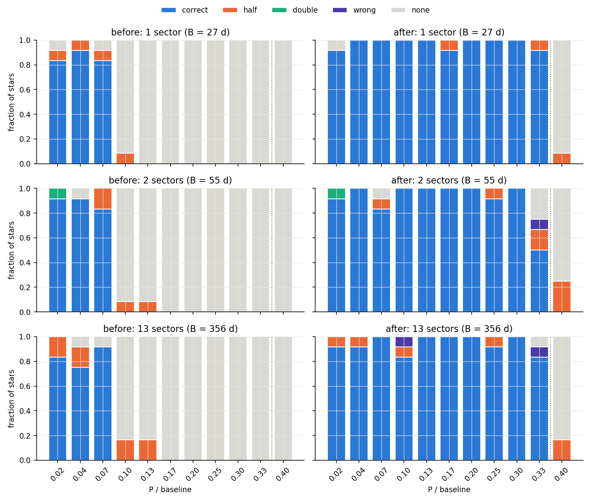
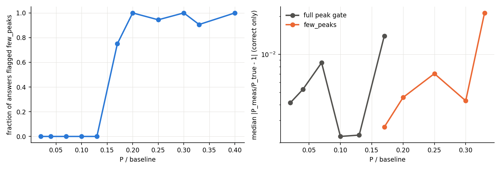
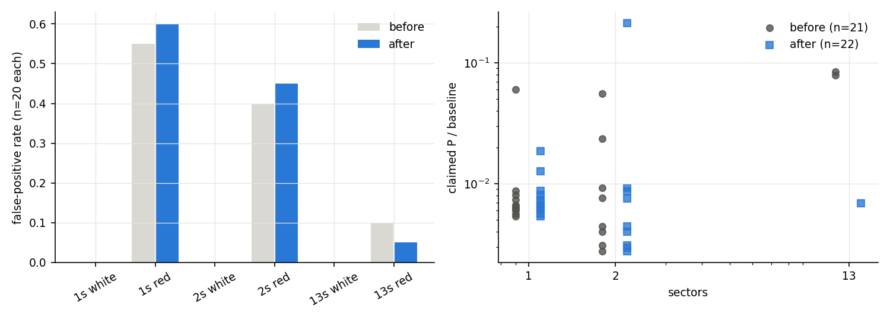
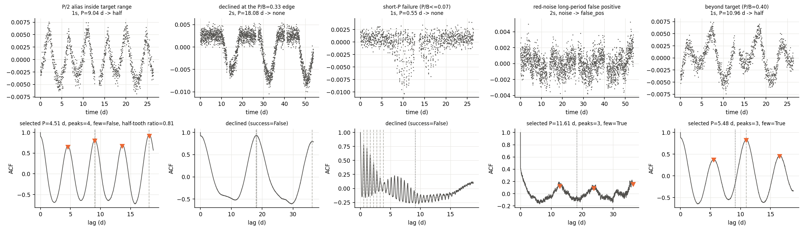

# ACF long-period limit: periods up to B/3 on 1-2 sector baselines

**Date:** 2026-10-13 · **Author:** Claude (side session of the T6/long-period thread) · **Branch:** `claude/angry-einstein-cb10da` · **Status:** draft

## TL;DR
- **The comb fit now returns periods up to ~B/3.** On the P/B scan (evaluation seeds, 252 stars at
  P/B 0.10–0.33, SNR 10), correct went **0.00 → 0.94** (0.976 / 0.917 / 0.940 for 1 / 2 / 13
  sectors). Before, every star above P/B ≈ 0.08 was declined.
- **No regression at short P/B; a small, flagged noise cost at long P.** At P/B ≤ 0.07, correct went
  0.861 → 0.944. White-noise false positives stayed at 0/60. Red-noise false positives went 21/60 → 22/60.
  21 of those are the existing ~0.2 d open-issue-10 kind. **One is a new long (11.6 d, 2-sector)
  few-peak false positive**, and the dev seeds had 3/30. Confidently-wrong answers on signal stars went
  0 → 3/396; two are P = B/3 edge measurements 11–12% off (just outside REL_TOL), flagged `few_peaks`.
- **`synthetic:n=200,seed=0` (13 sectors): success 0.670 → 0.725, no regression guard tripped.**
  The >30 d bin goes from 0 to 0.75, and 10–30 d from 0.698 to 0.767. No previously-correct star was lost. Wrong
  went 0.055 → 0.060 (3 new, 2 fixed) and declines went 0.24 → 0.185. `check_goals` still says FAIL, but only because
  of the pre-existing active goal G5 (pairwise_histogram crash, task T4). G7 misses 0.18 by one star.
- **Every relaxed answer is flagged.** `few_peaks` is set on 75–100% of answers at P/B ≥ 0.17 and on none at
  P/B ≤ 0.13. Few-peak answers were 160 correct / 6 P/2 alias / 2 wrong, with median |ΔP/P| = 0.0050
  (vs 0.0031 with the full peak gate).
- **Cost: runtime.** Median per star rose 1.6x on 1–2 sectors (1.58 → 2.55 s, 2.22 → 3.56 s), was unchanged on
  13 sectors, and rose 1.3x on synth200 (4.81 → 6.25 s). The cause is more teeth and candidates per fit; profiled, no single hotspot.
- **Deviations from the brief, each measured below:** (a) Stage 1 keeps the old B/3 ACF and only *adds*
  long-period candidates from the 0.7 B ACF. Feeding the long ACF straight to the guessers lost 6/34
  P < 1 d stars. (b) Three fixes not in the brief were required: the phase grid skips the trivial lag-0 tooth
  for unsaturated combs, a trailing run of decayed teeth is trimmed, outlier rejection can't
  drop below the required peak count, and an edge-clipped window's vertex is judged against its nominal bound. (c) The **sqrt(pair-count) weighting is implemented but measured as
  neutral**: identical outcomes with and without it.

## Question / goal
Rae's requirement: the ACF method should say something about periods up to ~1/3 of the baseline,
because most TESS stars have only 1–2 sectors. That's part of TASKS.md **T6**; it also moves G4 (10–30 d) and G1.
The brief's diagnosis: Stage 1 already lists the true P up to P/B = 0.33, so the loss is all in Stage 2.
`compute_acf` stopped at B/3, the n=0 tooth sits at ~P, and `min_peaks_required = 4` meant P ≤ B/12.
Rae accepted partial recovery and a higher P/2 rate at P/B 0.17–0.33, *if* such results are explicitly flagged.

## What I did
Test-first: `tests/test_long_period.py` was committed red (f2c06bc), then made green. It has 19 tests: lag range,
pair counts vs brute force, weighted-Jacobian finite-difference check, half-tooth ratio on synthetic
ACFs, tail trimming, two-view guessing, end-to-end 1-sector P = B/4 → CORRECT + `few_peaks`, pure
noise → declined, P/B ≤ 0.07 unchanged, and the new ML features.

Code changes (all in `claude_files/`, plus pipeline call sites):

| Change | Where | Why |
|---|---|---|
| `compute_acf` default `max_lag_frac` 1/3 → **0.7**; `return_counts=True` returns per-lag pair counts | `acf_utils.py` | The pair-coverage cut (`min_valid_frac = 0.3`) is now the real limit (~0.67 B with TESS gaps) |
| **Adaptive peak gate** `n_peaks_required = clamp(n_teeth_available, 2, min_peaks_required)`; `few_peaks`, `n_teeth_available`, `n_peaks_required` on `CandidateResult`, `few_peaks` on `EnsembleResult` | `comb_fit.fit_rotation_period` | Long periods have only 2–3 teeth in range |
| Residuals weighted by **sqrt(pair count / count[0])** (`acf_counts=`), analytic Jacobian scaled to match; model setup split into `_comb_model_setup` | `comb_fit._fit_comb_core` | ACF noise ∝ 1/sqrt(pairs) |
| **Factor-of-2 guard**: if a passing candidate sits at ~2x / ~0.5x the winner, the pair is decided by `_half_tooth_height_ratio` (interleaved vs shared tooth heights, McQuillan-style odd/even test on the shared lag range). The long P wins if the ratio < 0.7 | `comb_fit._resolve_factor2_aliases` | Raw redchi favours P/2 |
| **Lag-0 tooth skipped** in the t0 grid (start at P0/2) for unsaturated combs (< n_peaks genuine teeth in range) | `comb_fit._grid_search_t0` | See finding 1 below |
| **Trailing decayed teeth trimmed** (run of non-positive heights, keeping ≥ the required count) and refit | `comb_fit._fit_single_candidate` | See finding 2 |
| Few-peak regime: outlier rejection may not drop below the required count | `fit_rotation_period` | See finding 3 |
| Window clipped by the ACF's end: vertex gate uses its nominal upper bound (`PeakWindow.nominal_hi`) | `comb_fit._build_windows`, `_fit_single_candidate` | See finding 6 |
| **Two-view Stage 1**: guessers get the B/3 ACF (`STAGE1_MAX_LAG_FRAC`); `two_view_guesses` / `gather_initial_guesses(long_view=)` add only candidates beyond the B/3 view's reach from the 0.7 B ACF | `guesses.py`, `acf_utils.py` | See finding 4 |
| Windows stride-decimated to ≤ 100 points (`max_points_per_window`) | `comb_fit._build_windows` | Speed. Profiled: SVD cost scales with points. 16-star check showed identical outcomes and \|ΔP/P\| < 1e-3 |
| ML features `n_teeth_available`, `n_peaks_required`, `few_peaks`, `P_over_lc_baseline`, `lc_baseline_days`, `half_tooth_ratio` (+ docs) | `ml_features.py`, `FEATURE_DOCUMENTATION.txt` | `n_peaks_used` was already a feature |
| Call sites pass counts and the two ACF views | `benchmarks/scorecard.py` (pipeline call only, **no metric changes**), `run_debug_baseline*.py`, `example_from_fits.py` | |

Benchmarks (synthetic only; the real debug set was not touched):
- New `benchmarks/pb_scan.py`: P set as a fraction of B ∈ {0.02 … 0.40} × {1, 2, 13} sectors, 12 LCs
  per cell (SNR 10, 1–3 spots, spot lifetime ∞ or 3P, shear 0), plus 40 noise-only LCs per baseline
  (20 white, 20 white + AR(1) red), so 120 noise LCs total. **Before** = the base commit 4896568 run from a
  `git archive` snapshot. **After** = this branch.
- `scorecard.py --synthetic 200 --seed 0`, before (base snapshot) vs after, graded with `check_goals.py --baseline`.
- All tuning and leave-one-out ablations used a separate seed set (`pb_scan.py --seed-offset 500`,
  6 LCs/cell, 20 noise/baseline). The evaluation seeds were only used for before/after.

## Results

### Recovery vs P/B

Left: before, where everything past P/B ≈ 0.08 is declined (gray). Right: after, where correct (blue) extends to 0.33.
The weakest cell is **P/B 0.33 on 2 sectors** (6/12 correct; 1 and 13 sectors: 11/12 and 10/12): there 2P sits
on the ACF's coverage edge (~0.67 B). P/B 0.40 is beyond reach by construction: declined, except
6/36 P/2 aliases (flagged `few_peaks`).

| | before | after |
|---|---|---|
| correct, P/B ≤ 0.07 (n=108) | 0.861 | 0.944 |
| correct, P/B 0.10–0.33 (n=252) | 0.000 | 0.944 |
| P/2 alias, P/B 0.10–0.33 | 0.028 | 0.028 |
| wrong, all signal stars (n=396) | 0 | 3 |
| noise FP, white (n=60) | 0/60 | 0/60 |
| noise FP, red (n=60) | 21/60 | 22/60 (1 at P > 0.1 B, few_peaks) |

### The flag

Left: `few_peaks` switches on at P/B ≥ 0.17 and covers 75–100% of answers there. Right: few-peak answers are
slightly less precise (median |ΔP/P| 0.0050 vs 0.0031; 90th percentile 0.033 vs 0.026).

### Noise

False positives occur only with red noise. Almost all are at ~0.15–0.5 d, with counts essentially
unchanged: that's the existing open issue 10, not caused by this branch. **The new failure mode is a long
few-peak false positive on red noise**: 1/60 on evaluation seeds (11.6 d, 2 sectors), 3/30 on dev seeds (14,
16 d on 2 sectors, 72 d on 13). All are flagged `few_peaks` (see Open questions).

### synth200 regression check
```
goal  status  result  value    target   base  metric
G1    draft   FAIL    0.725 >= 0.75    0.670  final.overall.success
G2    draft   FAIL    0.647 >= 0.75    0.647  final.by_bin.<1d.success
G3    draft   FAIL    0.882 >= 0.94    0.882  union_recall.by_bin.<1d
G4    draft   FAIL    0.767 >= 0.82    0.698  final.by_bin.10-30d.success
G5    active  FAIL    0.260 <= 0.0     0.275  methods.pairwise_histogram.overall.error_rate
G6    draft   FAIL    0.060 <= 0.04    0.055  final.overall.wrong
G7    draft   FAIL    0.185 <= 0.18    0.240  final.overall.none

Regression guard (fail if a metric drops by more than its limit):
   base     new   delta  limit  metric
  0.670   0.725  +0.055  0.020  final.overall.success
  0.689   0.689  +0.000  0.060  final.by_bin.1-3d.success
  0.698   0.767  +0.070  0.060  final.by_bin.10-30d.success
  0.806   0.861  +0.056  0.060  final.by_bin.3-10d.success
  0.647   0.647  +0.000  0.060  final.by_bin.<1d.success
  0.000   0.750  +0.750  0.060  final.by_bin.>30d.success
  (union_recall.* all +0.000)
OVERALL: FAIL   <- only the pre-existing active G5
```
(full output: `data/check_goals_synth200.txt`.) Baseline here is a fresh run of the base commit, whose
outcomes reproduce `benchmarks/baselines/synth200_s0.json` exactly. Per-star transitions: 92/92 correct stay correct;
10 declined / half / wrong stars become success; 3 become wrong (`synth-s0-00096` diffrot → 0.27 d,
`00109` none → 3.6 d at SNR 1.0, `00122` none → 0.25 d at SNR 18). Two of them are the issue-10 ~0.25 d pattern.

### Ablation (dev seeds, final code, one option changed at a time)
| variant | correct P/B ≤ 0.07 | correct 0.10–0.33 | P/2 0.10–0.33 |
|---|---|---|---|
| before (base commit) | 0.833 | 0.000 | 0.032 |
| **final** | **0.944** | **0.968** | 0.024 |
| without pair-count weights | 0.944 | 0.968 | 0.024 |
| without factor-2 guard | 0.870 | 0.897 | 0.095 |
| without decayed-tail trim | 0.926 | 0.944 | 0.024 |
| guard threshold 0.6 | 0.944 | 0.960 | 0.032 |
| guard threshold 0.8 | 0.944 | 0.968 | 0.024 |

Red-noise long false positives on dev seeds are 3/30 in every variant (0 before), so they come from the
relaxed peak gate itself, not from any one of the options.

The factor-2 guard is the biggest single contributor: it cuts P/2 aliases 3x and also helps short P/B.
Trim helps a little. **Weighting changes nothing**: with it, outcomes are identical and median |ΔP/P| differed
in the 4th decimal on an earlier dev run.

### Runtime: this branch is slower on short baselines
Measured on a quiet machine (both runs back-to-back, 10 workers; the base commit was re-timed after an
earlier contaminated run, and its outcomes were verified identical). Median per star (Stage 1 + fit), P/B scan:
**1 sector 1.58 → 2.55 s, 2 sectors 2.22 → 3.56 s, 13 sectors 4.77 → 4.77 s**. synth200: **4.81 → 6.25 s/star**
(p90 6.32 → 8.33). Profile (cProfile, 8 one-sector stars, new vs old-style call): no single hotspot. Time is
spread across `least_squares` iterations, because each star now fits ~7% more candidates (the long-view
additions) and long candidates fit up to 8 teeth on the longer ACF instead of ~4, plus one refit when a decayed
tail is trimmed. Before window decimation (≤ 100 points per window), 13-sector fits were ~2.5x slower than
base; decimation removed that with no outcome change. Further speed-up (e.g. capping teeth per candidate,
skipping the long-view pass when Stage 1 already has a candidate near the same period) is left as a follow-up.

### Remaining failure modes

One representative per remaining failure type (first match on the evaluation seeds, re-simulated by the notebook).
(1) **Ambiguous double-dip, P/B 0.33, 1 sector → P/2.** The guard ran, but the half-tooth ratio is 0.81 (> 0.7):
the interleaved bumps are nearly as tall as the true ones, so the odd/even evidence is genuinely weak.
(2) **P/B 0.33 on 2 sectors → declined.** The second tooth (2P = 36 d) is at the ACF's coverage end.
(3) **Short P, 1 sector → declined.** The ACF decays within a few cycles (spot lifetime 3P), and this star was
declined before the change too. (4) **Red-noise long false positive (2 sectors, 11.6 d, `few_peaks`).** Note the
tiny comb heights (~0.1–0.2). That's the case for a height gate on few-peak answers (open question 3).
(5) **P/B 0.40 → P/2 (`few_peaks`).** The true period is beyond reach, and its half fits 3 teeth.

## Findings worth keeping (not in the brief)
1. **The lag-0 tooth.** `_grid_search_t0` searched t0 in [3 dt, 3 dt + P0), and comb_score almost always picks
   t0 ≈ 3 dt (ACF ≈ 1 there). So the n=0 window sat on the trivial lag-0 decay. With 8 teeth that is
   1 bad window in 8 (tolerated by `min_frac_vertex_in_window = 0.8`); with 2–4 teeth it biases P (7.58 vs
   6.85 d) and fails the vertex gate. But skipping it **everywhere** added 5 confidently-wrong ~0.2–0.5 d
   answers on low-SNR synth200 stars: **for short-period noise combs the lag-0 window acts as an implicit
   noise filter.** That is relevant to open issue 10 / T6. So the skip applies only to unsaturated combs
   (fewer than n_peaks genuine teeth in range).
2. **Spot evolution vs. the longer ACF.** With spot lifetime ~3P, ACF peaks decay through zero by ~6P. On
   the old B/3 ACF the comb never reached them. On the 0.7 B ACF, the late negative teeth sank
   `frac_positive_heights`, and 7 P/B ≤ 0.07 stars flipped correct → none. Trimming the trailing decayed run fixes it.
3. **MAD rejection over 3 windows is meaningless**: two near-identical window RMS values give MAD ≈ 0 and the
   third, genuine peak gets rejected. That cost clean P ≈ B/6 stars on 13 sectors (0.75 → 1.00 after the fix).
6. **Edge-clipped windows.** When a tooth lands right at the ACF's end, only its rising side is in range, so
   the fitted vertex legitimately falls past the data and failed the vertex gate. That cost 6/12 clean
   1-sector P = 0.17 B stars (4P = 0.68 B). Dropping such windows instead made P = B/3 unfittable (its 2nd
   tooth is always clipped). Judging the vertex against the window's nominal bound fixed both (1-sector
   0.17: 0.50 → 0.92 on a 12-star check).
4. **Stage 1 does not like the long ACF.** On the 0.7 B ACF, `guess_acf_fft`'s top-10 spectral peaks fill
   with low-frequency structure and drop short periods. That tripped the <1 d regression guard
   (0.647 → 0.559). But the B/3 view alone caps `acf_fft` at B/6, and at P/B 0.17 only Lomb-Scargle
   (5% off) proposes the period. Hence two views.
5. **Weighted outlier rejection hurts.** Weighted window RMS stops rejecting noisy long-lag windows, which then
   drag mean height SNR just under the 1.0 gate. Rejection stays unweighted (`weighted_rejection=False`).

## What didn't work
- `min_peaks_required = 3` floor (from the brief's diagnosis): nothing recovered beyond P/B 0.2. Hence the 2 floor.
- The long ACF for Stage 1 alone (finding 4) and the lag-0 skip everywhere (finding 1).
- Weighted rejection (finding 5); sqrt(pair-count) weighting itself is neutral.

## Open questions for Rae
1. **Keep the pair-count weighting?** It's principled and was in the brief, but measured neutral on every
   benchmark here. It is on by default when callers pass `acf_counts`. Turning it off would simplify the fit slightly.
2. **Factor-2 guard threshold (0.7).** 0.7 and 0.8 tie on dev seeds; 0.6 is slightly worse. Clean double-dip
   stars with ratio ~0.8 still go to P/2 (failure panel 1). `half_tooth_ratio` is exported as an ML
   feature so the ranker can learn its own threshold. Is a hand-tuned rule wanted at all, long term?
3. **Few-peak noise guard.** Red noise yields long few-peak false positives: 1/60 eval, 3/30 dev. In an
   earlier configuration, two such cases had raw ACF peak heights 0.08–0.43 and PDM θ 0.73–0.78, vs
   0.6–0.97 and 0.13–0.56 for true few-peak detections. A height or θ gate for `few_peaks` candidates would
   likely remove them. I didn't add one because it's a tuned threshold on few examples (proposed as P3 in
   TASKS.md). Want one, or leave it to the ranker? Note that `few_peaks` is already exported.
4. **P/B = 0.33 edge.** With `min_valid_frac = 0.3`, the ACF ends at ~0.67 B, so 2P at P = B/3 is on
   the edge. Correct there: 11/12, 6/12, 10/12 for 1 / 2 / 13 sectors, and the two "wrong" answers are 11–12% off.
   Lowering `min_valid_frac` to ~0.25 would push the edge out, at the price of noisier long lags. Worth trying?
5. **`baseline_days` / `period_frac_of_baseline` features** are relative to the ACF *lag range*, so their scale
   changed with this branch. I added `lc_baseline_days` / `P_over_lc_baseline` and left the old ones. Delete the old ones?
6. `guess_acf_fft_highpass` still computes its own ACF at `max_lag_frac = 1/3` (unchanged, out of scope).
7. `benchmarks/pb_scan.py` could become a standard benchmark with its own goal (e.g. "correct ≥ 0.8 at
   P/B 0.10–0.30 on 1–2 sectors, noise FP unchanged"). Proposed, not added to goals.json.

## Reproduce
```bash
# tests
/opt/anaconda3/envs/ss_local/bin/python -m pytest -q
# before = base commit snapshot
git archive 4896568 claude_files benchmarks | tar -x -C /tmp/before && cp benchmarks/pb_scan.py /tmp/before/benchmarks/
/opt/anaconda3/envs/ss_local/bin/python /tmp/before/benchmarks/pb_scan.py --outdir runs/pb_scan_before
/opt/anaconda3/envs/ss_local/bin/python /tmp/before/benchmarks/scorecard.py --synthetic 200 --seed 0 --outdir runs/synth200_before
# after
/opt/anaconda3/envs/ss_local/bin/python benchmarks/pb_scan.py --outdir runs/pb_scan_after
/opt/anaconda3/envs/ss_local/bin/python benchmarks/scorecard.py --synthetic 200 --seed 0 --outdir runs/synth200_after
/opt/anaconda3/envs/ss_local/bin/python benchmarks/check_goals.py runs/synth200_after/metrics.json --baseline runs/synth200_before/metrics.json
# dev-seed ablation (one per variant), e.g.
/opt/anaconda3/envs/ss_local/bin/python benchmarks/pb_scan.py --outdir runs/dev_noguard --n-per-cell 6 --n-noise 20 --seed-offset 500 --fit-kwargs '{"alias_guard": false}'
# figures
cd reports/2026-10-13_acf-long-period-limit && /opt/anaconda3/envs/ss_local/bin/python build_notebook.py && cd ../.. \
  && /opt/anaconda3/envs/ss_local/bin/python tools/run_notebook.py reports/2026-10-13_acf-long-period-limit/notebook.ipynb
```
