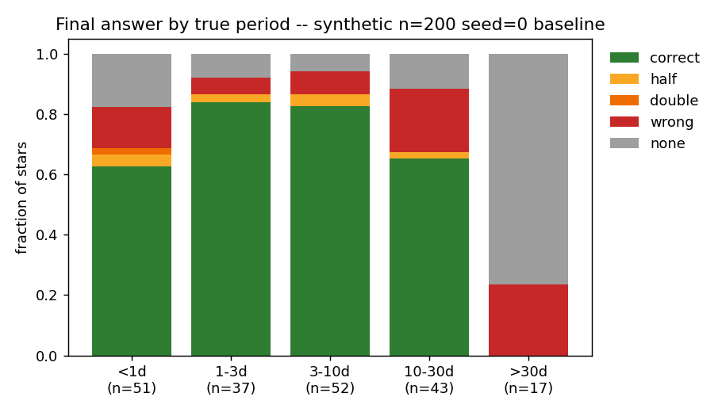
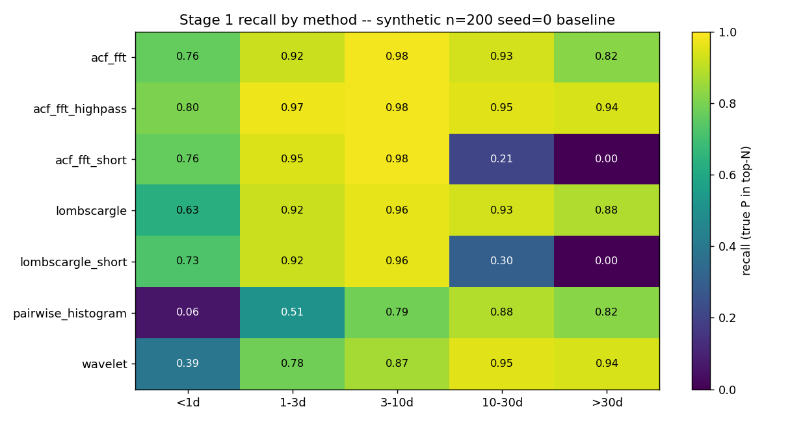
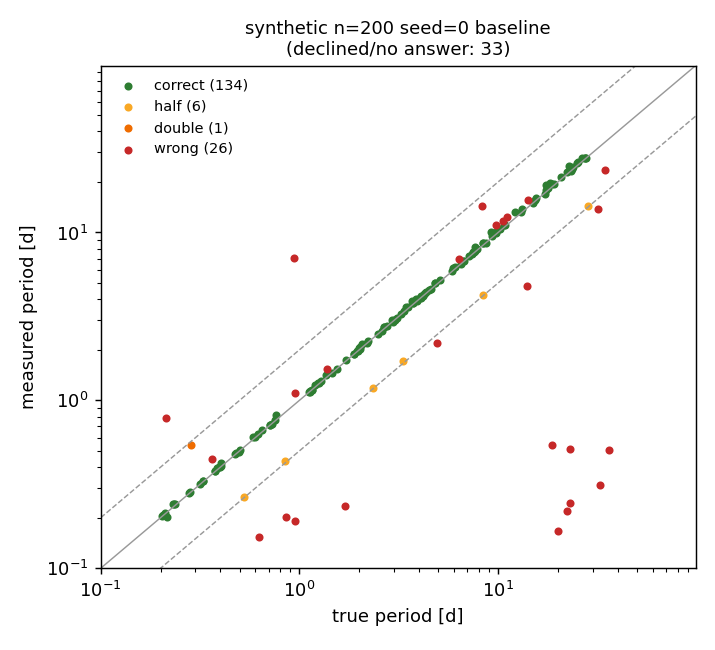
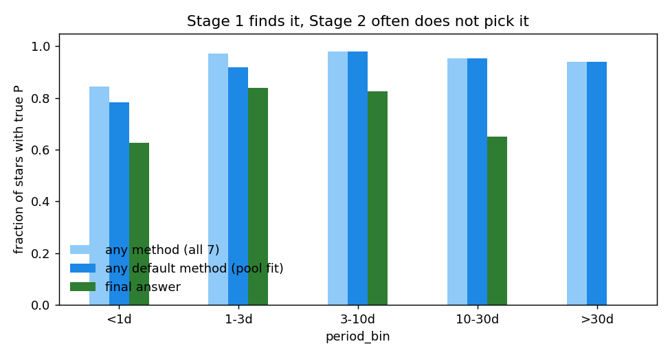
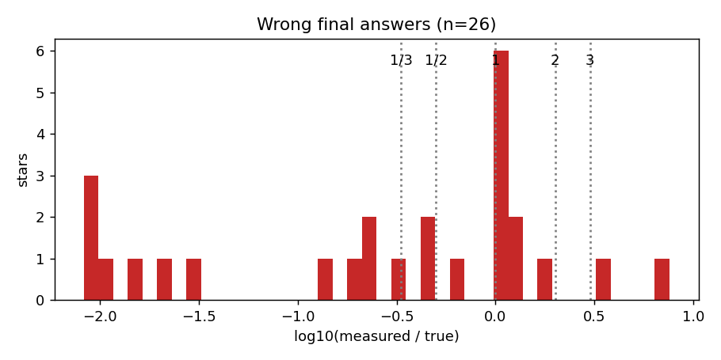
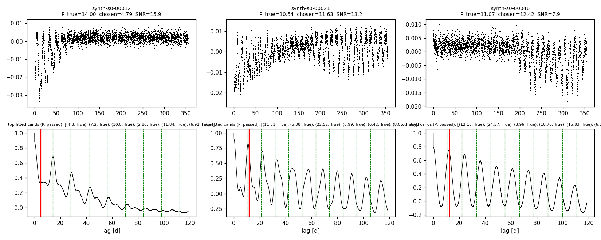

# Phase 0: synthetic baseline scorecard

**Date:** 2026-10-13 · **Author:** Claude (setup session with Rae) · **Branch:** main · **Status:** superseded by `reports/2026-10-13_synthetic-baseline-v2-diffrot/` (new synthetic population + diffrot-aware scoring; numbers below are not comparable)

## TL;DR
- On 200 synthetic stars (P = 0.2–40 d, SMARTS-length 356 d baseline), the current pipeline gets
  **67% correct, 3.5% alias (P/2 or 2P), 13% wrong, 16.5% declined** (REL_TOL = 0.10).
- **Stage 1 is not the main bottleneck. Arbitration is.** Some candidate method lists the true
  period for 84–98% of stars in every bin, but the final answer is correct for only 63–84%. In
  10–30 d, recall is 0.95 and final correctness is 0.65 (Fig. 4). This is the case for the ranking model.
- Two specific failure modes among the 26 wrong answers:
  1. **7 stars measured at 1.10–1.16 × P_true**, nearly all with strong differential rotation in
     the synthetic model. This is a *labeling* question (equatorial vs spot-latitude period), not
     clearly a pipeline bug. See Open questions.
  2. **7 low-SNR (1.1–2.6), long-period (18–36 d) stars where the pipeline confidently reports
     a period ~100× too short** (0.17–0.54 d) instead of declining. The reliability gates let noise
     through. This is a false-positive mode affecting goal G6.
- `guess_pairwise_histogram` raises on **18%** of stars (open issue 8, now goal G5 / task T4).
- Nothing above 30 d is recovered (0/17). 76% decline, which is the baseline limit (comb fit
  needs ≥ 4 ACF peaks inside 1/3 of the baseline, so P ≲ 30 d for 356 d).

## Question / goal
Phase 0 (task T0): build the test and benchmark infrastructure, and measure where the pipeline stands
on data with known periods, so later agent work has a baseline to beat.

## What I did
- Built `claude_files/evaluation.py` (scoring convention), `claude_files/synthetic.py` (spotted-star
  generator with TESS-like gaps), `tests/` (64 tests, ~5 s), `benchmarks/scorecard.py`,
  `benchmarks/check_goals.py` and `benchmarks/goals.json`.
- Ran the scorecard on dataset `synthetic:n=200,seed=0` at commit `a5fa572` (plus the uncommitted
  Phase 0 files). Pipeline: default 3 methods pooled into `fit_rotation_period` with default
  settings; all 7 methods also scored individually. 158 s wall time on 10 workers; median 6.8 s per
  star with all 7 methods run (the production pipeline runs only 3).
- Saved the metrics as `benchmarks/baselines/synth200_s0.json`.

## Results


Final answer by period bin. Look at the red (wrong) slice in 10–30 d and the grey (declined) wall above 30 d.


Stage 1 recall (true P anywhere in the method's top-N list). `acf_fft_highpass` is the best single
method in every bin. `pairwise_histogram` is weak below 3 d (it errors on many of those stars).
The `_short` variants collapse above 10 d by design.


Note the band of red points just above the 1:1 line (differential rotation) and the red points at
the bottom right (long-P, low-SNR stars reported at ~0.2–0.5 d).


**The key figure.** The middle bar is the fair ceiling for Stage 2: the true P is in the candidate
pool it actually fits. The gap between the middle and green bars is what better arbitration could
recover. Above 30 d the gap is entirely from the baseline limit.

| period bin | n | correct | half | double | wrong | declined | any-method recall |
|---|---|---|---|---|---|---|---|
| <1d | 51 | 0.63 | 0.04 | 0.02 | 0.14 | 0.18 | 0.84 |
| 1-3d | 37 | 0.84 | 0.03 | 0.00 | 0.05 | 0.08 | 0.97 |
| 3-10d | 52 | 0.83 | 0.04 | 0.00 | 0.08 | 0.06 | 0.98 |
| 10-30d | 43 | 0.65 | 0.02 | 0.00 | 0.21 | 0.12 | 0.95 |
| >30d | 17 | 0.00 | 0.00 | 0.00 | 0.24 | 0.76 | 0.94 |


Wrong answers are not mostly near-miss harmonics. They form two clusters: just above 1 (differential
rotation) and about 1/100 (noise accepted as signal).


Three 10–30 d stars where the true P was in the pool but not chosen. The left star chose ~P/3 (an
evolving spot plus early large-amplitude dips). The middle and right stars chose a period 10–12% long
that matches the ACF peaks better than the green "true" lines do, because the dominant spots sit at
latitudes that rotate slower than the equator.

## What didn't work
- Long-period synthetic stars on a short (2-sector) baseline all decline. That's expected from the
  ≥ 4 peaks in 1/3 baseline requirement, but it means **synthetic suites must use SMARTS-length
  baselines** (now the `make_suite` default).
- `jupyter nbconvert --execute` fails on this machine because of a stale
  `/usr/local/etc/jupyter/jupyter_nbconvert_config.json` referencing an uninstalled
  extension. Worked around with `tools/run_notebook.py` (nbclient) rather than editing system config.

## Open questions for Rae
1. **What is the "true" period under differential rotation?** How does SMARTS define `PERIOD` in
   its headers (equatorial, or the period of the injected spots)? What shear range does it inject?
   If SMARTS labels are equatorial with comparable shear, some fraction of "wrong" answers on real
   data will be this ambiguity, and we may want either a looser correct window for high-shear stars
   or a "differential-rotation" outcome. For now `synthetic.py` uses shear 0–0.2, and the 7 stars
   count as wrong.
2. **Are the draft goals in `benchmarks/goals.json` the right targets?** I set G1–G4 and G6 a
   modest step above baseline, and G5 (pairwise_histogram never raises) as the only active goal.
   Promote, edit or replace them as you see fit.
3. **Should improving Stage 2 arbitration wait for the ML ranker?** The 10–30 d gap might also
   yield to a simple hand-tuned change, e.g. preferring candidates with more cross-method support,
   which PROJECT_CONTEXT already identifies as a strong signal. This could be a quick task before T11.
4. The low-SNR "confident noise" failure suggests the gates (n_peaks, frac_positive_heights,
   height SNR, vertex-in-window) don't scale with the light curve's noise level at short lags.
   I added it to T6. Agree?

## Reproduce
```bash
/opt/anaconda3/envs/ss_local/bin/python benchmarks/scorecard.py --synthetic 200 --seed 0 --outdir runs/synth200_s0_baseline --label "synthetic n=200 baseline"
```
```bash
/opt/anaconda3/envs/ss_local/bin/python benchmarks/check_goals.py runs/synth200_s0_baseline/metrics.json --baseline benchmarks/baselines/synth200_s0.json
```
```bash
/opt/anaconda3/envs/ss_local/bin/python tools/run_notebook.py reports/2026-10-13_phase0-synthetic-baseline/notebook.ipynb
```
