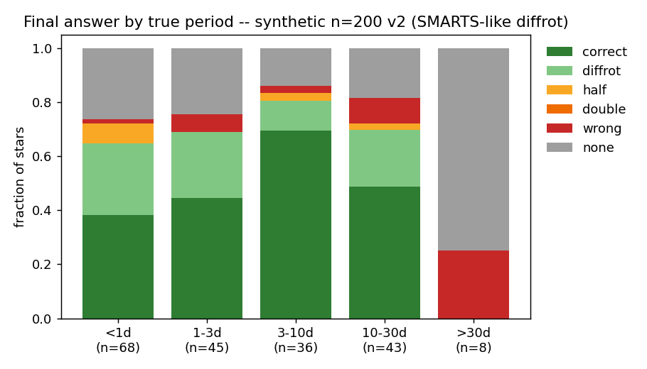
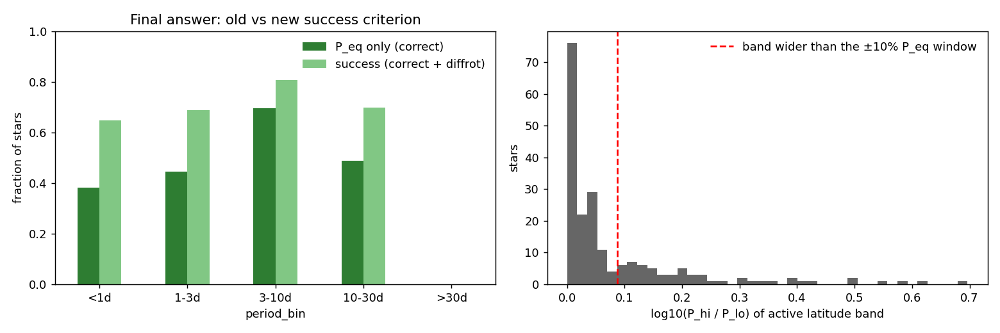
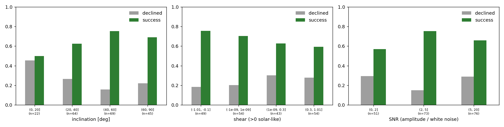
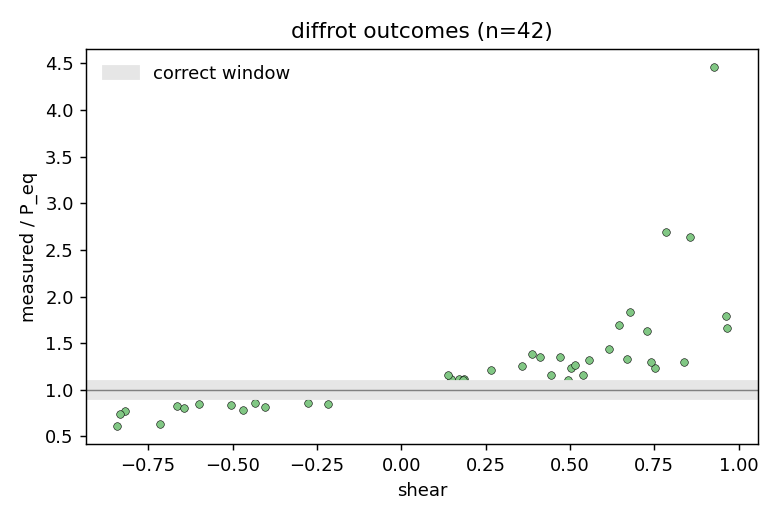
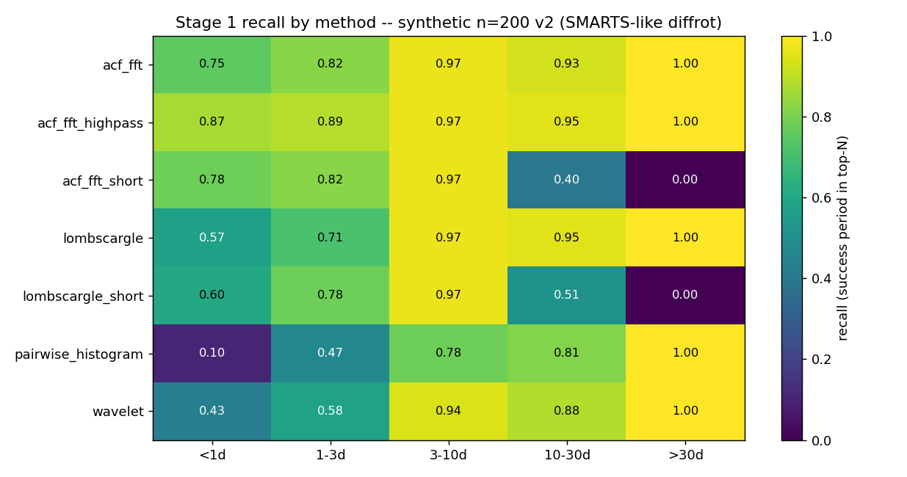

# Synthetic baseline v2: SMARTS-like differential rotation and diffrot-aware scoring

**Date:** 2026-10-13 · **Author:** Claude (setup session with Rae) · **Branch:** main · **Status:** draft

## TL;DR
- Scoring now counts a measured **spot-latitude period as success** (Rae's decision). The new
  `diffrot` outcome covers any period within 10% of the range P_eq / (1 − shear·sin²λ) over the
  star's active latitude band (SMARTS `MINLAT`–`MAXLAT`).
- The synthetic population now uses SMARTS's shear mixture (50% solar-like, 25% solid-body,
  25% anti-solar, |shear| up to 1), latitude bands and inclination distribution.
- New baseline on `synthetic:n=200,seed=0`: **67% success = 46% correct + 21% diffrot**, plus
  3.5% alias, 5.5% wrong and 24% declined. Under the old P_eq-only rule, the same run would score
  46%, so **a fifth of stars measure a real spot-latitude period that the old rule called failure**.
- **52% of stars have a band reaching beyond ±10% of P_eq.** Differential rotation is the norm in
  SMARTS, not an edge case.
- **Declines are now the biggest loss (24%), and the robustness target.** Some are legitimate
  (45% for near pole-on stars). But stars with strong signals (SNR 5–20) are declined as often as
  SNR < 2 (29% each), and solar-like shear > 0.3 raises declines to 28% versus 18% for anti-solar.
  Signals that are strong but not strictly periodic get rejected by the reliability gates. New
  draft goal G7.
- Wrong answers dropped from 13% to 5.5%. Most of v1's "wrong" were differential rotation.

## Question / goal
Rae asked to (1) keep a local reference of how SMARTS was generated, and (2) make success
criteria differential-rotation aware, so the tool is pushed to measure *whatever physical period
is measurable* rather than P_eq only. Detecting and measuring differential rotation itself is
logged separately as future feature F1 in `docs/TASKS.md`.

## What I did
- `docs/SMARTS_REFERENCE.md`: parameter table, FITS keys, latitude rules, noise model.
  Cross-checked against Claytor+2022, butterpy's 2021 source and 10,000 real SMARTS headers in
  `results_products/batch1/summary.csv`. **Found that the paper's printed Eq. 1 has the wrong
  shear sign.** butterpy's code uses ω = ω_eq(1 − shear·sin²λ), so shear > 0 is solar-like.
- `claude_files/evaluation.py`: `latitude_period`, `active_band_period_range`, `DIFFROT`
  outcome, and a `success` metric. Precedence: correct > diffrot > half/double > wrong.
- `claude_files/synthetic.py`: SMARTS shear mixture, spot latitudes uniform within a
  [MINLAT, MAXLAT] band, inclination uniform in sin²i. Periods stay log-uniform 0.2–40 d on purpose.
- `benchmarks/scorecard.py` v2: carries the band range per star (synthetic params, or FITS
  `DIFFROT`/`MINLAT`/`MAXLAT`). Method recall and union recall now count success.
- Re-baselined (`benchmarks/baselines/synth200_s0.json`; the old one is kept as
  `synth200_s0_v1_scorecard1.json`) and re-targeted `goals.json` on `success`.
- 6 new tests (68 pass, 2 known xfails), including one pinning the butterpy sign convention.

## Results


Light green is `diffrot`: a successful measurement of a spot-latitude period. Grey (declined) is now the largest non-success slice in every bin.


Left: the same run scored P_eq-only versus success. Right: the active-band width distribution. 29% of stars
have a band wider than the ±10% window itself (right of the red line); 52% have a band that reaches
outside the window around P_eq.

| period bin | n | success | correct | diffrot | half | double | wrong | declined | Stage-1 recall |
|---|---|---|---|---|---|---|---|---|---|
| <1d | 68 | 0.65 | 0.38 | 0.26 | 0.07 | 0.00 | 0.01 | 0.26 | 0.88 |
| 1-3d | 45 | 0.69 | 0.44 | 0.24 | 0.00 | 0.00 | 0.07 | 0.24 | 0.89 |
| 3-10d | 36 | 0.81 | 0.69 | 0.11 | 0.03 | 0.00 | 0.03 | 0.14 | 0.97 |
| 10-30d | 43 | 0.70 | 0.49 | 0.21 | 0.02 | 0.00 | 0.09 | 0.19 | 0.98 |
| >30d | 8 | 0.00 | 0.00 | 0.00 | 0.00 | 0.00 | 0.25 | 0.75 | 1.00 |


Decline (grey) and success (green) rates versus inclination, shear and SNR. Note the high-SNR bin and the solar-like-shear bins.


Sanity check of the sign convention: solar-like shear gives measured periods above P_eq, anti-solar
below, with no exceptions. The outlier at 4.5× P_eq (shear 0.93) shows how wide the band can get.


Stage 1 (success-period recall) is still strong everywhere except `pairwise_histogram`, which now
raises on 27.5% of stars (G5 / T4).

## What didn't work / caveats
- **The v1 and v2 baselines are not comparable.** The synthetic population changed (shear,
  latitudes, inclination), so the 67% → 67% headline is a coincidence, not "no change".
- The band uses SMARTS's *average*-latitude bounds, not butterpy's ±7° spillover, and not a
  flux weighting. It's a deliberately simple, reproducible definition. See open question 1.
- The synthetic star has 1–3 static or Gaussian-envelope spots placed uniformly in the band, with
  no butterfly drift, activity cycle or emergence-rate model. SMARTS stars carry many spots evolving
  through cycles, so the diffrot signal in SMARTS will be messier (task T3).

## Open questions for Rae
1. **How permissive should the diffrot window be?** For shear near +1 and high-latitude bands,
   P_hi can be many times P_eq (one star here succeeded at 4.5× P_eq). Options: keep it as is
   (physically defensible), cap the band (e.g. P_hi ≤ 2 P_eq), or weight latitudes by visible spot
   flux. As is, very high-shear stars become easier to "succeed" on.
2. **Should near pole-on stars be excluded from decline goals?** At i < 20° there is little
   rotational modulation, so declining is the right answer. G7 currently counts all declines.
3. **ML training labels** still use P_eq only, so a correct spot-latitude period gets label 0. I've
   proposed a graded relevance label (2 = P_eq, 1 = band, 0 = other) in TASKS.md T10. Your call.
4. Synthetic periods stay log-uniform 0.2–40 d rather than SMARTS's uniform 0.1–180 d, to focus on
   the measurable regime. Agree?

## Reproduce
```bash
/opt/anaconda3/envs/ss_local/bin/python benchmarks/scorecard.py --synthetic 200 --seed 0 --outdir runs/synth200_s0_v2 --label "synthetic n=200 v2 (SMARTS-like diffrot)"
```
```bash
/opt/anaconda3/envs/ss_local/bin/python benchmarks/check_goals.py runs/synth200_s0_v2/metrics.json --baseline benchmarks/baselines/synth200_s0.json
```
```bash
/opt/anaconda3/envs/ss_local/bin/python tools/run_notebook.py reports/2026-10-13_synthetic-baseline-v2-diffrot/notebook.ipynb
```
