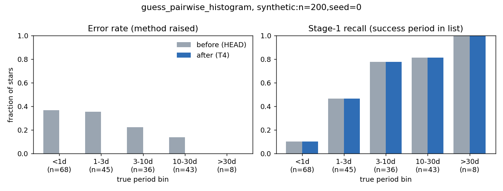
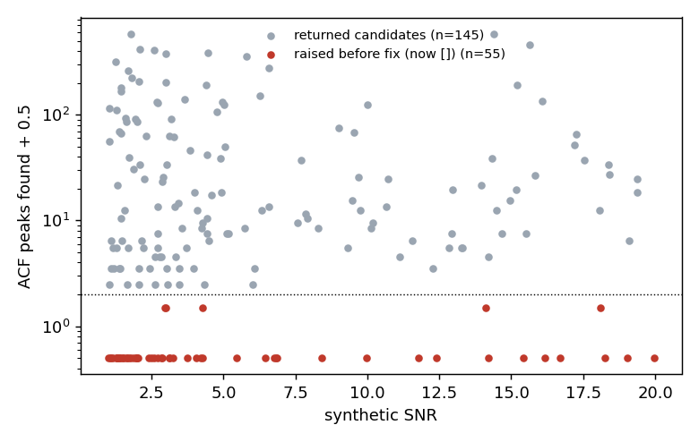
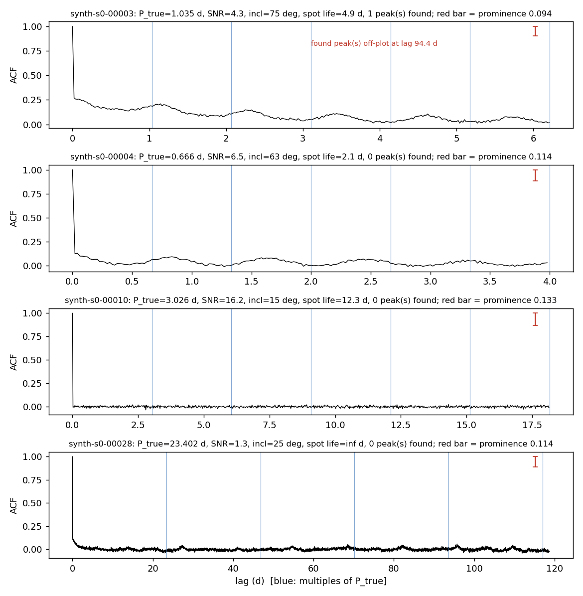

# T4: guess_pairwise_histogram returns [] instead of raising

**Date:** 2026-10-13 · **Author:** method-improver agent (Claude Code session) · **Branch:** `claude/t4-pairwise-histogram-49d342` · **Status:** draft

## TL;DR
- `guess_pairwise_histogram` now returns `[]` instead of raising `RuntimeError`. On
  `synthetic:n=200,seed=0` its error rate went **0.275 → 0.000** (55/200 stars
  → 0). **G5 passes**, and no regression guard trips.
- **The final-answer outcome table is identical**: 200/200 stars have the same
  outcome before and after, and the pooled candidate count matches for every
  star. That was expected, because the scorecard and `gather_initial_guesses`
  already caught the exception. The method's Stage-1 recall is also unchanged
  in every period bin.
- I also fixed the function's other degenerate exits. An empty
  `min_period`/`max_period` window used to raise. Fewer than 3 ACF lags used to
  crash with an `IndexError`/NaN. Exactly 2 peaks with an explicit
  `n_hist_bins` gave zero-width bins.
- All 55 stars that raised had 0 or 1 ACF peaks above the adaptive prominence
  threshold. Their causes were low SNR, nearly pole-on inclination, or short spot
  lifetimes (Figure 2). Returning `[]` is the right behavior for these stars.
  Some of them could still be recovered with a lower prominence, which I've
  listed as a follow-up below.

## Question / goal
This is task **T4** in `docs/TASKS.md` and PROJECT_CONTEXT open issue 8. The
aim was for `guess_pairwise_histogram` to return `[]` rather than raise when it
finds fewer than 2 ACF peaks. Active goal **G5**
(`methods.pairwise_histogram.overall.error_rate <= 0`) must pass with no
regression guard tripped.

## What I did
1. **Read the code.** `guess_pairwise_histogram` had two explicit
   `raise RuntimeError` exits: fewer than 2 peaks, and no spacings left after
   the period cut. It also had two implicit crash paths: fewer than 3 lags
   (giving `np.median([])` and `acf_lags[-1]`), and `n_hist_bins` combined with
   identical spacings, which gave `bin_width = 0` and a divide by zero.
2. **Wrote tests first.** I removed the two strict-xfail entries from
   `tests/test_guesses.py::KNOWN_FAILURES`, which is now `{}`. I also added two
   new tests: `test_pairwise_histogram_degenerate_inputs_return_empty` and
   `test_pairwise_histogram_two_peaks_with_explicit_bins`. On the unmodified
   `HEAD` code, all 4 of these tests fail. With the fix, all of them pass.
3. **Changed the code** (`claude_files/guesses.py`). Every early exit now
   returns `[]`. Zero-width bins fall back to the default `4*dt`. The docstring's
   Returns section now lists when the function returns `[]`. The ranking and
   candidate logic are untouched.
4. **Checked the callers.**
   - `gather_initial_guesses` extends the list, so an empty list adds nothing.
   - `batch_test_guesses.py` already has an `if not groups:` branch that writes
     a zero-candidate summary row.
   - `benchmarks/scorecard.py` handles an empty list in
     `ev.best_outcome([])` (returns `none`) and guards `out[0]`.

   None of them needed changes.
5. **Benchmarked** on `synthetic:n=200,seed=0` with 5 workers per run, two runs
   in parallel:
   - "before" ran from a `git archive HEAD` export (clean 4896568) into
     `runs/t4_before`. I first started it from the worktree but killed it,
     because my edit might have landed mid-run.
   - "after" ran from this branch into `runs/t4_after`.

   `runs/t4_before` reproduces the committed baseline exactly (every regression
   metric delta is +0.000, and G5 fails at 0.275).

## Results

**check_goals: after vs the committed baseline** (`benchmarks/baselines/synth200_s0.json`), which is what the brief asked for:
```
goal  status  result  value    target   base  metric
G1    draft   FAIL    0.670 >= 0.75    0.670  final.overall.success
G2    draft   FAIL    0.647 >= 0.75    0.647  final.by_bin.<1d.success
G3    draft   FAIL    0.882 >= 0.94    0.882  union_recall.by_bin.<1d
G4    draft   FAIL    0.698 >= 0.82    0.698  final.by_bin.10-30d.success
G5    active  PASS    0.000 <= 0.0     0.275  methods.pairwise_histogram.overall.error_rate
G6    draft   FAIL    0.055 <= 0.04    0.055  final.overall.wrong
G7    draft   FAIL    0.240 <= 0.18    0.240  final.overall.none

Regression guard (fail if a metric drops by more than its limit):
   base     new   delta  limit  metric
  0.670   0.670  +0.000  0.020  final.overall.success
  0.689   0.689  +0.000  0.060  final.by_bin.1-3d.success
  0.698   0.698  +0.000  0.060  final.by_bin.10-30d.success
  0.806   0.806  +0.000  0.060  final.by_bin.3-10d.success
  0.647   0.647  +0.000  0.060  final.by_bin.<1d.success
  0.000   0.000  +0.000  0.060  final.by_bin.>30d.success
  0.889   0.889  +0.000  0.060  union_recall.by_bin.1-3d
  0.977   0.977  +0.000  0.060  union_recall.by_bin.10-30d
  0.972   0.972  +0.000  0.060  union_recall.by_bin.3-10d
  0.882   0.882  +0.000  0.060  union_recall.by_bin.<1d
  1.000   1.000  +0.000  0.060  union_recall.by_bin.>30d

OVERALL: PASS
```
The check against my own `runs/t4_before` run gives the same table and also
reports `OVERALL: PASS`. Both full outputs are in
`data/check_goals_after_vs_*.txt`. The draft goals G1–G4, G6 and G7 fail before
and after, with identical values. They belong to other tasks.

**Final-answer outcome table (before → after).** The table is diagonal:
correct 92, diffrot 42, half 7, wrong 11, none 48. No star changed outcome.
`n_pooled` is identical for all 200 stars. 17 stars have final periods that
differ by at most 2.3e-4 relative. Because they had identical candidate input,
this looks like run-to-run floating-point noise in the fit; see the open
questions.

**Runtime.** Median per-star time was 11.28 s before and 11.36 s after. Median
`pairwise_histogram` call time was 3.3 ms in both runs. Neither change is
meaningful.


In the left panel the error rate goes to zero in every bin. Before the fix it
was worst below 3 days (37% and 36%). In the right panel recall is unchanged in
every bin. That is the expected result: a fix for crashes shouldn't change
recall.


Every star that raised (red) had 0 or 1 ACF peaks, and every other star had at
least 2. That matches the scorecard's error column exactly. Note that red stars
appear at every SNR, so low SNR is not the only cause.


Each panel shows one star per period bin. Blue lines mark multiples of P_true,
and the red bar shows the prominence threshold.
- **00003** (1.0 d): its small ACF bumps sit below the threshold. The single
  "peak" it found is noise at a lag of 94 d.
- **00004** (0.67 d): the spot lifetime is 2.1 d, about 3P, so the bumps are
  only about 0.05–0.08 high against a threshold of 0.11. Other methods still
  rescued this star (final outcome: diffrot).
- **00010** (3.0 d, SNR 16): inclination is 15°, nearly pole-on, so there is
  essentially no modulation. A flat ACF is correct here.
- **00028** (23 d): SNR is 1.3, so the ACF is noise.

## What didn't work
I made no failed attempts at the fix. One procedural note: my first "before"
scorecard run used the live worktree, and I killed it because my edit could
have reached its worker processes mid-run. I reran "before" from a clean
`git archive HEAD` export instead.

## Open questions for Rae
- **Recovering signal from the prominence threshold (follow-up, not done).**
  For stars like 00003 and 00004, the rotation bumps are visible by eye but sit
  below `5 × std(second difference)`. In other stars the same rule lets through
  hundreds of noise peaks: the median for non-raising stars is 15 peaks and the
  maximum is 585. The adaptive prominence therefore looks poorly calibrated in
  both directions. Possible fixes:
  - a smoothed-ACF second difference;
  - a prominence relative to the ACF's envelope;
  - retrying with a lower prominence when fewer than 2 peaks are found.

  Any of these is a method change that would affect recall, so I left it out of
  T4. It's a candidate "Proposed" task.
- **Run-to-run nondeterminism.** With identical inputs, 17/200 final periods
  differed by up to 2.3e-4 relative. That's harmless for scoring at
  REL_TOL=0.10, but it means scorecards aren't bit-reproducible. Likely causes
  are BLAS threading or optimizer tolerance, but I haven't verified that. Is
  this worth pinning down, for example by setting `OMP_NUM_THREADS=1` in the
  scorecard workers?
- **Same pattern in other methods.** `guess_lombscargle`, `guess_acf_fft` and
  `guess_wavelet` still `raise RuntimeError` on degenerate input (guesses.py,
  around lines 380, 510 and 1000–1030). Their tests don't currently trigger
  those exits, because none of them are in `KNOWN_FAILURES`. The test
  docstring's contract ("Returning [] is fine; raising is not") suggests they
  should get the same treatment. I left them alone because they're outside
  T4's scope.
- **Commit hash in `runs/t4_before`.** Because that run came from a non-git
  export, its `metrics.json` records `commit: unknown`. The code was exactly
  `HEAD` = 4896568.

## Reproduce
```bash
# tests
/opt/anaconda3/envs/ss_local/bin/python -m pytest -q
# before (clean HEAD export) and after scorecards
mkdir -p /tmp/t4_head && git archive 4896568 | tar -x -C /tmp/t4_head
(cd /tmp/t4_head && /opt/anaconda3/envs/ss_local/bin/python benchmarks/scorecard.py --synthetic 200 --seed 0 --outdir "$OLDPWD/runs/t4_before")
/opt/anaconda3/envs/ss_local/bin/python benchmarks/scorecard.py --synthetic 200 --seed 0 --outdir runs/t4_after
/opt/anaconda3/envs/ss_local/bin/python benchmarks/check_goals.py runs/t4_after/metrics.json --baseline benchmarks/baselines/synth200_s0.json
/opt/anaconda3/envs/ss_local/bin/python benchmarks/check_goals.py runs/t4_after/metrics.json --baseline runs/t4_before/metrics.json
# report data + notebook
/opt/anaconda3/envs/ss_local/bin/python reports/2026-10-13_t4-pairwise-histogram-no-raise/make_data.py
/opt/anaconda3/envs/ss_local/bin/python tools/run_notebook.py reports/2026-10-13_t4-pairwise-histogram-no-raise/notebook.ipynb
```
