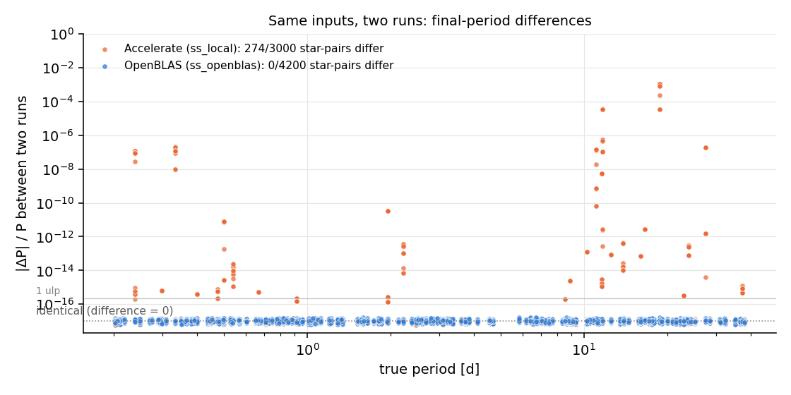
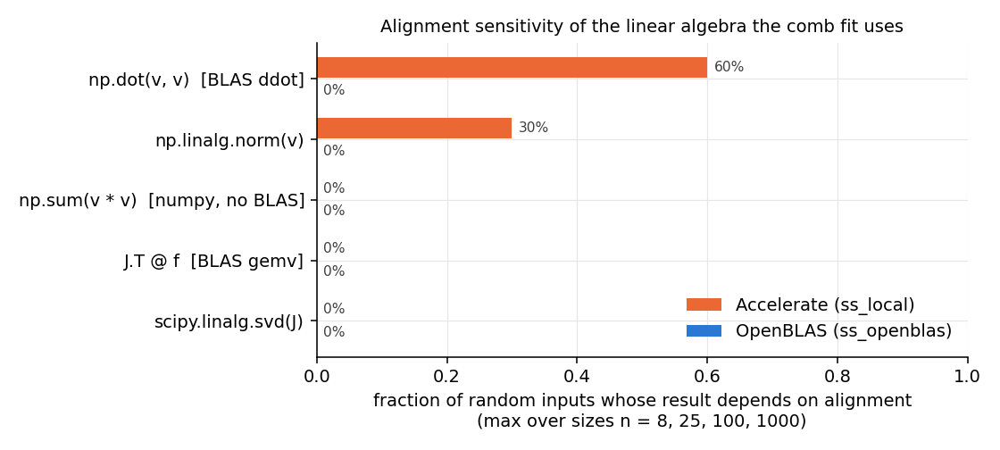
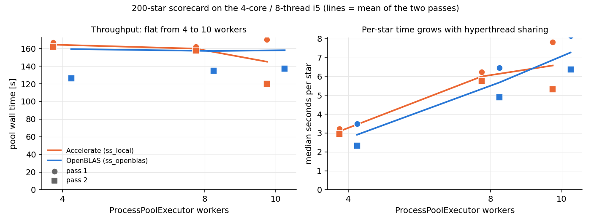

# T14: bit-reproducible scorecards

**Date:** 2026-10-14 · **Author:** method-improver agent (T14 session) · **Branch:** `claude/t14-determinism-18ba05` · **Status:** draft

## TL;DR
- **Cause.** The variation came from Apple Accelerate, not from threads, scheduling or randomness. Its `ddot` (what `np.dot` and `np.linalg.norm` call on 1-D float64) gives last-bit results that depend on where the array sits in memory. This happens for 52–60% of random vectors (n ≥ 25), and thread count makes no difference.
  - `scipy.optimize.least_squares` takes such norms on every iteration. Identical inputs therefore followed different iteration paths (42–80 function evaluations for one input) and stopped at different periods.
  - This happened even between two calls in the same process.
- **Fix.** A new env, `ss_openblas` (numpy/scipy on OpenBLAS; `environment.yml`, approved by Rae), plus BLAS pinned to 1 thread per process in the scorecard and all four batch runners (`claude_files/determinism.py`). This deviates from the brief's expectation: thread pinning alone (`VECLIB_MAXIMUM_THREADS=1`) was tested and **does not** fix it on Accelerate.
- **Evidence (synthetic n=200 seed 0).**
  - **After:** 21 pairs of runs (4/8/10 workers, two passes, plus one same-config repeat), and **0/200 final periods differ in every pair**. Every Stage-1 method's candidates also match exactly, except one star's `wavelet` top-1 at ~2e-11 relative (open question 2).
  - **Before (Accelerate):** 16–20 of 200 stars differ in every pair.
  - `check_goals` against `synth200_s0.json`: all regression deltas are +0.000, OVERALL PASS, and outcomes are identical star by star.
- **Runtime.** There is no measurable difference between backends, or between 4, 8 and 10 workers, on this 4-core/8-thread i5. Means are 145–164 s per 200 stars, and the same config varied by up to 66 s between passes.
  - New default: **one worker per physical performance core** (4 here, 10 on a 10P+4E Apple Silicon chip), replacing the hardcoded 10.
  - **Determinism must be re-verified on Apple Silicon**: numpy/scipy's arm64 PyPI wheels use Accelerate again.

## Question / goal
Task **T14** in `docs/TASKS.md`, from the T4 report's open question 2. Two scorecard runs on identical inputs gave final periods differing by up to 2.3e-4 relative, on 17 of 200 stars. Goal: identical results across runs, locked in by a test. This also unblocks T12's exact output-equivalence check. No goal in `goals.json` targets this.

## What I did
1. **Reproduce.** I ran the scorecard on `synthetic:n=40,seed=0` twice with 10 workers and once serially (`ss_local`). I wrote `tools/compare_runs.py` to diff runs star by star.
   - Final periods differed on 4/40 stars between the two parallel runs and on 7/40 between parallel and serial. The largest difference was 9.8e-3 relative, on star 00001, which is wrong either way.
   - Every method's top-1 and candidate count were identical, so the variation is in Stage 2.
2. **One targeted experiment per suspect** (scripts in my scratchpad; the key ones are folded into `make_data.py` and the test):

   | Suspect | Experiment | Result |
   |---|---|---|
   | worker scheduling / process count / dict ordering | repeat the pipeline 6× **serially in one process** (stars 1, 4, 14, 34) | still 2–5 distinct final P per star, while ACF and pooled candidates are bit-identical. **Refuted** |
   | unseeded randomness (RANSAC rejection etc.) | grep for RNG use in `comb_fit`/`guesses`/`acf_utils` | none; the only RNG is the seeded one in `synthetic.py`. **Refuted** |
   | multithreaded BLAS | same 6× repeat with `VECLIB_MAXIMUM_THREADS=1` (it took effect: system time 4.2 s → 1.8 s) | still 2–5 distinct P. **Refuted** |
   | optimizer tolerances / start points | wrap `comb_fit.scipy_least_squares`; hash (x0, bounds, f(x0), J(x0)) in, result out | 22 of 26 distinct inputs gave >1 distinct output; one input gave 6 different solutions with nfev 42–80. Start points are identical, so the solver itself is non-deterministic |
   | which primitive inside `trf` | trace `svd`, `qr`, `norm`, `compute_grad` per step; find the first step with the same input but a different output | **`numpy.linalg.norm` on an identical 25-vector** |
   | memory alignment | copy identical data to all 8 offsets in a 64-byte line | Accelerate `ddot` varies with offset (32-byte period); gemv, gemm, SVD and `np.sum` don't. OpenBLAS: nothing varies (Figure 1) |
   | fix candidate | existing OpenBLAS env (`pandora`), 6× repeats, heap-perturbation stress (random live allocations between repeats), 40-star scorecard ×3 | 1 distinct P per star; 0/40 final periods differ |
3. **Fix.** Rae approved option A (a new OpenBLAS env), built via pip (see `environment.yml` for the exact recipe and why scipy needs the hand-picked `macosx_10_14` wheel). Added:
   - `claude_files/determinism.py`: `pin_blas_threads()` (sets OPENBLAS/OMP/MKL/VECLIB/NUMEXPR thread variables to 1 before numpy is imported; spawned workers inherit them), `init_worker()` (pool initializer, plus a threadpoolctl runtime limit), `blas_backend()`, `warn_if_nondeterministic_blas()` and `default_n_workers()`.
   - Wired into `benchmarks/scorecard.py` (worker setup only; no metric, outcome or format changes) and into `batch_test_guesses.py`, `batch_test_acf_fft_highpass.py`, `run_debug_baseline.py` and `run_debug_baseline_full_methods.py`.
   - `tests/test_determinism.py` (`slow`): three stars that varied under Accelerate, run in-process, again in-process after heap perturbation, and through a 2-worker spawn pool. It asserts bit-identical candidate lists and final periods. On a non-OpenBLAS backend it XFAILs with the reason. I checked that it has teeth: with the backend guard bypassed under Accelerate, it **fails** (star 00004, pool run differs).
   - CLAUDE.md Environment section, `tools/new_report.py`, `tools/run_notebook.py`, the write-report skill and `docs/AGENT_WORKFLOW.md` now point at `ss_openblas`.
4. **Measure.** I ran a 200-star scorecard (`synthetic:n=200,seed=0`) at 4/8/10 workers in each env, in two passes in opposite orders, plus one same-config repeat; 13 runs in total.
   - "Before" means the pre-T14 `scorecard.py` (saved from git as a temporary file, now deleted) in `ss_local`. "After" means the new scorecard in `ss_openblas`.
   - Each run waited until no other session's scorecard/`pb_scan` was running (`runs/t14_timing.log`). The pipeline modules (`comb_fit`, `guesses`, `acf_utils`, `synthetic`, `evaluation`) are byte-identical to the pre-T14 commit. The `-dirty` commit tag in `metrics.json` reflects only the uncommitted `determinism.py` and runner edits.

## Results

### Identical runs
OpenBLAS: all 21 pairs of the seven 200-star runs, at 4, 8 and 10 workers, across both passes and the same-config repeat:

| backend | run pairs | final periods differing per pair | outcome changes | non-wavelet candidate differences | wavelet top-1 differences |
|---|---|---|---|---|---|
| Accelerate (`ss_local`) | 15 | 16–20 / 200 | 0 | 0 | ≤ 4 stars |
| OpenBLAS (`ss_openblas`) | 21 | **0 / 200** | 0 | **0** | ≤ 1 star (00058, ~2e-11) |

Two consecutive same-config runs (`runs/t14_after_w4` vs `runs/t14_after_w4_repeat`, from `tools/compare_runs.py`):
```
200 stars in common
final_period differs: 0 stars
final_outcome differs: 0 stars
  acf_fft                top1 differs:   0   n_candidates differs:   0
  acf_fft_highpass       top1 differs:   0   n_candidates differs:   0
  acf_fft_short          top1 differs:   0   n_candidates differs:   0
  lombscargle            top1 differs:   0   n_candidates differs:   0
  lombscargle_short      top1 differs:   0   n_candidates differs:   0
  pairwise_histogram     top1 differs:   0   n_candidates differs:   0
  wavelet                top1 differs:   1   n_candidates differs:   0
```
`compare_runs.py` reports this pair as DIFFERENT because it also compares wavelet. The task's criterion, identical `per_star.csv` final periods, is met.


Each point is one star in one pair of runs. Orange (Accelerate) is spread over 10 orders of magnitude, up to ~1e-3, in every period range. Blue (OpenBLAS) is all on the "identical" line: 0 of 4200 star-pairs differ.


The mechanism: only BLAS `ddot` (and `norm`, which calls it) depends on memory alignment, and only under Accelerate.

### Scores: check_goals against the committed baseline
```
$ python benchmarks/check_goals.py runs/t14_after_w4/metrics.json --baseline benchmarks/baselines/synth200_s0.json
Regression guard (fail if a metric drops by more than its limit):
   base     new   delta  limit  metric
  0.670   0.670  +0.000  0.020  final.overall.success
  0.689   0.689  +0.000  0.060  final.by_bin.1-3d.success
  0.698   0.698  +0.000  0.060  final.by_bin.10-30d.success
  0.806   0.806  +0.000  0.060  final.by_bin.3-10d.success
  0.647   0.647  +0.000  0.060  final.by_bin.<1d.success
  0.000   0.000  +0.000  0.060  final.by_bin.>30d.success
  0.889   0.889  +0.000  0.060  union_recall.by_bin.1-3d
  0.977   0.977  +0.000  0.060  union_recall.by_bin.10-30d
  0.972   0.972  +0.000  0.060  union_recall.by_bin.3-10d
  0.882   0.882  +0.000  0.060  union_recall.by_bin.<1d
  1.000   1.000  +0.000  0.060  union_recall.by_bin.>30d
OVERALL: PASS
```
G5 PASS; G1–G4, G6 and G7 FAIL with values identical to the baseline (they are draft goals that were already failing). Star by star against `runs/t4_after`, the run the baseline was made from, the outcome is unchanged on 200/200 stars.

The backend switch does shift numbers once, because OpenBLAS rounds differently:
- 128/200 final periods move, by at most 9e-5 relative (median 1.5e-14 among those that move);
- wavelet top-1 moves on 178 stars, by at most 8.2e-9 relative.

### Runtime (200-star scorecard, pool wall time from `metrics.json`, seconds)
This was measured on Rae's workstation, an Intel i5-1038NG7 (4 physical cores / 8 threads), with no other benchmark running.

| backend | workers | pass 1 | pass 2 | mean | mean median s/star |
|---|---|---|---|---|---|
| Accelerate (before) | 4 | 166.7 | 162.1 | 164.4 | 3.1 |
| Accelerate (before) | 8 | 161.9 | 157.8 | 159.9 | 6.0 |
| Accelerate (before) | 10 | 170.2 | 119.9 | 145.1 | 6.6 |
| OpenBLAS (after) | 4 | 192.5 | 126.2 | 159.4 | 2.9 |
| OpenBLAS (after) | 8 | 179.5 | 134.9 | 157.2 | 5.7 |
| OpenBLAS (after) | 10 | 179.2 | 137.0 | 158.1 | 7.3 |


Left: throughput is flat from 4 to 10 workers for both backends, and the spread between passes is larger than any backend or worker-count effect. Right: per-star time roughly doubles from 4 to 8 workers, which shows two hyperthreads sharing one core without adding throughput.

Reading the timings:
- With two samples per cell and up to 66 s spread within one cell, **I can't resolve a backend or worker-count difference**. OpenBLAS was 24–34% faster in pass 2 than in pass 1 at every worker count (Accelerate: 3% at 4 and 8 workers, 30% at 10), so machine state matters more than either setting.
- **Recommended default:** one worker per physical performance core. It is as fast as 8–10 here, uses half the processes and memory, and leaves the machine responsive for other work. `determinism.default_n_workers()` reads `hw.perflevel0.physicalcpu` (P-cores on Apple Silicon; on this Intel Mac it equals `hw.physicalcpu` = 4), so on a 10P+4E chip it gives the old value, 10.
- The new default now applies to `scorecard.py` and the four batch runners; `--n-workers` still overrides it.
- The one-thread pin is required with OpenBLAS: unpinned, 10 workers × 8 OpenBLAS threads ran at 165–600 s **per star** (oversubscription).

## What didn't work
- **`VECLIB_MAXIMUM_THREADS=1` or other thread pinning on Accelerate.** It changes nothing, because the non-determinism is per call, not per thread (table above).
- **An alignment test on matrix ops.** My first alignment probe only checked SVD and matmul, and found nothing. The culprit is level-1 `ddot`, which only the step-by-step trace inside `trf` exposed.
- **`conda env create` from conda-forge** with `libblas=*=*openblas`. The classic solver of conda 4.10.1 was still solving after more than 12 minutes (2.6 GB RSS), so I killed it and switched to pip.
  - With pip, the default scipy 1.16.0 resolution on macOS 15 picks the **Accelerate** wheel (`macosx_14_0_x86_64`), and a later step upgraded numpy to 2.5.4 (also Accelerate).
  - Both are now pinned and the OpenBLAS scipy wheel is installed by hand; `environment.yml` has the recipe and the checks.
- **Tracking down the wavelet residue** (open question 2). It doesn't reproduce in-process, with heap perturbation, or after replaying a worker's history with full `score_one_star` calls on 14 earlier stars.
- **Process hygiene (my mistakes, now fixed).**
  - `pkill` of a scorecard parent leaves its `ProcessPoolExecutor` workers orphaned. My first, unpinned OpenBLAS run left 10 orphans running at 8 threads each, which pushed the load average to ~320 and slowed the sibling session's run for ~20 minutes until I killed them.
  - A follow-on timing job deadlocked because `pgrep -f timing.zsh` matched its own command line. I caught that before it contaminated any timing.

## Open questions for Rae
1. **Refresh the baseline?** The backend switch moves 128/200 final periods by ≤9e-5 relative (outcomes identical), so `benchmarks/baselines/synth200_s0.json`'s metrics are unchanged but the underlying periods no longer match bit for bit.
   - For T12's exact equivalence test it would help to commit a reference run from `ss_openblas`, e.g. `runs/t14_after_w4`, as the new baseline (and its per_star/per_method CSVs).
   - I didn't touch `benchmarks/baselines/`; that's your call.
2. **The wavelet residue** (proposed as P4): `guess_wavelet`'s top-1 for synthetic star 00058 takes one of two values, 155.43585643800017 or 155.43585644091257, across seven runs (2e-11 relative). It's not pooled into the fit, so final answers aren't affected. Until it's explained, T12 could compare wavelet candidates with rtol=1e-9 rather than exactly.
3. **Apple Silicon** (proposed as P5, overlaps F2): numpy's and scipy's macOS arm64 PyPI wheels use Accelerate, so the pip recipe would bring the problem back.
   - There, build from conda-forge with `libblas=*=*openblas`, ideally with mamba or micromamba.
   - Then require `tests/test_determinism.py` to PASS (not XFAIL), rerun two scorecards with `tools/compare_runs.py`, and redo the worker sweep.
   - Accelerate on arm64 uses different kernels; I couldn't test whether it has the same alignment dependence.
4. **Should a wrong env fail loudly?** Right now `ss_local` still runs everything. The scorecard prints a `RuntimeWarning` and the determinism test XFAILs. Making the scorecard refuse to run on non-OpenBLAS would be stricter, but it would stop agents still on `ss_local`.
5. **Housekeeping.** One idle orphaned `ss_local` worker pool (resource tracker PID 41306, parent PID 1, 0% CPU) is left from this worktree; it predates this session, probably T4's. It holds memory only and is safe to kill. The two orphan pools I'd seen from the "Extend ACF period limit" worktree (PIDs 43379, 49104) are gone.
6. **`ss_local` uses python 3.13 and `ss_openblas` uses 3.12**, because numpy 1.26 has no 3.13 wheels. Moving to numpy 2.x later would allow 3.13 again, but on macOS ≥ 14 its x86_64 wheels are Accelerate too, so that needs the same hand-picked-wheel care.

## Reproduce
```bash
# env (see environment.yml for the full recipe and why scipy is hand-picked)
conda create -n ss_openblas python=3.12 pip
# ... pip steps from environment.yml ...
/opt/anaconda3/envs/ss_openblas/bin/python -m pytest -q                       # 75 passed (determinism test must PASS)
/opt/anaconda3/envs/ss_local/bin/python -m pytest -q -rx                      # 74 passed, 1 xfailed (wrong env, by design)

# two runs + exact comparison
/opt/anaconda3/envs/ss_openblas/bin/python benchmarks/scorecard.py --synthetic 200 --seed 0 --n-workers 4 --outdir runs/t14_after_w4
/opt/anaconda3/envs/ss_openblas/bin/python benchmarks/scorecard.py --synthetic 200 --seed 0 --n-workers 4 --outdir runs/t14_after_w4_repeat
/opt/anaconda3/envs/ss_openblas/bin/python tools/compare_runs.py runs/t14_after_w4 runs/t14_after_w4_repeat
/opt/anaconda3/envs/ss_openblas/bin/python benchmarks/check_goals.py runs/t14_after_w4/metrics.json --baseline benchmarks/baselines/synth200_s0.json

# "before" runs: pre-T14 scorecard in ss_local
git show faddcab~1:benchmarks/scorecard.py > benchmarks/_scorecard_head.py
/opt/anaconda3/envs/ss_local/bin/python benchmarks/_scorecard_head.py --synthetic 200 --seed 0 --n-workers 4 --outdir runs/t14_before_w4
# (repeat at 8 and 10 workers, both envs, then a second pass in reverse order -> runs/t14_{before,after}_w{4,8,10}[_pass2])

# report data + notebook
/opt/anaconda3/envs/ss_local/bin/python    reports/2026-10-14_t14-bit-reproducible-scorecards/make_data.py alignment
/opt/anaconda3/envs/ss_openblas/bin/python reports/2026-10-14_t14-bit-reproducible-scorecards/make_data.py alignment
/opt/anaconda3/envs/ss_openblas/bin/python reports/2026-10-14_t14-bit-reproducible-scorecards/make_data.py runs
/opt/anaconda3/envs/ss_openblas/bin/python tools/run_notebook.py reports/2026-10-14_t14-bit-reproducible-scorecards/notebook.ipynb
```
