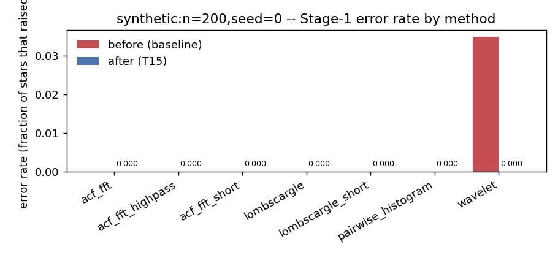
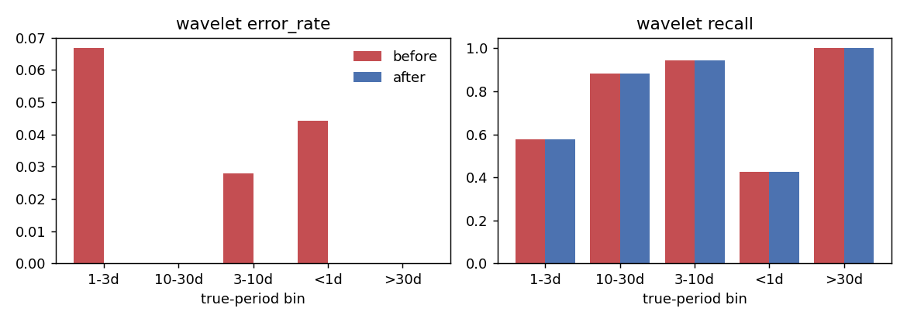
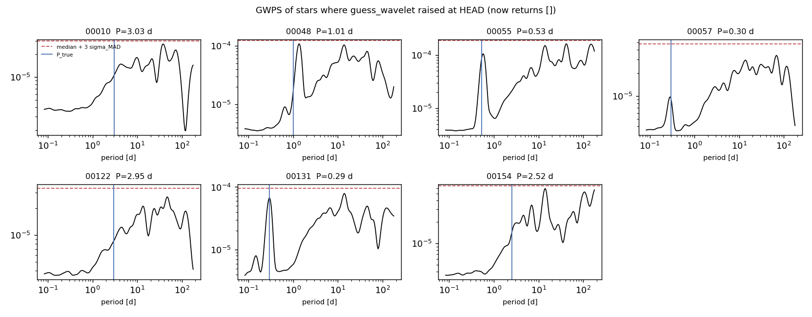

# T15: every guess_* returns [] instead of raising

**Date:** 2026-10-14 · **Author:** method-improver agent (Claude Code session, unattended) · **Branch:** `claude/t15-no-raise-940f9b` · **Status:** draft

## TL;DR
- On degenerate input, all 7 `guess_*` methods now return `[]` instead of raising. On
  `synthetic:n=200,seed=0` the error rate is **0.000 for every method**. Only
  `wavelet` had a nonzero rate before (**0.035 → 0.000**, 7/200 stars).
  check_goals against `benchmarks/baselines/synth200_s0.json` reports
  **OVERALL: PASS**, and every regression-guard delta is +0.000.
- **Final answers are identical**:
  - all 200 stars have the same outcome before and after (correct 92,
    diffrot 42, half 7, wrong 11, none 48);
  - `n_pooled` is identical for all 200 stars;
  - Stage 1 is bit-identical for every method on non-degenerate stars.

  Final periods differ only in 18 stars, by at most 4.7e-5 relative. That's
  the Accelerate-BLAS fit nondeterminism T14 found, not this change.
- **53 new tests** cover the early exits of every method, through
  introspection, so future `guess_*` functions inherit them. All 53 fail on
  HEAD 1a076f0 and pass with the fix. The full suite passes (141 tests).
- Two cases didn't raise but are now treated as degenerate too:
  - `lombscargle` on constant flux used to return 5 round-off "peaks"
    (power ~1e-6);
  - `acf_fft` on a flat or all-NaN ACF used to return an arbitrary argmax
    bin with strength 0.

  Both now return `[]`. See "Open questions".

## Question / goal
This is task **T15** in `docs/TASKS.md`, promoted from P2 and the T4 report.
`guess_lombscargle`, `guess_acf_fft` and `guess_wavelet` (and any other
`guess_*`) should return `[]` rather than raise on degenerate input. That's the
contract T4 established for `guess_pairwise_histogram`, and
`tests/test_guesses.py` states it as "returning [] is fine; raising is not". The
Done-when criterion is that every method's `error_rate` is 0 on the synthetic
scorecard. There is no active goal for this beyond G5, which T4 already met.

## What I did
1. **Probed every method** on degenerate bundles: all-NaN flux and ACF,
   constant flux with a zero ACF, 5 points with 2 lags, 1 point, empty arrays,
   and windows that were inverted, zero or NaN at the lower edge, or far beyond
   the baseline. Besides the three known `raise` sites, I found implicit
   crashes: `ZeroDivisionError`, astropy/argmax `ValueError`, `IndexError`, a
   `ValueError` from `np.geomspace`, and `compute_acf`'s `ValueError` escaping
   `acf_fft_highpass`.
2. **Wrote tests first** (`tests/test_guesses.py`, T15 section), parametrized
   over every discovered method:
   - `test_degenerate_input_returns_empty` × 5 cases (all-NaN, constant, too
     few points, single point, empty);
   - `test_inverted_period_window_returns_empty`;
   - `test_odd_period_windows_never_raise` × 3 windows, which asserts only "no
     raise, well-formed" because a window beyond the baseline is legitimate for
     LS;
   - six targeted tests, one per named exit: LS with fewer than 10 finite
     points, `acf_fft` with fewer than 3 frequency bins, `acf_fft_highpass`
     with fewer than 10 finite points, and wavelet with NaN flux, no peak above
     SNR, or a short baseline.

   On unmodified HEAD, **53 failed and 47 passed** (`runs/t15_tests_before_fix.txt`,
   not committed because `runs/` is gitignored).
3. **Changed `claude_files/guesses.py`.** I added one helper, listed every exit
   in each docstring under "Returns an empty list (never raises) when …", and
   left the ranking and candidate logic unchanged.
4. **Benchmarked with 2 workers** (T14 was timing concurrently):
   `scorecard.py --synthetic 200 --seed 0 --n-workers 2 --outdir runs/t15_after`,
   then ran `check_goals.py` against the committed baseline.
   - I didn't rerun a "before" scorecard. The committed baseline is the
     aggregate "before".
   - For per-star "before" data I used the main checkout's
     `runs/synth200_s0_v2` (pre-T4). T4 showed its final outcomes are
     identical, and T4 changed Stage 1 only for `pairwise_histogram`.
   - `make_data.py` reran `guess_wavelet` alone with a `git archive` export of
     HEAD and with this branch, to capture the error messages and GWPS of the 7
     stars that raised.

### Every exit changed
| Function | Exit | Before | After |
|---|---|---|---|
| (new) `_valid_period_window` | — | — | helper: finite edges, `min_period > 0`, `max_period > min_period` |
| `guess_lombscargle` (+ `_short`) | < 10 finite (t, f) points | `RuntimeError` | `[]` |
| | constant flux (`ptp == 0`) | 5 round-off candidates | `[]` |
| | inverted / zero / NaN window (incl. too-short baseline) | `ValueError` (argmax of empty) / `ZeroDivisionError` | `[]` |
| | periodogram with no finite power | (unguarded) | `[]` |
| | astropy missing | `ImportError` | **still raises** (environment, not input) |
| `guess_acf_fft` (+ `_short`) | < 3 ACF lags | `ValueError`/`RuntimeError` | `[]` |
| | inverted / zero / NaN window | `RuntimeError` / `ZeroDivisionError` | `[]` (window resolved before the FFT now; same values) |
| | < 3 frequency bins in window | `RuntimeError` | `[]` |
| | max power in window ≤ 0 or NaN (flat / NaN ACF) | 1 arbitrary candidate, strength 0 | `[]` |
| `guess_acf_fft_highpass` | < 10 finite (t, f) points | `ValueError` from `compute_acf`; `int(NaN)` on ≤ 1 point | `[]` |
| | `compute_acf` raising in one window | escaped | moved inside the existing per-window `try`, skips that window |
| `guess_wavelet` | < 2 points, or any NaN in time/flux | `ValueError` / `IndexError` | `[]` |
| | inverted / zero / NaN window, too-short baseline | `RuntimeError` / `ValueError` (geomspace) | `[]` |
| | no GWPS peak above `min_peak_snr` (incl. constant flux) | `RuntimeError` | `[]` |
| `guess_pairwise_histogram` | — | already done by T4 | unchanged |

`gather_initial_guesses`' docstring no longer cites "too few ACF peaks" as an
example of a method raising.

## Results

**check_goals: after vs the committed baseline** (`benchmarks/baselines/synth200_s0.json`):
```
Run: runs/t15_after/metrics.json  (dataset synthetic:n=200,seed=0, commit 1a076f0-dirty)
Baseline: benchmarks/baselines/synth200_s0.json  (commit 4896568-dirty)

goal  status  result  value    target   base  metric
G1    draft   FAIL    0.670 >= 0.75    0.670  final.overall.success
G2    draft   FAIL    0.647 >= 0.75    0.647  final.by_bin.<1d.success
G3    draft   FAIL    0.882 >= 0.94    0.882  union_recall.by_bin.<1d
G4    draft   FAIL    0.698 >= 0.82    0.698  final.by_bin.10-30d.success
G5    met     PASS    0.000 <= 0.0     0.000  methods.pairwise_histogram.overall.error_rate
G6    draft   FAIL    0.055 <= 0.04    0.055  final.overall.wrong
G7    draft   FAIL    0.240 <= 0.18    0.240  final.overall.none

Regression guard (fail if a metric drops by more than its limit):
   base     new   delta  limit  metric
  0.670   0.670  +0.000  0.020  final.overall.success
  0.689   0.689  +0.000  0.060  final.by_bin.1-3d.success
  0.698   0.698  +0.000  0.060  final.by_bin.10-30d.success
  0.806   0.806  +0.000  0.060  final.by_bin.3-10d.success
  0.647   0.647  +0.000  0.060  final.by_bin.<1d.success
  0.000   0.000  +0.000  0.060  final.by_bin.>30d.success
  0.889   0.889  +0.000  0.060  union_recall.by_bin.1-3d
  0.977   0.977  +0.000  0.060  union_recall.by_bin.10-30d
  0.972   0.972  +0.000  0.060  union_recall.by_bin.3-10d
  0.882   0.882  +0.000  0.060  union_recall.by_bin.<1d
  1.000   1.000  +0.000  0.060  union_recall.by_bin.>30d

OVERALL: PASS
```
The full output, including goal descriptions, is in `data/check_goals_after_vs_baseline.txt`.
`1a076f0-dirty` means the run used this branch's uncommitted fix on top of
1a076f0, and the fix is committed together with this report. The draft goals
fail with identical values before and after. They belong to other tasks.


Every method is at 0 after the fix. Only `wavelet` (red, 0.035) was nonzero in
the baseline, because T4 had already fixed `pairwise_histogram`.


The wavelet errors fell in the <1d, 1–3d and 3–10d bins and are now 0. Recall
in every bin is unchanged, as expected: a star that raised contributed no
candidates before, and it contributes `[]` now.


These are the 7 stars that raised. In each panel the dashed red line is the
first-iteration threshold (median + 3·1.4826·MAD of the GWPS), and the blue line
marks P_true.
- **00010** (inclination 15°) and **00122/00154** show no real signal at P_true,
  so `[]` is correct for them.
- **00055** (0.53 d) and **00131** (0.29 d) each have a clean, isolated GWPS peak
  at P_true that sits just under the threshold. The red-noise continuum rising
  toward long periods inflates the median and MAD. That's a calibration issue,
  not a crash; see the open questions.

**Stage-1 and final-answer identity** (from `data/stage1_diff_by_method.csv` and
`data/final_before_after.csv`):
- Stage 1, compared with the v2 run per (star, method):
  - outcome, `n_candidates` and top-1 period are identical for every method on
    all 200 stars;
  - the largest top-1 difference is 8e-16 relative (one wavelet star, last
    digit);
  - the only changes are errors → `[]`: 7 for wavelet here, plus 55 for
    pairwise_histogram from T4.
- The final-outcome confusion matrix is diagonal, and `n_pooled` is identical
  for all 200 stars.
- 18 stars have final periods that differ by up to 4.66e-5 relative. Their
  pooled candidates are identical, so this is Stage-2 floating-point
  nondeterminism (T14: alignment-dependent Accelerate `ddot` inside scipy's
  trf). I didn't investigate it further.

The fix can't touch final answers anyway: `wavelet` isn't in the pooled methods
(`pairwise_histogram, lombscargle, acf_fft`), and none of the pooled methods
raised on this suite.

**Runtime.** Median wall time per star was 2.29 s here against 11.36 s in the
baseline. That difference comes from the scheduling setup, not from this change.
T4 produced the baseline by running two 5-worker scorecards at once on the
4-core i5. This run used 2 workers. T14 is studying worker counts. The new guards are O(1) or a single
`isfinite`/`ptp` pass.

## What didn't work
No dead ends on the fix itself. Two judgment calls:
- **Out-of-baseline windows in LS.** For `min_period=1e5, max_period=2e5`, LS
  still returns a candidate at a period much longer than the baseline. That
  window is valid, just unhelpful, so I only tested "no raise, well-formed"
  rather than forcing `[]`. Making LS reject periods beyond the baseline would
  be a behavior change.
- **Wavelet with NaN flux.** I chose `[]` over interpolating inside the
  function. Interpolation would change what callers get, and the scorecard and
  `batch_test_guesses` already gap-fill before calling.

## Open questions for Rae
1. **Silent `[]` on wavelet NaN flux.** This used to be a loud `ValueError`
   explaining the gap-free precondition. A caller who forgets to interpolate now
   silently gets no wavelet candidates, and `gather_initial_guesses` no longer
   lists it in `failed_methods`. The docstring documents this. Options: keep it
   silent (my choice, matches T4), emit a `warnings.warn` (noisy at 1M scale),
   or interpolate internally.
2. **Missing astropy still raises `ImportError`** in `guess_lombscargle`. I
   treated it as an environment error, not degenerate input. Agree?
3. **The degenerate-but-non-raising cases** (LS on constant flux, `acf_fft` on a
   flat or NaN ACF) now return `[]` instead of meaningless candidates. This goes
   slightly beyond "stop raising". It never fires on the synthetic suite
   (Stage 1 is bit-identical), but say if you'd prefer the old behavior.
4. **Proposed goal (yours to edit in `goals.json`):** "every method's
   `methods.*.overall.error_rate <= 0`". This generalizes G5 and would catch
   regressions in new `guess_*` methods. check_goals would need one entry per
   method or wildcard support.
5. **Wavelet SNR threshold calibration (follow-up, not done).** In 00055 and
   00131, the true-period GWPS peak is clean but below median + 3σ_MAD, because
   the GWPS has a red-noise slope. Possible fixes: estimate the noise against a
   smoothed continuum or power-law fit rather than a flat median, or measure
   the SNR in log power. This is the wavelet counterpart of T13 (ACF
   prominence). I added it as P4 under "Proposed" in TASKS.md.

## Reproduce
```bash
# tests (full suite; the T15 section of tests/test_guesses.py is new)
/opt/anaconda3/envs/ss_local/bin/python -m pytest -q
# after scorecard (2 workers) and goals check against the committed baseline
/opt/anaconda3/envs/ss_local/bin/python benchmarks/scorecard.py --synthetic 200 --seed 0 --n-workers 2 --outdir runs/t15_after
/opt/anaconda3/envs/ss_local/bin/python benchmarks/check_goals.py runs/t15_after/metrics.json --baseline benchmarks/baselines/synth200_s0.json
# report data: wavelet-only stage 1 at HEAD (git archive) and on this branch, plus per-star comparison
R=reports/2026-10-14_t15-no-raise-all-guess-methods
mkdir -p /tmp/t15_head && git archive 1a076f0 | tar -x -C /tmp/t15_head
/opt/anaconda3/envs/ss_local/bin/python $R/make_data.py --code-dir /tmp/t15_head --out $R/data/wavelet_head.csv
/opt/anaconda3/envs/ss_local/bin/python $R/make_data.py --code-dir . --out $R/data/wavelet_t15.csv
/opt/anaconda3/envs/ss_local/bin/python $R/compare_runs.py <main checkout>/runs/synth200_s0_v2 runs/t15_after
# notebook
/opt/anaconda3/envs/ss_local/bin/python $R/build_notebook.py
/opt/anaconda3/envs/ss_local/bin/python tools/run_notebook.py $R/notebook.ipynb
```
