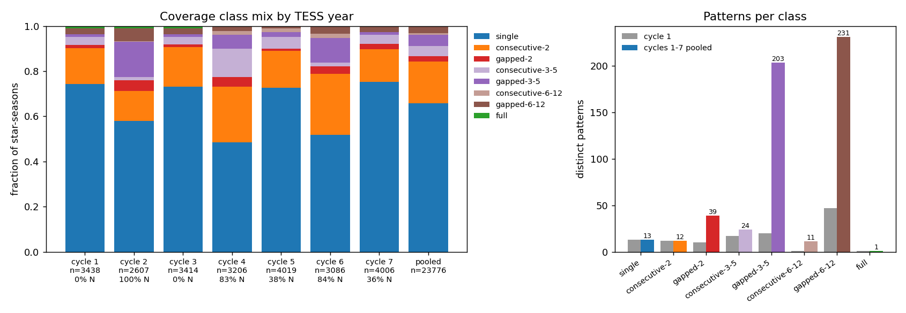
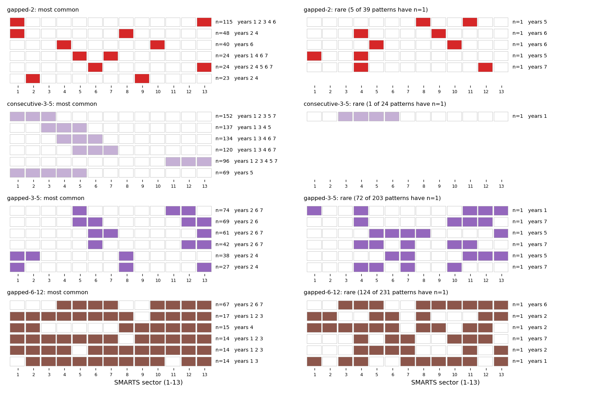
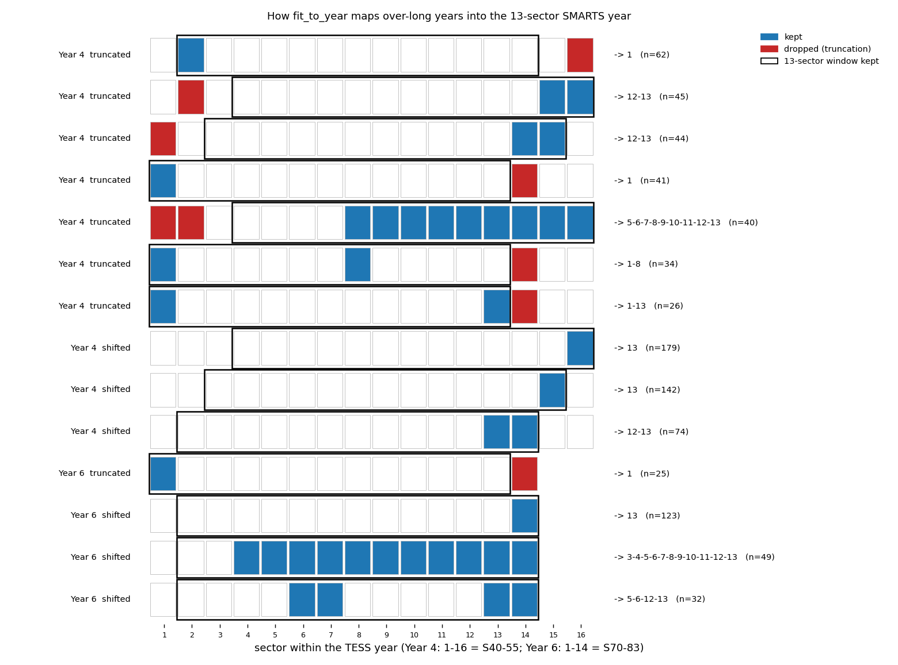
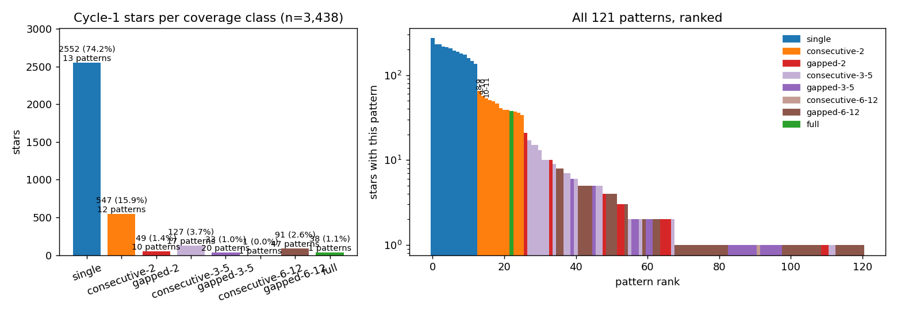
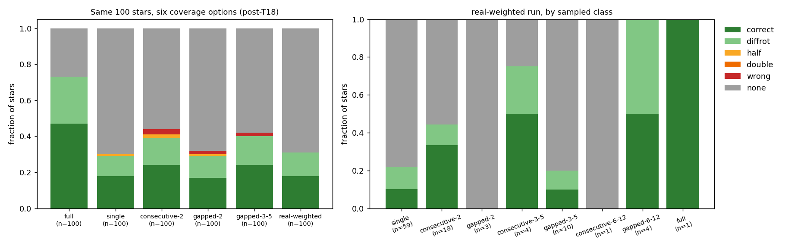
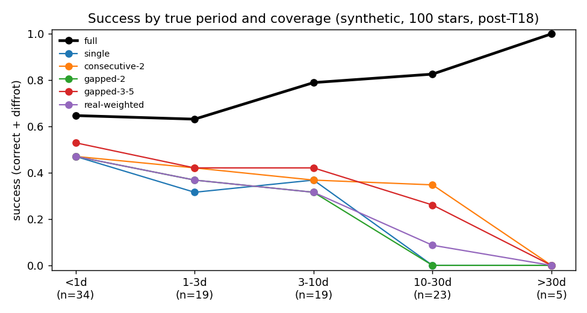
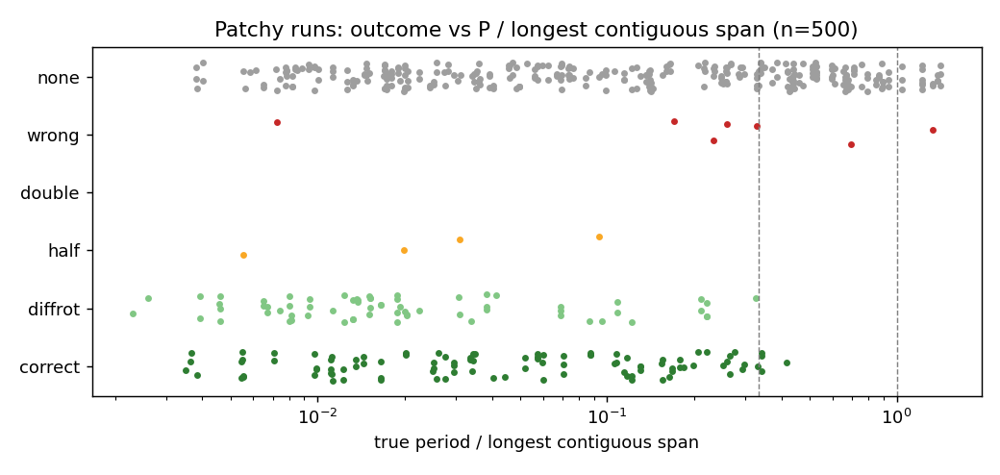
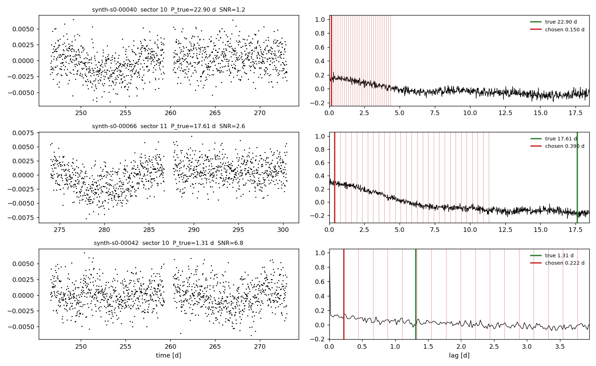

# T16a: patchy-coverage infrastructure (coverage library, synthetic sectors=, scorecard --coverage)

**Date:** 2026-10-14 · **Author:** method-improver agent (T16a session) · **Branch:** `claude/t16a-coverage-infra-fe5be3` · **Status:** draft

## TL;DR
- **Update 2026-10-15 (Rae's review):**
  - **All TESS years:** there are now libraries for every TESS year, 1–7 (`datasets/coverage/cycle<N>_patterns.csv`). The pooled `all_cycles_patterns.csv` (23,776 star-seasons, 534 patterns) is the new **default**.
  - **Hemisphere matters:** the northern-heavy years (2, 4, 6) have only 48–58% single-sector star-seasons, versus 73–75% for Cycles 1/3/5/7, and far more gapped coverage. 413 of the 534 pooled patterns never occur in Cycle 1.
  - **Classes:** `3-5` and `6-12` are split into consecutive/gapped; `--coverage 3-5` / `6-12` still draw from both halves.
  - **Sampling:** frequency-weighted within a class is now the default (Rae, after the extended-mission patterns were added). Uniform sampling is still available.
  - **Sector length:** the 14–16-sector years have normal ~27-d sectors. The *years* are longer: 434 d (Year 4), 383 d (5) and 376 d (6), against 349–358 d otherwise (TESS orbit times).
  - **Demos rerun after merging main (T18):** T18's gates removed the patchy-coverage failure mode. On one sector, wrong answers went from 0.36 to 0.00, but those stars are now declined (none = 0.70) rather than measured; success is 0.29. Many declines look measurable: 17/34 single-sector stars under 1 d and 27/36 at SNR > 5. That's the new lead for T16b/T16d.
  - **Year 8 deferred** (Rae).
- **New coverage library:** `datasets/coverage/cycle1_patterns.csv` lists the 121 real Cycle-1 sector patterns with star counts (sum = 3,438). By class: 74.2% `single`, 15.9% `consecutive-2`, 1.4% `gapped-2`, 4.7% `3-5`, 2.7% `6-12`, 1.1% `full`. It's built by `tools/build_coverage_library.py`, and a test checks it against a fresh build.
- **Synthetic `sectors=` option:** `synthetic.make_lightcurve(sectors=[...])` / `make_suite(sectors=...)` give the same time grid and NaN structure as `load_smarts_fits(sectors=...)` (exact match in tests). The star itself is unchanged; only coverage differs.
- **Scorecard `--coverage` option:** `--coverage {full, real-weighted, single, consecutive-2, gapped-2, 3-5, 6-12, pattern:…}` with `--coverage-seed`, for synthetic and FITS manifests. It adds seven coverage descriptor columns to `per_star.csv`, and `SCORECARD_VERSION` is now 3. Metric definitions are unchanged.
- **The default is unchanged:** `--coverage full` on `synthetic:n=200,seed=0` reproduces the committed baseline for 200/200 final periods and outcomes, bit for bit, and `check_goals` passes with every delta +0.000. The only differences are in wavelet on 3 stars (top-1 ≤1.5e-10 relative, and candidate counts): the known P4 nondeterminism, not this change (see "What didn't work").
- **Demo (first version, pre-T18; superseded by the rerun above):** on the same 100 stars, success fell from 0.69 (full) to 0.28 (single), 0.30 (gapped-2) and 0.33 (real-weighted), mostly through confident ~0.2 d wrong answers (wrong 0.08 → 0.36 / 0.44 / 0.37).

## Question / goal
This is task **T16a** in `docs/TASKS.md`, the infrastructure for T16b–f. It makes no method changes and touches no goal in `goals.json`. Scope:
- a frequency-weighted real coverage library;
- a synthetic `sectors=` option that mirrors `load_smarts_fits(sectors=...)`;
- scorecard dataset options and per-star coverage descriptors;
- tests;
- a small demo.

I read discussion items D1 and D2. Nothing here pre-empts them: there are no searched-range outputs, and SMARTS can't represent multi-year gaps.

## What I did

**1. What `target_df_shortform.csv` contains.** 8,156 rows, one per unique TIC, with columns:
- unnamed index;
- `TIC`;
- `ec_long`, `ec_lat` (ecliptic coordinates, deg);
- `num_s` (number of sectors);
- `sec` (string repr of the sorted list of every observed sector, 1–96).

`num_s != len(sec)` for 37 rows (0.45%). I use `sec` throughout. 3,438 stars have at least one sector in 1–13. All of them are southern (ecliptic latitude −89° to −6°), as expected for Cycle 1.

**2. Coverage library.** The new module `claude_files/coverage.py` holds the pattern parsing, `coverage_class`, `build_library`, `sample_patterns` and `coverage_descriptors`. `tools/build_coverage_library.py` writes `datasets/coverage/cycle1_patterns.csv`, which has a `#` provenance line with the input's sha256. Provenance and biases are in `datasets/coverage/README.md`. The patterns are exactly the 121 in `sector_configs.txt` (tested); the file is now superseded but kept.

**3. Synthetic `sectors=`.** The star is generated on the full `n_sectors` grid with the same RNG draws, then reduced to the kept sectors with `load_smarts_fits` conventions:
- sector s = orbits 2s−1, 2s;
- unobserved and gap cadences become NaN;
- the grid is trimmed to run from the first to the last kept valid cadence, with absolute times kept (no shift to 0);
- flux is re-centered on the kept data.

`sectors=None` takes the old code path untouched.

One small asymmetry: an explicit all-13 pattern also trims the trailing orbit-gap cadences that the legacy grid keeps. That's why `--coverage full` maps to `sectors=None`.

**4. Scorecard.**
- New flags: `--coverage`, `--coverage-seed` (default 0), `--coverage-weighting frequency|uniform` (for class specs; default frequency since 2026-10-15, originally uniform) and `--coverage-library`.
- Patterns are drawn once per star, in star order, from `default_rng(coverage_seed)`, independently of the suite seed. The same stars can therefore be re-run under a different coverage draw.
- FITS manifests pass the pattern as `load_smarts_fits(sectors=...)`. A manifest may instead carry a per-row `sectors` column ("1-2-13"), which is what T16f needs for frozen dev sets.
- For FITS, the `sectors` descriptor is what survived flagged-sector removal (`pre.sectors_used`), and the requested pattern goes in `meta_sectors_requested`.
- The dataset string is unchanged for `full`, so existing baselines and goals still apply. Otherwise it gains `,coverage=<spec>[,coverage_weighting=frequency],coverage_seed=<s>`. `config.coverage` records the spec, seed, weighting and library path.

**5. Commands** (all with `--n-workers 2`):
```
scorecard.py --synthetic 200 --seed 0 --coverage full                       -> synthetic:n=200,seed=0
scorecard.py --synthetic 100 --seed 0 --coverage single      --coverage-seed 0 -> synthetic:n=100,seed=0,coverage=single,coverage_seed=0
   (these strings predate the 2026-10-15 update; they now end in ",coverage_library=all_cycles" by default)
scorecard.py --synthetic 100 --seed 0 --coverage gapped-2    --coverage-seed 0 -> ...,coverage=gapped-2,coverage_seed=0
scorecard.py --synthetic 100 --seed 0 --coverage real-weighted --coverage-seed 0 -> ...,coverage=real-weighted,coverage_seed=0
```
The 100-star suite is the first 100 stars of the 200-star suite, so `full` for those 100 is taken from the n=200 run.

### Coverage classes

Classes as revised 2026-10-15 (Rae: split 3-5 and 6-12 into consecutive/gapped). Counts are for the Cycle-1 library; see "All TESS years" for the others.

| class | definition | Cycle-1 stars | patterns | note |
|---|---|---|---|---|
| `single` | 1 sector | 2552 (74.2%) | 13 | |
| `consecutive-2` | sectors s, s+1 | 547 (15.9%) | 12 | |
| `gapped-2` | 2 non-adjacent sectors | 49 (1.4%) | 10 | 21 of the 49 are `1-13`: adjacent on the sky but 11 months apart, the largest possible gap |
| `consecutive-3-5` | 3–5 sectors, one unbroken run | 127 (3.7%) | 17 | |
| `gapped-3-5` | 3–5 sectors with gaps | 33 (1.0%) | 20 | |
| `consecutive-6-12` | 6–12 sectors, one unbroken run | 1 (0.0%) | 1 | common in Cycles 4–6 |
| `gapped-6-12` | 6–12 sectors with gaps | 91 (2.6%) | 47 | mostly near-full years missing 1–2 sectors |
| `full` | all 13 | 38 (1.1%) | 1 | |

`--coverage 3-5` and `--coverage 6-12` still work as groups, drawing from both halves' patterns. The original version of this task used six classes, with 3-5 and 6-12 unsplit.

### Per-star descriptor columns (scorecard v3)
- `n_sectors`, `sectors` ("1-2-13"), `coverage_class`;
- `total_baseline_days` (first to last finite cadence);
- `longest_contiguous_days` (longest stretch with no gap > 5 d, so orbit gaps don't split a stretch but a missing sector does);
- `largest_gap_days`;
- `duty_cycle` (finite cadences / cadences spanned by the baseline).

## Results

### All TESS years (added 2026-10-15)
The same procedure, run per TESS cycle (year):

1. **Cycle boundaries**, as in tess-point 0.9.2: 1 = S1–13, 2 = S14–26, 3 = S27–39, 4 = S40–55, 5 = S56–69, 6 = S70–83, 7 = S84–96.
2. **Patterns** come from each star's sectors in that cycle, numbered from the cycle's first sector. The input table covers S1–96, so there is no Year 8 (whose longer pointings begin at S97).
3. **Fitting into 13 sectors.** Cycles 4–6 have 14–16 sectors, so `coverage.fit_to_year` maps them into the 13-sector SMARTS year:
   - **Shifted:** patterns spanning ≤ 13 sectors that end late move earlier, keeping their spacing (446 Cycle-4, 347 Cycle-5 and 404 Cycle-6 star-seasons).
   - **Truncated:** patterns spanning > 13 sectors keep their best 13-sector window (610 Cycle-4 and 25 Cycle-6 star-seasons, losing 1–2 sectors each, median 1).

| cycle | star-seasons | patterns | single | consec-2 | gapped-2 | consec-3-5 | gapped-3-5 | consec-6-12 | gapped-6-12 | full | frac north |
|---|---|---|---|---|---|---|---|---|---|---|---|
| 1 | 3438 | 121 | 0.742 | 0.159 | 0.014 | 0.037 | 0.010 | 0.000 | 0.026 | 0.011 | 0.00 |
| 2 | 2607 | 201 | 0.580 | 0.132 | 0.047 | 0.014 | 0.156 | 0.003 | 0.057 | 0.010 | 1.00 |
| 3 | 3414 | 126 | 0.731 | 0.176 | 0.011 | 0.033 | 0.012 | 0.001 | 0.026 | 0.010 | 0.00 |
| 4 | 3206 | 117 | 0.484 | 0.248 | 0.041 | 0.126 | 0.062 | 0.016 | 0.022 | 0.000 | 0.83 |
| 5 | 4019 | 116 | 0.726 | 0.164 | 0.010 | 0.051 | 0.021 | 0.016 | 0.011 | 0.000 | 0.38 |
| 6 | 3086 | 152 | 0.518 | 0.270 | 0.033 | 0.017 | 0.109 | 0.019 | 0.034 | 0.000 | 0.84 |
| 7 | 4006 | 96 | 0.752 | 0.145 | 0.023 | 0.041 | 0.011 | 0.000 | 0.027 | 0.000 | 0.36 |
| pooled | 23776 | 534 | 0.658 | 0.183 | 0.024 | 0.046 | 0.048 | 0.008 | 0.028 | 0.004 | |


Left: the southern years (1, 3) look almost identical. The northern-heavy years (2, 4, 6) have many more 2–12-sector star-seasons, mostly gapped (Cycle 2: 16% gapped-3-5; Cycle 6: 11%).

Right: pooling multiplies the variety of gapped patterns, with the number of distinct patterns going from Cycle 1 to pooled as follows:

| class | Cycle 1 | pooled |
|---|---|---|
| gapped-2 | 10 | 39 |
| gapped-3-5 | 20 | 203 |
| gapped-6-12 | 47 | 231 |

Pooling therefore covers a much wider range of gap shapes than Year 1 alone. Most of those shapes are rare: 361 of the 534 occur in only one cycle.

Other findings:
- No star-season after Cycle 3 has all 13 sectors. `full` comes only from Cycles 1–3.
- The commonest gapped-2 pattern overall is still `1-13` (115 star-seasons, seen in cycles 1, 2, 3, 4 and 6).

#### Common vs rare patterns within a class

Left column: each class's 6 most common pooled patterns. Right column: 6 drawn at random from the patterns with the fewest star-seasons (n = 1), with the TESS years each occurs in. The common patterns are a few repeated shapes, often in several years:
- gapped-2: `1-13` (115) and `1-8` (48);
- gapped-3-5: the Year-2/6/7 northern shapes `5-11-12` (74) and `5-6-12-13` (69);
- gapped-6-12: the Year-2/6/7 `4-7, 10-13` block (67).

The rare ones are mostly irregular, one-year-only shapes: 72 of the 203 gapped-3-5 patterns and 124 of the 231 gapped-6-12 patterns occur once. Under the default frequency weighting, n=1 patterns get 6.3% of gapped-3-5 draws and 18.8% of gapped-6-12 draws. Under uniform weighting they'd get 35.5% and 53.7%. Patterns seen in only one year still get 45% of the draws in both classes.

#### Truncating the over-long years

Each row is a raw Year-4 (16-sector) or Year-6 (14-sector) pattern on that year's own grid. The black box is the 13-sector window kept; red sectors are dropped. Shifting (the lower rows of each year) only renumbers sectors. Truncation always cuts the sector on the far side of the pattern's long gap, so it changes the pattern's character. Of the 635 truncated star-seasons (462 lose 1 sector, 173 lose 2):

| raw shape | becomes |
|---|---|
| gapped, 2 sectors (174) | **single** (174) |
| gapped, 3 sectors (189) | consecutive-2 (122) or gapped-2 (67) |
| gapped, 4 sectors (97) | consecutive-2 (41), consecutive-3-5 (9) or gapped-3-5 (47) |
| gapped, 10–11 sectors (88) | consecutive-6-12 (51) or gapped-6-12 (37) |

So truncation removes the longest-baseline gapped patterns from these years. An alternative that keeps them, not implemented and Rae's call, is to **shorten the longest internal gap** by the overflow (span − 13 = 1–3 sectors). For example, Year-4 `2-16` would become `1-13` rather than `1`. This keeps every observed sector and the gapped class, at the cost of a slightly shorter gap.

### Cycle-1 library

Single sectors dominate (74%). Beyond consecutive pairs, the long tail of 88 patterns covers just 301 stars, so `real-weighted` almost never draws multi-sector patterns. Per-class runs are needed to study those.

### Default bit-identity
`tools/compare_runs.py runs/t16a_full200 benchmarks/baselines/synth200_s0_tables`:
```
200 stars in common
final_period differs: 0 stars
final_outcome differs: 0 stars
  acf_fft / acf_fft_highpass / acf_fft_short / lombscargle / lombscargle_short / pairwise_histogram: 0 / 0
  wavelet                top1 differs:   2   n_candidates differs:   3
```
The wavelet differences are the P4 residue (see "What didn't work"):
- top-1 differs on 00038 by 1.5e-10 relative and on 00058 by 1.9e-11, with the same outcome;
- candidate counts differ on 00038, 00058 and 00158.

Wavelet isn't pooled into the fit.

`check_goals.py runs/t16a_full200/metrics.json --baseline benchmarks/baselines/synth200_s0.json`:
```
   base     new   delta  limit  metric
  0.725   0.725  +0.000  0.020  final.overall.success
  0.689   0.689  +0.000  0.060  final.by_bin.1-3d.success
  0.767   0.767  +0.000  0.060  final.by_bin.10-30d.success
  0.861   0.861  +0.000  0.060  final.by_bin.3-10d.success
  0.647   0.647  +0.000  0.060  final.by_bin.<1d.success
  0.750   0.750  +0.000  0.060  final.by_bin.>30d.success
  0.889   0.889  +0.000  0.060  union_recall.by_bin.1-3d
  0.977   0.977  +0.000  0.060  union_recall.by_bin.10-30d
  0.972   0.972  +0.000  0.060  union_recall.by_bin.3-10d
  0.882   0.882  +0.000  0.060  union_recall.by_bin.<1d
  1.000   1.000  +0.000  0.060  union_recall.by_bin.>30d
OVERALL: PASS
```
Tests pin bit-identity in three ways:
- `test_default_suite_bit_identical_to_pre_t16a`: sha256 of `make_suite(5, seed=0)` time and flux, recorded from main 589cb8d's `synthetic.py`;
- `test_default_suite_matches_baseline_population`: per-star parameters against the baseline CSV;
- `test_default_scorecard_rows_bit_identical_to_baseline` (slow): 3 stars end to end, exact final periods.

### Demo: outcome vs coverage (rerun 2026-10-15, post-T18)
Pipeline at main after the T18 merge. Coverage uses the defaults (pooled Years 1–7 library, frequency weighting, coverage seed 0). The same 100 stars are used throughout; `full` is those stars from the committed post-T18 baseline. Dataset strings look like `synthetic:n=100,seed=0,coverage=single,coverage_weighting=frequency,coverage_seed=0,coverage_library=all_cycles`.

| run | n | success | correct | diffrot | alias | wrong | none |
|---|---|---|---|---|---|---|---|
| full | 100 | 0.730 | 0.470 | 0.260 | 0.000 | 0.000 | 0.270 |
| single | 100 | 0.290 | 0.180 | 0.110 | 0.010 | 0.000 | 0.700 |
| consecutive-2 | 100 | 0.390 | 0.240 | 0.150 | 0.020 | 0.030 | 0.560 |
| gapped-2 | 100 | 0.290 | 0.170 | 0.120 | 0.010 | 0.020 | 0.680 |
| gapped-3-5 | 100 | 0.400 | 0.240 | 0.160 | 0.000 | 0.020 | 0.580 |
| real-weighted | 100 | 0.310 | 0.180 | 0.130 | 0.000 | 0.000 | 0.690 |


Look at the grey: patchy coverage now mostly produces declines, not wrong answers. The right panel is the real-weighted run split by sampled class; outside `single` (59) its n is tiny, so it only shows the plumbing working.


On one or two sectors, success above 10 d is 0–0.35, as expected for ~27-d sectors. But short periods lose too: on one sector, success under 1 d is 16/34 (full: 22/34), and 3–10 d is 7/19 (full: 15/19).


Pooled over all five patchy runs (n=500), wrong stays at ≤ 0.06 in every P / longest-span bin. Declines are 0.50 even at P / span ≤ 0.03, where the data hold more than 30 cycles. Above P / span = 1/3, declines are 0.94–0.95. That's the right behaviour there, and T16c's axis.

### Declines on short data (post-T18)

| single sector, by SNR | correct | diffrot | half | none | total |
|---|---|---|---|---|---|
| ≤ 2 | 5 | 3 | 0 | 16 | 24 |
| 2–5 | 9 | 4 | 0 | 27 | 40 |
| 5–20 | 4 | 4 | 1 | 27 | 36 |

Of the 73 full-coverage successes among these 100 stars, single-sector coverage declines 43:

| period bin | declined |
|---|---|
| <1 d | 5 |
| 1–3 d | 6 |
| 3–10 d | 8 |
| 10–30 d | 19 |
| >30 d | 5 |

The 10–30 d and >30 d losses are expected. The short-period ones suggest the gates, which T18 tuned on full-year data, are too strict for one sector. Which gate fires is a question for T16b; the pipeline message only says none met the reliability thresholds.

### History: the first demo (pre-T18, 2026-10-14)
Cycle-1 library, uniform weighting, pipeline before T18. The coverage draws differ from the rerun, so only aggregates compare:

| | full | single | gapped-2 | real-weighted |
|---|---|---|---|---|
| success, pre → post T18 | 0.69 → 0.73 | 0.28 → 0.29 | 0.30 → 0.29 | 0.33 → 0.31 |
| wrong | 0.08 → 0.00 | 0.36 → 0.00 | 0.44 → 0.02 | 0.37 → 0.00 |
| none | 0.21 → 0.27 | 0.32 → 0.70 | 0.24 → 0.68 | 0.26 → 0.69 |

Before T18, all 36 single-sector wrong answers were 0.13–0.42 d (median 0.21 d), at every SNR.


Pre-T18 history, one star per SNR bin. The ACF had no peak at the chosen lag, only noise texture on a slowly decaying envelope, yet the comb passed the old gates. T18's half-lag gate and few-peak guard now reject these. A side check at the time (not in the notebook): pure noise on one sector gave 2/12 confident answers near 0.16 d.

### Runtime
Median s/star at 2 workers, post-T18: 0.59 (single), 0.82 (consecutive-2), 1.09 (gapped-2), 1.24 (gapped-3-5), 0.63 (real-weighted). The full-year baseline was 3.51 pre-T18.

## What didn't work
- **Wavelet counts looked like a regression, but aren't.** The full run's wavelet output differed from the baseline on stars 00038, 00058 and 00158 (counts; top-1 by ≤1.5e-10 relative), which at first looked like a side effect of the extra descriptor computation. Pristine main 589cb8d, run in-process, gives 6 candidates on 00058 every time, including under heap perturbation. This branch gave 8 once in-process (while the background scorecard was loading the CPU), then 6 and 6 on reruns, and 7 in the pool run. So the same code produces different counts across invocations: this is P4's wavelet nondeterminism. P4 currently says top-1 differs by ~2e-11. Here it reached 1.5e-10 (00038), and the candidate *count* can change too (6/7/8 on 00058). Wavelet isn't pooled into the fit, so final answers are unaffected.
- **An end-to-end test through a fake SMARTS FITS can't be exact.** `split_lightcurve` re-detects gaps heuristically: on a synthetic star it flagged one orbit and shifted gap edges by a few cadences. The exact equivalence test therefore runs against `recombine_segments` + `to_even_cadence`, the deterministic part of `load_smarts_fits`. The FITS round-trip test uses tolerances: sectors equal, start within 0.1 d, NaN mismatch below 1%.
- **In-process scorecard tests need `threadpool_limits(1)`.** Without it, star 00002's final period differed from the baseline in the 14th digit, because pytest has already imported numpy, so BLAS isn't pinned.

## Open questions for Rae
1. **`target_df_shortform.csv` provenance.** How were these 8,156 stars selected (magnitude cut? a rotation catalog's cross-match? CVZ-heavy?) The library inherits that selection. Known biases: Cycle 1 only, southern sky only, and stars observed only after Cycle 1 dropped (4,718 of 8,156). Should we build a Cycle-2 (northern) library too? Or a library from a better-defined target list, e.g. all 2-min targets or a magnitude-limited FFI sample?
   **Answered (Rae, 2026-10-15):** the few thousand brightest TESS stars, with sector coverage
   from `tess-point` at each sky position, meant as a guide to typical coverage patterns. So the
   library is geometric FFI coverage at bright-star positions, which suits SMARTS (FFI). See
   `datasets/coverage/README.md`. The Cycle-2 / northern-library question remains open.
2. **Class boundaries.** Keep the six classes, or split `3-5` into consecutive (127 stars) and gapped (33)? And should `1-13` (21 of 49 `gapped-2` stars, an 11-month gap) be its own case? It behaves very differently from `5-7`.
   **Answered (Rae, 2026-10-15):** use the consecutive/gapped split. Done for both 3-5 and 6-12, since Cycles 4–6 have real consecutive 6–12-sector runs; the 3-5 / 6-12 groups remain available as specs. `1-13` is not a separate class.
3. **Within-class sampling.** It's uniform over patterns as specified, so `gapped-2` draws `1-13` 10% of the time instead of 43%. `--coverage-weighting frequency` is available. Which should T16b and T16f use by default?
   **Answered (Rae, 2026-10-15):** uniform at first, so as not to tune to Year 1's mix. Rae asked for the other TESS years, which are now pooled into the default library (see "All TESS years"). Once that was done, Rae **switched the default to frequency weighting**. `--coverage-weighting uniform` remains available, and dataset strings now always record the weighting for class specs.
4. **Approve the new `per_star.csv` columns** (the task asked for your OK): `n_sectors, sectors, coverage_class, total_baseline_days, longest_contiguous_days, largest_gap_days, duty_cycle`, plus `meta_sectors_requested` for FITS. The scorecard version is bumped to 3. `GAP_SPLIT_DAYS = 5` defines "contiguous". Is that right for real SMARTS gaps, where some Cycle-1 interruptions are 2–4 d?
   **Answered (Rae, 2026-10-15):** approved.
5. **The headline failure mode** (36% confident wrong on one sector, all ~0.2 d). It belongs to T16b/T16d, but it also bears directly on T18's gates. I left a note for the T18 session in the shared notes folder. T18's gate changes should be checked with `--coverage single` as well as on full-year synth200.
   **Update (2026-10-15, post-T18 rerun):** resolved as a wrong-answer problem; wrong on one sector is now 0. It has become a decline problem: 70% declined on one sector, including half the stars under 1 d. That's for T16b/T16d: recalibrate the gates for short data, without bringing back the ~0.2 d false positives.
6. **Proposed per-coverage-class metrics (T16f).** *(Rae, 2026-10-15: the layout looks reasonable.)* Add `final.by_coverage_class.<class>.{...outcome fractions...}` and `union_recall.by_coverage_class.<class>` alongside `by_bin`, computed the same way from the new `coverage_class` column. Possibly also `final.by_coverage_class_and_bin`. Regression guards per class would need goals.json entries. Not implemented here; that's T16f.

7. **New (2026-10-15): squeezing Cycles 4–6 into 13 sectors.** Cycles 4–6 have 14–16 sectors. Shifting (1,197 star-seasons) preserves spacing exactly. Truncation (635 star-seasons) drops 1–2 sectors from patterns longer than a SMARTS year, and always the sector beyond the long gap: 174 gapped-2 star-seasons become single, and 122 gapped-3 become consecutive-2 (see "Truncating the over-long years"). Keep truncation, shorten the longest gap instead (keeps every sector and the gapped class), or exclude these star-seasons? Context: those years' sectors are normal length; the years themselves are 376–434 d long, so a 356-d SMARTS light curve physically can't hold their full span. Shortening the gap would compress real time by 1–3 sectors (27–82 d); truncating keeps the real spacing but loses the far sector. Is pooling cycles in proportion to this table's stars per cycle fine, or should each cycle get equal weight? This only matters for `real-weighted` and `--coverage-weighting frequency`.
8. **New: Year 8+** (S97 onward: longer ~55-d pointings, partly visible in the pointing table). The input table stops at S96. A Year-8 library would need tess-point rerun on the targets, and SMARTS's 27.4-d sector grid can't represent those pointings directly.

## Reproduce
```bash
PY=/opt/anaconda3/envs/ss_openblas/bin/python
$PY tools/build_coverage_library.py
$PY benchmarks/scorecard.py --synthetic 200 --seed 0 --coverage full --n-workers 2 --outdir runs/t16a_full200
for c in single gapped-2 real-weighted; do $PY benchmarks/scorecard.py --synthetic 100 --seed 0 --coverage $c --coverage-seed 0 --n-workers 2 --outdir runs/t16a_$c; done
$PY tools/compare_runs.py runs/t16a_full200 benchmarks/baselines/synth200_s0_tables
$PY benchmarks/check_goals.py runs/t16a_full200/metrics.json --baseline benchmarks/baselines/synth200_s0.json
# copy runs/t16a_*/{per_star.csv,metrics.json} into data/<run>/ (already committed), then:
$PY tools/run_notebook.py reports/2026-10-14_t16a-coverage-infrastructure/notebook.ipynb
$PY -m pytest -q tests/test_coverage.py
```
