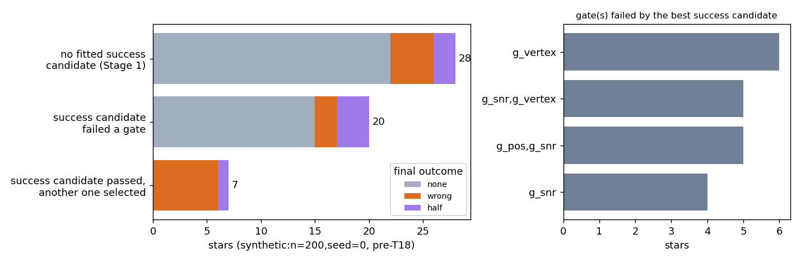
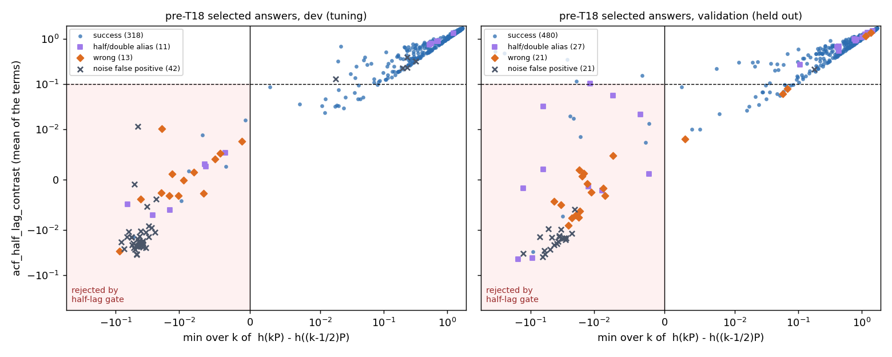
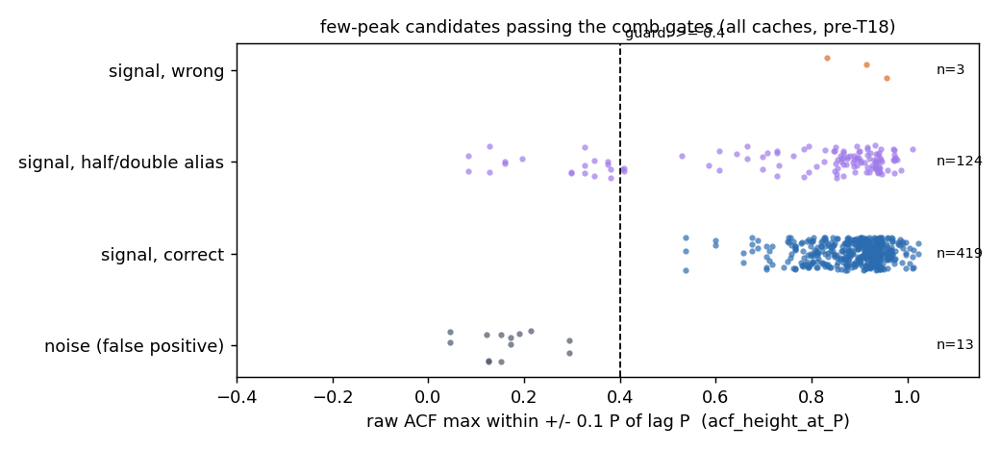
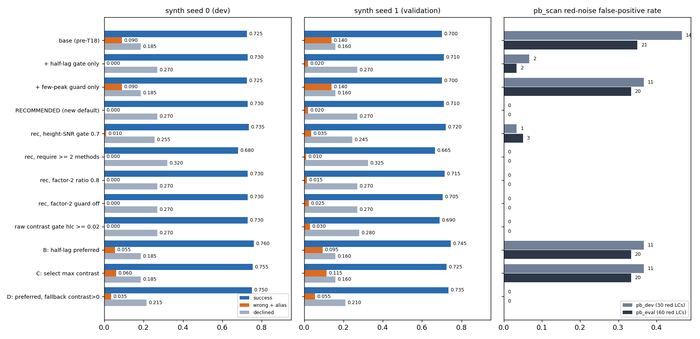
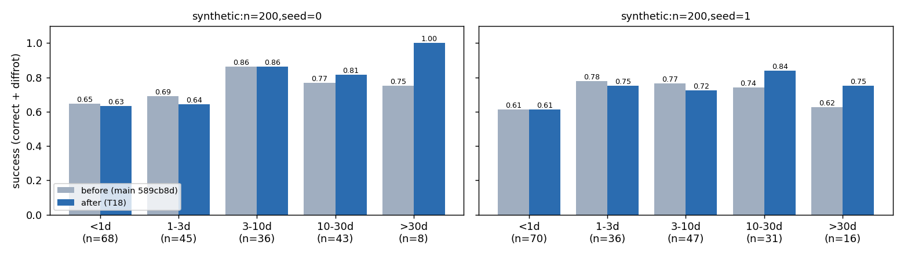
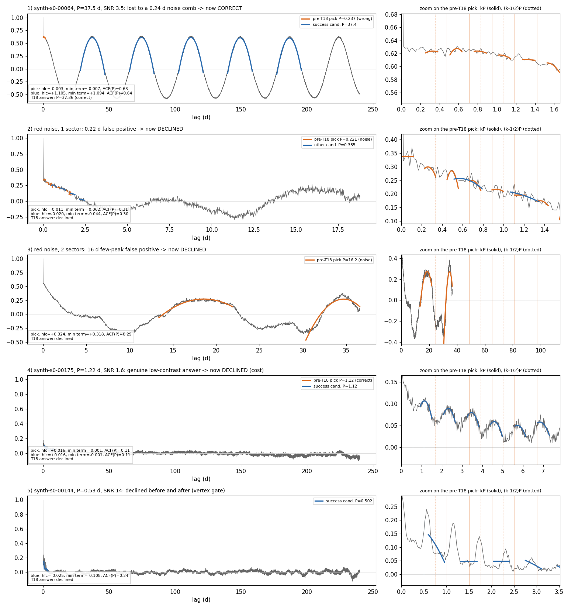

# T18: Arbitration and reliability gates

**Date:** 2026-10-14 · **Author:** method-improver agent (Claude, side session) · **Branch:** `claude/t18-arbitration-gates-39b00d` · **Status:** draft

## TL;DR
- **Two new gates in `fit_rotation_period` (both now on by default) remove nearly all confident wrong answers and noise false positives:**
  - a **half-lag consistency gate**: with h(x) the raw ACF max near lag x, every term h(kP) − h((k−½)P) must be > 0, or their mean (T9's `acf_half_lag_contrast`) must be ≥ 0.1;
  - a **few-peak ACF-height guard**: few-peak candidates need raw ACF height ≥ 0.4 at P.
- **Held-out validation confirms the dev result.**

  | | synth200 seed 0 (dev) | synth200 seed 1 (validation) |
  |---|---|---|
  | success | 0.725 → **0.730** | 0.700 → **0.710** |
  | wrong | 0.060 → **0.000** | 0.090 → **0.015** |
  | alias | 0.030 → **0.000** | 0.050 → **0.005** |
  | declined | 0.185 → **0.270** | 0.160 → **0.270** |

  On `pb_scan` the **red-noise false positives drop from 21/60 to 0/60 on the held-out evaluation seeds** (dev: 14/30 → 0/30, and 28/60 → 1/60 on a second dev noise set). White noise stays at 0, and correct goes 0.859 → 0.864.
- **The trade-off is declines, not success.** The answers the gate removes were almost all wrong. On seed 0, 18 wrong/alias answers became declines, 7 stars were rescued (wrong/half → success), and **6 genuine low-SNR (1.4–4.3), low-contrast answers were lost**. So G6 (wrong ≤ 0.04) now passes, G7 (declines ≤ 0.18) moves further from target, G1 is only +0.005, and G4 (10–30 d) goes 0.767 → 0.814.
- **`check_goals` passes on seed 0 against the committed baseline**: no regression guard trips and G8 passes. The worst bin is 1–3 d at −0.044 (limit 0.06). It also passes on seed 1 against its own before-run.
- **A softer option D** would give success 0.750 / 0.735, wrong + alias 0.035 / 0.055 and declines 0.215 / 0.210 (seed 0 / seed 1). Under your "honest decline beats confident wrong" rule I did not make it the default, but it's one keyword away (`half_lag_fallback_min=0.0`); see Open questions.
- **Unchanged after testing:**
  - the factor-of-2 guard's 0.7 (0.7/0.8 tie on dev; `fold_half_corr` is not better);
  - cross-method support weighting (neutral once the gate is in; requiring ≥2 methods costs 5 pp success).
- Runtime: the gates cost ~0.17 ms per candidate (~3 ms per star). Median per-star time showed no measurable change (seed 0: 2.96 → 2.77 s, seed 1: 2.85 → 2.82 s, under shared-machine noise).

## Question / goal
Task **T18** in `docs/TASKS.md`, which collects P1, P7 and P10. The aim was to improve which candidate `fit_rotation_period` selects and when it declines: success up (G1, G4), wrong down (G6), declines on measurable stars down (G7), red-noise FPs well below 22/60, no regression guard tripped, and a seed-1 validation that holds. Related open issues: 10 (low-SNR confident wrong answers), 12 (arbitration loses correct candidates), 14b (few-peak noise guard), 14c (factor-2 threshold) and 15 (the lag-0 tooth as an implicit noise filter).

## What I did
1. **Baselines** with `ss_openblas`, `--n-workers 2`, before any code change:
   - `synthetic:n=200,seed=0` (`runs/t18_before_s0`). `tools/compare_runs.py` against `benchmarks/baselines/synth200_s0_tables` gives **0/200 final periods differing**. The only difference is one wavelet top-1, the known P4 residue; wavelet is not in the pipeline pool.
   - `synthetic:n=200,seed=1` (`runs/t18_before_s1`, the validation set).
   - `pb_scan.py` evaluation seeds (`--seed-offset 0`, 12/cell, 40 noise per baseline).
   - `pb_scan.py` dev seeds (`--seed-offset 500 --n-per-cell 6 --n-noise 20`, the same dev set the ACF report used).
2. **Diagnostic cache** (`diag_cache.py`) re-runs the scorecard's exact pipeline. It stores every fitted candidate with its four gate values, few-peak flag, cross-method support, PDM θ, the five T9 alias features (`ml_features._alias_discrimination_features`) and the ACF.
   - Caches: seed 0, seed 1, pb dev (offset 500), an extra dev noise-only set (offset 1500, 40 per baseline, i.e. 60 red), and pb eval.
   - Candidate fits don't depend on the gating rule, so `arbitration.py` **replays** any gating/selection rule offline.
   - Replaying the pre-T18 rule reproduces the cached pipeline outcome on **all 5 caches with 0 mismatches**. The post-change scorecards match the replay of the recommended rule star by star (periods identical to CSV round-off).
3. **Diagnosis** (`diagnose.py`, `extra_feats.py`) of every lost seed-0 star and every noise FP. Section 1 below.
4. **Tests first.** `tests/test_arbitration_gates.py` (11 tests) and `tests/test_alias_metrics.py` (6 tests) were all red before the change (a 12th, for the optional fallback tier, was added after implementing it):
   - 3 red-noise short-comb FPs, 2 red-noise few-peak FPs, and 2 clean seed-0 stars (#64 at P=37 d, #1 at P=19 d) that were lost to a ~0.22 d comb;
   - a switch-off backward-compatibility test and a diagnostics test;
   - bit-identity pins for the moved ML helpers.
5. **Implementation:**
   - T9's `_acf_window_max`, `_acf_harmonic_contrasts` and `_fold_half_cycle_corr` moved verbatim into a new `claude_files/alias_metrics.py`. `ml_features` imports them under their old names, and `comb_fit` uses them without importing `ml_features`, so there is no circular import. A test pins the 5 ML alias features bit-for-bit to their pre-move values, and a test asserts that `comb_fit` does not import `ml_features`.
   - New helper `alias_metrics.half_lag_contrast_terms`. Its mean is exactly `acf_half_lag_contrast` (tested).
   - `fit_rotation_period` gains four keyword parameters with docstrings: `half_lag_gate=True`, `half_lag_strong_contrast=0.1`, `half_lag_fallback_min=None` and `few_peaks_min_acf_height=0.4`. `CandidateResult` gains `passed_base_gates`, and each candidate's `diagnostics` gains `acf_half_lag_contrast`, `half_lag_min_term`, `acf_height_at_P`, `passes_half_lag_gate` and `passes_few_peaks_height`.
   - Signatures are backward compatible. `half_lag_gate=False, few_peaks_min_acf_height=None` restores the pre-T18 gating (tested).
6. **Ablation** (`ablation.py`): 23 rules, replayed on the dev caches (for choosing) and the validation caches (for reporting only).
7. **After runs** on the same four benchmarks (`runs/t18_after_*`), plus `check_goals.py`.

## Results

### 1. Diagnosis (seed 0, pre-T18)

Of the 55 non-success stars, 28 have **no fitted success candidate at all**. That is a Stage 1 problem and no gate can fix it. 20 have a success candidate that fails a comb gate (mostly `g_vertex` and/or `g_snr`). The 7 in the bottom bar had a success candidate that **passed every gate but lost on redchi to a ~0.2–0.5 d comb**.

Things worth knowing:
- **Every one of the 18 wrong/alias answers on seed 0** has mean half-lag contrast in [−0.007, +0.011] and at least one negative half-lag term. So do all 11 short (0.17–0.32 d) red-noise FPs on the pb dev seeds. These are the "noise combs" of open issues 10 and 15. They sit on red-noise wiggles or the lag-0 decay, and their PDM θ is ≈ 1.00.
- **The success candidates that fail a gate on declined stars are noise-level too**: contrast −0.025 to +0.016, and none has every term positive (table in the notebook). Loosening the old gates therefore buys wrong answers, not successes. On dev, relaxing the height-SNR gate to 0.5 gives +1 success, +8 wrong and red FPs 1 → 14 (both dev noise sets); on seed 1, +2 success and +10 wrong.
- **The few-peak red-noise FPs** (12–72 d on 2/13 sectors) *do* have positive half-lag terms, but their raw ACF height at P is 0.12–0.29. True few-peak detections on pb_scan have ≥ 0.70.

### 2. The half-lag consistency gate

Each point is a pre-T18 answer. The gate rejects the shaded quadrant (some term ≤ 0 and mean < 0.1).
- On the dev panel (left), wrong answers (orange), aliases (purple) and noise FPs (×) pile up in the shaded quadrant, and successes sit at the upper right.
- The right panel is held-out data and shows the same separation, but not perfectly: a handful of genuine successes fall in the shaded region (the cost), and one wrong answer (seed-1 #144, 0.235 d) and a few aliases escape it.
- Why it works: for a real period, each (k−½)P lag sits in an ACF trough or on a lower secondary peak, so every term is positive. For a 2P alias the half-lags *are* the true peaks (negative). For a noise comb the terms scatter around 0. The k = 1..6 terms are the same ones T9's `acf_half_lag_contrast` averages. Requiring all of them positive, rather than thresholding their mean, is what removes the need for a tuned threshold: the 0.1 escape hatch for strong-but-irregular contrast was flat across 0.05–0.3 on dev.

### 3. The few-peak guard

This plots every few-peak candidate that passes the comb gates. Noise FPs (top row) all sit below 0.3; correct few-peak candidates sit at 0.7–1.0. 0.4 is in the gap, and 0.3 or 0.5 give identical FP counts. On synth200, the only few-peak candidates are 2P aliases at ~70 d (never selected), so the guard has no effect there.

### 4. Gate ablation

Rows marked "rec, …" change one thing in the recommended configuration. The orange bar is wrong + alias. The recommended row is the only one that is at least as good as base on success with near-zero bad answers and zero red FPs. B/C/D buy success back by re-admitting bad answers.

Selected rows: synth200 success / wrong / alias / declined, and pb_scan red-noise FPs. Full table: `data/ablation.csv`. Seed 1 and pb_eval were held out.

| rule | seed 0 | seed 1 | pb dev red FP | pb eval red FP |
|---|---|---|---|---|
| base (pre-T18) | 0.725 / 0.060 / 0.030 / 0.185 | 0.700 / 0.090 / 0.050 / 0.160 | 14/30 | 21/60 |
| + half-lag gate only | 0.730 / 0.000 / 0.000 / 0.270 | 0.710 / 0.015 / 0.005 / 0.270 | 2 | 2 |
| + few-peak guard only | 0.725 / 0.060 / 0.030 / 0.185 | 0.700 / 0.090 / 0.050 / 0.160 | 11 | 20 |
| **RECOMMENDED (both; new default)** | **0.730 / 0.000 / 0.000 / 0.270** | **0.710 / 0.015 / 0.005 / 0.270** | **0** | **0** |
| rec, factor-2 guard off | 0.730 / 0.000 / 0.000 / 0.270 | 0.705 / 0.015 / 0.010 / 0.270 | 0 | 0 |
| rec, factor-2 ratio 0.8 | 0.730 / 0.000 / 0.000 / 0.270 | 0.715 / 0.015 / 0.000 / 0.270 | 0 | 0 |
| rec, factor-2 by `fold_half_corr_at_2P` < 0.5 | 0.725 / 0.000 / 0.005 / 0.270 | 0.715 / 0.015 / 0.000 / 0.270 | 0 | 0 |
| rec, select max contrast | 0.730 / 0.000 / 0.000 / 0.270 | 0.715 / 0.015 / 0.000 / 0.270 | 0 | 0 |
| rec, select redchi / n_methods | 0.730 / 0.000 / 0.000 / 0.270 | 0.710 / 0.015 / 0.005 / 0.270 | 0 | 0 |
| rec, require ≥ 2 methods | 0.680 / 0.000 / 0.000 / 0.320 | 0.665 / 0.010 / 0.000 / 0.325 | 0 | 0 |
| rec, height-SNR gate 0.7 | 0.735 / 0.005 / 0.005 / 0.255 | 0.720 / 0.030 / 0.005 / 0.245 | 1 | 3 |
| raw contrast threshold hlc ≥ 0.02 | 0.730 / 0.000 / 0.000 / 0.270 | 0.690 / 0.010 / 0.020 / 0.280 | 0 | 0 |
| B: half-lag preferred, else base gates | 0.760 / 0.030 / 0.025 / 0.185 | 0.745 / 0.070 / 0.025 / 0.160 | 11 | 20 |
| C: base gates, select max contrast (T9's rule, no decline) | 0.755 / 0.030 / 0.030 / 0.185 | 0.725 / 0.070 / 0.045 / 0.160 | 11 | 20 |
| D: half-lag preferred, else base gates + contrast > 0 | 0.750 / 0.015 / 0.020 / 0.215 | 0.735 / 0.035 / 0.020 / 0.210 | 0 | 0 |

- **Factor-of-2 guard:** turning it off costs 6.6 pp correct on pb dev (P/2 aliases 0.015 → 0.081), so it's essential. Its 0.7 threshold isn't binding: 0.8 is +1 star on seed 1, +2 on pb eval, and ties on dev. Since the rule is to choose on dev only, I kept 0.7 (open question 3).
- **A raw contrast threshold** (T9's "≥ 0.03", here 0.02) works on seed 0 but **does not validate**: on seed 1, success is 0.690 and aliases 0.020. The parameter-free "all terms positive" form holds up better.

### 5. Before / after on the real benchmarks

The before/after for seed 0 and seed 1 is per period bin. The 10–30 d and >30 d bins gain on both seeds; 1–3 d and 3–10 d lose 2–4 pp on one seed each (the genuine low-SNR answers the gate now declines).

**check_goals, seed 0 vs the committed baseline** (`data/check_goals_synth200_s0.txt`):
```
goal  status  result  value    target   base  metric
G1    draft   FAIL    0.730 >= 0.75    0.725  final.overall.success
G2    draft   FAIL    0.632 >= 0.75    0.647  final.by_bin.<1d.success
G3    draft   FAIL    0.882 >= 0.94    0.882  union_recall.by_bin.<1d
G4    draft   FAIL    0.814 >= 0.82    0.767  final.by_bin.10-30d.success
G5    met     PASS    0.000 <= 0.0     0.000  methods.pairwise_histogram.overall.error_rate
G6    draft   PASS    0.000 <= 0.04    0.060  final.overall.wrong
G7    draft   FAIL    0.270 <= 0.18    0.185  final.overall.none
G8    active  PASS    0.000 <= 0.0     0.000  methods.*.overall.error_rate

Regression guard (fail if a metric drops by more than its limit):
   base     new   delta  limit  metric
  0.725   0.730  +0.005  0.020  final.overall.success
  0.689   0.644  -0.044  0.060  final.by_bin.1-3d.success
  0.767   0.814  +0.047  0.060  final.by_bin.10-30d.success
  0.861   0.861  +0.000  0.060  final.by_bin.3-10d.success
  0.647   0.632  -0.015  0.060  final.by_bin.<1d.success
  0.750   1.000  +0.250  0.060  final.by_bin.>30d.success
  (union_recall.* all +0.000)
OVERALL: PASS
```
Seed 1 against its own before-run also gives OVERALL PASS. Worst bins: 3–10 d −0.043 and 1–3 d −0.028; 10–30 d +0.097 (`data/check_goals_synth200_s1.txt`).

**Full before/after table:**

| metric | seed 0 before | seed 0 after | seed 1 before | seed 1 after |
|---|---|---|---|---|
| success | 0.725 | 0.730 | 0.700 | 0.710 |
| correct | 0.495 | 0.500 | 0.435 | 0.460 |
| diffrot | 0.230 | 0.230 | 0.265 | 0.250 |
| alias (half + double) | 0.030 | 0.000 | 0.050 | 0.005 |
| wrong | 0.060 | 0.000 | 0.090 | 0.015 |
| none (declined) | 0.185 | 0.270 | 0.160 | 0.270 |
| median s/star (total, all 7 Stage-1 methods) | 2.96 | 2.77 | 2.85 | 2.82 |
| median s/star (fit only) | 1.57 | 1.44 | 1.46 | 1.47 |

Per bin, success / alias / wrong / declined:

| bin (n s0, s1) | seed 0 before → after | seed 1 before → after |
|---|---|---|
| <1d (68, 70) | 0.647/0.074/0.015/0.265 → 0.632/0/0/0.368 | 0.614/0.057/0.043/0.286 → 0.614/0/0.029/0.357 |
| 1-3d (45, 36) | 0.689/0/0.111/0.200 → 0.644/0/0/0.356 | 0.778/0.028/0.111/0.083 → 0.750/0/0/0.250 |
| 3-10d (36, 47) | 0.861/0.028/0/0.111 → 0.861/0/0/0.139 | 0.766/0.043/0.106/0.085 → 0.723/0.021/0/0.255 |
| 10-30d (43, 31) | 0.767/0/0.093/0.140 → 0.814/0/0/0.186 | 0.742/0.065/0.097/0.097 → 0.839/0/0/0.161 |
| >30d (8, 16) | 0.750/0/0.250/0 → 1.000/0/0/0 | 0.625/0.062/0.188/0.125 → 0.750/0/0.062/0.188 |

**pb_scan** (`data/pb_*_summary.json`):

| | eval before | eval after | dev before | dev after |
|---|---|---|---|---|
| correct, all signal | 0.859 | 0.864 | 0.874 | 0.874 |
| correct, P/B ≤ 0.33 | 0.944 | 0.950 | 0.961 | 0.961 |
| correct, P/B ≤ 0.07 | 0.944 | 0.954 | 0.944 | 0.944 |
| alias | 0.043 | 0.030 | 0.025 | 0.015 |
| wrong | 0.008 | 0.005 | 0.005 | 0.000 |
| red-noise FP | 21/60 | **0/60** | 14/30 | **0/30** |
| white-noise FP | 0/60 | 0/60 | 0/30 | 0/30 |
| median s/star, 1 / 2 / 13 sectors | 1.12 / 1.84 / 3.17 | 1.17 / 1.65 / 2.45 | 2.05 / 2.71 / 3.13 | 1.34 / 1.82 / 2.61 |

Correct by P/B on the eval seeds, before → after: 0.07: 0.944 → 0.972, 0.10: 0.944 → 0.972, every other cell unchanged (0.33: 0.75, 0.40: 0.0).

**Runtime caveat.** All runs were 2 concurrent jobs × 2 workers on the 4-core i5, with another agent session active, so the wall-time medians above are noisy, not a speed-up. A controlled same-process check on 6 seed-0 stars gave a median fit of 1.29 s with gates vs 1.23 s without (run-to-run noise; the gate itself measured **0.17 ms per candidate**).

### 6. Example failure modes

Orange is the pre-T18 pick's fitted comb, blue the success (or another) candidate. The right column zooms on the pre-T18 pick, with kP (solid) and (k−½)P (dotted) lags.
1. Star 64 (P = 37.5 d): a 0.24 d comb on the lag-0 plateau beat the clean 37 d comb on redchi. Its terms are ±0.007, so it is now gated, and the 37 d answer wins.
2. Red noise, 1 sector: a 0.22 d comb down the red-noise decay; min term −0.06. Now declined.
3. Red noise, 2 sectors: a two-tooth 16 d comb on red-noise bumps. Its contrast is positive, but raw ACF(P) = 0.29 < 0.4, so it is now declined.
4. **The cost.** Star 175 (P = 1.22 d, SNR 1.6) has visible but weak ACF peaks. Its only negative term is k = 1, because P/2 still sits on the lag-0 decay, so it is now declined. 6 such stars on seed 0.
5. Still declined (unchanged): star 144 (P = 0.53 d, SNR 14) has clear ACF peaks every ~0.55 d, but its only near-true candidate (P = 0.502, 5% off) is fitted out of phase. The teeth walk off the peaks, so it fails the vertex gate. This is a fit/phasing problem, not a gating one (open question 5).

**Remaining bad answers on seed 1 after T18:**
- two `wrong` at **13.6–13.7 d for P < 1 d stars**, which is the TESS orbital period, so a gap/ramp periodicity (open issue 7 / T8) that passes every gate;
- one 0.235 d noise comb whose terms happen to all be positive (#144);
- one P/2 alias.

## What didn't work
- **Loosening the old gates** (height SNR 0.7/0.5, vertex 0.5, positive-heights 0.6), even with the new gate as a safety net: it buys wrong answers and red-noise FPs, not successes (see the ablation). The success candidates behind the gate-failure declines are noise-level.
- **A raw contrast threshold** (T9's rule): it validated worse than "all terms positive" (seed 1 success 0.690 vs 0.710).
- **A contrast t-statistic** (mean/SE of the terms ≥ 3): it cuts correct few-peak and short-baseline answers, which have only 1–3 terms (pb dev correct 0.874 → 0.768).
- **Selecting by contrast, or weighting redchi by n_methods:** this is neutral once the gate is in; at most one candidate family usually survives.
- **Requiring ≥ 2 contributing methods:** −5 pp success on both seeds.
- **The factor-2 guard via `fold_half_corr_at_2P`:** never better than the half-tooth ratio on dev (pb dev correct 0.864 vs 0.874 at threshold 0.5; worse at lower thresholds). It also needs the light curve, which `fit_rotation_period` doesn't receive.
- **Ignoring the k = 1 half-lag term** (motivated by example 4: P/2 on the lag-0 decay). On dev it gave +2 successes (seed 0: 0.730 → 0.740) with no new bad answers, but **seed 1 did not confirm it**: success unchanged and aliases +3 (0.005 → 0.020). Not adopted.

## Open questions for Rae
1. **Strict gate (implemented) vs softer option D.** The strict gate gives seed 0/1 success 0.730/0.710, wrong + alias 0.000/0.020, declined 0.270/0.270. D (`half_lag_fallback_min=0.0`) gives 0.750/0.735, 0.035/0.055, 0.215/0.210, with red FP 0/60 on eval but 3/60 on the second dev noise set. So relative to strict, D gains 4–5 successes per 200 stars for 7 extra wrong/alias answers. I chose strict by your stated preference. Flip it if a ~40% marginal precision is acceptable for the ranker's training data.
2. **G7 (declines ≤ 0.18) is now further away (0.270).** The added declines are stars that used to get wrong answers. The rest are Stage 1 recall (28 stars on seed 0 with no success candidate) and noise-level success candidates. Should G7 be restated as declines among stars with a measurable signal, e.g. "has a success candidate whose contrast terms are all positive", or should it stay as the overall decline rate?
3. **Factor-2 ratio 0.7 vs 0.8.** They tie on the dev sets, while 0.8 is +1 star on seed 1 and +2 on pb eval. I kept 0.7 because the rule was to choose on dev only. Want 0.8?
4. **`acf_half_lag_contrast` now gates.** Its value is computed by the same code the ML feature uses, so the ranker (T11) will see a feature that the hand gates already cut on. Training data generated with these gates will contain few candidates in the rejected region; for training, consider running with `half_lag_gate=False` and letting the model learn.
5. **Follow-ups not done here** (proposed in TASKS.md):
   - P12: star 144-style **mis-phased fits** of a 5%-off candidate (refine P0/t0 before the vertex gate);
   - P13: the **13.7 d orbit-period** false answers on P < 1 d stars (relates to T8);
   - P14: **Stage 1 recall** for the 28 never-proposed seed-0 stars, 24 of them at P < 1.6 d (T5's territory).
6. Validate on dev_small (real SMARTS noise) once P8 exists. The red-noise tests use one AR(1) model at τ = 2 d.

## Reproduce
```bash
PY=/opt/anaconda3/envs/ss_openblas/bin/python
# tests
$PY -m pytest -q   # 188 passed
# benchmarks (before = main 589cb8d; after = this branch)
$PY benchmarks/scorecard.py --synthetic 200 --seed 0 --outdir runs/t18_after_s0 --n-workers 2
$PY benchmarks/scorecard.py --synthetic 200 --seed 1 --outdir runs/t18_after_s1 --n-workers 2
OPENBLAS_NUM_THREADS=1 $PY benchmarks/pb_scan.py --outdir runs/t18_after_pb_eval --n-workers 2
OPENBLAS_NUM_THREADS=1 $PY benchmarks/pb_scan.py --outdir runs/t18_after_pb_dev --n-per-cell 6 --n-noise 20 --seed-offset 500 --n-workers 2
$PY benchmarks/check_goals.py runs/t18_after_s0/metrics.json --baseline benchmarks/baselines/synth200_s0.json
$PY tools/compare_runs.py benchmarks/baselines/synth200_s0_tables runs/t18_before_s0   # before == committed baseline
# diagnostic caches + offline replay (run the caches on the PRE-T18 code, e.g. a `git worktree` at 589cb8d,
# because they record what the old gates selected; replay applies the new rules)
cd reports/2026-10-14_t18-arbitration-gates
$PY diag_cache.py --synthetic 200 --seed 0 --outdir ../../runs/t18_cache_s0
$PY diag_cache.py --synthetic 200 --seed 1 --outdir ../../runs/t18_cache_s1
$PY diag_cache.py --pb --seed-offset 500 --n-per-cell 6 --n-noise 20 --outdir ../../runs/t18_cache_pbdev
$PY diag_cache.py --pb --noise-only --seed-offset 1500 --n-noise 40 --outdir ../../runs/t18_cache_pbdev2
$PY diag_cache.py --pb --seed-offset 0 --outdir ../../runs/t18_cache_pbeval
$PY extra_feats.py ../../runs/t18_cache_{s0,s1,pbdev,pbdev2,pbeval}
$PY diagnose.py pbdev pbdev2 pbeval && $PY ablation.py && $PY make_data.py && $PY build_notebook.py
cd ../.. && $PY tools/run_notebook.py reports/2026-10-14_t18-arbitration-gates/notebook.ipynb --timeout 900
```
