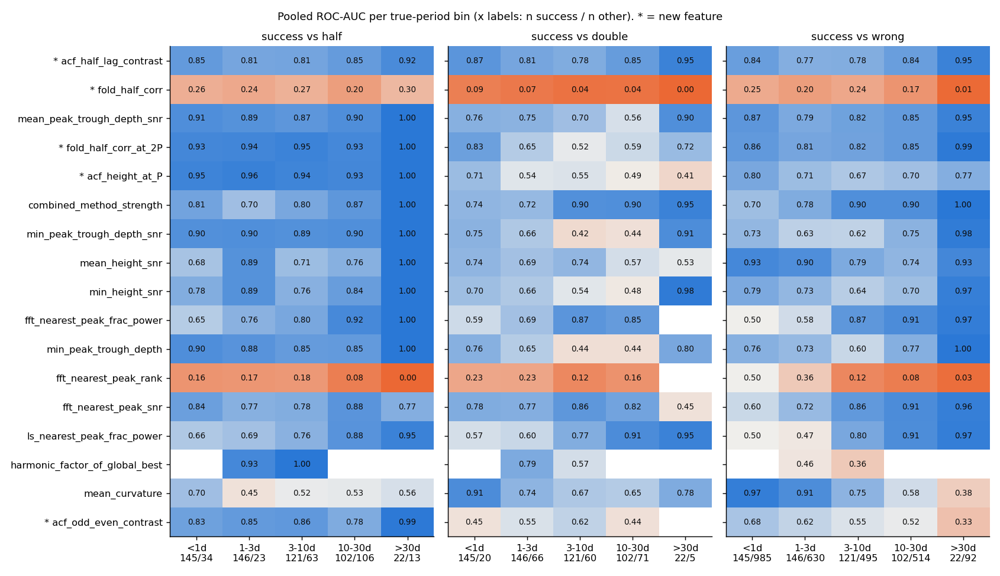
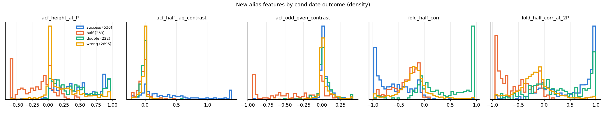
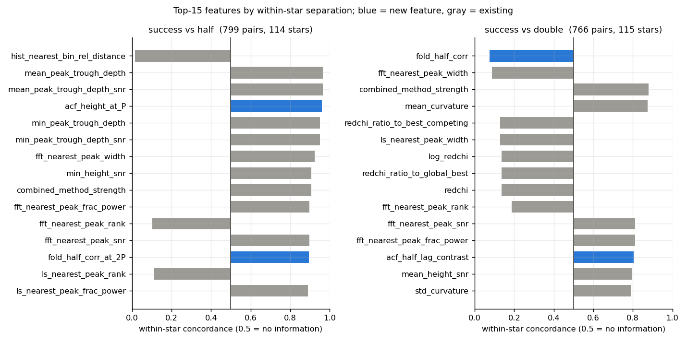
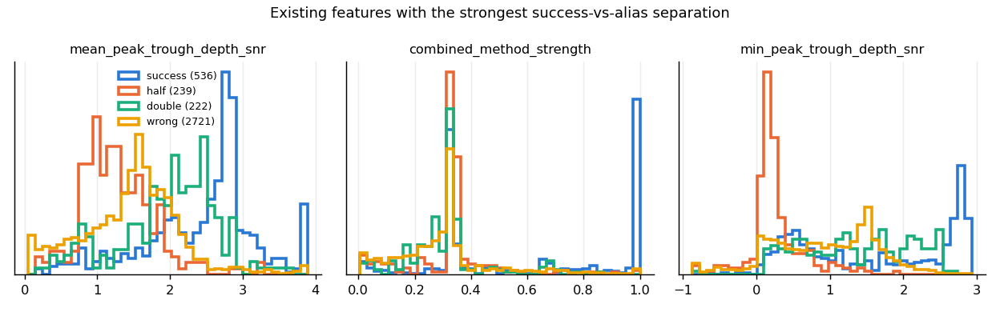
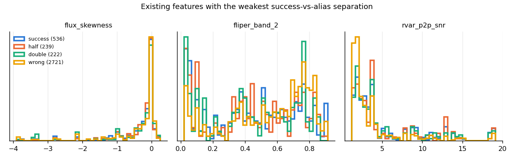
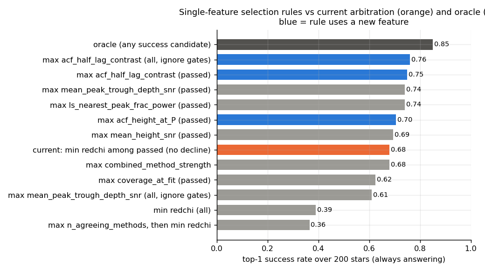
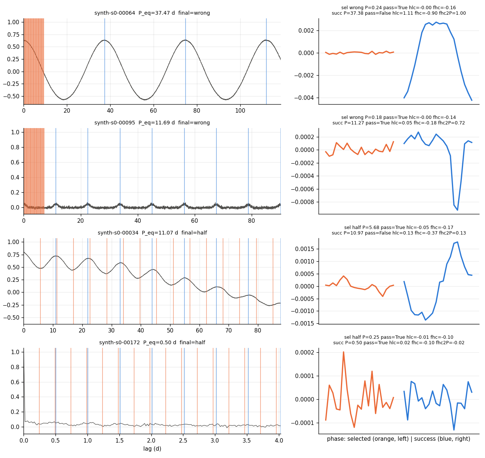
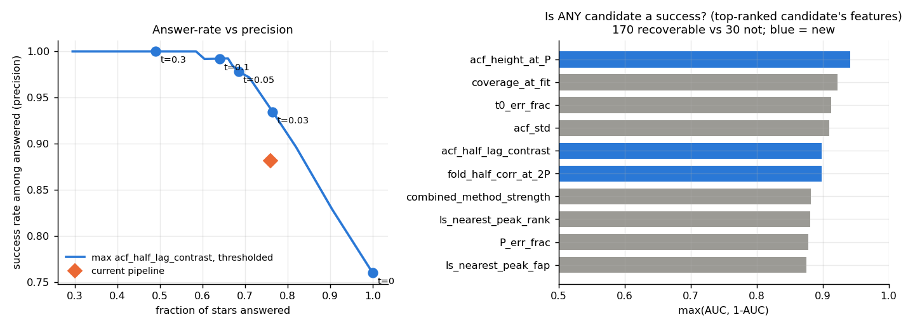

# T9: Feature literature and empirical search for alias / spurious-candidate separation

**Date:** 2026-10-14 · **Author:** feature-researcher agent (Claude, unattended) · **Branch:** `claude/t9-feature-search-c44ff5` · **Status:** draft

## TL;DR
- **I added five new per-candidate features** to `ml_features.py`, documented in `FEATURE_DOCUMENTATION.txt` Section G and tested. They are direct P/2-vs-P-vs-2P tests: `acf_height_at_P`, `acf_half_lag_contrast`, `acf_odd_even_contrast`, `fold_half_corr`, `fold_half_corr_at_2P`.
  - They cost about **1.7 ms per candidate**, about 0.03–0.05 s per star.
  - On `synthetic:n=200,seed=0`, two of them are the strongest success-vs-alias separators in the whole table. `acf_half_lag_contrast` has pooled AUC 0.83. `fold_half_corr` has AUC 0.17, i.e. a separation of 0.33.
  - **`fold_half_corr` is the single best P-vs-2P feature.** Pooled AUC is 0.06, i.e. 0.94 in the useful direction. Within a star, it orders success above a 2P alias in 92% of pairs.
  - None of the five correlates with an existing feature at |ρ| > 0.56, so they carry new information.
- **Open issue 12 is mostly a gating problem, not a ranking problem.** 170/200 stars had a success candidate after fitting, and 36 of those were lost. In 30 of the 36 the success candidate **failed the gates**:
  - 22 were declined;
  - 8 got a wrong/half answer instead.
  - Only 6 were lost to the min-redchi ranking among passing candidates.
  - The typical "wrong" pick is a ~0.2 d noise candidate with tiny redchi and `acf_half_lag_contrast` ≈ 0 (open issue 10).
- **Decline prediction:** consider the rule "pick the candidate with the largest `acf_half_lag_contrast`; answer only if it is ≥ 0.03". At about the same answer rate as the current pipeline (76.5% vs 76%), it gives **71.5% success vs 67%**, with precision 0.93 vs 0.88. At a threshold of 0.05 it matches today's 67% success with **precision 0.98** (3 bad answers vs 18).
  - The threshold was chosen in-sample on 200 synthetic stars. This is evidence for the feature, not a tuned rule.
- **The GBM sanity check shows only a small gain** from the new features: star-grouped CV top-1 went 0.765 → 0.775, i.e. 2 stars. The existing ~100 features already rank well when combined. The new features' clearest value is for decline, gating and interpretability.
- **Deviation from the brief:** I prototyped a star-level `rvar_p2p_snr` (variability amplitude / point-to-point noise) but **did not add it**. Synthetic white noise is fixed at 0.002, so on this data it is ρ = 0.993 with `r_var` by construction, and its separation can't be measured. It should be re-tested on SMARTS.

## Question / goal
Task **T9** in `docs/TASKS.md`: find metrics that separate correct candidates (`correct` / `diffrot`) from P/2 and 2P aliases and from spurious (`wrong`) ones, and metrics that predict when the pipeline should decline. There is no `goals.json` goal for T9. The results bear on open issues 10 and 12 and on T10/T11.

## What I did
1. **Literature.** Web search plus prior knowledge; see the table below. Items I could not verify this session are marked.
2. **Feature table, pass 1.** Script: `build_feature_table.py`.
   - Dataset: `synthetic:n=200,seed=0`, the same suite as the scorecard baseline.
   - Same Stage-1 pool as the scorecard: `pairwise_histogram`, `lombscargle` and `acf_fft`, with `n_guesses=10` each.
   - Then `fit_rotation_period` with defaults and `extract_candidate_features`.
   - Each candidate is labelled `classify_period(fitted_P, P_eq, REL_TOL, period_range)`, with `period_range = lc.params['period_range']`.
   - Ran with `--n-workers 2` and BLAS pinned to 1 thread, about 6 min.
   - Result: 3,718 candidates. 307 correct, 229 diffrot, 239 half, 222 double, 2,721 wrong.
   - The pipeline's final outcomes reproduce the committed baseline: 92 correct, 42 diffrot, 7 half, 11 wrong, 48 none.
3. **New features, pass 2.** Script: `new_features.py`. Evaluated at each candidate's fitted P from the regenerated (deterministic) light curve. No refit and no truth used.
4. **Analysis.** Script: `analysis.py`, which writes everything in `data/`. It computes:
   - pooled ROC-AUC, overall and per period bin, for success vs {half+double, half, double, wrong};
   - within-star pairwise concordance;
   - redundancy (|Spearman ρ| > 0.95) and near-constant features;
   - a star-level decline analysis;
   - simple single-feature arbitration rules;
   - a 5-fold star-grouped `HistGradientBoostingClassifier` top-1 check.
5. **Implementation.** I added the features with docstrings, `FEATURE_DOCUMENTATION.txt` Section G, and 4 tests (3 fast, plus an extension of the slow end-to-end test).
   - Existing feature definitions are untouched.
   - Not touched either: `guesses.py`, `comb_fit.py`, `acf_utils.py`, `evaluation.py`, the scorecard, goals, and the datasets.

## Results

### Literature table

Cost legend:
- **free**: already computed;
- **cheap**: O(N) or O(n_lags) per candidate, ≲ 2 ms;
- **moderate**: an extra transform per star, ~10–100 ms;
- **expensive**: per-star model fitting, ≳ 1 s.

| Idea | Citation | Definition | Failure mode targeted | In `ml_features.py`? | Cost/star |
|---|---|---|---|---|---|
| ACF local peak height h_P | McQuillan, Aigrain & Mazeh 2013 (MNRAS 432, 1203); McQuillan+2014 (ApJS 211, 24) | ACF peak height minus the mean of the two flanking minima | Spurious periods; detection threshold | Close analogues: `mean/min_peak_trough_depth(_snr)` use the *lower* trough, aggregated over comb teeth | free |
| Half-period rule (alternating peaks) | McQuillan+2013/2014 | If the 2nd ACF peak is higher than the 1st and 3rd, the 1st is P/2 | **P/2 alias** (double-dip) | **New:** `acf_odd_even_contrast` (continuous, every candidate) | cheap |
| G_ACF, H_ACF | Breton, Santos+ 2021 (ROOSTER, A&A 647, A125); periods from Santos+2019 (ApJS 244, 21), 2021 (ApJS 255, 17) | G_ACF = ACF height at P_ACF. H_ACF = mean height above the two flanking minima | Detection / reliability (ROOSTER RotClass) | **New:** `acf_height_at_P` (G_ACF per candidate). H_ACF ≈ `mean_peak_trough_depth` | free |
| Composite spectrum (CS), H_CS | Ceillier+2016 (MNRAS 456, 119); Ceillier+2017 (A&A 605, A111) | Product of the normalized wavelet power spectrum (GWPS) and the ACF (detrended, rebinned to periods); Gaussian fits | Instrumental / one-method-only peaks | Partial: `combined_method_strength` is the *mean* of per-method fractional powers, not the product. A product needs `wavelet` in the pool, which is off by default | cheap (moderate if wavelet must run) |
| Gaussian widths of GWPS/CS peaks | Breton+2021; García+2014 (A&A 572, A34) | Std / HWHM of the fitted Gaussians | Diffrot / spot evolution broadening; uncertainty | Partial: `*_nearest_peak_width` (in **days**, half-max crossing) | free |
| S_ph | Mathur+2014 (A&A 562, A124); García+2014; Santos+2019 | Std over segments of 5·P | Activity level; ML input | `s_ph` (bins of **1·P**, not 5·P) | cheap |
| FliPer | Bugnet+2018 | Integrated PSD above several cutoffs, minus shot noise | Classifying pulsators / binaries vs rotators | `fliper_band_*` (simplified) | cheap |
| R_var | Reinhold & Gizon 2015 (A&A 583, A65); Basri+2013 | 5–95 percentile range | Variability threshold before a period search | `r_var` | free |
| Two-peak diffrot (P_high, P_low) | Reinhold, Reiners & Basri 2013 (A&A 560, A4); Reinhold & Gizon 2015 | Two close LS peaks after pre-whitening; α = (P_high − P_low)/P_high | Measures shear; flags *diffrot* stars | No (future F1) | moderate (pre-whitening) |
| LS false-alarm probability | Baluev 2008 | Analytic FAP of a peak's power | Spurious peaks | `ls_nearest_peak_fap` (saturates for long LCs) | free |
| Single/double-dip ratio (SDR) | Basri & Nguyen 2018 (ApJ 863, 190) | Fraction of time a light curve shows 1 vs 2 dips per rotation (dip spacing > 0.75 P → single) | **P/2 alias** from double-dipping | **New, related:** `fold_half_corr`, `fold_half_corr_at_2P` (fold-based odd/even test) | cheap |
| Dip-duration harmonic test | "Double-dipping to refine stellar rotation periods", arXiv:2306.02315 (2023; authors not verified this session) | Distribution of dip durations in units of the candidate P; picks the plausible harmonic. Finds ~10% of McQuillan+2014 periods are ~2× too long | **2P and P/2 aliases** | Related to `fold_half_corr` (cheaper proxy) | moderate (dip finding) |
| Odd/even depth test | Transit / EB vetting standard (e.g. Kepler DV) | Compare alternate events folded at P | **2P alias** | **New:** `fold_half_corr` | cheap |
| GP quasi-periodic kernel posterior | Angus+2018 (MNRAS 474, 2094) | Period = QP-kernel hyperparameter, with a posterior width | Gives an uncertainty and handles spot evolution | No | expensive (≫ pipeline budget at 1M) |
| Random forest on 27-d LC + Gaia features (Astraea) | Lu, Angus, Agüeros+ 2020, "Astraea: Predicting Long Rotation Periods with 27-Day Light Curves" (AJ 160, 168; arXiv:2008.03351; verified 2026-10-14 by Rae + Crossref/arXiv) | RF *regression* of P from short-LC variability statistics plus Gaia DR2 stellar parameters, trained on 27-d Kepler segments; ~9% uncertainty up to 150 d on Kepler, ~55% on real TESS (systematics) | Periods **longer than one TESS sector**, where periodogram/ACF methods can't see a full cycle | No: predicts P rather than validating a candidate. **Highly relevant to T16 (single-sector stars) and D1**, as a prior or upper/lower-limit companion when coverage is too short | cheap at inference (needs Gaia params) |
| Ground-based (ZTF) rotation-period pipeline | Lu, Curtis, Angus, David, Hattori 2022, "Bridging the gap: the disappearance of the intermediate period gap for fully convective stars, uncovered by new ZTF rotation periods" (AJ 164, 251; arXiv:2210.06604; verified 2026-10-14) | 40,553 ZTF periods from a pipeline that cleans the archival light curves (26% less scatter); period-search details not checked (abstract only) | Sparse, **ground-based, day/night-gapped** photometry; long periods for M dwarfs | No new candidate-level feature. Relevant to periodic-gap aliasing if the pipeline goes beyond TESS (T8 out-of-scope note; Roman) | n/a |
| CNN on wavelet images, with heteroskedastic uncertainty | Claytor+2022 (ApJ 927, 219; built SMARTS); Claytor+2024 (arXiv:2307.05664, southern CVZ up to 80 d) | CNN maps the wavelet transform to (P, σ_P); σ_P used as a reliability cut | Decline / credibility; long periods | No. Its **σ_P is a decline signal we lack**; see open questions | expensive (needs a trained CNN + GPU) |
| Statistical comparison of ACF / LS / GP | Breimann, Matt & Naylor 2021 (ApJ 913, 75) (**not verified this session**; recalled as comparing period-detection methods on synthetic spotted LCs) | n/a | Method choice under spot evolution | n/a | n/a |
| Hare-and-hounds: diffrot and spot evolution | Aigrain+2015 (MNRAS 450, 3211) | Blind test with butterpy-like spots | Diffrot shear is poorly recovered from light curves. The period is recovered within 10% for ~70% | Informs the `diffrot` outcome (success) and the warning that F1 will be hard | n/a |

What this means for us:
- The literature's alias handling is almost entirely post-hoc and rule-based. Examples are McQuillan's peak-height rule (which Basri+ show over-doubles about 8–10% of periods) and ROOSTER's "flag if another candidate is within 15% of 2·P_ML" (ROOSTER's PeriodSel has no learned alias test).
- Encoding the odd/even and half-lag tests as continuous per-candidate features lets the ranker learn them instead.

### Feature separation

The pooled ROC-AUC table for all ~100 features is in `data/auc_overall.csv`, and the per-bin version in `data/auc_by_bin.csv`. The top of the success-vs-alias list:

| feature | vs alias | vs half | vs double | vs wrong | within-star: half | within-star: double |
|---|---|---|---|---|---|---|
| **acf_half_lag_contrast** (new) | 0.83 | 0.83 | 0.83 | 0.81 | 0.81 | 0.80 |
| **fold_half_corr** (new) | 0.17 | 0.28 | **0.06** | 0.20 | 0.21 | **0.08** |
| mean_peak_trough_depth_snr | 0.80 | 0.89 | 0.71 | 0.84 | 0.96 | 0.74 |
| **fold_half_corr_at_2P** (new) | 0.78 | **0.94** | 0.61 | 0.85 | 0.89 | 0.62 |
| **acf_height_at_P** (new) | 0.76 | **0.95** | 0.55 | 0.73 | 0.96 | 0.65 |
| combined_method_strength | 0.75 | 0.71 | 0.79 | 0.80 | 0.91 | 0.88 |
| min_peak_trough_depth_snr | 0.75 | 0.90 | 0.59 | 0.69 | 0.95 | 0.53 |
| mean_height_snr | 0.74 | 0.78 | 0.69 | 0.86 | 0.85 | 0.80 |
| **acf_odd_even_contrast** (new) | 0.68 | 0.83 | 0.52 | 0.60 | 0.78 | 0.43 |
| redchi | 0.44 | 0.52 | 0.35 | 0.47 | 0.53 | 0.14 |

AUC is P(success candidate has the higher value), so values far below 0.5 are equally useful. "Within-star" is pairwise concordance between candidates of the same star, which is the quantity a `rank:pairwise` model optimizes. Note that **redchi does not separate success from P/2 aliases at all** (0.52 pooled, 0.53 within-star), and that is the alias type that min-redchi arbitration cannot fix.


Look at the `fold_half_corr` row in the "success vs double" panel: it is 0.00–0.09 in every bin. Then look at the `acf_height_at_P` and `fold_half_corr_at_2P` rows in "success vs half": they are ≥ 0.92 in every bin. Existing P-vs-2P features fade in some bins; for example `min_peak_trough_depth_snr` is 0.42–0.44 at 3–30 d.


The double aliases (green) pile up at `fold_half_corr` ≈ 1. Half aliases (orange) have a spike at `acf_height_at_P` ≈ −0.6, where their first "peak" is a trough, and are pushed low in `fold_half_corr_at_2P`. Wrong candidates sit at `acf_half_lag_contrast` ≈ 0.


`fold_half_corr` is the strongest within-star P-vs-2P signal (0.08 concordance, i.e. 92% of pairs ordered correctly). Caveat: `fft/ls_nearest_peak_width` are measured in days, so within a star they partly encode the period itself.



The weakest features for alias separation are star-level (`r_var`, FliPer bands, etc.). They are constant within a star, so they can only help decline prediction, not candidate ranking.

**Redundancy** (`data/redundant_pairs.csv`): 23 pairs with |ρ| > 0.95. Most are expected (`period` / `log_period` / `period_frac_of_baseline` / `fitted_P` / `n_cycles_spanned`, and `redchi` / `log_redchi`). Two are worth a look:
- `flux_std` ~ `von_neumann_eta` ~ prototype `star_g_acf` (|ρ| ≥ 0.994). This is because synthetic white noise is constant, so these all just measure amplitude. Expect them to decouple on SMARTS.
- `ls_nearest_peak_width` ~ period (0.96). The width is in days, not relative.

**Near-constant** (`data/near_constant.csv`), 26 features:
- All 20 `ls_short_*` / `fft_short_*` / `fft_highpass_*` / `wavelet_*` columns are 100% NaN, because those methods are not in the default pool. Their usefulness has not been measured here.
- `baseline_days`, `n_acf_points` and `duty_cycle` are constant on synthetic data.
- `passes_redchi` is true for 99.9% of rows, and `passes_height_snr` for 99.4%.

### Arbitration (open issue 12)

| final outcome (stars that had a success candidate) | success cand failed gates | success cand passed gates |
|---|---|---|
| correct / diffrot | 0 | 134 |
| none (declined) | **22** | 0 |
| wrong | 4 | 5 |
| half | 4 | 1 |

So 30 of 36 losses happen because the success candidate never passes the gates. In the >30 d bin, 8/8 stars had a success candidate and **0/8** succeeded, because their success candidates fail the gates. They fit only 3–4 teeth inside the 1/3-baseline ACF, at or below the `n_peaks_used ≥ 4` limit, so the other gates presumably decide the 4-tooth cases; I did not break this down.


Top-1 success when always answering:
- the current rule (min redchi among gate-passers): 0.68;
- picking the max `acf_half_lag_contrast` among all candidates, ignoring gates: **0.76**;
- picking the max `mean_peak_trough_depth_snr` among passers: 0.74;
- the oracle: 0.85.
- The star-grouped GBM gets 0.765 with existing features and 0.775 with the new ones added.


Look at rows 1–2:
- The pipeline picked ~0.2 d noise candidates whose comb "teeth" sit on the ACF's lag-0 decay (orange band). They pass every gate, but `acf_half_lag_contrast` is −0.00.
- Row 1's true 37 d candidate is clean (`hlc` 1.11, `fold_half_corr` −0.90) but fails the gates.
- Row 4 (P = 0.5 d, flat ACF) is effectively unrecoverable. Its numbers are all near zero, which is what a decline model should see.

### Decline prediction


Left panel: thresholding a single new feature beats the current pipeline's operating point (orange) at every answer rate tested.

Right panel: the best predictor of whether a star is recoverable at all (any candidate is a success, from the top-ranked candidate's features; 170 vs 30 stars) is `acf_height_at_P`, AUC 0.94. Next are `coverage_at_fit` (0.92) and `t0_err_frac` (0.09, i.e. inverted).

Among answered stars (134 success vs 18 bad), `min_peak_trough_depth` (AUC 0.99) and `acf_half_lag_contrast` (0.98) best separate good answers from bad ones. Only 18 negatives, so this is noisy.

### Cost
Measured in pass 2 on 13-sector, 30-min light curves (17k cadences):
- **2.5 ms per candidate** including the prototype star-level metrics, about 0.05 s per star for ~18.6 candidates.
- The five implemented features alone take **~1.5–2 ms per candidate**, from a micro-benchmark.

For comparison, pass 1 took about 2.5 s per star and the scorecard about 1.2 s per star. My first fold implementation used a per-segment Python loop and cost up to 19 ms per candidate at P = 0.25 d. Vectorizing it with a single `bincount` brought that to about 2 ms; the rationale is recorded in a code comment.

### Ranked recommendations

**New features (implemented; ranked by value):**
1. `fold_half_corr`: the best P-vs-2P discriminator, independent of the ACF.
2. `acf_half_lag_contrast`: P-vs-2P, and also the cleanest "real comb vs noise" signal for decline and gating.
3. `acf_height_at_P`: P-vs-P/2 and recoverability (G_ACF per candidate).
4. `fold_half_corr_at_2P`: P-vs-P/2 in flux space.
5. `acf_odd_even_contrast`: P-vs-P/2. Weakest of the five, but cheap and interpretable.

**Proposed, not implemented:**
- **`rvar_p2p_snr`** (star level): re-test on SMARTS, where noise varies. Code is in `new_features.py`.
- **`*_nearest_peak_width_rel`** = width / fitted_P. The current widths are in days and partly duplicate the period.
- **A CS-style product** of LS and ACF-FFT fractional power at P (Ceillier). The ranker can learn this from the existing columns, so it is low priority.
- **A per-candidate local-SNR-of-teeth measure** that uses only teeth beyond the ACF's first zero crossing. This targets the lag-0-decay false positives in open issue 10.

**Proposed changes to existing definitions** (would invalidate training data, so these are Rae's call):
- `s_ph` uses 1·P bins. Mathur+2014 and ROOSTER use 5·P, and within a star 1·P mostly encodes the period (concordance 0.99 vs half, 0.10 vs double).
- `combined_method_strength` could also expose the product (CS) alongside the mean.

## What didn't work
- **`rvar_p2p_snr`** can't be evaluated on this synthetic suite: white noise is fixed, so it's just `r_var` (ρ = 0.993). Not implemented.
- **Star-level G_ACF** (highest ACF value after the first minimum) is |ρ| 0.996 with `flux_std` on synthetic data, for the same reason. Not implemented.
- **The first `fold_half_corr` definition** (correlate the first half of the fold with the second) depended on the arbitrary phase origin. I replaced it with the circular half-cycle self-correlation before finalizing; only the final definition's numbers are reported.
- **Combining features with a GBM** barely moved top-1 (+2 stars of 200). At this sample size the existing features already saturate what a pointwise model can do. The big gap to the oracle (0.775 vs 0.85) comes from gating and decline structure, not from missing features.

## Open questions for Rae
1. **Gate fix for issue 12 / issue 10 (your decision).** A gate like `acf_half_lag_contrast ≥ ~0.03` on the selected candidate, or "pick max contrast", would reject the lag-0-decay noise picks.
   - It could also stand in for the peak-count/shape gates for long periods: >30 d stars are 0/8 now, while each one's best success candidate has a contrast of 0.15–1.43.
   - Should this be a P1-style hand-tuned interim fix (`comb_fit.py` belongs to other agents) or wait for T11? The threshold here is in-sample on synthetic data.
2. **Ranker labels (T10).** The pooled AUCs above treat `diffrot` as success. If T10 uses graded relevance (2 = P_eq, 1 = band), check that the alias features don't penalize band periods. `fold_half_corr` for diffrot vs correct can be checked in `data/candidates.csv.gz`.
3. **`s_ph` bin width** (1·P vs the literature's 5·P): change it, or add `s_ph_5P` alongside it?
4. **CNN uncertainty as a decline input.** Claytor+2022's σ_P is the only published *learned* reliability score for SMARTS-like data. Do you want T11 to compare the ranker's decline threshold against the SMARTS CNN where both are available?
5. **Re-validate on SMARTS dev_small** once T2 lands. Synthetic noise is white and constant, spots are simple, and the `>30d` bin has n = 8.
6. **Literature gaps:** I couldn't verify Breimann+2021, Lu+2020 or "Lu+2022" this session; those rows say so. You may know which Lu 2022 paper was meant.
   **Resolved 2026-10-14 (Rae):** Lu+2020 = Astraea (AJ 160, 168) and Lu+2022 = ZTF periods (AJ 164, 251); rows updated. Breimann+2021 remains unverified.

## Reproduce
```bash
# from repo root (~6 min on 2 workers, then <2 min)
/opt/anaconda3/envs/ss_local/bin/python reports/2026-10-14_t9-feature-search/build_feature_table.py --n 200 --seed 0 --n-workers 2 --outdir runs/t9_feature_table
/opt/anaconda3/envs/ss_local/bin/python reports/2026-10-14_t9-feature-search/new_features.py --n 200 --seed 0 --indir runs/t9_feature_table
/opt/anaconda3/envs/ss_local/bin/python reports/2026-10-14_t9-feature-search/analysis.py
/opt/anaconda3/envs/ss_local/bin/python tools/run_notebook.py reports/2026-10-14_t9-feature-search/notebook.ipynb
/opt/anaconda3/envs/ss_local/bin/python -m pytest -q
```
