# T1 phase 1: SMARTS-TESS catalog audit and sample spot-check

**Date:** 2026-10-15 · **Author:** data-auditor agent (session t1-data-audit-phase1) · **Branch:** `claude/t1-data-audit-phase1-41159b` · **Status:** draft

## TL;DR

- **The catalog is clean and complete.** 1,000,000 rows, one per file, with no NaNs, infs, duplicates or non-positive periods. Every parameter matches `SMARTS_REFERENCE.md` Table 1 (KS D ≤ 0.0014 against the reference) **except OVERLAP**. That one is log-uniform over 0.1 yr to **max(CYCLE, √10 yr)**, so OVERLAP > CYCLE for 5.2% of stars.
- **Join trap: the file number is the catalog *row index*, not the "Simulation Number" column.** Rows are sorted by period. Joining on "Simulation Number" mismatches 100% of the 10k batch1 headers, while joining on the row index matches all of them to float32 precision. Bundle `NNN` holds P in (NNN−1, NNN] d, and that held exactly for the 10 bundles I listed.
- **The galaxy-noise train/test split is hidden in "Simulation Number".** Noise fingerprints of 1,050 files gave 383 pairs of files with identical noise. **0** of them straddle SIM_ID = 800,000, where ~125 would if galaxies were assigned at random. SIM_ID < 800k uses ≈ 978 galaxies (95% CI 882–1089); SIM_ID ≥ 800k uses a separate pool of ≈ 829 (574–1248). That matches Claytor's 1,000 train / 1,000 val+test galaxies. **Use SIM_ID ≥ 800k (200k stars) as the galaxy-disjoint holdout pool.** The two pools have identical parameter distributions (KS D ≤ 0.0025).
- **12.1% of files (127/1,050) carry corrupt galaxy-noise orbits** (max |flux − 1| > 0.1, up to 358, with flux going negative). Each noise group is entirely good or entirely bad, so this is a property of the galaxy. `load_smarts_fits` drops the bad orbits in 121 of 127 files. The WAVELET HDU and any raw-flux consumer still see them.
- **Differential rotation matters a lot.** For 15.0% of stars the whole active-band period range is outside P_eq ± 10%, so P_eq is never a spot period. For 55.6% the band extends beyond ± 10%. The rate is flat across period bins.
- **Reach:** on the full 13-sector baseline, 16.5% of the corpus has P < B/12, 66.1% has P < B/3 and 99.2% has P < B/2. On one sector, P < B/3 drops to 5.0%.
- **Files** are all 155,520 B, so the corpus is **155.5 GB** extracted (89 GB compressed). A 300 MB local budget holds **1,929 files**, enough for dev_small *and* a ~1,000-file dev_medium.

## Question / goal

Task **T1 phase 1** in `docs/TASKS.md`: audit the input-parameter catalog and spot-check a small sample before anyone trains on the corpus. Scope was catalog plus ≤ 50 sample files, with no full-corpus scan. No `benchmarks/goals.json` goals are involved, and no pipeline code changed.

**Deviation from the brief, disclosed:** besides the 50 sampled files, I *read* (did not extract or copy) the 1,000 files already on the drive at `smarts_data/data_subset/`, which are every 100th row from 0 to 99,900, so P < 18 d. The leakage check needs hundreds of files to see galaxy collisions. Each pass took ~2.5 min, within the brief's 15-min drive limit. The data-auditor role file says to hand runs over "a few hundred files" to Rae; I judged the brief's 15-minute rule to be the more specific limit.

## What I did

1. **Drive safety.** `tools/audit/smarts_data.py` checks the mount and exits with "plug in the Data_Vault drive" when it is missing. It takes the root from `--data-root` / `$SMARTS_DATA_ROOT`, writes atomically (temp file + `os.replace`), and extracts only to `/Volumes/Data_Vault/smarts_data/extracted/`.
2. **Catalog.** `extract_catalog.py` streamed the 1.96 GB tarball, which holds a single **4.19 GB FITS file**, to `extracted/catalog/` (62 s). `catalog_to_table.py` converted HDU 1 to `smarts_catalog.npz` (32.7 MB) and `.csv.gz` (32.8 MB) on the drive, renaming the columns to the FITS header keys (pyarrow is not installed, so no parquet).
3. **Catalog audit.** `catalog_audit.py` produces all the summary tables in `data/`. `t2_planning.py` produces the T2 numbers, and `flag_lists.py` the flag lists.
4. **Sample.** `extract_sample.py` takes 5 files from each of bundles 001, 002, 005, 010, 020, 040, 080, 120, 150 and 180, one per ACTIVITY quintile within the bundle (seed 0). It streams each tarball once (~6 s per bundle) and extracts only those members. That is 50 files, 7.8 MB, in `data/smarts_sample/` (gitignored), with `manifest.csv` holding paths relative to the data root. Indexes of those 10 bundles are cached at `extracted/bundle_index/NNN.csv`.
5. **Spot-check.** `lc_spotcheck.py` checks HDUs, headers vs catalog, the WAVELET HDU vs the catalog cube, the time grid, interpolated-gap runs, `load_smarts_fits` diagnostics, per-orbit noise, and a Lomb-Scargle peak scored with `evaluation.classify_period`.
6. **Leakage and noise.** `noise_fingerprint.py --split-analysis` and `flux_outliers.py` ran over `data_subset/` plus the sample (1,050 files).

## Results

### Catalog contents (`hlsp_smarts_tess_ffi_all_tess_v1.0_sim.fits`)

| HDU | Content |
|---|---|
| 0 PRIMARY | HLSP metadata only (TELAPSE = 357.04 d, XPOSURE = 1800 s). |
| 1 BINTABLE | 1,000,000 × 12: `Simulation Number` (K), `Activity Rate`, `Cycle Length`, `Cycle Overlap`, `Inclination`, `Spot Min`, `Spot Max`, `Period`, `Omega`, `Shear`, `Decay Time` (D), `Butterfly` ('True '/'False'). There are no TUNITs; units come from the per-file header comments (d, yr, yr, rad, deg, deg). |
| 2 IMAGE | uint8 (1,000,000 × 64 × 64), 4.1 GB: the per-file WAVELET images (the CNN input), not extracted further. |

- **No columns for noise-galaxy ID, train/val/test split, amplitude, or SNR.**
- Every value is rounded to 1e-4, and the per-file headers carry the same rounded values stored as float32.
- `Omega` = 2π/P to within its rounding (max relative deviation 0.14%, at the longest P).
- 118 rows have an exactly integer P. They sit at bundle edges, and the (NNN−1, NNN] convention puts them in the lower bundle.

**Per-file FITS** (all 50 identical in structure): PRIMARY (header keys PERIOD, ACTIVITY, CYCLE, OVERLAP, INCL, MINLAT, MAXLAT, DIFFROT, TSPOT, BFLY, HLSPTARG), LIGHTCURVE (17,520 × float32 time and flux, 30-min cadence, t = 0–364.98 d, the identical grid in every file), and WAVELET (64 × 64 uint8, PMIN = 0.1, PMAX = 180). The WAVELET HDU is byte-identical to the catalog cube slice at the same row in 50/50 files. Headers match the catalog row to < 7.6e-6 in 50/50 files, and HLSPTARG matches the file number.

### 1. Parameter distributions vs the reference

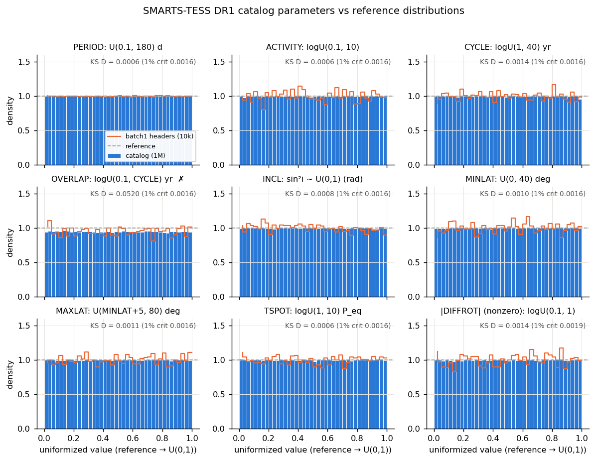

Every panel should be flat. Only OVERLAP isn't (KS D = 0.052, against a 1% critical value of 0.0016). Batch1 (orange) agrees with the catalog everywhere.

- Shear classes are **exact quotas**: 500,000 solar, 250,000 zero and 250,000 anti, with no |shear| in (0, 0.1).
- BFLY True for 80.06% of stars.
- INCL is uniform in sin²i (D = 0.0008). It is *not* isotropic (uniform in cos i gives D = 0.25), so pole-on stars are rarer than for random orientations: 4% have sin²i < 0.04.

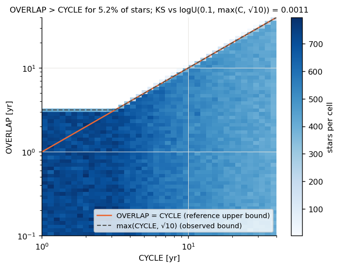

OVERLAP's upper bound is max(CYCLE, √10), not CYCLE (KS D = 0.0011 for that model). For CYCLE < 3.16 yr, overlap can reach 3.16 yr. This is valid physics (strongly overlapping cycles) but differs from Table 1.

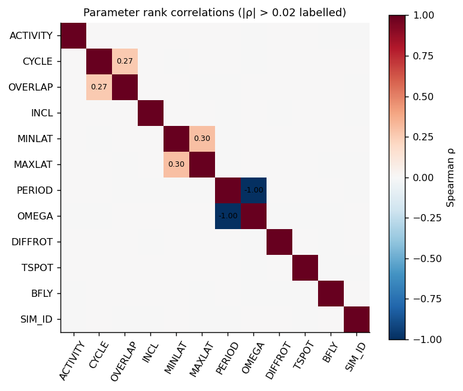

The parameters are mutually independent apart from the by-construction couplings. SIM_ID is uncorrelated with every parameter.

### 2. Pipeline reach

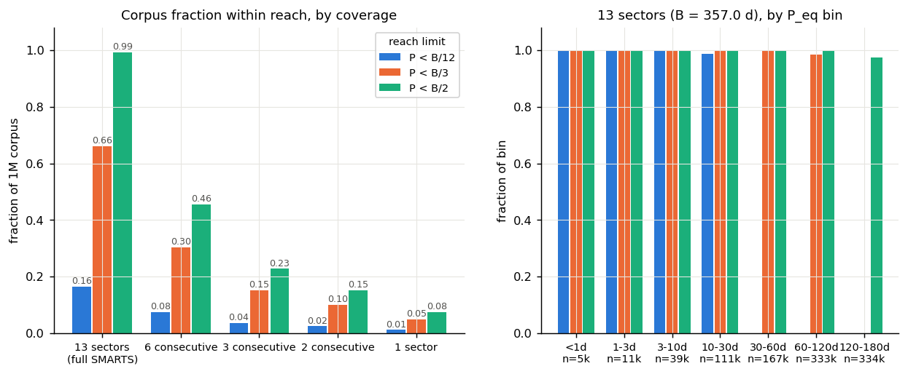

| coverage (span) | P < B/12 | P < B/3 | P < B/2 |
|---|---|---|---|
| 13 sectors (B = 357.0 d) | 0.165 | 0.661 | 0.992 |
| 6 consecutive (164 d) | 0.076 | 0.304 | 0.456 |
| 3 consecutive (82 d) | 0.038 | 0.152 | 0.228 |
| 1 sector (27.4 d) | 0.012 | 0.050 | 0.076 |

Because P_eq is uniform, these fractions are just limit/180. Requiring the whole active band to be in reach (P_hi < limit) lowers them: 0.590 instead of 0.661 for P < B/3 on 13 sectors (`data/reach.csv`, `frac_band_all`). "B" here is a span, so real duty cycles (below) make things worse.

### 3. Differential-rotation impact

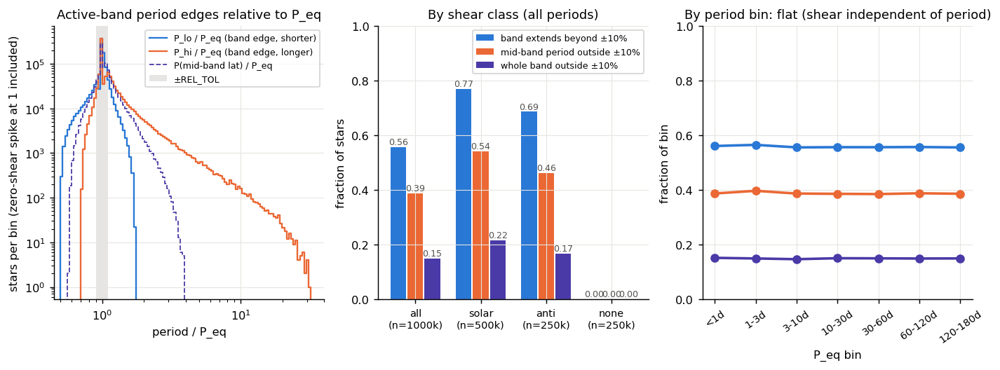

Left: the distributions of the band edges. Middle: the effect by shear class. Right: the same fractions in every period bin. Numbers use `evaluation.active_band_period_range` and REL_TOL = 0.10.

| shear class | band extends beyond ±10% | mid-band period outside ±10% | whole band outside ±10% (P_eq never seen) |
|---|---|---|---|
| all | 0.556 | 0.387 | **0.150** |
| solar (50%) | 0.770 | 0.542 | 0.215 |
| anti (25%) | 0.686 | 0.463 | 0.168 |
| none (25%) | 0 | 0 | 0 |

So the scorecard's `diffrot` outcome is not an edge case: for 15% of stars it is the *only* way to be scored a success. The ranker's P_eq-only label (open issue 11, T10) will call the physically correct answer "wrong" for those stars.

### 4. Detectability proxies

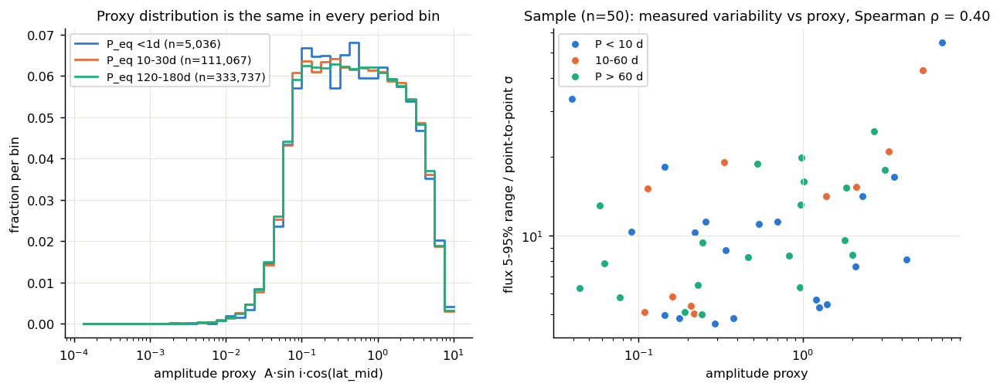

The amplitude proxy A·sin i·cos(lat_mid) has the same distribution in every period bin (left). The injected population therefore carries no period-amplitude correlation for a ranker to learn, and any period dependence of detectability comes from noise, cadence and baseline. 4.7% of stars have proxy < 0.05.

In the sample, the proxy correlates only weakly with the measured variability-to-noise ratio (Spearman ρ = 0.40, n = 50, right). The galaxy red noise dominates the raw 5–95% range, so this proxy is good for stratification only, not as an SNR estimate. Galaxy point-to-point noise in the sample is 159–1,694 ppm (median 666) per 30-min cadence, uncorrelated with P (ρ = −0.17, p = 0.23).

### 5. Sample spot-check: light curves, gaps, noise

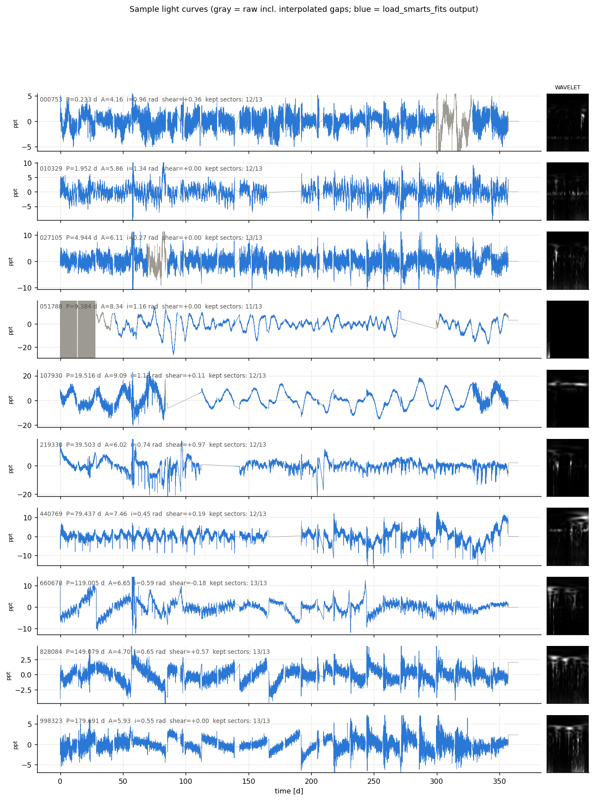

One file per bundle (the highest-ACTIVITY pick). Gray is the raw flux including the fills; blue is the `load_smarts_fits` output. Things to look at:

- 051788: its first orbit is corrupt and its WAVELET image is almost black, because the corrupt orbit saturates the scale.
- 107930 and 440769: clean rotation.
- 000753 (P = 0.23 d): the signal is invisible by eye.

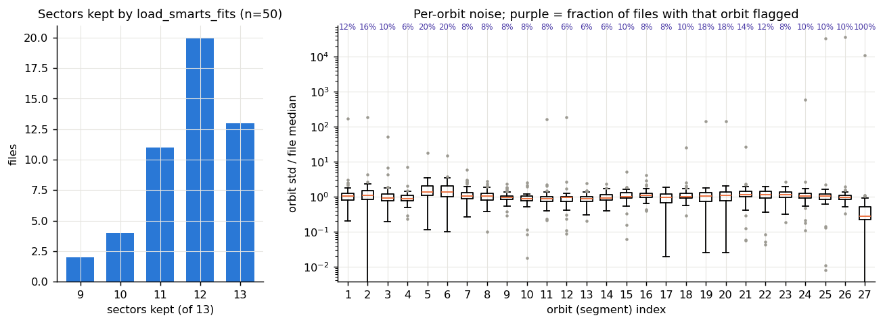

- **Gap re-detection works.** On average the loader matched 15.8 of its 26 expected breaks, flagged 3.8 orbits, and kept 11.8 of 13 sectors. Only 13/50 files keep all 13 sectors.
- **Fill is ~20% of cadences.** The median file has 19.6% of its cadences in linear-interpolation or constant fill.
- **Fill patterns differ by galaxy.** No interpolated run is common to all 50 files, and the most common ones appear in ~26/50, which suggests a few gap templates (camera/CCD groups?). The end-fill is 381–382 cadences in 46 files, but **1,747 cadences (36 d) in 4 files**. Those galaxies lack the last sector or more, and 4 others lack the first ~29 d.
- Orbit 27 (the constant end-fill) is always flagged, which is correct.

**Label sanity (raw LS peak vs P_eq):** success (correct + diffrot) for 0/10 files with P < 2 d, 13/20 for 2–60 d, and 2/20 for > 60 d. At P < 2 d the LS peak lands on galaxy red noise at 20–50 d; even restricted to < 3P, the LS power is ≤ 0.06. This is expected behaviour of a bare periodogram, not a label error. It confirms the short-P signals in SMARTS are weak relative to the TESS-galaxy noise (cf. open issue 1).

### 6. Corrupt galaxy-noise orbits

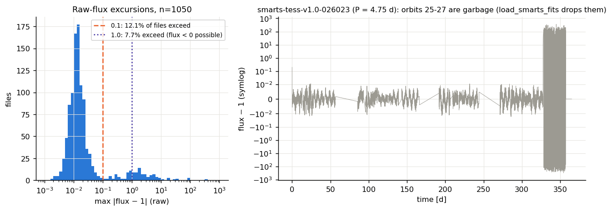

- **127 of 1,050 files (12.1%)** have max |flux − 1| > 0.1, and 7.7% exceed 1.0. Spots give at most a few percent, so this is corrupt noise.
- The bad orbits are spread over all 27 orbits, with orbits 5, 7 and 11 the most common.
- **In all 29 multi-file noise groups that contain a bad file, every member is bad** (0 mixed groups out of 229). It is a property of the galaxy, so roughly 12% of galaxies are affected.
- `load_smarts_fits` reduces every one of these files to max |flux| < 0.36. Only 6/127 keep |flux| > 0.1 after loading (`data/loader_on_corrupt.csv`), and these files keep 10.5 of 13 sectors on average.
- The list is in `data/exclusion_candidates.csv` (row, bundle member, reason, action).

### 7. Reused noise galaxies, and the hidden split

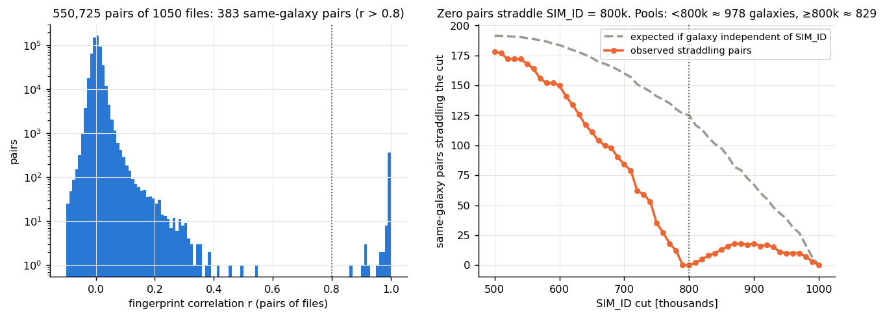

Left: fingerprint correlations are bimodal. Same-galaxy pairs sit at r > 0.98, and everything else is below 0.55. Right: the number of same-galaxy pairs straddling a SIM_ID cut drops to **0 at 790k–800k** (expected ~125), so SIM_ID < 800,000 and ≥ 800,000 use disjoint galaxy pools.

Inside the ≥ 800k pool, pairs do straddle 900k (18 pairs), so Claytor's val and test slices share galaxies. Within the scanned rows, the 1,050 files fall into 756 noise groups (group sizes 1–7). Each training galaxy is reused ~820 times in the < 800k pool (800,000 / 978). A second bump of moderate correlations (r = 0.2–0.55, 30 pairs) looks like common-mode systematics within a group of galaxies, not shared noise.

### 8. T2 planning numbers

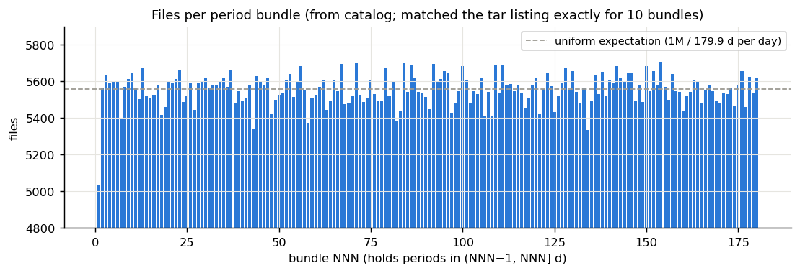

Bundles hold 5,037 files (bundle 001) to 5,707 files. Planning numbers from `data/t2_draft_draws.csv`, using illustrative stratified draws from the ≥ 800k pool with equal counts per audit period bin:

| set | files | bundles to scan | extracted size | scan time (~6 s/bundle) |
|---|---|---|---|---|
| dev_small (6 per bin × 7 bins) | 42 | 31 | 6.5 MB | ~3 min |
| dev_medium (~143 per bin) | 1,001 | 167 | 156 MB | ~17 min |
| holdout (500 per bin) | 3,500 | 180 | 544 MB | ~18 min |
| full corpus | 1,000,000 | 180 | 155.5 GB | ~18 min to *list*; extraction is I/O-bound |

Availability is no constraint. Even the smallest cell, P < 1 d × amplitude tercile × shear class in the ≥ 800k pool, has ≥ 73 stars (`data/t2_strata_by_pool.csv`).

## Recommendations for T2

1. **Split by galaxy pool. This is the leakage fix.**
   - Ranker training uses only SIM_ID < 800,000.
   - `holdout.csv` is drawn only from SIM_ID ≥ 800,000.
   - Dev sets also come from ≥ 800k, so ranker evaluation on dev is galaxy-clean.
   - Dev and holdout would then share galaxies (both ≥ 800k). Separating them needs per-file galaxy IDs (phase 2). See the open questions.
   - Join on **row index**, never SIM_ID, except to apply this split.
2. **Stratify on:**
   - audit period bin (<1, 1–3, 3–10, 10–30, 30–60, 60–120, 120–180 d);
   - amplitude-proxy tercile (cuts at proxy 0.220 and 1.028);
   - shear class;
   - coverage pattern applied at load time (T16f).

   Record P_lo/P_hi and the "band disjoint" flag per row. Oversample P < 30 d relative to the corpus, which is only 16.5% of it, but keep ~1/7 of stars beyond B/3 as decline tests.
3. **Exclusions.** Drop files with corrupt galaxy-noise orbits (max |flux − 1| > 0.1) from dev sets for now, since they are a galaxy property and cost ≥ 2 sectors. Alternatively keep a tagged handful to test the loader's flagging. They can stay in ranker training, since the loader handles them. A full-corpus list needs phase 2.
4. **Local working set (≤ 300 MB = 1,929 files):** put dev_small (≤ 50 files, ~8 MB) *and* dev_medium (~1,000 files, ~156 MB) on the laptop under `data/`, with manifests relative to `SMARTS_DATA_ROOT`. Development then never needs the drive. Holdout stays on the drive. Every set costs at most one ~18-minute streaming pass over the bundles; `bundle_index.scan_bundle(..., extract_rows=...)` already does single-pass member extraction.

## What didn't work

- **Joining on "Simulation Number"** looked like the natural key but is wrong for 100% of rows. I caught it against batch1.
- **Raw Lomb-Scargle as a label sanity check** is uninformative below ~2 d because galaxy red noise dominates the peak. A real label check needs the pipeline (or a high-passed periodogram) on a period-stratified sample.
- **The amplitude proxy vs measured variability** correlates only weakly (ρ = 0.40, n = 50), because the 5–95% flux range is noise-dominated. An SNR estimate per file needs a better amplitude measure (e.g. the pipeline's own) in phase 2.

## Open questions for Rae

1. **Dev/holdout galaxy overlap.** Is it acceptable for dev and holdout (both SIM_ID ≥ 800k) to share galaxies? If not, phase 2 needs per-file galaxy IDs. That means fingerprinting all 200k ≥ 800k files, roughly 1–3 h of streaming plus template matching once `interp_runs` is vectorized; currently it is ~0.25 s per file in Python.
2. **The P_eq label for the 15% "band disjoint" stars.** Score them diffrot-only (current behaviour), drop them from ranker training, or relabel to a band period? This feeds T10.
3. **Corrupt-noise files.** Exclude them from dev sets (my recommendation), keep them, or keep a tagged handful?
4. **Should SMARTS_REFERENCE.md record the OVERLAP bound as max(CYCLE, √10)?** I added it as confirmed-from-catalog. Butterpy's generator would explain the √10, but I didn't check the source.
5. **Suspicious, not resolved:** the 4/50 files with a 36-day end-fill and 4/50 with a 29-day start-fill (galaxies missing whole sectors). Should coverage strata use the *native* missing sectors as well as the T16a patterns?

## Rae's answers (2026-10-15)

1. Dev and holdout sharing galaxies: **acceptable.**
2. Band-disjoint stars: **keep them everywhere, including training, and track them** (manifest
   columns `band_disjoint`, `band_extends`, `P_lo`, `P_hi`). They're a case study for how far a
   measured period can sit from the governing physical periods; proposed as P17.
3. Corrupt-noise files: **exclude** from dev sets and holdout, as long as the pool stays large and
   diverse. It does: the >= 800k pool drops to ~176k and the smallest stratum from 73 to ~64.
4. Native missing sectors: **pending** (question re-explained 2026-10-15). Recommendation: record each file's
   natively usable sectors in the manifests and pick T16f coverage patterns from those.

## Phase 2 (if needed): full-corpus scan, for Rae to run locally

- **Bundle index** (member names and sizes for all 180 bundles, resumable; ~17–18 min of drive time):
  ```bash
  /opt/anaconda3/envs/ss_openblas/bin/python tools/audit/bundle_index.py --all
  ```
- **Corrupt-noise scan and galaxy IDs for all 1M files.** Not written yet. It needs a bundle-streaming variant of `flux_outliers.py` / `noise_fingerprint.py` (per-bundle outputs, `--resume`, `ProcessPoolExecutor` over bundles). I estimate a few hours on 4 workers after vectorizing `interp_runs`. Proposed as P15 in TASKS.md (P16: short-period signal strength vs synthetic).

## Reproduce

All commands run from the repo root. Each needs the Data_Vault drive, except the notebook.

```bash
PY=/opt/anaconda3/envs/ss_openblas/bin/python
D=reports/2026-10-15_t1-smarts-catalog-audit/data
$PY tools/audit/extract_catalog.py                       # ~1 min
$PY tools/audit/catalog_to_table.py                      # ~40 s
$PY tools/audit/catalog_audit.py --outdir $D             # ~40 s
$PY tools/audit/extract_sample.py                        # ~80 s, 10 bundles
$PY tools/audit/lc_spotcheck.py --outdir $D              # ~10 s
$PY tools/audit/noise_fingerprint.py --inputs /Volumes/Data_Vault/smarts_data/data_subset data/smarts_sample --split-analysis --outdir $D   # ~3 min
$PY tools/audit/flux_outliers.py --inputs /Volumes/Data_Vault/smarts_data/data_subset data/smarts_sample --out $D/flux_outliers.csv       # ~2.5 min
$PY tools/audit/flag_lists.py --outdir $D
PYTHONPATH=tools/audit $PY -c "from pathlib import Path; from flux_outliers import loader_residuals as f; D=Path('$D'); f(D/'exclusion_candidates.csv', ['/Volumes/Data_Vault/smarts_data/data_subset','data/smarts_sample'], D/'loader_on_corrupt.csv')"
$PY tools/audit/t2_planning.py --outdir $D
(cd reports/2026-10-15_t1-smarts-catalog-audit && $PY build_notebook.py) && $PY tools/run_notebook.py reports/2026-10-15_t1-smarts-catalog-audit/notebook.ipynb   # no drive needed
```

Note: `flux_outliers.py` appends and resumes, so delete `$D/flux_outliers.csv` first for a fresh run.
