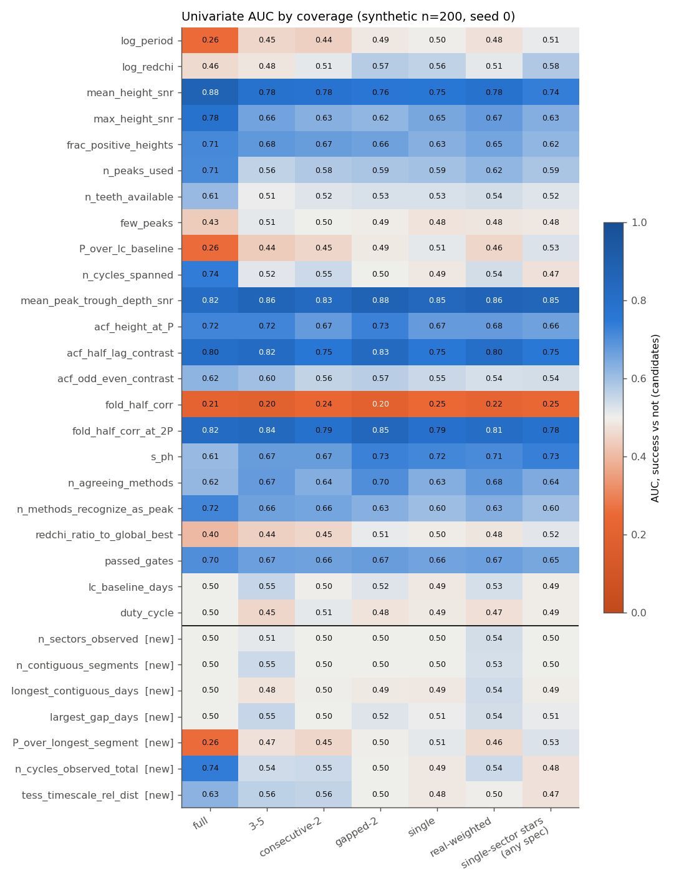
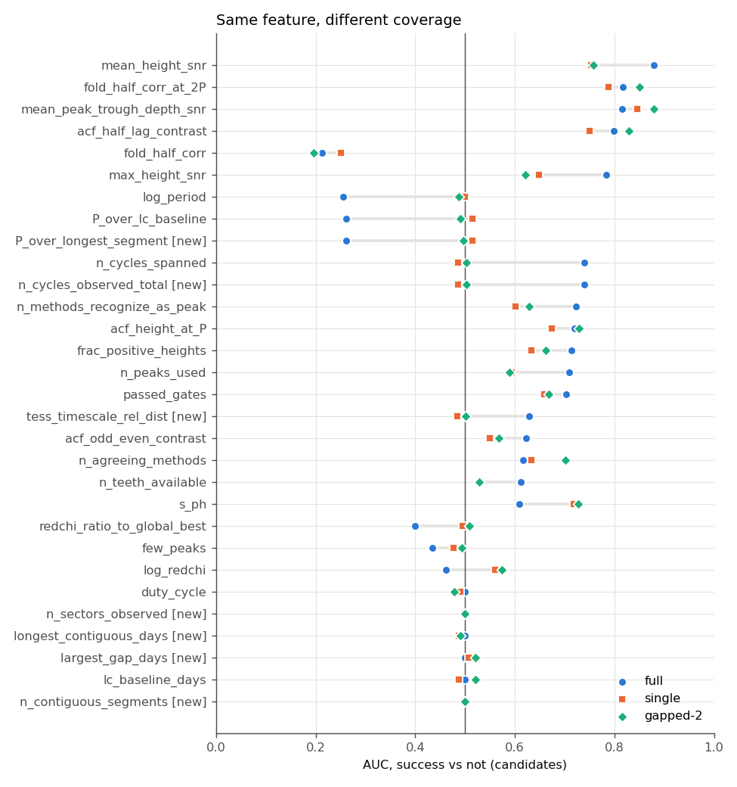
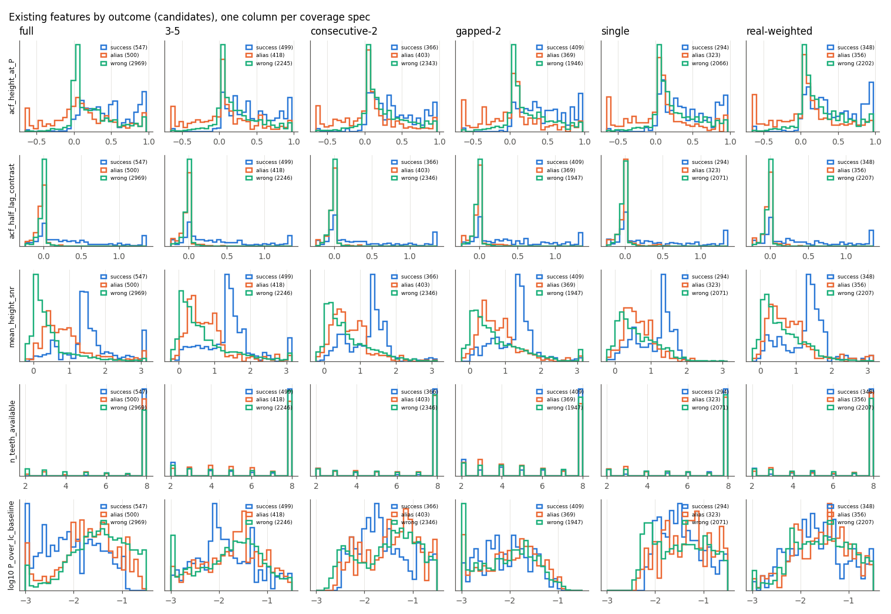
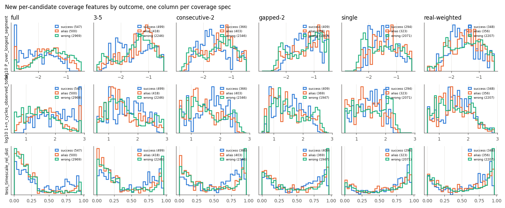
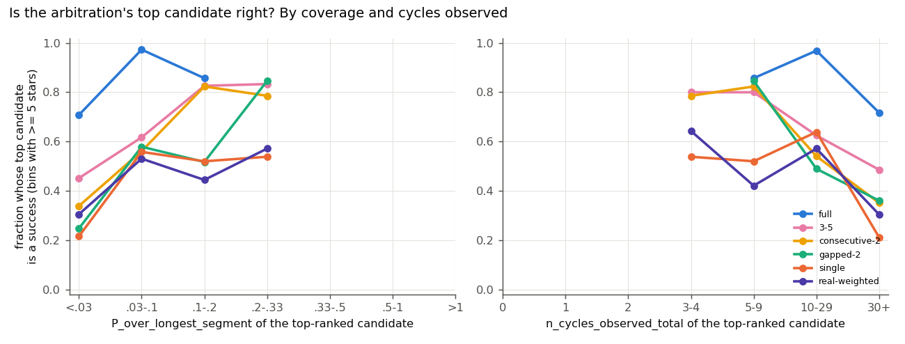
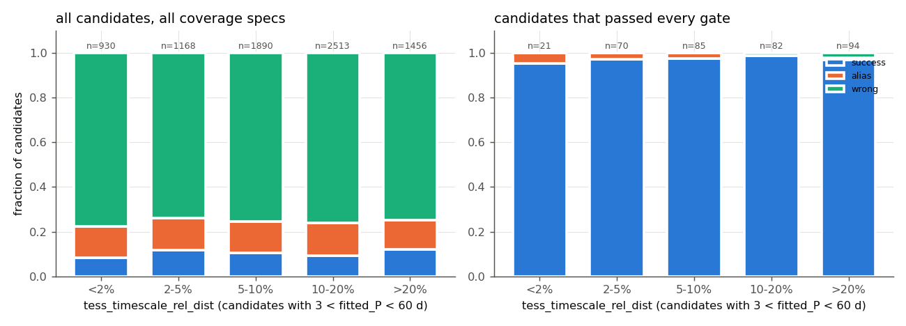
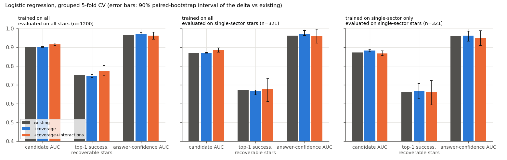

# T16e: coverage-context ML features

**Date:** 2026-10-15 · **Author:** feature-researcher agent (T16e session, overnight) · **Branch:** `claude/t16e-coverage-features-450578` · **Status:** draft

## TL;DR
- **I added 7 single-season coverage-context features** to `ml_features.py` (FEATURE_DOCUMENTATION Section H). They are computed only from the light curve's own time stamps and finite-flux mask; a no-leakage test checks this.
  - Star-level (4): `n_sectors_observed`, `n_contiguous_segments`, `longest_contiguous_days`, `largest_gap_days`.
  - Candidate-level (3): `P_over_longest_segment`, `n_cycles_observed_total`, `tess_timescale_rel_dist`.
  - Cost: ~38 µs per candidate, <1% of `extract_candidate_features`.
  - `coverage.py` was refactored lightly (new `contiguous_segments` / `sampling_descriptors`). `coverage_descriptors` still gives bit-identical output on 201 patterns, and all its tests pass.
- **I skipped 4 of the requested features because they duplicate existing ones.** `total_span_days` and `P_over_total_span` equal `lc_baseline_days` and `P_over_lc_baseline` exactly. `duty_cycle` already exists. `n_cycles_longest_segment` is just `1 / P_over_longest_segment`. Details are documented in Section H.
- **The headline finding is about existing features, not new ones.** Several existing features change meaning under patchy coverage. Success-vs-not AUC on the same 200 stars, full year → one sector:
  - `log_period` / `P_over_lc_baseline`: 0.26 → 0.50/0.51
  - `n_cycles_spanned`: 0.74 → 0.49
  - `n_peaks_used`: 0.71 → 0.59
  - `mean_height_snr`: 0.88 → 0.75
  - `max_height_snr`: 0.78 → 0.65
  - `n_teeth_available`: 0.61 → 0.53
  - `s_ph` goes the other way: 0.61 → 0.72.

  These features are stable: `mean_peak_trough_depth_snr` (0.82 → 0.85), the T9 alias features (`acf_half_lag_contrast` 0.80 → 0.75, `fold_half_corr_at_2P` 0.82 → 0.79) and `passed_gates` (0.70 → 0.66).
- **The new features add little on this synthetic data.** This is an honest, mostly null result.
  - Adding them to a logistic regression changes nothing: candidate AUC 0.901 → 0.902, Δ +0.000 [−0.001, +0.002] (90% bootstrap interval).
  - Adding coverage × existing-feature interactions gives a small, significant candidate-AUC gain: +0.014 [+0.007, +0.021] on all stars, +0.016 [+0.004, +0.027] on single-sector stars.
  - It does not significantly improve top-1 selection: +0.018 [−0.006, +0.050].
  - `tess_timescale_rel_dist` shows no signal here. Candidates within 3% of the 13.7 d ladder are no more often wrong: success 0.091 vs 0.106 (all), and 0/39 wrong among those that passed every gate.

## Question / goal
This is task **T16e** in `docs/TASKS.md`: coverage-aware ML features, so the ranker (T11) can learn how much to trust a candidate under a given observing window. No `goals.json` goal applies. Per Rae's decision (2026-10-15), multi-season features (n_seasons, per-season agreement) are deferred to T16g/D2.

Constraints: no changes to existing feature definitions or gates, no edits to `tools/`, `datasets/`, `scorecard.py`, `goals.json` or `evaluation.py`, synthetic data only, `--n-workers 2`.

**Literature:** I didn't search or read any papers this session. The new features are plain observing-window descriptors. They aren't drawn from a paper, so I cite none.

## What I did
1. **`coverage.py` refactor (outputs unchanged).**
   - Split the segmentation out of `coverage_descriptors` into:
     - `contiguous_segments(time, flux)`: finite-cadence times plus the start and end indices of each stretch;
     - `sampling_descriptors(time, flux)`: the four time-based descriptors plus each segment's span. Neither needs a sector label.
   - `coverage_descriptors` now calls these. Checked against the pre-change module on 201 synthetic patterns: 0 mismatches. `tests/test_coverage.py` passes (62), including the scorecard bit-identity test.
2. **New features** in `ml_features.py`: `_star_coverage_features`, `_candidate_coverage_features`, `_tess_timescale_rel_dist`. They are wired into `extract_candidate_features`, with constants `TESS_ORBIT_DAYS = 13.7`, `TESS_SECTOR_DAYS = 27.4` and `TESS_TIMESCALE_FACTORS`.
   - `n_sectors_observed` (27.4-d sector equivalents, from segment spans) reproduces `len(pattern)` for all 534 library patterns plus full coverage.
   - Definitions are in FEATURE_DOCUMENTATION Section H.
3. **Tests** (`tests/test_ml_features.py`, +9 tests):
   - **No leakage** (5 patterns): the features are unchanged when every flux value is replaced (NaN mask kept), when the time origin is shifted, and when a different star has the same coverage.
   - **Mask, not label:** blanking a sector of a full-year light curve changes them exactly as dropping that sector would.
   - Toy values.
   - The TESS ladder.
   - Degenerate inputs.
   - The slow end-to-end test checks the new columns. On contiguous data it also checks `longest_contiguous_days == lc_baseline_days` and `P_over_longest_segment == P_over_lc_baseline`.
4. **Feature tables.** `build_feature_tables.py` reproduces the scorecard's per-star pipeline:
   - two-view Stage 1 over pairwise_histogram, lombscargle and acf_fft, with `n_guesses=10`;
   - `fit_rotation_period(..., acf_counts=counts)` with the default (T18) gates;
   - `extract_candidate_features`;
   - each candidate labelled with `evaluation.classify_period(fitted_P, P_eq, REL_TOL, period_range)`.

   I ran six coverage specs on the same 200 stars: `full`, `3-5`, `consecutive-2`, `gapped-2`, `single` and `real-weighted`. That is 18,618 candidates. Equivalent dataset strings: `synthetic:n=200,seed=0` (full) and `synthetic:n=200,seed=0,coverage=<spec>,coverage_weighting=frequency,coverage_seed=0,coverage_library=all_cycles`.
5. **`analysis.py` analyses:**
   - univariate AUCs by coverage spec: success vs not, vs alias, vs wrong, and within-star;
   - AUC for "is the top-ranked candidate a success" (one row per star);
   - the interaction check;
   - feature cost;
   - figures.

**Sanity check:** final-answer success for the pipeline is full 0.730, single 0.325, gapped-2 0.345 and real-weighted 0.370 (`data/outcome_counts.csv`). That's consistent with the T16a post-T18 demo, which reported 0.73 / 0.29 / 0.29 / 0.31 on the first 100 of these stars.

## Results

### Feature cost
`data/feature_cost.csv`: the coverage features cost **~38 µs per candidate** (amortized, including the per-star segmentation of ~0.6 ms). That's 0.5–0.9% of `extract_candidate_features` (3.7–7.3 ms per candidate, depending on coverage).

### AUC by coverage


This is pooled candidate-level AUC (success = correct + diffrot, vs everything else), with one column per coverage spec. Blue predicts success, orange predicts failure. The new features are below the line.


Each row shows the same feature on full-year (●), single-sector (■) and gapped-2 (◆) stars. The longest grey bars mark features whose meaning changes with coverage.

Existing features whose meaning changes with coverage (success vs not; full → single):

| feature | full | single | why |
|---|---|---|---|
| `log_period`, `P_over_lc_baseline` | 0.26 | 0.50 / 0.51 | On a full year, long-period candidates are mostly spurious; on one sector, every candidate is short relative to the baseline, so period alone stops discriminating. |
| `n_cycles_spanned` (and new `n_cycles_observed_total`) | 0.74 | 0.49 | The same effect, seen through the cycle count. |
| `n_peaks_used` | 0.71 | 0.59 | Fewer teeth fit the ACF. |
| `n_teeth_available` | 0.61 | 0.53 | Saturated at 8 (the cap) for 58–77% of candidates, depending on spec. |
| `mean_height_snr` / `max_height_snr` | 0.88 / 0.78 | 0.75 / 0.65 | Noisier ACF on 27 d. |
| `few_peaks` | 0.43 | 0.48 | Flagged on 11–18% of candidates in every spec; weak everywhere. |
| `log_redchi` / `redchi_ratio_to_global_best` | 0.46 / 0.40 | 0.56 / 0.50 | |
| `s_ph` | 0.61 | **0.72** | More informative on short data. |

Stable across coverage: `mean_peak_trough_depth_snr` (0.82/0.85), `acf_half_lag_contrast` (0.80/0.75), `fold_half_corr_at_2P` (0.82/0.79), `fold_half_corr` (0.21/0.25), `acf_height_at_P` (0.72/0.67), `passed_gates` (0.70/0.66). The full table, including success vs alias and success vs wrong, is in `data/auc_by_coverage.csv` and the notebook.

The new candidate-level features:
- `P_over_longest_segment` almost duplicates `P_over_lc_baseline` here. They are identical on contiguous coverage and differ only slightly on gapped coverage: 3-5 gives 0.47 vs 0.44, gapped-2 0.50 vs 0.49.
- `n_cycles_observed_total` tracks `n_cycles_spanned` (0.74 / 0.49 again).
- The star-level features are constant within a coverage spec, so their AUC is 0.5 there by construction.


These are candidate distributions by outcome. On a full year, `mean_height_snr` separates success (blue) from wrong (green) cleanly, but on one sector the two overlap. `acf_half_lag_contrast` keeps its shape in every column.


`P_over_longest_segment` separates outcomes only on full coverage. Under patchy coverage the outcome curves overlap.

### Does coverage predict whether to trust the answer?


This shows the arbitration's top-ranked candidate (declined stars included) and whether it is a success, by coverage spec.
- At the same `P_over_longest_segment`, the success rate is much lower on 1–2 sectors than on a full year: 0.21–0.34 vs 0.71 below 0.03. Coverage carries information that P/span alone does not.
- No top candidate has P / longest segment > 1/3, because the gates already exclude them.

Pooled over all specs, the star-level features predict top-candidate success: `n_sectors_observed` AUC 0.65, `longest_contiguous_days` 0.65 (`data/auc_top_candidate.csv`). But the existing features already carry most of this: `passed_gates` 0.94, `acf_half_lag_contrast` 0.96, `s_ph` 0.95.

### TESS-timescale feature


This is the outcome mix of candidates with 3 < `fitted_P` < 60 d, binned by distance to the 13.7 d ladder. The mix is flat, so on synthetic data there is no excess of wrong candidates near orbit or sector timescales.
- Within 3% of the ladder: n = 1,338, success 0.091, wrong 0.762. Farther away: success 0.106, wrong 0.754.
- Among candidates that passed every gate: near the ladder 39 candidates, 0 wrong. Elsewhere 313 candidates, wrong 0.010.

The univariate AUCs (0.63 full, 0.48 single) mostly reflect period: the ladder is dense between 3.4 and 55 d, so short-period candidates sit far from it. Synthetic ramps are a weak stand-in for real TESS systematics. TASKS P13 saw ~13.7 d wrong answers on synth seed 1, but none appear in these 1,200 runs. The real test is SMARTS dev data.

### Interaction check


Setup: L2 logistic regression in numpy, with 5-fold CV grouped by underlying star (the same star appears under every coverage). Error bars are 90% paired-bootstrap intervals (300 resamples over stars) of the change relative to the existing-features model. Feature sets:
- **existing:** 21 features;
- **+coverage:** the 7 new features plus `lc_baseline_days` and `duty_cycle`;
- **+interactions:** also each existing feature × `longest_contiguous_days` and × `n_cycles_observed_total`.

Metrics:
- **candidate AUC;**
- **top-1 success among recoverable stars** (stars with at least one success candidate);
- **answer-confidence AUC:** does the star's top score predict that its top pick is right?

| train → evaluate | model | cand AUC | Δ [90%] | top-1 recov. | Δ [90%] | conf AUC | Δ [90%] |
|---|---|---|---|---|---|---|---|
| all → all (1,200 stars) | existing | 0.901 | | 0.754 | | 0.966 | |
| | +coverage | 0.902 | +0.000 [−0.001, +0.002] | 0.749 | −0.005 [−0.014, +0.001] | 0.970 | +0.004 [−0.001, +0.011] |
| | +interactions | 0.916 | +0.014 [+0.007, +0.021] | 0.772 | +0.018 [−0.006, +0.050] | 0.962 | −0.004 [−0.023, +0.016] |
| all → single-sector (321) | existing | 0.870 | | 0.672 | | 0.963 | |
| | +coverage | 0.871 | +0.001 [−0.001, +0.002] | 0.667 | −0.006 [−0.025, +0.000] | 0.969 | +0.007 [−0.001, +0.026] |
| | +interactions | 0.886 | +0.016 [+0.004, +0.027] | 0.678 | +0.006 [−0.060, +0.060] | 0.960 | −0.003 [−0.039, +0.034] |
| single → single (321) | existing | 0.874 | | 0.661 | | 0.961 | |
| | +coverage | 0.882 | +0.009 [+0.002, +0.016] | 0.667 | +0.006 [−0.035, +0.046] | 0.962 | +0.001 [−0.027, +0.026] |
| | +interactions | 0.868 | −0.005 [−0.019, +0.007] | 0.661 | +0.000 [−0.069, +0.061] | 0.951 | −0.010 [−0.053, +0.027] |

How to read the table:
- Added on their own, the coverage features change little. Star-level features are constant within a star, so they can't change the ranking, and on contiguous data the candidate-level ones duplicate `P_over_lc_baseline`.
- The interaction terms give the only consistent gain: a model that adjusts how much to trust each existing feature according to coverage ranks candidates measurably better (+0.014 to +0.016 AUC). That gain doesn't reach top-1 selection at this sample size.
- Within single-sector stars only, coverage barely varies, so as expected nothing changes.
- A gradient-boosted ranker (T11) learns such interactions natively, so these features are cheap insurance rather than a demonstrated win.
- For scale: the pipeline's final success on the same stars is 0.445 (all) and 0.302 (single-sector), but the logistic models never decline, so their top-1 isn't directly comparable.

### Remaining wrong answers (not coverage-related)
Final-answer wrong or alias outcomes: 14 star-runs across all specs (notebook last section).
- 12 are 0.14–0.64 d answers on 1–2-sector stars.
- 4 of the 12 are half aliases of stars with P < 1.1 d.
- The other 8 are wrong answers for stars with true P of 1.0–38 d, all at SNR < 4.3. One single-sector star (synth-s0-00146) appears twice, under `single` and `real-weighted`.

Those 8 wrong answers have many cycles observed (`n_cycles_observed_total` 110–386) and a tiny `acf_half_lag_contrast` (0.006–0.052), which passes T18's gate through its "every term > 0" route. The coverage features don't flag them; the half-lag *magnitude* does. That's relevant for T16d.

## What didn't work
- **`tess_timescale_rel_dist`:** no signal on synthetic data (see above). I kept it because it costs nothing and targets a real-data systematic (P13), but it's unvalidated.
- **`P_over_longest_segment` / `n_cycles_observed_total`:** on this data they are nearly redundant with `P_over_lc_baseline` / `n_cycles_spanned`, because the only gapped patterns in these specs are 2–5 sectors.
- **Within-single-sector benefit:** none measurable, as expected, since coverage barely varies within that subset.

## Open questions for Rae
1. **Skipped duplicates.** I didn't add `total_span_days`, `P_over_total_span`, the coverage.py `duty_cycle` or `n_cycles_longest_segment`, because they are identical to, or a monotone transform of, existing or new columns. OK, or do you want the exact names for readability?
2. **Keep `tess_timescale_rel_dist`?** It's unvalidated on synthetic data. I'd keep it and re-test on dev_small (real TESS systematics), and drop it in pruning if it's still null. The ladder (13.7 d × 1/4 … 4) is my choice. Year 8+ pointings (~55 d) would need it extended.
3. **`n_sectors_observed` is 27.4-d sector equivalents** inferred from segment spans. It's exact on every library pattern. A SMARTS file with one dropped corrupt orbit can count a half sector as 0 or 1, and Year 8 ~55-d pointings count as 2. Is that acceptable, or should it be "orbits observed" instead?
4. **For T11 (ranker):**
   - Include the coverage features, and make sure the training set mixes coverage classes (T16f). Otherwise features like `n_cycles_spanned`, `P_over_lc_baseline` and `mean_height_snr` will be learned at their full-year meaning and misused on 1–2-sector stars.
   - If T11 trains per coverage stratum instead, the star-level features become unnecessary.
   - Use star-grouped splits that also group the same star across coverage draws.
5. **For T16d (gate recalibration):**
   - Gates built on `mean_height_snr`, peak counts or few-peak logic lose meaning on short data. `mean_peak_trough_depth_snr`, `acf_half_lag_contrast`, `fold_half_corr_at_2P` and `s_ph` stay informative and are better candidates for coverage-robust thresholds.
   - The remaining wrong answers on 1–2 sectors pass the half-lag gate with mean contrast ≤ 0.05 through the every-term-positive route. A minimum-magnitude floor there looks worth testing.
   - Thresholds could be scaled by `n_cycles_observed_total` or `longest_contiguous_days` rather than by sector count.
6. **Training-data caveat:** with T18's gates on, few gate-passing candidates have P / longest segment > 1/3, so the ranker will see little data in that regime (as noted for the T9 features in the T18 report).

## Reproduce
```bash
/opt/anaconda3/envs/ss_openblas/bin/python reports/2026-10-15_t16e-coverage-features/build_feature_tables.py --n 200 --seed 0 --coverage-seed 0 --n-workers 2 --outdir runs/t16e_features --coverage full single consecutive-2 gapped-2 3-5 real-weighted
/opt/anaconda3/envs/ss_openblas/bin/python reports/2026-10-15_t16e-coverage-features/analysis.py
/opt/anaconda3/envs/ss_openblas/bin/python tools/run_notebook.py reports/2026-10-15_t16e-coverage-features/notebook.ipynb
/opt/anaconda3/envs/ss_openblas/bin/python -m pytest -q tests/test_ml_features.py tests/test_coverage.py
```
The build takes ~15 min with 2 workers on the i5. The analysis takes ~3 min, mostly bootstrapping.
