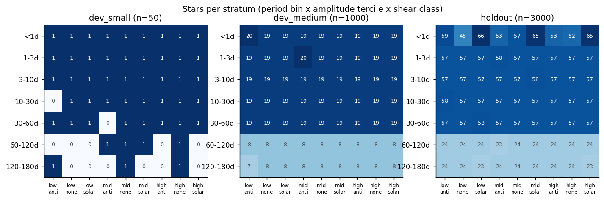
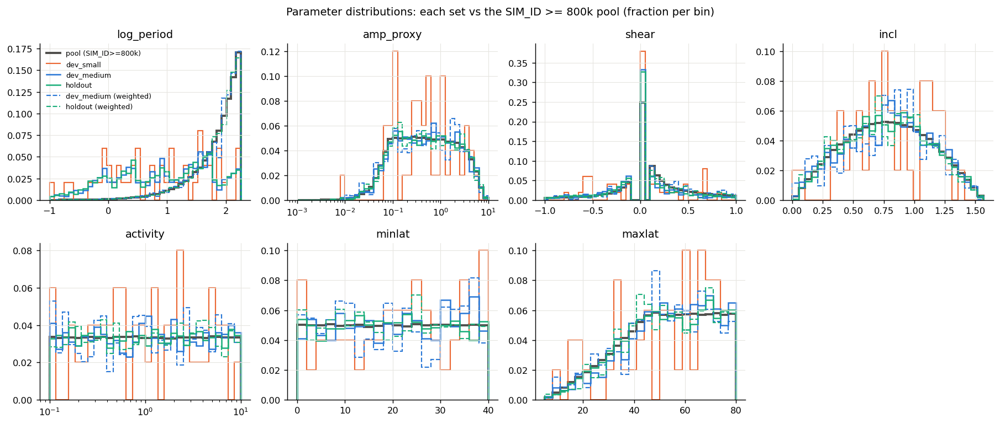
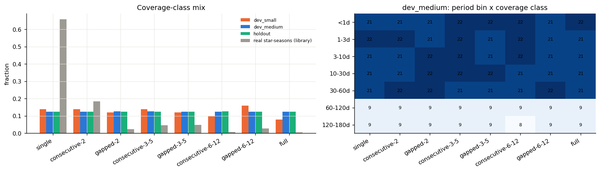
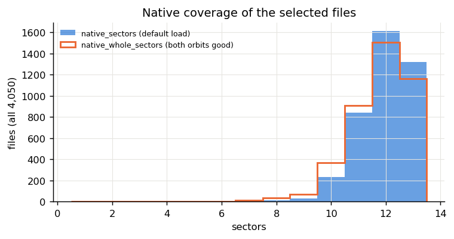
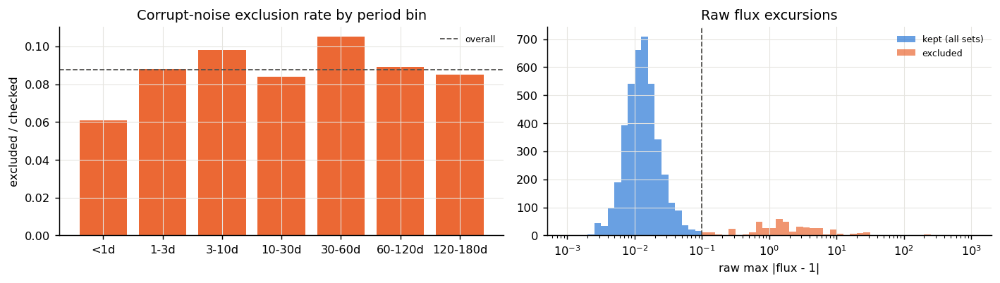
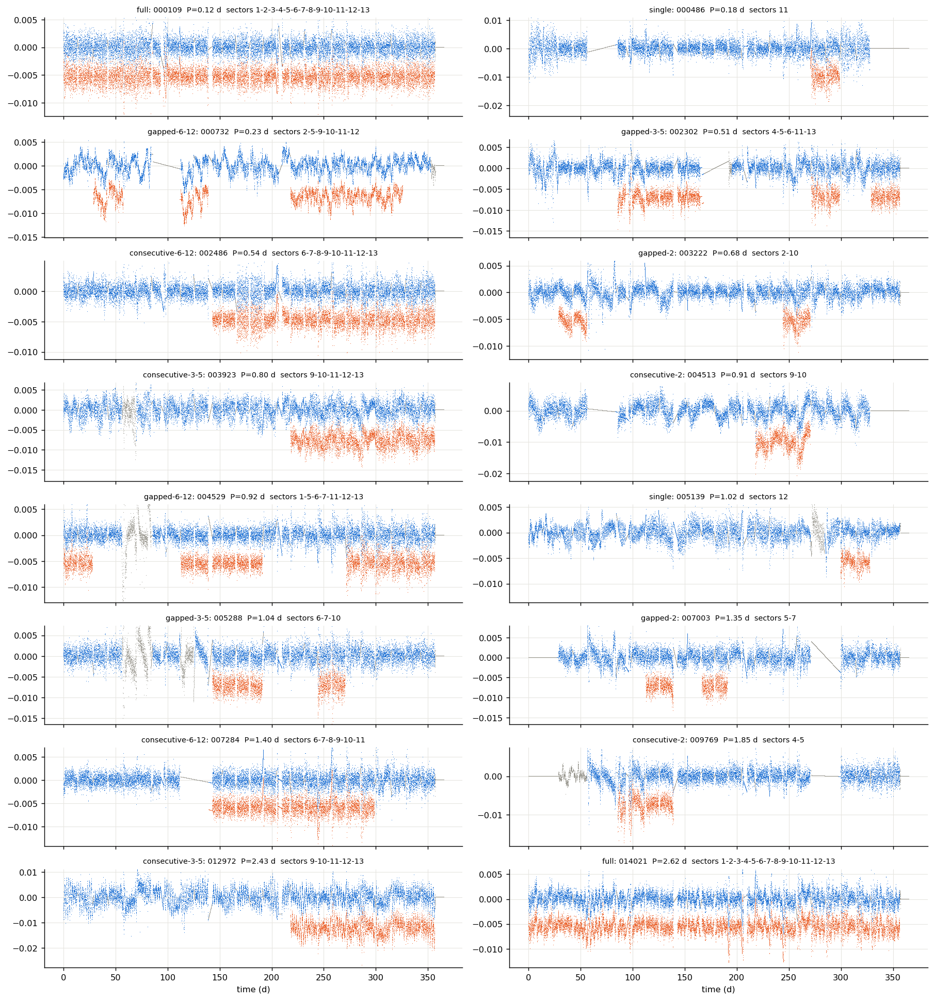
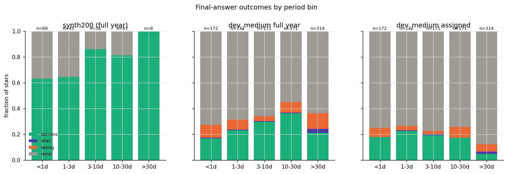
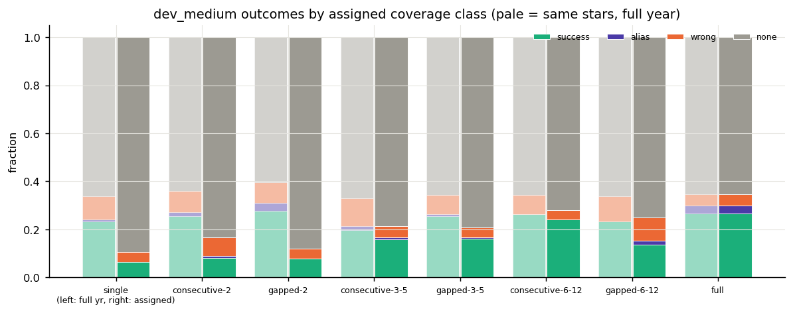
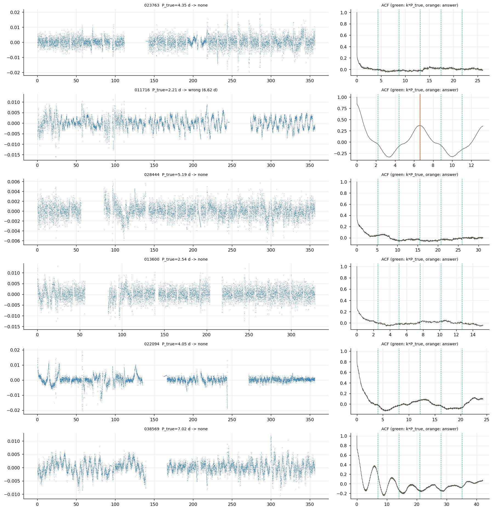

# T2: frozen SMARTS dev sets and holdout

**Date:** 2026-10-15 · **Author:** dev-set-builder (t2-dev-sets session) · **Branch:** `claude/t2-dev-sets-9f8124` · **Status:** draft

## TL;DR

- **Built and committed** `datasets/dev_small.csv` (50), `dev_medium.csv` (1,000) and
  `holdout.csv` (3,000).
  - All from SIM_ID ≥ 800k, disjoint, and stratified per Rae's spec: period bin ×
    amplitude tercile × shear class, with coverage classes balanced per period bin.
  - Reproducible from seed 20261015 with `tools/build_dev_sets.py`, and checked by
    `tests/test_datasets.py`.
  - Dev files are on the laptop in `data/smarts_dev/` (156 MB); holdout files are on the
    drive in `extracted/holdout/`.
  - 455 of 5,200 checked candidates (8.75%) were excluded, all for corrupt galaxy noise.
- **First look at real SMARTS noise: the pipeline does much worse than on synthetic.**
  dev_medium full-year success is **0.248** (wrong 0.088, declined 0.650), vs **0.730**
  (wrong 0, declined 0.270) on synth200. With assigned coverage it drops to **0.148**.
- Most of the gap is signal strength, plus confident wrong answers:
  - Low-amplitude-tercile stars are almost never recovered (success 0.033), so declining is
    probably right for most of them.
  - High-tercile stars reach only 0.44–0.75 success at 1–30 d, against 0.64–0.86 on
    synthetic.
  - Wrong answers run at 8–10% in every amplitude tercile, against 0 on synthetic.
  - Decline rate ≈ 0.65–0.79 is the dominant outcome.
- **Deviation from the brief:** coverage patterns are drawn from a new column,
  `native_whole_sectors` (sectors whose *both* orbits are unflagged), not from
  `native_sectors`.
  - An explicit `load_smarts_fits(sectors=[...])` drops a requested sector if either of
    its orbits is flagged. Drawing from `native_sectors` gave 6 of 50 dev_small rows a
    different coverage than assigned, and one load crashed.
  - `native_sectors` is still recorded as specified. The assigned pattern is now exactly
    what the pipeline loads, and this is tested for all of dev_small.

## Question / goal

Task **T2** in `docs/TASKS.md`, built to the "Rae's design decisions (2026-10-15)" block,
including T16f's real-data part (per-row coverage patterns). There are no goal IDs: this
task builds the datasets that goals will later be defined on. Holdout was **not** scored.

## What I did

1. **`tools/build_dev_sets.py`** (seeded, resumable, atomic writes, drive check first):
   - **Pool:** the 200,000 catalog rows with SIM_ID ≥ 800,000, joined to files by
     **row index**.
   - **Strata (63):** audit period bin × amplitude-proxy tercile (cuts 0.2199 / 1.0279 over
     the 1M corpus) × shear class. Each stratum gets a seeded random rank order.
   - **Quotas:**
     - The five bins below 60 d get equal shares; 60–120 + 120–180 d together get 1/7.
     - Within a bin, the 9 amplitude × shear cells get equal shares, limited by each
       cell's capacity.
     - Sets are filled in the order dev_small → dev_medium → holdout.
   - **Candidates:** 1.3 × quota per stratum (in rank order), extracted in one streaming
     pass per bundle (all 180 were needed) to a staging area on the drive.
   - **Checks per file:** corrupt-noise check (`flux_outliers.scan`, threshold 0.1), plus
     one `load_smarts_fits` call for `native_sectors` and `native_whole_sectors`.
   - **Filling:** passing rows fill quotas in rank order. Short strata get more ranks in a
     further round (2 extra rounds were needed, both for <1 d cells).
   - **Coverage:** classes are dealt in shuffled blocks of 8 per period bin, then matched
     to rows with `linear_sum_assignment` so every row gets a class it can support. The
     pattern is uniform among that class's library patterns that fit
     `native_whole_sectors`.
   - **Weights:** `sampling_weight` (strata with no rows in a set are spread over their
     period bin), `coverage_weight` (to the library's real star-season class mix), and
     `combined_weight`.
   - Full method and column list: `datasets/README.md`.
2. **Scorecard dataset options** (metric definitions untouched):
   - `--data-root` resolves relative manifest paths. Without it, `$SMARTS_DATA_ROOT` is
     used, then the current directory. A relative root is taken from the repo root.
   - `--ignore-manifest-sectors` scores full-year.
   - Both choices are appended to `config.dataset`, e.g.
     `datasets/dev_medium.csv,data_root=data/smarts_dev,sectors=ignored`.
   - The scorecard now stops at the start if any manifest file is missing.
3. **Baselines** (`tools/run_t2_baselines.sh`, `--n-workers 4`, main code @ 4c2a994):
   dev_small and dev_medium, each with assigned coverage (`sectors=manifest`) and
   full-year (`sectors=ignored`). Installed as `benchmarks/baselines/dev_{small,medium}_{assigned,fullyear}.json`
   plus `_tables/`. dev_medium took 516 s (assigned) and 783 s (full year).
4. `make_data.py` saves corpus histograms and example light curves; `build_notebook.py`
   builds the notebook, which reproduces every figure below without the drive.

**Drive time:**
- First build: 1,614 s.
- Rebuild after adding `native_whole_sectors`: 567 s plus ~10 min of an aborted 4-worker
  attempt. It re-read the staged files rather than the bundles; with 4 workers the small
  cold reads made it ~4× slower than with 2.
- Plus about 2 min for catalog loads and `make_data.py`.

## Results

### The sets



Every bin hits its target exactly (`tests/test_datasets.py::test_stratum_counts_match_spec`).
Look at the holdout's <1 d row:
- That bin's pool has only 984 rows, and 803 were checked; the 9 cells hold 45–66 stars
  instead of 57.
- The ≥800k pool simply doesn't have enough <1 d anti- and zero-shear stars for an even
  split once dev_medium has its share.

| period bin | dev_small | dev_medium | holdout | pool | pool share |
|---|---|---|---|---|---|
| <1d | 9 | 172 | 515 | 984 | 0.0049 |
| 1-3d | 9 | 172 | 514 | 2,247 | 0.0112 |
| 3-10d | 9 | 171 | 514 | 7,872 | 0.0394 |
| 10-30d | 8 | 171 | 514 | 22,285 | 0.1114 |
| 30-60d | 8 | 171 | 514 | 33,335 | 0.1667 |
| 60-120d | 4 | 72 | 215 | 66,638 | 0.3332 |
| 120-180d | 3 | 71 | 214 | 66,639 | 0.3332 |



Period is deliberately reshaped: equal per bin, so the sets are flat-ish in log P while the
pool rises steeply. Weighting by `sampling_weight` (dashed) puts it back on the pool curve.
Amplitude, shear, inclination, activity and latitudes follow the pool; dev_small is noisy at
n = 50, as expected.



Classes are balanced: 124–127 per class in dev_medium and 373–378 in the holdout,
including within every period bin (right panel). Real TESS star-seasons are 66% single
sector, which `coverage_weight` restores.

dev_small has 3 rows with a fallback class, in its 10–30, 30–60 and 60–120 d bins: each of
those bins had 8 or fewer stars and lacked a file with all 13 sectors whole for its `full`
slot. 33% of selected files keep all 13 sectors natively, but only 29% have 13
*whole* sectors.



16% of files have fewer whole sectors than native sectors. This is the half-flagged-sector
case behind the `native_whole_sectors` change.



The corrupt-noise exclusion rate is 6–11% in every bin (overall 8.75%), with a clean break
at the 0.1 threshold. It sits below T1's ~12% estimate, which came from 1,050 files.
`datasets/exclusions_log.csv` lists all 455 rows with their excursion and the orbits hit.



Two dev_small stars per coverage class:
- **gray:** raw flux, including the orbits the loader drops;
- **blue:** the default full-year load;
- **orange:** the assigned pattern as loaded.

Note how weak the rotation signal is relative to the galaxy red noise for most of these
short-period stars.

### Headline: real SMARTS noise vs the synthetic baseline

| run (dataset string) | success | alias | wrong | none | n |
|---|---|---|---|---|---|
| synth200 full year (`synthetic:n=200,seed=0`) | 0.730 | 0.000 | 0.000 | 0.270 | 200 |
| dev_small full year (`...,sectors=ignored`) | 0.260 | 0.020 | 0.040 | 0.680 | 50 |
| dev_small assigned (`...,sectors=manifest`) | 0.160 | 0.020 | 0.040 | 0.780 | 50 |
| dev_medium full year | 0.248 | 0.014 | 0.088 | 0.650 | 1000 |
| dev_medium assigned | 0.148 | 0.009 | 0.054 | 0.789 | 1000 |



Success by period bin:

| eval bin | synth200 | dev_medium full year | dev_medium assigned |
|---|---|---|---|
| <1d | 0.632 | 0.169 | 0.180 |
| 1-3d | 0.644 | 0.233 | 0.227 |
| 3-10d | 0.861 | 0.298 | 0.193 |
| 10-30d | 0.814 | 0.363 | 0.175 |
| >30d | 1.000 (n=8) | 0.210 | 0.048 |

The gray (declined) bars dominate everywhere on SMARTS. Wrong answers (orange) appear in
every bin; synth200 has none.

`check_goals.py benchmarks/baselines/dev_medium_fullyear.json --baseline benchmarks/baselines/synth200_s0.json`
flags every success metric as a "regression". That comparison crosses datasets, so it is not
a regression, but it shows the size of the gap. Union recall (any method lists a success
period) stays high on SMARTS:
- 0.965–0.988 at 1–30 d;
- 0.917 above 30 d;
- 0.442 below 1 d.

With 7 methods × 10 candidates covering a ±10% window, that number says little by itself
(see "What didn't work").

**By amplitude tercile** (dev_medium full year), success / wrong / declined:

| amp tier | success | wrong | declined |
|---|---|---|---|
| low | 0.033 | 0.084 | 0.871 |
| mid | 0.207 | 0.099 | 0.689 |
| high | 0.505 | 0.081 | 0.390 |

High-tercile success by bin is 0.44 / 0.44 / 0.68 / 0.75 / 0.56 for <1, 1–3, 3–10, 10–30 and
30–60 d, and 0.17 / 0 for 60–120 / 120–180 d.

So the gap is mostly signal strength, which is partly physics: SMARTS amplitudes are
realistic and the galaxy noise is real. On top of that come two pipeline problems:
- **Confident wrong answers on undetectable stars:** 8.4% of low-tercile stars get a wrong
  answer. Wrong answers span 0.8–34 d (10th–90th percentile), so this is not only T16a's
  ~0.2 d single-sector failure.
- **Declines on visibly periodic stars:** star 038569 (P = 7.02 d) has a clean ACF peak
  series, yet the pipeline declined (failure figure below). Its peaks sit at ~5.8 d, in the
  differential-rotation band, which may be what trips the gates.



The same 1,000 stars, with the assigned pattern (solid) and full year (pale), by coverage
class:

| class | success full yr | success assigned | wrong assigned | declined assigned |
|---|---|---|---|---|
| single | 0.234 | 0.065 | 0.040 | 0.895 |
| consecutive-2 | 0.256 | 0.080 | 0.080 | 0.832 |
| gapped-2 | 0.278 | 0.079 | 0.040 | 0.881 |
| consecutive-3-5 | 0.197 | 0.157 | 0.047 | 0.787 |
| gapped-3-5 | 0.256 | 0.160 | 0.040 | 0.792 |
| consecutive-6-12 | 0.264 | 0.240 | 0.040 | 0.720 |
| gapped-6-12 | 0.234 | 0.137 | 0.097 | 0.750 |
| full | 0.266 | 0.266 | 0.048 | 0.653 |

- `full` is identical in both modes, a built-in consistency check: whole = native = 13
  sectors.
- Coverage loss costs success roughly in proportion to the sectors removed. 1–2 sectors
  keep only ~0.07–0.08.
- On real noise, losing coverage mostly turns answers into **declines**, not into wrong
  answers (assigned wrong 0.054 < full-year 0.088). T16a's synthetic single-sector run
  instead found 0.36 wrong.

**Population estimates** (dev_medium):

| estimate | success | alias | wrong | none |
|---|---|---|---|---|
| full year, unweighted | 0.248 | 0.014 | 0.088 | 0.650 |
| full year, corpus-weighted | 0.134 | 0.029 | 0.147 | 0.691 |
| assigned, unweighted | 0.148 | 0.009 | 0.054 | 0.789 |
| assigned, corpus-weighted | 0.045 | 0.014 | 0.063 | 0.878 |
| assigned, corpus + real coverage mix | 0.012 | 0.001 | 0.042 | 0.944 |

Corpus-weighting is dominated by the 67% of the pool above 60 d, where recovery is near 0.
For a SMARTS-like star seen by TESS in the real coverage mix, the current pipeline returns
a correct period ~1% of the time and a wrong one ~4% of the time.



Six seeded-random full-year failures at 1–10 d:
- 4 of 6 show essentially no modulation at P_true (flat ACF): honest declines.
- 011716 (P = 2.21 d) is answered 6.62 d ≈ 3P, where the ACF really does peak strongest.
  Possibly a diffrot/evolution case worth a look.
- 038569 (P = 7.02 d) has strong ACF peaks at ~5.8 d and harmonics, yet the pipeline
  declined.

## What didn't work

- **Drawing patterns from `native_sectors` as specified.** `native_sectors` comes from the
  default load, which keeps any sector with one good orbit. A requested sector with one
  flagged orbit is dropped whole by `recombine_segments`. With the first build:
  - 6/50 dev_small rows loaded a different pattern than assigned;
  - one row (005139, pattern "11") loaded no data at all, and `to_even_cadence` raised
    `ValueError: attempt to get argmax of an empty sequence`.

  The fix was to add `native_whole_sectors`; the builder kept the same star selection.
- **Union recall as a sign that "the right answer is in the candidates":** 0.965–0.988 at
  1–30 d on dev_medium, but the light curves of many of those stars show no signal. With
  ~70 candidates over a log-period range, hitting a ±10% (or diffrot-band) window is easy by
  chance. A recall measure restricted to top-ranked candidates would say more.
- **4 workers for re-reading staged files on the drive:** ~1 s/file, I/O-bound (workers at
  9% CPU) vs ~0.25 s/file with 2. One streaming pass per bundle (the first build) is the
  efficient path; random small-file reads are not.

## Open questions for Rae

1. **`native_whole_sectors` instead of `native_sectors` for coverage** (deviation above).
   OK to keep? An alternative is to change the loader so an explicit request keeps
   half-flagged sectors' good orbit. That touches `preprocessing.py` and changes what
   T16a-style runs load.
2. **Loader crash on an all-flagged requested pattern.** `load_smarts_fits(sectors=[s])`
   raises inside `to_even_cadence` when nothing survives. The scorecard records it as an
   error, so it's harmless here, and the dev sets can't trigger it now. Should the loader
   return an empty light curve, or raise a clear error? (Small task; not done since it's
   outside T2.)
3. **The gap to synthetic is large.** Suggested follow-ups:
   - P8 (strict vs option-D gates) re-evaluated on dev_medium rather than dev_small;
   - a look at low-amplitude wrong answers (8% of undetectable stars get a confident
     period);
   - P16 (short-period signal strength vs synthetic). <1 d union recall is 0.44 on SMARTS
     vs 0.88 synthetic.

   Should goals be restated on `dev_medium` dataset strings? goals.json is untouched.
4. **Which dataset string should be the default judging set** for method tasks: dev_small
   assigned, or full-year? I'd judge on dev_medium full-year for method changes, and use
   assigned coverage for coverage-robustness work (T16b–e).
5. **dev_small is thin above 60 d** (7 stars across 18 strata; some cells empty, handled by
   the weight collapse). Fine for a smoke test, but per-bin rates there are anecdotes.
6. **Holdout <1 d imbalance** (45–66 per cell) is a pool limit. Should a future holdout_v2
   take <1 d stars from the SIM_ID < 800k pool? That would break galaxy separation for
   those stars, so I don't recommend it.
7. **Staging cache on the drive** (`extracted/t2_build/`, 774 MB: 5,200 candidate FITS plus
   check CSVs). Keep it for fast rebuilds (the reproducibility test uses it), or delete it?

## Reproduce

```bash
PY=/opt/anaconda3/envs/ss_openblas/bin/python
$PY tools/build_dev_sets.py --n-workers 2           # drive; ~30 min from scratch, minutes with the cache
./tools/run_t2_baselines.sh                          # local data only; ~25 min on the i5
$PY reports/2026-10-15_t2-dev-sets/make_data.py      # drive; ~1 min
(cd reports/2026-10-15_t2-dev-sets && $PY build_notebook.py) && $PY tools/run_notebook.py reports/2026-10-15_t2-dev-sets/notebook.ipynb
$PY -m pytest -q tests/test_datasets.py              # data tests skip cleanly without the manifests/drive
```
