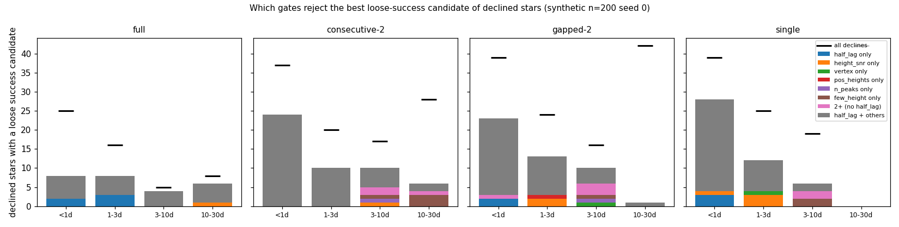
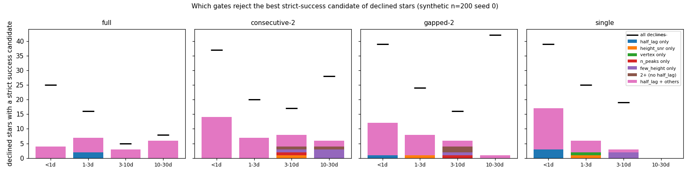
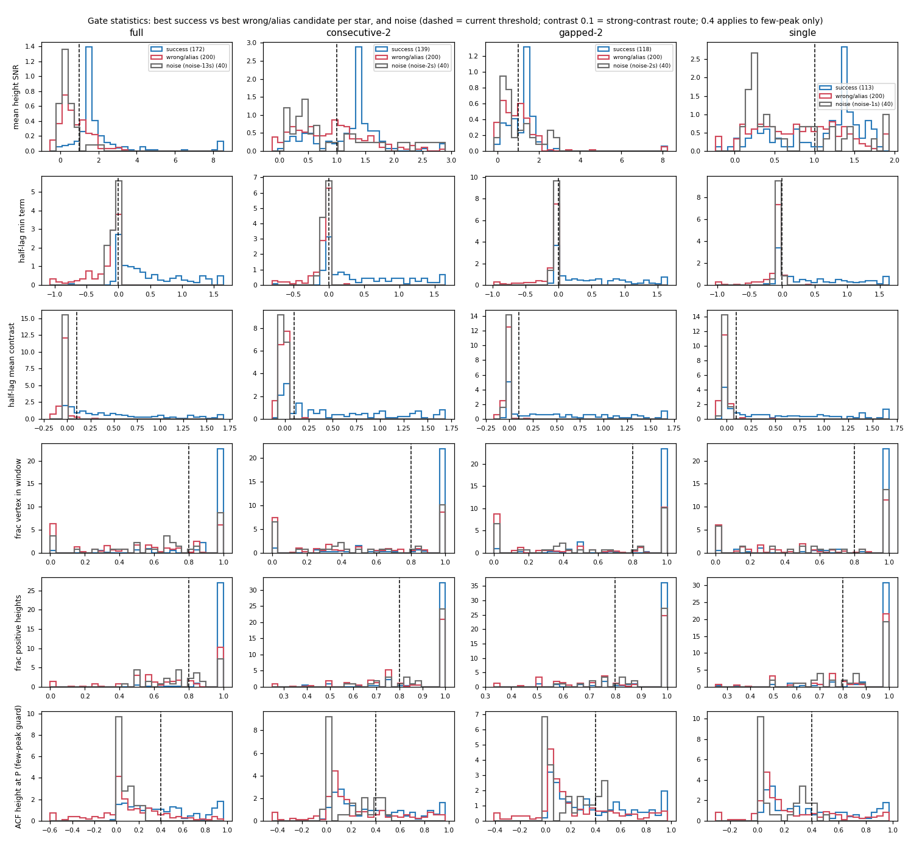
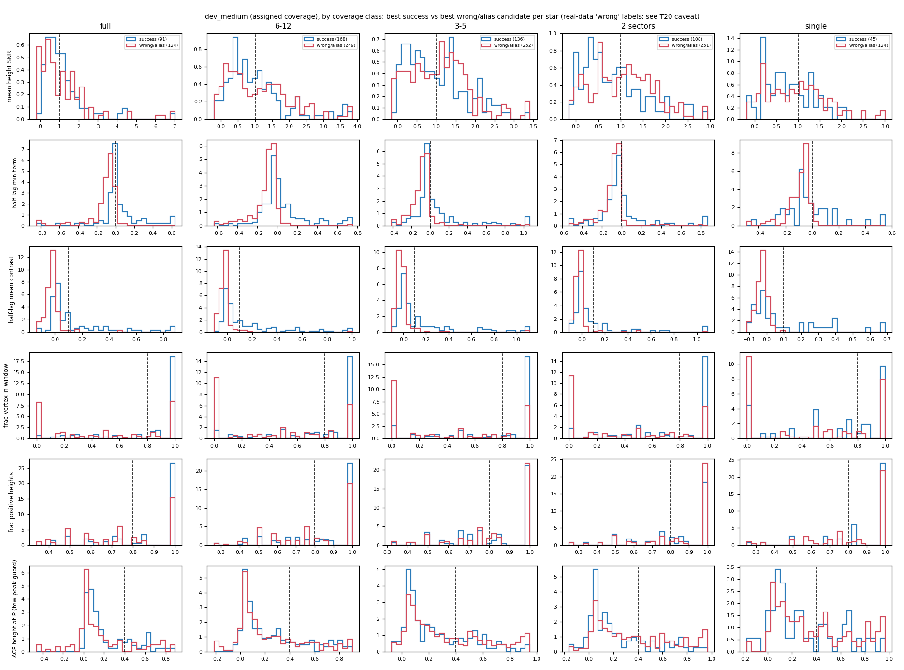
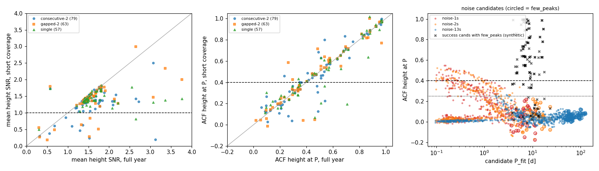
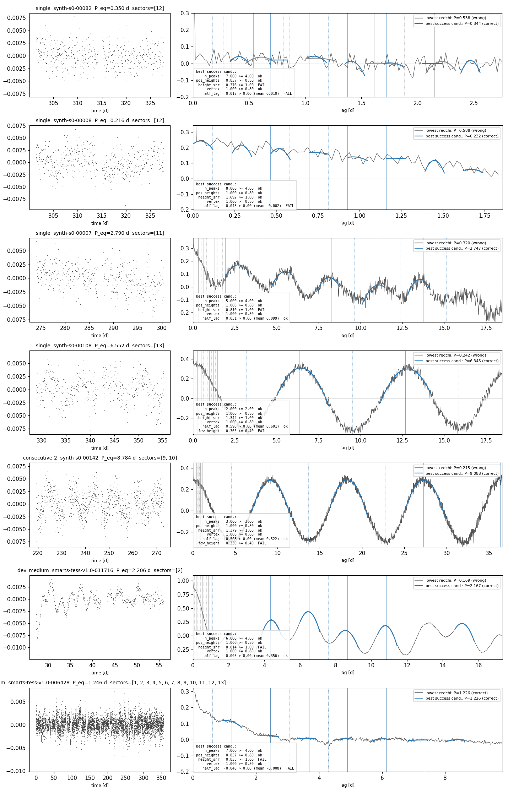

# T16b: which reliability gates over-decline on short coverage

**Date:** 2026-10-21 · **Author:** method-improver agent (Claude, side session) · **Branch:** `claude/t16b-gate-diagnosis-5311f5` · **Status:** draft

## TL;DR
- **Instrumentation is merge-ready and changes no results.**
  - Every fitted candidate now records each gate's value, threshold and pass/fail (`CandidateResult.gate_results`, `.failed_gates`).
  - A declined `EnsembleResult` names the gates that rejected its best-fitting candidates (`decline_reason`; also appended to `message`).
  - The scorecard gains descriptor columns and a `per_candidate.csv`.
  - Final periods and outcomes are bit-identical: 200/200 on synth200 s0, 50/50 on dev_small (assigned) and 1000/1000 on dev_medium (assigned). `check_goals` passes with all deltas 0.
- **The gates are mostly *not* why short-coverage stars are declined.** Synthetic n=200 seed 0: of 146 full-year successes, 79 are declined on one sector.
  - 41 of those 79 are 10–30 d or > 30 d periods, where one sector simply can't measure them. Stage 1 recall at 10–30 d falls from 0.95 to 0.02 in the pipeline pool.
  - Of the rest, only **6** have a fitted candidate within 3% of the period the full-year run finds.
  - "A success candidate was in the pool" (the brief's definition) is inflated. Stars with only such loose candidates are mostly differential rotators whose active band is wide: median (P_hi − P_lo)/P_eq of 0.25–0.86 per coverage, up to 4.2. Any period in that range scores success.
- **When a genuinely correct candidate (fitted P within 10% of P_eq) is declined, its ACF usually looks like noise.** Mean half-lag contrast is < 0.02, the same as pb_scan noise combs.
  - Synthetic: 22/26 single-sector cases, 27/35 consecutive-2, 22/27 gapped-2.
  - dev_medium: 202/312 (plus 71 "weak", 0.02–0.1).
  - The half-lag gate fires on every decline, and it is right to on these. Only **3–6 stars per 200 per short-coverage class** have a structured ACF (contrast ≥ 0.1) blocked by another gate. That other gate is the **few-peak ACF-height guard** (0.33–0.37 vs 0.4 on clean 6–17 d combs), **height SNR** (0.6–0.9) or vertex/n_peaks.
- **Coverage scaling is weak.** For the same star:
  - height SNR is 0.94–0.96× its full-year value (median; lower quartile 0.75–0.82×);
  - few-peak height and half-lag contrast don't change at all.
  - What does scale with coverage is *whether the few-peak guard applies at all*: 3–10 d success candidates are few-peak 57–63% of the time on 1 sector or gapped-2, never on full year.
- **Offline trade-offs (no defaults changed).**
  - The best rule I found ("PROPOSED2": few-peak height ≥ 0.25; height SNR ≥ 0.5 and vertex ≥ 0.5 when contrast ≥ 0.1 and ≥ 4 teeth; short coverage only) rescues +1/+4/+5 successes on consecutive-2/gapped-2/single with 0 extra wrong and 0/120 noise false positives. On **held-out** synthetic seed 1 it rescues +6/+7 (single/gapped-2), again with 0 wrong and 0/120 noise false positives.
  - **But on dev_medium it adds +10 successes against +17 wrong and +3 alias.** Every relaxation I tried is net negative on real data; the admitted "wrong" answers are mostly confident 5–50 d periods on stars whose P_eq is something else.
  - That is either noise-galaxy periodicity (T20) or real-noise structure pb_scan doesn't model. **My recommendation to T16d: don't relax any gate yet.** Revisit after T20 labels the noise galaxies. `few_peaks_height` 0.4 → 0.25 is the least risky candidate (synthetic +1–6 per 200, 0 wrong; dev_medium +5/+6).

## Question / goal
Task **T16b** in `docs/TASKS.md`, its "Priority finding": T18's gates were tuned on full-year synthetic data, and on one sector 70% of stars are declined, including measurable short-period ones. Per the brief, the scope here is **instrumentation + diagnosis only**:
- make every gate's evaluation inspectable and name the failing gates on a decline;
- find which gates reject success candidates of declined stars, by coverage class × period bin;
- check whether gate statistics scale with coverage;
- propose coverage-aware thresholds for T16d, with offline trade-off estimates (successes rescued vs wrong/noise admitted, including T18's red-noise false positives).

No threshold or default changes. Related: open issues 10, 12, 14, 15; goals G1, G6, G7.

## What I did
1. **Instrumentation** (`claude_files/comb_fit.py`):
   - `GATE_NAMES`, `_gate_results`, `failed_gate_names`, `_decline_reason`, `format_decline_reason`;
   - `CandidateResult.gate_results` / `.failed_gates` (property);
   - `EnsembleResult.decline_reason` (`kind` ∈ no_guesses / none_sane / none_fit / gates; for gates: the `gates` rejecting the 3 best-fitting candidates, their P/redchi/failed gates, and per-gate fail counts over the pool).
   - `passed_gates` is still computed by the original expressions; the gate dict is built from the same values but never read by selection. The fallback tier marks `half_lag_consistency.fallback=True`.
   - All signatures are backward compatible; new fields have defaults.
2. **Scorecard descriptors** (`benchmarks/scorecard.py`, no metric/outcome change, no version bump):
   - per-star `decline_kind`, `decline_gates`, `acf_lag_max`, `n_fit_candidates`, `n_success_candidates`, `best_success_P`, `best_success_failed_gates`;
   - a new `per_candidate.csv` (every fitted candidate's P, outcome of its fitted P, redchi, every gate's value/threshold/pass/enabled, `acf_pair_frac_at_P`).
3. **Tests**: `tests/test_gate_instrumentation.py` (7 tests). They check that recorded gates reproduce `passed_gates`/`passed_base_gates` exactly (default, fallback tier, `half_lag_gate=False`), decline reasons, non-gate decline kinds, and the scorecard descriptors.
4. **Runs** (ss_openblas, `--n-workers 2`):
   - `synthetic:n=200,seed=0` under `--coverage full`, `consecutive-2`, `gapped-2`, `single` (coverage seed 0, frequency weighting, all_cycles library; same 200 stars each time);
   - `datasets/dev_small.csv,data_root=data/smarts_dev,sectors=manifest`;
   - `datasets/dev_medium.csv,data_root=data/smarts_dev,sectors=manifest` (assigned coverage);
   - pb_scan's noise set (40 light curves × {1, 2, 13} sectors, half red) with full candidate dumps (`noise_candidates.py`).
   - **Held-out validation** (nothing was tuned on these): `synthetic:n=200,seed=1` single and gapped-2, and pb_scan noise with seed offset 1500.
5. **Analysis**:
   - `make_data.py` collects everything into `data/` (4.6 MB).
   - `gate_lib.py` replays any gate rule offline on the recorded per-candidate values: select the lowest-redchi passing candidate. That ignores the factor-of-2 guard, but replaying the current rule reproduces the real outcome class for 99.5–100% of stars on every set.
   - `rules.py` defines the rules tried; `figs.py` holds the figures; `examples.py` re-runs 7 example stars.

## Results

### 0. Bit-identity of the instrumentation
`tools/compare_runs.py` against the committed baselines (`data/bit_identity_compare_runs.txt`):

| run | final_period differs | final_outcome differs | other |
|---|---|---|---|
| synth200 s0 vs `synth200_s0_tables` | 0/200 | 0/200 | wavelet n_candidates differs on 3 stars |
| dev_small assigned vs `dev_small_assigned_tables` | 0/50 | 0/50 | wavelet top-1 differs on 1 star |
| dev_medium assigned vs `dev_medium_assigned_tables` | 0/1000 | 0/1000 | none |

- The wavelet differences are the known run-to-run residue (TASKS.md P4). `guesses.py` is untouched and wavelet isn't in the pipeline pool.
- `check_goals.py --baseline` reports **OVERALL: PASS** with every delta +0.000 on all three (`data/check_goals_*.txt`).

### 1. Which gates fire on declines
- Every one of the 1,212 declines across the synthetic coverage runs and dev_medium is a `gates` decline.
- **Half-lag consistency rejects at least one of the 3 best-fitting candidates in 100% of them.** Height SNR does in 78–93%, and vertex in 83–96% (`data/table_decline_gates_share.csv`).
- So the decline message is now informative, but "which gate fired" on its own is uninformative: the lowest-redchi candidates are almost always short noise combs that fail several gates.
- The useful question is which gates reject the *right* candidate.

Declined stars with a success candidate in the fitted pool, under three definitions (`data/table_rescue_counts.csv`):

| dataset | declined | loose (brief's def.) | strict (`correct`) | matched to full-year P (±3%) |
|---|---|---|---|---|
| full | 54 | 26 | 20 | – |
| consecutive-2 | 109 | 50 | 35 | 10 |
| gapped-2 | 128 | 47 | 27 | 10 |
| single | 132 | 46 | 26 | 6 |
| dev_medium (assigned) | 789 | 370 | 312 | – |

- "Loose" counts a candidate as success if it falls in the active-latitude band.
- For the loose-only stars the band width (P_hi − P_lo)/P_eq has a median of 0.25–0.86 (synthetic; up to 4.2). With ~20 candidates spread over two decades, one landing in such a band is likely by chance. So I report gates mainly under the **strict** definition.


Under the loose definition almost every declined star's best success candidate fails the half-lag gate *together with* other gates (grey); single-gate failures (coloured) are a handful per panel. Black ticks: all declines in that bin.


Same with the strict definition: the picture doesn't change.

Strict rescue candidates, gate failure counts over all bins (`any` = fails that gate, `sole` = fails only that gate); per-bin tables are in `data/table_gates_*_by_bin.csv`:

| dataset | n | n_peaks | pos_heights | height_snr | vertex | half_lag | few_height | sole failures |
|---|---|---|---|---|---|---|---|---|
| full | 20 | 0 | 6 | 11 | 14 | 20 | 0 | half_lag 2 |
| consecutive-2 | 35 | 1 | 12 | 24 | 15 | 27 | 8 | few_height 4, n_peaks 1, height_snr 1 |
| gapped-2 | 27 | 1 | 5 | 21 | 14 | 22 | 6 | one each: n_peaks, height_snr, half_lag, few_height |
| single | 26 | 0 | 7 | 18 | 11 | 22 | 2 | half_lag 3, few_height 2, height_snr 1, vertex 1 |
| dev_medium | 312 | 3 | 150 | 253 | 155 | 237 | 54 | height_snr 20, half_lag 7, vertex 5, few_height 5 |

Is the ACF at these strict-correct periods structured at all (mean half-lag contrast)?

| dataset | noise-like (< 0.02) | weak (0.02–0.1) | structured (≥ 0.1) |
|---|---|---|---|
| full | 20 | 0 | 0 |
| consecutive-2 | 27 | 2 | 6 |
| gapped-2 | 22 | 1 | 4 |
| single | 22 | 1 | 3 |
| dev_medium | 202 | 71 | 39 |

pb_scan noise combs have contrast 90th percentile ~0.01–0.02. In the noise-like majority the "correct" candidate's fitted P is usually a few percent off P_eq, and the ACF has no half-lag structure at that period. The comb is fitting a red-noise decay with a faint ripple (examples 1–2 below). Declining these is the behaviour T18 asked for.

**Stage 1 context.** `data/table_recall_by_coverage.csv` gives the fraction with a success period listed by any method and by the 3 pipeline-pool methods, vs final success.
- On one sector, recall stays high below 10 d (any 0.76–0.89, pool 0.72–0.81), but final success is 0.41–0.47 (full year: 0.63–0.86).
- At 10–30 d pool recall collapses (0.02 single, 0.53 gapped-2, 0.56 consecutive-2). That is a coverage limit (T16c), not a gate problem.

### 2. Statistic distributions by coverage class

Per star, best success (blue) vs best wrong/alias (red) candidate, plus pb_scan noise (grey); dashed = current threshold.
- **Half-lag contrast is the only statistic that cleanly separates** structured success from wrong/noise, at every coverage. Its distributions barely change with coverage.
- Height SNR has a low tail of success candidates on short coverage (10th percentile 0.26–0.34 vs 1.02 on full year), but wrong and noise overlap that tail heavily.
- Vertex and positive-heights are discrete and weakly separating everywhere.


Same on dev_medium by coverage class (no noise reference; real-data wrong labels carry the T20 caveat). Here the wrong/alias contrast distribution has a tail above 0.1, unlike synthetic: real data have structured wrong periods.

### 3. Does any gate statistic scale with coverage?

- **Left:** the same star's matched `correct` candidate, short coverage vs full year. Height SNR mostly sits just under the 1:1 line: median ratio 0.94 (consecutive-2), 0.96 (gapped-2), 0.95 (single); lower quartile 0.75 / 0.81 / 0.82.
- **Middle:** few-peak ACF height is unchanged (median ratio 1.01–1.02). So is half-lag contrast (1.00–1.01).
- **Right:** ACF height at P on noise. Below ~3 d red noise reaches 0.4–0.5 (its correlation time). Few-peak noise candidates (circled, 4–20 d) stay ≤ 0.22. Synthetic few-peak successes are mostly ≥ 0.4, with a tail down to 0.13.
- Mechanism for the height-SNR shrink: the denominator is std(ACF) over all lags to 0.7 B. On one or two sectors the long-lag ACF (few overlapping pairs) wanders to ±0.2, which inflates the std (example 3).
- The few-peak guard's *applicability* is what scales with coverage. 3–10 d success candidates are few-peak 0% of the time on full year, 24% on consecutive-2, 57% single, 63% gapped-2. The 0.4 floor was set on pb_scan's high-amplitude few-peak detections (≥ 0.7), while realistic synthetic amplitudes give 0.2–0.4.

### 4. Examples

Blue = best success candidate's comb (solid verticals kP, dotted (k−½)P), grey = lowest-redchi candidate; the box lists the success candidate's gate values.
1–2. **single 00082 (0.35 d) and 00008 (0.216 d):** no visible half-lag structure; the half-lag gate is correct to reject them.
3. **single 00007 (2.79 d):** a clean comb that fails only height SNR (0.81), because the long-lag ACF dips to −0.2 and inflates std(ACF).
4–5. **single 00108 (6.55 d) and consecutive-2 00142 (8.78 d):** textbook 2–3-tooth combs (contrast 0.5–0.6) that fail only the few-peak guard (0.365, 0.330 < 0.4).
6. **dev_medium 011716 (2.2 d, sector 2):** a clear 2.2 d comb, contrast 0.36, fails height SNR (0.81).
7. **dev_medium 006428 (1.25 d, full year):** the "correct" comb rides a decaying ACF with no half-lag structure; an honest decline.

### 5. Offline trade-offs (no defaults changed)
Deltas vs the current rule. `d_noise` = extra pb_scan noise light curves that would get an answer, out of 40 per set (20 red). Full tables: `data/table_tradeoff_{tuning,validation,dev_medium}.csv`; rules in `rules.py`.

**Tuning sets** (synthetic seed 0, pb_scan noise offset 0); PROPOSED2 was refined on these:

| rule | d_success full / c-2 / g-2 / single | d_wrong (same) | d_alias (same) | d_noise 13s / 2s / 1s |
|---|---|---|---|---|
| option D (fallback contrast > 0) | +4 / 0 / 0 / +1 | +3 / **+32 / +35 / +39** | +4 / +1 / +7 / +3 | 0 / 0 / 0 |
| few height ≥ 0.25 | 0 / +1 / +1 / +2 | 0 / 0 / 0 / 0 | 0 / 0 / 0 / +1 | 0 / 0 / 0 |
| few: height ≥ 0.4 or contrast ≥ 0.1 | 0 / +5 / +1 / +2 | 0 / −1 / 0 / 0 | 0 / +1 / 0 / +1 | 0 / +1 / +1 |
| height SNR ≥ 0.5 if contrast ≥ 0.1 | 0 / 0 / +2 / +2 | 0 | 0 / 0 / −1 / +1 | +1 / 0 / 0 |
| override all gates if all terms > 0 & contrast ≥ 0.1 | −2 / +7 / +4 / +3 | +1 / −1 / +3 / +4 | +1 / +3 / 0 / +1 | +1 / +4 / +5 |
| PROPOSED (4 contrast-conditional relaxations), short only | 0 / +6 / +6 / +5 | 0 / −1 / +1 / +3 | 0 / +1 / −1 / +1 | 0 / +3 / +3 |
| **PROPOSED2** (few ≥ 0.25; SNR/vertex ≥ 0.5 if contrast ≥ 0.1 & ≥ 4 teeth), short only | 0 / +1 / +4 / +5 | 0 / 0 / 0 / 0 | 0 / 0 / −1 / +1 | 0 / 0 / 0 |
| height SNR ≥ 0.5 everywhere | +1 / +2 / +3 / +3 | **+8** / +2 / +3 / +6 | +1 / 0 / 0 / +2 | **+6** / 0 / 0 |

- Every noise false positive the contrast-conditional rules admit is red noise with **2–3 teeth**: contrast reaches 0.44 there because the mean has only 1–2 terms, and few-peak height is 0.08–0.22.
- Hence PROPOSED2 restricts contrast-conditional relaxations to ≥ 4 teeth and lowers the few-peak floor to 0.25 instead.

**Held-out validation** (synthetic seed 1, pb_scan noise offset 1500):

| rule | d_success s1-single / s1-gapped-2 | d_wrong | d_alias | d_noise 13s / 2s / 1s |
|---|---|---|---|---|
| option D | +1 / +4 | +27 / +28 | +2 / +4 | +1 / 0 / +1 |
| few height ≥ 0.25 | +5 / +6 | 0 / 0 | 0 / 0 | 0 / 0 / 0 |
| PROPOSED (short only) | +7 / +10 | +1 / 0 | 0 / 0 | 0 / **+6** / +1 |
| **PROPOSED2 (short only)** | **+6 / +7** | 0 / 0 | 0 / 0 | 0 / 0 / 0 |

(Baseline s1-single: success 63, wrong 2, alias 1, declined 134. The current rule already gives 1/40 false positives on v-noise-1s.)

**dev_medium (assigned coverage)**, where real-data `wrong` labels carry the T20 caveat:

| rule | d_success | d_wrong | d_alias |
|---|---|---|---|
| option D | +10 | +36 | +2 |
| few height ≥ 0.25 | +5 | +6 | +1 |
| few height ≥ 0.25 (short only) | +1 | +4 | 0 |
| vertex ≥ 0.5 if contrast ≥ 0.1 & ≥ 4 teeth | +6 | +2 | 0 |
| height SNR ≥ 0.5 if contrast ≥ 0.1 & ≥ 4 teeth | +18 | +35 | +4 |
| PROPOSED2 (all coverage) | +29 | +44 | +5 |
| PROPOSED2 (short only) | +10 | +17 | +3 |

- The dev_medium "wrong" admissions are mostly confident 5–50 d answers on stars with a very different P_eq (e.g. 0.11 d → 6.2 d, 0.23 d → 20.7 d, 122 d → 7.1 d, 152 d → 3.7 d).
- That looks like long-period structure in the SMARTS noise galaxies (T20's question), which pb_scan's AR(1) noise does not reproduce. Whether or not it is "real", it isn't the target's rotation.
- The only relaxation that's net positive on dev_medium is the vertex one (+6/+2). Few-height ≥ 0.25 is roughly even (+5/+6).

### Proposed coverage-aware thresholds for T16d (not applied)
1. **Few-peak ACF-height guard: 0.4 → 0.25.** This is the most defensible change.
   - The clean 2–3-tooth combs it blocks sit at 0.33–0.37 (a few weaker true ones at 0.13–0.22 stay blocked). Noise few-peak candidates on the tuning set reach at most 0.22, and the rule admitted 0 noise false positives on both noise sets.
   - Synthetic: +1–6 per 200 with 0 wrong, tuning and validation.
   - dev_medium: about even. Wait for T20.
2. **Height-SNR denominator:** compute the ACF noise from well-sampled lags only (e.g. lags where the pair fraction ≥ 0.5) or from pair counts, instead of std over 0.7 B. That removes the long-lag inflation on short coverage (example 3) without lowering the threshold. It needs a re-run, not a replay, so it belongs to T16d.
3. **Contrast-conditional relaxations** (height SNR / vertex ≥ 0.5 when contrast ≥ 0.1) should be **restricted to ≥ 4 teeth**. With 2–3 teeth the mean contrast is not a reliable noise discriminator.
4. **Do not use option D on short coverage:** +27 to +39 wrong per 200 synthetic stars.
5. **Do not relax the half-lag gate.** It separates structure from noise equally well at every coverage, and the stars it rejects are mostly noise-like at that period.

## What didn't work
- **"A success candidate was in the pool" as the rescue criterion.** With the diffrot-band definition of success it counts many chance hits (wide bands); I added strict and matched definitions.
- **Contrast as an override for few-peak candidates.** On 2–3 teeth red noise reaches contrast 0.44 (pb_scan noise 901023: P = 8.0 d, contrast 0.44, few height 0.15), so it admitted 1–6 noise false positives per 40.
- **Lowering height SNR unconditionally (≥ 0.5):** +6/40 noise false positives on 13 sectors and +8 wrong on full-year synthetic.
- **Relaxing n_peaks by one:** no effect on any set.
- **Scaling thresholds by ACF pair count at P:** the noise few-peak height doesn't track pair count; it tracks the noise correlation time (high below 3 d, low above). So I didn't propose a pair-count scaling for it.

## Open questions for Rae
1. **Should T16d relax anything before T20 reports?** I'd say no. Synthetic says few-height 0.25 (and PROPOSED2) is free, but dev_medium says every relaxation admits about as many or more confident wrong answers. The replay is cheap, so once T20 flags periodic noise galaxies, rerun section 5 (rerun `make_data.py` + notebook) excluding them.
2. **The diffrot success band is very wide for some stars** (up to 4× P_eq; T1 found 15% of stars are band-disjoint). Any period in it scores success, so a random answer can "succeed". It doesn't change the gate conclusions, but it inflates success counts for wide-band stars. Worth a look in `evaluation.py` (not changed here), e.g. reporting `correct` alongside `success` per band-width class.
3. **Height-SNR denominator change** (proposal 2): OK to put this in T16d? It changes the meaning of the `mean_height_snr` ML feature too, so it may need a parallel feature.
4. **T16b's other half isn't done:** per-method mechanisms by coverage (ACF truncation, pairwise_histogram running out of peaks, LS window aliasing, wavelet across gaps). I added only a Stage 1 recall-by-coverage table. Keep that as T16b phase 2, or fold it into T16c?
5. **Year/hemisphere breakdown** (T16b 2026-10-15 update) isn't possible on these sets. The SMARTS light curves always use sectors 1–13, and the dev manifests carry no observing-year field. It needs the coverage library's year tag carried through the scorecard (synthetic `--coverage` draws), which is a small scorecard option if you want it.
6. **No `SCORECARD_VERSION` bump** for the new descriptor columns and `per_candidate.csv` (metrics unchanged, as with T2's options). T16a bumped for new descriptor columns; tell me if you want v4.
7. **sqrt(pair-count) weighting re-evaluation** (also listed under T16b) was out of this brief's scope; not done.

## Reproduce
```bash
PY=/opt/anaconda3/envs/ss_openblas/bin/python
# instrumented runs (~2.5 h total at 2 workers on the i5)
$PY benchmarks/scorecard.py --synthetic 200 --seed 0 --n-workers 2 --outdir runs/t16b_synth200_full
for c in single consecutive-2 gapped-2; do $PY benchmarks/scorecard.py --synthetic 200 --seed 0 --coverage $c --n-workers 2 --outdir runs/t16b_synth200_$c; done
$PY benchmarks/scorecard.py --manifest datasets/dev_small.csv --data-root data/smarts_dev --n-workers 2 --outdir runs/t16b_dev_small_assigned
$PY benchmarks/scorecard.py --manifest datasets/dev_medium.csv --data-root data/smarts_dev --n-workers 2 --outdir runs/t16b_dev_medium_assigned
for c in single gapped-2; do $PY benchmarks/scorecard.py --synthetic 200 --seed 1 --coverage $c --n-workers 2 --outdir runs/t16b_synth200s1_$c; done
$PY reports/2026-10-21_t16b-gate-diagnosis/noise_candidates.py --outdir runs/t16b_noise --n-workers 2
$PY reports/2026-10-21_t16b-gate-diagnosis/noise_candidates.py --outdir runs/t16b_noise_off1500 --seed-offset 1500 --n-workers 2
# bit identity
$PY tools/compare_runs.py benchmarks/baselines/synth200_s0_tables runs/t16b_synth200_full
$PY tools/compare_runs.py benchmarks/baselines/dev_small_assigned_tables runs/t16b_dev_small_assigned
$PY tools/compare_runs.py benchmarks/baselines/dev_medium_assigned_tables runs/t16b_dev_medium_assigned
# report data, examples, notebook
$PY reports/2026-10-21_t16b-gate-diagnosis/make_data.py
$PY reports/2026-10-21_t16b-gate-diagnosis/examples.py single:synth-s0-00082 single:synth-s0-00008 single:synth-s0-00007 single:synth-s0-00108 consecutive-2:synth-s0-00142 dev_medium:smarts-tess-v1.0-011716 dev_medium:smarts-tess-v1.0-006428
$PY reports/2026-10-21_t16b-gate-diagnosis/build_notebook.py
$PY tools/run_notebook.py reports/2026-10-21_t16b-gate-diagnosis/notebook.ipynb
```
