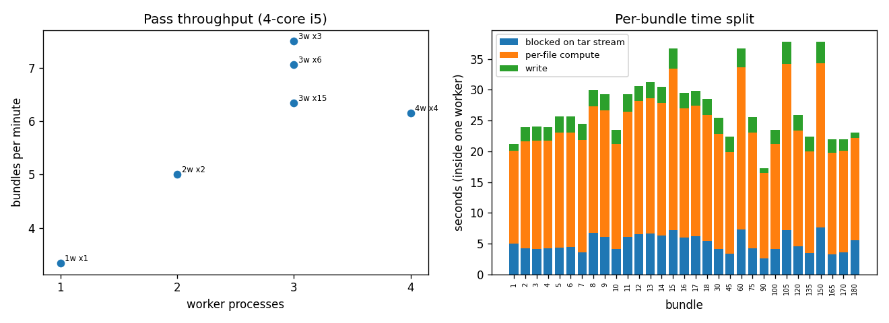
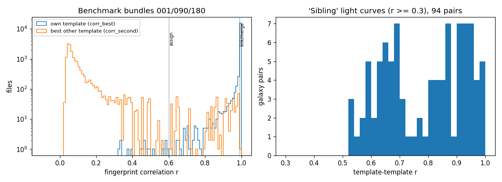
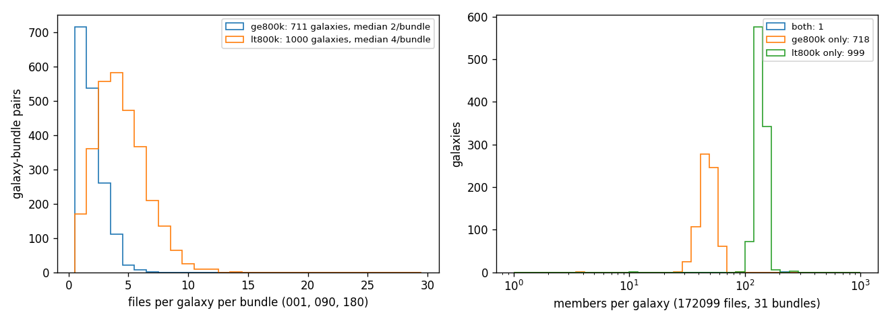
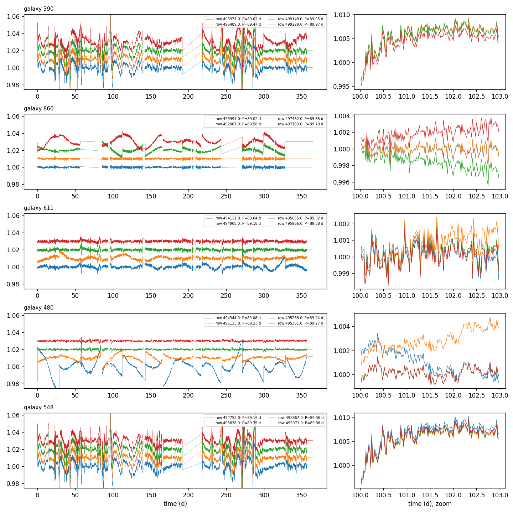

# T20 phase 1: full-corpus galaxy-ID pass, design and runtime estimate

**Date:** 2026-10-21 · **Author:** data-auditor session (T20 phase 1) · **Branch:** `claude/t20-galaxy-quietness-c3bb9b` · **Status:** draft

## TL;DR
- **The full-corpus pass is cheap. Estimate: ~45–60 min wall time in total, ~2 CPU-hours and 17.7 GB on the drive.**
  - `galaxy_pass.py` streams all 180 bundles at 3 workers in **24–28 min** (8.0–9.5 s per bundle measured). 149 bundles remain, so ~21–24 min more.
  - `galaxy_groups.py` then clusters 1M fingerprints in **~23 min** (scaled linearly from 239 s for 172,099 files).
  - It's resumable per bundle. A sleep or unplug loses at most the bundles in flight; rerun with `--resume`.
  - Waiting for your go-ahead (commands under Reproduce).
- **The grouping works.** I ran it on 31 of the 180 bundles (172,099 files): every file maps to one of **1,718 noise light curves**, except 16 unassigned files (short-P, high-activity stars whose own signal swamps the noise).
  - Membership is tight: median file-to-template r = 0.99989, and 99% of files are at r ≥ 0.984.
  - It recovers **371/371** of T1's identical-noise pairs, adds no false ones, and splits 5 T1 "pairs" that are really *siblings* (below).
  - Spot-check plots show identical noise and different signals within each galaxy.
- **The SIM_ID 800k split is almost, but not exactly, galaxy-disjoint.**
  - 999 light curves are used only below 800k and 718 only at or above it (the ≥800k pool is saturated at ~48 files each in 31 bundles, so ~718 is its real size, not Claytor's ~1,000).
  - **One light curve (galaxy 2) is used in both pools**: 164 + 47 files here, about **270 of the 200k ≥800k files** corpus-wide by extrapolation. That is T2's dev/holdout pool, so this is small but real train↔holdout noise leakage.
- **New dataset property: "sibling" noise light curves.** 94 pairs of *distinct* light curves correlate at r = 0.5–0.99 (in families of 2–12). One example looks identical by eye (galaxies 390/548, r = 0.989; `figures/spotcheck.png`).
  - Possible causes: one galaxy reduced twice, or overlapping apertures. Projecting out up to 30 common modes doesn't remove the correlation, so it isn't simply shared spacecraft systematics.
  - It matters for T20: a periodic contaminant would show up in every sibling.
- **Deviations from the brief, disclosed:**
  - I ran the pass on **31 bundles** (17% of the corpus, ~3 min of drive time each run), not 2–3. The worker-scaling test needed distinct cold bundles. Bundles 1–18 cover all of T1's `data_subset` files for validation. Templates converge after ~5 bundles, so this also tested the clustering at scale.
  - All outputs are valid parts of the full run, and `--resume` skips them.

## Question / goal
T20 phase 1 (`docs/TASKS.md`, step A; P15 revived): build a correct, resumable, fast full-corpus pass that assigns a noise-galaxy ID to every SMARTS file and records corrupt-noise flags and per-file stats. Time it on a few bundles, give a full-corpus estimate, and stop. No goal in `benchmarks/goals.json` is involved (no pipeline change).

## What I did
1. **`tools/audit/galaxy_pass.py`.** One streaming pass per bundle (module-level worker over bundles, `--bundles/--all`, `--resume`, `--n-workers`, mount check, BLAS pinned via `determinism.py`). For every file it records:
   - **Fingerprint:** T1's (first difference of raw flux, robust-standardized, clipped at ±8σ; linear-fill runs, constant fills and non-finite values zeroed) at full resolution (17,519 values), stored as int8 (×15). Agreement with T1's float fingerprint: r ≥ 0.9998 on 20 files.
   - **Corrupt-noise flags:** exactly `flux_outliers.py`'s (max |flux − 1|, count > 0.1, orbits hit), checked equal on 20 files.
   - **Stats:** point-to-point scatter `p2p_ppm`; slow-component amplitude `slow_amp_ppm` (5–95% range) and `slow_rms_ppm` (MAD) of 12-h bin means, excluding fills and bad orbits; fill counts; lead/trail constant runs.
   - **Outputs:** per bundle on the drive, `extracted/galaxy_pass/NNN_{fp.npy, stats.csv, meta.json}`, written atomically. The stats CSV is written last and marks the bundle done.
   - **Profiled before optimizing:**
     - `interp_runs` is vectorized into `interp_diff_mask`, tested bit-equal to T1's loop.
     - The FITS table is read at its fixed byte offset (astropy fallback for any other layout).
     - Python's `tarfile` "r|gz" spent 7.4 s CPU per bundle decompressing. Piping through an external `gzip -dc` gets that to 4.0 s wall / 1.5 s Python CPU and overlaps decompression with compute.
     - Per-file compute is ~2.5–3 ms (medians dominate), and that is now the bottleneck.
2. **`tools/audit/galaxy_groups.py`.** Template ("leader") clustering, O(N × T × D) BLAS products per bundle; no all-pairs step. The design came out of what bundle 001 showed:
   - same-light-curve files reach r ≥ 0.99 with their template (95%; median 0.9997);
   - signal-heavy files drop to ~0.6, but alone;
   - distinct "sibling" light curves reach r = 0.99;
   - unrelated galaxies stay ≤ 0.5. In the 4M file pairs straddling SIM_ID 800k in bundle 001, the max was 0.5 apart from one true straddler.

   The steps:
   - **Pass 1:** files at r ≥ 0.99 join and update a template. Leftovers that link to each other at r ≥ 0.99 (≥ 2 members) seed a new template. After the last bundle, the pooled weak files are clustered once more, so a sibling seen once per bundle still gets its own template.
   - **Merge:** templates at r ≥ 0.99 are merged; lone templates are folded into their best multi-member template at r ≥ 0.6. Templates with < 2 strong members are then dropped.
   - **Pass 2:** each file is assigned to its best template (`galaxy_id` if r ≥ 0.6, else −1; `galaxy_best` always), with best and second-best r recorded.
   - **Siblings:** template pairs at r ≥ 0.5 are listed in `galaxy_siblings.csv`; `sibling_group` gives the connected components.
   - **Pool split:** the 800k split is *not* imposed; it's checked.
3. **Benchmark.** Bundle 090 (1 worker); 001 + 180 (2 workers); 045/135/165 (3); 015/060/105/150 (4); 030/075/120/010/100/170 (3 workers, two rounds); then 002–018 (3 workers).
   - No other jobs were running. The load-average spikes came from my own runs; the 002–018 run overlapped my own test and dev processes.
   - Raw drive read: `cat` of bundle 100 runs at 138 MB/s, so 89 GB takes ~11 min. The pass is CPU-bound, not drive-bound.
4. **Grouping** on all 31 finished bundles (172,099 files), then `tools/audit/galaxy_phase1_data.py` to collect report tables, the T1 cross-check and spot-check light curves.
5. Tests: `tests/test_galaxy_audit.py` (8 tests, no drive): mask equals T1's, fast parse equals astropy, corrupt-orbit flags, grouping recovers synthetic galaxies, siblings stay separate, helpers. Full suite: see Reproduce.

## Results

### Runtime and the full-corpus estimate

Left: throughput peaks at **3 workers (7.0–7.5 bundles/min sustained)**. At 4 workers it drops to 6.2 because each worker also spawns a gzip process, giving 8 busy processes on 4 physical cores. Right: inside a worker, compute (~16–27 s) dominates waiting on the tar stream (~3–7 s).

| item | measured | full corpus (180 bundles, 1M files) |
|---|---|---|
| pass wall time, 3 workers | 8.0–9.5 s/bundle | **24–28 min** (≈21–24 min for the 149 bundles left); allow up to ~45 min if the laptop throttles or is busy |
| pass CPU | 19.6 s Python + ~3.6 s gzip per bundle (median, parallel runs) | **~1.2 CPU-h** |
| drive read | 138 MB/s raw | 89 GB, ~11 min if read alone; overlapped with compute |
| pass output | 17.7 KB/file (int8 fingerprint 17.5 KB + stats) | **17.7 GB on the drive** (`extracted/galaxy_pass/`) |
| grouping, 4 BLAS threads | 239 s for 172,099 files (pass 1 145 s, pass 2 89 s); 2.3 GB peak footprint | **~23 min**, ~0.9 CPU-h at 4 threads; fingerprints are memory-mapped from the drive |
| total | | **~45–60 min wall, ~2 CPU-h, 17.7 GB** |

### Fingerprint separation

Left (bundles 001/090/180):
- Own-template r piles up at 1; 4.9% of files fall below 0.99 and 0.95% below 0.9.
- Best-other r is ~0.06 typically. Its tail toward 1 (284 files with r > 0.9) is files whose galaxy has a sibling.

Right: the 94 sibling pairs spread over 0.5–0.99, with no gap below the 0.99 link threshold. This is the fuzziest decision in the design (open question 2).

### Group sizes

Left: within one bundle, a <800k galaxy contributes a median of 4 files and a ≥800k galaxy 2, as expected from ~4,400 and ~1,100 files per bundle spread over their pools. Right: over 31 bundles, the <800k galaxies have ~100–170 members and the ≥800k ones ~30–60. There are no stray tiny groups except two whole-galaxy-corrupt groups (4 and 10 files), each with a sibling at r ≈ 0.989, probably halves of a split galaxy. The single straddler is galaxy 2.

### Spot check

Three random galaxies from bundle 090 (860, 611, 480) plus a sibling pair (390, 548).
- In each 3-day zoom (right), members overlay to the cadence wherever their own spot signal is small. The members that drift away are the ones with strong signals (e.g. galaxy 480's blue and orange members, which are visibly spotted in the full-year panel).
- Galaxies 390 and 548 are distinct templates (r = 0.989), yet their light curves are nearly indistinguishable. That is what "sibling" means here.

### Other checks
- **T1 cross-check** (1,031 T1 rows covered): 371/376 T1 same-noise pairs are the same galaxy here, and 0 new pairs appear. The 5 others are sibling pairs that T1's r > 0.8 cut lumped together: each file matches its own template at r ≥ 0.997, and the template–template r (0.86–0.97) equals T1's pair r.
- **Corrupt noise.** 204 of 1,718 galaxies (11.9%) have every member corrupt (max |flux − 1| > 0.1); 13.1% of files are flagged. Another 18 galaxies have 1–2 flagged members out of ~140. Those 97 files have max |flux − 1| of only 0.100–0.23 (median 0.107), so they look like strong injected signals, not corrupt noise. **Use the galaxy-level flag** (most members corrupt) rather than the per-file one.
- **Unassigned (16 files):** all have P < 1.2 d and ACTIVITY 2.6–9.9. Their own signal swamps the 30-min noise (best r to any galaxy 0.32–0.59). `galaxy_best` holds a best guess.

## What didn't work
- **A loose seed link (r ≥ 0.6, then 0.9).** It merged sibling light curves (e.g. a <800k light curve and a ≥800k one at r = 0.92) into one template. The pool-split check caught it, which is why the link is now 0.99.
- **Projecting out common modes** (top 3/10/30 principal components of the templates) to separate siblings. Sibling pairs stayed at 0.94–0.95, so they aren't global spacecraft systematics. Dropped.
- **Decimated fingerprints** (4,096/2,048/1,024 of the 17,519 cadences). They lose separation (1% quantile of same-galaxy pairs ~0.61 vs a distinct-pair max of ~0.54), and the full-resolution matrix products are affordable. Not adopted.
- **`tarfile` "r|gz"**: 2× slower than an external gzip pipe (above). `np.add.at` for template sums: 4.3 s vs 0.27 s for a sparse one-hot product.
- `fill_hash` (a hash of the masked-cadence pattern) is recorded but differs between members of one galaxy (injected signals change which triples are exactly collinear). Don't use it as a galaxy key.

## Open questions for Rae
1. **Approve the full run?** ~45–60 min in total (pass ~25 min, grouping ~23 min), 17.7 GB on the drive. Commands below. Keep the laptop awake and plugged in (`caffeinate -i`).
2. **What counts as one "galaxy" for stacking?** I define `galaxy_id` = one identical noise light curve (r ≥ 0.99) and record siblings separately. Siblings with r ≥ 0.9 probably carry the same astrophysical contaminant, so phase 2 should search per galaxy and then compare across `sibling_group`. Alternatively, treat r ≥ 0.9 sibling groups as one unit.
3. **Leakage into the ≥800k pool.**
   - Galaxy 2's light curve is used by ~0.14% of ≥800k files, about 270 corpus-wide.
   - Two r ≥ 0.5 sibling groups straddle the pools (89 minority-side files in the 31 bundles).
   - Should T2's dev/holdout manifests be checked against the full galaxy table (a tiny exclusion), or is it negligible?
4. **The ≥800k pool has only ~718 noise light curves**, not ~1,000 (it's saturated at ~48 members each in 31 bundles). Worth confirming with Zach's TIC list if it arrives.
5. Galaxies 1716 (10 files) and 1717 (4 files) are whole-galaxy-corrupt and each sibling-linked at r ≈ 0.989. They are likely halves of galaxies split by corrupt-orbit garbage dominating the fingerprint. Harmless for phase 2, but noted.

## Plan for phase 2/3 (for review; not started)
**Phase 2: recover each galaxy's own light curve (T20 B), amplitude-aware.**
1. **Additive vs multiplicative.** For same-galaxy member pairs with tiny injected amplitude (low ACTIVITY, low sin i, high latitudes), compare `f_a − f_b` and `f_a / f_b` against the noise level in high- and low-flux stretches of the galaxy. A small, rigorous test (~50 pairs).
2. **Choose stacking members by expected amplitude.** Rank each galaxy's members by an expected-amplitude proxy from the catalog:
   - start from T1's `AMP_PROXY` (ACTIVITY × visibility from INCL and the latitude band);
   - check it against the measured `slow_rms_ppm` minus the galaxy floor;
   - build the estimate (a robust per-cadence median) from the lowest-amplitude ~third;
   - hold out the members whose injected signal should dominate.

   With ~500 members per galaxy, that's ~150 per stack.
3. **Verify empirically.** For held-out members, residual = member − galaxy estimate. It should be just the injected signal (LS peak at that member's P, nothing at a common period). Also check that the estimate doesn't change when built from two disjoint member subsets.
4. **Implementation.** A second streaming pass over the bundles, since we don't keep full fluxes. It accumulates per-galaxy robust stacks in memory (~2,000 × 17,520 values) from the chosen members, with per-bundle partial sums written atomically so it's resumable. Cost should be similar to this pass (~25 min). Exact medians need all values; a two-pass mean with clipping, or per-bundle medians combined, is good enough.

**Phase 3: periodicity in the galaxy light curves (T20 C–E).**
- **C.** Run LS and the pipeline on each galaxy light curve, plus the persistence test on disjoint-subset stacks. List periodic galaxies with period, amplitude relative to the injected-amplitude distribution, and number of affected files.
- **D.** Check whether dev_medium's wrong/alias/diffrot answers match their galaxy's period (`galaxy_id` joins on `row`).
- **E.** Classify each signal: common-mode (shared across galaxies at the same times; PCA across the ~1,700 light curves) vs source-specific, with sibling groups as a cross-check. Use Zach's TIC list if it arrives.

## Reproduce
```bash
PY=/opt/anaconda3/envs/ss_openblas/bin/python
# Full run (Rae, ~25 min; resumable; already-done bundles are skipped):
caffeinate -i $PY tools/audit/galaxy_pass.py --all --resume --n-workers 3
# Then cluster everything (~23 min, writes <root>/extracted/galaxy_groups/):
caffeinate -i $PY tools/audit/galaxy_groups.py
```
- **After a sleep, unplug or crash:** rerun the same `galaxy_pass.py --resume` line. A bundle is all-or-nothing:
  - the fingerprint `.npy` is written atomically first and the stats CSV last;
  - a bundle with no stats CSV is redone;
  - if the drive vanishes, in-flight bundles fail with "rerun with --resume" and the script exits 1;
  - an unplug mid-write can leave a hidden `.NNN_*.part.*` temp file on the drive, which is harmless and ignored.
- **Laptop sleep** just suspends the processes; they continue on wake if the drive is still mounted.
- **Grouping** is not resumable (one ~23-min run), but its outputs are atomic. If interrupted, rerun it.

This report (as run here):
```bash
$PY tools/audit/galaxy_pass.py --bundles 90 --n-workers 1
$PY tools/audit/galaxy_pass.py --bundles 1 180 --n-workers 2
$PY tools/audit/galaxy_pass.py --bundles 45 135 165 --n-workers 3
$PY tools/audit/galaxy_pass.py --bundles 15 60 105 150 --n-workers 4
$PY tools/audit/galaxy_pass.py --bundles 30 75 120 10 100 170 --n-workers 3
$PY tools/audit/galaxy_pass.py --bundles $(seq 1 18) --resume --n-workers 3
$PY tools/audit/galaxy_groups.py --outdir <scratch>/groups31          # 31 finished bundles
$PY tools/audit/galaxy_phase1_data.py --groups <scratch>/groups31 --outdir reports/2026-10-21_t20-galaxy-pass-phase1/data
$PY tools/run_notebook.py reports/2026-10-21_t20-galaxy-pass-phase1/notebook.ipynb
$PY -m pytest -q
```
