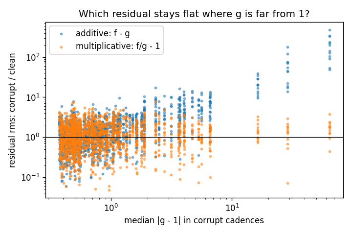
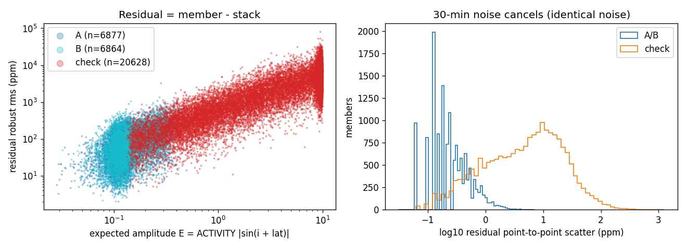
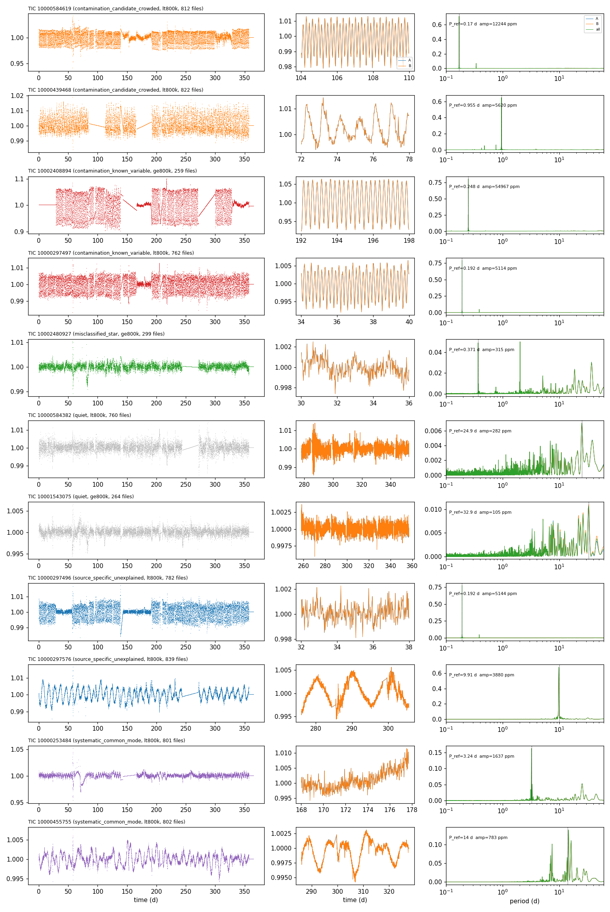
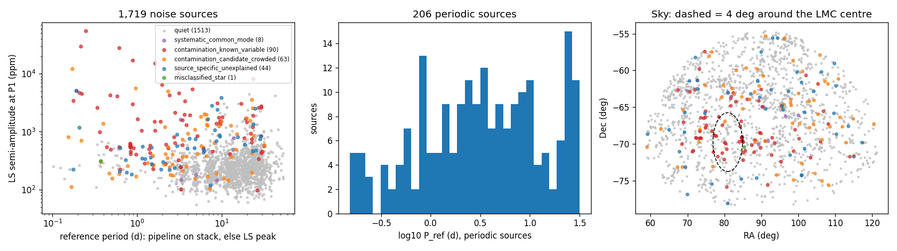
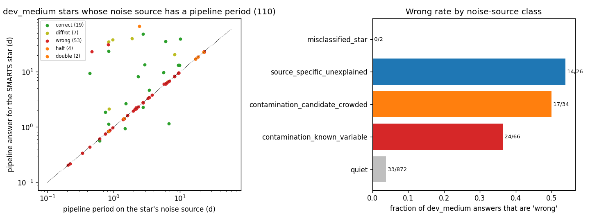
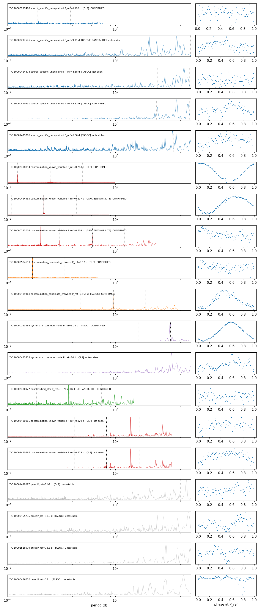

# T20 phase 2: which SMARTS noise sources are not quiet?

**Date:** 2026-10-21 · **Author:** data-auditor session (T20) · **Branch:** `claude/t20-galaxy-quietness-c3bb9b` · **Status:** draft

## TL;DR
- **Rae's suspicion is confirmed, and it explains most of the "confident wrong" answers.**
  - **206 of the 1,719 noise light curves (12%) carry a real periodic signal.** They underlie **121,502 SMARTS files (12.2%)**: 23,894 of the 199,728 files in the ≥800k dev/holdout pool, and the rest in the <800k pool.
  - **51 of dev_medium's 88 wrong answers (58%)** are, within 10%, exactly the period the production pipeline returns on the star's noise source *alone*. A shuffled-source null gives 0.4 (max 3 in 200 shuffles).
  - dev_medium stars on periodic sources are "wrong" **43%** of the time (55/128), vs **3.8%** (33/872) on quiet sources. Flagging these sources would take dev_medium's wrong rate from 8.8% to 3.8%. Correct + diffrot barely differs (22.7% vs 25.1%): periodic noise mostly turns would-be declines into confident answers.
  - The pipeline isn't failing on those stars; it correctly measures a signal that the labels don't contain.
- **What the signals are: overwhelmingly source-specific contamination, not spacecraft systematics.**
  - Only 8 of 206 lose their signal when the cross-source common modes are projected out.
  - **90** have a Gaia-classified variable within 63″ (EBs, Cepheids, RR Lyrae, δ Sct, LPVs). The five largest signals (1.5–5.5% amplitude, P = 0.2–1.6 d) all sit next to Gaia EBs or Cepheids.
  - 63 more are in crowded fields or have brighter neighbours. 44 are unexplained but source-specific, e.g. a coherent 9.9-d, 3,900 ppm sinusoid.
  - 1 has a dominant star-like point source.
  - Several are *families of neighbouring apertures sharing one signal*. For example, ~10 near-consecutive TICs (10002480866–885) all show P ≈ 0.83 d: one variable star leaking into many "galaxies".
- **Many SMARTS "galaxies" aren't background galaxies.** All 1,719 are TIC `EXTENDED` objects, but **242 lie within 4° of the LMC centre**, in fields with a median of 91 Gaia sources (G < 19) within 63″, vs 5–10 elsewhere. There, 26% are periodic vs 10% away from the LMC.
- **The injection was multiplicative (f = g × s).** Where the noise light curve departs from 1 by more than 3 (corrupt orbits), f − g grows 6.2× while f/g − 1 stays flat (1.17×).
- **Independent FFI light curves confirm it (follow-up (f), run after Rae's OK).**
  - No SPOC products exist for these extended TIC IDs, so I used QLP / TASOC / ELEANOR-LITE light curves (TESS sectors 1–5).
  - **9 of 12 testable periodic sources (P < 5 d) show the same period**, mostly in all 3 sectors checked. None of the 4 quiet controls does.
  - In the two misses from the 0.83-d family, QLP's aperture picks up a *different* neighbour's 1.38-d period, also seen in the family. Which star leaks in depends on the aperture.
- **Deviation from the brief:**
  - Public catalog queries went through VizieR rather than the ESA Gaia archive, because the archive's upload join timed out and its per-target cones took ~7 s each.

## Question / goal
T20 phase 2 (`docs/TASKS.md` T20 B–E plus Rae's test D, with the amplitude caution from "Rae's decisions"). Ground-truth noise-source IDs come from Zach Claytor's `galaxy_files.csv` (`docs/SMARTS_REFERENCE.md` §7). No pipeline code or goals were changed. The holdout was not touched; dev_medium was only *read* from the committed baseline tables.

## What I did
1. **TIC map** (`tools/audit/galaxy_tic_map.py`): catalog row → SIM_ID → TIC for all 1M files (`extracted/galaxy_ids/galaxy_map.csv.gz`). I also cross-checked it against the phase-1 blind fingerprint groups (31 bundles).
2. **Full corpus pass**, started by the coordinating session: `galaxy_pass.py --all --resume --n-workers 3`. It finished the remaining 149 bundles in 1,027 s with 0 failures, giving corrupt flags and stats for all 1M files.
3. **Amplitude-aware stacking** (`tools/audit/galaxy_stack.py`):
   - **Ranking:** members are ranked per TIC by an expected injected amplitude, E = ACTIVITY·|sin(INCL + mean band latitude)|.
   - **Estimate:** the lowest-E K = min(80, n/3) members are split by rank parity into disjoint halves A and B. The noise light curve estimate is the per-cadence **median** of A, of B and of A+B.
   - **Hold-outs:** the 4 highest-E members plus 8 random others per TIC are held out as checks.
   - **Scale:** a resumable extraction pass saved the 158,038 selected light curves (10 GB on the drive; 1,248 s); stacking took 1,142 s.
4. **Injection model** (`tools/audit/injection_model.py`): residuals of check members in the 146 TICs with corrupt orbits.
5. **Periodicity** (`tools/audit/galaxy_periods.py`): each stack is written as a SMARTS-layout FITS file (dummy PERIOD), so the production loader and pipeline see it exactly like a SMARTS star.
   - **LS:** 0.1–60 d on the loaded flux of A, B and all. **A/B persistence:** top peaks agree within 2%.
   - **Pipeline:** `scorecard.score_one_star` with default methods on the A+B stack (1,518 s).
6. **Independent FFI light curves** (follow-up (f), `tools/audit/ffi_lc_check.py` in `codeastro` + `ffi_lc_compare.py`): 57 MAST HLSP light curves for 19 sources (results below).
7. **Source lookups** (`tools/audit/tic_lookup.py`, run in the `codeastro` env; cached on the drive in `extracted/tic_lookup/`):
   - TIC v8.2 rows for all 1,719 TICs;
   - Gaia DR3 (VizieR I/355/gaiadr3) sources with G < 19 within 63″ (3 TESS pixels): 52,305 sources around 1,702 targets;
   - Gaia DR3 variability classes (I/358/vclassre) for the 785 flagged variables.
8. **Analysis** (`tools/audit/galaxy_phase2_analysis.py`):
   - **Common modes:** the top 8 principal components across all stacks, then the fraction of LS power at each source's reference period that survives projecting them out (`cm_retained`).
   - **Classification:** as below.
   - **dev_medium test:** against `benchmarks/baselines/dev_medium_fullyear_tables/per_star.csv`.
   - **Per-file flags:** `extracted/galaxy_ids/noise_source_flags.csv.gz` (1M rows).

**Classification (in this order):**
- **Periodic:** the pipeline returns a period for the stack (189 sources), *or* the stack's LS top peak has power ≥ 0.1 and agrees between A and B (104). 87 sources meet both criteria.
- **Non-periodic:** `quiet`.
- **`systematic_common_mode`:** less than 50% of the power at P_ref survives the common-mode projection.
- **`misclassified_star`:** a Gaia star-like (PSS > 0.9) source within 3″ and within 1.5 mag of the target's Tmag. Parallax can't be required, because LMC stars have none.
- **`contamination_known_variable`:** a Gaia-classified variable within 63″.
- **`contamination_candidate_crowded`:** within 4° of the LMC, or a Gaia neighbour within ~1 mag of Tmag or brighter.
- **Else `source_specific_unexplained`.**

## Results

### Ground-truth IDs vs the phase-1 fingerprint groups
On 172,083 assigned files, 1,694 of 1,718 fingerprint groups map to one TIC, and 99.83% of files are in their group's majority TIC.
- **Two groups are each two TICs** indistinguishable at r ≥ 0.99 (10000241254 + 10000255394; 10000480324 + 10000480315).
- **The other 22 impurities are single misassigned weak (signal-heavy) files.**
- **23 TICs are split across groups,** mostly the same single files.
- **Siblings:** 92 of the 94 sibling pairs are different TICs, with a median TIC-number gap of 7.5 (neighbouring sources). The other 2 are halves of one corrupt TIC (phase-1 galaxies 1716/1717).

### The injection was multiplicative

Look at the right side: where the noise light curve departs from 1 by more than 3, f − g (blue) grows with |g − 1| while f/g − 1 (orange) stays near 1.

| median \|g − 1\| | files (TICs) | f − g ratio | f/g − 1 ratio |
|---|---|---|---|
| > 1 | 504 (42) | 2.57 | 1.20 |
| > 3 | 168 (14) | 6.22 | 1.17 |
| > 10 | 36 (3) | 47.5 | 1.48 |

**So f = g × s:** a contaminant's relative amplitude is the same in every member file, and stacking (median of g·sᵢ) recovers g up to a constant.

### The stacks recover the noise light curve

- **Left:** member − stack residual vs expected amplitude E. Stacking members (A/B, low E) have a median residual of **68 ppm**; held-out checks **1,724 ppm**, rising with E (Spearman ρ = 0.59 over all members). E ranks the injected amplitude well, so the stacks are built from members whose own signal is small.
- **Right:** the residual's point-to-point scatter is **0.25 ppm** for stacking members, so the 30-min noise cancels exactly. Only smooth injected signal remains.
- **Persistence:** halves A and B give the same LS top peak in **1,615 / 1,719** sources. Every periodic signal below is present in both disjoint halves, so it lives in the noise light curve, not in leftover injected signal.

### Example noise light curves

Two sources per class, plus two random quiet ones. Middle column: halves A and B overlay exactly. Three things to look at:
- **Rows 1–4:** coherent 0.17–0.95 d pulsations or eclipses at 0.5–5.5% amplitude. Several *change amplitude from sector to sector* (rows 1, 3, 8), which is what a neighbouring star leaking into an aperture that is redefined each sector should do.
- **Row 9:** a clean 9.9-d sinusoid all year.
- **Quiet rows:** red noise only, LS power < 0.01.

### The population

- **Left:** periodic sources (coloured) separate from the quiet red-noise cloud at P < 5 d. The short-period, high-amplitude end is dominated by known-variable contamination.
- **Middle:** periodic sources' periods span 0.15–30 d.
- **Right:** periodic sources are concentrated toward the LMC (dashed circle), but not exclusively.

| class | sources | files | sources in ≥800k pool | median P_ref (d) | median LS amp (ppm) | pipeline period on stack | near LMC |
|---|---|---|---|---|---|---|---|
| quiet | 1,513 | 878,498 | 633 | — | 226 | 0 | 180 |
| contamination_known_variable | 90 | 53,417 | 36 | 2.6 | 1015 | 79 | 53 |
| contamination_candidate_crowded | 63 | 35,369 | 29 | 4 | 420 | 60 | 6 |
| source_specific_unexplained | 44 | 26,043 | 19 | 4.4 | 543 | 41 | 0 |
| systematic_common_mode | 8 | 6,374 | 0 | 5.6 | 355 | 8 | 2 |
| misclassified_star | 1 | 299 | 1 | 0.37 | 315 | 1 | 1 |


- **Crowding is the strongest environmental factor:**

  | | periodic sources with a Gaia variable within 63″ | quiet sources with one |
  |---|---|---|
  | away from the LMC | 26% | 8.6% |
  | within 4° of the LMC | 90% | 67% |

  Near the LMC a variable neighbour is therefore weak evidence on its own; away from it, it is a 3× enrichment.
- **Corrupt orbits are unrelated to periodicity:** 12.1% of periodic and 11.8% of quiet sources are mostly-corrupt.

### Rae's test: dev_medium answers vs their noise source's own period

**Left:** for the 110 dev_medium stars whose noise source has a pipeline period, the star's answer lies *on the diagonal*, equal to the noise source's period, in 51 wrong + several half/double/"correct" cases. Off-diagonal points are stars whose own signal won.

**Right:** wrong-answer rate by noise-source class.

| | count |
|---|---|
| wrong answers equal to the source's pipeline period (±10%) | **51 / 88** (shuffled-source null: mean 0.4, max 3 over 200 shuffles) |
| wrong answers matching any source period (LS P1–P3 or pipeline, incl. half/double) | 75 / 88 (null 26 / 88) |
| wrong answers on periodic sources | 55 / 88 |
| wrong rate on periodic vs quiet sources | 43% (55/128) vs 3.8% (33/872) |

The 33 wrong answers on quiet sources are the pipeline's own errors, the part method work should target.

### Independent FFI light curves (follow-up (f))

19 sources: 15 periodic (the top unexplained ones, the largest contaminants, two crowded, two "systematic", the dominant-star case, two members of the 0.83-d family) plus 4 random quiet controls. Light curves come from MAST HLSPs, 3 sectors each from sectors 1–5. Each sector is detrended with a running median of 4·P_ref (0.5–5 d), and the search runs from 0.1 d up to that window. A source counts as **confirmed** if one of the three highest stitched peaks is at P_ref, P_ref/2 or 2·P_ref (within 3%). Only P_ref < 5 d is testable: single 27-d sectors with pipeline trends give spurious 13–15 d "matches" even for the quiet controls, so I don't count those.

- **Confirmed (9/12 testable):**
  - **Unambiguous**, since no spacecraft systematic makes a coherent signal at these periods with this phase coherence:
    - the 0.192-d pair (3/3 sectors);
    - the 0.248-d and 0.217-d eclipsing-binary contaminants (3/3; QLP folds show eclipse shapes);
    - the 0.609-d Cepheid/RR Lyrae field;
    - the 0.170-d and 0.955-d crowded sources (3/3).
  - **Moderate:** the 4.82-d unexplained source (peak at the edge of the detrending window).
  - **Marginal:** the 0.37-d dominant-point-source case (107 ppm, 2/3 sectors, weak fold).
  - **3.24-d "systematic_common_mode" source TIC 10000253484:** clean 17,000 ppm sinusoid in TASOC, 3/3 sectors.
- **Not seen:**
  - the 4.88-d unexplained source (745 ppm in SMARTS);
  - both 0.83-d family members tested, where QLP shows 1.38 d instead. That is the period of other family members (10002480877/879), so which neighbour leaks in depends on the aperture.
- **Amplitudes differ wildly between reductions** at the same period, e.g. 12,244 ppm in SMARTS vs 336 ppm in QLP for TIC 10000584619, and 5.5% vs 80% for TIC 10002408894. The fraction of a neighbour's light in the aperture is reduction-specific. An intrinsically constant galaxy plus a leaking star predicts exactly this.
- **Caveat on "systematic_common_mode":** three of its eight members have P ≈ 3.24–3.29 d, and one common mode peaks at 3.39 d. Every TESS reduction shares spacecraft systematics, so an independent FFI light curve can't tell a few-day systematic, such as momentum-dump-related, from an intrinsic signal. TIC 10000253484 stays ambiguous: either a strong spacecraft systematic or a real 3.24-d variable that the common-mode test absorbed.

## Recommendations for Rae's keep / flag / exclude decision
1. **Flag, don't silently keep.** Add the per-file flags (`noise_source_flags.csv.gz`: classification, `P_ref`, amplitude, `periodic`) to every training and evaluation table. The 12% of files on periodic sources have, in effect, two true periods.
2. **Exclude `contamination_known_variable` and `contamination_candidate_crowded` from ranker training** (143 sources, 88,786 files, 8.9%), or relabel them. Either way, a candidate at the contaminant's period must not be scored as a negative. These are astrophysical signals the pipeline *should* find.
3. **Keep `systematic_common_mode`** (8 sources). Real TESS data has these too, and it's small. One of them (3.24 d) is strong and coherent in TASOC too; treat it as "unclear".
4. **`source_specific_unexplained` (44): exclude with the contamination classes.** They behave like contamination in every test: source-specific, persistent, 54% wrong rate on dev_medium, and 2 of 3 testable ones confirmed in independent FFI light curves.
5. **Scoring:** a new outcome, e.g. `noise_period` = "matches the noise source's own period", would separate these 51+ cases from genuine pipeline errors. I didn't touch `evaluation.py`; it's Rae's call.
6. **Dev/holdout:** 128 of dev_medium's 1,000 stars sit on periodic sources. Report metrics on the quiet subset next to the full set until the training-set decision is made. G9–G12 numbers on dev_medium full-year are currently dragged down by this.

## What didn't work
- **Gaia via the ESA archive.** An uploaded-table join timed out (HTTP 408); per-target cones took ~7 s each (~3.3 h). CDS XMatch was unreachable (port 80). VizieR batched cones did it in ~8 min.
- **Classifying systematics by "top LS peak moves after removing common modes".** It flipped on red-noise peaks (47% "moved" even for quiet sources). It was replaced by the fraction of power at the reference period that survives (`cm_retained`; median 1.01 for periodic sources).
- **Period clustering as a systematics test.** It is meaningless here: the 5–30 d red-noise continuum fills every 1% bin with ≥ 10 sources (`period_clusters.csv`, informational only).
- **"Misclassified star" by parallax or proper motion.** Only 22 targets have a central source with ϖ/σ > 5, and none is periodic; LMC stars have no measurable parallax. It was replaced by a dominant star-like point source (9 sources, 1 periodic).

## Open questions for Rae
1. **Keep / flag / exclude:** see the recommendations. The main decision is whether to drop the 206 periodic sources (12% of files) from ranker training, or keep them with a second "noise period" label.
2. **Add a `noise_period` scoring outcome?** It changes `evaluation.py`, so it's your decision.
3. **More FFI checks?** Done for 19 sources (above). Extending to all 206 periodic sources would be ~600 light curves (~170 MB), ~15 min. Long periods (≥ 5 d, e.g. the 9.9-d sinusoid) need multi-sector detrending that keeps slow signals, which is not done here.
4. **The "periodic" threshold** (pipeline returns a period, or LS power ≥ 0.1 with A/B agreement) is a judgment call. Quiet sources may still carry weaker signals that matter at low injected amplitude. A stricter cut, e.g. LS power ≥ 0.2, gives fewer sources.
5. **Ask Zach:** were the 242 near-LMC "galaxies" meant to be in the sample? Many are likely LMC clusters or nebulae classified as extended.

## Reproduce
```bash
PY=/opt/anaconda3/envs/ss_openblas/bin/python
$PY tools/audit/galaxy_tic_map.py --fingerprint-groups <phase-1 groups dir> --report-dir reports/2026-10-21_t20-noise-sources-phase2/data
/opt/anaconda3/envs/codeastro/bin/python -I tools/audit/tic_lookup.py --tic-table /Volumes/Data_Vault/smarts_data/extracted/galaxy_ids/tic_table.csv --outdir /Volumes/Data_Vault/smarts_data/extracted/tic_lookup   # ~10 min, network
$PY tools/audit/galaxy_pass.py --all --resume --n-workers 3          # ~17-25 min (done)
$PY tools/audit/galaxy_stack.py select
$PY tools/audit/galaxy_stack.py extract --all --resume --n-workers 3  # ~21 min, 10 GB on the drive
$PY tools/audit/galaxy_stack.py stack                                 # ~19 min
$PY tools/audit/injection_model.py --out reports/2026-10-21_t20-noise-sources-phase2/data/injection_model.csv
$PY tools/audit/galaxy_periods.py fits && $PY tools/audit/galaxy_periods.py ls && $PY tools/audit/galaxy_periods.py pipeline   # ~2 + 25 min
$PY tools/audit/galaxy_phase2_analysis.py --outdir reports/2026-10-21_t20-noise-sources-phase2/data
$PY tools/audit/ffi_lc_compare.py --make-selection reports/2026-10-21_t20-noise-sources-phase2/data/sources.csv --select reports/2026-10-21_t20-noise-sources-phase2/data/ffi_selection.csv
/opt/anaconda3/envs/codeastro/bin/python -I tools/audit/ffi_lc_check.py --select reports/2026-10-21_t20-noise-sources-phase2/data/ffi_selection.csv --outdir /Volumes/Data_Vault/smarts_data/extracted/ffi_check   # ~2 min, 16 MB
$PY tools/audit/ffi_lc_compare.py --ffi-dir /Volumes/Data_Vault/smarts_data/extracted/ffi_check --select reports/2026-10-21_t20-noise-sources-phase2/data/ffi_selection.csv --outdir reports/2026-10-21_t20-noise-sources-phase2/data
$PY tools/run_notebook.py reports/2026-10-21_t20-noise-sources-phase2/notebook.ipynb
```
