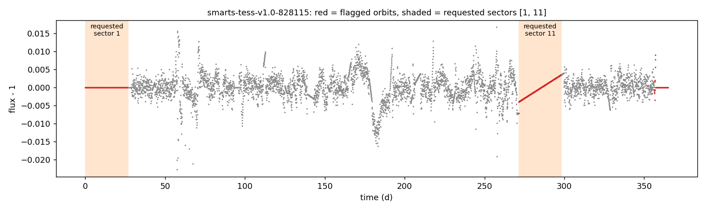

# T21: load_smarts_fits fails clearly when no sector survives

**Date:** 2026-10-21 · **Author:** method-improver agent (T21 session) · **Branch:** `claude/t21-loader-error-c98179` · **Status:** draft

## TL;DR
- When nothing survives selection, `preprocessing.load_smarts_fits` now raises **`NoUsableSectorsError`** (a `ValueError`) *before* regridding. The message names the file and the requested, flagged and absent sectors. Before, it crashed in `to_even_cadence` with `ValueError: attempt to get argmax of an empty sequence`.
- **No caller changes were needed.** The scorecard, both `batch_test_*` runners, both `run_debug_baseline*` runners and `tools/build_dev_sets.py` already catch per-star exceptions and record the reason. The scorecard writes `final_outcome="none"` plus the error text.
- **Results unchanged:** on dev_small (assigned and full-year), 0 of 50 stars differ in final period or outcome, and `check_goals` passes with all deltas +0.000. `compare_runs.py` exits 1 only because `wavelet`'s candidate count differs on 1–2 stars. I showed that the same flicker happens on **unmodified HEAD** (see Results), and `wavelet` is not a pooled pipeline method.
- No dev-set star hits the new error: all four committed dev baselines have 0 per-star errors.

## Question / goal
Task **T21** in `docs/TASKS.md` (open issue P20, found by T2). Rae decided on 2026-10-21 that an all-flagged request should raise a clear, named error early, and that callers should record it as a decline. No `goals.json` goal is involved.

## What I did
1. **Reproduced the crash.** On `data/smarts_sample/smarts-tess-v1.0-828115.fits`, both orbits of sectors 1 and 11 are flagged. `sectors=[1, 11]` and `sectors=[99]` both crashed with `attempt to get argmax of an empty sequence`.
2. **Wrote failing tests first** in `tests/test_preprocessing.py` (9 tests). They write a synthetic SMARTS-style FITS with extra scatter injected into sector 5 so `split_lightcurve` flags it. The cases are: all requested sectors flagged; a sector beyond the end of the file; mixed flagged and absent; `sectors=[]`; partial survival still loads; `sectors=None` with every orbit flagged; a pickle round trip; and the real-file case above (skipped if `data/smarts_sample` is missing).
3. **Fixed `claude_files/preprocessing.py`:**
   - Added `NoUsableSectorsError(ValueError)` with attributes `path`, `requested`, `flagged`, `absent`, `n_orbits` and `n_orbits_flagged`. It has a `__reduce__`, so it pickles across process pools.
   - `load_smarts_fits` raises it as soon as `recombine_segments` returns no points, before `to_even_cadence`. This also covers `sectors=None` with every orbit flagged and `drop_flagged_segments=True`.
   - Updated the docstrings (new `Raises` section; the `sectors` parameter now says what happens to flagged and absent sectors).
4. **Checked the callers** (no edits):

   | caller | what happens now |
   |---|---|
   | `benchmarks/scorecard.py` `score_one_star` | catch-all → `final_outcome="none"`, `pipeline_success=False`, `error="NoUsableSectorsError: …"` (verified by calling it directly on 828115 with `sectors=[1, 11]`) |
   | `batch_test_guesses.py`, `batch_test_acf_fft_highpass.py` | worker catch-all → a `failures.csv` row with the error text |
   | `run_debug_baseline.py`, `run_debug_baseline_full_methods.py` | per-file `try` → `error` column (these never pass `sectors`) |
   | `tools/build_dev_sets.py` `check_file` | → `passed=False`, `reason="load_error: NoUsableSectorsError: …"` |
5. **Regression check** on dev_small: one scorecard run each, assigned and full-year, at 4 workers, compared with `tools/compare_runs.py` and `check_goals.py --baseline`.

## Results



The two requested sectors (shaded) are both flagged (red). Sector 1 is SMARTS's constant end-fill and sector 11 is a linear interpolation, so nothing real is left. The loader now says:

```
NoUsableSectorsError: data/smarts_sample/smarts-tess-v1.0-828115.fits: no usable data in requested sectors [1, 11]: flagged [1, 11], absent [] (file has 27 orbits = sectors 1-14, 5 orbits flagged)
```

**dev_small assigned** (`datasets/dev_small.csv,data_root=data/smarts_dev,sectors=manifest`), `check_goals.py runs/t21_dev_small_assigned/metrics.json --baseline benchmarks/baselines/dev_small_assigned.json`:
```
   base     new   delta  limit  metric
  0.160   0.160  +0.000  0.020  final.overall.success
  0.222   0.222  +0.000  0.060  final.by_bin.1-3d.success
  0.125   0.125  +0.000  0.060  final.by_bin.10-30d.success
  0.333   0.333  +0.000  0.060  final.by_bin.3-10d.success
  0.222   0.222  +0.000  0.060  final.by_bin.<1d.success
  0.000   0.000  +0.000  0.060  final.by_bin.>30d.success
  (union_recall rows all +0.000)
OVERALL: PASS
```
**dev_small full-year** (`...sectors=ignored`):
```
  0.260   0.260  +0.000  0.020  final.overall.success
  0.333   0.333  +0.000  0.060  final.by_bin.1-3d.success
  0.375   0.375  +0.000  0.060  final.by_bin.10-30d.success
  0.222   0.222  +0.000  0.060  final.by_bin.3-10d.success
  0.222   0.222  +0.000  0.060  final.by_bin.<1d.success
  0.200   0.200  +0.000  0.060  final.by_bin.>30d.success
  (union_recall rows all +0.000)
OVERALL: PASS
```
`compare_runs.py`, both runs: `final_period differs: 0 stars`, `final_outcome differs: 0 stars`, and every method's top-1 and candidate count is identical **except `wavelet`** (assigned: 1 star; full-year: 1 top-1 + 2 counts, e.g. 005139 has 13 candidates in the baseline and 10 now).

**The wavelet difference predates T21.** I scored 4 of the affected stars with unmodified HEAD (4681e36, a temporary detached worktree) and with this branch, using the same mini-manifest. For full-year 005139, HEAD gave 10 wavelet candidates and this branch gave 13. In the full 50-star run this branch gave 10 and the baseline has 13. The same code gives different counts from run to run, so it isn't the loader change. That fits: the change only acts when the stitched light curve is empty, which never happens on these stars. `wavelet` is not in `DEFAULT_PIPELINE_METHODS`, so final answers are unaffected.

`pytest -q`: 286 passed (including the 9 new tests).

## What didn't work
Nothing failed. I didn't change any caller, because each already turns the exception into a recorded decline with the reason.

## Open questions for Rae
1. **Scorecard rows for this error lose their truth columns.** `_load` raises before `true_period`/`period_bin` are filled, so a star that hits it counts toward `final.overall` as `none` but drops out of every `by_bin` table. The manifest already has `true_period`, so a small `scorecard.py` change could fill those from the task before loading. I didn't touch `scorecard.py` (T16b is editing it). This doesn't matter today, because no dev-set star hits the error. It will matter once random coverage patterns are applied to stars with flagged sectors.
2. **Should the scorecard and batch runners tell this decline apart from real crashes?** Right now it shows up as `error="NoUsableSectorsError: …"`, alongside genuine exceptions in `errors.n_star_errors`. One option is a `decline_reason` column that keeps `n_star_errors` for true bugs. That's a scorecard metric-definition change, so it's your call.
3. **Wavelet candidate counts are not run-to-run reproducible** (above), even though T14 made the comb fit bit-reproducible. It doesn't affect final answers, but it makes `compare_runs.py` report `DIFFERENT` for identical results. Worth a small follow-up: find the source (worker ordering? a threshold sitting right at a float tie?), or have `compare_runs` treat non-pooled methods separately.
4. Requesting a single partly-flagged sector, e.g. sector 14, which is just the trailing 27th orbit and is flagged in every sample file, also raises now. That's the intended behaviour, noted here so it's not a surprise.

## Reproduce
```bash
/opt/anaconda3/envs/ss_openblas/bin/python -m pytest -q tests/test_preprocessing.py
/opt/anaconda3/envs/ss_openblas/bin/python benchmarks/scorecard.py --manifest datasets/dev_small.csv --data-root data/smarts_dev --n-workers 4 --outdir runs/t21_dev_small_assigned
/opt/anaconda3/envs/ss_openblas/bin/python benchmarks/scorecard.py --manifest datasets/dev_small.csv --data-root data/smarts_dev --ignore-manifest-sectors --n-workers 4 --outdir runs/t21_dev_small_fullyear
/opt/anaconda3/envs/ss_openblas/bin/python tools/compare_runs.py benchmarks/baselines/dev_small_assigned_tables runs/t21_dev_small_assigned
/opt/anaconda3/envs/ss_openblas/bin/python tools/compare_runs.py benchmarks/baselines/dev_small_fullyear_tables runs/t21_dev_small_fullyear
/opt/anaconda3/envs/ss_openblas/bin/python benchmarks/check_goals.py runs/t21_dev_small_assigned/metrics.json --baseline benchmarks/baselines/dev_small_assigned.json
/opt/anaconda3/envs/ss_openblas/bin/python reports/2026-10-21_t21-loader-no-usable-sectors/make_data.py
/opt/anaconda3/envs/ss_openblas/bin/python tools/run_notebook.py reports/2026-10-21_t21-loader-no-usable-sectors/notebook.ipynb
```
