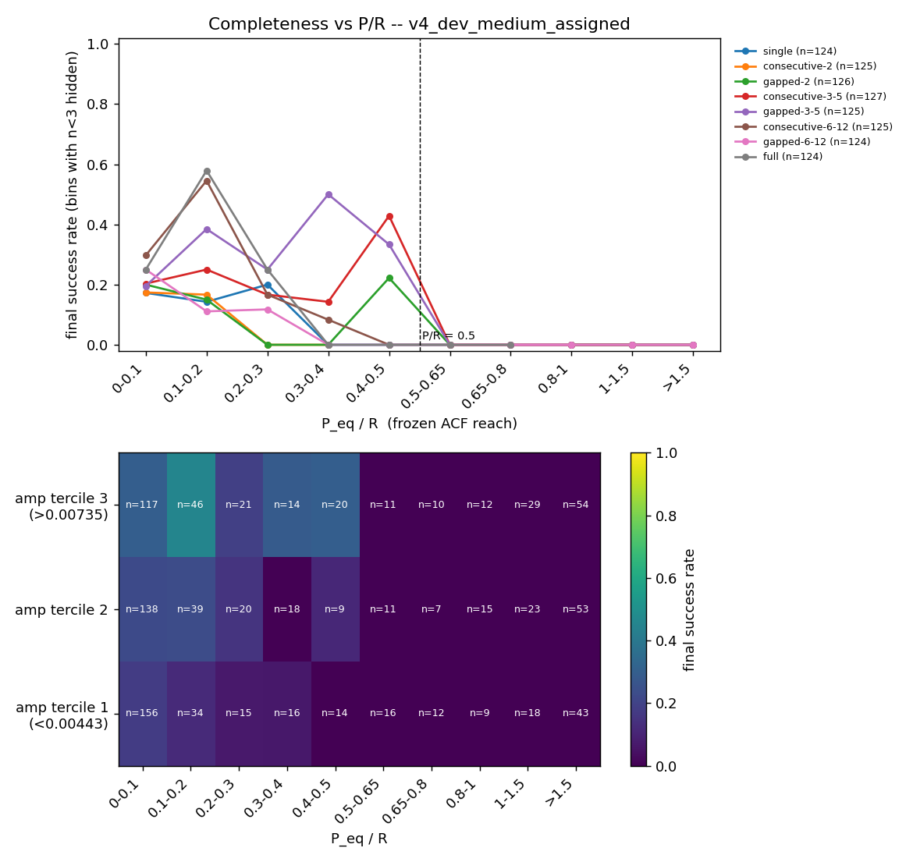
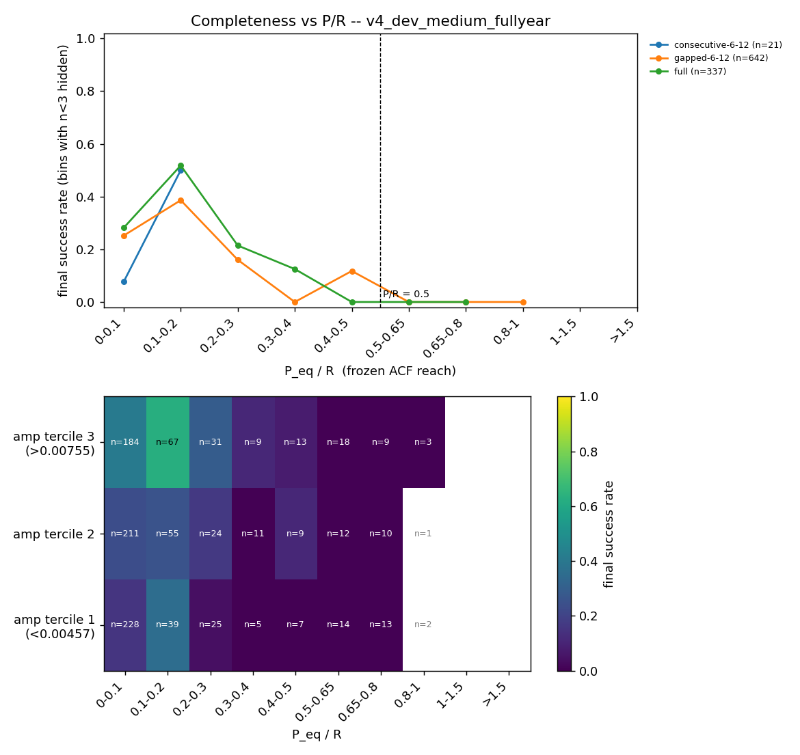

# Scorecard v4: band-width breakdown and searchable-subset metrics (T22 + T23)

## TL;DR
`SCORECARD_VERSION` is now **4**. It adds `final.by_band_width`, `final.by_coverage_class`, `final.searchable.*`,
`final.unsearchable.*`, per-star `acf_reach` / `P_over_reach` / `searchable` / `band_width*` / `flux_amp` columns, and a
completeness-map figure. **No existing metric changed**: every v3 key is identical to its baseline on synth200, dev_small,
dev_medium full-year and dev_medium assigned. New baselines (`*_v4.json`) are committed.
Headline (dev_medium, assigned coverage): **320 of 1000 stars (32%) are unsearchable (P_lo > R/2), and none of them is ever
solved (0 successes)**; success among searchable stars is 21.8% vs 14.8% overall (full-year: 76 unsearchable, 26.8% vs 24.8%).
Success is exactly 0 for P/R > 0.5, which confirms the D4 definition empirically.

## Question / goal
`docs/TASKS.md` T22 (band-width breakdown + version bump) and T23 (frozen `acf_reach`, `is_searchable`, searchable-subset
metrics, completeness map), under one bump. Decision D4 pre-approved the `evaluation.py` additions. No goal in `goals.json`
was touched (proposals below).

## What I did
- `claude_files/evaluation.py`: added `acf_reach(time, flux)`, `is_searchable(period_lo, reach)` and frozen constants
  (`ACF_REACH_MIN_VALID_FRAC=0.3`, `ACF_REACH_MAX_LAG_FRAC=0.7`, `SEARCHABLE_REACH_FACTOR=0.5`). Nothing existing was edited.
  `acf_reach` re-implements the lag cut itself and never reads `compute_acf`'s defaults (a test monkeypatches them to prove
  it). On 30 synthetic stars it equals `compute_acf(...)[0][-1]` exactly under the current defaults.
- `benchmarks/scorecard.py`: version bump; `_searchability_columns` (per-star columns), `_breakdown` / `_subset_block` /
  `_v4_final_breakdowns` (the new metric groups), `band_width_class`, `make_completeness_map`.
  `_breakdown(df, col)` is the single hook for further subset groupings (T24's `noise_period` outcome needs no change: it
  appears automatically via `ev.OUTCOMES` once added; T25's quiet-subset is one extra column + one `_subset_block` call).
- `benchmarks/check_goals.py` docstring and `benchmarks/baselines/README.md` updated (old baselines lack the keys: reported, not guarded).
- Tests: `tests/test_scorecard_v4.py` (12 tests). One **existing assertion edited**: `tests/test_coverage.py:498`
  `scorecard_version == 3` -> `== 4`. That is a direct consequence of the requested bump; please eyeball it.
  Full suite: 305 pass (one run before this edit showed that single expected failure).

Definitions
- **band width** w = (P_hi - P_lo) / P_eq. Classes `zero` (solid body/shear 0), `lt_0p2`, `0p2_to_0p5`, `ge_0p5`
  (keys avoid '.' for check_goals paths). Cuts: 0.2 is about 2x REL_TOL (band comparable to the tolerance window, so
  success ~ correct); 0.5 is where diffrot answers span a factor ~1.5 and `correct` visibly diverges from `success`. Population on
  dev_medium: 333 / 457 / 138 / 72 stars, all classes with n >= 72.
- **searchable** = P_lo <= R/2, P_lo = low end of the success range (P_eq when there is no band). `P_over_reach` = **P_eq / R**
  (the x-axis of the map; searchability itself uses P_lo).
- **flux_amp** = 95th - 5th percentile of the loaded flux: the only amplitude/SNR proxy available on both synthetic and real
  data (the scorecard has no amplitude column). It mixes signal and noise; treat it as "visible variability".
- `final.searchable` / `final.unsearchable` each carry `overall`, `by_bin`, `by_coverage_class` outcome fractions. On the
  unsearchable group read `overall.none` (correct-decline rate), `.wrong`, `.success` (bonus successes).

## Results
Before/after on the **same code revision's data** (before = `git archive HEAD` of the pre-change tree, run in a scratch copy;
after = this branch). `check_goals.py <after> --baseline <before>`, every row delta +0.000, OVERALL: PASS for both:

| dataset | success before -> after | check_goals |
|---|---|---|
| `synthetic:n=200,seed=0` | 0.730 -> 0.730 | all guard rows +0.000, PASS |
| `datasets/dev_small.csv,data_root=data/smarts_dev,sectors=manifest` | 0.160 -> 0.160 | all +0.000, PASS |

Also: after-run `per_star.csv` (all columns but timing and the `meta_path` string) and `per_candidate.csv` are identical to the
before run row-for-row; dev_medium full-year and assigned v3 keys (`final.*`, `methods.*`, `union_recall.*`) are equal to the
committed v3 baselines. Caveat: `per_method.csv` differs in `guess_wavelet` only (3 of 200 stars have a different
`n_candidates`, 1 `top1` differs by 4e-15). That wobble is present between any two runs, including before-vs-committed-baseline, so it
is pre-existing wavelet non-determinism, not this change; the metrics derived from it are equal.

**dev_medium assigned coverage** (n=1000): by coverage class and band width

| class | n | success | correct | none | wrong |
|---|---|---|---|---|---|
| full | 124 | 0.266 | 0.177 | 0.653 | 0.048 |
| consecutive-6-12 | 125 | 0.240 | 0.192 | 0.720 | 0.040 |
| gapped-3-5 | 125 | 0.160 | 0.128 | 0.792 | 0.040 |
| consecutive-3-5 | 127 | 0.157 | 0.102 | 0.787 | 0.047 |
| gapped-6-12 | 124 | 0.137 | 0.121 | 0.750 | 0.097 |
| consecutive-2 | 125 | 0.080 | 0.064 | 0.832 | 0.080 |
| gapped-2 | 126 | 0.079 | 0.071 | 0.881 | 0.040 |
| single | 124 | 0.065 | 0.024 | 0.895 | 0.040 |
| band zero | 333 | 0.171 | 0.171 | 0.775 | 0.042 |
| band < 0.2 | 457 | 0.138 | 0.096 | 0.796 | 0.059 |
| band 0.2-0.5 | 138 | 0.145 | 0.036 | 0.790 | 0.058 |
| band >= 0.5 | 72 | 0.111 | 0.056 | 0.806 | 0.069 |

Band width: `correct` falls 0.171 -> 0.096 -> 0.036 as the band widens, while diffrot makes up much of the gap in the middle classes.
Success also falls with width (0.171 -> 0.111), so wide bands cost real recovery, not only the P_eq definition.
(Full-year numbers are in `data/v4_breakdowns_dev_medium.csv`.)

| subset | n (assigned) | success | none | wrong | n (full-year) | success | none | wrong |
|---|---|---|---|---|---|---|---|---|
| searchable | 680 | 0.218 | 0.724 | 0.047 | 924 | 0.268 | 0.642 | 0.076 |
| unsearchable | 320 | 0.000 | 0.928 | 0.069 | 76 | 0.000 | 0.750 | 0.237 |

Searchable fraction under assigned coverage by class: full 0.94, consecutive-6-12 0.86, gapped-6-12 0.77, consecutive-3-5 0.72,
gapped-3-5 0.58, consecutive-2 0.58, single 0.50, gapped-2 0.48. By period bin: `<1d` 1.00, 1-3d 1.00, 3-10d 0.96, 10-30d 0.57, `>30d` 0.24.


Top panel: success vs P/R per coverage class; success is exactly 0 beyond the dashed P/R = 0.5 line in every class, and peaks at P/R ~ 0.1-0.2
(about 0.55 for full and consecutive-6-12, about 0.2 for the short classes). Bottom: pooled heatmap over P/R x amplitude tercile (cell n shown; cells with n < 3 are blank);
higher amplitude helps at every P/R, and the all-zero band beyond 0.5 is the unsearchable region. The line near P/R 0.4-0.5 is noisy (n ~ 10-20 per cell).


Same for full-year data (mostly 6-12 sector patterns, hence 92% searchable).

## What didn't work
- First attempt at the "before" runs was made in the working tree, which I was about to edit: workers import modules at start, so a mid-run edit
  would have contaminated "before". I killed it and re-ran from a clean `git archive HEAD` copy.
- The dev_medium re-baseline waited a long time for the T16c agent's chain of scorecards on the same 4 cores (as instructed, I did not
  run concurrently). Results are deterministic, so timing contention would only affect `seconds`.

## Open questions for Rae
Proposed goals (not edited into `goals.json`; all are on the new keys, so they need `dev_medium_*_v4.json` as the baseline):
1. **G7 restated** on searchable stars: `final.searchable.overall.none <= X` on dev_medium assigned (current 0.724; full-year 0.642).
   Pick X after T16c/T16d; the old synthetic G7 (`final.overall.none <= 0.18`) mixes in stars that cannot be solved at all.
2. **Correct-decline guard**: `final.unsearchable.overall.none >= 0.9` (assigned now 0.928; full-year 0.750 with 0.237 wrong). This
   is the "do not hallucinate where blind" goal; full-year unsearchable stars are all >30 d (76 of 76) and show a high `wrong` rate worth a look.
3. **Wrong among searchable**: `final.searchable.overall.wrong <= 0.05` (assigned 0.047, full-year 0.076).
4. **Searchable success by period bin** as a per-bin recovery goal (replaces all-star per-bin goals, which silently punish 30+ d stars that are 76% unsearchable).
5. **Band-width**: a guard that `final.by_band_width.ge_0p5.success` does not drop (n=72, one star is 0.014, so use a loose limit like 0.06).

Other questions:
- Is `flux_amp` (95-5 percentile of loaded flux) acceptable as the amplitude axis, or do you want an injected-amplitude/ACTIVITY column
  (header `ACTIVITY` is available on real files, `amplitude` on synthetic)? Adding it would be a small follow-up.
- The `test_coverage.py` version assertion edit (above).
- Whether R should use the 0.7 B cap or the pipeline's chosen reach is T16c's call (this evaluation reference is frozen on purpose).

## Reproduce
```bash
/opt/anaconda3/envs/ss_openblas/bin/python -m pytest -q tests/test_scorecard_v4.py
/opt/anaconda3/envs/ss_openblas/bin/python benchmarks/scorecard.py --synthetic 200 --seed 0 --outdir runs/v4_synth200
/opt/anaconda3/envs/ss_openblas/bin/python benchmarks/scorecard.py --manifest datasets/dev_medium.csv --data-root data/smarts_dev --ignore-manifest-sectors --outdir runs/v4_dev_medium_fullyear
/opt/anaconda3/envs/ss_openblas/bin/python benchmarks/scorecard.py --manifest datasets/dev_medium.csv --data-root data/smarts_dev --outdir runs/v4_dev_medium_assigned
```
Baselines: `benchmarks/baselines/*_v4.json`. Notebook reads `data/v4_breakdowns_dev_medium.csv` and `figures/`.
