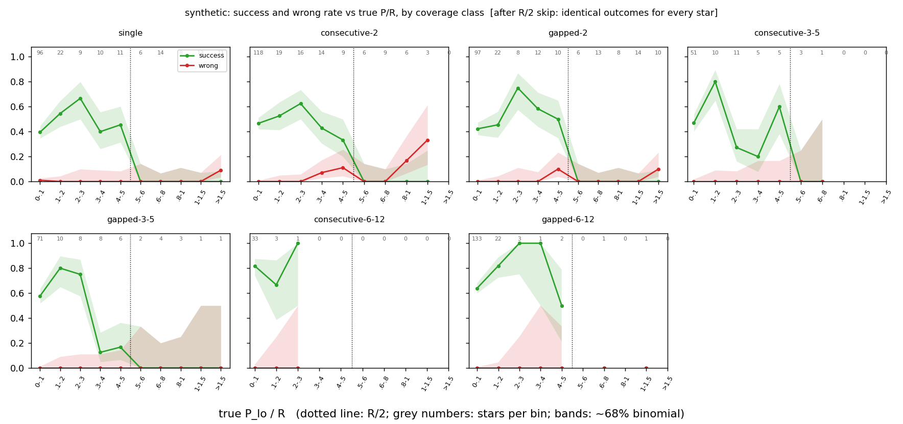
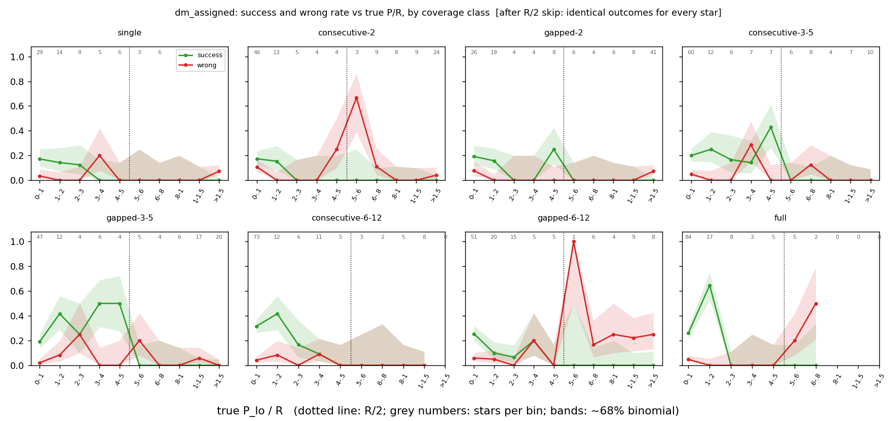
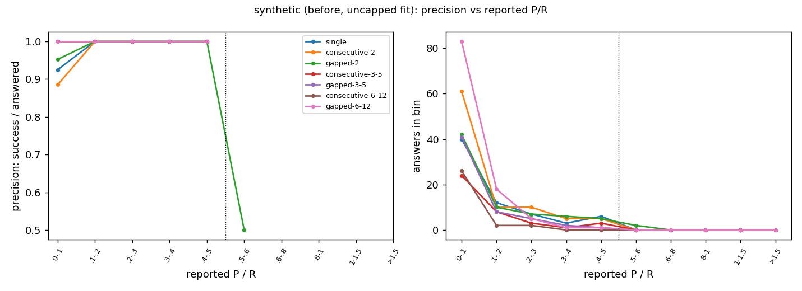
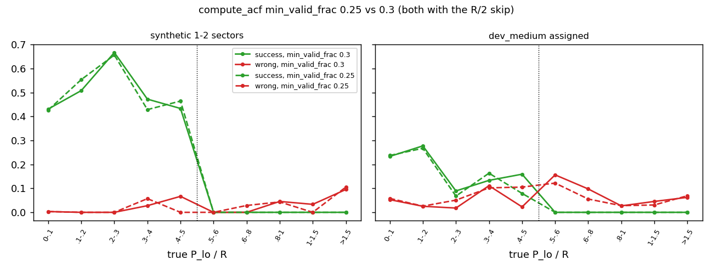
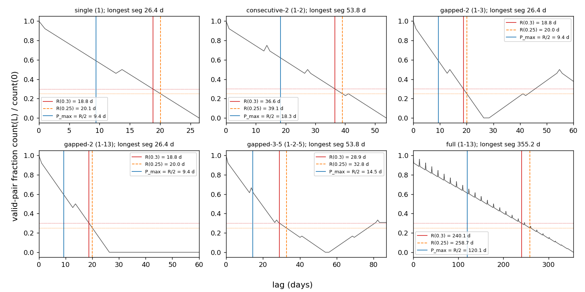
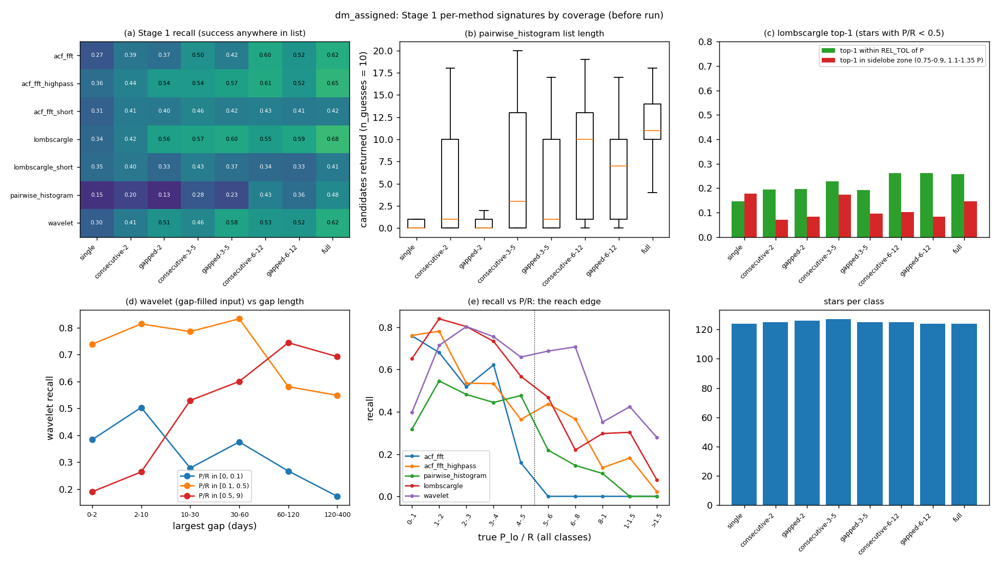
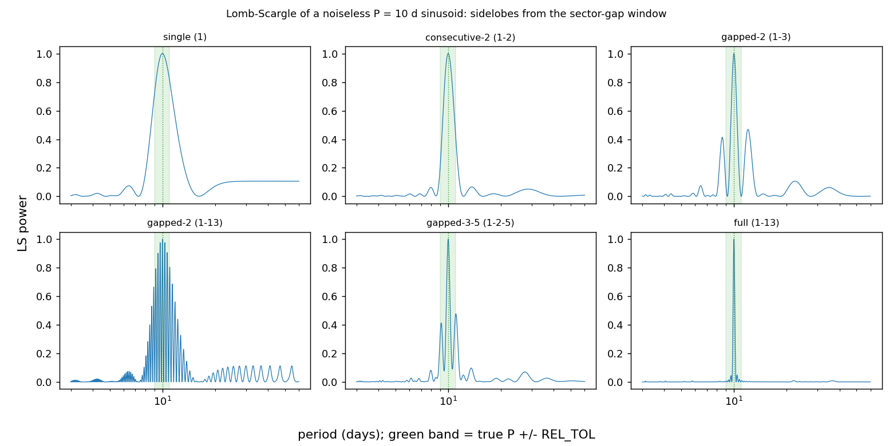
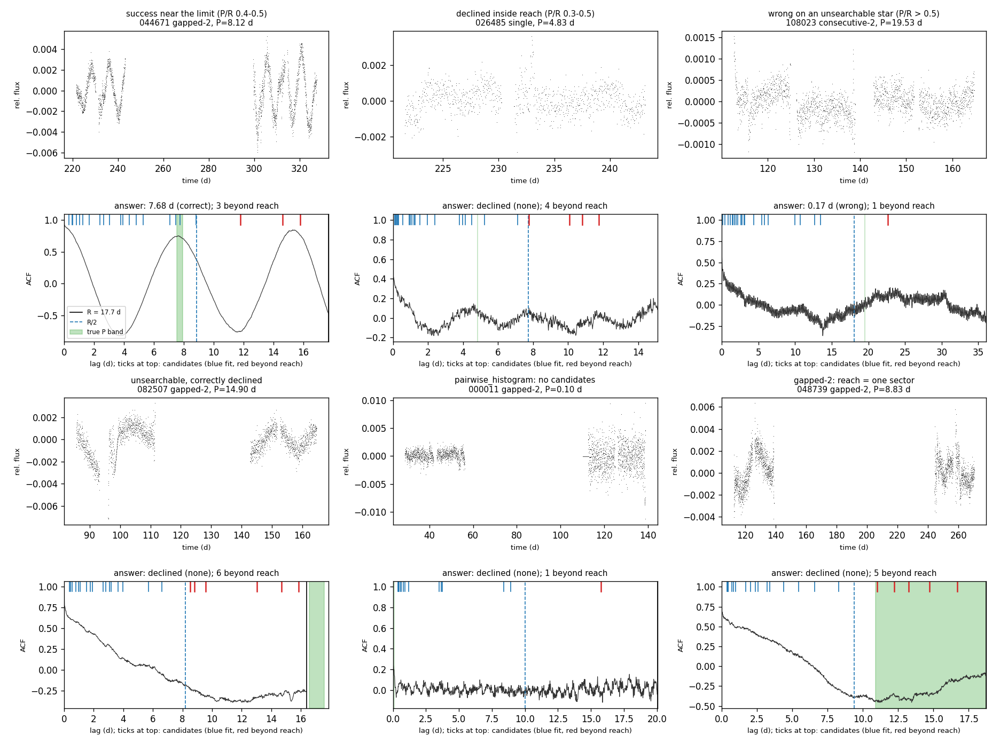

# T16c: searchable range P_max = R/2

**Date:** 2026-10-22 · **Author:** Claude (method-improver, T16c session) · **Branch:** `claude/t16c-searchable-range-6f41b7` · **Status:** draft

## TL;DR
- **Implemented D4.** `coverage.searchable_range(time, flux)` returns P_min (2 × cadence), the ACF reach R (valid-pair fraction ≥ 0.3) and P_max = R/2, from the time sampling only. It works on any batch. The comb fit now skips deduplicated candidates with P0 > R/2. It keeps them as `beyond_reach` records, and `EnsembleResult` stores the range. There is also a new ranker feature, `P_over_reach`.
- **Results are bit-identical everywhere tested.** Seven before/after scorecard pairs (dev_medium full-year, dev_medium assigned, and 5 synthetic coverage classes × 200 stars) gave **0 changed stars**, and the in-reach candidate rows (P0, P_fit, redchi, gates) were identical. The fit skips 5% of candidates (1,247–1,261 per 1,000 dev_medium stars). The uncapped fit had already never picked a beyond-reach answer: the largest reported P/R was 0.51 on any dataset, so the existing gates were rejecting them.
- **The runtime gain is small.** Measured paired on identical inputs, total fit time was −3% (−17% on gapped-2, roughly 0 on single sectors). Beyond-reach candidates have only 2–3 teeth, so they were cheap to fit. The scorecard's own timings were confounded by the other agent's runs on the same 4 cores.
- **R/2 is confirmed for every coverage class.** Success is 0 for true P/R > 0.5 in every class and dataset. On synthetic draws it stays at about 0.42 up to 0.5 (0.4–0.5 bin: 0.419, n = 43; 0.5–0.6 bin: 0.000, n = 23). Precision of answers reported at P/R 0.4–0.5 is 21/21 on synthetic and 0.6 (n = 10) on dev_medium. I found no evidence to move the limit for any class.
- **`min_valid_frac` 0.25 is a wash; I don't recommend it.** Success is unchanged or up by 1–3 stars, and wrong goes up 0.5 pp (assigned) and 0.4 pp (full-year). Under D4 it also can't help the motivating P ≈ B/3 two-sector case, because R is frozen at 0.3.

## Question / goal
T16c in `docs/TASKS.md` (decision D4, 2026-10-22): the searchable range, a Stage 1 that stays uncapped with `beyond_reach` tagging, the range recorded for D1, a P/R feature, per-class validation (option E), the `min_valid_frac` 0.25 test, and per-method degradation mechanisms (fixes belong to T16d). No goal in `goals.json` targets this yet. Proposed goals are under Open questions.

## What I did
1. **Code** (commit `736b16f`):
   - **`claude_files/coverage.py`:** `reach_from_pair_counts` (the one place the reach rule lives), `sampling_pair_counts` (FFT pair counts of the finite-cadence mask on a regular grid; it accepts NaN-gapped or gap-removed arrays) and `searchable_range`. The constants `REACH_MIN_VALID_FRAC = 0.3` and `REACH_PERIOD_FRAC = 0.5` are kept separate from `compute_acf`'s argument, so retuning the ACF doesn't move the range.
   - **`claude_files/comb_fit.py`:** `fit_rotation_period(max_period="auto")`, step 2b.
     - Inputs: `"auto"` takes R from `acf_counts` with the same rule. `None` gives the old behaviour. A float sets p_max, and a dict uses the output of `searchable_range`.
     - The skip happens after dedup, so in-reach groups and their representatives don't change.
     - New fields: `CandidateResult.beyond_reach`, `EnsembleResult.searchable_range` and `EnsembleResult.beyond_reach_candidates`.
     - A new decline kind, `all_beyond_reach`.
     - `n_candidates_tried` now counts only the candidates actually fit.
   - **`ml_features.py`:** `P_over_reach = fitted_P / R`, with R from `searchable_range`. It is documented in `FEATURE_DOCUMENTATION.txt`, Section H.
   - **`tests/test_searchable_range.py`:** 12 tests. Among them, R is compared with an **independent brute-force pair-counting reference** for the D4/T23 definition on 5 samplings. The other tests cover: gridded vs gap-removed input; agreement with `compute_acf`'s counts; per batch; agreement of "auto" with `searchable_range` to within 1 cadence; skipped-but-recorded candidates; in-reach fits bit-identical; the decline kind; and the feature.
2. **Scorecards** (4 workers, `ss_openblas`). "before" is a detached checkout of `9133239` (main), "after" is this branch, and `mvf025` is this branch with `compute_acf(min_valid_frac=0.25)` as the default:
   - `datasets/dev_medium.csv,data_root=data/smarts_dev,sectors=ignored` (full-year, the judging set) and `...,sectors=manifest` (assigned coverage);
   - `synthetic:n=200,seed=0,coverage=<C>,coverage_seed=0,coverage_library=all_cycles` for C in single, consecutive-2, gapped-2, 3-5, 6-12;
   - mvf025 on dev_medium (both) and on synthetic single / consecutive-2 / gapped-2.
3. **Analysis scripts** in this folder:
   - `analysis.py`: bit-identity, P/R curves and the min_valid_frac comparison;
   - `mechanisms.py`: per-method signatures;
   - `profile_fit.py`: paired timing plus cProfile;
   - `examples.py`: example stars.

   R per star in the scorecard analysis is the Stage 2 ACF's `acf_lag_max`, which equals `searchable_range`'s R except where the 0.7 B cap binds first (within 1 cadence; tested).

## Results

### Bit-identity (deliverable 2)
`data/bit_identity_summary.csv`; `data/changed_stars.csv` is empty.

| run | stars | stars with a beyond-reach candidate | candidates skipped | stars changed | in-reach candidate rows identical |
|---|---|---|---|---|---|
| dm_full | 1000 | 487 | 1261 / 24129 | 0 | yes |
| dm_assigned | 1000 | 536 | 1247 / 21122 | 0 | yes |
| syn_single | 200 | 25 | 49 / 3436 | 0 | yes |
| syn_consecutive-2 | 200 | 28 | 70 / 3719 | 0 | yes |
| syn_gapped-2 | 200 | 169 | 273 / 3460 | 0 | yes |
| syn_3-5 | 200 | 101 | 214 / 3725 | 0 | yes |
| syn_6-12 | 200 | 113 | 234 / 4097 | 0 | yes |

`check_goals.py runs/t16c/after/dm_full/metrics.json --baseline runs/t16c/before/dm_full/metrics.json`. The goals section is unchanged (G9–G12 drafts fail as before); full output is in `data/check_goals_dm_full.txt`:
```
Regression guard (fail if a metric drops by more than its limit):
   base     new   delta  limit  metric
  0.248   0.248  +0.000  0.020  final.overall.success
  0.233   0.233  +0.000  0.060  final.by_bin.1-3d.success
  0.363   0.363  +0.000  0.060  final.by_bin.10-30d.success
  0.298   0.298  +0.000  0.060  final.by_bin.3-10d.success
  0.169   0.169  +0.000  0.060  final.by_bin.<1d.success
  0.210   0.210  +0.000  0.060  final.by_bin.>30d.success
  0.971   0.971  +0.000  0.060  union_recall.by_bin.1-3d
  0.988   0.988  +0.000  0.060  union_recall.by_bin.10-30d
  0.965   0.965  +0.000  0.060  union_recall.by_bin.3-10d
  0.442   0.442  +0.000  0.060  union_recall.by_bin.<1d
  0.917   0.917  +0.000  0.060  union_recall.by_bin.>30d

OVERALL: PASS
```
dm_assigned and all 5 synthetic classes also give every delta +0.000 and PASS (`data/check_goals_*.txt`). There are no changed stars to plot.

### Runtime
`data/profile_fit.csv`: 8 dev_medium stars per class at assigned coverage. The fit runs with `max_period=None` and `"auto"` on identical inputs, taking the best of 3 repeats each.

| class | candidates fit (median) | beyond reach (mean) | fit s before → after (median) | total ratio |
|---|---|---|---|---|
| single | 27 | 3.0 | 1.609 → 1.658 | 1.033 |
| consecutive-2 | 25 | 1.9 | 1.615 → 1.548 | 0.961 |
| gapped-2 | 23 | 3.8 | 1.094 → 0.960 | 0.828 |
| consecutive-3-5 | 25.5 | 1.6 | 1.919 → 2.100 | 1.014 |
| full | 25.5 | 1.4 | 2.330 → 2.249 | 0.963 |

The overall ratio is 0.968, and the selected periods were identical. The profile (`data/profile_single_star.txt`) shows the fit time is all in `scipy.optimize.least_squares` (48 calls, 3.1 of 3.8 s). Skipped candidates have only 2–3 teeth, so their least-squares problems are small, and the gain is about the share of candidates skipped (~5–15%), scaled down. On the 1–2-sector stars where I expected it, it's within noise for single sectors and −17% for gapped-2. The scorecard timings in `data/fit_time_by_class.csv` are not usable as a comparison. The `before/dm_full` run overlapped my profiling, and every after-run overlapped the other agent's runs: synthetic Stage 1 times also went *up* in the after runs, although Stage 1 code is unchanged.

### R/2 validation per coverage class (deliverable 4, option E)

Synthetic coverage draws, 200 stars per draw. Look at the dotted R/2 line. Success holds at 0.3–0.6 up to it in every class and is exactly 0 past it. Wrong is ~0 everywhere except 1–2 stars per class near and beyond the limit. Before and after outcomes are identical, so only one curve is drawn.


dev_medium at assigned coverage has 3–10 stars per bin past 0.2, hence the wide bands. Success is 0 past R/2 in all 8 classes. The wrong answers past R/2 (for example, 1 of 1 in gapped-6-12 0.5–0.6) are unsearchable stars given a *short* false period, as D4 found. A search limit can't remove those.

Pooled numbers, by true P_lo/R (`analysis.py`, `data/truth_curve_*.csv`):

| true P_lo/R | synthetic success (n) | dm_assigned success (n) | dm_full success (n) |
|---|---|---|---|
| 0.3–0.4 | 0.400 (50) | 0.133 (45) | 0.033 (30) |
| 0.4–0.5 | 0.419 (43) | 0.159 (44) | 0.087 (23) |
| 0.5–0.6 | 0.000 (23) | 0.000 (32) | 0.000 (32) |


Answers by **reported** P/R (uncapped before run). Answers at 0.4–0.5 are as reliable as shorter ones: 21/21 success on synthetic and 0.6 (n = 10) on dev_medium assigned, compared with 0.71 (n = 136) at 0–0.1. Only 2 synthetic answers and 1 dev_medium answer were above 0.5, at 0.507–0.509 (the fitted P drifting a few % past R/2). `reported_precision_dm_assigned.png` shows the same pattern.

**Conclusion:** R/2 is the right limit in every class. Nothing argues for a tighter limit (there's no wrong-answer bump just below 0.5) or a looser one (zero successes among the 87 stars at P/R 0.5–0.6 across the three datasets, and none beyond).

### `min_valid_frac` 0.25 vs 0.3 (deliverable 5)
Both settings run this branch's code, so R stays frozen at 0.3 and only the ACF the fit sees extends further. Data: `data/mvf025_summary.csv`, `data/mvf025_changed_stars.csv`, `data/check_goals_mvf025_*.txt`.

| run | success 0.3 → 0.25 | wrong 0.3 → 0.25 | stars changed | gained / lost success | new / fixed wrong |
|---|---|---|---|---|---|
| dm_assigned | 0.148 → 0.148 | 0.054 → 0.059 | 14 | 2 / 2 | 8 / 3 |
| dm_full | 0.248 → 0.251 | 0.088 → 0.092 | 23 | 8 / 5 | 5 / 1 |
| syn_single | 0.325 → 0.325 | 0.010 → 0.010 | 0 | 0 / 0 | 0 / 0 |
| syn_consecutive-2 | 0.420 → 0.425 | 0.020 → 0.020 | 1 | 1 / 0 | 0 / 0 |
| syn_gapped-2 | 0.345 → 0.345 | 0.010 → 0.005 | 4 | 2 / 2 | 0 / 1 |


The curves overlap within noise. On real data the changes are mostly in gapped/full stars at low P/R. The cause is that the Stage 1 view (B/3, cut at the pair-coverage breach) also gets longer, which shuffles candidates. The P ≈ B/3 two-sector case that motivated the test sits at P/R ≈ 0.5, at the frozen R/2 limit, so extending the ACF beyond R can't recover it under D4.

### Per-method degradation mechanisms (deliverable 6; diagnosis only, fixes → T16d)

**ACF truncation / reach.** The valid-pair fraction falls linearly within a segment, and it doesn't bridge a missing sector until the lag reaches the gap spacing, long after the first breach. As a result:
- R is 18.8 d for both 1-3 and 1-13 (the same as a single sector);
- R is 0.68–0.71 × the longest segment for equal segments;
- R is only 0.54 × for the mixed 1-2-5 pattern.

0.25 would extend R by 7–13% (`data/pair_fraction_patterns.csv`).


dev_medium assigned. `mech_methods_synthetic.png` shows the same panels on synthetic. Look at:
- **(b) pairwise_histogram runs out of peaks.** It returns **0 candidates** for 63% of single-sector stars, 67% of gapped-2 and 48% of consecutive-2, against 11% at full coverage. Its recall is the lowest of any method at 0.13–0.20 for 1–2 sectors (panel a). It needs several ACF peak pairs inside R, and with R ≈ 19 d there are rarely enough.
- **(e) The reach edge.** acf_fft's recall falls from 0.62 at P/R 0.3–0.4 to 0.16 at 0.4–0.5 and 0 beyond, because its Stage 1 view stops at B/3 or R. pairwise_histogram collapses at the same edge. LS and wavelet keep proposing periods past R/2 (wavelet recall 0.69–0.71 at P/R 0.5–0.8). That accounts for nearly all the candidates the fit now skips: Stage 1 finds them, but the ACF can't verify them.
- **(c) LS window aliasing is a null result on this data.** `mech_ls_window.png` (below) shows the mechanism exists: a noiseless 10 d sinusoid sampled 1-3 or 1-2-5 has sidelobes of ~0.45 power at about 8.5 d and 12 d, just outside REL_TOL. However, the LS top-1 does not land in the sidelobe zone more often for gapped classes:
  - dm_assigned: gapped-2 0.08 vs consecutive-2 0.07 vs single 0.18;
  - synthetic: gapped-2 0.09 vs consecutive-2 0.14.

  LS's top-1 errors are dominated by something other than the sector window.
- **(d) Wavelet across gaps.** It shows no clear degradation with gap length for searchable stars (P/R 0.1–0.5: 0.74–0.83 for gaps < 60 d, 0.55–0.58 for gaps of 60–400 d; n per bin is modest). Its gap-filled input lets it "find" long periods that span the gap (recall at P/R ≥ 0.5 rises with gap length, from 0.19 to 0.74). Those periods are unverifiable by the ACF and are now tagged beyond reach.


The sidelobes are visible in the clean case (green band = ±REL_TOL), even though they don't show up as a population failure.


Six dev_medium stars at assigned coverage, chosen by rule (`examples.py`, `data/examples.csv`). Blue ticks are candidates the fit tested, red ticks are beyond reach (skipped now), the dashed line is R/2 and green is the true band.
1. A gapped-2 star at P/R 0.43, correctly measured: two full ACF cycles within R.
2. A single-sector star at P/R 0.32, declined: low-amplitude ACF bumps that fail the gates. This is the T16d / T20 territory.
3. An unsearchable consecutive-2 star (P/R 0.54) given a **0.17 d** false period: the D4 "short false detection" failure, untouched by R/2.
4. An unsearchable gapped-2 star, correctly declined, with 6 red candidates skipped.
5. The pairwise_histogram-empty case, a 0.10 d star whose ACF is noise.
6. A gapped-2 star with P/R 0.58: R covers only one sector, so the true period can't be verified even though the baseline is 160 d.

## What didn't work
- **The expected runtime gain on 1–2 sectors mostly didn't materialize** (−3% overall, about 0 on single sectors, −17% on gapped-2). Beyond-reach candidates are the cheapest fits, so this result is an accounting fact, not a reverted optimization; no code comment was needed.
- **Scorecard timing comparisons were unusable** because of shared-CPU contention (see Runtime). I replaced them with the paired timing script.
- **The first version of the truth-curve figure overplotted identical before/after curves.** It now draws one set and states that the outcomes are identical.

## Open questions for Rae
1. **Confirm R/2 for all coverage classes.** The data supports a single R/2 for every class. My recommendation is to keep it, with no per-class adjustment. Caveats: dev_medium bins past 0.3 hold 3–10 stars per class, and synthetic make_suite periods cluster below P/R 0.1, so the 0.3–0.5 region has 93 synthetic stars in total. A targeted synthetic suite with log-uniform P/R in 0.2–0.8 per class would tighten this if you want more certainty.
2. **`min_valid_frac`: keep 0.3** (recommended). 0.25 adds a few wrong answers on real data, has no net success gain, and can't help the B/3 case under a frozen R. If you want to revisit it, it belongs to T16d together with the well-sampled-lags SNR change.
3. **Proposed goals** (for T23's metrics, once that lands), all draft:
   - `final.searchable.success` on dev_medium full-year: **≥ current value** as a regression guard (rather than a target), with a stretch target after T20;
   - on synthetic coverage draws, **zero reported periods with P/R > 0.55** (a structural guard; the fit can drift ~2% past R/2, observed max 0.509);
   - `final.unsearchable.wrong` on dev_medium assigned **≤ 0.05**. The before run has 5–16% wrong per P/R bin past 0.5, almost all short false detections, so this is a T16d target, not something R/2 can move.
4. **Cross-check after merge.** My test checks R against an independent brute-force reference implementation. Once T23's `evaluation.acf_reach` is on main, add a test that `coverage.searchable_range(t, f)["reach"] == evaluation.acf_reach(t, f)` on the same 5 samplings.
5. **Scorecard records.** `beyond_reach_candidates` are not in `per_candidate.csv`, because `scorecard.py` was off-limits for this task. If you want them there (with a `beyond_reach` column), it's a 3-line addition to `_candidate_rows`, best done in T23's scorecard bump.
6. **T16d proposals from the mechanisms:**
   - Skip or down-weight pairwise_histogram when R < ~30 d: it returns nothing for most 1–2-sector stars, so this costs nothing and saves its runtime.
   - Restrict wavelet and LS Stage 1 proposals to P ≤ R/2 *for scoring purposes only*. Stage 1 stays uncapped per D4; this is only so their recall metrics reflect usable candidates.
   - Look at LS top-1 errors on single sectors (0.18 in the sidelobe zone, versus a within-tolerance rate of only 0.15). That looks like a sector-length / ramp systematic rather than window aliasing.

## Reproduce
```bash
# tests
/opt/anaconda3/envs/ss_openblas/bin/python -m pytest -q
# scorecards: before = checkout of 9133239, after = this branch, mvf025 = this branch with compute_acf min_valid_frac=0.25
/opt/anaconda3/envs/ss_openblas/bin/python benchmarks/scorecard.py --manifest datasets/dev_medium.csv --data-root data/smarts_dev --ignore-manifest-sectors --n-workers 4 --outdir runs/t16c/after/dm_full
/opt/anaconda3/envs/ss_openblas/bin/python benchmarks/scorecard.py --manifest datasets/dev_medium.csv --data-root data/smarts_dev --n-workers 4 --outdir runs/t16c/after/dm_assigned
/opt/anaconda3/envs/ss_openblas/bin/python benchmarks/scorecard.py --synthetic 200 --seed 0 --coverage gapped-2 --coverage-seed 0 --n-workers 4 --outdir runs/t16c/after/syn_gapped-2
# (likewise single, consecutive-2, 3-5, 6-12; same commands from the before / mvf025 checkouts into runs/t16c/before|mvf025/...)
/opt/anaconda3/envs/ss_openblas/bin/python benchmarks/check_goals.py runs/t16c/after/dm_full/metrics.json --baseline runs/t16c/before/dm_full/metrics.json
# analysis (from this folder)
/opt/anaconda3/envs/ss_openblas/bin/python analysis.py
/opt/anaconda3/envs/ss_openblas/bin/python mechanisms.py
/opt/anaconda3/envs/ss_openblas/bin/python profile_fit.py 8
/opt/anaconda3/envs/ss_openblas/bin/python examples.py
```
