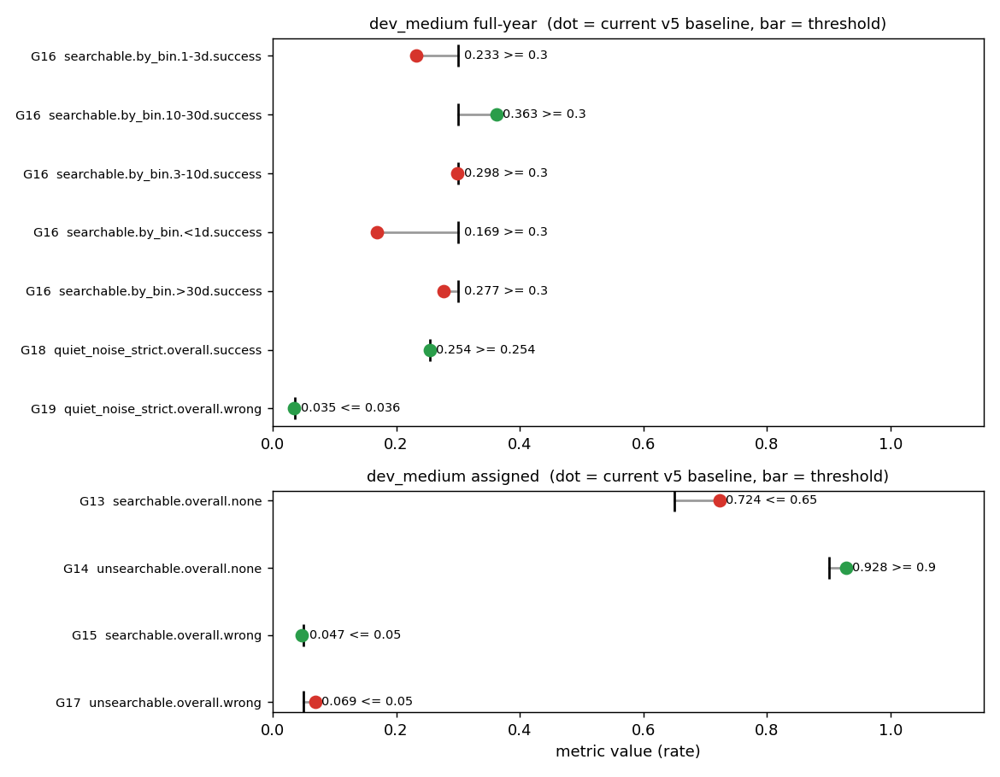

# Collected goal proposal (v4/v5 drafts)

**Date:** 2026-11-11 · **Author:** Claude session (goals-proposal) · **Branch:** claude/goals-proposal-092794 · **Status:** draft

## TL;DR
- Seven new goals (G13–G19) plus three regression-guard additions are collected in `benchmarks/goals_proposed.json` (same schema as `goals.json`; **`goals.json` untouched**). `check_goals.py --goals benchmarks/goals_proposed.json` parses and grades it on the v5 baselines.
- Against today's baselines **4 goals pass** (G14, G15, G18, G19) and **3 fail** (G13, G16, G17), so they are real targets, not rubber stamps. G16 is a per-bin goal: it fails in 4 of 5 bins.
- Two drafts could **not** be turned into goals: the synthetic "no reported period with P/R > 0.55" guard (no such metric exists) and "noise-period wrongs fall only if success rises" (a conditional, not a threshold). Several thresholds are my placeholders where the reports gave none (G13, G16). One report number (quiet wrong ≤ 0.035) fails the baseline by one star, so I proposed 0.036.

## Question / goal
Collect every pending goal draft (scorecard v4 report, T16c report accepted 2026-11-09, scorecard v5 / T25 report) into one proposal for Rae. TASKS.md T16c, T22/T23, T25 say only "propose goals; Rae edits `goals.json`" and add no extra goal text. Existing goals G1–G12 are unchanged; numbering continues at G13.

## What I did
Read the goal sections of the three reports, then computed each metric's current value from the committed baselines with `make_figures.py` (uses `check_goals.expand/get_path`, no hand-copied numbers). Datasets: `datasets/dev_medium.csv,data_root=data/smarts_dev,sectors=ignored` (full-year, `dev_medium_fullyear_v5.json`) and `...sectors=manifest` (assigned, `dev_medium_assigned_v5.json`). The v4 keys are bit-identical in v5, so v5 baselines serve all goals.

## Results

| ID | Source | Dataset | Metric key | Dir | Threshold | Current | Pass today |
|---|---|---|---|---|---|---|---|
| G13 | v4 #1 (G7 on searchable) | assigned | `final.searchable.overall.none` | ≤ | 0.65 (placeholder) | 0.724 | no |
| G14 | v4 #2 | assigned | `final.unsearchable.overall.none` | ≥ | 0.90 | 0.928 | yes |
| G15 | v4 #3 | assigned | `final.searchable.overall.wrong` | ≤ | 0.05 | 0.047 | yes |
| G16 | v4 #4 | full-year | `final.searchable.by_bin.*.success` (every bin) | ≥ | 0.30 (placeholder) | worst 0.169 (<1d); 1-3d 0.233, 3-10d 0.298, 10-30d 0.363, >30d 0.277 | no (1 of 5 bins) |
| G17 | T16c #3c | assigned | `final.unsearchable.overall.wrong` | ≤ | 0.05 | 0.069 | no |
| G18 | v5 #3 | full-year | `final.quiet_noise_strict.overall.success` | ≥ | 0.254 | 0.2541 | yes (zero margin) |
| G19 | v5 #3 | full-year | `final.quiet_noise_strict.overall.wrong` | ≤ | 0.036 | 0.0353 | yes (one star of margin) |

Regression-guard additions (in the `regression_guard` block of the proposal file, **additions** to `goals.json`'s guard):

| Guard | Source | Limit | Note |
|---|---|---|---|
| `final.searchable.overall.success` | T16c #3a | max_drop 0.0 | "≥ current value"; near-duplicate of the existing `final.overall.success` guard (0.02) since 92% of stars are searchable |
| `final.searchable.by_bin.*.success` | v4 #4 | 0.06 | same looseness as the existing per-bin guard |
| `final.by_band_width.ge_0p5.success` | v4 #5 | 0.06 | n = 72 stars, one star = 0.014 |


Look at the gap between each dot and its bar: G18/G19/G15 sit on the line (any small regression trips them), while G13, G16 (<1d) and G17 are far off and are targets to work toward.

Full `check_goals.py` output: `data/check_goals_dev_medium_fullyear_v5.txt`, `data/check_goals_dev_medium_assigned_v5.txt` (baseline vs itself, so guard deltas are +0.000). Table: `data/goal_table.csv`.

### Duplicates, conflicts, missing keys
- **Missing metric key:** T16c's "zero reported periods with P/R > 0.55 on synthetic coverage draws" has no aggregate in `metrics.json` (only per-star `P_over_reach`). Not included; needs a scorecard metric first.
- **Not a threshold:** v5's "`final.noise.overall.wrong_noise_period` falls only if success rises" is conditional; `check_goals` can't express it. Not included (see Q4).
- **Overlap with G11:** for P<1d, 172 of 172 stars are searchable, so searchable-<1d success equals all-star success (0.169). G16's <1d bin is the same measurement as G11 (target 0.30, FY). Not a conflict but a duplicate.
- **Overlap G14 vs G17:** both about unsearchable stars; G17 (wrong ≤ 0.05) is stricter than G14 (none ≥ 0.90 allows wrong up to 0.10). Keeping both is harmless; G17 implies the useful part.
- **Related to G10:** G10 (all stars, FY wrong ≤ 0.04) already fails at 0.088; G15 is on assigned coverage where searchable wrong is 0.047, but on full-year it is 0.076, so G15 would fail there.
- **Full-year vs assigned:** the unsearchable set is 76 stars (all >30 d, wrong 0.237) full-year versus 320 assigned (wrong 0.069), so G14/G17 only make sense on assigned coverage.
- Nothing conflicts with an existing goal's direction; no proposed key has disappeared.

## What didn't work
Nothing failed. The quiet-subset definition is as settled in v5 (`quiet_noise_strict`, n=850); I used it rather than `quiet_noise` (n=872, success 0.251, wrong 0.038).

## Open questions for Rae
1. **G13 threshold (searchable decline rate).** The "decline rate" is the share of stars where the pipeline returns no period. The v4 report left X to be picked after T16c/T16d. I chose 0.65 (current 0.724) as a placeholder. Declines are acceptable only if honest, so this goal must not be reached by guessing; it only makes sense alongside G15. Pick X, or drop G13 until T16d.
2. **G16 threshold and shape.** The v4 report gave no number. 0.30 mirrors G11 but fails 4 of 5 bins; a per-bin goal needs every bin to pass. Alternatives: a lower floor (e.g. 0.15, mostly a don't-collapse guard), or use only the regression-guard form and drop the goal. Also: the <1d bin is identical to G11, so do you want it twice?
3. **G19: 0.035 or 0.036?** The v5 report proposed "quiet wrong ≤ 0.035", but the baseline is 0.0353 (30 of 850 stars), so that would fail today. I set 0.036 so it passes by one star. Strictly "no worse than baseline" needs 0.036; 0.035 means "must improve by one star".
4. **Noise-period wrongs.** A "noise-period wrong" is a wrong answer whose period matches the periodic noise injected into the star's light curve (label contamination, not a pipeline error). v5 suggested it should fall only if success rises. This can't be a plain threshold; options: drop it, or report it as informational. Your call.
5. **Guards that duplicate existing ones.** The searchable-success guard (max_drop 0.0) is nearly the same as the existing overall-success guard; keeping 0.0 means zero tolerance and any change to the searchable set could trip it. Keep at 0.0, or loosen to 0.02?
6. **G17 and G14 on assigned only.** OK to restrict them to assigned coverage (full-year is all >30 d, 0.237 wrong)? Should a full-year companion goal exist?
7. **Add a synthetic P/R > 0.55 metric to the scorecard?** Needed for the structural guard; it's a scorecard change (yours to approve).
8. **Statuses.** All are `draft` (reported, never failing). Which should be `active` (exit 1 on fail)? G14, G15, G18, G19 pass today and would protect existing behavior.

## Reproduce
```bash
/opt/anaconda3/envs/ss_openblas/bin/python reports/2026-11-10_goals-proposal/make_figures.py
for p in dev_medium_fullyear_v5 dev_medium_assigned_v5; do /opt/anaconda3/envs/ss_openblas/bin/python benchmarks/check_goals.py benchmarks/baselines/$p.json --baseline benchmarks/baselines/$p.json --goals benchmarks/goals_proposed.json; done
```
