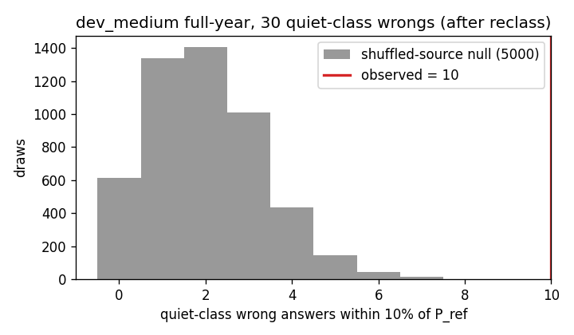
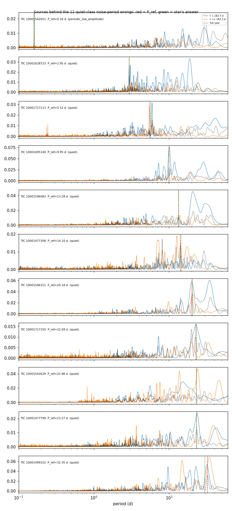
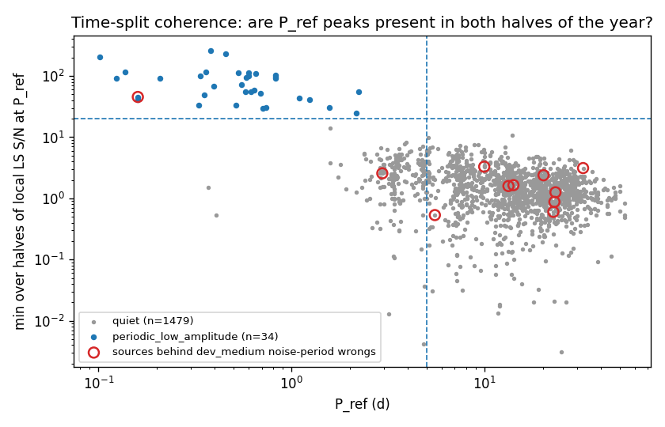
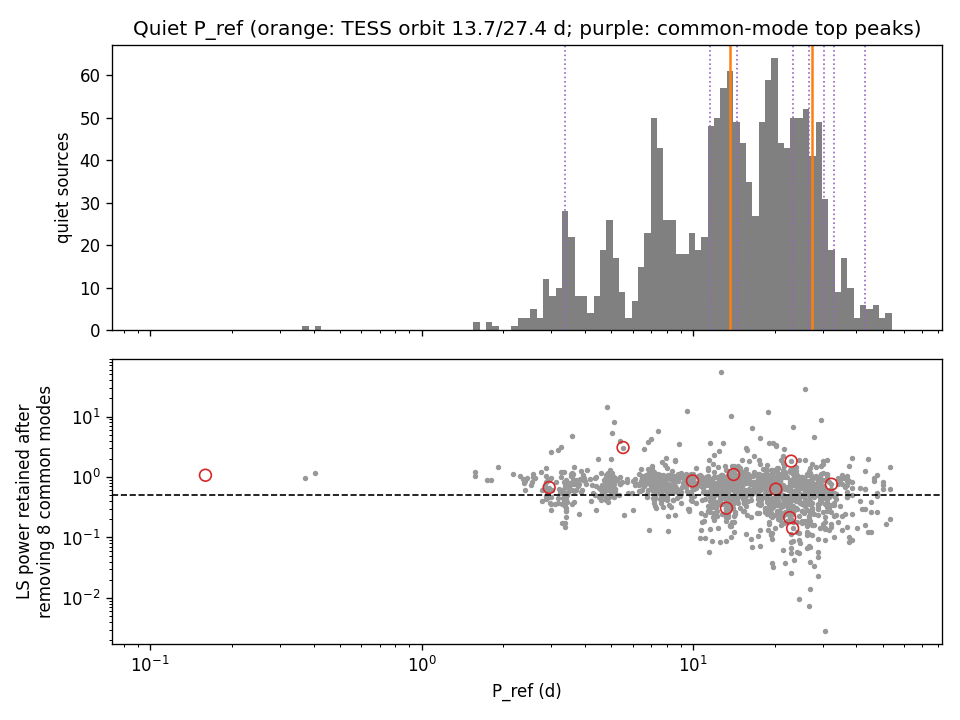
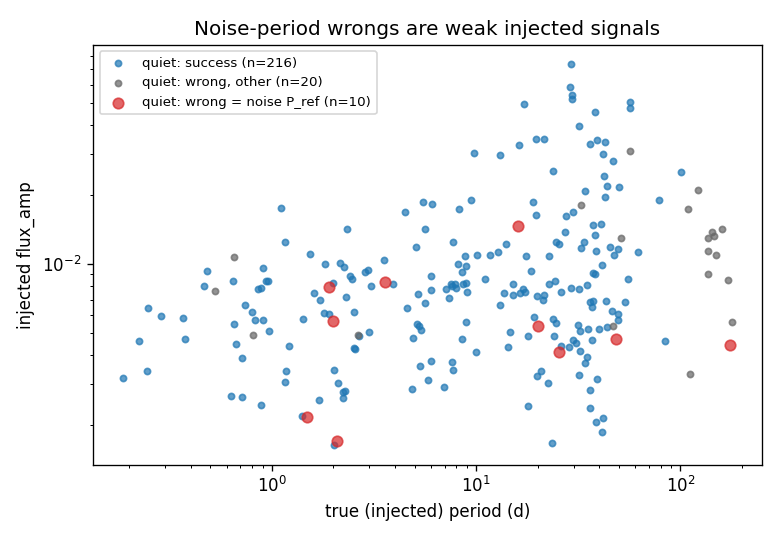

# Quiet-class noise periods: real signals or red noise?

**Date:** 2026-11-10 · **Author:** data-auditor session · **Branch:** `claude/quiet-noise-reclass-59bf5a` · **Status:** draft

## TL;DR
- **Part 1 (applied, commit `b442f6a`):** new T20 class `periodic_low_amplitude`, excluded from training. The rule is a quiet source with P_ref < 5 d and local LS S/N > 20 in *both* halves of the year. It is ported from the review's c07 test and reproduces the review's 34-source list exactly. Regenerating `noise_source_flags.csv.gz` changed only those 34 sources' `classification`/`periodic`/`exclude_from_training` (plus a new `tsplit_min_snr` column).
  - **34 sources / 19,554 files** were reclassified, of which 15 sources / 4,233 files are in the ≥800k pool.
  - New totals are **240 periodic sources / 141,056 files**.
  - In the ≥800k pool, **27,828 of 200,000 files** are now excluded (was 23,595).
- **Part 2: the remaining quiet-class P_ref values look like red-noise or common-mode peaks of the noise light curve, not missed contamination.** I recommend **no further exclusions**.
  - 10 of the 30 quiet-class wrongs (after reclassification) land within 10% of P_ref. The shuffled-source null gives mean 2.0 (max 9 in 5,000), so the matches are real.
  - But none of their 10 sources is coherent across the two halves of the year (min-half S/N 0.5–3.3; 14th–97th percentile of quiet sources at the same period).
  - None has a Gaia neighbour period match, none has an FFI check, and 1 is near the LMC.
- **Why the pipeline lands there:** every file built on a source carries the *same* noise realization, so its strongest red-noise peak is present identically in all of them. When the injected spot signal is weak, the comb fit locks onto that peak instead.
  - The matched stars' median `flux_amp` is 0.0051, vs 0.0076 for quiet-class successes and 0.011 for other wrongs.
  - The pipeline's LS candidate on the source's stack alone equals P_ref for all 11 matched sources, but the comb fit declines it there.
  - This is label noise intrinsic to SMARTS, not a contamination we failed to catch.
- **Long periods:**
  - Quiet P_ref values are 88% ≥ 5 d.
  - There is a mild excess within 3% of the TESS orbit (13.7/27.4 d): 125 observed vs 81 expected from log-shifted reference periods (max 120 in 40 shifts).
  - 33% of quiet P_ref ≥ 5 d lose more than half their power when T20's 8 common modes are removed; 3 of the 11 matched sources do. One example is TIC 10001477799: P_ref 23.27 d is common mode PC1's top peak (23.28 d), and it retains 0.14 of its power.
  - There is no stacking or injection artefact: the fraction of stack members whose injected PERIOD lies within 2% of P_ref is 0.0034, vs 0.0036 shuffled.

## Question / goal
The task brief from the coordinating session (follow-up to T20, the 2026-11-09 note review finding M1, and scorecard v5 T24). Part 1 applies Rae's 2026-11-10 decision. Part 2 asks whether quiet-class `P_ref` values are real, and why v5's 12 quiet-class `noise_period` wrongs happen. No goals in `benchmarks/goals.json` are touched.

## What I did
1. **Part 1.** In `tools/audit/galaxy_phase2_analysis.py`:
   - added `time_split_snr()` (the review's c07 statistic) and the constants `TSPLIT_T_SPLIT=182.5`, `TSPLIT_SNR_MIN=20`, `TSPLIT_P_MAX=5`;
   - added the class `periodic_low_amplitude` (evaluated before `quiet`) and added it to `EXCLUDE_FROM_TRAINING`.

   I reran the script to scratch, diffed the new flags against a backup of the old drive file and the report tables against the old ones, then copied the tables into the T20 report and re-executed its notebook. The T20 README got a dated update box.
2. **Part 2.** `tools/audit/quiet_noise_periods.py` (drive) plus `tools/audit/quiet_gaia_fetch.py` (Gaia DR3 variability periods for all 560 variable neighbours of quiet sources, via the ESA archive in the `codeastro` env). Inputs:
   - the v5 per-star table of dev_medium full-year (`runs/dev_medium_fullyear_v5/per_star.csv` from the v5 worktree, copied into `data/`; no new scorecard run);
   - the regenerated T20 `sources.csv`.

   `make_figures.py` makes the figures and the extra statistics from `data/` only.

## Results

10 observed matches vs a null centred on 2. These are not coincidences: the wrong answer really is the source's LS peak. (Before reclassification: 12 of 33, null mean 2.0. Restricted to P_ref ≥ 5 d: 9 of 27, null mean 2.1.)


Each matched source's LS power in the first (blue) and second (orange) half of the year. In most panels the peak at P_ref (red) is present in only one half, or sits among many comparable red-noise peaks. The exceptions are 2.95 d, 5.52 d and 9.95 d, which look line-like by eye but have local S/N only 0.5–3.3 (see Open questions).


The 34 reclassified sources (blue) are cleanly separated from the rest. The matched sources (red circles) sit inside the bulk of the quiet population, which is what red-noise top peaks look like.

| quiet P_ref bin | n | median min-half S/N | 95th pct | 99th pct |
|---|---|---|---|---|
| 1.5–5 d | 170 | 2.48 | 6.07 | 7.91 |
| 5–10 d | 274 | 1.91 | 5.78 | 7.34 |
| 10–20 d | 563 | 1.41 | 3.63 | 4.86 |
| 20–61 d | 469 | 1.16 | 2.77 | 4.09 |

Caveat (the review's): above about 5 d a half-year spans only ~180/P independent cycles. The ±25% band then holds few independent frequencies, so a low S/N is weak evidence *against* a real signal. A true 20–30 d signal could be missed.


Top: the quiet P_ref distribution is a smooth 5–40 d continuum with a mild bump at 13.7 d. Bottom: a third of the long-period P_ref values are mostly common-mode (below the dashed line).


The red points (wrong = noise P_ref) sit at the low-amplitude end. This is the mechanism: weak injected signal, so the pipeline measures the noise realization instead.

**Per matched source (10 quiet + 1 now `periodic_low_amplitude`):**

| | |
|---|---|
| pipeline on stack (comb fit) | declines all 11 |
| pipeline's LS candidate on stack = P_ref | 11 of 11 |
| common modes | `cm_retained` < 0.5 for 3 |
| near LMC | 1 (TIC 10001638723, 2.95 d) |
| Gaia neighbour periods | 1 source has any (3); 0 match |
| FFI | 0 tested |

Population checks:
- **Gaia:** 119 quiet sources have a neighbour with a Gaia period and 2 match (TIC 10001416914, 10001638782), vs a shuffled null of 2.3. That is consistent with chance.
- **Independent FFI:** 26 quiet controls were tested in T20 and 4 of them are "confirmed" (a background rate, not evidence).
- Full numbers are in `data/summary.json` and `data/extra_stats.json`.

## What didn't work
- The common-mode *peak-period* match is uninformative. The 24 PC peaks cover so much of 5–40 d that 685 of 1,307 long quiet P_ref values fall within 3% of one, vs 643 expected from shifted copies. `cm_retained` (the projection test) is the useful systematics measure.
- Time-split S/N can't resolve P ≳ 10 d (the caveat above). I have no stronger long-period coherence test.

## Open questions for Rae
1. **Recommendation: no further exclusions.** No documented rule separates the remaining quiet P_ref values from red noise.
   - If you want the long-period common-mode cases labelled, the rule would be: quiet & P_ref ≥ 5 d & `cm_retained` < 0.5 → `systematic_common_mode`, which is ~33% of long quiet sources.
   - That class is kept in training under your 2026-10-22 decision, so it would not change exclusions. Your call whether it's worth the churn.
2. **Three line-like peaks** (TIC 10001638723 at 2.95 d, near the LMC; 10001717113 at 5.52 d; 10001695140 at 9.95 d) have low local S/N but look narrow in both halves. Run an FFI check (T20's `ffi_lc_compare.py`) on just these three? It's cheap.
3. **Scorecard v5 open question 2:** given this, I'd keep counting quiet-class P_ref matches as `noise_period` but report them separately (as v5 does). Their excess over chance shows they are genuinely noise-realization lures, not coincidences.
4. **Training implication:** these "lures" exist for every quiet source, so the ranker will see weak-signal stars whose best candidate is the noise peak. A per-source feature (e.g. |log(P_candidate / P_ref of the noise source)|) is impossible in real data. A light-curve-level proxy might help, though: the candidate's coherence across halves of the light curve. Not pursued.

## Reproduce
```bash
PY=/opt/anaconda3/envs/ss_openblas/bin/python
$PY tools/audit/galaxy_phase2_analysis.py --outdir <scratch>   # rewrites noise_source_flags.csv.gz on the drive (~15 min)
/opt/anaconda3/envs/codeastro/bin/python -I tools/audit/quiet_gaia_fetch.py reports/2026-10-21_t20-noise-sources-phase2/data/sources.csv /Volumes/Data_Vault/smarts_data/extracted/tic_lookup/gaia_xmatch.csv reports/2026-11-10_quiet-noise-periods/data/gaia
$PY tools/audit/quiet_noise_periods.py --sources reports/2026-10-21_t20-noise-sources-phase2/data/sources.csv --per-star reports/2026-11-10_quiet-noise-periods/data/dev_medium_fullyear_v5_per_star.csv --gaia-dirs reports/2026-11-10_quiet-noise-periods/data/gaia <review worktree>/reports/2026-11-09_smarts-note-review/checks/gaia --outdir reports/2026-11-10_quiet-noise-periods/data
$PY tools/run_notebook.py reports/2026-11-10_quiet-noise-periods/notebook.ipynb
```
