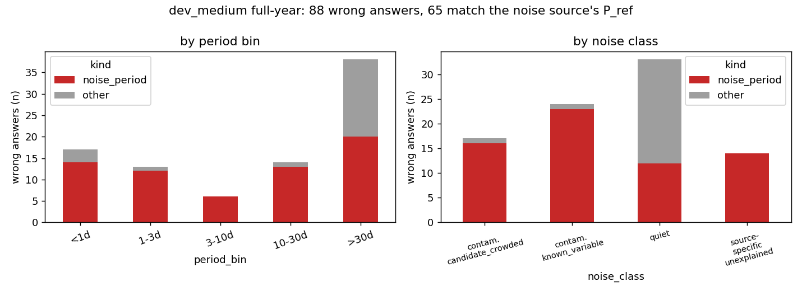

# Scorecard v5: noise_period breakdown, quiet-noise subsets, beyond-reach candidates (T24/T25/P22b)

**Date:** 2026-11-10 · **Author:** method-improver session · **Branch:** claude/t24-t25-scorecard-v5-84eca3 · **Status:** draft

## TL;DR
- **Scorecard is now version 5. Every v4 key is bit-identical** on synth200, dev_small (assigned) and dev_medium (full-year and assigned): 724 / 931 / 796 / 949 old leaf values compared, 0 differ (`tools/compare_scorecard_keys.py`). `wrong` and `success` are unchanged.
- **T24:** 65 of dev_medium full-year's 88 `wrong` answers match the noise source's `P_ref` within REL_TOL (`final.noise.overall.wrong_noise_period` = 0.065; `wrong_other` = 0.023). On the 128 periodic/contaminated-noise stars it is 53 of 55 wrong; on the 872 quiet-class stars 12 of 33. Only 1 further wrong answer is a half/double of the noise period (`noise_alias`).
- **T25:** `final.quiet_noise` (872 stars) has success 0.251 / wrong 0.038, `final.quiet_noise_strict` (850; drops the 22 coherent-quiet stars) 0.254 / 0.035, versus 0.227 / 0.430 on the other 128 stars (full-year).
- **P22(b):** `per_candidate.csv` now has `beyond_reach` rows (1,261 of 24,129 on dev_medium full-year). 108 of them (57 correct + 51 diffrot by raw P0) would have been a success had they been fit.
- Deviation from the brief: `noise_period` is a **breakdown of `wrong`**, not a new outcome (as instructed); two existing test assertions were edited for the version bump and the extra candidate rows (see below).

## Question / goal
T24, T25 (`docs/TASKS.md`) and P22(b), under one `SCORECARD_VERSION` bump to 5. No goals in `goals.json` touched.

## What I did
- `claude_files/evaluation.py` (pre-approved): added `noise_period_match` and `noise_alias_kind`. Existing functions, outcomes and `OUTCOMES` unchanged.
- `tools/build_noise_table.py` → `benchmarks/noise_sources_dev.csv` (1,050 dev_small ∪ dev_medium stars, keyed by `sim_id`; from `noise_source_flags.csv.gz` on the drive; holdout not touched). Provenance of the coherent-quiet list: `benchmarks/noise_quiet_coherent.csv`, verbatim `reports/2026-11-09_smarts-note-review/checks/quiet_coherent.csv` at branch `claude/smarts-note-review-2d28d8` commit fd543bf (34 TICs; 24 of them are in the dev table, 22 in dev_medium).
- `benchmarks/scorecard.py`: per-star `noise_tic, noise_class, noise_periodic, noise_exclude, noise_quiet_coherent, noise_P_ref, noise_period_match, noise_alias`; metrics `final.noise.{overall,by_bin,by_noise_class}` (n, wrong, wrong_noise_period, wrong_other, counts, noise_alias), `final.quiet_noise`, `final.quiet_noise_strict`, `final.periodic_noise` (each overall/by_bin/by_coverage_class plus a `noise` block); `--noise-subset {all,quiet,quiet_strict}` restricts which stars are scored (and is appended to `config.dataset`); `per_candidate.csv` gets `beyond_reach` and `P0_outcome` columns, beyond-reach rows appended after the v4 rows.
- Definitions: **quiet** = `classification == quiet`, not periodic, not excluded. **strict** = quiet and not in the coherent list. `noise_period_match` is only ever true for a `wrong` final answer. Never a success.
- Tests: `tests/test_scorecard_v5.py` (no drive). Edited existing assertions: `scorecard_version == 5` in `test_coverage.py` and `test_scorecard_v4.py`; in `test_gate_instrumentation.py` the candidate-row count now includes `beyond_reach_candidates`.

## Results
**v4 keys unchanged** (`tools/compare_scorecard_keys.py`, NaN==NaN): synth200 724/0, dev_small assigned 931/0, dev_medium full-year 796/0, dev_medium assigned 949/0 (compared/differing). `check_goals.py --baseline <v4>`: PASS with all deltas +0.000 (`data/check_goals_synth200.txt`, `data/check_goals_dev_small.txt`).
Per-star tables: the committed `*_v4_tables` pre-date the 0.7-baseline reach-cap fix (0005087), so their `n_candidates`/`top1`/`pipeline_message` columns differ from any current run. Separately I ran the *unmodified* HEAD scorecard on dev_small and compared: all 38 v4 per-star columns identical to the v5 run (so v5 itself changes nothing).

dev_medium (n=1000), v5 numbers:

| subset | n | full-year success | full-year wrong | assigned success | assigned wrong |
|---|---|---|---|---|---|
| quiet_noise | 872 | 0.251 | 0.038 | 0.147 | 0.026 |
| quiet_noise_strict | 850 | 0.254 | 0.035 | 0.149 | 0.022 |
| periodic_noise (the rest) | 128 | 0.227 | 0.430 | 0.156 | 0.242 |

`--noise-subset quiet` removes 128 stars from dev_medium; `quiet_strict` removes 150 (128 + 22).


Red = wrong answers equal to the noise source's period. Look at the right panel: nearly every wrong on contaminated classes is noise_period, while quiet-class wrongs are mostly "other"; the >30 d bin has the most "other" wrongs (18).

## What didn't work
- Nothing failed. Caveat: T20 counted 51 noise-period wrongs; I get 65. The extra 12 are quiet-class stars matching `P_ref`, which for quiet sources is only a weak Lomb–Scargle peak (not a pipeline detection), so those matches are weaker evidence. They are reported separately via `by_noise_class.quiet`.

## Open questions for Rae
1. **Halves/doubles of the noise period:** only 1 wrong on dev_medium full-year is a half/double (`noise_alias`), so counting them changes almost nothing; keep as a diagnostic? 
2. **Quiet-class `P_ref` matches** (12 wrongs): count them as `noise_period`, or restrict `noise_period_match` to sources with `noise_periodic` / non-quiet class? Easy change, but it would alter the v5 key meanings, so decide before the baseline is relied on.
3. **Quiet subset definition and goals:** use `quiet_noise_strict` as the judging subset (Q5 of the review)? Proposed goals (yours to edit): guard `final.quiet_noise_strict.overall.success` and `.wrong` against the v5 baselines (success ≥ 0.254, wrong ≤ 0.035 full-year), and a goal that `final.noise.overall.wrong_noise_period` falls only if success rises (it is label contamination, not a pipeline bug).
4. **Beyond-reach rows:** 108 of 1,261 beyond-reach P0 candidates would be successes by raw P0 — a lead for T16d-style reach questions.

## Reproduce
```bash
/opt/anaconda3/envs/ss_openblas/bin/python tools/build_noise_table.py          # needs the drive
/opt/anaconda3/envs/ss_openblas/bin/python benchmarks/scorecard.py --manifest datasets/dev_medium.csv --data-root data/smarts_dev --ignore-manifest-sectors --n-workers 4 --outdir runs/dev_medium_fullyear_v5
/opt/anaconda3/envs/ss_openblas/bin/python benchmarks/scorecard.py --manifest datasets/dev_medium.csv --data-root data/smarts_dev --n-workers 4 --outdir runs/dev_medium_assigned_v5
/opt/anaconda3/envs/ss_openblas/bin/python tools/compare_scorecard_keys.py benchmarks/baselines/dev_medium_fullyear_v4.json runs/dev_medium_fullyear_v5/metrics.json
/opt/anaconda3/envs/ss_openblas/bin/python reports/2026-11-10_scorecard-v5-noise-period/make_figure.py
```
Baselines: `benchmarks/baselines/*_v5.json` (+ `dev_medium_*_v5_tables/`).
