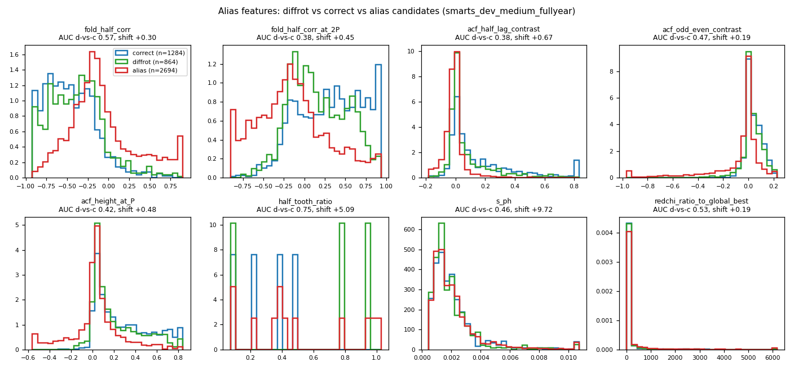
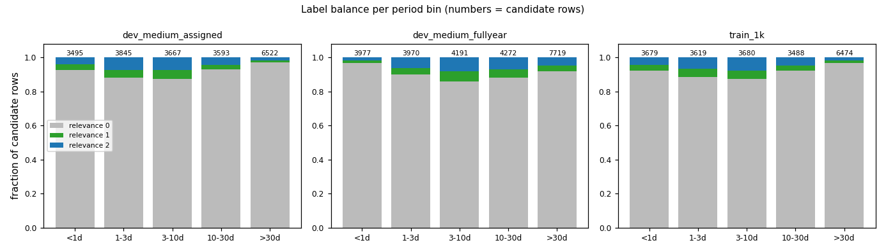
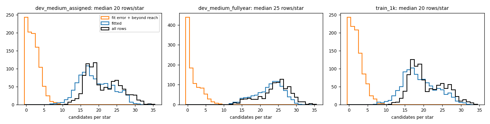
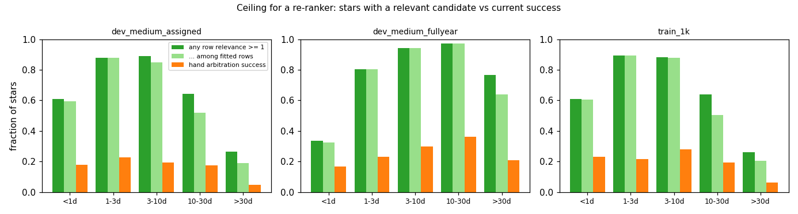
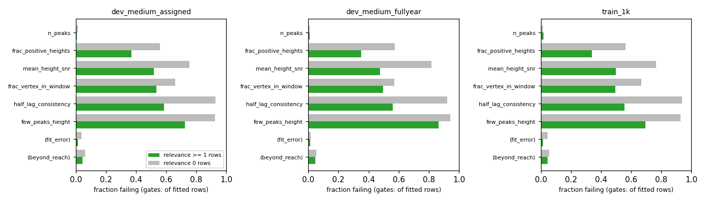

# T10: ranker v0 feature tables

**Date:** 2026-11-10 · **Author:** Claude (ranking-model-builder session) · **Branch:** `claude/t10-ranker-feature-tables-303694` · **Status:** draft

## TL;DR
- **Feature-table builder:** `tools/build_feature_tables.py`. Each star gets the scorecard's own pipeline, and every candidate the comb fit saw becomes a row: gate-failed candidates, fit errors and `beyond_reach` candidates are all included. Gate values and pass/fail are features. Labels are graded (`relevance` 2 = correct, 1 = diffrot, 0 = other), with `alias_class` as a separate column. Every row carries `star_id` and `noise_tic`. Schema: `docs/FEATURE_TABLE_SCHEMA.md`.
- **The tables reproduce the scorecard exactly.** On dev_medium, all 1,000 stars match scoring-v5's scorecard on the success flag and on the outcome, in both coverage modes, and every reported period is bit-identical (211 assigned, 350 full-year).
- **Training manifest:** `datasets/train_v0.csv`, 3,000 stars stratified like dev_medium. It comes from the SIM_ID < 800k pool and uses **strict quiet** noise only: the 34 coherent-quiet sources are excluded, per Rae's decision relayed mid-task. Its first 1,000 rows (`nested_1k`) are a balanced nested subset. It shares no noise TIC with dev_medium or the holdout.
- **Tables built (0 errors):**

  | table | rows | location |
  |---|---|---|
  | dev_medium, assigned coverage | 21,122 | `runs/` |
  | dev_medium, full-year | 24,129 | `runs/` |
  | train 1k | 20,940 | drive |

- **The re-ranking headroom is large.** On train_1k, 60% of stars have a relevance ≥ 1 candidate, while hand arbitration succeeds on 18% (full-year dev_medium: 76% vs 25%).
- **Alias check: the T9 features don't penalize diffrot within a star.** Pooled, `acf_half_lag_contrast` places diffrot candidates 0.67 of the way toward aliases. Within stars that have both kinds of candidate, though, the paired difference is ≈ 0, so the pooled shift reflects which stars have diffrot candidates. **Flag:** the `half_lag_consistency` *gate* passes 32% of diffrot candidates vs 52% of correct ones, and a pooled model could carry the same star-level bias into its decline threshold.

## Update after merging scorecard v5 (main `b54ecc2`)
- **The builder broke on v5, and is now fixed.** v5's `_candidate_rows` appends `beyond_reach` records (P22b) after the fit-error ones, and the builder's slice for fit-error messages assumed they weren't there. It now takes fitted, then fit-error, then beyond-reach records, and checks the P0s against the candidates, so rows aren't counted twice.
- **Parity vs a fresh v5 scorecard on dev_small** (`datasets/dev_small.csv,data_root=data/smarts_dev,sectors=manifest`):
  - all 50 stars have the same success flag and outcome, and all 11 reported periods are bit-identical;
  - the table has 1,028 candidate rows, equal to v5's `per_candidate.csv`.
- **The dev_medium tables were not rebuilt; their pipeline rows are unchanged.** The first 50 dev_medium full-year stars, rebuilt with the merged code, are bit-identical in every column except the noise flags.
- **The noise flags were refreshed instead.** The drive's flags file changed at 12:30 (quiet-noise-probe added `periodic_low_amplitude`, 19,554 rows), so I refreshed all three tables with `--combine-only --refresh-noise`. dev_medium's 22 coherent-quiet stars are now `periodic_low_amplitude` with `noise_exclude_from_training` True (148 excluded stars in all). train_v0 and train_1k still have 0 excluded stars under the new flags.

## Question / goal
T10 in `docs/TASKS.md` (Roadmap step 2, ranker v0). It covers:
- feature tables for dev_medium plus a training sample, with every candidate included, graded labels, star- and noise-grouped rows, and quiet noise only;
- the required check that T9's alias features don't penalize diffrot periods.

No goal in `goals.json` applies, since no method changed.

## What I did
1. **Alias check** (`alias_check.py`, `alias_within_star.py`). I compared alias-feature distributions for diffrot, correct and alias (half + double) candidates:
   - in T9's synthetic table (`reports/2026-10-14_t9-feature-search/data/candidates.csv.gz`);
   - in the new full-year dev_medium table (real SMARTS, fitted rows only);
   - within star, using the best-redchi correct and best-redchi diffrot candidate on the same light curve.
2. **Builder** (`tools/build_feature_tables.py`):
   - A module-level per-star worker runs the scorecard's `_load`, Stage 1 methods (all 7), `two_view_guesses` and `fit_rotation_period` calls unchanged. It imports these from `benchmarks/scorecard.py` read-only.
   - It joins `ml_features.extract_candidate_features` with the scorecard's per-candidate gate records.
   - New `ml_features.extract_unfit_candidate_features` covers fit-error and beyond-reach candidates, with features evaluated at P0.
   - Plumbing: `ProcessPoolExecutor(initializer=determinism.init_worker)`, `--n-workers`, `--resume`, per-star pickle shards written atomically, and a combiner (`--combine-only`).
   - Tests: `tests/test_build_feature_tables.py`, synthetic only, including a parity test against `scorecard.score_one_star`.
3. **Training manifest** (`tools/build_train_sample.py`). It reuses `build_dev_sets` (strata, quotas, corrupt-noise check, coverage assignment), configured for:
   - the SIM_ID < 800k pool, filtered to `classification == quiet`, not `exclude_from_training`, and not the one noise TIC shared with the ≥ 800k pool (10001390027, 810 rows);
   - strict quiet (coherent sources dropped *after* ranking, so the other rows' selection is stable);
   - two nested subsets, filled in rank order;
   - a separate cache on the drive (`extracted/t10_train/`), with files in `extracted/train_v0/`.

   Tests: `tests/test_train_manifest.py`.
4. **Runs** (4 workers, each after checking that no scorecard was running). Scorecard dataset strings:
   - `datasets/dev_medium.csv,data_root=data/smarts_dev,sectors=manifest`, giving `runs/t10_dev_medium_assigned/` (14 min);
   - `datasets/dev_medium.csv,data_root=data/smarts_dev,sectors=ignored`, giving `runs/t10_dev_medium_fullyear/` (20 min);
   - `datasets/train_v0.csv --only nested_1k`, giving `/Volumes/Data_Vault/smarts_data/extracted/t10_tables/train_1k/` (25 min, reading from the drive).
5. **Sanity checks** (`sanity.py`):
   - label balance;
   - candidates per star;
   - stars with any relevant candidate;
   - gate-failure rates;
   - parity against scoring-v5's dev_medium scorecards (`runs/dev_medium_*_v5` in the t24-t25 worktree; same base commit `8a764eb`, with only `scorecard.py`/`evaluation.py` edits).

## Results

### Alias features vs diffrot
On real SMARTS candidates, pooled over all candidates:

| feature | AUC correct vs alias | AUC diffrot vs correct | alias_shift |
|---|---|---|---|
| `acf_half_lag_contrast` | 0.81 | 0.38 | 0.67 |
| `acf_height_at_P` | 0.78 | 0.42 | 0.48 |
| `fold_half_corr_at_2P` | 0.78 | 0.38 | 0.45 |
| `fold_half_corr` | 0.22 | 0.57 | 0.30 |
| `acf_odd_even_contrast` | 0.73 | 0.47 | 0.19 |

`alias_shift` runs from 0 (diffrot looks like correct) to 1 (diffrot looks like an alias). On synthetic data the shifts are smaller (`acf_half_lag_contrast` 0.41, `fold_half_corr` 0.04).


Look at how far the green (diffrot) curve sits from blue (correct) toward red (alias) for the three ACF-height features.

Within star (243 dev_medium stars with both a fitted correct and a fitted diffrot candidate):
- the median paired difference is ≈ 0 for every alias feature (`fold_half_corr` −0.027; the others ≤ 0.005 in magnitude);
- `acf_height_at_P` is *higher* at the diffrot candidate in 70% of stars.

So the features don't rank a star's diffrot period below its P_eq period. The pooled shift comes from diffrot candidates clustering on stars with weaker, less coherent ACFs. Caveat: in stars that have both kinds, the two candidates are often close in period, which makes paired differences small by construction.

**Flagged for Rae:** `half_lag_consistency` (the gate, built on this feature) passes 52% of correct candidates and 32% of diffrot candidates. Hand arbitration therefore throws away diffrot answers more often. A pooled ranker may also score diffrot-only stars lower in absolute terms, which matters for T11's decline threshold, not for ordering within a star. I kept every feature; T11 should check its calibration on diffrot-only stars.

### Label balance and candidates per star

Relevance ≥ 1 rows are 6–9% of rows in every bin (numbers above the bars are rows). Train_1k and assigned-coverage dev_medium look alike, as intended.


The median is 20 rows per star with assigned coverage and 25 full-year. No star has zero rows. Unfit rows are a small minority:

| table | fit error | beyond reach |
|---|---|---|
| train_1k | 4.0% | 5.3% |
| dev_medium, full-year | 1.4% | 5.2% |

### Stars with any relevant candidate (the re-ranking ceiling)

The green bars are what a perfect re-ranker of these candidates could reach. Orange is today's hand arbitration.

train_1k:

| bin | any relevance ≥ 1 | hand success |
|---|---|---|
| <1 d | 0.61 | 0.23 |
| 1–3 d | 0.90 | 0.22 |
| 3–10 d | 0.88 | 0.28 |
| 10–30 d | 0.64 | 0.19 |
| >30 d | 0.26 | 0.06 |

Wide diffrot bands inflate the ceiling somewhat (`data/ceiling_by_band_width.csv`). On train_1k, solid-body stars (`zero` band) reach 0.54, against 0.68–0.77 for bands ≥ 0.2. Counting only `correct` candidates (relevance 2), it is 0.48–0.54 in every band class.

One oddity: **<1 d full-year has a lower ceiling (0.34) than assigned coverage (0.61)** on the same stars. The longer baseline seems to lose short-period Stage 1 candidates, since hand success is unchanged (0.17 vs 0.18). I didn't investigate; it's a Stage 1 recall question (P14), not a table bug.

### Gate-failure rates

Every gate rejects relevant candidates much less often than irrelevant ones, but the gates still reject a lot of relevant ones. On train_1k, the share of relevance ≥ 1 rows failing each gate is:

| gate | fail rate |
|---|---|
| `half_lag_consistency` | 56% |
| `frac_vertex_in_window` | 50% |
| `mean_height_snr` | 49% |
| `frac_positive_heights` | 34% |
| `few_peaks_height` (few-peak rows only) | 70% |

At most 12% of relevant rows fail any one gate alone (9% for `frac_vertex_in_window`, 12% for `few_peaks_height`, ≤ 4% for the rest; `data/sanity_*_gate_failure.csv`), so no one gate is the bottleneck.

### Parity with the scorecard
`data/parity.json`. For both dev_medium modes:

| check | assigned | full-year |
|---|---|---|
| stars with the same success flag | 1,000 / 1,000 | 1,000 / 1,000 |
| reported periods bit-identical | 211 / 211 | 350 / 350 |
| stars with the same final outcome | 1,000 | 1,000 |

Every successful star has exactly one `selected` row, whose `fitted_P` equals `final_period`, and no declined star has one.

### Training manifest
`datasets/train_v0.csv` (+ `train_v0_build_summary.json`):
- **Rows:** 3,000, split 515/515/514/514/513/215/214 over the bins <1 d … 120–180 d. Each subset has the same shares, and coverage classes are balanced (373–377 each).
- **Pool after filtering:** 701,582 non-strict rows; 15,321 rows are on coherent-quiet sources and were dropped for strict.
- **Corrupt noise:** 583 of 3,960 checked files (14.7%) were excluded, against 8.75% for T2's ≥ 800k pool.
- **Noise sources:** 728 noise TICs, none shared with dev_medium or the holdout.
- **Size rationale (3,000):** about 63k candidate rows and about 1,800 stars with a relevant candidate. That's roughly 310–460 positive groups per bin below 30 d, enough for a grouped gradient-boosted ranker with ~200 features. It is also 3× dev_medium, so a 1k → 3k learning curve shows whether more data is worth its cost before anyone scales up. Rae's full run is ~76 min of CPU (~51 min for the 2,000 not yet built).

## What didn't work
- **First manifest pass wrote into T2's cache.** `ProcessPoolExecutor` workers are spawned on macOS and re-import `build_dev_sets` with its defaults, so my config overrides didn't reach them. The 3,951 checks and staged files landed in `extracted/t2_build/` (append-only, so nothing of T2's was overwritten).
  - I moved exactly those 3,951 rows and files to `extracted/t10_train/`, which restored T2's cache to its original 5,200 rows.
  - `test_build_reproducible_from_seed` still passes.
  - Fixed with a worker wrapper that re-applies the config.
- **The first 1k build read the non-strict manifest.** The strict decision arrived mid-run. I moved the 26 shards that aren't in the strict `nested_1k` to `train_1k/shards_not_in_strict_1k/` and resumed, which built the 26 replacements.
- **Leftover drive files:** `extracted/train_v0/` still holds the 67 FITS files of the non-strict rows (3,067 files for 3,000 rows). They're harmless; I didn't delete them.

## Open questions for Rae
1. **Sample size.** I chose 3,000 with a nested 1,000 (rationale above). Go for the full 3,000, or wait for the 1k-vs-dev_medium learning-curve point from T11 first?
2. **Strict quiet is applied.** Coherent-quiet sources are excluded from `train_v0` per your 2026-11-10 decision; `--keep-coherent` rebuilds the non-strict version.
   - When the drive's flags file gains the `periodic_low_amplitude` exclusion (quiet-noise-probe), the builder's `noise_exclude_from_training` column picks it up on the next build. The hard-coded list then becomes redundant.
   - **dev_medium itself contains 22 coherent-quiet and 126 non-quiet-noise stars** (it's frozen, so the tables keep them, flagged). Should T11 report dev_medium on the strict-quiet subset (as T25 does), on all stars, or both?
3. **Labels.**
   - Unfit rows are labelled at P0. A fit-error candidate at the right period (common below 1 d) gets relevance 2 even though the pipeline can't report a fitted period for it. Keep those as positives, or set them to 0 for v0?
   - Wide-band stars make relevance 1 easy (see the ceiling by band width). Down-weight relevance 1 for `ge_0p5` bands?
4. **The `half_lag_consistency` gate discriminates against diffrot answers** (32% vs 52% pass). Worth noting for P7/T16d, which are paused; the ranker may make this moot.
5. **<1 d full-year Stage 1 recall** is lower than with assigned coverage on the same stars (ceiling 0.34 vs 0.61). Worth a look under P14?
6. **Builder coupling.** The builder imports private scorecard helpers (`_load`, `_candidate_rows`, …) to guarantee parity. When scoring-v5 merges, rerun `tests/test_build_feature_tables.py`, which checks parity.

## Reproduce
```bash
PY=/opt/anaconda3/envs/ss_openblas/bin/python
R=reports/2026-11-10_t10-ranker-feature-tables
# alias check
$PY $R/alias_check.py --candidates reports/2026-10-14_t9-feature-search/data/candidates.csv.gz --tag t9_synthetic
# training manifest (drive; reuses the cache in extracted/t10_train/, ~2 min with cache, ~25 min from scratch)
$PY tools/build_train_sample.py --n-workers 2
# tables
$PY tools/build_feature_tables.py --manifest datasets/dev_medium.csv --data-root data/smarts_dev --outdir runs/t10_dev_medium_assigned --n-workers 4 --resume
$PY tools/build_feature_tables.py --manifest datasets/dev_medium.csv --data-root data/smarts_dev --ignore-manifest-sectors --outdir runs/t10_dev_medium_fullyear --n-workers 4 --resume
$PY tools/build_feature_tables.py --manifest datasets/train_v0.csv --data-root /Volumes/Data_Vault/smarts_data --only nested_1k --outdir /Volumes/Data_Vault/smarts_data/extracted/t10_tables/train_1k --n-workers 4 --resume
# full 3,000 (Rae, locally; ~51 min, reuses the 1k shards)
tools/run_t10_train_tables.sh
# SMARTS alias check + sanity + figures
$PY -c "import pandas as pd; c=pd.read_csv('runs/t10_dev_medium_fullyear/candidates.csv.gz',low_memory=False); c[~c.fit_error&~c.beyond_reach].to_csv('runs/t10_dmfy_fitted.csv.gz',index=False)"
$PY $R/alias_check.py --candidates runs/t10_dmfy_fitted.csv.gz --tag smarts_dev_medium_fullyear
$PY $R/alias_within_star.py runs/t10_dmfy_fitted.csv.gz smarts_dev_medium_fullyear
$PY $R/sanity.py --run dev_medium_assigned=runs/t10_dev_medium_assigned --run dev_medium_fullyear=runs/t10_dev_medium_fullyear \
  --run train_1k=/Volumes/Data_Vault/smarts_data/extracted/t10_tables/train_1k \
  --scorecard dev_medium_assigned=<scorecard outdir> --scorecard dev_medium_fullyear=<scorecard outdir>
$PY tools/run_notebook.py $R/notebook.ipynb
```
