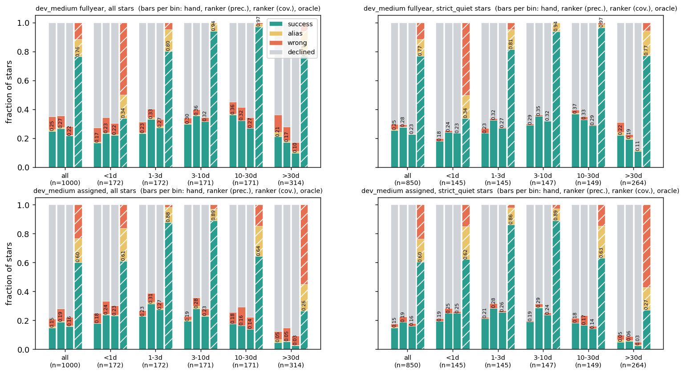
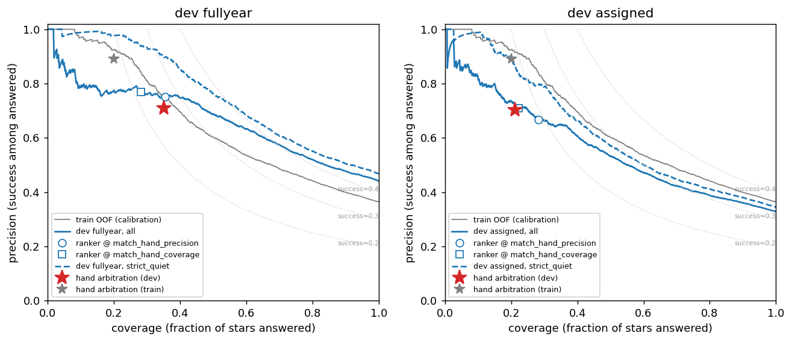
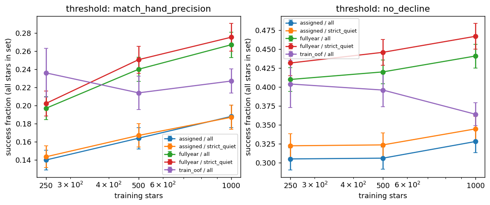
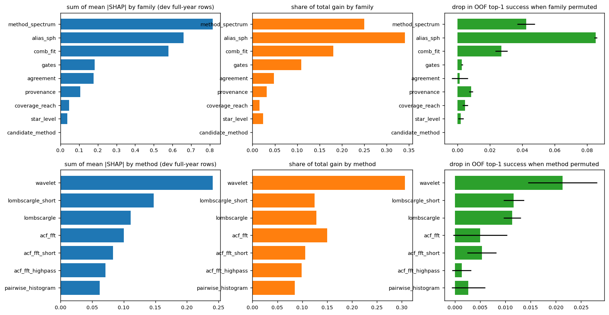
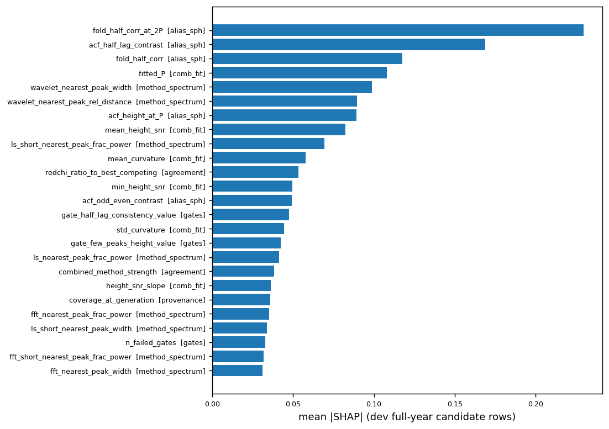
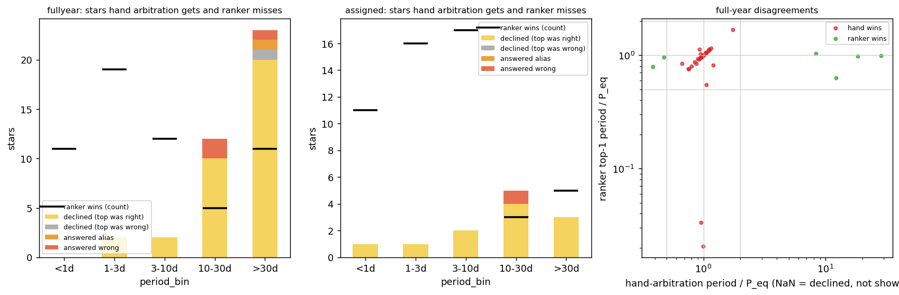
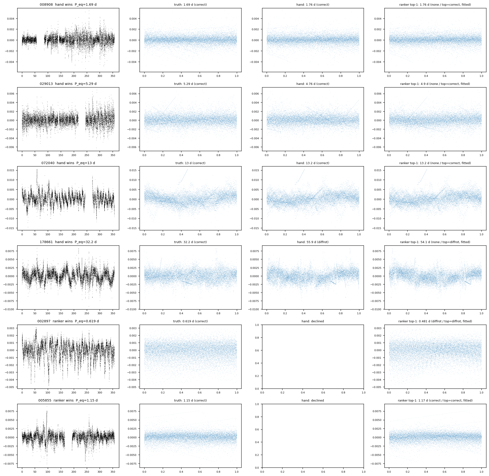

# T11: ranker v0

**Date:** 2026-11-10 · **Author:** Claude (ranking-model-builder session) · **Branch:** `claude/t11-ranker-v0-2d9aed` · **Status:** draft

## TL;DR
- **The ranker beats hand arbitration, but only modestly once it has to decline.** It is an XGBoost `rank:ndcg` model, trained on the 1,000-star strict-quiet `train_1k` table, with its decline threshold calibrated on out-of-fold (OOF) training scores to match hand arbitration's training precision (0.89). On dev_medium:

  | dev_medium | success, hand → ranker | wrong, hand → ranker | declined, hand → ranker |
  |---|---|---|---|
  | full-year | 0.248 → 0.267 | 0.088 → 0.080 | 0.650 → 0.645 |
  | assigned | 0.148 → 0.188 | 0.054 → 0.087 | 0.789 → 0.718 |

  Paired per star:
  - full-year: the ranker wins 58 stars and loses 39 (sign test p = 0.067);
  - assigned: it wins 52 and loses 12 (p = 5e-7).
- **On strict-quiet noise, the ranker is clearly better on full-year.** Success is 0.254 → 0.275 and wrong 0.035 → 0.016, so precision goes from 0.85 to 0.93 at the same coverage. On assigned coverage it answers more (success 0.149 → 0.187), but precision dips (0.85 → 0.83).
- **Ordering is solved far better than declining.** Without a decline, the ranker's top-1 succeeds on 0.441 of full-year stars (oracle ceiling 0.764) and on 0.328 of assigned ones (ceiling 0.601). That is 1.8–2.2× hand arbitration's success.
- **The decline score is the bottleneck.** 34 of the 39 full-year losses are stars where the ranker's top-1 *was right*, but its score was below the threshold. They sit almost entirely in 10–30 d and > 30 d. Absolute scores fall with period: the median top score of correct top-1s is 3.5 at < 1 d and 1.3 at > 30 d. So one global threshold over-declines long periods, which the training set, at assigned coverage, rarely shows at full-year baselines. In those two full-year bins the ranker loses to hand arbitration: 0.32 vs 0.36 at 10–30 d, and 0.17 vs 0.21 at > 30 d. It wins in every bin below 10 d.
- **Data:** the learning curve is still rising at 1k. Full-year success at the threshold goes 0.197 → 0.240 → 0.267 for 250 / 500 / 1,000 stars; without a decline it goes 0.410 → 0.420 → 0.441. At a fixed answer rate, though, it is flat from 500 on (0.263 / 0.263). More data helps the ordering and the threshold placement, not precision at fixed coverage. **The 3k point is worth running**: it's one command, below.
- **Ablations change where the threshold lands, not the ranking.** At fixed coverage every variant is within ±0.006 of base: fit-error relabelling, wide-band down-weighting or relabelling, and `rank:pairwise`. My recommendation is to keep the T10 labels for v0.
- **What matters:**
  - the alias/S_ph family (6 features; permuting them costs 0.085 OOF top-1 success);
  - the method spectra (0.042), where **wavelet** is the most useful single `guess_*` method (0.021), ahead of `lombscargle_short` and `lombscargle` (0.012 and 0.011);
  - the comb-fit shape (0.027).

  The gate pass/fail flags add almost nothing on top (0.003). `acf_fft_highpass` and `pairwise_histogram` spectra contribute least, which feeds T12.
- **Caveat: rotators only.** No non-rotator negatives exist yet (T27), so the decline threshold only learns "this rotator's top candidate is probably wrong". It does not learn "this star has no rotation signal". Expect it to move once T27 lands.

## Question / goal
This is T11 in `docs/TASKS.md` ("Train and evaluate the ranker"), done as ranker v0 per Roadmap step 2. It asks:
- does a learned ranker beat hand arbitration, per period bin;
- which features and methods matter (for T12);
- how much data is enough.

Per Rae's 2026-11-10 note, `beyond_reach` rows stay in, with `P_over_reach` as a feature (P23). No `goals.json` goal applies: no pipeline method changed, and the ranker isn't wired into the scorecard.

## What I did
1. **Code.**
   - `claude_files/ranking_model.py` holds the reusable pieces:
     - loading;
     - feature encoding (`method` one-hot; booleans to 0/1; ±inf to ±1e30; constant columns dropped, leaving 137 features);
     - label variants;
     - noise-TIC-grouped folds;
     - training and the fold ensemble;
     - top-1, thresholds, the coverage curve and outcome summaries (all via `evaluation.classify_period` / `best_outcome`);
     - SHAP, gain and feature-family maps.
   - `tools/train_ranker.py` is the resumable driver.
   - `tests/test_ranking_model.py` has 8 tests, synthetic only.
2. **Data (read-only).**
   - Train: `/Volumes/Data_Vault/smarts_data/extracted/t10_tables/train_1k` (1,000 stars, 20,940 rows, 551 noise TICs).
   - Final comparison only: `runs/t10_dev_medium_fullyear` and `runs/t10_dev_medium_assigned` in the main checkout. Those are T10's tables for `datasets/dev_medium.csv,data_root=data/smarts_dev,sectors=ignored` and `sectors=manifest`.
   - No holdout.
3. **Model selection, all inside the training set.**
   - 5-fold `GroupKFold(shuffle, seed 0)` on `noise_tic`.
   - The grid: objective ∈ {`rank:ndcg`, `rank:pairwise`} × `max_depth` {3, 5} × `eta` {0.03, 0.1} × rounds {150, 400} × `min_child_weight` {1, 5}, with subsample and colsample 0.8.
   - Selection criterion: OOF top-1 success.
   - Winner: `rank:ndcg`, depth 3, eta 0.1, 150 rounds (OOF 0.364). `rank:pairwise` was tied at 0.363 (`data/tune.csv`).
   - Deterministic: `tree_method=hist`, 4 threads, seed 0. A repeated CV gave bit-identical OOF scores.
4. **Dev scoring.**
   - The dev score is the mean of the 5 fold models.
   - The reported period is the top-1 candidate's `P_eval` (fitted P, or P0 for unfit rows).
   - The decline thresholds come from the OOF top-1 table:
     - `match_hand_precision`: the largest OOF coverage with precision ≥ 0.89, hand arbitration's training precision (threshold 1.357);
     - `match_hand_coverage`: hand's training coverage, 0.20;
     - `precision_0.80`.
   - Subsets: all, strict-quiet (`noise_classification == quiet`, not excluded, not coherent-quiet: 850 stars), searchable, and both.
5. **Ablations** at 1k: `fiterr0`, `wideband_w05` (query weight 0.5 on `ge_0p5` stars, since XGBoost ranking weights are per query), `wideband_rel0`, and `rank:pairwise`. **Learning curve:** 250 / 500 / 1,000 stars, taken as stratified-by-`eval_pbin` prefixes of `train_order`, because `train_order`'s plain prefix is all < 3 d for the first 250 rows.
6. **Diagnostics** (`analysis.py`):
   - total gain;
   - mean |SHAP| (`pred_contribs=True`) over dev full-year candidate rows;
   - grouped permutation importance on OOF (3 repeats; each family or method's columns permuted jointly);
   - Spearman redundancy within families;
   - failure-mode breakdown;
   - the diffrot / `half_lag_consistency` check;
   - top-1 row kinds (`beyond_reach`, `fit_error`).

```
PY=/opt/anaconda3/envs/ss_openblas/bin/python
$PY tools/train_ranker.py --outdir runs/t11_ranker --resume            # ~17 min (grid ~15 min)
$PY reports/2026-11-10_t11-ranker-v0/analysis.py --run runs/t11_ranker --compute
```

## Results

### Hand arbitration vs ranker vs oracle

Bars per bin: hand, ranker at matched precision, ranker at matched coverage, oracle (hatched). Compare the first two bars in each bin. The ranker is ahead below 10 d in all four panels, and behind at 10–30 d / > 30 d full-year.

Overall, threshold `match_hand_precision`. Precision = success / answered; `data/comparison.csv` has every bin, subset and threshold:

| dev | subset | method | answered | success | wrong | precision |
|---|---|---|---|---|---|---|
| full-year | all | hand | 0.350 | 0.248 | 0.088 | 0.709 |
| full-year | all | ranker | 0.355 | **0.267** | 0.080 | 0.752 |
| full-year | all | ranker, precision 0.80 | 0.411 | 0.306 | 0.097 | 0.745 |
| full-year | strict-quiet | hand | 0.298 | 0.254 | 0.035 | 0.854 |
| full-year | strict-quiet | ranker | 0.295 | **0.275** | 0.016 | 0.932 |
| assigned | all | hand | 0.211 | 0.148 | 0.054 | 0.701 |
| assigned | all | ranker | 0.282 | **0.188** | 0.087 | 0.667 |
| assigned | strict-quiet | hand | 0.176 | 0.149 | 0.022 | 0.847 |
| assigned | strict-quiet | ranker | 0.226 | **0.187** | 0.036 | 0.828 |

Searchable-only, ranker vs hand success:

| dev | all stars | strict-quiet + searchable |
|---|---|---|
| full-year | 0.289 vs 0.268 | 0.297 vs 0.274 |
| assigned | 0.276 vs 0.218 | 0.272 vs 0.217 |

Per bin, success at matched precision, hand → ranker (oracle in brackets):

| bin | full-year | assigned |
|---|---|---|
| < 1 d | 0.169 → 0.233 (0.337) | 0.180 → 0.238 (0.610) |
| 1–3 d | 0.233 → 0.331 (0.802) | 0.227 → 0.314 (0.878) |
| 3–10 d | 0.298 → 0.357 (0.942) | 0.193 → 0.281 (0.889) |
| 10–30 d | 0.363 → **0.322** (0.971) | 0.175 → **0.164** (0.643) |
| > 30 d | 0.210 → **0.172** (0.768) | 0.048 → 0.054 (0.264) |

### Coverage vs accuracy

The grey curve is the training OOF curve the thresholds are set on. Blue is dev, all stars (solid) and strict-quiet (dashed); the red star is hand arbitration on dev. Three things to look at:
- the ranker curve passes above the red star in both modes;
- on full-year, all stars, precision plateaus near 0.78 even at very low coverage. These are confidently wrong answers on non-quiet noise sources: the strict-quiet curve stays near 0.99 there;
- the calibration doesn't transfer exactly. The target was 0.89, but dev precision at that threshold is 0.75 full-year and 0.67 assigned. Train and dev differ in noise mix and in period / coverage balance.

### Learning curve

Success keeps rising from 500 to 1,000 stars, both at the threshold and without it (error bars are binomial). At fixed coverage (`data/fixed_coverage.csv`) it is flat:
- full-year 0.257 / 0.263 / 0.263;
- assigned 0.153 / 0.158 / 0.153.

So the extra data mostly improves the top-1 ordering and how much the threshold lets through at a given training precision.

**Adding the 3k point** after `tools/run_t10_train_tables.sh` finishes:
```
/opt/anaconda3/envs/ss_openblas/bin/python tools/train_ranker.py --train /Volumes/Data_Vault/smarts_data/extracted/t10_tables/train_3k --sizes 3000 --outdir runs/t11_ranker --resume
```
Then rerun `analysis.py --compute`. That re-tunes nothing (`tune.json` is reused). The headline model becomes the 3k ndcg run, and pairwise and the ablations also run at 3k.

### Ablations (1k)
Each cell is success / declined at `match_hand_precision`, then success at hand's dev coverage:

| variant | full-year, at threshold | full-year, fixed coverage | assigned, at threshold | assigned, fixed coverage | top-1, no decline (full-year) |
|---|---|---|---|---|---|
| base (`rank:ndcg`) | 0.267 / 0.645 | 0.263 | 0.188 / 0.718 | 0.153 | 0.441 |
| `rank:pairwise` | 0.266 / 0.656 | 0.269 | 0.187 / 0.727 | 0.154 | 0.438 |
| (a) `fiterr0` | 0.255 / 0.664 | 0.264 | 0.180 / 0.747 | 0.155 | 0.444 |
| (b1) `wideband_w05` | 0.256 / 0.661 | 0.264 | 0.182 / 0.736 | 0.154 | 0.446 |
| (b2) `wideband_rel0` | 0.240 / 0.688 | 0.263 | 0.171 / 0.756 | 0.154 | 0.447 |

- **(a) Fit-error positives.** Only 10 training rows are fit-error with relevance 2, so their label barely matters. Under base, the top-1 is a fit-error row on 0.4% of full-year stars and 1.7% of assigned ones, and *none* of those get answered: they score below the threshold. Setting the label to 0 shifts the OOF calibration toward declining more (wrong 0.087 → 0.067 on assigned, success 0.188 → 0.180). **Recommendation:** keep relevance 2 for v0. It's harmless, and it keeps the "an unfit candidate is at the right period" signal for P23. Revisit if the pipeline gains a way to report unfit periods.
- **(b) Wide bands.** On `ge_0p5` stars (72 in dev) the ranker's successes are mostly diffrot (0.111 diffrot vs 0.014 correct, full-year). Down-weighting doesn't change the ordering: no-decline success is 0.441–0.447 for every variant. It only moves the threshold toward more declines. **Recommendation:** no down-weighting for v0. If Rae wants wide-band diffrot hits to count for less, that's a scoring decision (`evaluation.py` / goals), not a label change.
- **`rank:pairwise` vs `rank:ndcg`:** a tie (OOF 0.363 vs 0.364; dev within 0.006). ndcg is kept because it is faster at the tuned settings (150 vs 400 rounds; 13 s vs 23 s per 5-fold CV + dev scoring).

### Feature and method importance

Top row: families. Bottom row: Stage 1 `guess_*` methods (that method's spectrum features plus its one-hot). Columns: SHAP, gain share, and permutation drop in OOF top-1 success (reference 0.364). Look at the right column first: it is the one that measures what removing the information costs.


The top three are all alias features: `fold_half_corr_at_2P`, `acf_half_lag_contrast` and `fold_half_corr`. Then come `fitted_P` and the wavelet peak width and distance.

Permutation drops (`data/perm_importance.csv`):

| family | drop | | method | drop |
|---|---|---|---|---|
| alias_sph | 0.085 | | wavelet | 0.021 |
| method_spectrum | 0.042 | | lombscargle_short | 0.012 |
| comb_fit | 0.027 | | lombscargle | 0.011 |
| provenance | 0.008 | | acf_fft_short | 0.005 |
| coverage_reach | 0.005 | | acf_fft | 0.005 |
| gates | 0.003 | | pairwise_histogram | 0.003 |
| star_level | 0.002 | | acf_fft_highpass | 0.001 |
| agreement | 0.001 | | | |
| candidate_method | 0.000 | | | |

**For T12:**
- Wavelet and the two LS variants carry the method-spectrum signal.
- `acf_fft_highpass`'s spectrum features and `pairwise_histogram`'s bin features are the cheapest to lose, at ≤ 0.003 each within noise.
- The *candidate source* method (`method_is_*`) is never used.

This measures the methods' spectra as features, not their candidates' recall: dropping a method from Stage 1 also removes its candidates.

**Redundancy** (`data/family_correlation.csv`, Spearman |ρ| > 0.95): exact duplicates such as `period`~`log_period`, `redchi`~`log_redchi` and `passes_min_peaks`~`gate_n_peaks_pass`, plus 6 pairs in coverage/reach and 5 in star-level. That is harmless for trees, but it explains why gain spreads across twins.

### Failure modes: where the ranker loses to hand arbitration

Bars are the stars hand arbitration gets right and the ranker misses, coloured by the ranker's reason; black ticks are the stars the ranker gets and hand misses. In the right panel, red points sit on the diagonal: both picked the same (or nearly the same) right period, and the ranker then declined. Losses by reason:

| dev | ranker losses | declined though top-1 was right | other |
|---|---|---|---|
| full-year | 39 | 34 | 3 answered wrong, 1 alias, 1 declined with a wrong top-1 |
| assigned | 12 | 11 | 1 answered wrong |

- **Where the full-year losses sit:** 10–30 d has 12 (10 declined-right) and > 30 d has 23 (20 declined-right).
- **Hand's pick in the ranker's list:** it is the ranker's #1 in 21 of the 39 losses and #2 in 9.
- **The ranker's 58 full-year wins:** hand arbitration *declined* 52 of these stars; the other 6 were wrong or half answers.

Cause: the ranking score isn't calibrated across period regimes. Correct top-1 candidates have median top score 3.5 (< 1 d), 2.1 (1–3 d), 2.4 (3–10 d), 1.6 (10–30 d) and 1.3 (> 30 d). The training table has assigned coverage only, so long-period full-year stars are rare there.


Each row is a light curve plus folds at the truth, hand and ranker periods. The first four are typical losses: the ranker's top-1 is right (stars 008908, 072040: same period as hand; 029013, 178661: a different success period) but declined. The last two are wins hand arbitration declined (002897 diffrot, 005855 correct).

### `beyond_reach` rows (P23)
`data/top_kind.csv`:
- the top-1 is a `beyond_reach` row on 88 of 1,000 assigned stars and 15 full-year ones;
- those top-1s are right 19% (assigned) and 27% (full-year) of the time;
- the ranker answers only 2 of the 88 assigned, both wrong; it answers none full-year.

So the ranker effectively learned to decline when its best guess is beyond reach. Keeping the rows costs nothing: they're there for when the decline stage improves.

### The diffrot / `half_lag_consistency` bias (from T10)
`data/diffrot_bias.csv`, at matched precision:

| stars | answer rate, OOF | answer rate, full-year | ranker success, full-year | hand success, full-year |
|---|---|---|---|---|
| has a correct candidate | 0.42 | 0.44 | 0.368 | 0.348 |
| diffrot-only | 0.27 | 0.35 | **0.243** | 0.191 |

- **The bias carries through.** Diffrot-only stars are answered less often, and their median top score is about half as high (0.58 vs 1.03 full-year). When the top-1 is a diffrot candidate, it is answered 48% of the time, against 65% for a correct one.
- **It's a decline-level bias, as T10 predicted, not an ordering one.** The ranker still beats hand arbitration on diffrot-only stars (0.243 vs 0.191).
- **SHAP:** `acf_half_lag_contrast` pushes relevance-2 rows up by +0.16 on average and relevance-1 rows by only +0.05. The `half_lag_consistency` gate columns themselves contribute little (|SHAP| 0.047 and 0.007).

## What didn't work
- **First DMatrix build failed on ±inf values** in a few features, e.g. redchi ratios. They are now mapped to ±1e30, which keeps their order for trees.
- **The `train_order` prefix isn't a learning-curve subset.** Its first 250 rows are all < 3 d, so I use per-`eval_pbin` prefixes instead (nested).
- **The global decline threshold transfers poorly** (target 0.89, dev 0.67–0.75), and it under-answers long periods. I didn't try fixes for this in v0, to keep dev clean for this comparison. The first follow-up is below.

## Open questions for Rae
1. **Decline stage (recommended next step).** Replace the global top-score cut with a small star-level "accept" classifier, calibrated on OOF. Its inputs would be the top score, the margin to #2, the top candidate's period and `P_over_reach`, the coverage descriptors, and its relevance-2 probability. A simpler alternative is a threshold per *candidate-period* bin, set on OOF. Either should recover most of the 34 declined-right full-year losses. A full-year (or mixed-coverage) training table would help too: should Rae build `train_v0` full-year as well?
2. **Labels (ablations a, b):** I recommend keeping the T10 labels: fit-error positives at 2, and no wide-band down-weighting. Neither changed the ranking; both only moved the calibration. OK?
3. **Judging subset.** I showed all stars and strict-quiet. The gap matters: on full-year, the ranker's precision edge is much larger on strict-quiet (0.93 vs 0.85) than on all stars (0.75 vs 0.71), because confidently wrong answers come from non-quiet noise sources. I'd make strict-quiet the headline and keep all stars as the realism check.
4. **Next data:**
   - **The 3k point:** yes; the curve is still rising at 1k. Run it with the command above, after `tools/run_t10_train_tables.sh`.
   - **T27 negatives:** needed before the decline threshold means "no rotation".
   - **A full-year training table:** see question 1.
5. **Calibration target.** I matched hand arbitration's *training* precision (0.89). Hand arbitration's own dev precision is 0.71 / 0.70, so dev doesn't hold 0.89 for either method. Is "same precision as hand arbitration on train" the right operating point? Or should v1 target a fixed number, e.g. 0.80 (`precision_0.80` is in `data/comparison.csv`)?
6. **External benchmark (Claytor+2022 CNN σ_P):** not done. No CNN predictions are in the repo.

## Reproduce
```bash
PY=/opt/anaconda3/envs/ss_openblas/bin/python
# needs the Data_Vault drive (train_1k) and the main checkout's runs/t10_dev_medium_* tables
$PY tools/train_ranker.py --outdir runs/t11_ranker --resume
ln -s /Users/raeholcomb/Documents/GitHub/ss_redevelopment/data/smarts_dev data/smarts_dev   # worktrees only, for the example plots
$PY reports/2026-11-10_t11-ranker-v0/analysis.py --run runs/t11_ranker --compute
$PY tools/run_notebook.py reports/2026-11-10_t11-ranker-v0/notebook.ipynb
$PY -m pytest -q tests/test_ranking_model.py
```
