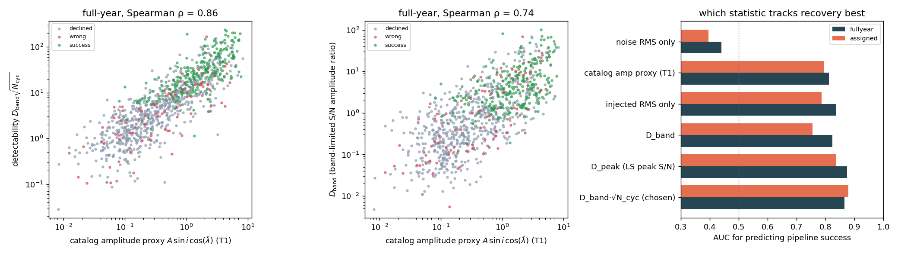
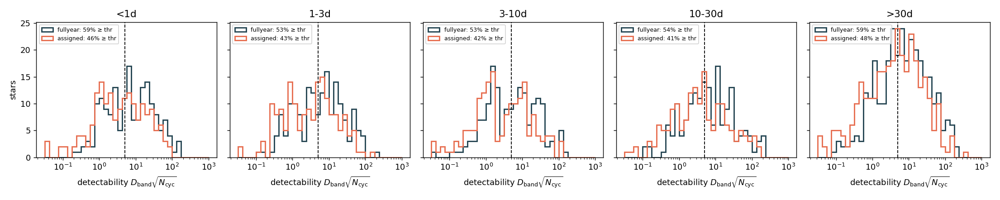
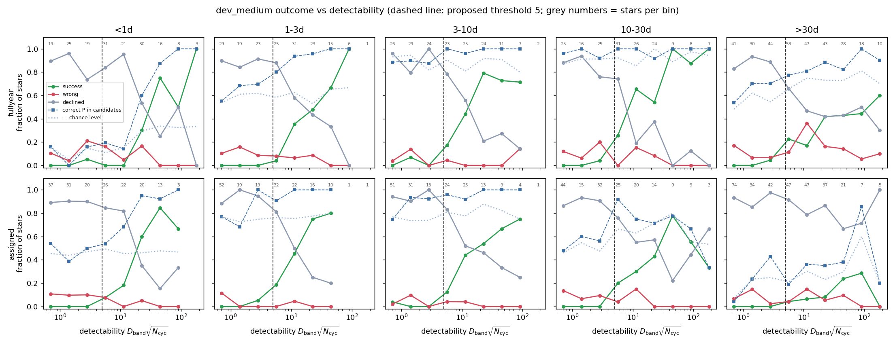
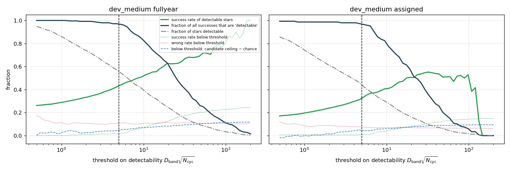
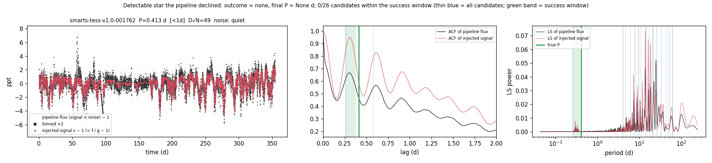
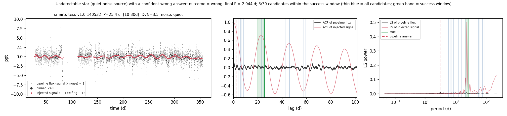
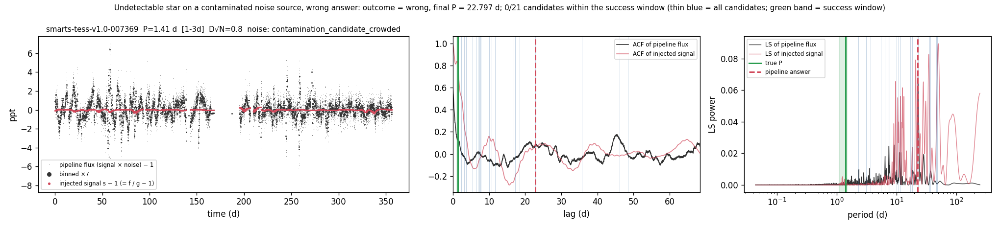
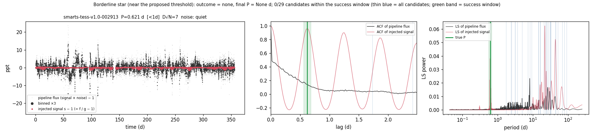

# T26: detectability ceiling for SMARTS stars

**Date:** 2026-11-10 · **Author:** T26 session (data-auditor) · **Branch:** `claude/t26-detectability-7f7523` · **Status:** draft

## TL;DR
- **Every dev_medium star now has a detectability number,** in both coverage modes. It is computed from the injected
  signal itself: s = SMARTS flux / T20 noise stack. The statistic is **D_band·√N_cyc**: the band-limited
  signal/noise amplitude ratio on rotation timescales (periods P_lo/1.5 to 1.5·P_hi), using exactly the cadences the
  pipeline saw, times √(observed cycles). It predicts pipeline success with AUC **0.86 full-year / 0.88 assigned**,
  against 0.81 / 0.79 for the T1 catalog amplitude proxy.
- **Proposed `detectable` = D_band·√N_cyc ≥ 5 (Rae decides).** Below the cut the pipeline almost never succeeds
  (1.8% full-year, 0.9% assigned), and 96.8% / 96.6% of all successes lie above it.
  - **56%** of dev_medium stars are detectable at full-year, **44%** with assigned coverage.
- **On detectable stars, full-year success is 0.43** (wrong 0.10, declined 0.47), against 0.25 overall.
  - On detectable stars from quiet noise sources that are also searchable: **0.47 / 0.05 / 0.48**.
  - Assigned coverage: 0.32 overall on detectable stars, 0.45 on detectable + quiet + searchable.
- **So most of the 65% decline rate is correct, but not all of it:**
  - 385 of the 650 full-year declines are undetectable stars.
  - On quiet noise sources the pipeline declines **97%** of undetectable stars, which is correct behaviour.
  - **265 declines (27% of dev_medium) are detectable stars**: real pipeline failures and the headroom for the ranker.
- **Confident wrong answers on undetectable stars come from the noise, not from the arbiter guessing:** 41 of the 47
  full-year cases sit on non-quiet noise sources (contaminating variables, crowding).
- **The "correct period anywhere in the candidates" ceiling is mostly chance:** full-year 0.76, against **0.65** with
  shuffled truth. With ~20 candidates in ±10% windows, 3–30 d stars hit the truth by chance 87–94% of the time. The
  ceiling only means something below 1 d, where detectable stars have a correct candidate 50% of the time against 24%
  by chance. **Half of the detectable <1 d stars have no correct candidate at all**, which is a candidate-generation
  failure (see the first example).
- No pipeline, metric, goal, manifest or test was changed. The holdout was not touched.

## Question / goal
T26 in `docs/TASKS.md` (roadmap step 1). dev_medium full-year sits at success 0.25 / wrong 0.09 / declined 0.65,
and we couldn't tell "pipeline failed on a detectable star" from "signal was never there". Asked for:
1. a per-star detectability statistic for every dev_medium star in both coverage modes, compared against the catalog
   amplitude proxy;
2. a join to existing outcomes;
3. a proposed `detectable` descriptor + threshold, with success, wrong, declined and the candidate ceiling on the
   detectable subset, per period bin.

No goal in `benchmarks/goals.json` is affected.

## What I did
1. **Per-star statistic** (`tools/audit/detectability.py`; reads the drive, 88 s full-year + 49 s assigned at 4 workers,
   resumable, atomic writes):
   - **Noise light curve:** SMARTS injects multiplicatively (f = g·s, T20), and T20 recovered g for all 1,719 noise
     sources (`extracted/galaxy_stack/stacks.npy`; halves A, B and A+B).
   - **Avoiding self-contamination:** 287 dev_medium stars are themselves stacking members (157 in A, 130 in B). Those
     use the **disjoint other half**; all other stars use A+B.
   - **Same cadences as the pipeline:** `load_smarts_fits` runs with the scorecard's sectors (all native sectors for
     full-year, the manifest `sectors` for assigned). Its kept cadences are mapped back to the raw grid, giving
     s − 1 = f/g − 1 (the injected signal) and n = g − 1 (the noise) there.
   - **D_band** = √(Σ LS_psd(s−1) / Σ LS_psd(n)) over a uniform frequency grid covering periods
     [P_lo/1.5, 1.5·P_hi] (P_lo/P_hi = active-latitude-band period range). Both periodograms use identical timestamps,
     so this is a band-limited S/N amplitude ratio.
   - **N_cyc** = observed days / P. **Detectability = D_band·√N_cyc** (coherent-gain S/N).
   - **Also stored:** D_peak (signal LS peak within ±10% of P over the median noise PSD in the band), signal RMS,
     noise RMS and p2p.
2. **Join and analysis** (`tools/audit/detectability_analysis.py prepare`):
   - Joined to the main checkout's `runs/t10_dev_medium_{fullyear,assigned}/{stars,candidates}.csv.gz`. These are
     dataset strings `datasets/dev_medium.csv,data_root=data/smarts_dev,sectors=ignored` and `…,sectors=manifest`.
     The pipeline was not rerun.
   - Outcomes: success = correct + diffrot; wrong = wrong + half + double; declined = none.
   - **Candidate ceiling:** any candidate's `P_eval` is a success. My vectorised rule reproduces the scorecard's
     per-candidate `outcome` exactly (asserted).
   - **Chance level of the ceiling:** truth (P, P_lo, P_hi) shuffled among stars of the same period bin, averaged
     over 5 seeded shuffles.
   - Threshold scan over 0.5–200.
3. **Robustness:** for 40 non-member stars I recomputed the statistic using half A and half B separately. The ratio
   has median 1.0002, 16–84% range 0.992–1.010 and worst case ±9%, so the noise-stack estimate is not what limits it.

## Results

### The statistic, and why I trust it over the catalog proxy


**What to look at:**
- **Left and middle:** the statistic tracks the T1 proxy A·sin i·cos(λ̄) (Spearman ρ = 0.86 for D_band·√N_cyc) but
  separates outcomes more cleanly. Green successes sit above ~5, and below that almost everything is grey (declined).
- **Right:** AUC for predicting pipeline success.

| statistic | AUC full-year | AUC assigned |
|---|---|---|
| **D_band·√N_cyc (chosen)** | **0.865** | **0.879** |
| D_peak (LS peak S/N) | 0.874 | 0.838 |
| injected RMS only | 0.838 | 0.786 |
| D_band | 0.824 | 0.755 |
| catalog amp proxy (T1) | 0.812 | 0.795 |
| noise RMS only | 0.441 | 0.396 |

**Why I trust D_band·√N_cyc:**
- **It knows the noise and the coverage.** The catalog proxy knows neither, and it is identical in both coverage
  modes, which is why its AUC barely changes between them.
- **It is the only variant that is best or near-best in both modes.** D_peak is slightly better at full-year (0.874)
  but drops to 0.838 with assigned coverage. D_band alone ignores the number of cycles, so it overrates long-P stars
  with patchy coverage.
- **The noise term carries real information.** Noise RMS alone anti-correlates with success (AUC 0.44).

The proxy is still a fine stratification variable. It is just not an S/N.

### Distribution per period bin


**What to look at:**
- **Same in every period bin:** median 5.3–6.9 at full-year, 2.8–4.7 with assigned coverage. The injected population
  carries no period–detectability trend, consistent with T1.
- **Assigned coverage shifts everything left** (fewer cycles). The detectable fraction drops from 53–59% to 41–48%
  per bin.

### Outcomes vs detectability, per period bin


**What to look at:**
- **The success curve (green) is ~0 below the dashed line in every bin and both modes,** then rises to 0.6–1.0 by
  D√N ~ 30–100.
- **The exception is >30 d, which plateaus at ~0.4–0.6 full-year and ~0.2 assigned.** There, the limit is baseline
  and searchability (P beyond ACF reach), not signal strength.
- **Wrong (red) is flat at ~0.1 across detectability:** it does not fall off at low S/N the way success does.
- **The candidate ceiling (blue squares) only clears its chance level (dotted) clearly at <1 d and 1–3 d.**

### Metrics on the detectable subset (threshold 5)
Each cell gives success / wrong / declined / ceiling (chance), with n below it. "Quiet" = T20 quiet noise source;
"searchable" = scorecard v4 flag.

**Full-year:**

| subset | all bins | <1 d | 1–3 d | 3–10 d | 10–30 d | >30 d |
|---|---|---|---|---|---|---|
| all | 0.25 / 0.10 / 0.65 / 0.76 (0.65)<br>n=1000 | 0.17 / 0.10 / 0.73 / 0.34 (0.18)<br>n=172 | 0.23 / 0.08 / 0.69 / 0.80 (0.59)<br>n=172 | 0.30 / 0.04 / 0.66 / 0.94 (0.89)<br>n=171 | 0.36 / 0.09 / 0.55 / 0.97 (0.91)<br>n=171 | 0.21 / 0.15 / 0.64 / 0.77 (0.66)<br>n=314 |
| **detectable** | **0.43 / 0.10 / 0.47** / 0.84 (0.67)<br>n=560 | 0.28 / 0.08 / 0.64 / 0.50 (0.24)<br>n=101 | 0.44 / 0.04 / 0.52 / 0.96 (0.59)<br>n=91 | 0.54 / 0.02 / 0.43 / 0.99 (0.87)<br>n=90 | 0.65 / 0.06 / 0.29 / 0.98 (0.93)<br>n=93 | 0.34 / 0.19 / 0.47 / 0.84 (0.73)<br>n=185 |
| undetectable | 0.02 / 0.11 / 0.88 / 0.66 (0.62)<br>n=440 | 0.01 / 0.14 / 0.85 / 0.11 (0.11)<br>n=71 | 0.00 / 0.12 / 0.88 / 0.63 (0.60)<br>n=81 | 0.02 / 0.06 / 0.91 / 0.89 (0.90)<br>n=81 | 0.03 / 0.12 / 0.86 / 0.96 (0.90)<br>n=78 | 0.02 / 0.10 / 0.88 / 0.66 (0.55)<br>n=129 |
| detectable, quiet | 0.45 / 0.07 / 0.49 / 0.86 (0.68)<br>n=476 | 0.30 / 0.03 / 0.66 / 0.53 (0.23)<br>n=86 | 0.44 / 0.03 / 0.53 / 0.96 (0.61)<br>n=77 | 0.54 / 0.01 / 0.44 / 0.99 (0.86)<br>n=79 | 0.65 / 0.04 / 0.31 / 0.98 (0.94)<br>n=83 | 0.36 / 0.15 / 0.49 / 0.87 (0.75)<br>n=151 |
| undetectable, quiet | 0.01 / 0.02 / **0.97** / 0.65 (0.62)<br>n=374 | 0.00 / 0.00 / 1.00<br>n=59 | 0.00 / 0.04 / 0.96<br>n=68 | 0.00 / 0.00 / 1.00<br>n=68 | 0.02 / 0.02 / 0.97<br>n=66 | 0.03 / 0.02 / 0.96<br>n=113 |
| detectable, quiet, searchable | **0.47 / 0.05 / 0.48** / 0.87 (0.68)<br>n=451 | 0.30 / 0.03 / 0.66<br>n=86 | 0.44 / 0.03 / 0.53<br>n=77 | 0.54 / 0.01 / 0.44<br>n=79 | 0.65 / 0.04 / 0.31<br>n=83 | 0.44 / 0.10 / 0.47<br>n=126 |

**Assigned coverage:**

| subset | all bins | <1 d | 1–3 d | 3–10 d | 10–30 d | >30 d |
|---|---|---|---|---|---|---|
| all | 0.15 / 0.06 / 0.79 / 0.60 (0.51)<br>n=1000 | 0.18 / 0.07 / 0.75<br>n=172 | 0.23 / 0.04 / 0.73<br>n=172 | 0.19 / 0.04 / 0.77<br>n=171 | 0.18 / 0.08 / 0.74<br>n=171 | 0.05 / 0.08 / 0.88<br>n=314 |
| **detectable** | **0.32 / 0.05 / 0.63** / 0.69 (0.54)<br>n=444 | 0.39 / 0.04 / 0.57 / 0.77 (0.46)<br>n=79 | 0.51 / 0.01 / 0.47 / 0.99 (0.78)<br>n=74 | 0.44 / 0.03 / 0.54 / 0.97 (0.81)<br>n=71 | 0.40 / 0.04 / 0.56 / 0.76 (0.67)<br>n=70 | 0.10 / 0.09 / 0.81 / 0.35 (0.28)<br>n=150 |
| undetectable, quiet | 0.01 / 0.02 / **0.97**<br>n=471 | 0.00 / 0.03 / 0.97<br>n=77 | 0.00 / 0.01 / 0.99<br>n=83 | 0.01 / 0.00 / 0.99<br>n=85 | 0.02 / 0.03 / 0.94<br>n=87 | 0.00 / 0.04 / 0.96<br>n=139 |
| detectable, quiet, searchable | **0.45 / 0.03 / 0.52** / 0.92 (0.68)<br>n=276 | 0.41 / 0.01 / 0.57<br>n=68 | 0.50 / 0.00 / 0.50<br>n=62 | 0.44 / 0.02 / 0.54<br>n=61 | 0.57 / 0.02 / 0.41<br>n=44 | 0.32 / 0.12 / 0.56<br>n=41 |

The full tables, including the ceiling and chance values for every cell, are in `metrics.json`.

**Readings:**
- **The true decline problem is the ~half of detectable stars that are declined** (265 stars full-year, 279
  assigned).
  - It is worst at <1 d (0.64–0.66 declined). There, half of the detectable stars have no correct candidate at all
    (ceiling 0.50 against 0.24 chance), so the fault is in candidate generation, not arbitration.
  - At 3–30 d the correct period is nearly always among the candidates, so the declines there are an
    arbitration/gate problem: the ranker's job.
- **Detectable + searchable full-year success is 0.30–0.65 per bin, still far below synthetic** (0.64–0.86). The gap
  is not a lack of signal.

### Where to put the cut


**What to look at:**
- **The dark line ("fraction of all successes that are detectable") stays at ≥0.96 up to ~6,** then falls quickly.
  This is the "don't throw away real recoveries" constraint.
- **The dotted green line (success rate below the cut) stays ≤2% up to ~6.**
- **The blue dashed line (candidate ceiling minus chance, below the cut) is 0.04–0.05 at 5:** even the candidate
  generator barely sees anything there.

| threshold | detectable (FY / asg) | success on detectable | successes kept | success below |
|---|---|---|---|---|
| 3 | 0.66 / 0.54 | 0.37 / 0.27 | 0.98 / 0.98 | 0.015 / 0.007 |
| 4 | 0.61 / 0.49 | 0.40 / 0.30 | 0.98 / 0.98 | 0.015 / 0.006 |
| **5** | **0.56 / 0.44** | **0.43 / 0.32** | **0.97 / 0.97** | **0.018 / 0.009** |
| 6 | 0.52 / 0.40 | 0.46 / 0.35 | 0.96 / 0.95 | 0.023 / 0.012 |
| 8 | 0.44 / 0.33 | 0.49 / 0.38 | 0.88 / 0.86 | 0.056 / 0.031 |
| 10 | 0.39 / 0.29 | 0.52 / 0.40 | 0.83 / 0.79 | 0.071 / 0.044 |

**I propose 5:** the largest round cut that keeps ≥95% of today's successes in both modes. Above ~6 the subset starts
discarding stars that the current pipeline recovers.

### Example stars (full-year)
Each figure shows three panels:
- **Light curve:** grey = pipeline flux, red = recovered injected signal.
- **ACF:** of the flux (black) and of the signal (red).
- **LS periodograms:** of the flux and of the signal.

In the ACF and LS panels, the true period is the green line, the success window is the green band, the pipeline
answer is the red dashed line, and every candidate is a thin blue line.



**Detectable star the pipeline declined** (001762, P_eq = 0.41 d, anti-solar shear, so the success window is
0.26–0.37 d; D√N = 49):
- The flux ACF has a clear peak at 0.29 d, inside the window.
- **None of the 26 candidates is anywhere near it.** All of them are > 0.5 d, mostly 4–60 d, where the injected
  signal's slow spot evolution and the noise put their power.
- This is the <1 d candidate-generation failure in its plainest form.



**Undetectable star (quiet noise source) with a confident wrong answer** (140532, P = 25 d, D√N = 3.5):
- The injected 25 d signal (red) is plain in isolation, but invisible in the flux ACF.
- The pipeline returned 2.94 d from noise.
- This is the rare case: only 6 of 374 undetectable quiet stars end up wrong.



**The common case of a wrong answer on an undetectable star:** a non-quiet noise source whose own variability wins
(41 of 47 full-year cases).
- **This example (007369, P = 1.41 d, D√N = 0.8, crowded-contamination source):** the answer, 22.8 d, sits on a peak
  of the *flux* periodogram that comes from the noise source.
- **Another one (139467):** sits on an eclipsing-binary-like contaminant and returned 0.88 d, twice the contaminant's
  0.44 d.

This is T29's territory (rotation-like / EB flags).

**Side observation (examples 001762 and 007369):** the injected signal itself has a lot of 10–100 d power from spot
growth and decay, even for short-P stars. The detectability band deliberately excludes it, but it is a competing
source of long-period candidates.



**Borderline star** (002913, P = 0.62 d, D√N = 7):
- The signal's ACF is strong, but the flux ACF is dominated by red noise.
- The flux periodogram does show a small peak at 0.62 d.
- No candidate is within the window, and the star was declined. Another short-P candidate-generation miss, near the cut.

## What didn't work
- **The "correct period anywhere in candidates" ceiling, taken literally.**
  - It is 0.76 full-year, but 0.65 of that is reached with shuffled truth.
  - For 3–30 d stars it is 0.87–0.94 by chance alone, so it is not an upper bound on anything useful there.
  - I report it with its chance level everywhere. "Ceiling − chance" is the meaningful number.
- **D_band alone (no √N_cyc)** under-predicts success in assigned coverage (AUC 0.755). It is an intrinsic amplitude
  ratio and doesn't know how many cycles were observed.
- **Ceiling restricted to gate-passing candidates** equals the final success rate (only ~2% of candidates pass the
  gates), so it adds nothing.

## Follow-up: scorecard v6 `detectable` flag (Rae, 2026-11-10)
**Rae's decisions:**
- **Yes to a `detectable` flag in the scorecard** for development use.
- **No to undetectable stars as ranker negatives.** Noise-only light curves (the galaxy ID → the T20 stack with no
  injected signal, as in T27) capture that case better.

**What I built:**
- **`benchmarks/detectability_dev.csv`:** 1,971 rows covering all 1,050 dev_small + dev_medium stars, in both
  full-year and assigned coverage.
  - It is built by `tools/build_detectability_table.py`, which runs `tools/audit/detectability.py` per manifest and
    mode. That needs the drive (read-only) and takes ~7 min at 2 workers.
  - It is keyed by `(star_id, sectors)`, where `sectors` is the pattern the loader actually used, in the scorecard's
    format.
  - The dev_medium values are identical to this report's (max relative difference 0).
  - It joins every dev_medium star in both t10 runs.
- **Scorecard v6:**
  - **Per-star columns:** `detectability` (= snr_rot) and `detectable` (≥ `--detectable-threshold`, default **5**),
    joined after scoring.
  - **New metric groups:** `final.detectable.*`, `final.undetectable.*` and `final.detectable_searchable.*`, each
    with overall / by_bin / by_coverage_class.
  - **Stars with no table row are left out of these subsets:** synthetic stars and other coverage draws get empty
    columns.
  - **New options:** `--detectability-table` and `--detectable-threshold`. Both are recorded in `config`, and
    `config.dataset` is unchanged.
- **Existing metrics are unchanged:**
  - dev_small full-year ran with v5 and with v6. All **1,054 existing metric keys are identical**, the old
    per-star columns are identical, and `check_goals --baseline` gives PASS.
  - dev_small with assigned coverage matched all 50 stars.
  - dev_small full-year detectable: success 0.44 (n=27); undetectable: 0.04 (n=23).
- **Tests:** new `tests/test_scorecard_v6.py` (7 tests). The only edits to existing assertions are the two
  scorecard-version pins (5 → 6), the same edit every earlier version bump made.

**Still open:**
- The threshold default of 5 is the T26 proposal. Changing it is a one-flag rerun, or a re-threshold of the
  per-star `detectability` column; no rerun of the pipeline is needed.
- The table covers only the dev sets. The holdout and any new coverage draws would need a table build first.

## Open questions for Rae
1. **Threshold.** Is `detectable = D_band·√N_cyc ≥ 5` the cut you want?
   - The trade-off figure and table above show the alternatives. 4–6 behave alike; ≥8 starts discarding real
     recoveries.
   - **Caveat (circularity):** the cut is calibrated against current pipeline success, so "detectable" partly means
     "detectable by methods like ours".
   - Mitigating that, the chance-corrected candidate ceiling is also ~0 below the cut, and the injected signal is
     visibly buried in the examples.
2. ~~**Scorecard `detectable` flag.**~~ **Answered (Rae, 2026-11-10): yes.** Implemented as scorecard v6; see
   "Follow-up" above.
3. **Should goals target the detectable subset?** Full-year detectable success is 0.43 (quiet + searchable 0.47).
   That's a fairer denominator than "all stars" for SMARTS, but goals are yours.
4. ~~**Should undetectable stars be training negatives for the ranker?**~~ **Answered (Rae, 2026-11-10): no.**
   Use the galaxy ID's noise-only light curve (the T20 stack, as T27 does) instead.
5. **Follow-ups this surfaced.**
   - **<1 d candidate generation:** half of the detectable short-P stars have no correct candidate, even when the
     ACF/LS shows the peak (examples 001762, 002913). This agrees with
     `reports/2026-11-11_candidate-recall-by-method/` (Stage 1 limits <1 d), so I filed no new task. The detectable
     subset is the fair denominator for that work.
   - **Wrong answers on undetectable stars are mostly contaminated noise sources.** That evidence belongs in T29.
   - **The scorecard flag** was filed as P26 and is now implemented (v6).

## Reproduce
```bash
# needs the Data_Vault drive for steps 1 and the examples in step 2 (~2.5 min total at 4 workers)
P=/opt/anaconda3/envs/ss_openblas/bin/python
$P tools/audit/detectability.py --mode fullyear --n-workers 4 --resume
$P tools/audit/detectability.py --mode assigned --n-workers 4 --resume
$P tools/audit/detectability_analysis.py prepare --threshold 5     # joins main-checkout runs/t10_dev_medium_*
$P tools/audit/detectability_analysis.py figures --threshold 5     # data/ only
$P tools/run_notebook.py reports/2026-11-10_t26-detectability/notebook.ipynb
# scorecard v6 side table (drive, read-only; ~7 min at 2 workers) and the bit-identical check
$P tools/build_detectability_table.py --n-workers 2
$P benchmarks/scorecard.py --manifest datasets/dev_small.csv --data-root data/smarts_dev --ignore-manifest-sectors --n-workers 2 --outdir runs/dev_small_fullyear_v6
```
