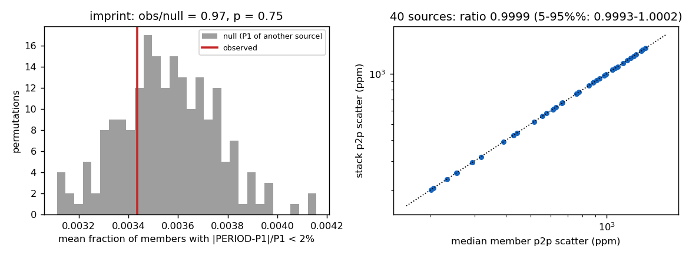
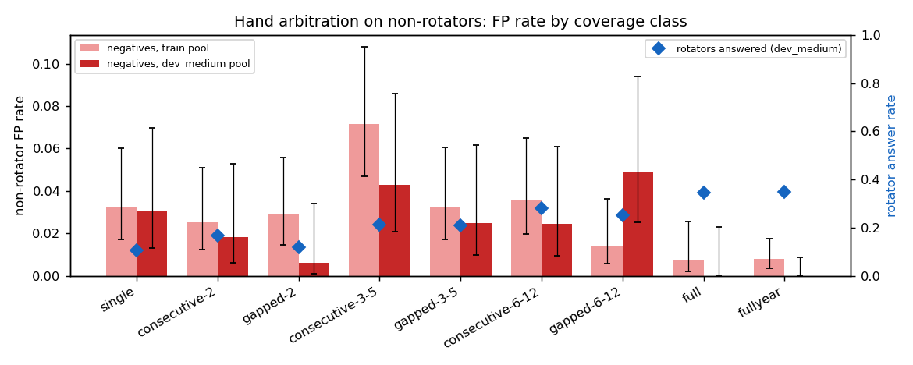
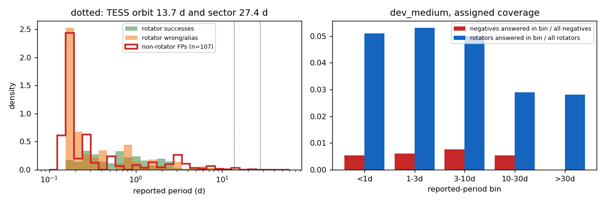
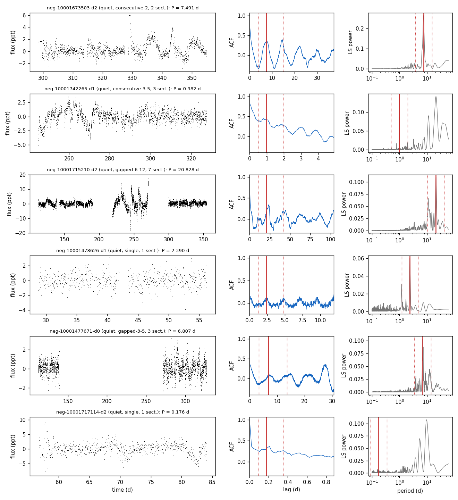
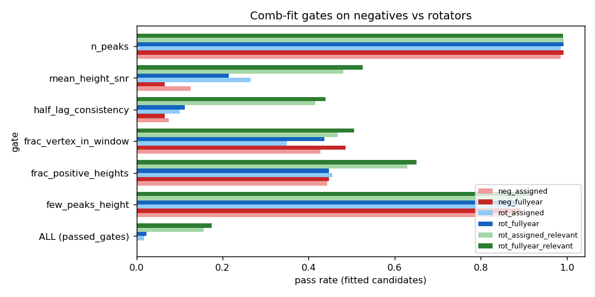
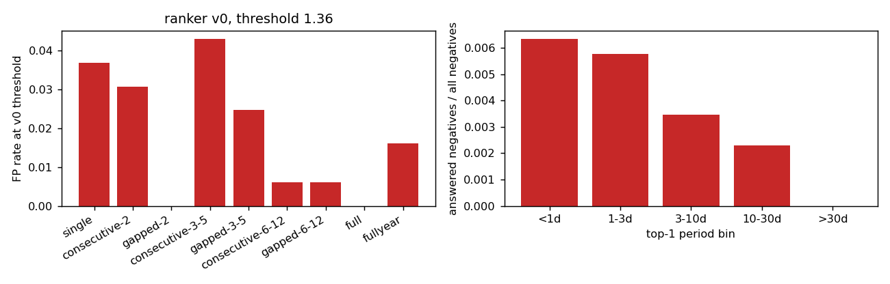
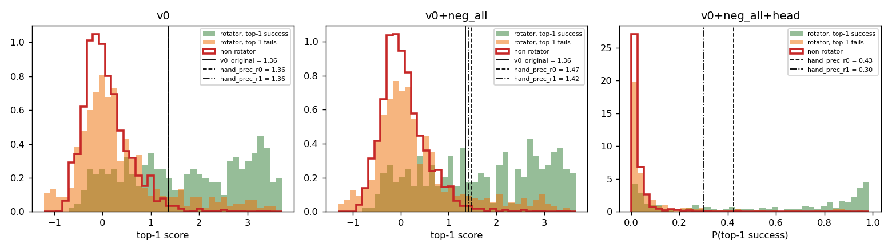
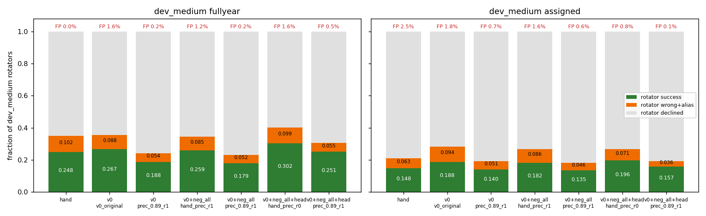

# T27: non-rotator negatives from SMARTS noise stacks

**Date:** 2026-11-10 · **Author:** Claude (data-auditor session, ranking-model-builder conventions) · **Branch:** `claude/t27-nonrotator-negatives-008ccf` · **Status:** draft

## TL;DR
- **There are now 4,708 non-rotator light curves**, made from T20's recovered A+B noise stacks. They come from 1,177 sources: 743 in the training pool and 434 in dev_medium. Each source has three seeded real-TESS coverage draws plus a full-year version. The committed manifest is `datasets/negatives_v0.csv`.
  - Feature tables for them are on the drive at `extracted/t27_negatives/{train,dev_medium}`. They use the T10 schema: `is_rotator` = False and `relevance` = 0 on every row.
  - The pools are strictly disjoint: train negatives vs dev_medium, dev_medium negatives vs `train_v0`, and train vs dev_medium negatives all share 0 TICs.
- **The stacks are fair non-rotators.**
  - The injected-signal imprint is at chance level: 0.34% of members match the stack's top period within 2%, against a null of 0.36% (p = 0.75).
  - Their white noise equals the single files' (stack/member p2p ratio 1.0000).
- **Hand arbitration rarely answers on a non-rotator.**
  - The false-positive (FP) rate is 2.5% (dev_medium pool) and 3.1% (train pool) on assigned coverage. On full-year it is 0 of 434 and 6 of 743.
  - The two gates that do the rejecting are `mean_height_snr` and `half_lag_consistency`.
  - The FPs sit at 1–10 d (median 3.3 d). 34% of them match the stack's own LS peak, and 84% of the sources with repeated FPs give the same period every time. So **many "FPs" are real weak signals in the "quiet" sources** (label noise in the negatives), not pure noise.
- **Ranker v0 answers on 1.6% (full-year) and 1.8% (assigned) of dev_medium non-rotators** at its threshold (1.357), and on 3.9% of train-pool assigned draws.
  - Retraining v0 with negatives under the same CV leaves the ordering unchanged (OOF top-1 success 0.364 → 0.364). `rank:ndcg` gets no gradient from a star whose rows are all relevance 0.
  - The recalibrated threshold barely moves (1.357 → 1.42, rule = match hand precision with negatives at 1:1).
  - Non-rotators' top scores look exactly like rotators whose top-1 is wrong, so **a score threshold can't use the negatives**.
- **An exploratory star-level decline model can use them.** It is `binary:logistic` on the top-1 row plus score and margin. Both rows below use the same OOF calibration (precision 0.89 with negatives at 1:1):

  | dev_medium | v0, success / wrong / FP | v0 + negatives + decline model, success / wrong / FP |
  |---|---|---|
  | full-year | 0.188 / 0.049 / 0.2% | **0.251 / 0.050 / 0.5%** |
  | assigned | 0.140 / 0.047 / 0.7% | **0.157 / 0.033 / 0.08%** |

  (Here "wrong" excludes aliases.)
  - Against hand arbitration (0.248 / 0.088 / 0% full-year; 0.148 / 0.054 / 2.5% assigned), it matches success with a third to a half fewer wrong answers.
  - It is not better than v0 *at v0's own threshold*, which answers more (0.267 / 0.080 / 1.6% full-year).
  - This is a proposal, not a v1: choosing the operating point is Rae's call (see open questions).
- **Deviations from the brief:**
  - Coverage draws are class-balanced across sources, like the rotator manifests, with the pattern frequency-weighted *within* the class. A fully frequency-weighted draw would have made the negatives mostly 1–2 sectors, while the rotators are class-balanced. The ranker could then learn "few sectors = non-rotator".
  - 125 training-pool stacks were dropped by the same `corrupt_noise` rule (raw |flux − 1| > 0.1) that keeps such files out of the rotator sets.
  - Synthetic red noise (named in the T27 board entry) was not run. The real stacks made it unnecessary for this round.

## Question / goal
T27 in `docs/TASKS.md` ("Non-rotator negatives from SMARTS noise light curves", roadmap step 2). Rae's decision (2026-11-10) was to use T20's recovered stacks as the negatives, so they share the training data's reduction. The T27 brief asked for:
- a negatives manifest;
- the pipeline's FP table by coverage class and reported period, plus which gates and features fire;
- negative feature tables T10/T11 can join;
- ranker v0 on the negatives, and v0 retrained with negatives.

No `goals.json` goal applies, and no pipeline code changed.

## What I did
1. **Sources** (`tools/build_negatives_manifest.py`).
   - Selection: per TIC, classification `quiet` or `systematic_common_mode` and `exclude_from_training` False (from `noise_source_flags.csv.gz`).
   - **train** = every file in the < 800k pool, and the TIC is in neither dev_medium nor the holdout.
   - **dev_medium** = the TIC appears in `datasets/dev_medium.csv`.
   - Holdout-only sources are never used. 430 of the 434 dev_medium sources also appear in the holdout. That is allowed, because they appear in dev_medium.
   - Leakage checks run in the script and raise on any overlap:

     | check | TICs shared |
     |---|---|
     | train negatives vs dev_medium negatives | 0 |
     | train negatives vs dev_medium rotators | 0 |
     | train negatives vs holdout | 0 |
     | dev_medium negatives vs `train_v0` rotators | 0 |
     | train negatives vs `train_v0` rotators (same pool, by design) | 728 |

   - Native and whole sectors per stack: same logic as `build_dev_sets.check_file`. The scan is resumable and was cut once by a drive unplug.
2. **Sampling.**
   - Coverage library: `datasets/coverage/all_cycles_patterns.csv`.
   - Draws k = 0, 1, 2 with RNG `[20261110, set, k]`. Classes are dealt in shuffled blocks of 8 and matched to sources that can support them; the pattern within the class is drawn weighted by `n_stars`.
   - Plus `full` (empty `sectors`, i.e. every native sector).
   - Result: ~279 train and ~163 dev_medium rows per class, plus 743 / 434 full-year rows. Manifest paths are relative to `SMARTS_DATA_ROOT`. No light curves are written, since sector selection happens at load time.
3. **Fairness** (`tools/audit/negatives_fairness.py`).
   - Per source: the fraction of its A+B members with |PERIOD − P1|/P1 < 2%, where P1 is the stack's LS top peak (T20 `ls_peaks.csv`).
   - Null: P1 from a random other source, 200 permutations.
   - p2p scatter of the stack vs its members' raw flux for 40 random sources, plus T20's per-member residuals.
4. **Feature tables.** The builder gets an additive `--nonrotator` mode (`tools/build_feature_tables.py`; schema doc updated):
   - the truth is None, so any period is `wrong`;
   - `relevance` = 0, `period_bin` = `nonrotator`;
   - flags are joined on `noise_tic`;
   - `--only-set` picks the train or dev_medium negatives.

   The pipeline is the scorecard's, unchanged; the gate records use a stand-in truth whose outcomes are discarded. `scorecard.py` is untouched. Run with 4 workers on the drive, about 80 min for 4,708 stars, with 0 errors.
5. **Pipeline FPs** (`tools/audit/negatives_false_positives.py`). Compared against T10's dev_medium rotator tables (`runs/t10_dev_medium_{assigned,fullyear}`, main checkout).
6. **Ranker** (`tools/train_ranker_negatives.py`).
   - v0 = T11's saved fold models (`runs/t11_ranker/models/n1000_base_ndcg`). Its rotator OOF comes from T11; the train-pool negatives were never seen by v0, so its scores on them are held-out.
   - Retrains: tune.json's best `ndcg` config (150 rounds, depth 3, η 0.1), seed 0, 5-fold `GroupKFold` on `noise_tic`. Training data is `train_1k` plus the train negatives: draw 0 only (743, `v0+neg_d0`) or all three draws (2,229, `v0+neg_all`).
   - Decline model: `+head`, on `v0+neg_all`'s OOF scores with the same folds.
   - Thresholds come from OOF only. To make precision independent of how many draws are in the table, negatives are re-weighted to r negatives per rotator:
     - `hand_prec_r0`: v0's rule, rotators only;
     - `hand_prec_r1`: match hand's training precision with r = 1 (0.771);
     - `prec_0.89_r1`: v0's numeric target with r = 1.
   - dev_medium is scored once, as rotators (T10 tables) plus the dev_medium negatives: full-year rows go with the full-year table, and the three assigned draws with the assigned table.

## Results

### The stacks are fair non-rotators

- **Left:** the observed imprint (red, 0.0034) sits inside the permutation null (0.0032–0.0039, 5–95%), so the median of low-amplitude members leaves no trace of their injected periods.
- **Right:** the stack's white noise is the single files' (ratio 0.9993–1.0002), because the 30-min noise is shared and cancels exactly in member − stack (median residual p2p 0.22 ppm).

### Hand arbitration on non-rotators

- FP rates are 0.6–7% per class, all small next to the rotators' answer rate (blue diamonds, 10–35%).
- Full-year and `full` draws give almost no FPs: 0/434 and 0/162 in the dev_medium pool, 6/743 full-year in the train pool.
- The class-to-class differences sit mostly inside the 95% intervals. The train pool's `consecutive-3-5` peak (7.2%, 20/279) is the one outlier.

By source class (assigned draws):

| pool | quiet | systematic_common_mode |
|---|---|---|
| train | 3.4% (51/1,491) | 2.4% (18/738) |
| dev_medium | 3.2% (31/954) | 0.3% (1/348) |

The train-pool `systematic_common_mode` full-year draws give 6/246 FPs (2.4%), all six full-year FPs. That is the systematics showing up once the baseline is long.


- **Left:** FP periods (red) are spread over 0.2–28 d with a median of 3.3 d. They overlap the rotators' wrong answers (orange) more than their successes (green). 9% are within REL_TOL of the 13.7-d orbit, and only 1% near 27.4 d.
- **Right:** per reported-period bin on dev_medium assigned, the negatives answered (7–10 per bin out of 1,302) are small next to the rotators answered (28–53 of 1,000). They still cost precision: at a 1:1 mix, per-bin precision drops by 6–14 points.

  | reported bin | <1 d | 1–3 d | 3–10 d | 10–30 d | >30 d |
  |---|---|---|---|---|---|
  | rotators only | 0.61 | 0.76 | 0.66 | 0.86 | 0.68 |
  | 1:1 with negatives | 0.55 | 0.68 | 0.57 | 0.73 | 0.68 |

  The 10–30 d bin loses the most (`data/fp_by_period_bin.csv`).


These are six dev_medium-pool non-rotators where the pipeline reported a period, one per reported-period bin; red marks P, dotted marks P/2 and 2P. Look at rows 1, 4 and 5:
- each has a clean, isolated LS peak at the reported P and a matching ACF;
- these "quiet" sources contain a real low-amplitude periodic signal (the TESS target's own rotation, or a blend).

Across all FPs:
- 34% match the stack's LS top peak;
- 84% of the 19 sources with ≥ 2 FPs give the same period (within 10%) in every draw;
- only 7.1% of sources ever give an FP.

Rows 2, 3 and 6 are the noise-driven kind: red noise or one disturbed stretch, with the reported P not the LS maximum.


- Per gate, the pass rate of fitted candidates is about the same for negatives (red) and for all rotator candidates (blue): most rotator candidates are wrong too.
- The separation is from the *relevant* rotator candidates (green). `mean_height_snr` passes 12.6% of negative candidates vs 48% of relevant ones (assigned), and `half_lag_consistency` 7.5% vs 41.5%.
- Only 0.2% of negative candidates pass every gate (0.0% full-year), vs 15.6% / 17.4% of relevant rotator candidates.
- For 97.1% of assigned draws (99.5% full-year), the decline reason is `gates`.

**Features of the answers** (`data/feature_auc.csv`): these are the selected candidate on answered negatives (n = 101, assigned) vs on rotator successes (n = 148). The ones that separate them best are the S_ph/alias family and light-curve amplitude:
- `acf_height_at_P`: AUC 0.17, median 0.16 vs 0.49;
- `fold_half_corr_at_2P` (0.21), `acf_half_lag_contrast` (0.22);
- `r_var` / `flicker_std` / `flux_std` (0.22–0.24).

So the answers on non-rotators are weak-amplitude, low-ACF-height periods. These are the same features T11 found most useful, which is why a learned decline model can catch them.

### Ranker v0 on non-rotators, and with negatives

Ranker v0 at its threshold (1.357) answers on 1.8% of dev_medium assigned and 1.6% of full-year non-rotators. On held-out train-pool negatives it answers on 3.9% of assigned and 1.1% of full-year draws. The FPs concentrate in 1–3 sectors (3–7%) and spread over 1–30 d. Unlike hand arbitration, v0 *does* answer on full-year non-rotators, at 1.6% vs 0%.


- **Left and middle:** the non-rotators' top-1 score distribution (red) is the same as that of rotators whose top-1 is wrong (orange). The ranker scores "is this candidate better than the others", and that carries no information about whether any candidate is real.
- So when negatives are added, the threshold rule moves only from 1.357 to 1.42 (`hand_prec_r1`) or 1.47 (`hand_prec_r0`).
- The retrained ranking is the same in aggregate:
  - OOF rotator top-1 success is 0.364 for v0, 0.362 for `v0+neg_d0` and 0.364 for `v0+neg_all`;
  - the identical top-1 is 59–61%, the rest being near-ties reshuffled by the new folds and hist bins.
- **Right:** the decline model's P(top-1 success) puts non-rotators at ≈ 0 and spreads the successes toward 1. The two separate.


Each bar is a model × threshold on dev_medium (rotators: success / wrong + alias / declined), with the non-rotator FP rate above it. Full table: `runs/t27_ranker/summary.csv`.

| dev_medium | model, threshold | success | wrong | alias | declined | non-rotator FP |
|---|---|---|---|---|---|---|
| full-year | hand | 0.248 | 0.088 | 0.014 | 0.650 | 0.0% |
| full-year | v0, 1.357 | 0.267 | 0.080 | 0.008 | 0.645 | 1.6% |
| full-year | v0, prec 0.89 r1 (2.165) | 0.188 | 0.049 | 0.005 | 0.758 | 0.2% |
| full-year | v0+neg_all, hand_prec_r1 (1.425) | 0.259 | 0.077 | 0.008 | 0.656 | 1.2% |
| full-year | +head, hand_prec_r0 (0.425) | 0.302 | 0.089 | 0.010 | 0.599 | 1.6% |
| full-year | **+head, prec 0.89 r1 (0.718)** | **0.251** | **0.050** | 0.005 | 0.694 | **0.5%** |
| assigned | hand | 0.148 | 0.054 | 0.009 | 0.789 | 2.5% |
| assigned | v0, 1.357 | 0.188 | 0.087 | 0.007 | 0.718 | 1.8% |
| assigned | v0, prec 0.89 r1 | 0.140 | 0.047 | 0.004 | 0.809 | 0.7% |
| assigned | v0+neg_all, hand_prec_r1 | 0.182 | 0.079 | 0.007 | 0.732 | 1.6% |
| assigned | +head, hand_prec_r0 | 0.196 | 0.065 | 0.006 | 0.733 | 0.8% |
| assigned | **+head, prec 0.89 r1** | **0.157** | **0.033** | 0.003 | 0.807 | **0.08%** |

- **At the same calibration rule** (prec 0.89, r = 1), the decline model beats v0 on both tables: success +0.063 full-year and +0.017 assigned, with equal or fewer wrong answers.
- **Against v0 at v0's own threshold**, the decline model at prec 0.89 answers less. Per star, it wins 15 and loses 31 on full-year (sign test p = 0.026), and wins 8, loses 39 on assigned (p = 6e-6). It is a stricter operating point, not a free gain.
- **At the looser `hand_prec_r0` point** (0.425), it beats v0's success on both tables (0.302 vs 0.267 full-year, 0.196 vs 0.188 assigned). Full-year wrong is about equal and FP is the same (1.6%); assigned wrong is lower (0.065 vs 0.087) and FP halves (0.8% vs 1.8%).
- **Against hand arbitration** (prec 0.89 point): 51 wins vs 48 losses full-year (p = 0.84) and 39 vs 30 assigned (p = 0.34), so success is the same. Wrong drops 0.088 → 0.050 full-year and 0.054 → 0.033 assigned.
- By period bin (`data/paired_head.json`), the decline model at prec 0.89 still under-answers > 30 d (0.175 vs hand 0.21 full-year). T11's long-period over-decline is reduced but still there.

## What didn't work
- **Adding negatives to the ranking objective.** Expected and confirmed: all-zero queries carry no `rank:ndcg` gradient, so the ordering and the score scale don't change. Neither do the precision-matched thresholds, beyond 1.357 → 1.42–1.47. Weighting the negative queries would change nothing either.
- **Matching hand precision with negatives (`hand_prec_r1`) for v0** returns exactly v0's threshold (1.357). With negatives at 1:1, hand's training precision drops to 0.771, and v0's OOF precision at 1.357 is 0.772. That is a coincidence of the two curves, not a bug: the cut is the same star.
- **Fully frequency-weighted coverage draws** (in the brief): not used, for the confound reason in the TL;DR.

## Open questions for Rae
1. **What precision target, and at what non-rotator : rotator ratio r?**
   - Every threshold above assumes r = 1. The real TESS mix has far more non-detectable stars than rotators, and precision at r = 10 would be much lower for every method.
   - `train_ranker_negatives.weighted_curve(top, r)` gives the curve for any r. A target of "FP rate ≤ x%" is independent of r and may be easier to set.
2. **How many negatives per rotator in training?** The decline model used all 3 draws: 2,229 negatives vs 1,000 rotators. I didn't scan this. `v0+neg_d0` (743) vs `v0+neg_all` made no difference to the ranker, but the decline model may be sensitive to it.
3. **Adopt the star-level decline model as ranker v1's decline?** It is the first model here to use the negatives, and it cuts wrong answers by 40–60% at hand-level success. It needs its own learning curve, an ablation of which features it uses, and a per-period-bin threshold (T11's P24) before it counts.
4. **"Quiet" sources with a consistent weak period.**
   - 34% of FPs match the stack's own LS peak, and 84% of repeat-FP sources repeat their period (examples 1, 4 and 5). These are probably real weak signals in the TESS noise light curves, i.e. label noise in the negatives *and* a second true period on those sources' rotator files.
   - Should a source whose stack has a persistent LS peak (A/B agree, like T20's `persist`) leave the negatives? Should it be flagged the way the parallel `periodic_low_amplitude` relabelling does? The per-source table is `data/fp_sources.csv`.
5. **Train-pool `systematic_common_mode` full-year FPs** (6/246, 2.4%, every full-year FP in either pool). Is the systematics-driven long-baseline FP worth a dedicated check (T29)?
6. **125 dropped stacks** (raw spike > 10%). Excluding them is consistent with the rotator sets, but they are a realistic failure mode (scattered light, momentum dumps). Should spike-masked versions come back as negatives?
7. **Synthetic red noise** (T27 board text) was not run. Worth doing only if we want negatives outside the real-noise distribution.

## Reproduce
```bash
PY=/opt/anaconda3/envs/ss_openblas/bin/python
# everything (resumable, ~95 min at 4 workers, needs the Data_Vault drive):
zsh tools/run_t27_negatives.sh
# or step by step:
$PY tools/build_negatives_manifest.py                      # datasets/negatives_v0{,_sources}.csv
$PY tools/audit/negatives_fairness.py
O=/Volumes/Data_Vault/smarts_data/extracted/t27_negatives
$PY tools/build_feature_tables.py --nonrotator --manifest datasets/negatives_v0.csv --only-set dev_medium \
    --data-root /Volumes/Data_Vault/smarts_data --outdir $O/dev_medium --n-workers 4 --resume
$PY tools/build_feature_tables.py --nonrotator --manifest datasets/negatives_v0.csv --only-set train \
    --data-root /Volumes/Data_Vault/smarts_data --outdir $O/train --n-workers 4 --resume
$PY tools/audit/negatives_false_positives.py --neg-train $O/train --neg-dev $O/dev_medium
$PY tools/audit/negatives_examples.py --neg-dev $O/dev_medium
$PY tools/train_ranker_negatives.py --neg-train $O/train --neg-dev $O/dev_medium   # -> runs/t27_ranker
$PY tools/run_notebook.py reports/2026-11-10_t27-nonrotator-negatives/notebook.ipynb
```
The rotator inputs are T10's `train_1k` (drive) and the dev_medium tables in the main checkout's `runs/t10_dev_medium_{assigned,fullyear}`. v0 is `runs/t11_ranker/` in this worktree (gitignored).
