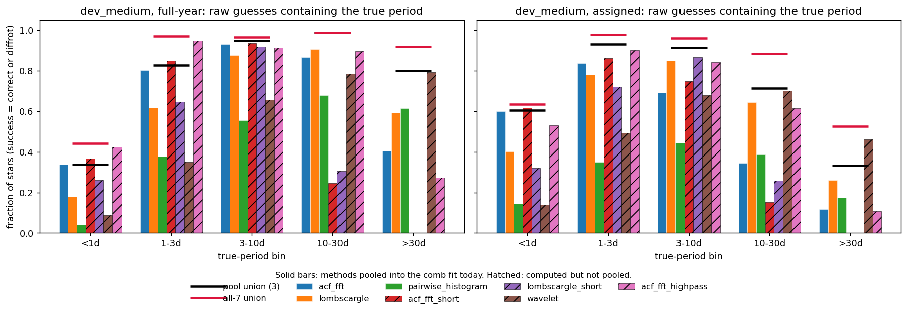
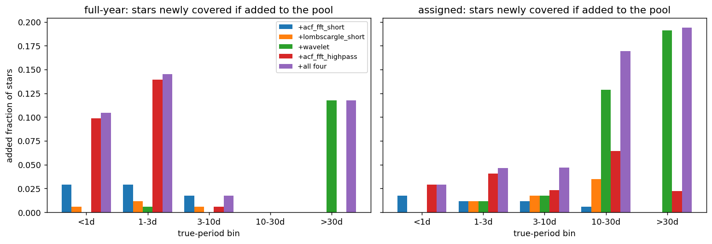

# Candidate recall by method and period bin (dev_medium)

**Date:** 2026-11-11 · **Author:** Claude (coordinator session) · **Branch:** `main` · **Status:** check-in, no pipeline change

## TL;DR
- **Below 1 day the candidate list itself is the bottleneck, and no single method fixes it.** Even taking all 7 `guess_*` methods together, the raw guesses contain the true period for only 44% of <1 d stars with full-year coverage (63% with assigned coverage). The 3 pooled methods reach 34% / 60%.
- **Adding a method to the pool helps <1 d by at most 10 points**, full-year only: `acf_fft_highpass` adds 0.099 (assigned: 0.029). `acf_fft_short` adds 0.029 / 0.017, and `lombscargle_short` and `wavelet` add almost nothing there.
- **The bigger lead: every method does worse on <1 d full-year than on the same stars with assigned coverage.** `acf_fft` drops from 0.60 to 0.34, `lombscargle` from 0.40 to 0.18, and `acf_fft_short` from 0.62 to 0.37. A longer light curve shouldn't hide a short period. This points at something shared across methods, such as how guesses are ranked or capped on long baselines, or long-timescale power pushing short-period peaks out of the top 10. Of the methods that find more than a third of <1 d stars, `acf_fft_highpass` (which detrends) loses the least (0.53 → 0.42), which fits a long-timescale explanation. I checked that the light curve isn't being binned coarser; the cause is not yet known.
- **Outside the short end:** `wavelet`, which isn't pooled, would add 0.12 (full-year) and 0.19 (assigned) of >30 d stars, and 0.13 of 10–30 d assigned. It is also the ranker's most useful single method spectrum (T11).
- **Among pooled methods,** `acf_fft` is the only source of a correct fitted candidate for 13–21% of <1 d stars. `pairwise_histogram` is the only source for 8–18% of >30 d stars. `lombscargle` is rarely the only source.

## Question / goal
Rae's check-in (2026-11-11): what fraction of stars have the correct period among their candidates, per period bin, and which method produced it? Answered from the existing T10 dev_medium feature tables (`runs/t10_dev_medium_{fullyear,assigned}` in the main checkout); no pipeline was run.

## What I did
- **Stage 1 (raw guesses, all 7 methods):** the builder stores, per star, the best outcome among each method's raw `P0` guesses (`stage1_<method>_outcome`, via `evaluation`'s `best_outcome`). I count success = `correct` or `diffrot`.
- **Marginal gain:** stars where none of the 3 pooled methods has a success but the added method does.
- **Fitted pool:** fitted candidates (no fit error) with relevance ≥ 1, credited to each method in `contributing_methods`. "Only source" = that method is the sole contributor across all of the star's relevant candidates.
- 1,000 dev_medium stars per mode, binned by `eval_pbin` (172 / 172 / 171 / 171 / 314).

## Results
### Raw guesses containing the true period, by method


| bin | pool (3) full-year | all 7 full-year | pool (3) assigned | all 7 assigned |
|---|---|---|---|---|
| <1 d | 0.34 | 0.44 | 0.60 | 0.63 |
| 1–3 d | 0.83 | 0.97 | 0.93 | 0.98 |
| 3–10 d | 0.95 | 0.96 | 0.91 | 0.96 |
| 10–30 d | 0.99 | 0.99 | 0.71 | 0.88 |
| >30 d | 0.80 | 0.92 | 0.33 | 0.53 |
| all | 0.78 | 0.86 | 0.65 | 0.76 |

Per-method values are in `data/stage1_*.csv`.

### What each non-pooled method would add


| added method | <1 d (FY / asg) | 1–3 d | 10–30 d | >30 d |
|---|---|---|---|---|
| `acf_fft_short` | 0.029 / 0.017 | 0.029 / 0.012 | 0 / 0.006 | 0 / 0 |
| `lombscargle_short` | 0.006 / 0 | 0.012 / 0.012 | 0 / 0.035 | 0 / 0 |
| `wavelet` | 0 / 0 | 0.006 / 0.012 | 0 / 0.129 | 0.118 / 0.191 |
| `acf_fft_highpass` | 0.099 / 0.029 | 0.140 / 0.041 | 0 / 0.064 | 0 / 0.022 |

### Fitted pool: who supplies the correct candidate
`data/fitted_pool_*.csv`. The "any pooled method" column reproduces T10's re-ranking ceiling (0.76 full-year, 0.59 assigned), which serves as a consistency check.

## What didn't work / caveats
- Stage 1 counts a guess anywhere in the differential-rotation band, so wide bands inflate it (T10: about half of the "relevant" hits are band hits rather than exact matches).
- A raw guess isn't a fitted candidate: pooling a method also adds its wrong guesses to the comb fit and the ranker. **False-positive cost and compute cost are not measured here.** They need the non-rotator tables and a timing run; see the proposed short-period task.
- dev_medium is period-stratified, so "all" rows are not population-weighted.

## Open questions for Rae
1. The <1 d full-year deficit is shared by every method. Should the short-period task diagnose it first, before choosing which optional method to pool? (Recommended: yes. It may be worth more than any added method.)
2. `wavelet` is the clear long-period addition. Should it be evaluated for the pool in the same task, or separately?

## Reproduce
```bash
/opt/anaconda3/envs/ss_openblas/bin/python reports/2026-11-11_candidate-recall-by-method/analysis.py
```
No notebook: this is a short coordinator check-in on existing tables, and the script prints every table above.
