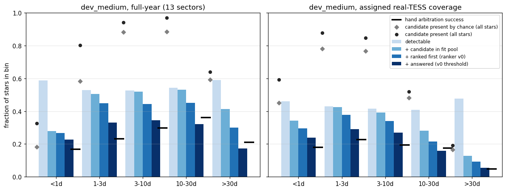
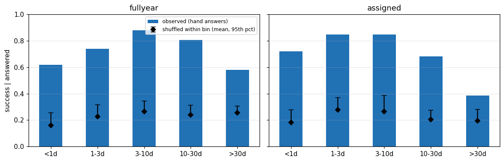
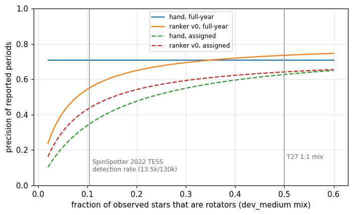
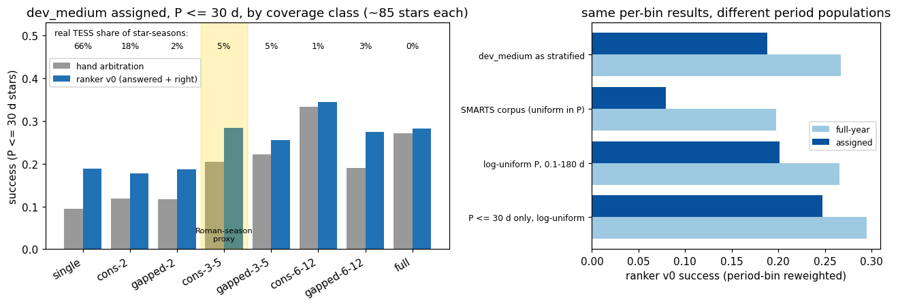

# Midway project review

**Date:** 2026-11-11 · **Author:** midway-review session (read-only review) · **Branch:** `claude/midway-review-d397c3` · **Status:** draft

## TL;DR
- **The science is sound, and the evaluation is mostly honest.** Successes are not chance coincidences with the wide
  diffrot windows: answered stars succeed 0.58–0.88 per bin, against 0.16–0.28 when the same answers are shuffled within
  the bin (Fig. 4). The train/dev noise pools are disjoint, and the holdout is untouched. The weak spots are in
  **what the headline means**, not in leakage:
  - full-year coverage is a 13-sector, CVZ-only regime;
  - "candidate present" ceilings are mostly chance at 3–30 d;
  - precision depends on how many observed stars are non-rotators (Fig. 5);
  - nothing has been checked on real TESS light curves yet.
- **Where stars are lost (dev_medium, Fig. 1).**
  - Full-year: 44% undetectable → Stage 1 loses 0.115 (mostly <1 d and >30 d) → ranking loses 0.075 → **declining loses 0.106, the biggest single loss**.
  - Assigned coverage: Stage 1 loses most (0.157, mostly 10–30 d and >30 d, i.e. coverage reach).
  - At the real TESS coverage mix, P ≤ 30 d success is **0.12 (hand) / 0.20 (ranker v0)**, not 0.25–0.27.
- **The plan is mostly right**: ranker v1 decline model, then short-period Stage 1. Two things are missing:
  - **a real-TESS validation set** of known rotators and non-rotators;
  - **starting the Roman scoping now**, because it has lead time and no compute cost.
- **Wheel-spinning:** the scorecard grew from v4 to v6 in about two weeks (11 subset families), but only 1 of 12 goals is active. Training-scale ambitions (1M stars) outlive a learning curve that plateaued at 3k stars. There are also ~170 KB of `old/` code, duplicate batch runners, stale docs and long TL;DRs (median ~300 words; 57 KB across 27 reports).
- No pipeline code, metric, goal or manifest was changed, and no pipeline or drive job was run. The figures come from existing T10/T11/T26/T27 outputs.

## Ranked recommendations (at most 10)

| # | Label | Recommendation | Effort | Expected payoff |
|---|---|---|---|---|
| 1 | **reprioritize** | **Build a small real-TESS validation set** (P27) before tuning ranker v1 much further. Use known rotators (Kepler-field overlap with McQuillan+2014 periods, cluster members with K2 periods, Claytor+2024 CVZ) and known non-rotators/EBs (Prša+2022 EB catalog, Gaia DR3 classes). | M (1 scoping + 1 build session; Rae downloads) | **High.** It is the only test of whether SMARTS→real transfers: PDCSAP/QLP suppression of long periods, real stellar noise, and the real non-rotator false-positive rate. The paper needs it anyway. |
| 2 | **reprioritize** | **Start Roman scoping (T28 a–b) now, in parallel**: a conversation and a reference doc, no compute. Meanwhile, report the SMARTS "Roman proxy" (one ~70 d contiguous batch ≈ consecutive-3-5): P ≤ 30 d success 0.20 hand / 0.28 ranker v0 (Fig. 3). Add a fixed ~70 d window variant (P29). | S | **High** for the deadline. Data access and survey-design facts have lead time, and the proxy says what to expect. |
| 3 | **keep** | **Ranker v1: decline model + per-bin thresholds** (P24, already decided). Bound the expectation: a perfect decline would add at most +0.106 (full-year) / +0.059 (assigned) of all stars (Fig. 1, ranked-first vs answered). | M | **High**, and the cheapest remaining lever on full-year. |
| 4 | **keep, cap effort** | **Short-period Stage 1** (in progress elsewhere). First chase the cheap lead: every method recalls <1 d *worse* on full-year than on assigned coverage, which smells like a shared ranking or cap bug. After that session, revisit the pool: add `wavelet` (+0.12–0.19 at >30 d), drop `lombscargle_short` (adds ≤ 0.012 anywhere). | M | **Medium.** <1 d is 0.5% of the SMARTS corpus and a minority of real rotators. It is worth fixing once, but it isn't the science bottleneck. |
| 5 | **reprioritize** | **One "headline card" instead of more subsets** (P28): ~6 numbers on fixed definitions (assigned coverage at the real coverage mix; a named period population; success *and* correct-only; precision at a stated non-rotator prevalence; and a Claytor+2022-comparable "fraction within 10% / 20% at the most-credible half"). Turn 3–5 goals `active`, and leave the rest draft. | S | **High** for legibility and for the paper. It ends the "which 0.25?" ambiguity. |
| 6 | **cut** | **Freeze the scorecard at v6.** New subset breakdowns go in report notebooks, not in `scorecard.py`. | — | Saves a version bump, new baselines and new tests per idea, since v4–v6 each needed all three. |
| 7 | **park** | **Corpus-scale (1M) training tables**: the ranker plateaued at 3k rotators (`reports/2026-11-11_ranker-3k-learning-curve/`). Defer T12 (efficiency) until the pool and features settle after short-period work and v1. Its real driver is Roman deployment scale, not training. | — | Avoids ~80 CPU-h passes on the i5 (1.16 s/star × 1M / 4 cores) that wouldn't change the model. |
| 8 | **cut** | **Repo cruft, one `repo-curator` session (P30).** Delete `claude_files/old/` (11 files, 168 KB). Resolve open issue 9 (`batch_test_acf_fft_highpass.py`). Retire `batch_test_guesses.py` and `run_debug_baseline*.py`, which the scorecard and table builder now cover (`benchmarks/scorecard.py:177` reimplements `discover_guess_functions`). Prune superseded baselines (`*_pre_acf`, `*_pre_t18`, `*_accelerate`, `v1_scorecard1`, unversioned + v4 where v5/v6 exist). | S | Less to read for every session, and fewer places for drift. |
| 9 | **simplify** | **Docs and process diet** (also in P30). Make these edits:<br>• Refresh `PROJECT_CONTEXT.md` §4: issues 2–5 and 12 are stale, and issue 3 says "No ranking-model training code exists yet".<br>• Refresh `METHODOLOGY_NOTES.md` §7, which says the same.<br>• Fix the code map, which lists a missing `example_usage.py`.<br>• Fix the stale TASKS statuses: T1, T16e, T21 and T26 say "in review/awaiting" but are merged.<br>• Move `done` tasks to `TASKS_DONE.md` (TASKS.md is 1,327 lines).<br>• Cap TL;DRs at ~150 words in the write-report skill. | S | **High** on usage: every session starts by reading ~2,200 lines of CLAUDE/CONTEXT/TASKS. |
| 10 | **investigate** | **Scoring robustness, cheap checks.**<br>• Always print correct-only next to success: diffrot is 20% of full-year successes (50 of 248).<br>• Don't use `detectable` as a goal denominator: its cut was placed where pipeline success starts (T26), so "success on detectable" is flattering by construction.<br>• Plan one holdout evaluation at the v1 milestone (Rae decides). | S | Protects the paper's numbers from a referee's first questions. |

## Question / goal
Rae's 2026-11-11 request for a high-effort midway check: is the science sound, is the plan right, and where are we
spinning our wheels? It is read-only with respect to pipeline code. This is not a `docs/TASKS.md` task, and it addresses no goal ID.

## What I did
- Read, in order: `CLAUDE.md`; `docs/PROJECT_CONTEXT.md` §1–4 plus the changelog tail; `METHODOLOGY_NOTES.md` (§1, §6.5, §7 in
  full, the rest by headings); `SMARTS_REFERENCE.md` §1–5; the `TASKS.md` roadmap and statuses; the TL;DR of all 27 reports and
  the open questions of the November ones; `AGENT_WORKFLOW.md`, `.claude/agents/`, the write-report skill and `HANDOFF.md`.
- Opened code only to check claims: the `evaluation.py:104–177` scoring windows, `goals.json` statuses, the duplicate
  `discover_guess_functions`, and the file sizes in `claude_files/`.
- `compute_funnel.py` (this folder) joins existing outputs, all from the main checkout:
  - `runs/t10_dev_medium_{fullyear,assigned}/{stars,candidates}.csv.gz` (T10);
  - `runs/t27_ranker/v0_*_top1.csv` (ranker v0 top-1; threshold 1.357 from `results.json`);
  - `benchmarks/detectability_dev.csv` (T26, `snr_rot` ≥ 5).

  It writes the tables in `data/`. Permutation nulls use seed 0. It reproduces the published headline numbers: hand
  0.248 / 0.148, ranker v0 0.267 / 0.188 (full-year / assigned).
- Two literature facts were checked by web search: the Claytor+2022 and Holcomb+2022 abstracts. Everything else
  from the literature is **from memory and marked (m)**.

## Results

### 1. Scientific basis

**The method.** The ACF plus a joint comb of parabolae, fit to every candidate, is a principled generalization of
McQuillan+2013/2014-style ACF peak picking (m) and of SpinSpotter's single-parabola fit. SpinSpotter itself reaches
periods up to B/3 and found 13,504 periods among ~130k TESS 2-min stars, at 0.4–14 d
([Holcomb+2022](https://arxiv.org/abs/2206.10629)). The gap-aware masked ACF, the R/2 searchable limit
(`PROJECT_CONTEXT.md` changelog 2026-10-22, D4), and "propose broadly, evaluate uniformly" are all defensible and well
documented. Cross-method agreement as a feature matches the composite-spectrum logic of Santos+2019/2021 and Ceillier+2017 (m).

**The candidate pool and its ceiling.** "Correct candidate anywhere in the list" is **not** a meaningful ceiling
at 3–30 d. With ~24 candidates per star and ±10% windows, a shuffled truth hits 0.88 of 3–30 d stars, against an
observed 0.94–0.97 (Fig. 1 grey diamonds vs dots; T26 found the same). The ranker's "oracle 0.764" (T11 TL;DR) inherits
this inflation. It is only informative below 1 d (0.33 observed vs 0.18 chance, full-year), where it really does show a
Stage 1 hole. The funnel in Fig. 1 therefore conditions on `detectable` first.



*Look at the gap between adjacent blue bars.* Full-year: <1 d loses most at Stage 1 (0.59 detectable → 0.28 with a
candidate); 1–30 d lose most at the decline (dark bar vs the third bar); >30 d loses at both. Assigned coverage: 10–30 d
and >30 d collapse at Stage 1, which is the coverage reach (R/2), not a method failure. The black ticks show hand
arbitration beating ranker v0 at 10–30 d and >30 d full-year (the known P24 issue).

**Success = correct + diffrot within REL_TOL = 0.10.** This is defensible physically: SMARTS's `PERIOD` is
equatorial, and spots at latitude λ rotate at P_eq/(1 − shear·sin²λ) (`SMARTS_REFERENCE.md` §2). It also uses the
MINLAT–MAXLAT band, not butterpy's ±7° spillover (`evaluation.py:104–110`). Two caveats:
- **Comparability.** Claytor+2022 score against the injected period with 10% and 20% thresholds: 46% / 69% on the most
  credible half of their SMARTS-TESS test set ([Claytor+2022](https://arxiv.org/abs/2104.14566)). McQuillan-style
  catalogues compare against literature periods (m). Our success credits diffrot, which is 20% of full-year successes
  (50 of 248), so print correct-only beside it (rec. 10).
- **Wide bands.** 21% of dev_medium stars have band width ≥ 0.2, and 7% have ≥ 0.5. Fig. 4 shows this doesn't make
  answers succeed by chance, even under a stringent within-bin shuffle.



*Look at the bars vs the diamonds:* observed success among answered stars is 2–4× the shuffled-answer null in every
bin, so the success metric isn't rewarding lucky hits in wide windows.

**Aliases as a separate outcome.** This is correct and standard (P/2 and 2P are the classic ACF/LS failure modes). They
are only 14 of 1,000 full-year final answers, so this choice doesn't move any headline.

**Subsets (searchable / detectable / quiet-noise).** All three are good *diagnostics*. Two cautions:
- `detectable` is computed from the injected signal (fine), but its cut of 5 was placed where pipeline success begins
  (T26: 96.8% of successes lie above it). So "success on detectable stars" (0.43) is flattering by construction, and it
  shouldn't become a goal denominator.
- The quiet-noise subsets exclude the noise sources that real TESS stars *do* have (blends, crowding), so they describe
  an idealized sky.

**SMARTS noise.** T20 was excellent work: 12% of noise sources carry real periodicity, and 65 of 88 full-year wrong answers
match the noise period. Two gaps remain:
- The "galaxies" are faint, extended sources with no stellar granulation or flicker, reduced closer to SAP than PDCSAP
  (`SMARTS_REFERENCE.md` §5). Real TESS rotation work uses PDCSAP/QLP/TESS-SPOC, which attenuate signals beyond ~13 d (m).
- Every SMARTS star sits on one of ~1,000 reused noise realizations. The `noise_period` wrongs show the pipeline can learn
  a source's red-noise peak, so **group-by-noise-TIC splits must never be relaxed**.

Only real light curves can close the first gap (rec. 1).

**Non-rotator negatives.** Galaxy stacks are a clean, nearly free start (T27). They are *cleaner* than real non-rotators,
which include granulating stars, pulsators, EBs and blends. And the 1:1 mix is far from the sky:
SpinSpotter found periods for ~10% of TESS 2-min stars. Fig. 5 shows how fast precision falls with prevalence.



*Look at the two dashed (assigned-coverage) curves at x ≈ 0.1:* precision 0.34 (hand) and 0.43 (ranker v0), against
0.63–0.64 at the 1:1 mix. Rae deferred the precision target, so I'm not asking for one. The point is that any precision
number must state its prevalence, and the non-rotator FP rate on *real* stars is the number that matters for a Roman
catalogue.

**Ranker labels and calibration.** I found no leakage:
- Labels are injected truth (graded 2/1/0).
- Splits are noise-TIC-grouped; train is SIM_ID < 800k and dev ≥ 800k (disjoint galaxy pools, T1/T2).
- The threshold is set on out-of-fold training scores, not on dev.

Two mismatches are real:
- **Coverage.** The training table is assigned-coverage while full-year is a headline (P24, known).
- **Dev reuse.** dev_medium has guided many design decisions (T18, T16b, T16c, T11 ablations), so it is mildly
  overfit. That is why a single holdout check at v1 is worth planning.

**Population weighting.** The dev sets carry `sampling_weight` / `coverage_weight`, but the scorecard never uses them
(grep: only coverage-sampling weights appear in `scorecard.py`). Re-weighting the same per-bin results moves things a lot:
- assigned ranker success: 0.08 (SMARTS uniform-in-P) to 0.25 (log-uniform, ≤ 30 d);
- full-year: 0.20 to 0.29.

At the real TESS coverage mix (66% of star-seasons are single-sector), P ≤ 30 d success is 0.116 hand / 0.198 ranker v0.
The T2 report's 0.134 "corpus-weighted" uses amplitude and coverage weights too, so it isn't directly comparable to my
period-only re-weighting.



*Look at the left panel's single-sector bar and its 66% share:* the most common real TESS case has the lowest success.
The yellow band (consecutive-3-5) is the closest SMARTS stand-in for one Roman season.

### 2. The plan
- **Order.** Ranker v1 decline → short-period Stage 1 → Roman is right for the *SMARTS* numbers (Fig. 1: decline is the
  biggest full-year loss, and <1 d Stage 1 is the biggest per-bin hole). It is wrong to leave Roman scoping until after v1:
  scoping costs Rae a conversation, not compute, and the deadline is Roman's.
- **What moves the final science goal most:**
  1. Evidence that SMARTS-trained choices transfer to real data. Today none exists for TESS, and none can exist for Roman
     until WG6 sets arrive.
  2. The non-rotator false-positive rate on realistic negatives.
  3. Then the decline model.

  Everything else changes dev_medium by a few points.
- **Can wait:** T16h (multi-batch combination; off the Season 1 path, as the roadmap says), T12 (efficiency; after the
  pool settles), T8 (orbit-gap aliasing), T17, P4/P21 (wavelet residue), F2 (Apple Silicon re-verification), T19b
  (packaging).
- **Can be dropped:** further gate hand-tuning (already paused: T16d, P1, P7, P21) and new scorecard subset families. Also
  drop full-corpus training-table generation as a *training* need.
- **Missing:**
  - real-TESS validation (P27);
  - a fixed headline card with a named target population (P28);
  - a Roman proxy on SMARTS (P29);
  - a stated plan for **uncertainties**: the ranker gives no σ_P, and Claytor+2022 and the catalogues report one (m).
    The comb fit's own P error is a natural start.

### 3. Wheel-spinning

| Item | Evidence | Verdict |
|---|---|---|
| `claude_files/old/` (11 files, 168 KB) | CLAUDE.md says never read it; git keeps history | **delete** |
| `batch_test_acf_fft_highpass.py` | open issue 9 has been unresolved since the project began | **delete** after a 5-minute diff check |
| `batch_test_guesses.py`, `run_debug_baseline*.py` | scorecard + `build_feature_tables.py:267` produce per-method stage-1 outcomes; `scorecard.py:177` re-implements discovery | **park → delete** (move to `old/` history via git) |
| Superseded baselines (`*_pre_acf`, `*_pre_t18`, `*_accelerate`, `v1_scorecard1`, unversioned/v4 where v5/v6 exist) | 29 entries in `benchmarks/baselines/` | **simplify** (keep the latest per dataset + one historical) |
| Scorecard subset growth (v4→v6 in ~2 weeks, 11 families) | changelog 2026-11-09 → 11-10 | **cut** further growth; freeze at v6 |
| Goals: 12 in `goals.json`, 10 `draft`, 1 `active`, 1 `met`; 7 more proposed | `goals.json`, goals-proposal report | **simplify**: activate 3–5, delete the rest |
| `lombscargle_short` | adds ≤ 0.012 recall in every bin (candidate-recall report) | **park → cut** after the short-period session |
| `pairwise_histogram` in the pool | lowest ranker value, returns nothing for ~2/3 of 1–2-sector stars (T16c), but sole source for 8–18% of >30 d | **keep** for now |
| Two arbitration paths (7 hand gates + ranker) | gates are now ranker features (T10) | **keep** hand gates as the fallback/baseline; stop tuning them (as decided) |
| 1M-star training ambitions | learning curve flat 1k→3k | **park** |
| Stale docs (§4 issues 2–5, 12; METHODOLOGY §7; code map; TASKS statuses) | see rec. 9 | **simplify** |
| Re-litigated decisions | none serious. Decisions are recorded with dates and kept, e.g. precision target deferred and R/2 kept. Good. | — |

### 4. Process
- **What works.** The protected-files rule, "Open questions for Rae", the figure requirement, and the coordinator's own
  verification (pytest, key-by-key metric comparisons, pool/leakage checks; `HANDOFF.md`) are why the numbers above
  reproduce exactly. Keep them.
- **Where it is heavier than the decisions it supports:**
  1. TL;DRs run 104–588 words (median ~300); 27 of them total 57 KB. Rae's first read of every report is the
     longest part. Cap at ~150 words, with the rest under Results.
  2. Every session starts by reading CLAUDE.md (234 lines), PROJECT_CONTEXT (679) and TASKS (1,327). The changelog alone
     is ~34 KB. Archive done tasks and split old changelog entries into `docs/CHANGELOG_ARCHIVE.md`.
  3. Each scorecard bump triggers new baselines, tests and a bit-identical check across 4 datasets. That is right for
     metric changes, but it is a reason to stop adding subsets (rec. 6).
  4. Eight agent role files plus a reviewer is fine. The reviewer pass could be reserved for method changes and merges
     that move headline numbers.
  5. Session count: decisions to Rae are batched well, but stale statuses suggest the board isn't updated at merge time.
     Make "update status + changelog" part of the merge step, not the report step.

## What didn't work
- I could not compute a real-population ("Kepler-like") weighting without a period-distribution table. The log-uniform
  and ≤ 30 d variants in Fig. 3 only show the *sensitivity*.
- The funnel uses ranker v0 (the T27 rerun of v0's top-1 files), not the 3k model. The 3k report says per-bin changes
  are ≤ 0.03.

## Open questions for Rae
1. **Real-TESS validation (rec. 1 / P27): which known-rotator sources do you trust?** Kepler-field overlap gives
   McQuillan periods on TESS data (mostly short-ish periods). Clusters give young stars with K2 periods. Your own SpinSpotter
   2022 catalog is the same method family, so it is less independent. This matters because it decides whether "it works
   on real stars" can go in the paper.
2. **Roman scoping now or after v1 (rec. 2)?** I recommend now. It is a conversation plus a reference doc, so data access
   and season-design facts arrive in time.
3. **Which period population is the headline (rec. 5)?** SMARTS's uniform-in-P (mostly >30 d), log-uniform, or a
   literature distribution (e.g. McQuillan 2014's). The same per-bin results give assigned success anywhere from 0.08 to
   0.25 (Fig. 3). This is a framing choice for the paper, not a method choice.
4. **Holdout timing (rec. 10).** I propose one holdout evaluation when ranker v1 is final, and never for tuning. OK?
5. **Cut list (recs. 6–9).** Do you approve one `repo-curator` session for the deletions and the doc/TASKS diet, and
   freezing the scorecard at v6?

## Reproduce
```bash
/opt/anaconda3/envs/ss_openblas/bin/python reports/2026-11-11_midway-review/compute_funnel.py --main /Users/raeholcomb/Documents/GitHub/ss_redevelopment
```
```bash
/opt/anaconda3/envs/ss_openblas/bin/python reports/2026-11-11_midway-review/make_notebook.py reports/2026-11-11_midway-review/notebook.ipynb
```
```bash
/opt/anaconda3/envs/ss_openblas/bin/python tools/run_notebook.py reports/2026-11-11_midway-review/notebook.ipynb
```

Sources (web-checked): [Claytor et al. 2022, arXiv:2104.14566](https://arxiv.org/abs/2104.14566) ·
[Holcomb et al. 2022, arXiv:2206.10629](https://arxiv.org/abs/2206.10629). Items marked (m) are from memory and should be checked before
they are cited in a paper.
