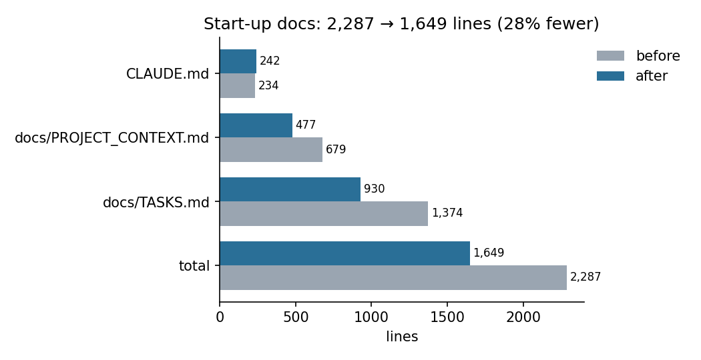
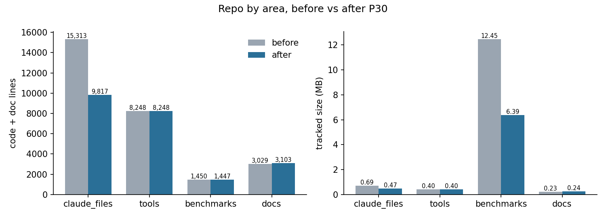
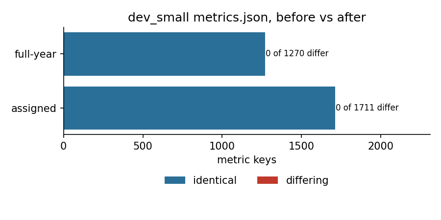

# P30: repo and docs diet

**Date:** 2026-11-11 · **Author:** repo-curator session (P30) · **Branch:** `claude/p30-repo-diet-f21062` · **Status:** draft

## TL;DR
- The start-up docs (CLAUDE.md, PROJECT_CONTEXT.md, TASKS.md) went from **2,287 to 1,649 (28% fewer) lines** (Fig. 1).
  Done tasks are now in `docs/TASKS_DONE.md` and pre-2026-10-22 changelog entries in `docs/CHANGELOG_ARCHIVE.md`,
  both moved verbatim.
- **Deleted:** `claude_files/old/` (11 files) and four retired runners (`batch_test_guesses.py`,
  `batch_test_acf_fft_highpass.py`, `run_debug_baseline*.py`; 1,557 lines). This settles open issue 9.
  **Pruned:** 15 superseded baseline entries (21 files).
- **Results unchanged:** dev_small `metrics.json` is bit-identical before and after in both coverage modes
  (1,711 + 1,270 keys, 0 differ), and pytest passes (379 passed).
- **Not done (your call):** untracking the committed `results_products/` outputs and `.DS_Store` files, and
  porting `analyze_batch_processing.ipynb` off the retired runner's `summary.csv` (see Open questions).

## Question / goal
P30 in `docs/TASKS.md` (midway review recs. 8 and 9, §3 "wheel-spinning"): cut what every session has to read and
remove superseded code and baselines, with pipeline results bit-identical. No goal in `goals.json` applies.

## What I did
1. Ran the dev_small scorecard before any change (`datasets/dev_small.csv,data_root=data/smarts_dev`, assigned
   and `--ignore-manifest-sectors`).
2. Grepped every candidate for deletion across code, tests, docs, `.claude/`, reports and the three root notebooks
   (imports, `%run`, `sys.path`, and plain mentions) before deleting it with `git rm`. One commit per logical change.
3. Rewrote the docs (below), then re-ran both scorecards and the full pytest suite, and compared `metrics.json`
   key by key (`scripts/compare_metrics.py`: NaN-aware, `runtime.*` and `config` ignored).
4. Counted lines at `d3f73e6` (before) and the branch tip (after) from git (`scripts/line_counts.py`).

## Results

### Start-up reading


The bars are the three files every session reads first; the total is at the top. TASKS.md shrank most (21 done
tasks moved out) and PROJECT_CONTEXT.md next (30 changelog entries archived). CLAUDE.md grew by a few lines: it now
points at the two new history files and at a current resumability example.

### Repo by area


Left: lines in `.py/.md/.txt/.sh` files per area (`claude_files/` 15,313 → 9,817). Right: tracked bytes, which is where the baseline pruning shows
(`benchmarks/`). `docs/` keeps its total size because the moved text now lives in `TASKS_DONE.md` and
`CHANGELOG_ARCHIVE.md`; the point is that sessions no longer read it at start-up.

### Results are bit-identical


Every compared key in dev_small's `metrics.json` is identical in both coverage modes (no keys added or lost).

| Mode | Keys compared | Differing | Only before | Only after |
|---|---|---|---|---|
| assigned | 1,711 | 0 | 0 | 0 |
| full-year | 1,270 | 0 | 0 | 0 |

`per_star.csv` is also identical in both modes once the two timing columns (`fit_seconds`, `seconds`) are dropped (50 stars × 43–44 columns).

Final answers: assigned success 16.0% / wrong 4.0% / declined 78.0%; full-year success 26.0% / wrong 4.0% /
declined 68.0%, before and after. `check_goals.py --baseline` isn't needed here since no pipeline code changed; the
key-by-key comparison is stricter.

### Every deleted or moved file

| Path | Action | Reason / evidence |
|---|---|---|
| `claude_files/old/` (11 files: `try0/` and `try1/` copies of `comb_fit`, `plotting`, `acf_utils`, `example_usage`, `example_messy_data`; old copies of both batch runners; `.DS_Store`) | deleted | CLAUDE.md already said never to read it; nothing imports it. Git history keeps it (`d3f73e6`). |
| `claude_files/batch_test_guesses.py` (673 lines) | deleted | Stage-1-only per-method recall. Covered by the scorecard's `per_method.csv` (`star_id, method, outcome, rank, n_candidates, top1, …`) for every discovered `guess_*`; `scorecard.py:177` already re-implemented its method discovery. No code imports it. |
| `claude_files/batch_test_acf_fft_highpass.py` (477 lines) | deleted (open issue 9) | Diff check: it did the same as `batch_test_guesses.py`'s `acf_fft_highpass` rows (one summary row per smoothing window), so it was a strict subset of a runner that is itself retired. **Lost:** the per-smoothing-window breakdown (see Open questions). |
| `claude_files/run_debug_baseline.py`, `run_debug_baseline_full_methods.py` (407 lines) | deleted | Full pipeline over a directory → one CSV. The scorecard does this for any manifest with a `path` column, resumable and with outcomes scored by `evaluation.py`. CLAUDE.md's "Debug workflow" now says so. |
| `benchmarks/baselines/synth200_s0_pre_acf.json` + `_tables/` | deleted | History only (before the ACF long-period merge). |
| `benchmarks/baselines/synth200_s0_pre_t18.json` + `_tables/` | deleted | History only (before T18's gates). |
| `benchmarks/baselines/synth200_s0_accelerate.json` | deleted | Non-reproducible Accelerate run; nothing cites it. |
| `benchmarks/baselines/synth200_s0_v4.json` | deleted | Superseded by `_v5` (every v4 key identical in v5). |
| `benchmarks/baselines/dev_small_assigned.json` + `_tables/`, `dev_small_assigned_v4.json` | deleted | Superseded by `dev_small_assigned_v5.json`. (The v3 per-star tables go with it; a 1-minute run regenerates them.) |
| `benchmarks/baselines/dev_medium_assigned.json` + `_tables/`, `_v4.json` + `_v4_tables/` | deleted | Superseded by `dev_medium_assigned_v5` (+tables). |
| `benchmarks/baselines/dev_medium_fullyear_v4.json` + `_v4_tables/` | deleted | Superseded by `_v5` (+tables). |
| 21 done task sections (T0, T1, T2, T4, T9, T14, T15, T16a–c, T16e, T18, T20–T27, P26) | moved `TASKS.md` → `docs/TASKS_DONE.md` | Verbatim, grouped by phase; a one-line pointer per phase stays. Checked by script: every removed line is in one of the two files, apart from the intended status fixes. |
| 30 changelog entries before 2026-10-22 | moved `PROJECT_CONTEXT.md` → `docs/CHANGELOG_ARCHIVE.md` | Verbatim, with a pointer at the top of the changelog. |

**Kept on purpose:** every `_v5` baseline; `synth200_s0.json` + `_tables/` (`goals.json`, `check_goals.py`,
`tests/test_coverage.py`); `synth200_s0_v1_scorecard1.json` (named in `goals.json`); `dev_medium_fullyear.json` +
`_tables/` (goals G9–G12 quote it; `tools/audit/galaxy_phase2_analysis.py` reads its `per_star.csv`);
`dev_small_fullyear.json` + `_tables/` (the only dev_small full-year baseline: no v4/v5 re-run exists).
`benchmarks/baselines/README.md` now lists what's kept and what was pruned.

### Doc edits
- **PROJECT_CONTEXT.md:** code map adds `ranking_model.py` (was missing), drops the batch runners and the missing
  `example_usage.py`, and lists the current `tools/`; §4 issues 2, 4, 5 and 12 rewritten to the current state
  (corpus-scale runs parked; importance from ranker v0; 1.16 s/star and parked T12; arbitration is now a decline
  problem, P24); issues 3 and 9 resolved, numbers kept stable; §5 says when to archive the changelog; P30 changelog entry.
- **METHODOLOGY_NOTES.md §7:** no longer says there's no ranker; now lists ranker v0, dev-set statistics and T26
  detectability as written-up-later items.
- **TASKS.md statuses fixed:** T1 (phase 1 merged 2026-10-15), T16e and T21 (merged 2026-10-21), T26 and P26 (merged
  2026-11-11), plus T16h (said T16c was "merged-pending"). T19a's inventory marks the P30 deletions done.
- **CLAUDE.md:** repo-layout lines for `claude_files/`, `docs/`, `benchmarks/`, `tools/`, `results_products/`; the
  resumability convention now points at `scorecard.py` (`score_one_star` + `rows.jsonl`) and
  `build_feature_tables.py` (`build_one_star` + atomic shards).
- **Process:** write-report skill caps the TL;DR at ~150 words (detail goes to Results).
  `docs/AGENT_WORKFLOW.md` step 6 makes "TASKS status → done + move to TASKS_DONE + changelog entry" part of the
  coordinator's merge step.
- `tests/conftest.py`: a docstring pointed at the deleted `batch_test_guesses._prep_wavelet_flux`; it now points at
  `scorecard._gap_filled`. No assertion changed.

### What the root notebooks lose
None of the three notebooks imports anything deleted (checked every `import`/`from`/`sys.path` line).
`analyze_batch_processing.ipynb` and `results_products/run_full_analysis.py` read `summary.csv` files written by
`batch_test_guesses.py`. The existing files under `results_products/` (gitignored, in the main checkout) still load,
but **new `summary.csv` files can't be made**. The scorecard's `per_method.csv` has the same information with different
column names (`outcome`/`rank` instead of `found_true_period`/rank), so pointing the notebook at it is a small rewrite.
`ss_claude_sandbox.ipynb` mentions `example_usage.py` only inside a pasted docstring.

## What didn't work
Nothing failed. One caution for whoever merges: the T5 session is editing T5's entry in `TASKS.md`. I left T5's
section and the blank line before it untouched, so the merge should be clean, but T4's section (just above T5) was
moved out, so check that hunk if git reports a conflict.

## Open questions for Rae
1. **Tracked result files in `results_products/`** (e.g. `batch1/candidates.csv`, the PNGs, `.DS_Store`) and 6
   tracked `.DS_Store` files overall. T19a already lists them. They're your outputs, so I didn't untrack them.
   Recommend: untrack the CSVs and `.DS_Store`, add them to `.gitignore`, and leave history alone until T19b.
2. **`analyze_batch_processing.ipynb` / `run_full_analysis.py`:** keep them as-is for the old outputs, or port them
   to read the scorecard's `per_method.csv`? I recommend porting only if you still use them.
3. **Per-smoothing-window `acf_fft_highpass` breakdown** went with the deleted runners. `acf_fft_highpass` isn't in
   the default pool and isn't in your current plans, so I didn't rebuild it. If needed, it's a few notebook lines
   (call `guess_acf_fft_highpass` and group by its `method` tag, e.g. `acf_fft_hp5d`).
4. **Baselines `synth200_s0_v1_scorecard1.json` and the v3 `dev_medium_fullyear.json` / `synth200_s0.json`** stay
   only because `goals.json` names them. If you update `goals.json`'s descriptions to the `_v5` files (P28 headline
   card is a natural moment), they can go too.
5. **Files I didn't touch because they're protected:** `benchmarks/scorecard.py:177` re-implements method discovery
   (formerly duplicated by `batch_test_guesses.py`; now the only copy, so no action needed). Nothing else in the
   protected files needed a change.
6. Larger cleanups worth doing later (not P30): `tools/run_t2_baselines.sh`, `run_t10_train_tables.sh` and
   `run_t27_negatives.sh` are one-off task scripts that could move to their reports; root-level `split_smarts_lc.py`
   belongs in the package (T19a); `docs/HANDOFF.md` is coordinator state and could live outside the start-up set.

## Reproduce
```bash
P=/opt/anaconda3/envs/ss_openblas/bin/python
$P benchmarks/scorecard.py --manifest datasets/dev_small.csv --data-root data/smarts_dev --outdir runs/p30_assigned
$P benchmarks/scorecard.py --manifest datasets/dev_small.csv --data-root data/smarts_dev --ignore-manifest-sectors --outdir runs/p30_full
# (run both at d3f73e6 and at the branch tip, then:)
$P reports/2026-11-11_p30-repo-docs-diet/scripts/compare_metrics.py <before>/metrics.json <after>/metrics.json assigned
$P reports/2026-11-11_p30-repo-docs-diet/scripts/line_counts.py d3f73e6 HEAD
$P tools/run_notebook.py reports/2026-11-11_p30-repo-docs-diet/notebook.ipynb
$P -m pytest -q
```
