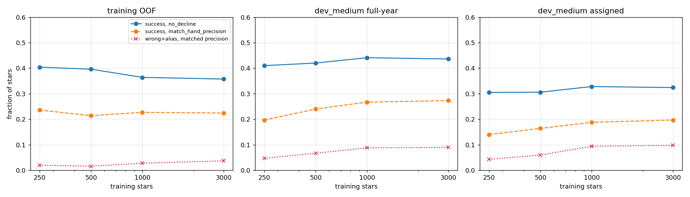
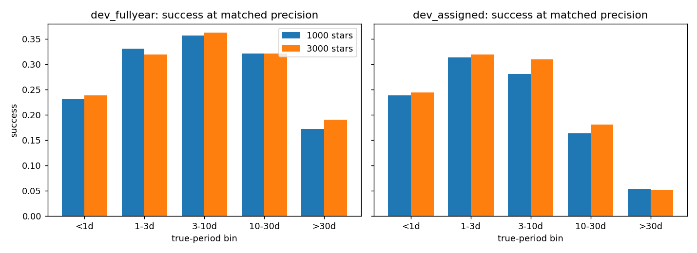

# Ranker v0 learning curve: the 3,000-star point

**Date:** 2026-11-11 · **Author:** Claude (coordinator session) · **Branch:** `main` · **Status:** check-in, no code change

## TL;DR
- **More rotator training stars no longer help.** Going from 1,000 to 3,000 training stars moves dev_medium success at matched precision from 0.267 to 0.273 (full-year) and from 0.188 to 0.197 (assigned). Without a decline, success is flat: 0.441 → 0.436 and 0.328 → 0.324.
- **The gains from 250 to 1,000 stars mostly came from where the threshold landed,** not from better ordering. At 3,000 stars the wrong rate is unchanged: 0.080 → 0.081 full-year, 0.087 → 0.092 assigned.
- **Per bin, nothing changes by more than 0.03.** The long-period full-year deficit against hand arbitration (10–30 d: 0.322 at both sizes) is still there. More data of the same kind doesn't fix it, which supports doing the decline model and per-bin thresholds next.
- **Implication:** the levers now are the decline stage, the candidate list (<1 d recall), and new kinds of training data (negatives, other coverage), not more of the same rotators.

## What I did
- `tools/train_ranker.py --train .../t10_tables/train_3k --sizes 3000 --variants base --outdir runs/t11_ranker --resume`, using T11's tuned hyperparameters (`rank:ndcg`, depth 3, eta 0.1, 150 rounds). It took about 1 minute.
- The `train_3k` table is a superset of `train_1k`: the 1,000 shards were reused, and 2,000 stars were built on 2026-11-11.
- The 250 / 500 / 1,000 points are T11's, trained on `train_1k`. `runs/t11_ranker` was copied from the T11 worktree into the main checkout's `runs/`.
- Dev scoring and thresholds are exactly as in T11: the fold-model ensemble, and the OOF `match_hand_precision` threshold (1.594 at 3k vs 1.357 at 1k).

## Results


| dev_medium, all stars | 250 | 500 | 1,000 | 3,000 |
|---|---|---|---|---|
| full-year success, matched precision | 0.197 | 0.240 | 0.267 | 0.273 |
| full-year success, no decline | 0.410 | 0.420 | 0.441 | 0.436 |
| assigned success, matched precision | 0.140 | 0.164 | 0.188 | 0.197 |
| assigned success, no decline | 0.305 | 0.306 | 0.328 | 0.324 |
| full-year wrong, matched precision | 0.044 | 0.061 | 0.080 | 0.081 |
| assigned wrong, matched precision | 0.041 | 0.056 | 0.087 | 0.092 |



| bin | full-year 1k → 3k | assigned 1k → 3k |
|---|---|---|
| <1 d | 0.233 → 0.238 | 0.238 → 0.244 |
| 1–3 d | 0.331 → 0.320 | 0.314 → 0.320 |
| 3–10 d | 0.357 → 0.363 | 0.281 → 0.310 |
| 10–30 d | 0.322 → 0.322 | 0.164 → 0.181 |
| >30 d | 0.172 → 0.191 | 0.054 → 0.051 |

Full table: `data/learning_curve.csv`.

## Caveats
- One seed, one CV split. Differences of ±0.01 are within run-to-run noise for 1,000 dev stars.
- The decline threshold here is v0's score cutoff, not the star-level decline model Rae chose for v1.

## Open questions for Rae
None. This confirms the plan already decided: ranker v1 = decline model + per-bin thresholds, trained on `train_3k`.

## Reproduce
```bash
/opt/anaconda3/envs/ss_openblas/bin/python reports/2026-11-11_ranker-3k-learning-curve/analysis.py
```
