# T5: short-period recovery (sub-day Stage 1 recall)

**Date:** 2026-11-11 · **Author:** Claude (method-improver session, started by the coordinator) · **Branch:** `claude/t5-short-period-8a550e` (worktree `t24-t25-scorecard-v5-84eca3`) · **Status:** draft

## TL;DR
- **Why full-year misses sub-day periods: top-10 crowding, not a grid or min-period limit.**
  - The true <1 d peak is still in the spectrum. `guess_lombscargle` and `guess_acf_fft` rank peaks by raw power and keep the top 10.
  - A full-year light curve has ~4× more ACF-FFT and ~3× more LS peaks (median 470 ACF-FFT / 1,414 LS peaks, against 122 / 511 with assigned coverage). Galaxy red noise also makes power rise toward long periods.
  - So 3–60 d noise peaks fill all 10 slots. On detectable <1 d stars the true peak's median rank is 10 (ACF FFT) and 19 (LS) full-year, against 3 and 8 assigned.
- **The fix costs no compute.** Both methods now fill half their slots by raw power and half by power over the local continuum (`rank_by="hybrid"`, new default; `rank_by="power"` restores the old behaviour).
  - Interleaved A/B timing: +20 ms generation per star, but 1.5 fewer distinct candidates to fit, so the median per-star total is **0.93×**.
- **What the fix does, before → after:**

  | metric | full-year | assigned |
  |---|---|---|
  | <1 d Stage-1 union recall (scorecard) | 0.442 → **0.698** | 0.634 → **0.779** |
  | <1 d fitted-candidate ceiling (what the ranker can pick from) | 0.33 → **0.65** | 0.59 → **0.69** |
  | same ceiling, detectable stars only | 0.48 → **0.77** | 0.75 → **0.82** |

  - G12 now passes. Final <1 d success is 0.169 → 0.186 full-year and unchanged assigned. Wrong stays at 0.088 full-year and moves 0.054 → 0.055 assigned. Every regression guard passes in all three scorecards.
  - On synthetic n=200, overall success is 0.730 → 0.755 (**G1 now passes**) and <1 d 0.632 → 0.691. G2/G3 still fail (0.691 vs 0.75; 0.897 vs 0.94).
- **Most rescued sub-day candidates are fitted and then declined by hand arbitration.** For every <1 d star that has a fitted success candidate but no success answer, that candidate fails `half_lag_consistency` (79/79 full-year, 87/87 assigned).
  - The gain therefore lands in the ranker's candidate ceiling, not in today's hand-arbitrated answers. That makes the ranker, retrained on rebuilt feature tables, the way to cash it in.
- **Phase 2 (optional pooled methods):** **no optional method is worth pooling after the fix; I recommend none.**
  - On top of the fixed pool, `acf_fft_highpass`, `acf_fft_short` and `lombscargle_short` each add a fitted success candidate for **0 detectable stars in any bin**, in both modes.
  - What `acf_fft_highpass` used to add at <1 d (+0.099 raw, full-year) the fix now covers.
  - They do cost something. `acf_fft_highpass`: +0.74 s/star full-year (+28%), +0.57 wrong fitted candidates/star.
  - FP rate on the 1,736 dev_medium non-rotators: 1.84% before, **1.90% after the fix (+1 star)**, and 2.13–2.48% with any optional method (+4 to +10 stars).
- **Deviation from the brief:** the `pairwise_histogram` share of the deficit is diagnosed but not fixed. Its cause is a different one (degenerate pair counts with ~190 ACF peaks), and re-binning didn't fix it (see *What didn't work*).

## Question / goal
- **Task:** T5 in `docs/TASKS.md`, following its 2026-11-11 update. Rae's priority is <1 d recall, with minimal extra compute and no new false positives that survive the ranker.
- **Phase 1:** diagnose why every method is worse at <1 d full-year than on the same stars' assigned coverage, and fix it if the fix is free.
- **Phase 2:** choose which optional method(s), if any, to pool.
- **Goals:** G2/G3 (synthetic, T5's "done when"); G11/G12 (dev_medium full-year <1 d).
- **Scorecard version:** main is at **v5** (`detectable` flag not merged). The baselines are the committed v5 files: `benchmarks/baselines/dev_medium_{fullyear,assigned}_v5.json` and `synth200_s0_v5.json`.
  - Pipeline code (`guesses`, `comb_fit`, `acf_utils`, `preprocessing`) is byte-identical between their commit (8a764eb) and this branch's parent (99c46ef), so they are valid "before" runs.

## What I did
1. **Five-star quick check, then all 1,000 stars × 2 modes.** I dumped every spectral peak of `acf_fft` (both ACF views) and `lombscargle`, with power and local-continuum estimates (`dump_peaks.py`).
   - From the dump: the rank of the true peak and the number of competing peaks.
   - Offline re-ranking schemes, scored as the 3-method pool union per bin.
   - A **shuffled-truth chance level**: each star's list scored against another star's truth from the same bin.
   - The **detectable** subset (T26's `snr_rot` ≥ 5; branch `claude/t26-detectability-7f7523`, copied into `data/t26_snr_rot.csv`).
   - Chance and detectability matter because assigned coverage "finds" 46% of *undetectable* <1 d stars with `acf_fft`, mostly by chance (few peaks, wide ±10% windows).
2. **Hypotheses I tested and rejected:**
   - **The Hann window suppresses the short lags where a decaying signal lives.** False: a one-sided taper made the true peak's rank worse on 5/5 stars.
   - **`pairwise_histogram` bin width.** It is (lag range)/200 ≈ 0.6 d full-year, which is real but not sufficient; see *What didn't work*.
   - **Light-curve binning.** The coordinator had already excluded it: 30-min cadence in both modes.
3. **Fix, test-first.** New `tests/test_short_period_ranking.py` (14 tests).
   - The failing case: a weak 0.3 d sinusoid under AR(1) red noise on a 350 d, 30-min, TESS-gapped light curve. The old LS rank of the true peak was 16–23.
   - Plus guards: `rank_by="power"` is the old top-N, a strong 8 d signal stays rank 1, and peaks are distinct with the right count.
   - The implementation is `guesses._select_peaks`, used by `guess_lombscargle` and `guess_acf_fft`. The `*_short` and `acf_fft_highpass` variants inherit it.
   - The full suite passes (`pytest -q`: 386 passed, including the 14 new tests).
4. **Judging runs:**
   - Scorecard `datasets/dev_medium.csv,data_root=data/smarts_dev,sectors=ignored` (full-year).
   - Scorecard `…,sectors=manifest` (assigned).
   - Scorecard `synthetic:n=200,seed=0`.
   - `check_goals.py --baseline` against each v5 baseline.
   - An interleaved A/B timing run (`bench_ranking.py`, 40 stars × 2 repeats).
5. **Phase 2.** `tools/t5_pool_compare.py` loads each star once, runs every generator once (timed), then runs the comb fit once per pool configuration (timed). Configurations: `base` (fixed 3-method pool) and `base` + one of `acf_fft_highpass` / `acf_fft_short` / `lombscargle_short`.
   - Run on dev_medium rotators in both modes.
   - Run on the 1,736 dev_medium non-rotator negatives (`datasets/negatives_v0.csv`, `eval_set == dev_medium`, Data_Vault drive). The negatives also get the pre-fix pool (`base_old`).
   - Recall is counted on **fitted** candidates, i.e. after `fit_rotation_period` caps each short-period family at 3 candidates by comb score. The coordinator's table counted every raw guess (25 for `acf_fft_highpass`), most of which never reach the fit.

## Results

### Phase 1: the diagnosis
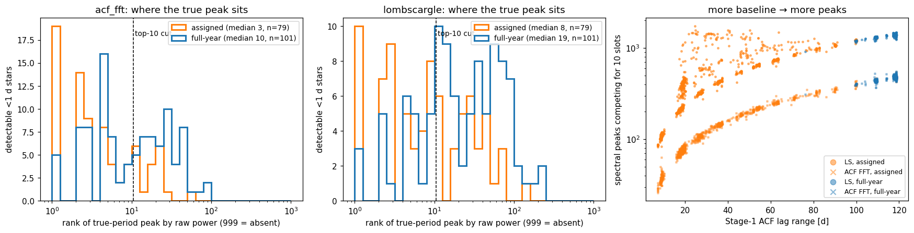

**Left and middle:** the rank (by raw power) of the true-period peak for detectable <1 d stars.
- With assigned coverage it is usually inside the top 10 (dashed line). Full-year, the distribution shifts right by ~3×.
- **Right:** the number of peaks competing for the 10 slots grows with the Stage-1 ACF lag range (≈ B/3).

Four examples follow. Columns: the light curve; the Stage-1 ACF (the inset marks n·P_true); the ACF-FFT spectrum; Lomb-Scargle. Red marks the true period and its diffrot/±10% band. Grey ▼ are the old top 10, green ▼ the picks the new ranking adds.

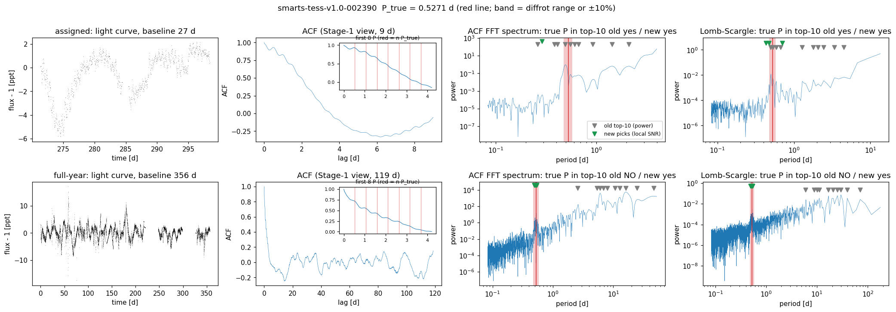
- **002390** (P = 0.527 d, snr_rot 31): with one assigned sector, the true peak is rank 1 in both spectra.
- Full-year, the true peak is still the clearest local feature, but all 10 old picks sit on the 3–60 d red-noise hump. The new ranking picks it in both spectra.

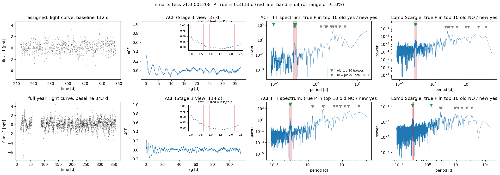
**001208** (P = 0.311 d, snr_rot 27): the same pattern. Full-year old ranks are 14 (ACF FFT) and 30 (LS); the new ranking recovers it.

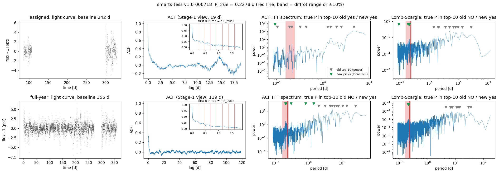
**000718** (P = 0.228 d, snr_rot 15): no oscillation is visible in the ACF at all. The spectral peak still stands above its local continuum, which is exactly what local-SNR ranking measures.

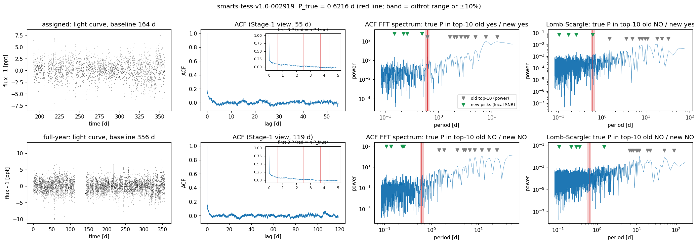
**002919** (P = 0.622 d, snr_rot 9.8) is still missed: old ranks 37 / 59 full-year. Its true peak is not the most prominent peak above the continuum either. This is one of 3 of the 25 "assigned-only" detectable stars the fix does not recover.

### Phase 1: Stage-1 recall before / after
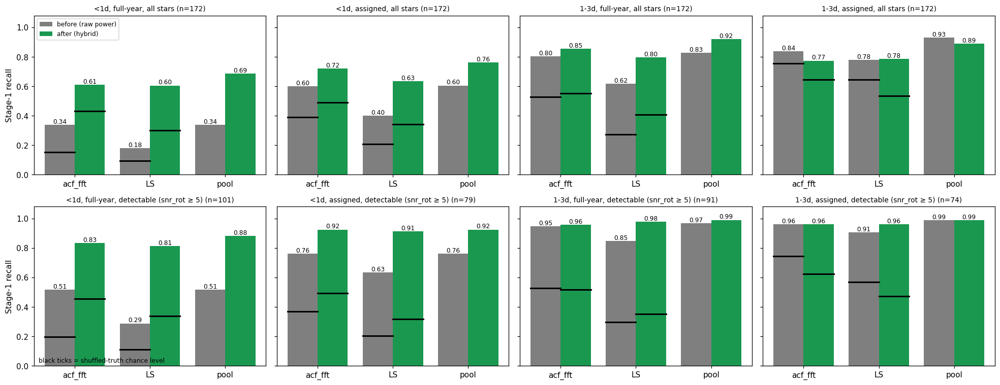

How to read it: grey is before, green after, and black ticks are the shuffled-truth chance level.
- **<1 d** (left half):
  - Full-year, detectable: `acf_fft` 0.51 → 0.83, LS 0.29 → 0.81, pool 0.51 → 0.88.
  - The gain is well above the rise in chance level (0.20 → 0.46 for `acf_fft`), so it is not a chance effect.
  - Full-year now matches assigned (0.92 detectable), so the full-year deficit is closed at Stage 1.
- **1–3 d:** unchanged or better on detectable stars in both modes. The pool drops 0.93 → 0.89 on *all* assigned stars, which is chance hits on undetectable stars (chance 0.76 → 0.65 for `acf_fft`).

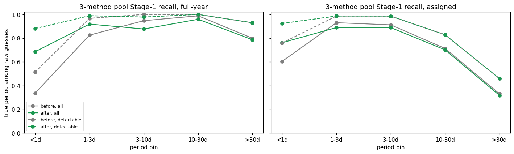

**Regression check across all bins (pool union):**
- **Detectable stars (dashed):** flat except one 3–10 d full-year star (1.00 → 0.98).
- **All stars (solid):** the drops at 3–30 d are lost *chance* hits on undetectable stars. With 10 guesses in ±10% windows, the old raw-power lists hit a random truth 80–90% of the time there (T26's point that the ceiling is mostly chance above 3 d).

### Scorecard (before = v5 baseline, after = this branch)
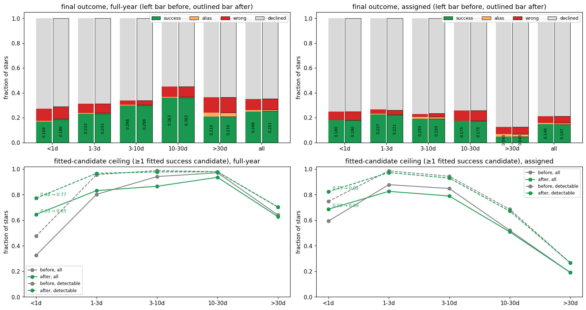

- **Top row:** final outcomes are almost unchanged in every bin, in both modes. Full-year: 4 stars move decline → success, 1 decline → wrong, 1 success → decline, and 1 wrong → decline.
- **Bottom row:** the fitted-candidate ceiling (stars with ≥ 1 fitted success candidate) jumps at <1 d.
  - Detectable stars elsewhere move by at most one star per bin.
  - The solid-line drops at 3–10 d are again undetectable stars.

`check_goals.py runs/t5_after_fullyear/metrics.json --baseline benchmarks/baselines/dev_medium_fullyear_v5.json`:
```
goal  status  result  value    target   base  metric
G9    draft   FAIL    0.251 >= 0.35    0.248  final.overall.success
G10   draft   FAIL    0.088 <= 0.04    0.088  final.overall.wrong
G11   draft   FAIL    0.186 >= 0.3     0.169  final.by_bin.<1d.success
G12   draft   PASS    0.698 >= 0.6     0.442  union_recall.by_bin.<1d

Regression guard (fail if a metric drops by more than its limit):
   base     new   delta  limit  metric
  0.248   0.251  +0.003  0.020  final.overall.success
  0.233   0.233  +0.000  0.060  final.by_bin.1-3d.success
  0.363   0.363  +0.000  0.060  final.by_bin.10-30d.success
  0.298   0.298  +0.000  0.060  final.by_bin.3-10d.success
  0.169   0.186  +0.017  0.060  final.by_bin.<1d.success
  0.210   0.210  +0.000  0.060  final.by_bin.>30d.success
  0.971   0.983  +0.012  0.060  union_recall.by_bin.1-3d
  0.988   0.982  -0.006  0.060  union_recall.by_bin.10-30d
  0.965   0.942  -0.023  0.060  union_recall.by_bin.3-10d
  0.442   0.698  +0.256  0.060  union_recall.by_bin.<1d
  0.917   0.908  -0.010  0.060  union_recall.by_bin.>30d

OVERALL: PASS
```
`check_goals.py runs/t5_after_assigned/metrics.json --baseline benchmarks/baselines/dev_medium_assigned_v5.json`:
```
Regression guard (fail if a metric drops by more than its limit):
   base     new   delta  limit  metric
  0.148   0.147  -0.001  0.020  final.overall.success
  0.227   0.221  -0.006  0.060  final.by_bin.1-3d.success
  0.175   0.175  +0.000  0.060  final.by_bin.10-30d.success
  0.193   0.193  +0.000  0.060  final.by_bin.3-10d.success
  0.180   0.180  +0.000  0.060  final.by_bin.<1d.success
  0.048   0.048  +0.000  0.060  final.by_bin.>30d.success
  0.977   0.930  -0.047  0.060  union_recall.by_bin.1-3d
  0.883   0.865  -0.018  0.060  union_recall.by_bin.10-30d
  0.959   0.930  -0.029  0.060  union_recall.by_bin.3-10d
  0.634   0.779  +0.145  0.060  union_recall.by_bin.<1d
  0.525   0.516  -0.010  0.060  union_recall.by_bin.>30d

OVERALL: PASS
```
(No goal targets the assigned dataset string.)

`check_goals.py runs/t5_after_synth200/metrics.json --baseline benchmarks/baselines/synth200_s0_v5.json`:
```
goal  status  result  value    target   base  metric
G1    draft   PASS    0.755 >= 0.75    0.730  final.overall.success
G2    draft   FAIL    0.691 >= 0.75    0.632  final.by_bin.<1d.success
G3    draft   FAIL    0.897 >= 0.94    0.882  union_recall.by_bin.<1d
G4    draft   FAIL    0.814 >= 0.82    0.814  final.by_bin.10-30d.success
G5    met     PASS    0.000 <= 0.0     0.000  methods.pairwise_histogram.overall.error_rate
G6    draft   PASS    0.000 <= 0.04    0.000  final.overall.wrong
G7    draft   FAIL    0.245 <= 0.18    0.270  final.overall.none
G8    active  PASS    0.000 <= 0.0     0.000  methods.*.overall.error_rate

Regression guard (fail if a metric drops by more than its limit):
   base     new   delta  limit  metric
  0.730   0.755  +0.025  0.020  final.overall.success
  0.644   0.667  +0.022  0.060  final.by_bin.1-3d.success
  0.814   0.814  +0.000  0.060  final.by_bin.10-30d.success
  0.861   0.861  +0.000  0.060  final.by_bin.3-10d.success
  0.632   0.691  +0.059  0.060  final.by_bin.<1d.success
  1.000   1.000  +0.000  0.060  final.by_bin.>30d.success
  0.889   0.911  +0.022  0.060  union_recall.by_bin.1-3d
  0.977   0.977  +0.000  0.060  union_recall.by_bin.10-30d
  0.972   0.972  +0.000  0.060  union_recall.by_bin.3-10d
  0.882   0.897  +0.015  0.060  union_recall.by_bin.<1d
  1.000   1.000  +0.000  0.060  union_recall.by_bin.>30d

OVERALL: PASS
```

### Why the rescued candidates are still declined
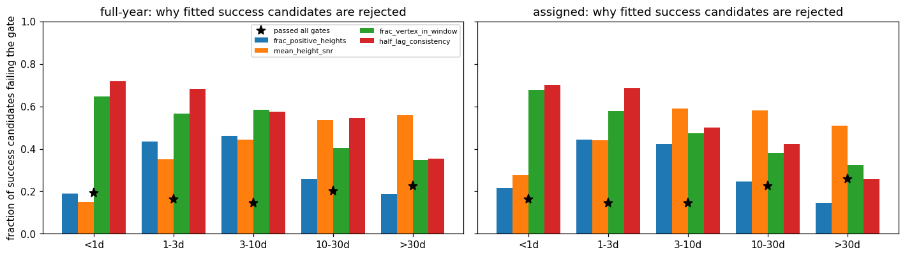

The figure shows the fraction of fitted *success* candidates failing each comb-fit gate, by bin.
- At <1 d, 72% fail `half_lag_consistency` and 65% fail `frac_vertex_in_window`.
- For every <1 d star that has a success candidate but no success answer, *all* its success candidates fail `half_lag_consistency` (79 full-year, 87 assigned).
- But the same gate also rejects 55–68% of success candidates at 1–30 d. So this is not a sub-day-only bug, and I didn't change any gate (see open questions).

### Compute
Interleaved A/B on 40 dev_medium full-year stars (every 25th row), 2 repeats, one process (`data/bench_ranking.csv`):
- Generation of the 3 pooled methods: median 0.075 → 0.095 s per star.
- Comb fit: 3.15 → 3.02 s, because 24 → 22.5 distinct candidates are fitted.
- Median paired per-star total ratio after/before: **0.928**.
- Wall-clock in the scorecard runs themselves is not comparable: methods I didn't touch (`wavelet`, `pairwise_histogram`) were also 1.25–1.5× slower in them, because other jobs shared the CPU.
- A first implementation (an exact per-peak median over ~1,400 LS peaks) cost +0.05–0.1 s per star. The shipped version evaluates the continuum on a 0.05-dex grid; see the comment in `_select_peaks`.

### Phase 2: optional methods on top of the fixed pool
Setup: each method is added on top of the *fixed* 3-method pool, on the same stars, with recall counted on **fitted** candidates (after the comb fit's top-3-per-family short-period cap and dedup). Data: `data/phase2_rot.csv.gz` and `data/phase2_neg.csv.gz`, from `tools/t5_pool_compare.py` (`runs/t5_pool/`).

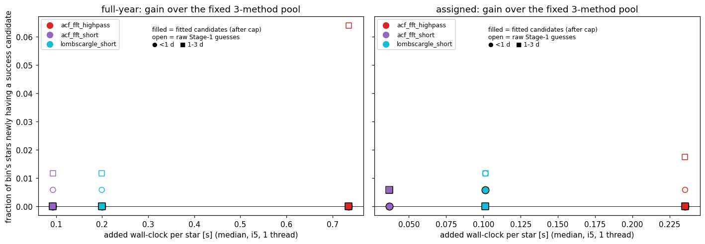

**Trade-off:** each point is one method's gain over the fixed pool vs its added wall-clock per star. Filled markers count fitted candidates, open markers raw guesses.
- **Every filled marker sits at 0** except two single-star (0.006) blips in assigned coverage.
- `acf_fft_highpass` still finds raw 1–3 d hits full-year (0.064), but the cap (top 3 by comb score) discards them before fitting.

| method (added to fixed pool) | mode | added s/star (median) | % of pool's per-star time | fitted gain, detectable, any bin | extra wrong fitted cands/star | Δ final success | Δ final wrong |
|---|---|---|---|---|---|---|---|
| `acf_fft_highpass` | full-year | 0.735 | 28% | 0 | 0.57 | +0.005 | +0.007 |
| `acf_fft_short` | full-year | 0.093 | 4% | 0 | 0.30 | +0.001 | −0.001 |
| `lombscargle_short` | full-year | 0.199 | 8% | 0 | 0.60 | 0.000 | 0.000 |
| `acf_fft_highpass` | assigned | 0.235 | 16% | 0 | 0.74 | +0.003 | +0.006 |
| `acf_fft_short` | assigned | 0.037 | 2% | 0 | 0.31 | +0.003 | +0.003 |
| `lombscargle_short` | assigned | 0.101 | 7% | 0 | 0.76 | 0.000 | +0.004 |

"Per-star time" is the 3-method pool's load + generation + fit, median 2.61 s full-year and 1.48 s assigned, on 4 workers, one BLAS thread each. The final-success deltas are 1–5 stars out of 1,000, and in each case the wrong delta is as big or bigger.

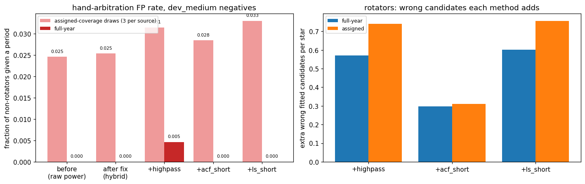

**FP rate on the 1,736 dev_medium non-rotators** (`datasets/negatives_v0.csv`; 434 sources × 3 assigned draws + full-year), any period reported, by pool:

| pool | FPs | rate |
|---|---|---|
| pre-T5 | 32 | 1.84% (reproduces T27's 2.5% on draws and 0/434 full-year) |
| after the fix | 33 | 1.90% (the one new FP is a 0.26 d period) |
| + `acf_fft_short` | 37 | 2.13% |
| + `acf_fft_highpass` | 43 | 2.48% (including 2 full-year FPs, the first full-year FPs in any configuration) |
| + `lombscargle_short` | 43 | 2.48% |

The methods' new FPs sit at 3–25 d, not at sub-day periods. **Right panel:** extra wrong candidates each method puts in front of the comb fit and the ranker.

Not measured here: FPs that *survive the ranker*. That needs the ranker re-scored on rebuilt feature tables (open question 2). With no recall gain, I didn't think it was worth a separate run.

## What didn't work
- **One-sided taper instead of the Hann window in `guess_acf_fft`** made the true peak's rank worse on 5/5 example stars (e.g. 001175 full-year: 30 → 73). The short lags are dominated by slow red-noise structure, so Hann's suppression of them helps.
- **Pure local-SNR ranking** (all 10 slots by power/continuum) gave the best <1 d recall but lost 3–30 d recall: the 3–10 d full-year pool dropped 0.95 → 0.67 (offline, all stars). Long-period true peaks often *are* the red-noise hump. Hence the hybrid.
- **Reserving slots below 1 or 2 d** (top-5 raw + top-5 raw among P < 1 d) was competitive at <1 d but lost 1–3 d recall (1 d cut). With a 2 d cut it gave less <1 d gain than the hybrid.
- **`pairwise_histogram`.** I diagnosed it but did not fix it.
  - Full-year it finds *no* <1 d candidate even at snr_rot ≈ 140.
  - Its bin width is (lag range)/200 ≈ 0.6 d. But capping the width at 2–10% of the spacing still fails, because the ACF has ~190–240 clean peaks.
  - With that many peaks every multiple kP has almost the same pair support (m − k), so the winner is set by how multiples merge into bins, not by the fundamental.
  - A real fix needs a different statistic, e.g. nearest-neighbour spacings or a comb fold. The fixed `acf_fft`/LS already cover these stars, so I left it as a follow-up.

## Open questions for Rae
1. **Make the hybrid ranking the default?** It is the default on this branch, because every scorecard check passed with no guard tripped. The costs:
   - Small losses of chance-level hits on undetectable 3–30 d stars at Stage 1.
   - About one detectable star per bin at 1–30 d in the fitted ceiling.
   - Changed `rank`/`strength` semantics for the ranker's provenance features.

   `rank_by="power"` restores the old behaviour exactly.
2. **Ranker feature tables need a rebuild.** The candidate sets and guess ranks changed, so ranker v0's training tables (T10) and thresholds no longer match the pipeline. The ceiling gain only becomes final-answer gain through the ranker or arbitration.

   Proposed next step: rebuild the dev_medium T10 tables (~1 h locally) and the training tables on this branch, then re-run ranker v0's CV. That is your local job at training scale.
3. **`half_lag_consistency` is now the main gate between sub-day candidates and answers**, but it also rejects most 1–30 d success candidates, so loosening it is a precision/recall call for you. I'd propose a separate task: measure its FP-vs-recall curve on rotators plus the T27 negatives, before touching it.
4. **Phase 2 recommendation:** **pool none of the three optional methods.**
   - After the fix they add no fitted success candidate on detectable stars in any bin.
   - They cost 2–28% more per-star time and add 0.3–0.76 wrong candidates per star.
   - They raise the non-rotator FP rate by 4–10 stars per 1,736.
   - `acf_fft_short` is the cheapest (+4% full-year, +4 FPs), if you want a hedge. I don't recommend it.
   - Nothing is pooled by default on this branch; `--pipeline-methods` still lets you try any of them.
5. **`pairwise_histogram` on long baselines** (degenerate pair counts): a separate small task? See *What didn't work*.

## Reproduce
Every command runs from the repo root (`PY=/opt/anaconda3/envs/ss_openblas/bin/python`).

1. Peak dump and Phase-1 tables. The dump goes to `runs/` (gitignored), ~35 min at 4 workers:
```bash
$PY reports/2026-11-11_t5-short-period-recovery/dump_peaks.py runs/t5_peaks
```
```bash
$PY reports/2026-11-11_t5-short-period-recovery/phase1_tables.py runs/t5_peaks
```
```bash
$PY reports/2026-11-11_t5-short-period-recovery/make_examples.py
```
2. Scorecards and Phase-2 runs (~4 h; the last step reads the Data_Vault drive for ~45 min; resumable):
```bash
zsh tools/run_t5.sh
```
```bash
$PY benchmarks/scorecard.py --synthetic 200 --seed 0 --outdir runs/t5_after_synth200
```
3. Tables, timing, notebook:
```bash
$PY reports/2026-11-11_t5-short-period-recovery/scorecard_tables.py
```
```bash
$PY reports/2026-11-11_t5-short-period-recovery/gate_tables.py
```
```bash
$PY reports/2026-11-11_t5-short-period-recovery/phase2_tables.py runs/t5_pool
```
```bash
$PY reports/2026-11-11_t5-short-period-recovery/bench_ranking.py 40 2
```
```bash
$PY reports/2026-11-11_t5-short-period-recovery/make_notebook.py
```
```bash
$PY tools/run_notebook.py reports/2026-11-11_t5-short-period-recovery/notebook.ipynb
```
