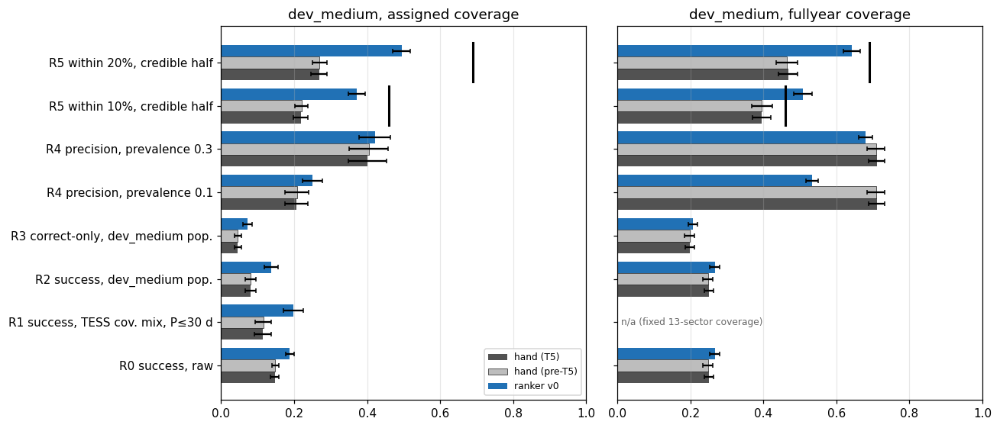
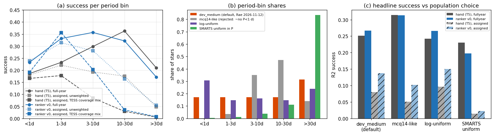
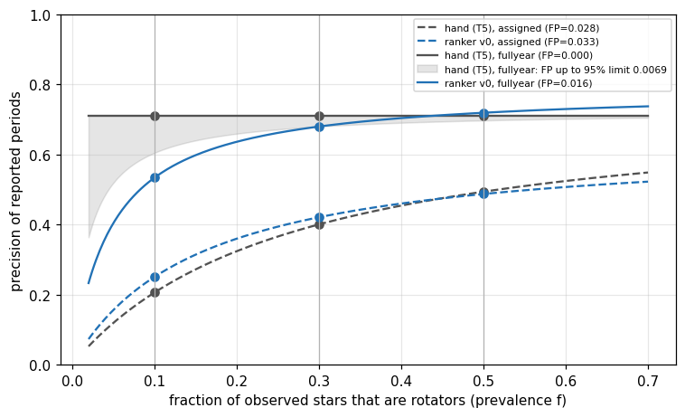
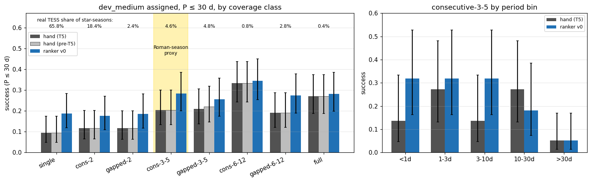

# Headline card and Roman-season proxy

**Date:** 2026-11-12 · **Author:** P28/P29 headline-card session · **Branch:** `claude/p28-p29-headline-card-dcb5aa` · **Status:** draft

## TL;DR
- **`tools/headline_card.py`** computes a fixed 6-row card from any scorecard `per_star.csv` (plus ranker top-1 files) and writes `headline.json` + `headline.md`.
- **Current pipeline (dev_medium, hand T5 / ranker v0):**
  - TESS coverage mix, P ≤ 30 d: **0.115 / 0.198**;
  - dev_medium period mix (default, Rae 2026-11-12): **0.080 / 0.137** assigned, **0.251 / 0.267** full-year;
  - correct-only: 0.046 / 0.072 assigned, 0.198 / 0.207 full-year;
  - precision at 10% rotators: 0.21 / 0.25 assigned, 0.71 / 0.53 full-year;
  - Claytor-style best half, within 10% / 20% (full-year): ranker **0.51 / 0.64** vs Claytor+2022's 0.46 / 0.69.
- **T5 moved no row by more than 1 SE.**
- **Roman proxy (P29):** `consecutive-3-5`, P ≤ 30 d: **0.20 hand / 0.28 ranker**, with 95% intervals of about ±0.09. A true 70 d window costs ≈14 min to score. Not run.
- **Population decided (Rae, 2026-11-12):** the dev_medium period mix, not McQuillan+2014, which has almost no P < 1 d stars.
- **Your call:** the prevalences, and which of the 5 proposed goals to activate.

## Question / goal
`docs/TASKS.md` **P28** (headline card) and **P29** (Roman-season proxy), from the midway review
(`reports/2026-11-11_midway-review/`, recommendations 5 and 2). P28 asks for one small, fixed card that
every method/ranker report quotes, instead of more scorecard subsets. P29 asks what one ~70 d contiguous
season should expect from the TESS-trained pipeline. This touches no goal in `benchmarks/goals.json`; goals on
the card are *proposed* below, not edited.

## What I did
- **Inputs (existing per-star tables only, no pipeline runs):**
  - **hand arbitration, post-T5:** `benchmarks/baselines/dev_medium_{assigned,fullyear}_t5_tables/per_star.csv`
    (dataset strings `datasets/dev_medium.csv,data_root=data/smarts_dev,sectors=manifest|ignored`);
  - **hand, pre-T5:** the `_v5_tables` equivalents;
  - **ranker v0:** `<main>/runs/t27_ranker/v0_{assigned,fullyear}_top1.csv`, threshold 1.357 (`results.json`).
    These files also carry the T27 galaxy-stack negatives (1,302 assigned, 434 full-year), which give the
    non-rotator false-positive (FP) rates.
  - **coverage weights:** `coverage_weight` from `datasets/dev_medium.csv`.
- **Built `tools/headline_card.py`.** Its row definitions are fixed in `ROW_DEFINITIONS`, every period is
  re-scored with `evaluation.classify_period` (`REL_TOL`), and every number gets a bootstrap SE (200 resamples
  over stars, seed 0).
  - Re-scoring agrees 100% with the `final_outcome` / `top_outcome` columns already in the tables.
  - R0 and R1 reproduce the review's published numbers: 0.148 / 0.188 raw, 0.116 / 0.198 at the coverage mix.
- **The rows:**

| Row | Definition |
|---|---|
| R0 | success (correct + diffrot), unweighted: continuity with older reports |
| R1 | success at the real TESS coverage mix (per-star `coverage_weight`), P ≤ 30 d; assigned only |
| R2 | success re-weighted per period bin to a named population (default `dev_medium`: dev_medium's own period-bin shares; Rae, 2026-11-12), × `coverage_weight` when assigned; 0.1–180 d |
| R3 | correct-only (no diffrot credit), same weighting as R2 |
| R4 | precision `f·S / (f·A + (1−f)·FP)` at rotator prevalence f = 0.1, 0.3, 0.5. S and A (success and answer rates) use the R2 weighting; FP is the answer rate on T27 negatives, coverage-weighted when assigned |
| R5 | fraction of the most credible half of all rotators with a period within 10% / 20% of the injected P_eq (Claytor+2022's metric). "Credible" means ranker score; hand has no score, so its answered stars come first and declined stars fill the half as misses |

- **Ran** `reports/2026-11-12_headline-card/compute.py` (~7 s) for the card, the sensitivity tables and P29,
  then built and executed the notebook (all four figures). New tests: `tests/test_headline_card.py` (6 tests).
  The full `pytest -q` passes.

## Results

### The card (current pipeline)



*Look at the dark-grey vs light-grey bars:* pre-T5 and T5 hand arbitration are indistinguishable on every row,
so T5's short-period fix doesn't show up at dev_medium scale. Black ticks are Claytor+2022's 46% / 69%. On
full-year, ranker v0's most-credible half (0.51 / 0.64) is level with them. That comparison is fair: their test set
was also ~1-year SMARTS-TESS, but its period mix differs, so read it as "same ballpark", not a win.

**dev_medium assigned** (population `dev_medium`, value ± bootstrap SE):

| Row | hand (T5) | hand (pre-T5) | ranker v0 |
|---|---|---|---|
| R0 success, raw (unweighted) | 0.147 ± 0.011 | 0.148 ± 0.010 | 0.188 ± 0.012 |
| R1 success, TESS coverage mix, P ≤ 30 d | 0.115 ± 0.023 | 0.116 ± 0.023 | 0.198 ± 0.028 |
| R2 success, population `dev_medium` | 0.080 ± 0.015 | 0.081 ± 0.015 | 0.137 ± 0.018 |
| R3 correct-only, population `dev_medium` | 0.046 ± 0.010 | 0.046 ± 0.010 | 0.072 ± 0.013 |
| R4 precision at rotator prevalence 0.1 | 0.206 ± 0.032 | 0.207 ± 0.032 | 0.251 ± 0.028 |
| R4 precision at rotator prevalence 0.3 | 0.401 ± 0.053 | 0.405 ± 0.053 | 0.421 ± 0.043 |
| R4 precision at rotator prevalence 0.5 | 0.494 ± 0.062 | 0.500 ± 0.063 | 0.487 ± 0.050 |
| R5 within 10%, most credible half | 0.218 ± 0.019 | 0.220 ± 0.018 | 0.372 ± 0.023 |
| R5 within 20%, most credible half | 0.268 ± 0.022 | 0.270 ± 0.019 | 0.494 ± 0.023 |
| n rotators / answered | 1000 / 211 | 1000 / 211 | 1000 / 282 |
| non-rotator FP rate (R4 input) | 0.0284 | 0.0284 | 0.0332 |

**dev_medium full-year** (13 sectors; R1 is n/a because the coverage is fixed):

| Row | hand (T5) | hand (pre-T5) | ranker v0 |
|---|---|---|---|
| R0 success, raw (unweighted) | 0.251 ± 0.013 | 0.248 ± 0.014 | 0.267 ± 0.014 |
| R2 success, population `dev_medium` | 0.251 ± 0.013 | 0.248 ± 0.014 | 0.267 ± 0.014 |
| R3 correct-only, population `dev_medium` | 0.198 ± 0.013 | 0.198 ± 0.014 | 0.207 ± 0.013 |
| R4 precision at rotator prevalence 0.1 | 0.711 ± 0.022 | 0.709 ± 0.024 | 0.534 ± 0.016 |
| R4 precision at rotator prevalence 0.3 | 0.711 ± 0.022 | 0.709 ± 0.024 | 0.680 ± 0.019 |
| R4 precision at rotator prevalence 0.5 | 0.711 ± 0.022 | 0.709 ± 0.024 | 0.719 ± 0.020 |
| R5 within 10%, most credible half | 0.396 ± 0.026 | 0.396 ± 0.028 | 0.508 ± 0.026 |
| R5 within 20%, most credible half | 0.468 ± 0.026 | 0.464 ± 0.029 | 0.642 ± 0.023 |
| n rotators / answered | 1000 / 353 | 1000 / 350 | 1000 / 355 |
| non-rotator FP rate (R4 input) | 0.0000 | 0.0000 | 0.0161 |

**Caveats on the card:**
- **Ranker v0 uses pre-T5 Stage-1 candidates** (T10 tables). A post-T5 ranker column needs rebuilt feature tables
  (already a HANDOFF next step).
- **Hand R4 uses pre-T5 negatives** for both hand columns: the T5 baselines didn't score the negatives.
- **Hand full-year answered 0 of 434 negatives**, so its precision is flat at 0.71. At the 95% upper limit on its FP
  rate (0.0069), precision at f = 0.1 / 0.3 / 0.5 would be 0.60 / 0.68 / 0.70 (shaded band in Fig. 3).
- **R4 SEs ignore the uncertainty in FP** (they resample rotators only). With 24–32 assigned FP events, the FP rate
  itself is uncertain by about ±20%.

### Period-population weighting (row R2; decided 2026-11-12: `dev_medium`)



*Look at panel (c):* the same per-star results give an assigned ranker headline anywhere from 0.02 (SMARTS
uniform-in-P, 83% of stars at > 30 d) to 0.15 (log-uniform). `mcq14_like` would put 47% of stars in 10–30 d and 0.1% below 1 d.
- **Assigned:** that bin is where single-sector coverage fails (panel a, dashed: 0.03 hand / 0.04 ranker at the
  coverage mix), so assigned R2 is low, 0.05 / 0.10.
- **Full-year:** the same weight lands where full-year does best, so R2 (0.31) is *higher* than raw (0.25).

**Decision (Rae, 2026-11-12): the default is `dev_medium`**, the period-bin shares of `datasets/dev_medium.csv` (17% in each bin below 30 d, 31% above). McQuillan+2014 is rejected: Kepler's selection is light on M dwarfs, so it has essentially no P < 1 d stars, and we must stay sensitive to fast rotators. dev_medium isn't a physical population, but it keeps real weight in every period range we care about. On full-year, R2 therefore equals R0. On assigned it differs from R0 only by the coverage weighting (period mix held at dev_medium's). The text above about `mcq14_like` describes the rejected option; `mcq14_like` stays in `tools/headline_card.py` for sensitivity checks only.

| R2 success | dev_medium (default) | mcq14_like | loguniform | smarts_uniform |
|---|---|---|---|---|
| assigned, hand (T5) | 0.080 | 0.051 | 0.096 | 0.014 |
| assigned, ranker v0 | 0.137 | 0.102 | 0.150 | 0.023 |
| full-year, hand (T5) | 0.251 | 0.314 | 0.243 | 0.231 |
| full-year, ranker v0 | 0.267 | 0.313 | 0.266 | 0.198 |

(Full table, including "none", in `data/population_sensitivity.csv`.)

### Precision vs non-rotator prevalence (row R4)



*Look at the dots on the f = 0.1 line:* at a sky-like 10% rotator fraction, assigned-coverage precision is
0.21–0.25, whatever the system, and full-year is 0.53 (ranker) to ~0.6–0.7 (hand).
- **Assigned precision is lower than the review's Fig. 5** (0.34 / 0.43 at f ≈ 0.1) because the card weights by the
  real coverage mix: single-sector stars answer worse, and single-sector negatives false-alarm more (ranker FP
  0.033 coverage-weighted vs 0.018 raw).
- **On full-year, hand arbitration's zero galaxy-stack FPs beat ranker v0** at every prevalence shown, as T27
  found.

As agreed, the card states prevalences; it doesn't ask for a precision target.

### P29: the Roman-season proxy



*Look at the yellow band:* `consecutive-3-5` at P ≤ 30 d scores **0.205 hand (T5) [Wilson 95% 0.13–0.30] and
0.284 ranker v0 [0.20–0.39]**, n = 88. The pre-T5 hand number is the same 0.205, so the review's 0.20 / 0.28 stand.
- The class is on par with `gapped-3-5` and below `consecutive-6-12` and `full`. It is 2.2× single-sector for hand and 1.5× for the ranker.
- Right panel: at > 30 d the class collapses to 0.05 for both systems. Its median ACF reach is 69 d, so R/2 ≈ 35 d
  is the searchable limit.
- Correct-only in the proxy is 0.125 hand / 0.193 ranker (`data/p29_consecutive35.csv`).

**What a true single ~70 d window would need (not run):**
- **This class is an optimistic proxy.** Its median span is 101 d (3–5 sectors = 82–137 d), against ~70 d for a
  Roman season.
- **The matching run** is one contiguous window trimmed to 70 d per star, with Stage 1 + arbitration on dev_medium:
  - **sectors:** take, per star, the first 3 consecutive native sectors. All 1,000 dev_medium stars have such a run.
    A fixed `--coverage pattern:1-2-3` would cover only 71.8% of them, so it needs a per-star `sectors` column.
  - **trimming:** this needs one new scorecard *dataset* option (not a metric change), e.g. `--max-span-days 70`.
    It drops samples after t₀ + 70 d at load and appends `,max_span_days=70` to the dataset string, e.g.
    `datasets/dev_medium_roman70.csv,data_root=data/smarts_dev,sectors=manifest,max_span_days=70`.
  - **manifest:** the per-star-sectors file is a new manifest, so it's a `dev-set-builder` job.
- **Cost:** measured wall time is 3.0 s/star (`consecutive-2`) to 3.7 s/star (`consecutive-3-5`), giving
  **≈ 14 min for 1,000 stars at 4 workers** (computed in `compute.py`). A ranker column would add a feature-table
  build of similar size.

### Proposed goals (proposal only, `goals.json` untouched)
All goals are on dev_medium, evaluated with `tools/headline_card.py` and the default settings.

| # | Goal | Current | Proposed target | Why |
|---|---|---|---|---|
| H1 | **R1** assigned, TESS coverage mix, P ≤ 30 d, shipped system | ranker v0 0.198 ± 0.028 | ≥ 0.25 | The most common real case. This is the Roman/TESS deliverable. |
| H2 | **R3** correct-only, full-year, `dev_medium` | hand 0.198 ± 0.013 / ranker 0.207 ± 0.013 | no regression > 0.02 (≈1 SE) vs baseline | Guards against gains that come only from diffrot credit. |
| H3 | **R4** precision at f = 0.1, full-year and assigned | ranker 0.534 / 0.251; hand 0.711 / 0.206 | ranker ≥ hand on each | The "match hand" default, not a numeric precision target. |
| H4 | **R5** within 20%, most credible half, full-year | ranker v0 0.642 ± 0.023 | ≥ 0.69 (Claytor+2022) | A paper-comparable number with an external benchmark. |
| H5 | **R2** success, full-year, `dev_medium` | hand 0.251 / ranker 0.267 | no regression > 0.02 vs baseline | Guards the full-year headline while assigned work proceeds. |

## What didn't work
- **There is no post-T5 ranker column.** Ranker v0's top-1 files were built on pre-T5 candidate tables, and
  rebuilding them is a pipeline run, out of scope here. The ranker column is therefore pre-T5 in both modes.
- **No failure-mode light curves.** This task changes scoring definitions, not a method, and loads no light curves.
  Fig. 4 (right) shows where the Roman proxy fails instead: > 30 d.
- **Within-bin population weighting is per-bin, not per-star.** A per-star density ratio would assume dev_medium is
  uniform-in-P inside each bin, which its stratification doesn't guarantee. The 5-bin approximation is coarse but
  transparent.

## Open questions for Rae
1. ~~Period population for R2.~~ **Decided 2026-11-12: `dev_medium`** (see above).
2. **Prevalences for R4.** 0.1 / 0.3 / 0.5 are shown. 0.1 is SpinSpotter 2022's TESS detection rate. Should the
   card quote one canonical prevalence (I'd suggest 0.1), with the others in the JSON?
3. **Which goals to activate.** H1–H5 above. My suggestion is H1, H3 and H4 (one deliverable, one precision guard,
   one external benchmark), with H2 and H5 as regression guards.
4. **The credible-half rule for hand (R5).** Hand has no confidence score, so its declined stars count as misses.
   That makes hand vs ranker on R5 partly a test of declining. Keep it, or report hand R5 among answered only?
5. **P29 next step.** Is it worth the ~14-min 70 d window run, plus a `dev-set-builder` manifest and a
   `--max-span-days` dataset option? Or is `consecutive-3-5` good enough until the WG6 sets (T28) exist?

## Reproduce
```bash
/opt/anaconda3/envs/ss_openblas/bin/python reports/2026-11-12_headline-card/compute.py --main /Users/raeholcomb/Documents/GitHub/ss_redevelopment
```
```bash
/opt/anaconda3/envs/ss_openblas/bin/python reports/2026-11-12_headline-card/make_notebook.py reports/2026-11-12_headline-card/notebook.ipynb
```
```bash
/opt/anaconda3/envs/ss_openblas/bin/python tools/run_notebook.py reports/2026-11-12_headline-card/notebook.ipynb
```
```bash
/opt/anaconda3/envs/ss_openblas/bin/python tools/headline_card.py --mode assigned --hand "hand (T5)=benchmarks/baselines/dev_medium_assigned_t5_tables/per_star.csv" --ranker "ranker v0=/Users/raeholcomb/Documents/GitHub/ss_redevelopment/runs/t27_ranker/v0_assigned_top1.csv" --negatives /Users/raeholcomb/Documents/GitHub/ss_redevelopment/runs/t27_ranker/v0_assigned_top1.csv --out runs/headline_assigned
```
```bash
/opt/anaconda3/envs/ss_openblas/bin/python -m pytest -q tests/test_headline_card.py
```
