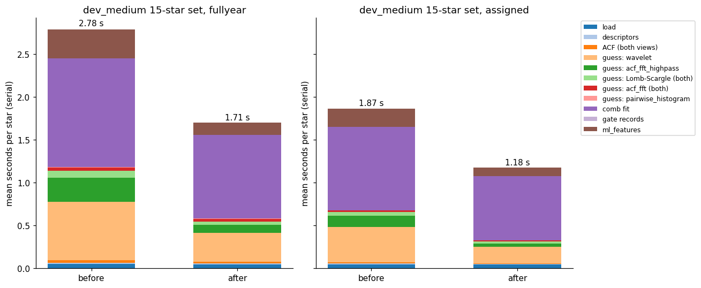
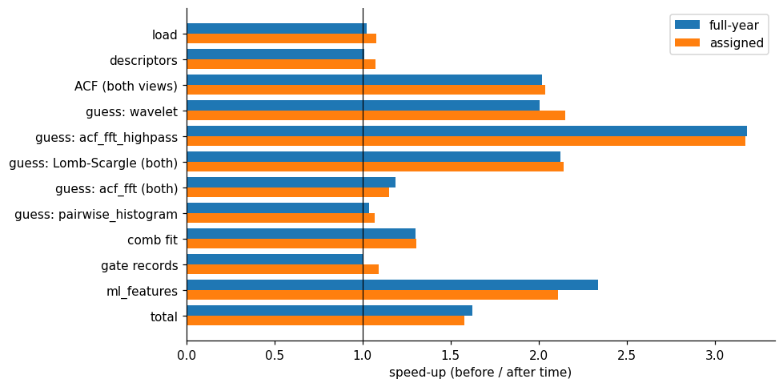
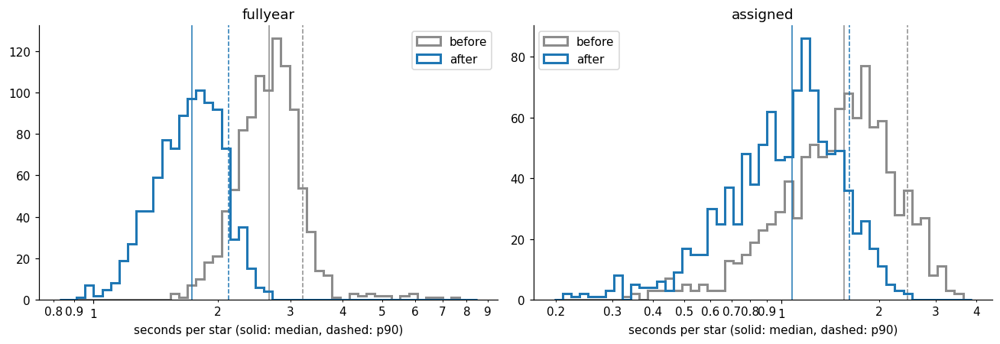
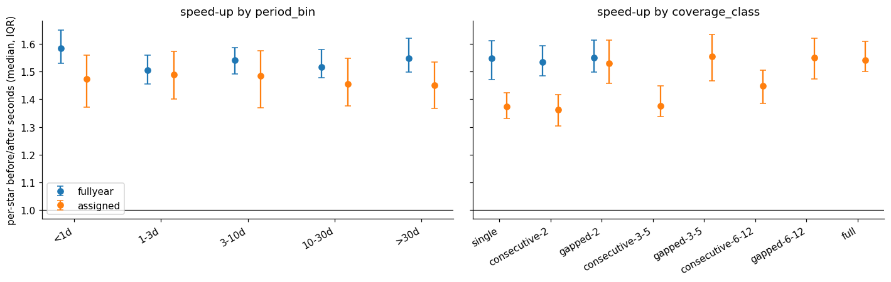
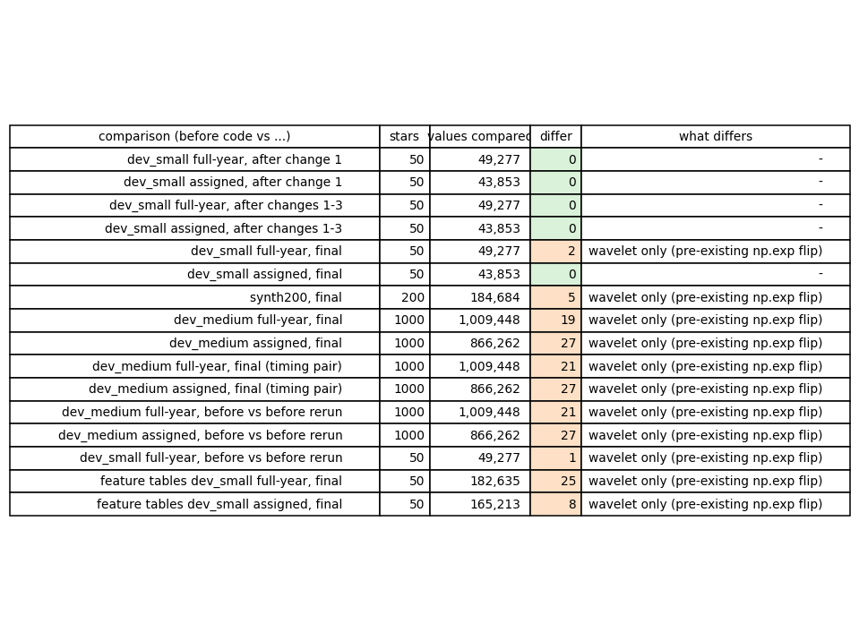
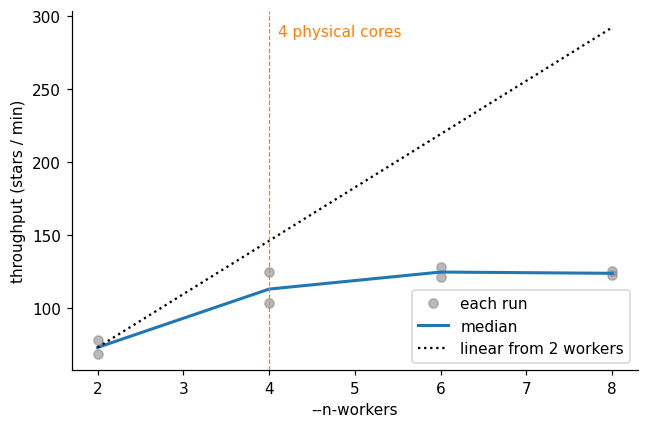
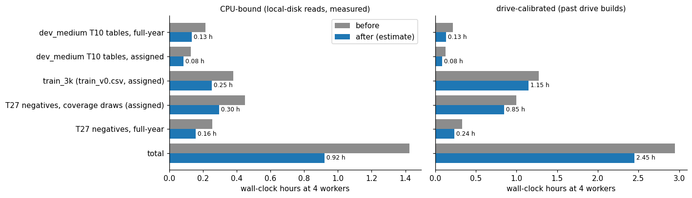

# T12: bit-identical speed-up of the per-star pipeline

**Date:** 2026-11-12 · **Author:** T12 performance-optimizer session (overnight) · **Branch:** `claude/t12-speed-up-2a627c` · **Status:** draft

## TL;DR
- **1.5–1.6× faster per star, every result unchanged.** dev_medium at 4 workers: median per-star time 2.66 → 1.73 s full-year (p90 3.20 → 2.12), 1.56 → 1.07 s assigned (p90 2.45 → 1.62). The feature-table build is 1.62× faster, the production path 1.31×.
- **Six changes, none a numerical approximation:** skip Stage 1 calls that can't add candidates, vectorize the comb fit's phase search and model, cache repeated ACF FFTs, and two ml_features caches.
- **Bit-identical:** every metric key matches the new v6 baselines, and `check_goals` passes. The only per-star differences are wavelet last-bit flips, which the unchanged code also shows run to run (an `np.exp` quirk, P4; your call whether to fix).
- **v6 baselines committed.** Keep 4 workers. The ranker-table rebuild should take ~2.5 h on the drive (was ~3 h).

## Question / goal
T12 in `docs/TASKS.md`: make the per-star pipeline faster without changing any result. That covers Stage 1 `guess_*`, `acf_utils`, `comb_fit`, `preprocessing`, the `ml_features` used by `tools/build_feature_tables.py`, and the scorecard's runtime plumbing. It also supplies the scorecard v6 baselines (Rae agreed they'd come from this "before" run). No `goals.json` goal targets runtime.

## What I did
1. **Before runs and v6 baselines.** I froze the unchanged code (`9063c95`, the T5 pipeline) in a detached worktree and ran scorecard v6 at 4 workers on:
   - `datasets/dev_medium.csv,data_root=data/smarts_dev,sectors=ignored` (full-year);
   - `...,sectors=manifest` (assigned);
   - `synthetic:n=200,seed=0`;
   - dev_small in both modes.
   
   Every v5 key matches the committed `_t5` baselines bit for bit (`tools/compare_scorecard_keys.py`: 1151, 1439 and 724 values, 0 differ). I committed them as `benchmarks/baselines/{dev_medium_fullyear,dev_medium_assigned,synth200_s0}_v6.json` plus `_v6_tables/`.
2. **Profile.** New `benchmarks/profile_pipeline.py` times each stage of `scorecard.score_one_star` serially, with an optional cProfile and the ml_features step (`--features`). I profiled 15 dev_medium stars (3 per period bin, mixed coverage classes) in both modes.
3. **Optimize, one change at a time.** Each change got an equivalence test against the old implementation (`tests/test_t12_speedups.py`, 36 tests). After each one I ran `pytest` and a dev_small scorecard in both modes, compared value by value with `tools/compare_runs_exact.py` (new; NaN-aware, skips only `seconds`/`fit_seconds` and the metrics `config`/`runtime` blocks).
4. **Timing.** I ran three interleaved before/after repeats of the 15-star set on the idle machine (serial, `--features`). I then reran the before and after code back to back on dev_medium at 4 workers, because the first before runs were slowed (see "What didn't work").
5. **After runs.** I ran the optimized code on dev_medium (both modes), synth200 and dev_small, plus dev_small feature tables before and after. Then a worker-count scan at 2/4/6/8 workers on dev_small full-year (2 repeats each), and `check_goals.py --baseline` against the new `_v6` files.

## Results

### Where the time went, and what each change bought


The comb fit (purple) is still the biggest stage; the wavelet (light orange) and the high-pass ACF-FFT (green) shrank the most. Serial, idle machine, 15 stars × 3 repeats: **full-year 2.78 → 1.71 s/star (1.62×), assigned 1.87 → 1.18 s/star (1.58×)**, with `--features` on.



Each bar is one stage's before/after time ratio; 1.0 means unchanged.

The six changes, in the order made (micro-benchmarks from `microbench.py`, old vs new implementation on the same inputs):

| # | Change | File | Measured effect |
|---|---|---|---|
| 1 | `two_view_guesses` skips the long-view call for methods marked `@acf_independent` (`lombscargle`, `lombscargle_short`, `acf_fft_highpass`, `wavelet`). They never read the ACF, so the second call returned the same candidates, all of which the dedup then discarded. | `guesses.py` | wavelet stage 2.0–2.2×, Lomb-Scargle 2.1×, high-pass 3.2× (with change 4) |
| 2 | `_grid_search_t0`: one vectorized pass over the 200 trial phases (`_comb_scores_over_t0`) instead of 200 `comb_score` calls. The sums stay per-row 1-D `np.sum`, so the float order is unchanged. | `comb_fit.py` | 4.6–4.9× per candidate |
| 3 | Comb-model residual and Jacobian computed on concatenated per-point arrays instead of a Python loop over windows (same elementwise operations, same order). | `comb_fit.py` | residual 3.8–5.0×, Jacobian 2.9–4.9× per call; with change 2, comb fit stage 1.30× |
| 4 | `compute_acf`: exact-bytes cache of the full-length ACF and of the gap-mask pair counts. The Stage 1 view reuses the Stage 2 FFTs, and the five high-pass windows reuse the mask FFT. | `acf_utils.py` | repeat call 51–68×; ACF stage 2.0× |
| 5 | `ml_features._s_ph`: one `axis=1` `np.std` over the NaN-free bins instead of a per-bin loop. | `ml_features.py` | 14× at P = 0.42 d (no change at 27 d, which has few bins) |
| 6 | `ml_features`: identity-keyed LRU cache of the candidate-independent spectrum work (sorted FFT spectra, `find_peaks` tables, medians), previously redone for every candidate. | `ml_features.py` | with 5, ml_features stage 2.1–2.3× |

**cProfile before → after** (15 stars, full-year, `--features`): total 61.9 → 39.5 s; `two_view_guesses` 22.8 → 10.7 s; `fit_rotation_period` 28.8 → 23.8 s; `compute_acf` 4.1 → 1.2 s; `extract_candidate_features` 6.8 → 2.8 s (`data/prof_*.txt`).

### Per-star runtime at 4 workers (dev_medium, 1000 stars per mode)


The whole distribution moves left, including the slow tail (dashed lines are p90).

| | median before → after | p90 before → after | mean speed-up |
|---|---|---|---|
| full-year | 2.66 → 1.73 s (1.54×) | 3.20 → 2.12 s (1.51×) | 1.56× |
| assigned | 1.56 → 1.07 s (1.45×) | 2.45 → 1.62 s (1.51×) | 1.47× |

Wall time: full-year 682 → 438 s, assigned 404 → 276 s (back-to-back runs on the idle machine).



The speed-up is flat across period bins (median 1.45–1.58×). Short assigned baselines (single, consecutive-2, consecutive-3-5) gain the least, 1.36–1.38×, probably because the comb fit, the least-improved stage, is a larger share of their time (not separately measured).

### Bit-identical evidence


Green rows are exactly identical; orange rows differ only in wavelet fields. The before code compared against a rerun of itself differs by the same amount.

- **After changes 1 and 1–3:** dev_small in both modes is identical in all 49,277 and 43,853 values.
- **metrics.json:** every key is bit-identical to the `_v6` baselines (1394 / 1817 / 724 values, 0 differ). `check_goals.py --baseline` reports `OVERALL: PASS` with every delta +0.000 (`data/check_goals_*.txt`).
- **Per-star values (rows.jsonl, ~1M values per dev_medium run):** every difference is `methods.wavelet.top1` or `methods.wavelet.n_candidates`, on 17–23 stars per run. No wavelet outcome changes, so no metric moves. The final answer, every other method's candidates, and every gate record are identical.
- **Feature tables (dev_small):** of 182,635 and 165,213 cells, only `wavelet_nearest_peak_frac_power` / `_snr` differ (25 and 8 cells, last ulp, one star each).
- **The wavelet differences are pre-existing.** The before code against a rerun of itself on dev_medium differs in 21 and 27 wavelet values, the same count as after against before. Repeated in-process calls of the unchanged `guess_wavelet` give 2–4 distinct GWPS byte patterns per star (dev_small 031596, 419951, 107369).
- **Root cause (this explains backlog item P4):** `_morlet2_kernel`'s `np.exp(-0.5*x**2)` returns different bytes for byte-identical input, depending on allocation state (numpy 1.26.4, AVX-512 on the i5). I couldn't pin the exact trigger: input alignment alone doesn't do it. Any change that alters allocation patterns can flip it.

No change was rejected for breaking bit-identity.

### Worker count


Throughput plateaus at the 4 physical cores. On dev_small full-year (50 stars, 2 repeats) the median wall time is 41.0 / 26.5 / 24.0 / 24.2 s at 2 / 4 / 6 / 8 workers. 6 or 8 workers gave 1.10× the throughput of 4, but the two 4-worker repeats alone spread from 24.0 to 29.0 s. **Recommendation: keep `determinism.default_n_workers()` (= 4 here), as T14 set it.** No defaults changed. (`benchmarks/pb_scan.py` still hardcodes 10.)

### Projections
Serial s/star on the 15-star set → CPU-hours per 1M stars (`data/projection_1M.csv`):

| path | full-year | assigned |
|---|---|---|
| production (load → ACF → 3 default methods → fit) | 1.40 → 1.07 s; 388 → 297 h | 1.06 → 0.81 s; 295 → 226 h |
| scorecard (all 7 methods) | 2.45 → 1.57 s; 679 → 436 h | 1.66 → 1.08 s; 460 → 301 h |
| feature build (scorecard + ml_features) | 2.78 → 1.71 s; 773 → 476 h | 1.87 → 1.18 s; 520 → 329 h |

The production path gains less (1.31×) because it doesn't run the wavelet or high-pass methods; its win is the comb fit plus the ACF and Lomb-Scargle reuse.

### Ranker-table rebuild estimate (not run)


Left: estimated from measured 4-worker throughput with local-disk reads. Right: the same savings subtracted from past drive runs, since drive I/O doesn't get faster.

The rebuild covers dev_medium T10 tables (both modes), `train_3k` (`train_v0.csv`, 3,000 assigned) and the T27 negatives (3,531 assigned draws + 1,177 full-year): 9,708 stars in all.
- **CPU-bound:** 1.42 → 0.92 h.
- **Drive-calibrated:** about 2.95 → 2.45 h. The drive estimate uses the T27 report's ~80 min for 4,708 negatives and the T10 report's ~51 min for 2,000 train stars.

**So budget ~2.5 h at 4 workers with the drive plugged in.** On the drive, I/O, not CPU, is now about half the time.

## What didn't work
- **The first before-run timings were inflated.** The original before runs (01:25–02:12) ran while the machine was about 1.9× slower: dev_small full-year took 66.6 s then and 34.9 s on the same code at 03:03. The cause was my profiling and test runs plus background system load. Their *results* are valid (they are the v6 baselines, and every value matches a later rerun apart from the wavelet flips). For timing I used only the interleaved serial A/B and the back-to-back dev_medium pair. Comparing the first before run with the after run would have claimed about 3× instead of 1.5×.
- **Not attempted, because it would change bits:**
  - one `axis=1` reduction for the comb-score sums (numpy's reduction order across zero-padded rows isn't guaranteed to match a 1-D sum);
  - anything inside `scipy.optimize.least_squares`: looser tolerances, `lsmr`, fewer points per window;
  - a cheaper CWT: smaller FFT sizes, real FFTs, batched kernels (the batched version was already measured slower; see the `_cwt_morlet` note).
- **No same-bits option was found for the two biggest remaining stages:** the comb fit's `least_squares` internals (SVD per trust-region step, `trf_bounds` overhead) are 62% of the optimized full-year scorecard path, and the wavelet's 200 padded FFT pairs are 22%. Ranked ideas are in proposal P38.

## Open questions for Rae
1. **Fix the wavelet `np.exp` nondeterminism (P4, updated)?** It's harmless for final answers, but it reaches the ranker features (`wavelet_nearest_peak_*`) and the per-method scorecard columns, and it will keep tripping exact before/after checks. A fix (e.g. building the Morlet envelope through a deterministic path) changes wavelet bits once, so it needs your OK and a new baseline.
2. **Result-changing speed-ups (P38)** are now the only big lever: the comb fit's solver settings and a cheaper CWT. Want a measured accuracy-vs-time study on dev_medium?
3. **Worker count:** keep 4 (my recommendation), or have someone time 6 on a 1000-star run? The 1.10× I saw at 6 is within the noise of the small set.
4. **Runtime goal:** T12's "Follow-up" suggests a runtime goal in `goals.json` on `benchmarks/profile_pipeline.py`'s output. If you want one, a natural pair is production-path ≤ 1.1 s/star serial on the 15-star set, full-year (now 1.07), and feature build ≤ 1.75 s/star (now 1.71).
5. The committed `_v6` baselines' `runtime` blocks come from the slowed first run (median 5.91 s full-year). They aren't metrics and no goal reads them, but don't quote them as the pipeline's speed.

## Reproduce
```bash
PY=/opt/anaconda3/envs/ss_openblas/bin/python
# scorecards (both code versions; "before" = a detached worktree at 9063c95 with data/smarts_dev symlinked)
$PY benchmarks/scorecard.py --manifest datasets/dev_medium.csv --data-root data/smarts_dev --ignore-manifest-sectors --n-workers 4 --outdir runs/t12_dmfy
$PY benchmarks/scorecard.py --manifest datasets/dev_medium.csv --data-root data/smarts_dev --n-workers 4 --outdir runs/t12_dmas
$PY benchmarks/scorecard.py --synthetic 200 --seed 0 --n-workers 4 --outdir runs/t12_syn
$PY tools/compare_runs_exact.py runs/<before> runs/<after> --json out.json           # value-by-value identity
$PY tools/compare_scorecard_keys.py benchmarks/baselines/dev_medium_fullyear_v6.json runs/t12_dmfy/metrics.json
$PY benchmarks/check_goals.py runs/t12_dmfy/metrics.json --baseline benchmarks/baselines/dev_medium_fullyear_v6.json
# per-stage timing / cProfile (15-star set in the notebook data; run with the machine idle)
$PY benchmarks/profile_pipeline.py --manifest datasets/dev_medium.csv --data-root data/smarts_dev --ignore-manifest-sectors \
    --star-ids <ids> --features --repeats 3 --out runs/t12_profile.csv --cprofile runs/t12_profile.txt
# feature tables (identity of ml_features)
$PY tools/build_feature_tables.py --manifest datasets/dev_small.csv --data-root data/smarts_dev --no-flags --n-workers 4 --outdir runs/t12_ft
# report data + figures
$PY reports/2026-11-12_t12-speed-up/microbench.py
$PY reports/2026-11-12_t12-speed-up/collect_data.py <scratch dir with the run folders listed in its docstring>
$PY reports/2026-11-12_t12-speed-up/build_notebook.py && $PY tools/run_notebook.py reports/2026-11-12_t12-speed-up/notebook.ipynb
```
The 15 timing stars are 008705, 014308, 009444, 091212, 151481, 098694, 029013, 049025, 030879, 001810, 004433, 002102, 218521, 995392 and 311204 (prefix `smarts-tess-v1.0-`). They were drawn with `groupby("eval_pbin").sample(3, random_state=0)` from `datasets/dev_medium.csv`.
