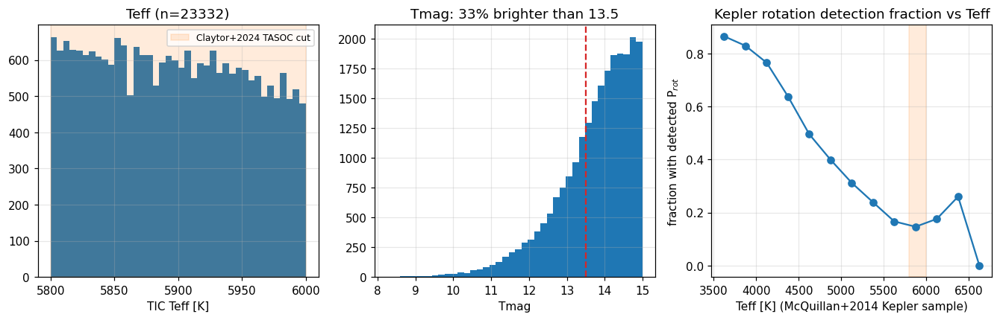
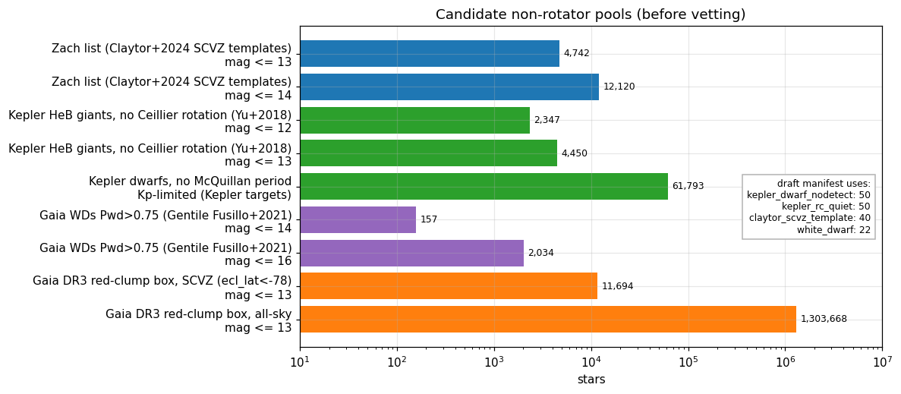
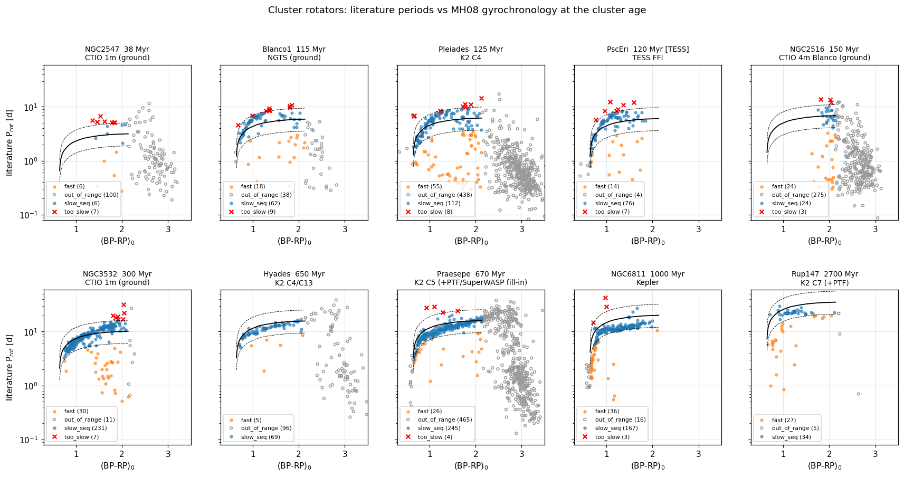
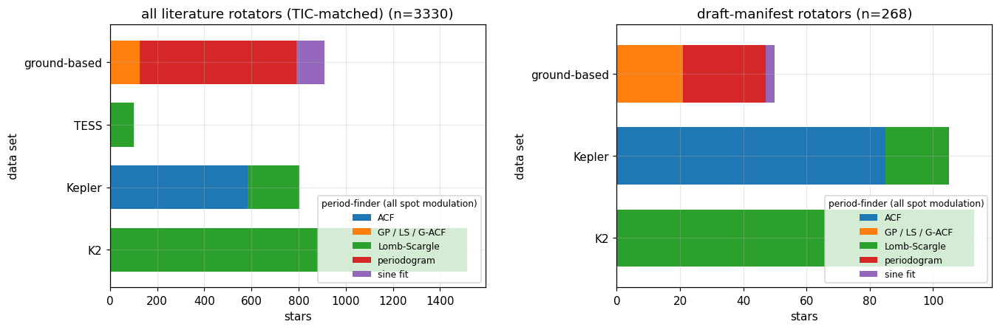
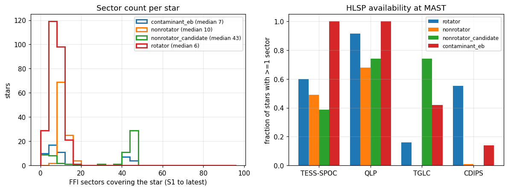
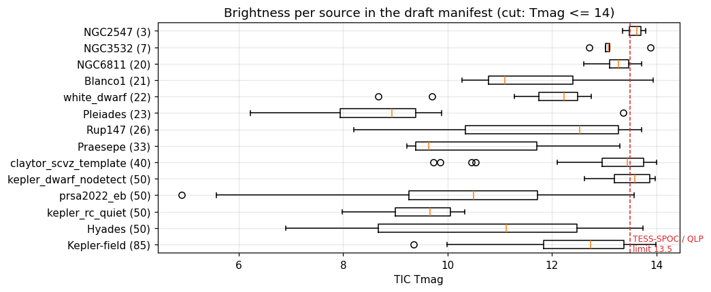
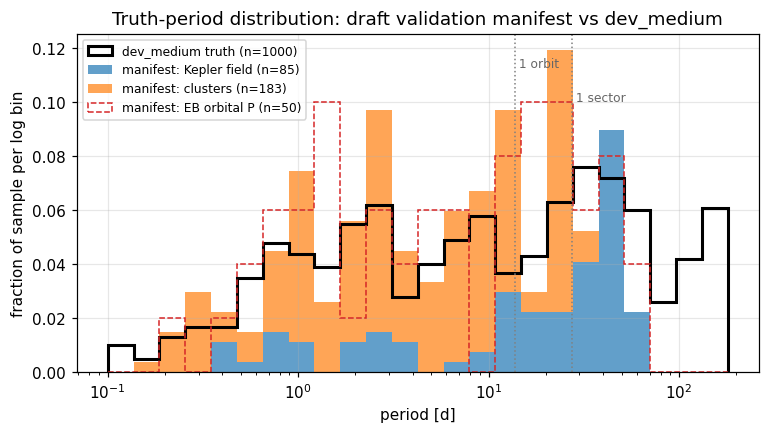

# P27: real-TESS validation set scoping

**Date:** 2026-11-12 · **Author:** P27 scoping session · **Branch:** `claude/p27-validation-scoping-4c1c1b` · **Status:** draft

## TL;DR
- **Zach's 23,332 TIC IDs are not vetted non-rotators.** They match exactly the Claytor+2024 southern-CVZ noise-template
  cut: TIC Teff 5800–6000 K dwarfs, Tmag 6–15. In Kepler, 14% of such stars show rotation. Use them as
  "expected undetectable", not as truth negatives.
- **Literature verdict:**
  - **Red clump:** usable only if asteroseismically classified and Kepler-quiet. A CMD-only selection carries 2–15%
    rotators and ~0.3 d oscillations.
  - **White dwarfs:** a clean but faint control. Only 157 have G < 14.
  - Kepler dwarfs with no detected period are the best large negative pool.
- **Draft manifest:** `datasets/proposed/p27_validation_draft.csv`, 480 stars. 268 rotators stratified 0.1–71 d with
  method and data-set provenance, 100 Kepler-quiet negatives, 62 candidate negatives and 50 Prša EBs.
- **Recommended light curves:** TESS-SPOC `SAP_FLUX` as primary, QLP `SAP_FLUX` as fallback; about 2.3 GB. The cluster
  stars have a median of only 6 sectors.
- **Rae decides:** how to label Zach's list, product choice, and the mix.

## Question / goal
Scope P27 in `docs/TASKS.md`: a small (≤ 500) real-TESS set of known rotators and known non-rotators. It follows Rae's
direction (young clusters + gyrochronology; WD / red-clump negatives; Zach's TIC list) and her 2026-11-12 additions:
- a literature check;
- a citation list;
- period method and data-set provenance;
- TGLC / CDIPS.

No goals in `benchmarks/goals.json` are touched. No light curves were downloaded and no pipeline was run.

## What I did
All steps are catalogue queries, cached under the gitignored `data/p27_cache/`. Scripts are in `tools/validation_set/`:
- `vo.py`: stdlib-only clients for VizieR ASU (CfA mirror; CDS was down on 2026-11-11), MAST Catalogs/CAOM and TESScut,
  with atomic caching. The env has no astroquery/pyvo/requests, so nothing was installed.
- `tic_lookup.py`: TIC v8.2 rows for Zach's list.
- `build_rotators.py`: cluster and Kepler-field periods, mapped to TIC through Gaia DR2 / KIC, plus the MH08 gyro flag.
  Output: `data/rotators_all.csv`.
- `gaia_counts.py`, `gaia_vari_counts.py`: Gaia DR3 red-clump counts and variability-class counts (ESA archive TAP).
- `summarize_sources.py`: non-rotator pool sizes and McQuillan detection fraction vs Teff.
- `build_manifest.py`: the draft manifest, with FFI sectors (TESScut) and HLSP availability per star (MAST CAOM).
- `download_plan.py`: real file sizes from MAST product metadata (no downloads). Output: `data/download_plan.csv`.
- `make_notebook.py`: writes `notebook.ipynb`, which regenerates every figure.

Literature: arXiv full texts of Claytor+2024 and Claytor & Tayar 2025, the TGLC, CDIPS and SPOC papers, plus web searches
(sources in the citation list).

**Bug found and fixed on the way:** 19-digit Gaia DR2 IDs silently lost precision whenever a column passed through
float64, and the first cross-match matched only 13–40% of several clusters. `vo.py` now parses identifier columns as
exact `Int64`, giving 98–100% TIC matches.

## Results

### 1. What Zach's list is


All 23,332 IDs have:
- TIC Teff in 5800–6000 K;
- `lumclass = DWARF`;
- ecliptic latitude ≤ −78°;
- Tmag ≤ 15.

That is exactly the Claytor+2024 §III.1.2 cut for TASOC "quiescent" noise templates. The paper's 22,090 are what was
left after a ≥ 4-sector light-curve cut, so this list is plausibly the parent sample. The stars are not red-clump stars
(red clump was the *Kepler* paper, Claytor & Tayar 2025), and nobody vetted them as non-rotating. They were chosen
because hotter-than-solar stars are *less often* detected (right panel). Even so, 14.4% of Kepler stars at
5800–6000 K have a McQuillan period, with a median of 11 d. Only 33% are brighter than Tmag 13.5. **Treat them as a
"should mostly be undetectable" population.** A detection there is not automatically a false positive.

### 2. Literature check: are white dwarfs and red-clump stars good "non-rotators"?

**What we need from a negative.** We need a star with *no detectable periodic signal anywhere in 0.1–180 d in a TESS FFI
light curve*. That is a property of the light curve, not of the star's spin. "Slow rotator" is good enough only when the
expected spot signal is below TESS noise **and** the star has no other periodic signal (pulsation, binarity, granulation
peaks, a blended neighbour) in that range. A negative set is mostly a test of how often the pipeline invents a period
from systematics and red noise. For that, "astrophysically quiet in 0.1–180 d" matters more than "not rotating".

**Red clump (Claytor & Tayar 2025 used them as noise templates, but in *Kepler*).**
- *Most don't show rotation, but not all.* Ceillier+2017 found rotation in 2.08% of 17,377 oscillating Kepler red giants
  (361 stars), yet in **~15% of 575 low-mass (M < 1.1 M☉) red-clump stars**. They read the excess as mergers and
  engulfment on the RGB. Gaulme+2020 found ~8% of ~4,500 bright Kepler giants with rotational modulation and argue that
  low-mass giants gain angular momentum on the way to the clump (engulfment or merger). Tayar+2015 report rapid rotators
  (APOGEE v sin i) among low-mass giants. **So a red-clump sample selected only on the CMD has a several-% to ~15%
  rotator contamination,** with periods of tens of days, inside our search range.
- *Oscillations and granulation are in range at the short end.* A clump star has ν_max ≈ 30–40 μHz (P ≈ 7–9 h ≈ 0.3 d),
  with granulation at a similar or slightly longer timescale (Mathur+2011: granulation timescale scales as 1/ν_max).
  Both sit right at our 0.1–1 d bins, as quasi-periodic red-noise humps rather than coherent peaks. Claytor & Tayar 2025
  report that their CNN detected **608 asteroseismic frequencies** from red giants as "periods", and that the clump
  light curves were noisier than the rest of the CMD. **The days-to-tens-of-days issue the brief raised belongs to the
  high-luminosity RGB/AGB** (ν_max ≲ 1 μHz → P ≳ 10 d, semi-regular variables). The M_G cut excludes most of those,
  but a CMD-only selection (−0.5 < M_G < 1.5) does admit some upper-RGB stars and AGB bump stars.
- *Blending.* Giants are bright and distant, so at a fixed Tmag they sit in more crowded fields than dwarfs. Claytor &
  Tayar 2025 found that even PSF-deblended Kepler background light curves were still blended for up to 63% of
  periodic pairs. TESS's 21″ pixels make this worse.
- *Usable form:* the clean version of this idea is **asteroseismically classified He-burning (clump) giants in the
  Kepler field with no rotation detected in four years of Kepler data** (Yu+2018 phase = HeB, minus every Ceillier+2017
  rotator or polluted star). Kepler is ~10x more precise than TESS FFIs, so a star with no Kepler rotation signal has
  none TESS can see either. We should still expect the pipeline to "detect" the ~0.3 d oscillation hump; that is a known
  astrophysical signal, so score it as its own outcome (`seismic`), not as a rotation false positive.

**White dwarfs.**
- *Variability classes that hit our range:*
  - Spotted or magnetic WDs rotate at minutes to hours (Oliveira da Rosa+2024: 318 periods among 9,285 TESS WDs;
    median ~3.9 h for single WDs).
  - ZZ Ceti / DBV / GW Vir pulsators sit at 100–1500 s, below our 0.1 d floor except as aliases in 30-min FFIs.
  - Reflection and ellipsoidal effects in WD + M-dwarf and double-WD binaries run from hours to a few days.
  - Steen+2024 confirmed 105 Gaia-variable WDs (binaries, spotted, pulsators; median amplitude 1.4%).
  - Gaia DR3's classifier labels 910 sources "WD" variables.
- *Most of those signals sit below 0.1 d*, so a correctly working pipeline should report "no period in 0.1–180 d" for
  nearly all WDs. That makes them a clean test of systematics-only false positives, which is what we want.
- *But they are faint.* Of the Gentile Fusillo+2021 high-confidence WDs (P_WD > 0.75), only **157 have G < 14 and 566
  have G < 15**; 2,034 have G < 16. At G ≈ 15–16 a TESS FFI star is photon- and background-dominated. The sample tests
  "noise only" well, but the noise is in the faint regime, unlike the Tmag 9–13 stars we most care about.
- *Crowding:* WDs are faint neighbours of brighter stars more often than not, so a TESS "detection" in a WD aperture is
  usually a neighbour's signal. That is a useful blend test, but it is not a clean negative unless TGLC-style PSF
  photometry is used.

**Verdict.**
- **Red clump: usable with care.** Use asteroseismically classified Kepler-field clump stars with no Kepler rotation
  (≈2,300 at Kp ≤ 12; 4,450 at Kp ≤ 13). Do not use a CMD-only clump selection: it carries an unknown several-% to 15%
  rotator rate. Score a 0.2–0.5 d hump as `seismic`, not as a rotation FP.
- **White dwarfs: usable as a small, faint, systematics-only control** (~20–40 stars at G ≲ 14.5). They don't represent
  the brightness of the main sample, and crowding has to be checked star by star.
- **"Slow rotator" is good enough only where the spot signal is below TESS noise.** That is true for clump giants
  (P ~ 100+ d, tiny amplitudes; rapid rotators excluded by Kepler). It is not true for an arbitrary slow-rotating
  dwarf: TESS can see a 20 d K dwarf at 1% amplitude.
- **Complements the literature supports:**
  1. **Kepler dwarfs with no detected period** (McQuillan+2014 non-periodic, after removing Santos+2019/2021
     detections): ~58,600 stars, 4000–6200 K. Same logic as the clump: no rotation signal in four years of Kepler, so any
     confident TESS period is a false positive or a blend. Caveat: activity cycles and evolving spots mean "not detected
     in Q3–Q14" is not "never variable", but it is the strongest label available.
  2. **Inactive old FGK dwarfs with spectroscopic rotation** (log R'HK ≲ −4.9 and P_rot from activity time series, e.g.
     Mount Wilson / HARPS samples). They are few and bright (Tmag < 8, saturation risk), so they are a small
     "bright-star" negative block for later.
  3. Hot A/F stars are **not** quiet: δ Sct / γ Dor pulsate at 0.3–3 d. Gaia DR3 flags 748,058 DSCT|GDOR|SXPHE
     candidates and 54,476 `vari_ms_oscillator` stars.



Pool sizes at TESS-usable brightness, before vetting. There are ~1.3M clump-box stars with G < 13 all-sky, but the
pools with an *independent* quiet label (Kepler) are 10^3–10^4.

### 3. Known rotators: clusters and the Kepler field, with provenance

| Source | Age (Myr) | Stars w/ period (TIC-matched) | Tmag ≤ 14 | P range (d) | Method (period-finder) | Data set |
|---|---|---|---|---|---|---|
| NGC 2547 (Irwin+2008 via Godoy-Rivera+2021) | 38 | 119 (119) | 6 | 0.19–11.6 | spot modulation; sine fit | CTIO 1 m (ground) |
| Blanco 1 (Gillen+2020) | 115 | 127 (125) | 75 | 0.26–10.8 | spot modulation; GP / LS / G-ACF, adopted | NGTS (ground) |
| Pleiades (Rebull+2016 via GR21) | 125 | 613 (612) | 238 | 0.08–17.3 | spot modulation; LS + by-eye | K2 C4 |
| Psc–Eri (Curtis+2019) | 120 | 101 (101) | 101 | 0.45–12.2 | spot modulation; LS | **TESS FFI (not independent; excluded)** |
| NGC 2516 (Fritzewski+2020 via GR21) | 150 | 326 (326) | 0 | 0.09–13.7 | spot modulation; periodogram | CTIO (ground) |
| NGC 3532 (Fritzewski+2021) | 300 | 279 (275) | 121 | 0.51–32.0 | spot modulation; periodogram | CTIO 1 m (ground) |
| Hyades (Douglas+2019 + compiled) | 650 | 170 (168) | 151 | 0.20–38.6 | spot modulation; LS (K2) / per source (ground) | **per star:** K2 C4, K2 C13, SuperWASP, HATNet, ASAS, Lowell, Prosser |
| Praesepe (Douglas+2019) | 670 | 740 (734) | 308 | 0.13–38.1 | spot modulation; LS + by-eye | K2 C5 (+PTF/SuperWASP fill-in) |
| NGC 6811 (Curtis+2019 via GR21) | 1000 | 222 (219) | 48 | 0.55–42.7 | spot modulation; LS | Kepler |
| Ruprecht 147 (Curtis+2020) | 2700 | 66 (66) | 57 | 0.20–30.0 | spot modulation; LS + by-eye | K2 C7 (+PTF) |
| Kepler field (McQuillan+2014; stratified sample of 600) | field | 600 (585) | 292 | 0.22–65.3 | spot modulation; ACF | Kepler Q3–Q14 |

Per-star rows, including `period_method`, `period_dataset`, `period_ref` and `tess_independent`, are in
`data/rotators_all.csv` (3,363 stars, 3,330 with TIC). Hyades periods carry the *per-star* source. I decoded Douglas+2019's
`P` column by checking which period column each code fills. α Per and IC 2602/2391 were not included: their modern
periods are TESS-derived (e.g. Kounkel+2022), and the older ground-based catalogues weren't reachable while CDS was
down. Method strings for NGC 2516 / NGC 3532 ("periodogram") and the exact telescopes are from memory of the papers;
check them before publishing.



Each panel shows the literature periods against Mamajek & Hillenbrand (2008) at the cluster age.
- **Flags** (black line ×0.6 and ×1.6):
  - 1,315 FGK stars fall in the calibration range: 1,026 `slow_seq`, 241 `fast`, 48 `too_slow`.
  - `too_slow` is ≤ 2.6% in NGC 3532, Praesepe, NGC 6811, Hyades and Rup 147, where gyrochronology is reliable.
  - It is high in NGC 2547 (37%) and Blanco 1 (10%). That reflects MH08's failure for pre-main-sequence / ≲ 120 Myr
    stars (the empirical slow sequence lies above it), not bad periods.
- **The manifest excludes `too_slow` stars and keeps `fast` ones.** Unconverged fast rotators are real periods.
- M dwarfs (BP−RP ≳ 2.1) can't be checked with MH08. A calibrated empirical model (gyro-interp, Bouma+2023) would cover
  them; it is not installed.



All literature periods are photometric spot modulation, mostly LS (K2) and ACF (Kepler). Only Psc–Eri is TESS-derived,
and it is excluded from the manifest. No v sin i or activity-only periods entered the truth set: they constrain
P/sin i or are statistical, so they don't belong in a ±10% scorer.

### 4. Known non-rotators and candidate negatives in the draft manifest

| Block | n | Label | Truth basis |
|---|---|---|---|
| `kepler_rc_quiet` | 50 | nonrotator | Yu+2018 He-burning (seismic), not in Ceillier+2017 rotating/polluted tables; Kp < 12.5 |
| `kepler_dwarf_nodetect` | 50 | nonrotator | McQuillan+2014 non-periodic, 4000–6200 K, log g > 4.2, minus Santos+2019/2021 detections (cleaning removes 3,158 of 61,793) |
| `claytor_scvz_template` | 40 | nonrotator_candidate | Zach's list (assumed quiet, unvetted) |
| `white_dwarf` | 22 | nonrotator_candidate | Gentile Fusillo+2021, P_WD > 0.9, G < 14.5 |
| `prsa2022_eb` | 50 | contaminant_eb | Prša+2022 TESS EBs, orbital period stratified 0.1–71 d |

**Proposed checks of "quiet"** (none run; they need light curves):
1. Kepler-quiet stars: re-read the Kepler PDC light curve and require a 4-yr ACF/LS peak below an amplitude threshold
   (cheap, small downloads).
2. Zach's list: query Gaia DR3 `vari_summary` / `vari_classifier_result` by Gaia ID, drop any star in a variable class,
   and drop stars with a TESS-SPOC/QLP S1–13 LS amplitude above ~3σ of the CDPP.
3. WDs: TESS-localize-style centroid check of any detected signal.
4. All negatives: TIC `contratio` < 0.2 (applied), plus no Gaia DR3 neighbour brighter than the target within 2 TESS
   pixels (not applied; one Gaia cone per star).

### 5. Variable-star contaminants
WG6/OGLE classes are profiled by the parallel WG6 session (`docs/WG6_REFERENCE.md` on `claude/t28-wg6-scoping-*`,
still uncommitted). That set is bulge I-band archival photometry and does not overlap with this one. TESS-side
sources, with counts queried this session (`data/gaia_vari_counts.csv`):

| Source | Count | Use |
|---|---|---|
| Prša+2022 TESS EBs | 4,584 | 50 in the draft (orbital P truth) |
| Gaia DR3 `vari_eclipsing_binary` | 2,184,477 | EB veto / more EBs |
| Gaia DR3 `vari_rotation_modulation` | 474,026 | *Rotators*, not contaminants (TESS-independent periods; a future rotator block) |
| Gaia DR3 classifier DSCT\|GDOR\|SXPHE / `vari_ms_oscillator` | 748,058 / 54,476 | pulsator contaminants at 0.02–3 d |
| Gaia DR3 classifier RS (RS CVn) / ELL / YSO | 742,263 / 65,300 / 79,375 | spotted binaries (real rotation, orbit-locked), ellipsoidals, dippers |
| Gaia DR3 classifier LPV / `vari_long_period_variable` | 2,325,775 / 1,720,588 | giants with P ≳ 10 d: the main long-period FP class |
| Gaia DR3 `vari_rrlyrae` / `vari_cepheid` | 271,779 / 15,021 | rare at Tmag < 14 off the plane |
| Fetherolf+2023 TESS 2-min variables | ~46k periodic (S1–26, from the paper) | cross-check |

### 6. Light-curve products

Scope note: rows marked ✔ were checked against the paper or the MAST HLSP page this session; the rest are from
the papers as I know them and should be confirmed on one file before a loader is written.

| Product | Photometry / crowding | What it does to long periods | Mag limit, sectors | Cluster stars | Loader needs |
|---|---|---|---|---|---|
| **TESS-SPOC FFI** (Caldwell+2020) ✔ | SPOC aperture photometry; targets need crowding metric ≥ 0.8 ✔ | `PDCSAP_FLUX`: cotrending basis vectors fitted per sector. It attenuates or distorts signals longer than ~10–13 d (the reason Claytor+2024 built custom light curves). `SAP_FLUX` is in the same file, untouched. | ≤160k stars per sector; Tmag ≤ 13.5, H ≤ 10, d < 100 pc, all 2-min targets ✔. Started at S14, since back-filled; per-star coverage is patchy (example SCVZ star: 12 SPOC sectors vs 42 QLP). | Poor in dense clusters (crowding cut); OK for nearby open clusters | Standard lightkurve-style FITS (`TIME`, `SAP_FLUX`, `PDCSAP_FLUX`, `QUALITY`); per-sector files to stitch. Closest to an existing format. |
| **QLP** (Huang+2020; Kunimoto+2021/22) ✔ | Aperture photometry on TICA-calibrated FFIs; no deblending | `KSPSAP_FLUX` is spline-detrended for transit search and removes rotation beyond ~1 d. `SAP_FLUX` (raw) is kept. | All stars with Tmag ≤ 13.5 in every sector ✔; the most complete sector coverage | Same crowding as SPOC, without the cut | Per-sector FITS; read `SAP_FLUX`, never `KSPSAP_FLUX` |
| **eleanor / GSFC-eleanor-lite** (Feinstein+2019; Powell+2022) | Aperture + PCA (SPOC CBVs) or analytic-Gaussian PSF | `CORR_FLUX`/PCA regress out long trends much like PDC; `RAW_FLUX` is available | Tmag ≤ 16 in eleanor-lite (patchy by sector); the eleanor code itself is no longer actively maintained | Gaussian PSF is crude in crowded fields | Different column names; needs its own adapter |
| **TGLC** (Han & Brandt 2023) ✔ | **ePSF forward model with Gaia DR3 priors; removes flux from neighbours** ✔ | **`cal_psf_flux`/`cal_aper_flux` are normalised and detrended with a wotan biweight, 1-day window** ✔. That erases rotation beyond ~1 d. Use the raw `psf_flux`/`aperture_flux` columns. | Tmag ≤ 16, all available sectors ✔; negative fluxes for faint stars near variables in S1–26 ✔ | **Best deblending for clusters and crowded fields** | Raw flux plus our own mild systematics correction; per-sector FITS |
| **CDIPS** (Bouma+2019) ✔ | **Image-subtraction photometry** | Three flux versions: raw (IRM), PCA-detrended and TFA-detrended ✔. TFA/PCA remove long trends; IRM keeps them. | G_RP < 16 **cluster and young-star targets only** (~1M, built from Cantat-Gaudin, Kounkel, etc.), 30-min/10-min, sectors 1–55ish ✔ (5 releases) | **Designed for clusters**, but has no field stars, so it can't serve as a general-purpose source | Own FITS layout (multiple apertures, IRM/PCA/TFA); adapter needed |
| (unpopular CPM; Hattori+2022) | Causal pixel model on TESScut cutouts | Can be tuned to preserve long signals; used for TESS rotation | Any star, built on demand from cutouts | Pixel-level, OK in moderate crowding | Built locally from TESScut cutouts |

**Which flux matters for us.** SMARTS noise came from "galaxy" TESScut cutouts reduced with lightkurve regression
correctors, closer to SAP than to PDCSAP (`SMARTS_REFERENCE.md` §5). A fair real-star test therefore uses light curves
**in the same state as the training noise.** Products that detrend on ~1 d windows (QLP `KSPSAP`, TGLC `cal_*`, CDIPS
TFA) would turn every star beyond a few days into a "non-rotator". Those columns must not be used.

**Recommendation.**
- **Primary: TESS-SPOC FFI, read as `SAP_FLUX` (keep `PDCSAP_FLUX` for comparison).** It is the most standard format
  (one small adapter beside `load_smarts_fits`) and covers most Tmag ≤ 13.5 stars from S14 on. Running both fluxes gives
  the PDC long-period-attenuation measurement for free.
- **Fallback: TGLC raw `aperture_flux` / `psf_flux`.** Use it for cluster members and anything with TIC
  `contratio` > 0.1, and for stars that SPOC does not cover, down to Tmag 16. Its Gaia-based deblending is the right tool
  for Pleiades, Praesepe and NGC 2516 fields.
- **Not primary:**
  - **QLP:** use only its `SAP_FLUX`, and only when SPOC is missing; same aperture issues, more sectors.
  - **CDIPS:** clusters only, not field negatives; but its IRM flux is a useful independent cross-check on cluster
    rotators.
  - **eleanor:** unmaintained.
- **Gold standard, later:** if both products prove too lossy at P > 13 d, the long-period answer is TESScut cutouts
  reduced exactly as SMARTS noise was (lightkurve `RegressionCorrector`) or with unpopular/CPM. That is larger
  (≈ 0.5–1 MB per sector per star for a 10×10 cutout at 30-min cadence, more at 200 s) and is Rae's local job.



**Coverage findings.**
- Rotators have a **median of 6 FFI sectors**. Pleiades, Praesepe and Hyades: 5 each. Rup 147: 1. They lie near the
  ecliptic, which TESS mostly skipped until the extended missions. Zach's SCVZ stars have 43.
- 28 rotators have ≤ 2 sectors. **Periods ≳ 13 d in these clusters may be untestable whatever the method.** Score them
  but stratify by sector count and contiguous baseline.
- Availability at MAST across the 480 stars:

  | Product | Rotators | Kepler-quiet negatives |
  |---|---|---|
  | QLP | 91% | 68% |
  | TESS-SPOC | 60% | 49% |
  | CDIPS | 55% | n/a |
  | TGLC | 16% | 0% |

  TGLC at MAST covered only S1–26 for the 40-star size sample; it is the gap-filler only if Rae runs the `tglc`
  package locally.
- Given that, **the practical pair is TESS-SPOC SAP as primary with QLP SAP as fallback.** TGLC and CDIPS are
  crowding cross-checks for cluster members.



Brightness is comparable across blocks (medians Tmag 10.5–12.9). The Kepler dwarfs and Zach's stars sit near the 13.5
SPOC/QLP limit.

### 7. Draft manifest and download plan
`datasets/proposed/p27_validation_draft.csv` (480 rows, seed 27).
- **Columns:**
  - `tic`, `label`, `source`, `truth_period`;
  - `period_method`, `period_dataset`, `period_ref`;
  - `Tmag`, `Teff`, `logg`, `ra`, `dec`, `contratio`, `gyro_flag`;
  - `sectors` (space-separated FFI sectors, S1 to the latest at MAST), `n_sectors`;
  - `n_tess_spoc`, `n_qlp`, `n_tglc`, `n_cdips` (HLSP files per star).
- **Rotators:** 48 per log bin (0.1–1, 1–3, 3–10, 10–20, 20–40 d), drawn round-robin across sources. The 40–71 d bin
  has only 28, all Kepler field: no cluster periods there, and nothing beyond McQuillan's 70 d ceiling is trustworthy.
- **Selection cuts:** Tmag ≤ 14, TIC `contratio` < 0.2, TESS-independent periods, not `too_slow`.



Compared with dev_medium's log-uniform 0.1–180 d, the real set stops at ~70 d and is heavier at 1–40 d. It can't test
the 70–180 d range at all.

**Download plan** (`data/download_plan.csv`): sizes are medians of real MAST product sizes (`data/lc_file_sizes.csv`),
times the per-star file counts.

| Product | Stars | Files | MB/file | Total |
|---|---|---|---|---|
| TESS-SPOC (primary) | 284 | 1,785 | 0.58 | **1.0 GB** |
| QLP (fallback) | 409 | 3,890 | 0.32 | **1.3 GB** |
| CDIPS (cluster cross-check) | 156 | 486 | 0.67 | 0.3 GB |
| TGLC (HLSP, S1–26 only) | 110 | 546 | 0.05 | 0.03 GB |
| TESScut 10×10 cutouts (all 5,541 star-sectors) | 480 | 5,541 | ~11 | ~61 GB (on the drive; later) |

SPOC + QLP comes to ≈ 2.3 GB and 5,675 files. That is small enough for the laptop, roughly 1–2 h with resumable
`astroquery.mast` / curl scripts at typical MAST throughput (a guess; I timed nothing). TESScut cutouts are a
many-hour, drive-only job, needed only if SAP proves too lossy at P > 13 d. A download script isn't written yet; it
needs astroquery or a curl manifest (Rae's call on installing).

## What didn't work
- **CDS VizieR (TAP and ASU) was unavailable all session** ("Page unavailable", then 404s). Everything went through the
  CfA mirror, which itself fails intermittently, so the client retries three passes.
- **Gaia ID precision bug** (above): the first rotator table was wrong for 7 of 11 sources. It was caught by match
  rates, fixed, and rebuilt.
- **The MAST TIC filter ignores the `columns` parameter** and returns all 120+ columns (~1.2 MB per 500 IDs). That is
  slow but fine.
- **MAST `Caom.Cone` per star takes ~100 s**, too slow. `Caom.Filtered` on `target_name` lists is fast and is what
  the manifest uses.
- The red-clump count uses a CMD box with no extinction correction. Take it as an order of magnitude.

## Open questions for Rae
1. **Zach's list:** it is the Claytor+2024 SCVZ TASOC noise-template parent sample (5800–6000 K dwarfs), not
   non-rotators. Options:
   - **(a)** label it `nonrotator_candidate` and report its detection rate separately (draft default);
   - **(b)** ask Zach whether a vetted subset exists;
   - **(c)** drop it.

   Was "non-rotators" his word or a shorthand?
2. **Primary product:** TESS-SPOC `SAP_FLUX` with QLP `SAP_FLUX` as fallback (recommended), or TGLC raw flux for
   everything, which needs the `tglc` package run locally because MAST has S1–26 only for most stars? Should PDCSAP be
   scored too, to measure its long-period attenuation?
3. **Size and mix:** 268 rotators / 162 negatives / 50 EBs. Change the balance? Add a Gaia DR3 `vari_rotation_modulation`
   rotator block (independent periods, all-sky, more sectors) to offset the clusters' low sector counts?
4. **Seismic outcome:** should a 0.2–0.5 d detection on a clump giant be scored as a separate `seismic` outcome rather
   than an FP? It is a real signal, just not rotation.
5. **Long periods:** nothing in the real set tests 70–180 d, and few cluster stars have enough sectors for > 13 d.
   Is that acceptable for v1, with stratification by contiguous baseline?
6. **Installing astroquery** (or tess-point) for the download step: OK?
7. Freeze as is, or iterate first? The manifest is in `datasets/proposed/`, not frozen.

## Reproduce
Network needed for the first run; reruns read `data/p27_cache/`.
```bash
/opt/anaconda3/envs/ss_openblas/bin/python tools/validation_set/tic_lookup.py datasets/external/claytor2025_nonrotator_ticids.txt data/p27_cache/zach_tic.csv
/opt/anaconda3/envs/ss_openblas/bin/python tools/validation_set/gaia_counts.py
/opt/anaconda3/envs/ss_openblas/bin/python tools/validation_set/gaia_vari_counts.py
/opt/anaconda3/envs/ss_openblas/bin/python tools/validation_set/summarize_sources.py
/opt/anaconda3/envs/ss_openblas/bin/python tools/validation_set/build_rotators.py
/opt/anaconda3/envs/ss_openblas/bin/python tools/validation_set/build_manifest.py
/opt/anaconda3/envs/ss_openblas/bin/python tools/validation_set/download_plan.py
/opt/anaconda3/envs/ss_openblas/bin/python tools/validation_set/make_notebook.py reports/2026-11-12_validation-set-scoping/notebook.ipynb
/opt/anaconda3/envs/ss_openblas/bin/python tools/run_notebook.py reports/2026-11-12_validation-set-scoping/notebook.ipynb
```

## Citation list

Bibcodes follow the ADS convention. Entries marked † were confirmed this session against arXiv, the journal or MAST/VizieR
metadata. The rest are standard references whose bibliographic details I'm confident of but did not re-fetch; spot-check
them before they go into a paper.

**Non-rotator samples: red giants / red clump**
1. †Claytor, Z. R. & Tayar, J. 2025, ApJ (accepted), arXiv:2506.03248. Kbonus rotation periods. Uses Kepler red-clump
   light curves (−0.5 < M_G < 1.5; 27,709 stars) as noise templates. Clump light curves are noisier; the CNN reports 608
   seismic frequencies as "periods"; up to 63% of periodic background sources are still blended.
2. †Ceillier, T., et al. 2017, A&A 605, A111 (2017A&A...605A.111C). Rotation in 2.08% of 17,377 Kepler red giants and
   ~15% of low-mass clump stars, attributed to mergers. Source of the "rotating/polluted" exclusion list.
3. †Gaulme, P., et al. 2020, A&A 639, A63 (2020A&A...639A..63G). ~8% of ~4,500 Kepler giants show rotational
   modulation; low-mass giants appear spun up (engulfment or merger).
4. Tayar, J., et al. 2015, ApJ 807, 82 (2015ApJ...807...82T). Rapid rotation (APOGEE v sin i) among low-mass Kepler red
   giants.
5. †Yu, J., et al. 2018, ApJS 236, 42 (2018ApJS..236...42Y). Asteroseismology of 16,094 Kepler giants with
   evolutionary phase (RGB/HeB); defines the "quiet clump" pool.
6. Mathur, S., et al. 2011, ApJ 741, 119 (2011ApJ...741..119M). Granulation in Kepler red giants: the timescale scales
   with 1/ν_max, which puts clump granulation at ~0.1–1 d.
7. Hon, M., et al. 2021, ApJ 919, 131 (2021ApJ...919..131H). Quick-look asteroseismology of ~158k TESS red giants. The
   route to a TESS-native seismic clump classification.

**Non-rotator samples: white dwarfs**
8. †Gentile Fusillo, N. P., et al. 2021, MNRAS 508, 3877 (2021MNRAS.508.3877G). Gaia EDR3 WD catalogue (P_WD);
   count of WDs bright enough for TESS.
9. †Oliveira da Rosa, G., et al. 2024, ApJ, doi:10.3847/1538-4357/ad6987 (arXiv:2407.05214). TESS rotation of WDs:
   318 periods among 9,285 WDs, median ~3.9 h; uses TESS-localize to rule out contamination.
10. †Steen, M., et al. 2024, ApJ (arXiv:2404.02201). Gaia DR3 WD variability: 105 confirmed variables (binaries,
    spotted, pulsators), median amplitude 1.4%.
11. †arXiv:2401.15158 (2024). TESS spin periods of ten magnetic WDs within 40 pc; magnetic WDs spin faster.
12. Romero, A. D., et al. 2022, MNRAS 511, 1574 (2022MNRAS.511.1574R). 74 new bright ZZ Cetis from TESS; pulsation
    periods of 100–1400 s, below our 0.1 d floor.

**Non-rotator samples: Kepler non-detections and quiet templates**
13. †McQuillan, A., Mazeh, T. & Aigrain, S. 2014, ApJS 211, 24 (2014ApJS..211...24M). ACF periods for 34,030 Kepler
    stars, plus 99,000 non-periodic stars. Long-period rotator truth and the "no detection" pool.
14. †Santos, A. R. G., et al. 2019, ApJS 244, 21 and 2021, ApJS 255, 17 (2019ApJS..244...21S; 2021ApJS..255...17S).
    Kepler M/K and F/G rotation periods that McQuillan missed; used to clean the non-detection pool (removes 3,158 of
    61,793).
15. †Claytor, Z. R., et al. 2024, ApJ 962, 47 (2024ApJ...962...47C; arXiv:2307.05664). TESS SCVZ rotation to 80 d.
    §III.1.2 defines the 5800–6000 K TASOC "quiescent" noise templates that Zach's 23,332 TIC IDs reproduce exactly.

**Cluster rotation periods (truth; method and data set in the source table)**
16. †Godoy-Rivera, D., Pinsonneault, M. H. & Rebull, L. M. 2021, ApJS 257, 46 (2021ApJS..257...46G). Homogeneous
    Gaia-DR2 membership plus literature periods for benchmark clusters (Pleiades, NGC 2516, NGC 2547, NGC 6811 used).
17. †Rebull, L. M., et al. 2016, AJ 152, 113 (2016AJ....152..113R). Pleiades, K2 C4, LS periodogram.
18. †Douglas, S. T., et al. 2016, ApJ 822, 47; 2017, ApJ 842, 83; 2019, ApJ 879, 100 (2019ApJ...879..100D). Hyades
    and Praesepe K2 periods plus compiled ground periods (SuperWASP, HATNet, PTF, ASAS, Lowell).
19. †Gillen, E., et al. 2020, MNRAS 492, 1008 (2020MNRAS.492.1008G). Blanco 1 with NGTS (ground); GP / LS / G-ACF.
20. †Fritzewski, D. J., et al. 2020, A&A 641, A51 (NGC 2516) and 2021, A&A 652, A60 (NGC 3532). Ground-based CTIO.
21. †Curtis, J. L., et al. 2019, ApJ 879, 49 (NGC 6811, Kepler); 2019, AJ 158, 77 (Psc–Eri, TESS FFI); 2020, ApJ 904,
    140 (Ruprecht 147, K2 + PTF).
22. Irwin, J., et al. 2008, MNRAS 383, 1588 (2008MNRAS.383.1588I). NGC 2547 (ground; via Godoy-Rivera+2021).
23. Mamajek, E. E. & Hillenbrand, L. A. 2008, ApJ 687, 1264 (2008ApJ...687.1264M). Gyrochronology relation used for
    the sanity check.
24. Bouma, L. G., Palumbo, E. K. & Hillenbrand, L. A. 2023, ApJL 947, L3 (2023ApJ...947L...3B). Empirical limits of
    gyrochronology (gyro-interp); a better calibrated check than MH08 if we install it.
25. Kounkel, M., et al. 2022, AJ 164, 137 (2022AJ....164..137K). TESS rotation for ~100k young-population stars; large,
    but TESS-derived (not independent).

**Contaminants**
26. †Prša, A., et al. 2022, ApJS 258, 16 (2022ApJS..258...16P). 4,584 TESS EBs (2-min, S1–26) with orbital periods.
27. †Gaia Collaboration, Eyer, L., et al. 2023, A&A 674, A13; Rimoldini, L., et al. 2023, A&A 674, A14; Distefano, E.,
    et al. 2023, A&A 674, A20. Gaia DR3 variability. Counts queried this session: 11.75M in `vari_summary`; 474,026
    rotation modulation; 2,184,477 EBs; 54,476 MS oscillators.
28. Fetherolf, T., et al. 2023, ApJS 268, 4 (2023ApJS..268....4F). TESS 2-min variability catalogue (S1–26).

**Light-curve products**
29. †Caldwell, D. A., et al. 2020, RNAAS 4, 201 (TESS-SPOC FFI). †Huang, C. X., et al. 2020, RNAAS 4, 204, and
    †Kunimoto, M., et al. 2021, RNAAS 5, 234 (QLP).
30. Feinstein, A. D., et al. 2019, PASP 131, 094502 (eleanor). Powell, B. P., et al. 2022, RNAAS (GSFC-eleanor-lite).
31. †Han, T. & Brandt, T. D. 2023, AJ 165, 71 (2023AJ....165...71H). TGLC: ePSF + Gaia DR3 priors; `cal_*` fluxes are
    wotan-biweight detrended with a 1 d window.
32. †Bouma, L. G., et al. 2019, ApJS 245, 13 (2019ApJS..245...13B). CDIPS: image subtraction; raw / PCA / TFA fluxes;
    G_RP < 16 cluster stars.
33. Hattori, S., et al. 2022, AJ 163, 284 (unpopular / CPM). Handberg, R., et al. 2021, AJ 162, 170 (TASOC).

**Our own baseline**
34. Claytor, Z. R., et al. 2022, ApJ 927, 219 (SMARTS-TESS). Holcomb, R. J., et al. 2022, ApJ 936, 138 (SpinSpotter).
