# WG6 Roman variable-star light curves: scoping

**Date:** 2026-11-12 · **Author:** T28 scoping session (Claude) · **Branch:** `claude/t28-wg6-scoping-43bfaa` · **Status:** draft (Part 2 added 2026-11-12)

## TL;DR
- **The noise variants:** both add **white Gaussian noise** at a quoted σ(mag) to the **same** GP-resampled light curve.
  **simple** keeps stars bright (F146 ~10–18) on one fixed σ(mag) curve (1.0 mmag floor); its "shifted" copies are
  +8.000 mag fainter. **improved** shifts stars to F146 ~14–21 and adds star-to-star σ scatter (×1.5; per the README,
  blending). Neither has red noise or systematics. **Use improved:** realistic magnitudes, times in the files, the only
  rotators.
- **Roman grid:** 6 consecutive 71-d seasons (2027–2030), F146 every 12.1 min (8,450 points per season), F087/F213 every 6 h.
- **No ROT set.** The only Roman-cadence rotators are **FL**: 2,000 objects on 65 TESS M-dwarf templates, 1,600 with
  literature P (0.2–5 d), amplitudes not evolving. LS recovers 23/25.
- **Pipeline (20 stars, 1.1 s each):** FL 3/4 correct; 14/16 contaminants get a confident period.
- **For Rae:** resample OGLE ROT ourselves, or ask WG6?

## Question / goal
T28 (Roman GBTDS track), scoping step: where the RGES PIT WG6 variable-star set comes from, what it contains, which
classes are worth using, and a plan for bringing them in. This task changes no pipeline code. No goal in
`benchmarks/goals.json` applies yet; a Roman scorecard doesn't exist.

Deliverables: `docs/WG6_REFERENCE.md` (the reference, including the full README-vs-code discrepancy list) and
`docs/ROMAN_REFERENCE.md` (GBTDS design, draft, every line tagged confirmed or unconfirmed).

## What I did
1. **Read everything.** I read the shipped `README.txt` and `README.docx`. I also read the generating repo
   `rges-pit/variable_catalog_xmatch` at commit `5982d92` (2025-10-01), in a scratch clone: every `.py`, the docs
   notebook and `data/`.
2. **Extracted onto the drive** with `tools/extract_wg6.py`. It checks the mount (`WG6_DATA_ROOT`), resumes, writes
   atomically (`.part` then rename, or a `.tmp` folder then rename), handles one archive at a time, and uses
   `tarfile` `filter="data"`. Output is 22 GB under `extracted/`.
3. **Inventoried every file's header** with `tools/audit/wg6_inventory.py`: 68,824 unique stars.
4. **Downloaded the OGLE OCVS truth tables** with `tools/fetch_ogle_truth.py`: 35 files, 105.8 MB, to
   `extracted/_truth/`. Rae approved this via the coordinator. I joined them with `tools/audit/wg6_truth.py`.
5. **Profiled a sample** with `tools/audit/wg6_profile.py`: 30 stars per class plus 100 ROT, 524 stars in all. Per band
   it measures span, cadence, seasons and point-to-point noise, and runs Lomb–Scargle on the primary band. I cached
   examples and timed the pipeline on 3 ROT stars with `tools/audit/wg6_examples.py`. The notebook regenerates every
   figure from `data/`.

6. **Resampled set (Part 2, added 2026-11-12):**
   - I read both READMEs (`README_Roman_filters.docx` and `README_Roman_filters_improved_noise.docx`).
   - I **did not extract** the 42 GB of zips (that would be ~1.5–2 h of drive I/O). `tools/audit/wg6r_profile.py` reads
     FITS members in place: it inventories all 38,657 members by name, then profiles 138 objects (12 per OGLE class,
     the same stars in every variant, plus 30 FL objects at every magnitude copy).
   - It compares each variant with simple on the same star (offset, correlation, whiteness of the difference).
   - Truth comes from `tools/audit/wg6_truth.py --resampled` (full OCVS + FL templates).
   - Pipeline test: `tools/audit/wg6r_pipeline.py`, 20 stars, one process. Figure inputs come from
     `tools/audit/wg6r_examples.py`.
   - The raw set's folder was renamed to `wg6_roman_data_raw/`, and the tool defaults follow it.

## Results

## Part 2: the resampled (Roman-cadence) set

### What arrived
| Class | simple | simple_shifted | improved (`_final`) | truth joined |
|---|---|---|---|---|
| CEP | 24 | 24 | — | 24 OCVS |
| DSCT / ECL / ELL | 1,000 each | 1,000 each | 1,000 each | 100% OCVS |
| RRLYR / LPV | 991 / 991 | 990 / 976 | 991 / 991 | 100% OCVS |
| HB / T2CEP | 93 / 100 | 93 / 100 | 93 / 100 | 100% OCVS |
| CV (dwarf novae) | — | — | 1,100 files (110 stars × 10 `_ind` copies) | none (no period table) |
| FL (M-dwarf rotation + flares) | — | — | 12,000 files = 2,000 objects × F146 16–21 | 1,600 objects (54 of 65 TIC templates) via Günther/Medina; 79 "flat" objects |
| ROT, BLAP, TR | **absent** | **absent** | **absent** | |

Also in the improved folder: 10,000 FL "non-final" files (the same 2,000 objects at F146 16/18/20/22/24, simple-style).

- **Same stars as the raw set?** The OGLE IDs are identical across all three variants: the 5,175 stars common to
  simple and improved.
- **Against the raw WG6 set** they match 97–100%, except **ECL: none of the 1,000 resampled ECL stars are in the raw
  WG6 ECL files**. All are in OCVS, so the truth join still works (now against the full OCVS tables).
- **The files carry no truth parameters**: the header has only `NAME` and `VARTYPE`.
- **No ROT here, and no evidence that one exists yet.** The WG6 repo's unmerged branch `add_rotators` (`4130e4e`)
  only adds the OGLE ROT/BLAP/transit catalogs to the archival extraction, where the raw `Rotators_lightcurves`
  came from. None of the READMEs lists rotators among the resampled types.

### Same star, raw vs the three variants
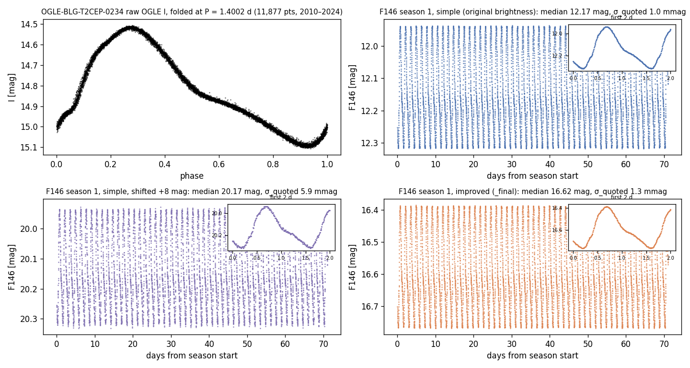

The figure shows OGLE-BLG-T2CEP-0234 (P = 1.40 d): the raw OGLE I folded light curve, then F146 season 1 in simple,
shifted and improved. The variability is identical in all three; only the brightness and the noise change.
- **simple:** F146 12.2, σ 1.0 mmag.
- **shifted:** 20.2, σ 5.9 mmag.
- **improved:** 16.6, σ 1.3 mmag.

Across the sample, the correlation with simple is 0.998–1.000. The exception is LPV, where the GP was re-drawn per variant.

### What "simple" and "improved" noise are (measured)
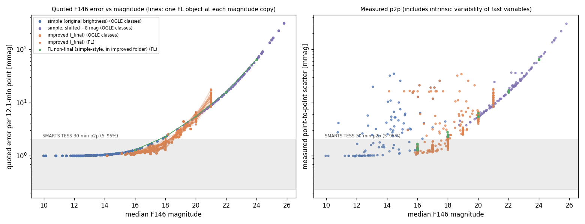

**Left:** quoted σ per 12.1-min point. Simple, shifted and the FL non-final files all sit on one tight curve (0.002–0.006
dex scatter). Improved scatters around a slightly lower curve, by 0.05 dex (up to ×1.5) at fixed magnitude, and each FL
object traces its own line across its magnitude copies. **Right:** measured p2p; for slow variables it equals σ.

| F146 mag | 14 | 16 | 17 | 18 | 19 | 20 | 22 | 24 |
|---|---|---|---|---|---|---|---|---|
| simple / shifted σ [mmag] | 1.06 | 1.31 | 1.65 | 2.15–2.33 | 3.78 | 5.87 | 18.0 | 68.7 |
| improved σ [mmag] (OGLE classes) | 1.00 | 1.15 | 1.27 | 1.62 | 2.72 | 4.27 | — | — |
| FL, same objects, improved vs non-final [mmag] | | 1.13 vs 1.29 | 1.32 | 1.70 vs 2.30 | 2.86 | 5.19 vs 5.44 | (21: 12.5) vs 15.7 | – vs 64.3 |

- **Both are white.** The difference of two noise draws on the same star (variant − simple − offset) has a lag-1–5
  autocorrelation of ≈0.00, and the RMS of 4/16/64-point bins equals σ/√N (ratio 1.00). Its std equals
  √(σ₁² + σ₂²). So there is no red noise, no blending-induced correlated noise and no amplitude dilution (the 5–95% range
  matches simple within ~1%).
- **Magnitude shifts:**
  - shifted = +8.000 mag exactly. It is the README's "dimmer, more pronounced uncertainties" copy, and its σ re-scales
    along the same curve.
  - improved = +0 (stars already fainter than ~15.4), ~4.45 or ~6.68 mag. That is a step rule into F146 ~14–20; the exact
    rule isn't documented.
- **Which to use: improved.**
  - Bulge-like magnitudes (simple is mostly brighter than any GBTDS target).
  - Per-star σ scatter that mimics crowding.
  - JD in each file.
  - The FL rotators exist only there (`_final`).
  - Caveat: both variants are optimistic. They are white noise only, with a 1.0 mmag floor and no systematics or
    season-to-season offsets.
- **Couldn't settle:**
  - why improved σ is *lower* than simple at 17–20 mag;
  - the source of either σ(mag) curve (ETC? simulation?);
  - what the CV `_ind<k>_<j>` copies and the FL `k` field are;
  - whether "FL non-final" counts as "simple noise".

### Cadence and seasons
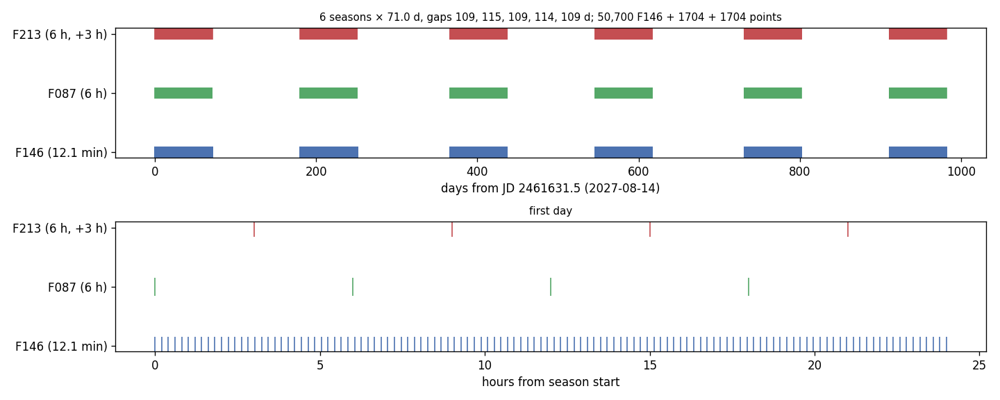

There are 6 seasons of exactly 71.00 d, contiguous at 12.1 min (8,450 F146 points each):
- Aug 14–Oct 23 and Feb 10–Apr 21, in consecutive years 2027–2030;
- separated by 109–115 d;
- F087 and F213 every 6 h, offset by 3 h, with 284 points per season each;
- nothing off-season.

`docs/ROMAN_REFERENCE.md` is corrected. Its earlier "3 early + 3 late seasons" and "colours every ≤12 h" are now marked
as differing from the WG6 grid. For us, one season is R = 71 d, so R/2 = 35.5 d.

### Per-class examples (improved)
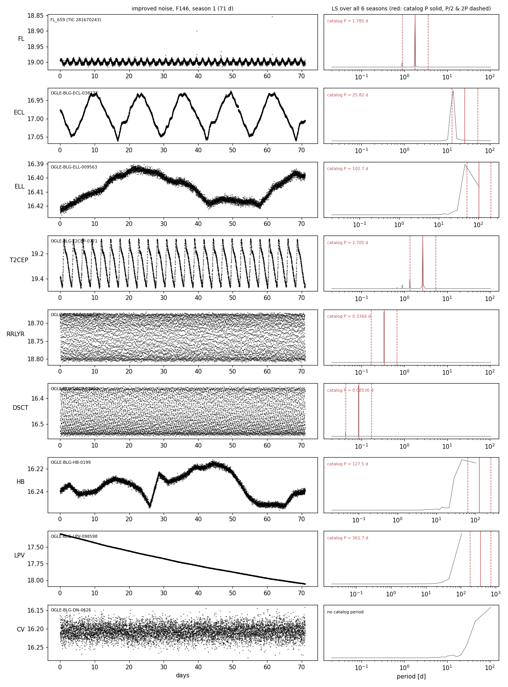

F146 season 1 with the 6-season LS, with the catalog P marked. What to look at:
- **FL** shows a clean 1.78 d rotation sinusoid plus flare spikes;
- **ECL/ELL/HB** peak at P_orb/2;
- **T2CEP/RRLYR/DSCT** sit on their period;
- **LPV** is a monotonic trend within one season;
- **CV** in quiescence looks like noise.

**The signals are strictly periodic.** Folded-profile correlation between seasons is 1.000 for ECL/T2CEP. FL amplitudes
are constant across seasons (e.g. 0.0600–0.0603 mag), with no spot evolution. Many FL templates have tiny amplitudes
(0.2–2 mmag).

### Stored vs measured periods
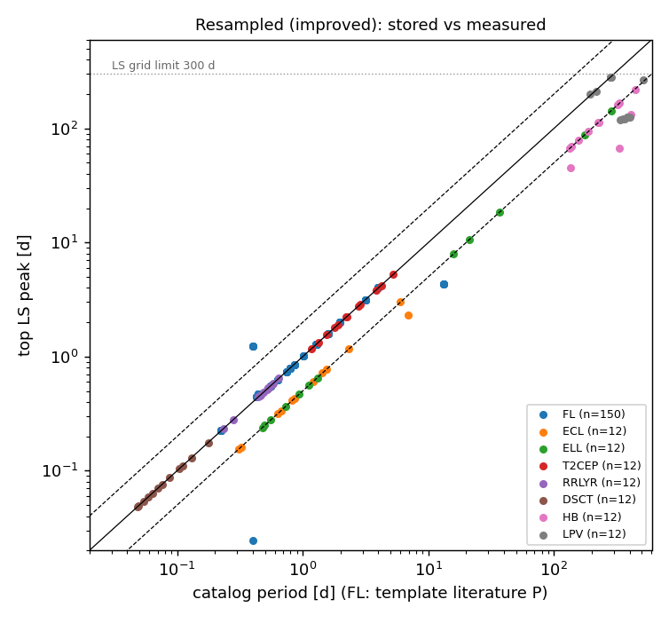

LS on all 6 seasons of F146 (improved, n = 12 per class):

| Class | Result |
|---|---|
| ECL | 11/12 at P_orb/2 |
| ELL | 12/12 at P_orb/2 |
| HB | 9/12 at P/2 (2 at P/3) |
| RRLYR, DSCT, T2CEP | 12/12 each |
| CEP (simple) | 12/12 |
| **FL** | **23/25 objects match the literature rotation P at every magnitude copy** (138/150 files) |

The simple and shifted variants give identical tables. LPV can't be checked here: the LS grid stops at 300 d.

### Pipeline on 20 resampled stars
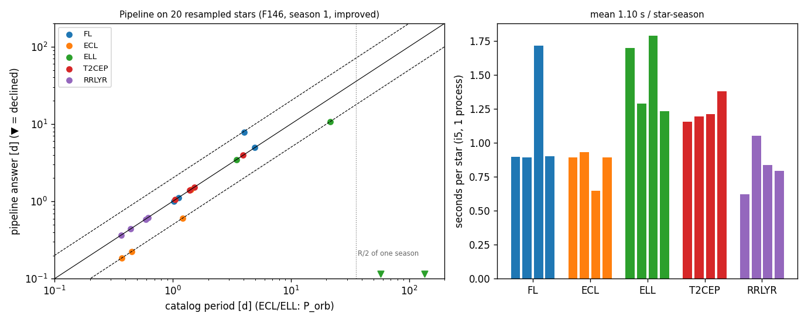

F146 season 1, improved noise, standard pipeline, one process on the i5:

| Class | Result |
|---|---|
| **FL** (rotators) | 3/4 correct, 1 at 2P (TIC 294754396, P = 4.05 d → 7.90) |
| T2CEP | 4/4 confident at the pulsation period |
| RRLYR | 4/4 confident at the pulsation period |
| ECL | 3 at P_orb/2, 1 at P_orb |
| ELL | 1 at P_orb/2, 1 at P_orb, 2 declined (P_orb 57 and 135 d, beyond R/2) |

**So 14 of 16 contaminants come back as confident "rotation periods".** The current pipeline has no defence against
astrophysical false positives, which is exactly what P36 and T29 are for.

**Time:** 0.62–1.79 s per star-season (mean 1.10 s, 8,450 points). That is ~1.6 CPU-h for every improved OGLE star
(one season each), or ~37 CPU-min for the 2,000 FL objects at one magnitude.

### Revised class classification (for the resampled set)

| Class | Use | Why |
|---|---|---|
| **FL** (rotating templates) | **(a) Roman-cadence rotator truth, v0** | 1,600 objects / 54 templates with literature P (0.2–5 d). Caveats: M dwarfs only, short periods, **no spot evolution**, only 54 independent stars (split by template) |
| **FL "flat"** | **(b) negative**: flaring, non-rotating | 79 objects |
| **ECL** | (b) contaminant, flagged class (T29) | P_orb/2 mimics rotation. 1,000 stars, none in the raw set |
| **ELL** | (b) contaminant, strongest mimic | smooth double-humped sinusoid at P_orb/2 |
| **T2CEP** | (b) contaminant | 1–37 d, confident pipeline answers (4/4) |
| **RRLYR** | (b) contaminant, sub-day | confident pipeline answers (4/4) |
| **CEP** | (b) contaminant | only 24, simple variant only |
| **HB** | (c) stress test | harmonics of long P_orb |
| **DSCT** | (c) stress test | < 0.1 d edge |
| **LPV** | (c) stress test | long trends within a season |
| **CV / DN** | (c) stress test | outbursts; 10 copies per star |
| **ROT** | **(a), but only in the raw set** | the bulk Roman-like rotator truth needs resampling (game plan step 1) |
| raw VVV, BLAP, TR | (d) / (c) as before | not resampled |

### Revised game plan
1. **Roman-like input.** Use the WG6 resampled product, **improved** variant, F146, cut into 71-d seasons. This retires the
   old option C, and option A (our own template resampling of the periodic classes) is no longer needed.
   **One gap remains: ROT.** Two ways to fill it:
   - (i) Ask WG6 to run their GP resampling on the 3,172 OGLE ROT stars they already extracted.
   - (ii) Resample ROT ourselves (old option B): a quasi-periodic GP per OGLE season (`celerite2`/`tinygp`: Rae's OK
     to install), evaluated on the WG6 Roman grid (`roman_times_shortcadence.npy`) with noise drawn from WG6's improved
     σ(mag) relation.

     A cheaper fallback is to inject ROT periods and amplitudes into `synthetic.spot_signal` on the same grid.

     Both versions of (ii) should also add **spot evolution**, which none of the WG6 light curves have.
2. **Loader** `claude_files/wg6.py` (design only):
   - `load_wg6_roman(zip_or_path, member=None, band="F146", season=None, times_dir=None)` returns the
     `load_smarts_fits`-style `(time, flux)` container;
   - it reads in place from the zip or an extracted file, takes the JD column, or the `.npy` grid for simple;
   - it converts mag to relative flux with a NaN-safe median and NaN-masks FL dropouts;
   - `season=k` cuts the k-th 71-d season;
   - it returns σ too, converted to relative flux.

   The raw-set loader (`load_wg6_raw`, OGLE I with the HJD fix) stays for ROT work.
3. **Manifest:** a new `datasets/wg6_roman_v0.csv`. Columns:
   - `star_id`, `zip` and `member`, relative to `WG6_RESAMPLED_ROOT`;
   - `variant`, `cls`, `subtype`;
   - `P_true`, `p_convention`, `P_phot_expected` (P_orb/2 for ECL/ELL);
   - `fl_template`, `wfmag`, `season`;
   - `is_rotator`, `is_eb`, `in_raw`, `eval_set`.

   **Split by FL template and by OGLE star.** No template may appear in both train and eval.
4. **How the classes enter:**
   - (i) **Ranker negatives:** ECL, ELL, T2CEP, RRLYR, CEP and FL-flat as star-level declines, every candidate at
     relevance 0. ECL/ELL candidates near P_orb or P_orb/2 are tagged `eb_period` for T29.
   - (ii) **Roman scorecard dataset strings:**
     - `wg6r_fl_v0_improved_s<k>`: FL rotators, scored with `classify_period` against the template P; correct and
       alias outcomes only, since there is no diffrot.
     - `wg6r_contam_v0_improved_s<k>`: the FP rate.
     - Later, `wg6r_rot_v0` once ROT is resampled.
5. **Compute** (measured 1.10 s per star-season):
   - every improved OGLE star, one season: ~1.6 CPU-h;
   - a v0 of 300 per contaminant class plus all 1,600 FL rotators at 2 magnitudes, one season: ~1.4 CPU-h at 1 process,
     ~25 min at 4 workers;
   - all 18,275 improved files × 6 seasons: ~34 CPU-h, so Rae's local job.

Follow-ups P34–P37 in `docs/TASKS.md` are revised to match.

## Part 1: the raw archival set (2026-11-11)


### Where the raw data came from: plain-language summary
- **Selection.** WG6 took every known variable from the OGLE-IV bulge catalogs (plus VVV, plus Gaia alerts) inside a
  4°-radius circle at l = 359.7°, b = −1.6°.
  - That circle is about 50 deg², roughly 30× the real GBTDS footprint of ~1.7 deg².
  - For each star they downloaded the OGLE I/V photometry and added UKIRT microlensing-survey H/K (2015–2017) where
    available.
  - The flare stars are a separate, **all-sky** set: TESS M dwarfs from Günther+2020 and Medina+2020, with TESS 20-s
    PDCSAP converted to magnitudes.
- **What did not happen** (README vs code vs files):
  - no GP resampling;
  - no Roman cadence;
  - no transformation to F146;
  - no Roman noise;
  - no "magnitude-shifted copies".

  The public code can't even run as committed (a missing module, a wrong call signature, a missing script). So the
  files were made with unpublished code, but the files themselves show which steps were done.
- **Quirks:**
  - Cepheid times carry a doubled +2,450,000 offset.
  - ELL files are labelled `eclipsing_binary`.
  - The `*SOURCE` header keys are constant boilerplate.

  All 10 discrepancies are listed in `docs/WG6_REFERENCE.md` §5.

### What's there: counts and profile
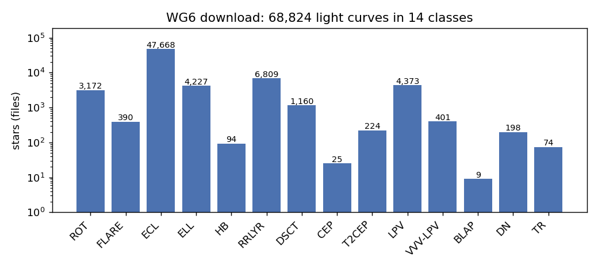

ECL dominates (47,668 stars). The two rotator classes are small next to it: ROT has 3,172 and FLARE has 390.

| Class | Stars | Catalog P joined | P 5/50/95% [d] | Points (primary band, sample median) | Median spacing [min] | Seasons × length [d] | Median mag | p2p [mmag] |
|---|---|---|---|---|---|---|---|---|
| ROT | 3,172 | 100% | 1.0 / 25.7 / 74.6 | 12,014 (OGLE I) | 59 | 14 × 267 | I 16.7 | 13 |
| FLARE | 390 | 70% (lit.) | 0.32 / 1.4 / 124 | 89,023 per sector (TESS) | 0.33 | 1 × 24 per sector | T 11.1 | 5 |
| ECL | 47,668 | 99.98% | 0.31 / 0.58 / 8.2 (P_orb) | 7,113 | 57 | 6 × 271 | I 18.1 | 60* |
| ELL | 4,227 | 100% | 0.36 / 1.39 / 227 (P_orb) | 10,529 | 22 | 6 × 271 | I 16.5 | 16 |
| HB | 94 | 100% | 128 / 246 / 437 (P_orb) | 12,314 | 36 | 22 × 252 | I 13.8 | 3 |
| RRLYR | 6,809 | 100% | 0.27 / 0.51 / 0.68 | 6,516 | 67 | 8 × 269 | I 17.6 | 59* |
| DSCT | 1,160 | 99% | 0.049 / 0.075 / 0.15 | 14,309 | 24 | 10 × 269 | I 17.4 | 64* |
| CEP | 25 | 100% | 0.29 / 1.1 / 4.4 | 1,774 | 1,291 | 14 × 243 | I 16.9 | 58* |
| T2CEP | 224 | 100% | 1.2 / 8.5 / 36.7 | 2,121 | 1,118 | 14 × 243 | I 16.5 | 32* |
| LPV (Miras) | 4,373 | 100% | 171 / 319 / 490 | 3,409 | 585 | 10 × 256 | I 15.6 | 19 |
| VVV-LPV | 401 | 0 | — | 50 (all bands, UKIRT H/K) | — | — | — | — |
| BLAP | 9 | 0 | (LS ~0.02–0.05) | 13,739 | 24 | 10 × 270 | I 17.3 | 50* |
| DN | 198 | 0 | — | 6,067 | 33 | 7.5 × 262 | I 20.0 | 225 |
| TR | 74 | 0 | — | 14,135 | 24 | 10 × 269 | I 15.2 | 5 |

\* p2p includes real variability between consecutive points, which dominates for fast or large-amplitude variables.
Full table: `data/profile_table.csv`.

### Time coverage vs a Roman season
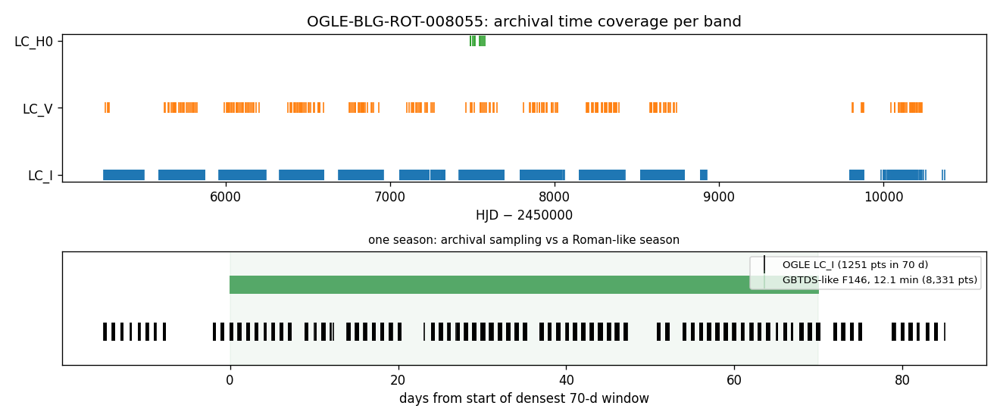

**Top:** a typical ROT star has 14 OGLE I seasons of ~270 d each, sparse V, and a few weeks of UKIRT H.

**Bottom:** in its densest 70-d window OGLE has 1,251 points in nightly clumps; a GBTDS season at 12.1 min would have
8,331 contiguous points. This sampling difference is the central obstacle: on a regular grid only 15–18% of 15-min
cadences are filled, and `compute_acf` truncates the ACF after ~17 lags (`min_valid_frac=0.3`). **The pipeline can't
take these light curves as they are.**

### Example light curves per class
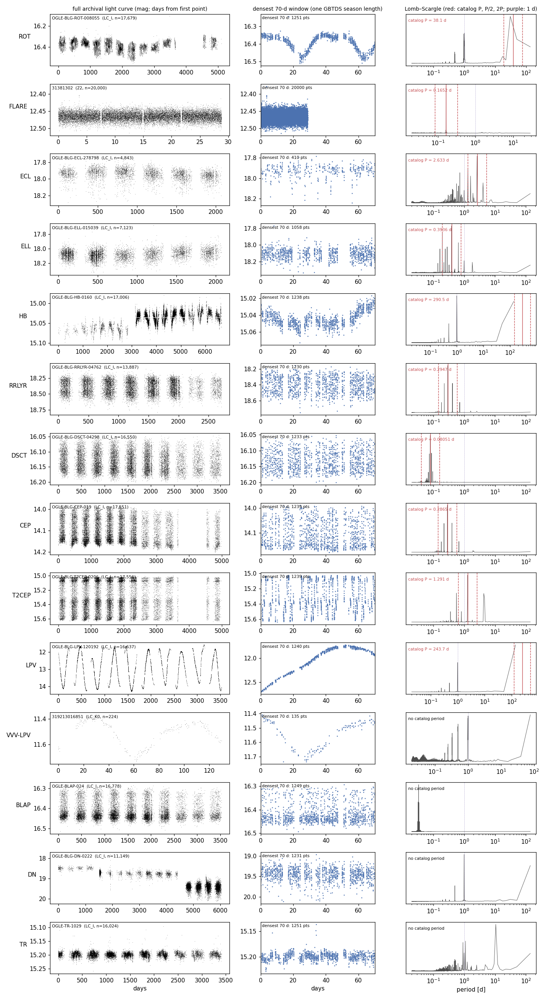

Each row shows one star:
- **left:** the full archival light curve;
- **middle:** the densest 70 d window;
- **right:** the Lomb–Scargle periodogram, with the catalog P (solid red), P/2 and 2P (dashed) and 1 d (purple dotted).

Look at:
- **ROT**: clean ~38 d spot modulation in a single 70 d window;
- **ECL/ELL**: the main peak sits on the dashed P/2 line, not on the catalog P_orb;
- **HB, LPV, DN**: the 1 d window peak dominates the raw periodogram;
- **T2CEP**: sharp, strictly periodic peaks at 1–40 d, right in the rotation range.

### Periods vs our range
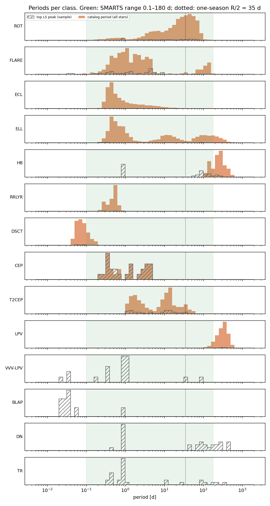

Filled histograms show the catalog periods of every star; hatched ones show our top LS peak on the sample. ROT spans
the whole rotation range, but its mode (~30–50 d) sits right at the one-season R/2 = 35 d line: 63% of ROT stars are
at 0.1–35 d, 58% at 1–35 d, and 37% are above 35 d. Which contaminants fall in 1–35 d:
- all of T2CEP (94%);
- about 30% of ECL/ELL (by P_orb; their light curves show P_orb/2);
- half of CEP.

RRLYR and DSCT are entirely sub-day. LPV and HB are far beyond any single season.

### Noise vs magnitude
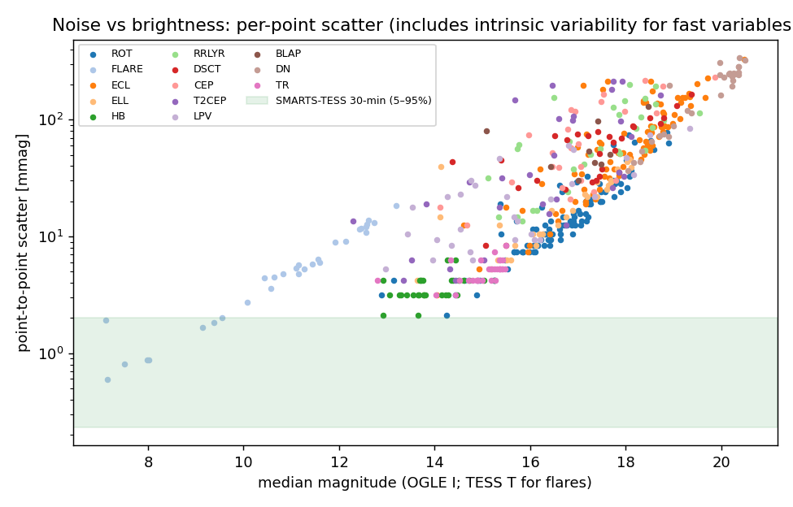

OGLE I point-to-point scatter rises from ~3 mmag at I ≈ 13 to ~100 mmag at I ≈ 19. That is 1–2 orders of magnitude
above SMARTS-TESS (0.23–2.0 mmag, 5–95%, 30-min, green band, measured on 100 dev files). The flare stars sit on the
TESS sequence (≈5 mmag per 20 s at T ≈ 11). F146 noise at bulge magnitudes is unknown to us (no WG6 model; see
ROMAN_REFERENCE §3). Any Roman-like product will have to impose it.

### Stored vs measured periods
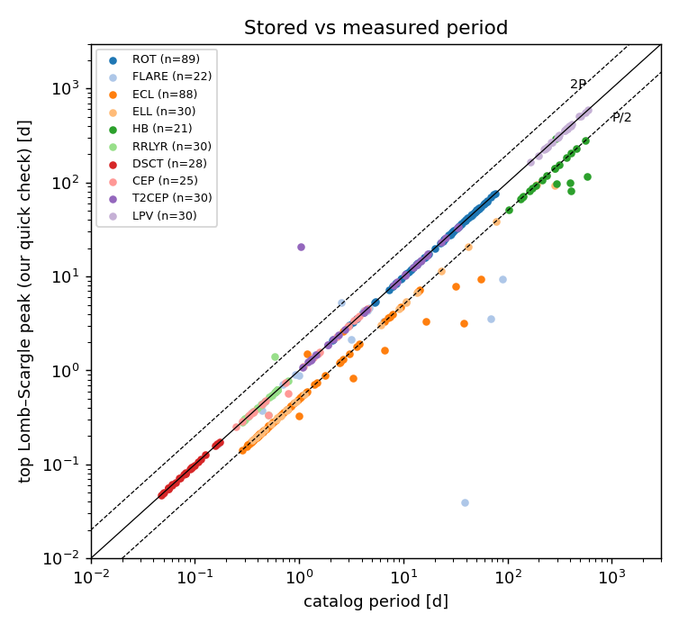

Our period is the top LS peak after skipping ground-based window peaks (0.95–1.05 d, 0.49–0.51 d, >300 d; the raw peak
for LPV). Points on the solid line agree with the catalog.

| Class | match | P/2 | 2P | other | no measurement |
|---|---|---|---|---|---|
| ROT (n=100) | **88** | 1 | 0 | 0 | 11 (1-d alias swamps it) |
| ECL | 1 | **79** | 0 | 8 | 2 |
| ELL | 1 | **28** | 0 | 1 | 0 |
| HB | 1 | 16 | 0 | 4 | 9 |
| RRLYR / DSCT / CEP / T2CEP / LPV | 28 / 28 / 23 / 29 / 30 | 0 | 0 | 2 / 0 / 2 / 1 / 0 | 0 / 2 / 0 / 0 / 0 |
| FLARE (lit. P) | 14 | 1 | 1 | 6 | 8 |

Conventions this confirms:
- **ROT** catalog periods are photometric spot periods, and reliable.
- **ECL/ELL** catalog periods are **orbital**; the light curve's dominant period is P_orb/2.
- **HB** light curves show harmonics of P_orb (P/2, P/3, P/5).
- **FLARE** literature periods agree only about two-thirds of the time on one TESS sector. Most misses have P > 25 d
  (Medina's MEarth periods).

### ROT, the Roman-like rotator truth (coordinator's question)
- **Source:** the OCVS "rotating variables toward the Galactic bulge" (Iwanek et al. 2024, 18,441 stars). WG6 holds
  3,172 of them, all with a `rot.dat` period.
- **Convention:** the "primary period" is the photometric period. 88/89 measurable stars agree within 10%; 1 is at
  P/2 and none are wrong. The 11 unmeasured stars are swamped by the daily alias in raw LS, which is a ground-based
  artefact rather than a catalog error.
- **Population caveat:** they are **mostly red giants/subgiants**, given I ≈ 15–18 at the bulge distance and I amplitudes of
  0.06–0.31 mag (5–95%). That is a much bigger spot signal than the Sun-like and M dwarfs Roman will mostly see.
- **Contamination flags:** OCVS remarks flag 52 of them as flaring and 4 as RS CVn (with EB IDs).
- **Period bins** (0–1 / 1–3 / 3–10 / 10–23 / 23–35 / 35–70 / >70 d): 159 / 111 / 545 / 649 / 540 / 959 / 209.

### Class classification (raw set; for Roman work see Part 2's revised table)

| Class | Use | Why |
|---|---|---|
| **ROT** | **(a) rotator stand-in** (Roman-like truth) | Bulge targets, reliable photometric periods, 2,000+ with P < 35 d. Caveat: giant-dominated, large amplitudes |
| **FLARE** | **(a) rotator stand-in, TESS side** (+ (c) flare stress test) | Real M-dwarf rotators with literature P. Real TESS data, which gives a cross-mission check of SMARTS-trained models. Not bulge, not Roman cadence |
| **ECL** | **(b) contaminant**, but a *flagged* class (T29), not a plain negative | Light curves at P_orb/2 mimic rotators. Spotted/synchronised EBs are real rotators (Rae: flag, don't discard) |
| **ELL** | **(b) contaminant** (strongest rotation mimic) | Smooth double-humped sinusoid at P_orb/2, mostly 0.2–1 d with a 10–200 d tail |
| **T2CEP** | **(b) contaminant** | Strictly periodic, 1–37 d, right in the rotation range |
| **CEP** | (b) contaminant (only 25) | 0.3–4 d |
| **RRLYR** | (b) contaminant, sub-day bin | 0.27–0.68 d, large amplitude, sawtooth |
| **HB** | (c) stress test | P_orb 130–440 d (out of range) but harmonics land in range; only 94 |
| **DSCT** | (c) stress test | Mostly < 0.1 d, below our range; tests the short-period edge |
| **LPV / Miras** | (c) stress test | P 170–490 d. In one season they appear as a trend or a partial cycle, which tests long-trend false positives |
| **DN, TR, BLAP** | (c) stress test | Outbursts (DN), transit dips (TR, mostly flat), very short pulsators (BLAP, 9 stars) |
| **VVV-LPV** | (d) not useful | UKIRT H/K only, median 50 points, no truth joined |

The SMARTS negatives so far are noise-only stacks (T27). The (b) classes would be the **first astrophysical false
positives** the ranker sees.

### Game plan (raw set, 2026-11-11; superseded by Part 2's revised plan)
1. **Make it Roman-like first.** This decides everything else, so Rae picks the approach (Q1 below).
   - **A. Model resampling** for the strictly periodic classes (ECL, ELL, T2CEP, CEP, RRLYR, DSCT, HB, LPV): fit a
     multi-harmonic Fourier/phase-binned template at the catalog period to the OGLE I data, then evaluate it on a
     70 d × 12.1 min grid with F146-like noise at a chosen magnitude. Cheap, deterministic, exact truth, numpy only.
   - **B. ROT** spots evolve, so a strict template is wrong. Either fit a quasi-periodic GP (e.g. a `celerite2`
     RotationTerm) per OGLE season and draw a conditional sample on the Roman grid (needs a package: Rae's OK), or
     inject ROT periods/amplitudes into our own `synthetic.spot_signal` on a Roman grid (no new dependency, but no
     longer "real").
   - **C. Ask WG6** for the GP-resampled Roman product their README says is complete, plus the noise model.
2. **Loader** `claude_files/wg6.py` (design only):
   - `load_wg6_fits(path, band="LC_I", window=None)` returns the same `(time, flux)` container as `load_smarts_fits`;
   - it applies `fix_time` (the doubled offset), converts mag to relative flux (median 1), optionally cuts one
     season or the densest 70 d window, and regrids to a regular cadence;
   - `make_roman_season(...)` implements option A or B behind one call, with the method and seed recorded in the output.
3. **Manifest**, as a new file `datasets/wg6_v0.csv` (no existing manifest edited). Columns:
   - `star_id`, and `path` relative to `WG6_DATA_ROOT`;
   - `cls`, `subtype`;
   - `P_true`, `p_convention`, `P_phot_expected` (P_orb/2 for ECL/ELL);
   - `imag`, `amp`;
   - `is_rotator`, `is_eb`, `label_source`;
   - `resample_method`, `seed`, `eval_set`.

   Splits are by star (no star in both train and eval).
4. **How the classes enter:**
   - (i) **Ranker negatives:** the (b) classes as star-level non-rotators (decline targets), every candidate at
     relevance 0, like T27. For ECL/ELL, also tag candidates within REL_TOL of P_orb or P_orb/2 as `eb_period` for the
     T29 flag.
   - (ii) **Roman scorecard dataset string**, proposed as `wg6_rot_v0[_roman70]` for the rotators and
     `wg6_contam_v0[_roman70]` for the false-positive rate. ROT/FLARE are scored with `evaluation.classify_period` against
     `P_true`. There is no `DIFFROT`, so the outcomes are correct/alias only. Stars with P > season R/2 count as
     *undetectable* (not failures), as on SMARTS.
5. **Compute** (`data/pipeline_timing.csv`): a Roman-like season (70 d at 12.1 min, 8,331 points) costs **0.57–0.83 s
   per star** on the i5 in one process (mean 0.70 s), and 2 of 3 periods were recovered. So:
   - ROT, one season each: ~37 CPU-min;
   - all 68,824 stars: ~13.3 CPU-h;
   - a v0 subset of all ROT plus ~300 per contaminant class: well under an hour at 4 workers.

   Raw OGLE seasons on a grid "run" in 0.01–0.02 s only because they fail early (ACF truncated), so those times mean nothing.

Follow-ups are proposed in `docs/TASKS.md` as P34–P37.

## What didn't work
- **Running the pipeline on raw OGLE seasons.**
  - At 15 min, `compute_acf` returns ~17 lags (coverage cut).
  - At 60 min the ACF survives, but `fit_rotation_period` found no period on 3 of 3 ROT stars at P = 2–16 d.

  This is why resampling is step 1.
- **Raw Lomb–Scargle on ground-based data.** 19 of 100 ROT stars have the 1-d window peak on top, so I added the mask.
  It stays a diagnostic only: Roman won't have the daily alias.
- **The first timing run** picked ROT stars with P > 35 d, which can't be found in 70 d. I re-ran it on P = 2–20 d.
- **Part 2:**
  - The first resampled period check matched truth only for stars in the raw inventory, which drops every ECL star
    (none are in the raw set). I fixed this by joining against the full OCVS tables.
  - FL files carry NaN cadences, which broke plain `np.median`. Switched to NaN-safe medians.

## Open questions for Rae
1. **ROT at Roman cadence:** ask WG6 to resample their 3,172 OGLE ROT stars (the archival set is already on their
   `add_rotators` branch), or do it ourselves (a GP, which needs `celerite2`/`tinygp` installed with your OK, or spot
   injection into `synthetic.py` on the WG6 Roman grid)? Without it, the Roman rotator truth is 54 TESS M-dwarf
   templates with periods of 0.2–5 d.
2. **Which noise variant to standardise on:** I recommend improved. Is the shifted-simple set worth keeping as a
   fainter-magnitude stress test (F146 18–26)?
3. **Questions to put to WG6** (things I couldn't settle from the files):
   - the source of the two σ(mag) curves, and why improved σ is *below* simple at 17–20 mag;
   - the improved magnitude-shift rule (0 / 4.45 / 6.68 mag);
   - what the CV `_ind<k>_<j>` copies and the FL `k` field are;
   - whether the FL non-final files are the "simple noise" FL;
   - whether a resampled set with red noise or systematics is planned.
4. **No spot evolution** in FL, and in any GP-resampled ROT unless we add it. Is that acceptable for ranker v1
   training, or should the Roman rotator truth come from our own butterpy-style simulations (D3/T16g) on the WG6 grid?
5. **EBs and ELLs:** star-level negatives, or a separate flagged class (T29)? This is still open from Part 1.
   14/16 contaminants currently get confident periods.
6. **FL as rotators:** 1,600 objects, but only 54 independent stars, each reused ~30× at 6 magnitudes. Splitting by
   template is required. Is that enough for a Roman scorecard v0?
7. **The 37% of ROT with P > 35.5 d:** keep them as one-season-undetectable truth or drop them? (Still open from Part 1.)
8. **GBTDS design:** the WG6 grid (6 consecutive 71-d seasons, colours every 6 h) differs from the NASA web summary
   (3 early + 3 late, colours every ≤12 h). Which should our Roman scorecard assume?

Part 1 questions superseded by Part 2:
- resampling A/B/C is now step 1 of the revised plan;
- the F146 noise source is now a question for WG6 (Q3);
- the flare stars as a real-TESS validation set is still P37.

## Reproduce
```bash
# drive mounted at /Volumes/Data_Vault (or export WG6_DATA_ROOT=...)
/opt/anaconda3/envs/ss_openblas/bin/python tools/extract_wg6.py              # resumable, ~40 min, 22 GB on drive
/opt/anaconda3/envs/ss_openblas/bin/python tools/fetch_ogle_truth.py         # 35 files, 106 MB on drive
/opt/anaconda3/envs/ss_openblas/bin/python tools/audit/wg6_inventory.py      # ~12 min, header-only
git clone https://github.com/rges-pit/variable_catalog_xmatch /path/to/scratch/wg6code   # commit 5982d92; outside the repo
/opt/anaconda3/envs/ss_openblas/bin/python tools/audit/wg6_truth.py --wg6-repo /path/to/scratch/wg6code
/opt/anaconda3/envs/ss_openblas/bin/python tools/audit/wg6_profile.py --n 30
/opt/anaconda3/envs/ss_openblas/bin/python tools/audit/wg6_profile.py --n 100 --sets Rotators_lightcurves
/opt/anaconda3/envs/ss_openblas/bin/python tools/audit/wg6_truth.py --period-check
/opt/anaconda3/envs/ss_openblas/bin/python tools/audit/wg6_examples.py --time-pipeline 3
# data/ls_spectra/ keeps only the 14 example stars (trimmed for git); the profile run regenerates the rest
# Part 2 (resampled set; read in place from the zips, ~30-60 min of light drive reads in all)
/opt/anaconda3/envs/ss_openblas/bin/python tools/audit/wg6r_profile.py              # inventory + 138-object profile (spectra/ and per-variant examples/ are regenerated here; not committed)
/opt/anaconda3/envs/ss_openblas/bin/python tools/audit/wg6_truth.py --resampled     # resampled/truth.csv.gz + period_check.csv
/opt/anaconda3/envs/ss_openblas/bin/python tools/audit/wg6r_pipeline.py             # 20 stars, ~30 s
/opt/anaconda3/envs/ss_openblas/bin/python tools/audit/wg6r_examples.py             # figure inputs
/opt/anaconda3/envs/ss_openblas/bin/python tools/run_notebook.py reports/2026-11-12_wg6-dataset-scoping/notebook.ipynb
```
