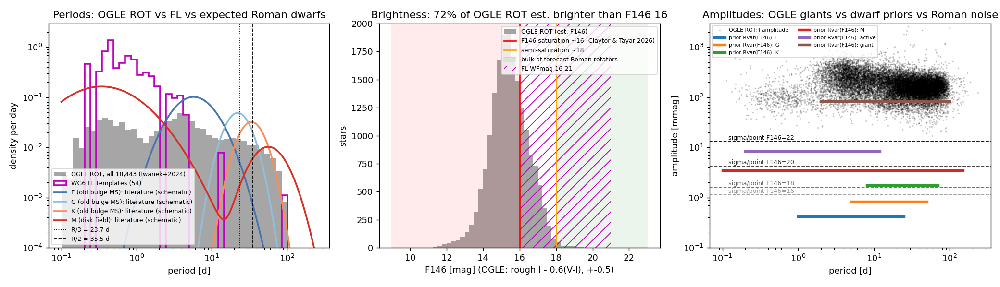
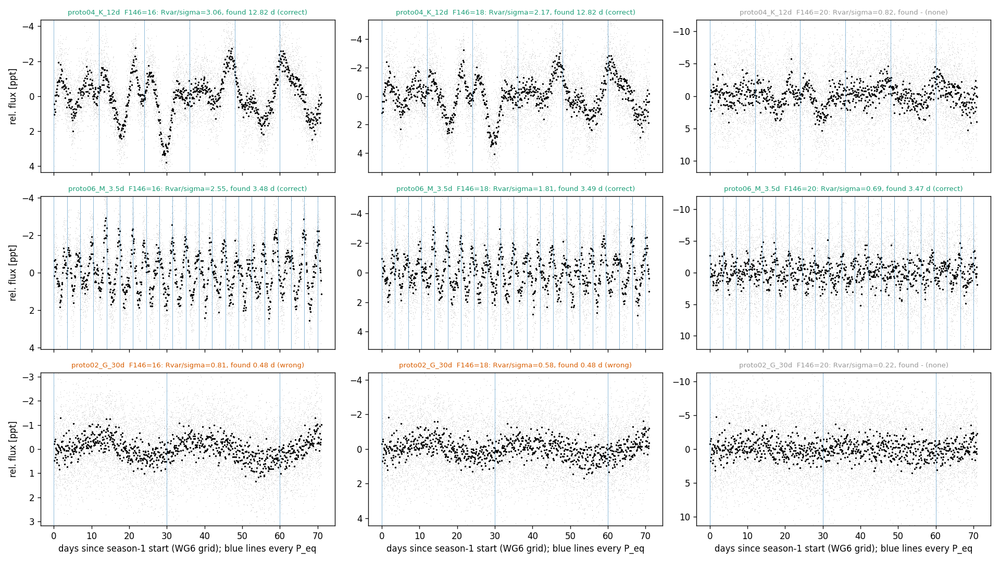
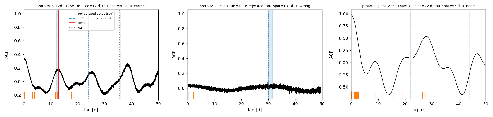
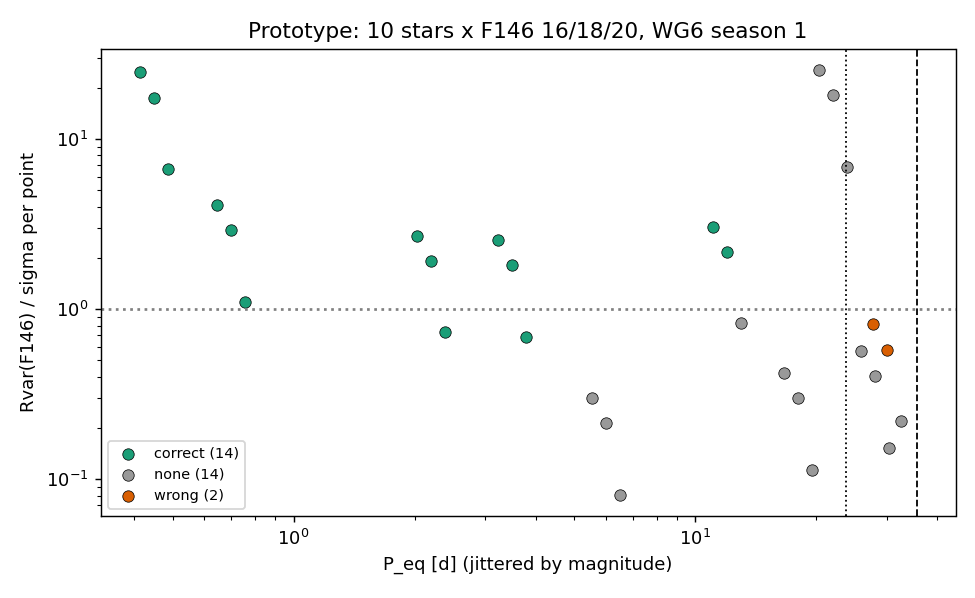
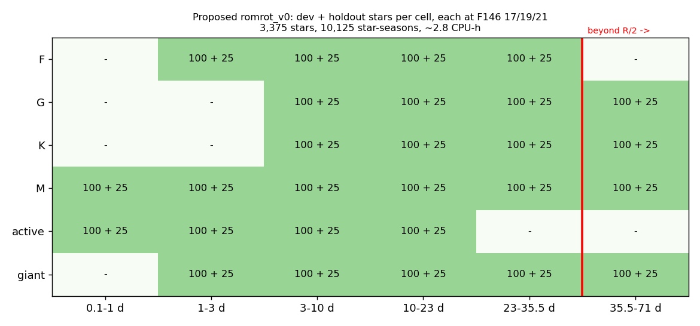

# Roman-cadence spotted rotators: scoping + celerite2 prototype (P34)

**Date:** 2026-11-13 · **Author:** P34 scoping session · **Branch:** `claude/p34-roman-rotators-accd50` · **Status:** draft

## TL;DR
- **Roman's rotators will mostly be old bulge F–K dwarfs at F146 ~18–23** (Claytor & Tayar 2026: ~1.7M periods). **OGLE ROT is the wrong population:** an estimated 72% are saturated (F146 < 16), and 36% have P > 35.5 d.
- **Recommendation:** (b), a celerite2 `RotationTerm` GP generator with two latitude bands, so truth carries P_eq plus the DIFFROT window. Calibrate its priors on Kepler (d) and OGLE giants (a).
- **Prototype:** 10 stars × F146 16/18/20 on WG6 season 1: 14 correct, 2 wrong, 14 declined of 30. Stars with P ≤ 3.5 d are correct even at F146 20; old G/K dwarfs (Rvar ≲ σ) decline.
- **Proposed `romrot_v0`:** 3,375 stars, 10,125 star-seasons, ~2–3 CPU-h (Rae's local job).
- **Deviation:** I was denied permission to install celerite2 (it was later installed outside this session) and to edit `environment.yml`.

## Question / goal
P34 in `docs/TASKS_PROPOSED.md` asks for a Roman-cadence spotted-rotator set for the GBTDS track (T28 in `docs/TASKS.md`). This is a scoping pass with a small prototype, not a production build. Rae's 2026-11-13 decisions are taken as given:
- we resample ourselves, using WG6's improved σ(mag);
- development uses the 3 early seasons (~71 d, F146, 12.1 min);
- FL's 54 templates are not enough;
- celerite2 is the GP package, and spot evolution is required.

No goals, metrics, `evaluation.py` or manifests are touched.

## What I did
1. **Read** `docs/ROMAN_REFERENCE.md`, `docs/WG6_REFERENCE.md` (§2, §8), `docs/SMARTS_REFERENCE.md`, T28/P34–P36, Part 2 of `reports/2026-11-12_wg6-dataset-scoping/`, and the P35 loader on `claude/p35-wg6-loader-ef0d37` (via `git show`, not merged).
   - **Time grid:** WG6's `roman_times_shortcadence.npy` (on the drive) is 6 seasons × 8,450 points. It is exactly uniform at 12.1 min within a season, with 109–115 d gaps.
2. **Literature:** the Iwanek+2019/2024 OGLE ROT papers, the OGLE `rot.dat` table (18,443 stars, on the drive), the Claytor & Tayar CS23 poster (read in full), and the WG6 FL template periods from the P35 manifest. Citations are at the end.
3. **celerite2:**
   - The dry-run showed `celerite2==0.3.2` has a cp312 macOS x86_64 wheel and leaves numpy 1.26.4 and scipy 1.16.0 untouched. 0.3.3 is sdist-only and its build pulls in `jax==0.8.0`, so avoid it.
   - **My install command was denied by the permission classifier.** I messaged the coordinator. celerite2 0.3.2 was then installed outside this session; numpy 1.26.4 and scipy 1.16.0 were unchanged when I checked afterwards.
   - **My edit to `environment.yml` was also denied.** The proposed line is under Open questions.
4. **Generator** `tools/make_roman_rotators.py`:
   - It implements the celerite2 `RotationTerm` algebra (two SHOs, at P and P/2).
   - It has an exact numpy state-space SHO sampler (fallback and test oracle) and calls `celerite2.GaussianProcess.sample()` when installed.
   - Truth draws come from per-type priors (`TYPE_PRIORS`).
   - The signal is a sum of 2 latitude-band GPs at P(lat) = P_eq / (1 − shear sin² lat), so `period_range` matches the SMARTS DIFFROT convention.
   - Noise is white Gaussian at WG6's improved σ(F146), with a per-star 0.05 dex crowding factor.
   - The output is a `synthetic`-kind scorecard task.
   - Tests: `tests/test_make_roman_rotators.py` (7 tests). The numpy sampler matches the analytic kernel, and **my kernel matches celerite2's `get_value` to 1e-8**.
5. **Prototype run** (light: 30 star-seasons, 22 s wall, 2 workers, `nice -n 15`; no scorecard was running). The script `run_prototype.py` sends 10 stars, each rendered at F146 16/18/20 (same GP draw, different noise), through `scorecard.score_one_star` with the default pipeline. Re-running gives bit-identical flux and outcomes.

## Results

### Q1. What will Roman's bulge rotators be?


**Left (periods):**
- OGLE ROT is broad, with a median of 24.5 d and 36% above R/2 = 35.5 d.
- The 54 FL templates sit almost entirely at 0.2–5 d (96% < 5 d).
- The schematic literature curves show where old bulge dwarfs should lie: F ~8 d, G ~25 d, K ~38 d (stalled braking for old stars), and M dwarfs bimodal.

**Middle (brightness):**
- OGLE ROT, converted roughly to F146, is **72% brighter than F146 16 (Roman saturation) and 99% brighter than 18**.
- The forecast Roman rotators sit at 18–23.

**Right (amplitude):** OGLE ROT I-band amplitudes are 20–2,600 mmag, while old-dwarf F146 priors are 0.4–2 mmag. The latter are comparable to or below the per-point σ at F146 ≥ 18.

- **Population.** Claytor & Tayar (2026) ran injection–recovery on a synthetic Roman population and expect **~1.65M rotation periods**. The Zenodo record text says "one hundred thousand"; the poster figure says 1,653,696. Their predicted rotators are **bulge main-sequence stars, roughly uniform from F to late K**. In their Teff–F146 plot they lie at F146 ≈ 17–23 and Teff 3,500–7,000 K. Saturation is at F146 ~16 and semi-saturation at ~18. Distances peak at 6–9 kpc, i.e. the bulge, not the foreground disk.
  - The bulge is old (~8–10 Gyr; Zoccali+2003), with a minority of younger metal-rich dwarfs (Bensby+2017).
  - Old Sun-like stars stop spinning down at Ro ~ 2 (van Saders+2016). That gives P_eq of ~5–15 d for F, ~20–35 d for G and ~30–50 d for K dwarfs, with small amplitudes (Kepler-band Rvar ~0.5–3 mmag for slow rotators; McQuillan+2014, Santos+2021, Reinhold+2020).
- **Foreground disk** dwarfs and M dwarfs add a fast-rotating, active tail along the line of sight. Field M dwarfs are bimodal: 0.1–10 d and 30–150 d (Newton+2016). These are the stars that are easy for a 71-d season.
- **Giants and subgiants** are what ground surveys see (OGLE ROT: 11,812 of 12,660 were giants in Iwanek+2019). For Roman they sit at or above saturation, so they are a small stratum at best.
- **Consequence:** most of the forecast population (old G/K dwarfs) has P_eq near or beyond one season's R/3–R/2 and amplitude ≲ σ per point. The prototype shows exactly this regime declining. Rae's still-open "how to handle long ROT periods" question is the central design issue for Roman, not an edge case.

### Q2. Where realistic rotator signals come from

| Source | Realism | Type / period coverage | Truth labels | Effort | Scoring compatibility |
|---|---|---|---|---|---|
| **(a) OGLE ROT** (3,172 in WG6; 18,443 in OCVS) | Real spots and evolution, but I band, ground sampling (needs GP fit + resample) | **Giants** (~72% est. saturated in F146), 0.1–235 d, 36% > R/2; dwarfs only at P < 2 d (4%) | OCVS photometric P only; no P_eq, no diffrot | Medium: celerite2 fit per star on irregular OGLE data, then predict on the Roman grid | correct/half/double only |
| **(b) celerite2 GP generator** (this prototype) | Quasi-periodic, evolving spots with Gaussian statistics. No spot geometry or limb darkening; realism depends on the priors | **Any** type × period by construction | Exact: P_eq, shear, latitudes, band periods, `period_range`, lifetime, Rvar | **Low (done)**: 6 ms per star with celerite2, regenerated from seed (no files) | Full, including DIFFROT |
| **(c) SMARTS-style physical spots** (`synthetic.spot_signal`, butterpy) on the WG6 grid | Most physical (spot geometry, inclination, butterfly) | Any, if re-drawn per type. SMARTS's own draws (P uniform 0.1–180 d, solar-scaled activity) don't match the bulge | Native P_eq and diffrot | Medium. Reusing SMARTS-TESS flux isn't clean: TESS galaxy noise (0.2–2 mmag) is baked in multiplicatively, at Roman's bright-end σ | Full |
| **(d) Kepler/K2/TESS templates** | Real stars and real evolution. Kepler 30-min at ~0.1 mmag, resampled by GP to 12.1 min and scaled ×0.7 to F146 | Field disk FGKM, 0.2–70 d. K2 C9 (bulge) has no stellar rotation catalog that I found | Catalog P from ACF/wavelet (method-dependent, biased to detectable stars); no diffrot | Medium; needs a MAST download (Rae's OK) | correct/half/double only |

**Recommendation:**
- (b) is the primary training/dev set.
- (d) as a ~200-star realism check: does the pipeline behave the same on GP signals as on real Kepler stars at matched P, Rvar and σ?
- (a) only to calibrate the giant stratum's amplitude and coherence (fit celerite2 to a few hundred OGLE I light curves).
- (c) as a 100-star ablation (GP vs physical spots).

### Prototype light curves at F146 16, 18, 20


Each row is the same GP draw at three magnitudes; blue lines mark every P_eq.
- **K 12 d:** evolving spots (τ = 41 d) and is recovered at 16 and 18. At 20 the spot signal is below the noise (Rvar/σ = 0.82) and the pipeline declines.
- **M 3.5 d:** recovered even at 20 (Rvar/σ = 0.69, but 20 cycles).
- **G 30 d:** returns a spurious 0.48 d at 16 and 18, a **wrong** answer rather than a decline, at Rvar/σ < 1.

### ACF with candidate periods


**Left:** the K 12 d star has a clean ACF peak inside the diffrot band (shaded), and the comb fit lands on it.

**Middle:** the G 30 d star's ACF is flat. The pooled candidates are mostly < 0.1 d noise, and the comb fit accepted 0.48 d. That is a low-SNR false positive the ranker/gates should catch.

**Right:** the giant at 22 d (τ_spot = 55 d = 2.5 P, Rvar/σ = 18) has a big but irregular ACF. Its highest peak is at ~28 d, and only 3 cycles fit in a season, so the pipeline declines. This is real GP behaviour at low coherence: **with Q ~ 8 and 3 cycles, a single realization's apparent period scatters around P_eq.** Low-coherence long-period stars carry intrinsic label noise; see the open question on τ_spot priors.

### Prototype outcomes


Outcome against P_eq and Rvar(F146)/σ per point:
- every star with P ≤ 12 d and Rvar/σ ≳ 0.7 is correct;
- all declines are at Rvar/σ < 1 for P ≥ 5 d, or near R/3 (the giant);
- both wrongs are the G 30 d star.

| outcome | n (of 30) |
|---|---|
| correct | 14 |
| none (declined) | 14 |
| wrong | 2 |

Ten stars is a plumbing test, not a rate.

### Q3. Recommended design: `romrot_v0`


There are 27 allowed type × period cells (`data/proposed_strata.csv`). Each has 100 dev + 25 holdout stars, and each star is rendered at F146 17, 19 and 21 (the same GP draw at 3 noise levels, like FL's magnitude copies). The 35.5–71 d column is the `beyond_reach` stress set, scored apart, as in P35.

- **Sampling within a cell:** log-uniform P within the cell ∩ type range (development focus, like `synthetic.py`). Record a `pop_weight` column so scorecards can be re-weighted to a forecast population (needs Claytor's population; see the open questions).
- **Signal:**
  - two latitude-band `RotationTerm` GPs, with Q1 = π τ_spot / P (τ_spot per type: 1–4 P for F up to 5–20 P for M; Giles+2017);
  - harmonic fraction f from U(0.1, 0.6), and Q0 from U(0.3, 0.8)(Q1 − ½);
  - Rvar per type from a log-normal (Kepler band) × 0.7 for F146 (spot contrast 53% in F146 vs 76% in F062; Claytor & Tayar).
- **Grid and noise:**
  - WG6 season 1 grid; seasons 2–3 are identical 71-d grids, and spots decorrelate across 109-d gaps, so one season per star is enough.
  - White noise at the WG6 improved σ(F146) × 10^N(0, 0.05 dex).
  - Beyond 20 mag the σ curve is extrapolated from the FL and simple-noise curves (flagged in code).
  - No red noise or systematics, matching WG6, which is optimistic.
- **Truth:**
  - `datasets/romrot_v0.csv`, one row per star: `star_id, seed, stype, P_eq, shear, minlat, maxlat, band_lats, band_weights, band_periods, Q0, dQ, f_harm, tau_spot_days, rvar_f146_mmag, sigma_scatter, beyond_reach, eval_set, generator_version`.
  - The scorecard regenerates light curves from `seed` (celerite2 0.3.2 pinned), so no light-curve files are needed.
  - `period_range` comes from `active_band_period_range`, so DIFFROT works unchanged.
- **Split:** by star (seed). Holdout seeds come from a disjoint seed range, decided before any scoring.
- **Dataset strings:** `romrot_v0_m<17|19|21>` and `romrot_beyond_v0_m<k>`, added to `scorecard.py` the same way P35 adds `wg6r_*`. That needs the P35 branch merged first.
- **Cost:**
  - generation 6 ms per star (celerite2), versus 0.19 s with the numpy sampler;
  - pipeline 0.56 s mean, 0.92 s max per star-season in the prototype;
  - so 10,125 star-seasons ≈ **1.6–2.8 CPU-h, ~35–60 min at 3 workers**. That's a Rae-local job.
  - A first `romrot_v0` quick check (20 stars per cell × 1 magnitude = 540) is ~10 min.

## What didn't work
- **Installing celerite2 and editing `environment.yml` from this session:** both were denied by the permission classifier. The package was installed outside this session afterwards; the pin is still to do.
- **A literature period curve from real catalog data:** I did not download McQuillan/Santos tables (that needs approval), so the per-type curves in the population figure are *schematic* log-normals summarising the papers, not fits.
- **Converting OGLE I to F146** is rough: F146 ≈ I − 0.6(V − I), ±0.5 mag, assuming reddened K giants. The "72% saturated" figure could move by ±15 percentage points, but "99% brighter than 18" is robust.
- **The pipeline returns a confident wrong 0.48 d** on a flat-ACF, low-SNR star. That is not a generator issue, but it shows Roman will stress the decline gates.

## Open questions for Rae
1. **`environment.yml` pin:** add `- celerite2==0.3.2  # P34; --only-binary :all: (0.3.3 is sdist-only; its build pulls jax)`. I wasn't allowed to edit it.
2. **Long periods are the main Roman problem.** Forecast old G/K bulge dwarfs have P_eq ~20–50 d and Rvar ≲ σ.
   - (i) Accept a single season and score them as `beyond_reach`.
   - (ii) Prototype a 3-early-season joint analysis (separate seasons, joint ACF/periodogram, which survives spot decorrelation if τ_spot ≳ P).
   - (iii) Both.
   - This is your open "long ROT periods" decision; I'd prototype (ii) on `romrot_beyond_v0`.
3. **Ask Zach Claytor for his GBTDS synthetic population** (Teff, F146, P, amplitude per star). It is exactly the population weighting this set needs, and could seed `pop_weight`. He is the SMARTS PI, so it's a natural ask.
4. **Giants stratum:** keep it (F146 14–17.5, mostly saturated in reality), shrink it to ~25 per cell, or drop it?
5. **Kepler realism check (d):** OK to download ~200 Kepler long-cadence light curves plus McQuillan/Santos periods from MAST?
6. **τ_spot priors.** Low coherence (τ ≲ 3 P) makes single-season labels intrinsically noisy, as the giant shows. Should truth stay P_eq, which is the physical answer, or should we also store a "best-achievable" period from a long noiseless draw?
7. **The F146 amplitude factor of 0.7** is one number from a K-dwarf spot-contrast plot. Make it Teff-dependent later?
8. **Red noise and systematics:** none in WG6 or here. Add a Roman systematics model before the paper?

## Reproduce
```bash
# from the repo root; env ss_openblas with celerite2 0.3.2 (drive optional: grid falls back to the identical uniform grid)
/opt/anaconda3/envs/ss_openblas/bin/python -m pytest -q tests/test_make_roman_rotators.py
nice -n 15 /opt/anaconda3/envs/ss_openblas/bin/python reports/2026-11-13_p34-roman-rotators/run_prototype.py   # ~25 s
/opt/anaconda3/envs/ss_openblas/bin/python reports/2026-11-13_p34-roman-rotators/figlib.py                       # figures from data/
/opt/anaconda3/envs/ss_openblas/bin/python tools/run_notebook.py reports/2026-11-13_p34-roman-rotators/notebook.ipynb
```
- `data/ogle_rot_catalog.csv.gz` is the OCVS `rot.dat` table, parsed from `/Volumes/Data_Vault/wg6_roman_data_raw/extracted/_truth/rot/rot.dat`.
- `data/fl_templates.csv` holds the 54 FL template periods from `datasets/wg6_roman_v0.csv` on the P35 branch.

## Citations
- Iwanek, P. et al. 2024, AcA 74, "The OGLE Collection of Variable Stars: Over 18 000 Rotating Variables toward the Galactic Bulge", arXiv:2406.18728. 18,443 stars; period peak ~50 d; I amplitude peak 0.13 mag; P < 2 d mostly dwarfs.
- Iwanek, P. et al. 2019, ApJ, "12 660 spotted stars toward the OGLE Galactic bulge fields", doi:10.3847/1538-4357/ab23f6, arXiv:1903.05651. 11,812 giants and 848 dwarfs; 79 flaring.
- Claytor, Z. R. & Tayar, J. 2026, "Stellar Rotation with Roman as a Map to Galactic Archaeology", Cool Stars 23 poster, Zenodo record 20586804. ~1.65M expected GBTDS periods; bulge MS F–late K; F146 saturation ~16 and semi-saturation ~18; spot contrasts per Roman band.
- Claytor, Z. R. et al. 2022, ApJ 927, 219 (SMARTS).
- McQuillan, A., Mazeh, T. & Aigrain, S. 2014, ApJS 211, 24 (Kepler periods and amplitudes vs Teff).
- Santos, A. R. G. et al. 2021, ApJS 255, 17 (Kepler FGKM rotation and photometric activity).
- van Saders, J. L. et al. 2016, Nature 529, 181 (weakened magnetic braking in old stars).
- Reinhold, T. et al. 2020, Science 368, 518 (solar variability vs Sun-like stars).
- Newton, E. R. et al. 2016, ApJ 821, 93 (M-dwarf rotation, bimodal).
- Medina, A. A. et al. 2020, ApJ 905, 107; Günther, M. N. et al. 2020, AJ 159, 60 (the FL template sources).
- Giles, H. A. C., Collier Cameron, A. & Haywood, R. D. 2017, MNRAS 472, 1618 (spot lifetimes vs Teff).
- Foreman-Mackey, D. et al. 2017, AJ 154, 220 (celerite); Foreman-Mackey, D. 2018, RNAAS 2, 31 (celerite2 kernels, `RotationTerm`).
- Angus, R. et al. 2018, MNRAS 474, 2094 (quasi-periodic GPs for rotation).
- Aigrain, S. et al. 2015, MNRAS 450, 3211 (rotation hare-and-hounds; evolving spots).
- Zoccali, M. et al. 2003, A&A 399, 931 (bulge age); Bensby, T. et al. 2017, A&A 605, A89 (bulge dwarf ages).
- Penny, M. T. et al. 2019, ApJS 241, 3 (GBTDS simulations); `docs/ROMAN_REFERENCE.md` for the survey design.
