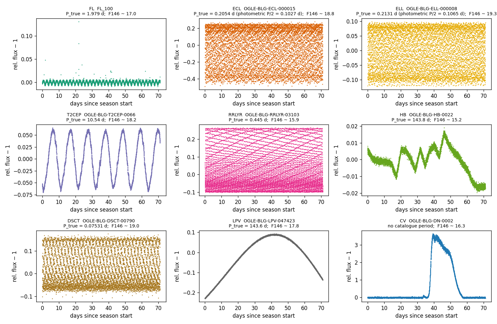
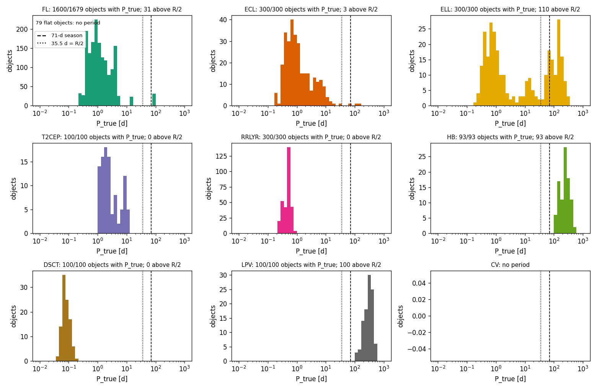
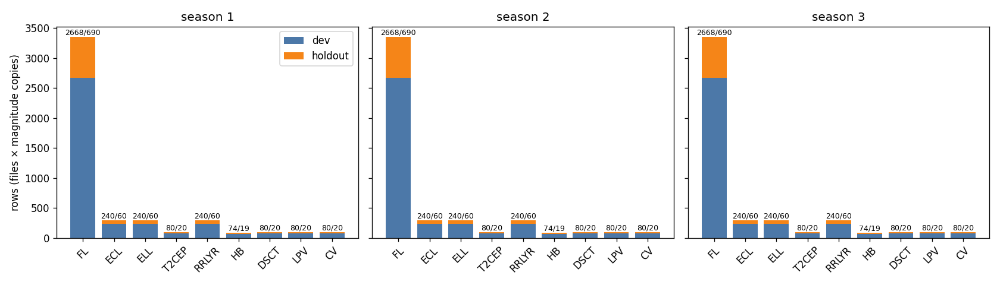
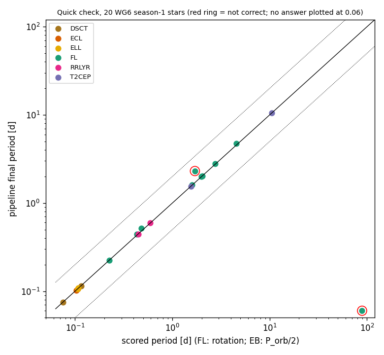

# WG6 Roman loader + first frozen manifest (P35)

**Date:** 2026-11-13 · **Author:** P35 agent session · **Branch:** `claude/p35-wg6-loader-ef0d37` · **Status:** draft

## TL;DR
- Built `claude_files/wg6.py` (`load_wg6_roman`, `load_wg6_raw`), `tools/build_wg6_manifest.py`, `datasets/wg6_roman_v0.csv` (14,253 rows, 3,072 objects, improved noise, seasons 1–3, dev/holdout split by FL template and by OGLE star), and the dataset strings `wg6r_{fl,contam}_v0_improved_s{1,2,3}` in `benchmarks/scorecard.py`. 12 new tests; full pytest passes.
- **Deviation: no CEP.** The improved set has no Cepheids (only the 24 simple-noise ones), so CEP is absent from v0. T2CEP is 100 stars, not 300.
- Quick check (20 stars, `--n-workers 2`): 18/20 correct, ~1 s/star, nothing crashes. No full WG6 scorecard was run.
- Needs your call: scoring of non-rotators (below), CEP, and how many FL magnitudes to keep.

## Question / goal
Task P35 (`docs/TASKS_PROPOSED.md`), part of T28: the WG6 Roman-resampled loader plus a first frozen-candidate manifest, so a later task can run the first WG6 scorecard. No goals in `benchmarks/goals.json` are touched. Rae's 2026-11-13 decisions are applied: improved noise only; three early seasons (assumption: seasons 1–3 of WG6's six consecutive seasons); EBs/ELLs flagged (`is_eb`); no rotators beyond FL here (the schema holds them later via `is_rotator`, `cls`, `variant`).

## What I did
- **Loader** (`claude_files/wg6.py`). `load_wg6_roman(zip_or_path, member, band, season, times_dir, true_period)` reads the FITS member in memory from the zip (no extraction; the `ZipFile` handle is cached per process). It takes the `JD` column (or the simple-noise `.npy` grid via `times_dir`) and converts mag to relative flux with a NaN-safe median. It then cuts one 71-d season (split at gaps > 1 d, 1-indexed) and returns σ converted to flux. The return type is `WG6LightCurve`, a subclass of `preprocessing.PreprocessedLightCurve` (the `load_smarts_fits` container) with extra `flux_err` and `meta`. Conventions match the SMARTS loader: flux is zero-centred (relative flux − 1), time in days, NaN slots kept in place. A relative `zip_or_path` resolves against `$WG6_RESAMPLED_ROOT`. `load_wg6_raw` is ported from WG6_REFERENCE §7 (OGLE I, doubled-offset HJD fix); it was not in the scoping report as code.
- **Manifest** (`tools/build_wg6_manifest.py`, columns exactly as in P35 plus `star_id`, `obj_id`, `subtype`, `in_raw`). One row per (file, season), seasons 1–3. Selection is seeded and hash-based, so row order cannot change it. Per class: 300 stars each of ECL, ELL, RRLYR; all 100 T2CEP; 100 each of DSCT and LPV, all 93 HB, 100 CV (first copy of each star); all 1,600 FL rotator objects at WFmag 17 and 20; and the 79 FL `flat` objects as non-rotator negatives. 20% of FL templates (11 of 54), of FL-flat objects and of the stars in each OGLE class go to the holdout; the builder asserts nothing is on both sides. `P_phot_expected` = P_true/2 for ECL and ELL. The builder is resumable (keeps an existing output unless `--force`, atomic writes, inventory cached) and has `--verify N` to open members on the drive.
- **Dataset strings** (`benchmarks/scorecard.py`, additive only: `parse_wg6_dataset`, `build_wg6_tasks`, a `wg6r` branch in `_load`; metric definitions, `evaluation.py`, `goals.json` untouched). `--manifest wg6r_fl_v0_improved_s<k>` scores dev FL rotators against the template rotation period. `--manifest wg6r_contam_v0_improved_s<k>` scores dev non-rotators with a period against `P_phot_expected`. The holdout is never selected. Zips are read from `$WG6_RESAMPLED_ROOT` (the default is the Data_Vault path).
- **Tests** (`tests/test_wg6.py`): a synthetic FITS-in-zip fixture (season cut, NaN slots, σ, zero-centring, recoverable injected period, simple-noise `times_dir`, relative-path root, errors); a builder test on a toy inventory (schema, split, EB flags, order independence); checks on the committed manifest and dataset strings (no drive); and a drive test that skips when unmounted. Full suite: see Reproduce.

## Results

### The loader on real files, one per class


One season-1 F146 curve per class, read straight from the zips. FL shows the 2 d rotation plus flares. The EB/ELL/RRLYR/DSCT panels look like filled bands because the period is short against the 12.1-min sampling over 71 d. LPV and HB show only a slice of a >100 d signal, and CV (dwarf nova) is an outburst with no period.

### What periods the manifest holds


Dashed = 71-d season, dotted = R/2 = 35.5 d (the searchable limit, D4). **All 93 HB and 100 LPV stars, 110 of 300 ELL and 31 of 1,600 FL (the 89 d template) have P_true above R/2**, so a single season cannot recover them by construction. Keep them in the contaminant set but don't read their "correct" rate as a failure. The 54 FL templates cover 0.2–5 d plus 13 d and 89 d: this is the thin rotator coverage P34 is meant to fix.

### Counts by class × season × dev/holdout


Labels are dev/holdout rows. Seasons have identical counts by construction (one row per file per season). Season-1 objects: FL rotators 1,271 dev / 329 holdout objects (43 / 11 templates), ECL and ELL 240 / 60 each, RRLYR 240 / 60, T2CEP 80 / 20, DSCT 80 / 20, LPV 80 / 20, CV 80 / 20, HB 74 / 19. Full table: `data/counts.csv`.

### Quick check: pipeline vs truth on 20 stars


10 FL rotators (distinct templates, WFmag 17) plus 10 contaminants (2 each of ECL, ELL, T2CEP, RRLYR, DSCT), season 1, `--n-workers 2` under `nice`, through the real `score_one_star` path (`data/quick_check.csv`). 18 of 20 are `correct`: 8/10 FL and all 10 contaminants (2/2 each of ECL/ELL vs P_orb/2, T2CEP, RRLYR, DSCT; the contaminant "correct" is a lock on the variable's own period, i.e. a false positive for rotation: see Q1). Misses: the 89 d FL template (beyond one season, no answer), and one FL star at 1.70 d where the pipeline returned 2.31 d (`wrong`). Roughly 1 s per star-season. This is a plumbing test, not a performance number: 10 stars, no baseline.

## What didn't work
- **CEP.** Planned at ~300 stars; the improved folder has none and the 24 simple-noise CEP stars would break the "improved only" rule, so I left them out.
- The ECL/ELL/T2CEP/RRLYR/HB/LPV selection ends up with an unrepresentative quick-check sample because I took the first stars in manifest order (ECL/ELL in the check are the shortest-period ones). Use the full s1 scorecard for rates.

## Open questions for Rae
1. **How should non-rotators be scored?** On `wg6r_contam_*`, `classify_period(P, P_phot_expected)` says `correct` when the pipeline locks onto the contaminant's own period, which is a *false positive* for rotation. I did not change `evaluation.py`. Proposal: in the first WG6 scorecard, read `contam` outcomes as "locked on the variable's period" (FP) and report FP rate per class, plus the `eb_period` tag for ECL/ELL candidates near P_orb or P_orb/2 (P36/T29). CV and FL-flat have no period, so they are not in `contam` (they are in the manifest for ranker negatives); a star-level "declined = good" metric for them needs new logic.
2. **ECL/ELL target:** scored at P_orb/2 only. Should P_orb count as an acceptable (flagged) answer too?
3. **CEP:** wait for WG6 to ship an improved CEP set, or use the 24 simple-noise stars as a labelled stress set?
4. **FL magnitudes:** v0 keeps WFmag 17 and 20 (the earlier compute budget). "All FL rotators" at all six copies (16–21) would be 4.8k objects × seasons; it is a one-flag change (`--fl-mags`) if you want it.
5. **HB/LPV/ELL with P > R/2:** keep in `contam` as is, or move to a "beyond reach" stress subset so the FP rate is not confounded?
6. **Seasons 1–3 as "early":** WG6's grid is six consecutive seasons with no early/late split; the loader/manifest assume the first three. If WG6's real early/late layout differs (non-consecutive), the season numbering has to be revisited.
7. The manifest is v0 and frozen on your approval; its `holdout` side is never scored by these dataset strings.

## Reproduce
```bash
# drive mounted; from repo root, /opt/anaconda3/envs/ss_openblas/bin/python
nice -n 15 python tools/build_wg6_manifest.py --force --verify 12   # rebuild datasets/wg6_roman_v0.csv
nice -n 15 python reports/2026-11-13_p35-wg6-loader/quick_check.py  # 20-star check -> data/quick_check.csv
python reports/2026-11-13_p35-wg6-loader/figlib.py --drive           # figures (the last needs the drive)
nice -n 15 python -m pytest -q
# full WG6 scorecard (NOT run here; coordinator schedules):
# nice -n 15 python benchmarks/scorecard.py --manifest wg6r_fl_v0_improved_s1 --outdir runs/wg6r_fl_s1 --n-workers 3
```
