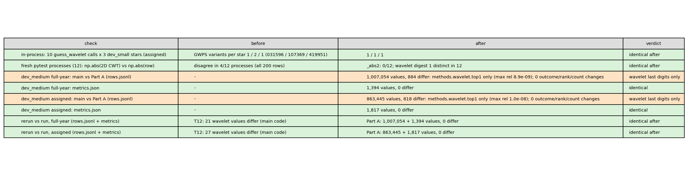
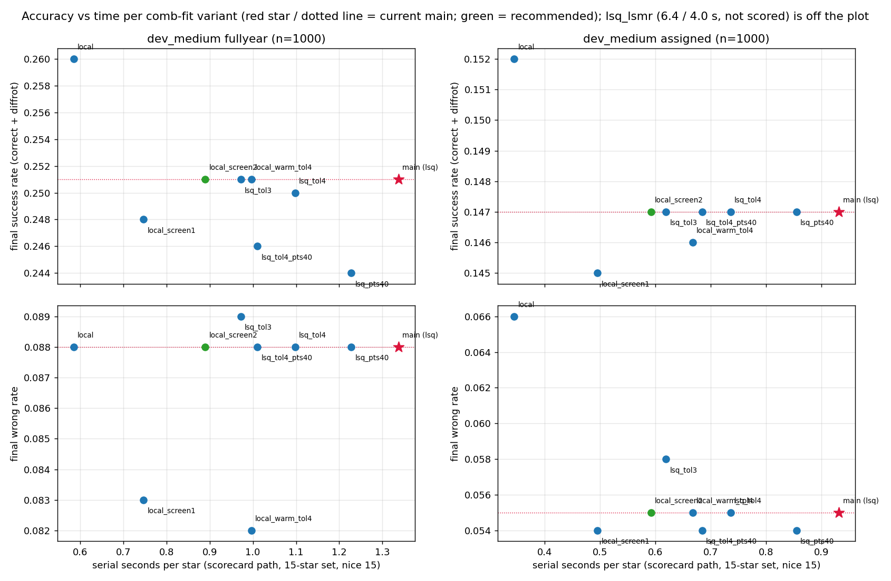
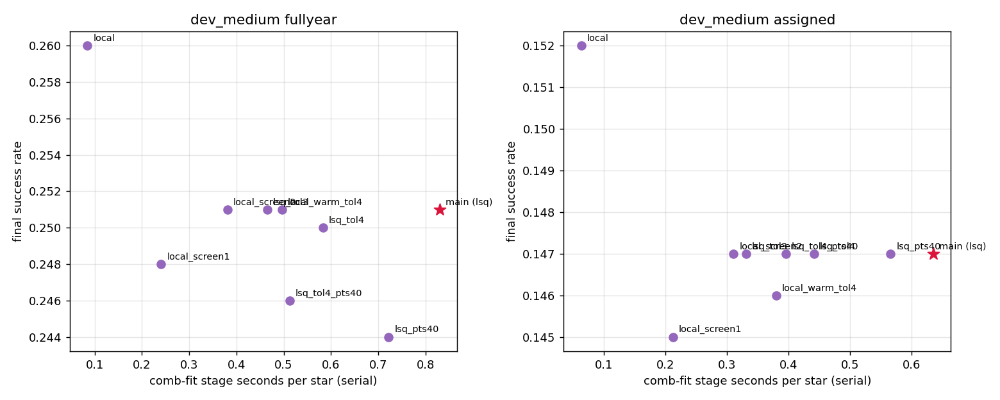
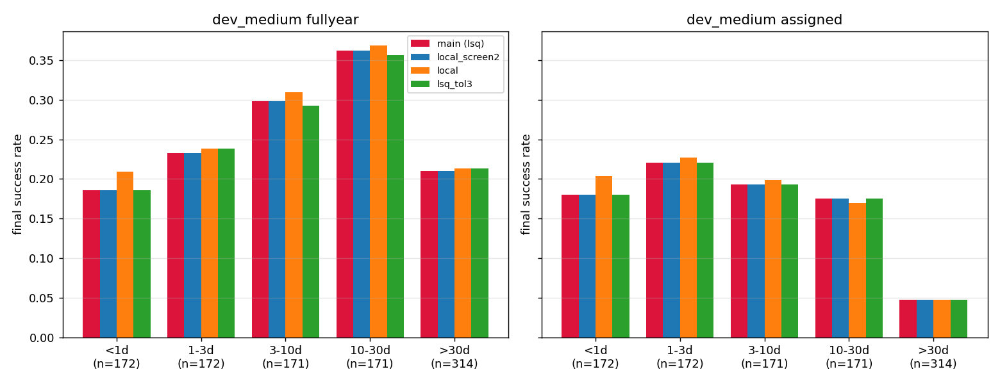
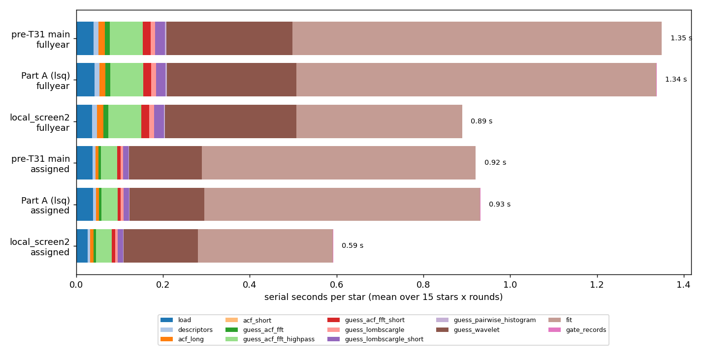
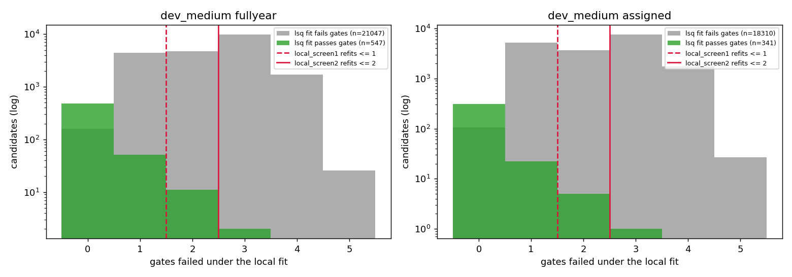
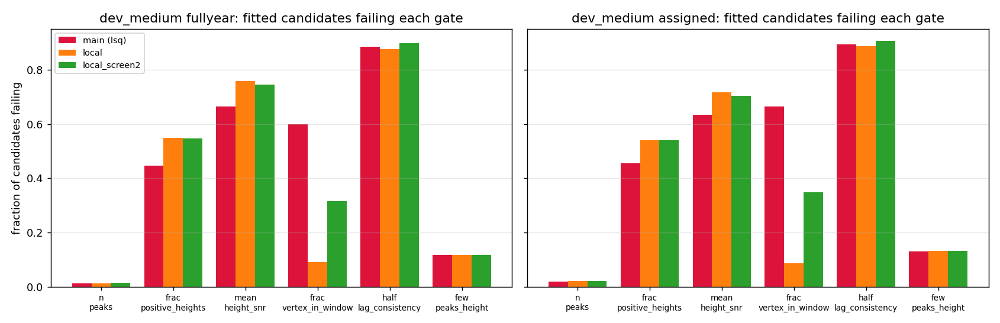
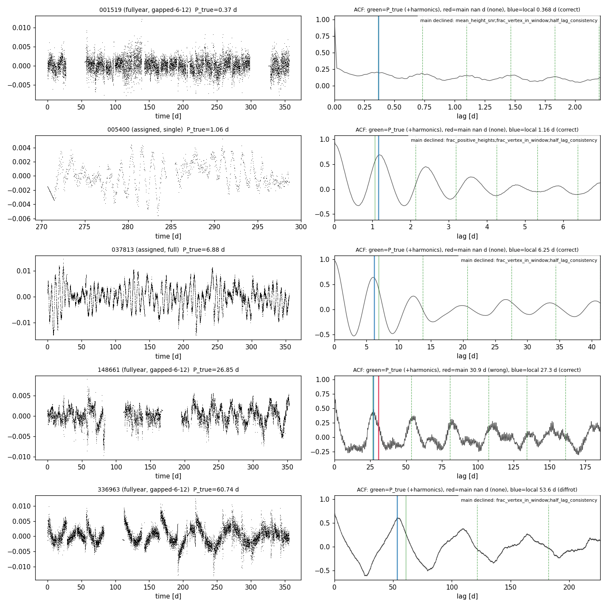
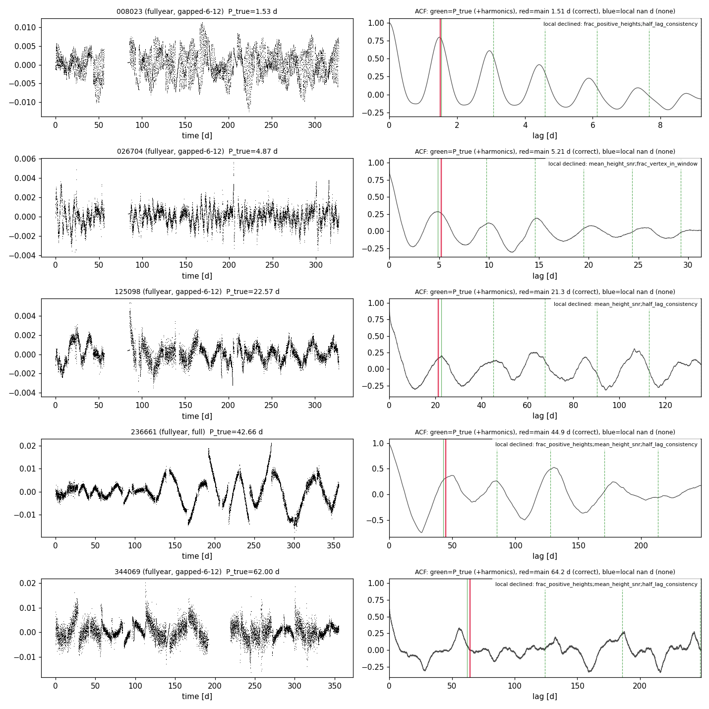
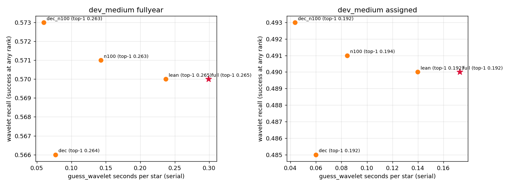

# T31: wavelet determinism + result-changing comb-fit / CWT speed-ups

**Date:** 2026-11-13 · **Author:** T31 performance-optimizer session (overnight) · **Branch:** `claude/t31-comb-fit-speed-e7e5bb` (Part A alone: `claude/t31-partA-wavelet-determinism`) · **Status:** draft

*Run conditions: AC power the whole night. This is the second attempt: the first was killed by the 01:59 WindowServer hang. All heavy jobs ran at `nice -n 15` with 3 workers (`taskpolicy -b` throttled jobs to ~0.5 core, see "What didn't work"). Memory peaked at ~245 MB per worker. My keep-awake request was denied, so the app's in-turn keep-awake was all there was.*

## TL;DR
- **Part A, wavelet determinism (P4): fixed.** Two numpy SIMD loops were behind it: real `np.exp` and complex `np.abs`. A rerun of dev_medium is now bit-identical (0 of 1.87M values differ). Against main, only the last digits of `wavelet.top1` move. No outcome or metric changes. Candidate baselines `_v6w` are committed.
- **Part B, recommended variant `local_screen2`:** cheap closed-form per-peak fits screen every candidate, and the unchanged fit is rerun on any candidate failing ≤ 2 gates.
  - It reproduces main's answers: every outcome and metric is identical, and 1 of 2000 periods moves by 0.04%.
  - Speed-up: production path 1.99× / 1.94× (full-year / assigned), scorecard path 1.50× / 1.57×.
- **Fastest variant, `local` (pure closed-form):** 2.3–2.7× faster with more successes (+0.009 / +0.005). But assigned wrong goes 0.055 → 0.066, because its vertex gate becomes nearly vacuous.
- **Your calls:** which variant to adopt, the ranker-feature changes, and the `_v6w` baselines.

## Question / goal
T31 in `docs/TASKS.md` (from P4 and P38).
- **Part A:** make `guess_wavelet` bit-reproducible.
- **Part B:** explore result-changing speed-ups of the comb fit (`claude_files/comb_fit.py`) and the CWT, and measure accuracy against seconds per star.

No `goals.json` goal targets runtime. Every scored variant passes the regression guard against `benchmarks/baselines/dev_medium_{fullyear,assigned}_v6.json`.

## What I did
1. **Part A.** I reproduced the flip in process: 10 calls on dev_small 107369 gave 2 GWPS byte patterns. I then traced it op by op and found two culprits:
   - the float64 `np.exp` behind the Morlet envelope;
   - complex `np.abs`, for the power. In ~1 of 3 fresh processes, `np.abs` of the 2D CWT disagreed with `np.abs` of its own rows on identical bytes.

   The fixes, in `claude_files/guesses.py`:
   - the kernel is one complex `exp(-x²/2 + i·w0·x)`, a scalar libm `cexp` loop;
   - `|c|² = re·re + im·im` (`_abs2`);
   - the GWPS Gaussian peak fits use `_det_exp`, a libm exp.

   Tests are in `tests/test_wavelet_determinism.py`: element-wise reference, heap churn, row vs 2D, and in-process plus spawned-process repeatability on 031596 / 419951 / 107369.
2. **Part A scoring.** I ran a fresh scorecard of the pre-T31 code (`0c8b0e9`) and Part A on `datasets/dev_medium.csv,data_root=data/smarts_dev` in both coverage modes (`sectors=ignored`, `sectors=manifest`), plus a second Part A run of each. I compared value by value with `tools/compare_runs_exact.py` and a field classifier. The Part A runs are committed as `benchmarks/baselines/dev_medium_{fullyear,assigned}_v6w.json` (+ `_tables/`).
3. **Part B variants.** Each sits behind a switch: `fit_rotation_period(comb_variant=...)` or the `SS_COMB_VARIANT` env var, and `guess_wavelet(cwt_variant=...)` or `SS_CWT_VARIANT`. Defaults are unchanged, and the refactored default path is bit-identical on dev_small. The scorecard records both names in `metrics.json` `config`. Tests are in `tests/test_t31_variants.py`.
   - Comb (`COMB_VARIANTS`):
     - `lsq_tol4` / `lsq_tol3`: xtol = ftol = gtol 1e-4 / 1e-3, instead of 1e-6;
     - `lsq_lsmr`: iterative trust region with a sparse Jacobian;
     - `lsq_pts40`: 40 points per window instead of 100;
     - `lsq_tol4_pts40`;
     - **`local`**: an independent weighted quadratic fit per ACF peak. Its vertex is accepted only if it lies inside the window. A robust (soft-L1 IRLS) line fit of vertex vs n gives P and t0, then a 2-parameter (h, A ≥ 0) fit runs at each comb-tied centre. No iterative solver.
     - `local_warm` / `local_warm_tol4`: `lsq` started from the `local` solution;
     - **`local_screen1` / `local_screen2`**: `local` fit plus all gates for every candidate, then the unchanged `lsq` fit, cold-started, for every candidate failing ≤ 1 / ≤ 2 gates.
   - CWT (`CWT_VARIANTS`):
     - `lean`: GWPS accumulated scale by scale, no 200 × N `wavelet_power` array;
     - `dec`: long scales on 2^k-block-averaged flux, keeping ≥ 16 samples per period;
     - `n100`: 100 trial periods instead of 200;
     - `dec_n100`.
4. **Scoring.** I scored 8 comb variants on dev_medium in both modes, at 3 workers and `nice 15`. Each CWT variant rode along with one comb variant: the wavelet isn't pooled, so final answers don't depend on it. `lsq_lsmr` and `local_warm` weren't scored because they're no faster.
5. **Timing.** `benchmarks/profile_pipeline.py` ran serially on T12's 15-star set for every variant, in both modes. I used rounds 2–3 only: round 1 ran ~40% slow machine-wide (post-login Spotlight indexing; even `acf_long`, which no variant touches, was 0.020 vs 0.014 s).

## Results

### Part A: the wavelet is now bit-reproducible


Green rows are bit-identical; orange rows are the expected one-time change. Against main, only `methods.wavelet.top1` moves: 884 / 818 stars, max relative change 1.0e-8, from the peak fit amplifying last bits. No wavelet outcome, rank or candidate count changes. Every `metrics.json` value is identical. The Part A rerun differs in 0 values; T12 measured 21 / 27 for main against itself. Part A costs no time: 1.337 vs 1.349 s/star full-year and 0.931 vs 0.920 assigned (serial, Part A vs pre-T31).

**Also found:** `guess_acf_fft` (a pooled method) uses the same `np.abs(fft)**2` pattern. T14's 40-star cross-process test never caught a flip there, and I left it alone because it would change final-answer bits (proposed as P39).

### Part B: accuracy vs time


One point per comb variant: the top row is success, the bottom row is wrong rate, and the red star is main. `local_screen2` (green) sits exactly on main's success and wrong lines at 0.67× its time. `local` is far left and higher, but its assigned wrong rate rises. The pts40 variants lose full-year success.

| variant | s/star full-year / assigned (serial) | success full-year / assigned | wrong full-year / assigned |
|---|---|---|---|
| main (`lsq`) | 1.337 / 0.931 | 0.251 / 0.147 | 0.088 / 0.055 |
| **`local_screen2`** | **0.890 / 0.592** | **0.251 / 0.147** | **0.088 / 0.055** |
| `local_screen1` | 0.747 / 0.496 | 0.248 / 0.145 | 0.083 / 0.054 |
| `local` | 0.585 / 0.345 | 0.260 / 0.152 | 0.088 / 0.066 |
| `lsq_tol3` | 0.972 / 0.619 | 0.251 / 0.147 | 0.089 / 0.058 |
| `local_warm_tol4` | 0.996 / 0.667 | 0.251 / 0.146 | 0.082 / 0.055 |
| `lsq_tol4_pts40` | 1.011 / 0.684 | 0.246 / 0.147 | 0.088 / 0.054 |
| `lsq_tol4` | 1.098 / 0.736 | 0.250 / 0.147 | 0.088 / 0.055 |
| `lsq_pts40` | 1.228 / 0.855 | 0.244 / 0.147 | 0.088 / 0.054 |
| `local_warm` (not scored) | 1.233 / 0.839 | | |
| `lsq_lsmr` (not scored) | 6.393 / 4.006 | | |

Full numbers are in `data/variant_metrics.csv`, `data/timing_summary.csv` and `data/speedups.csv`. The **production path** (load → ACFs → 3 default methods → fit, no wavelet) gains more, because the comb fit is most of it:

| variant | production path (full-year / assigned) | speed-up |
|---|---|---|
| main | 0.910 / 0.695 s | |
| `local_screen2` | 0.458 / 0.358 s | 1.99× / 1.94× |
| `local` | 0.155 / 0.109 s | 5.9× / 6.4× |

Scorecard path per 1M stars: 372 → 247 CPU-hours full-year and 259 → 164 assigned with `local_screen2` (serial i5, `nice 15`).



The same plot against the comb-fit stage alone: `local` is 10× faster there, `local_screen2` 2.2×, `lsq_tol3` 1.8×.

### Success by period bin


`local_screen2` (blue) matches main (red) in every bin. `local` (orange) gains most below 1 d (full-year 0.186 → 0.209) and loses only assigned 10–30 d. `lsq_tol3` is flat apart from small 3–30 d full-year losses.

`check_goals.py --baseline ..._v6.json` gives `OVERALL: PASS` for `local_screen2`, `local` and `lsq_tol3` in both modes (`data/check_goals_*.txt`). Excerpt for `local_screen2`, full-year:
```
  0.251   0.251  +0.000  0.020  final.overall.success
  0.233   0.233  +0.000  0.060  final.by_bin.1-3d.success
  0.363   0.363  +0.000  0.060  final.by_bin.10-30d.success
  0.298   0.298  +0.000  0.060  final.by_bin.3-10d.success
  0.186   0.186  +0.000  0.060  final.by_bin.<1d.success
  0.210   0.210  +0.000  0.060  final.by_bin.>30d.success
OVERALL: PASS
```
`local` against `_v6`: success +0.009 full-year (0.251 → 0.260) and +0.005 assigned (0.147 → 0.152). Wrong isn't a guarded metric. The draft goals G9–G11 fail exactly as they do on the baseline.

### Where the time goes


The fit (light brown) shrinks from 0.83 to 0.38 s full-year and from 0.64 to 0.31 s assigned. The wavelet (dark brown) is now the biggest remaining stage of the scorecard path.

### Why the screen works, and what it costs


This shows how many gates each candidate fails under the cheap `local` fit (log scale). Green marks candidates that the full `lsq` fit passes. Nearly all of them fail ≤ 2 gates under `local`, and the solid line marks `local_screen2`'s cutoff.
- **Recall:** `local_screen2` refits 9.9 / 9.3 of ~21.6 / 18.7 candidates per star, and keeps 99.6 / 99.7% of `lsq`-passing candidates and 99.7 / 100% of main's selected answers.
- **`local_screen1`:** refits only 5.2 / 5.6, but keeps 97.6 / 98.2%, which is why it loses 3 + 2 stars.
- **The one difference:** dev_medium 009530 full-year, 1.8206 vs 1.8213 d (`figures/fig_examples_local_screen2_period_moved.png`); both are `correct`.

### Why `local` answers more, and errs more


Under `local`, `frac_vertex_in_window` fails on only 9% of candidates (main: 60%), while height and SNR fail more often. Its vertices are accepted only inside their window, and the comb-tied jitter is clipped to ±5% P, so the vertex gate is nearly vacuous by construction. So `local` changes the gate balance, not just the solver:
- **Gains:** 29 of its 33 gained stars were declined by main on `frac_vertex_in_window` (+ `half_lag_consistency`).
- **Losses:** 28 stars go from none to wrong, 7 of them assigned > 30 d.



Stars `local` gains. Left: the light curve. Right: the ACF with P_true and its harmonics (green), main's answer (red), `local`'s answer (blue) and main's decline reason. Several are clean rotators that main's fit declines because its vertices drift out of the frozen windows (005400, 037813, 336963), so part of `local`'s gain looks real.



Stars `local` loses. These are clear rotators that `local` declines, mostly on `frac_positive_heights` / `mean_height_snr` / `half_lag_consistency`. Its plain per-window least squares, unlike `lsq`'s soft-L1 loss, lets heights go negative on noisy or decaying teeth.

### CWT variants


Wavelet recall (and top-1) against the wavelet-stage time; the red star is `full`. The wavelet isn't pooled, so none of these change final answers; they only affect the per-method columns and the ranker's `wavelet_nearest_peak_*` features.

| variant | wavelet stage speed-up (full-year / assigned) | result change |
|---|---|---|
| `lean` | 1.26× / 1.24× | bit-identical on all of dev_medium: top-1 and candidate counts, both modes |
| `n100` | 2.1× | recall 0.571 / 0.491, vs main 0.570 / 0.490 |
| `dec_n100` | 5.0× / 4.0× | recall 0.573 / 0.493, top-1 0.263 / 0.192 (main 0.265 / 0.192) |
| `dec` | 3.9× / 2.9× | recall 0.566 / 0.485 |

`lean` also drops the ~27 MB `wavelet_power` array per full-year star. Combining `local_screen2` with `dec_n100` should give about 0.65 / 0.46 s/star, ~2.0× on the scorecard path. That estimate is from additive stage times; I didn't run it.

### Ranker-feature changes, if a variant is adopted
- **`local_screen2`:** the 46–50% of candidates that are refit (all candidates that can be selected) carry identical features. The rest carry `local`-fit features: every fit-derived column (`fitted_P`, `P_err_frac`, `t0_err_frac`, `redchi`/`log_redchi`, `n_peaks_*`, `frac_positive_heights`, `mean_height_snr`, vertex fraction, per-peak shape and depth summaries, gate values). Their P differs from the `lsq` fit by a median 9% (full-year) / 12% (assigned). These candidates fail ≥ 3 gates, but a ranker trained on main-built tables would see a shifted distribution for them, so build training and inference tables with the same variant.
- **`local`:** every fit-derived feature changes. `P_err` comes from the vertex-line fit, not the Jacobian, and `frac_vertex_in_window` loses most of its information.
- **CWT:** `lean` changes nothing. `n100` / `dec` change `wavelet_nearest_peak_*`; `wavelet_power` disappears from `info` (only `plotting.py` reads it, behind an `if`).

## What didn't work
- **`lsq_lsmr` is 4.3–7× slower.** The iterative solver needs many more inner iterations than the dense SVD on these small (≤ ~30-parameter) problems.
- **Warm starts don't help.** `local_warm` saves only 1.1×: least squares from the local solution still iterates nearly as long.
- **Fewer points per window costs accuracy.** `lsq_pts40` and `lsq_tol4_pts40` lose 0.007 / 0.005 full-year success for 1.09× / 1.32×.
- **`local_screen1` is too aggressive** (97.6% screen recall): it loses 3 + 2 correct stars.
- **`taskpolicy -b` was unusable for scorecards.** Background QoS capped a process at ~0.5 core on the idle machine: the full pytest suite took > 10 min instead of 75 s. I used `nice -n 15` (the brief's alternative) instead.
- **My first Part A fix was incomplete.** The single complex-exp kernel fixed the in-process flips, but a test still failed in ~1 of 3 fresh processes. That led to the complex `np.abs` culprit, and the first Part A queue was stopped and rerun.

## Open questions for Rae
1. **Comb variant:**
   - **(a) Adopt `local_screen2` as the default:** recommended. It reproduces main's answers, and the production path is 2× faster.
   - **(b) Adopt `local`:** 6× on the production path and more successes, but more wrong answers on assigned. It also needs a new vertex gate, since its current one is nearly vacuous; see P40.
   - **(c) Keep `lsq`.**

   Any change is a one-line default in `COMB_VARIANTS`. The ranker-table rebuild (P31) should use the same variant.
2. **CWT variant:**
   - `lean` is a free 1.25× on the wavelet stage plus memory, with identical results. I'd make it the default.
   - `dec_n100` gives 4–5× more on the wavelet stage at ±0.003 recall, but changes the wavelet features. Your call.
3. **Baselines.** The `_v6w` files (Part A) are committed but not yet the judging baseline. If you adopt a comb or CWT variant, its runs (in `runs/t31/runs/`) would become the next baseline.
4. **Ranker features.** Under `local_screen2`, screened-out candidates carry `local`-fit features (see above). That's fine if tables are rebuilt consistently; otherwise use `local_screen2` only for production inference.
5. **Merging.** Part A can merge alone from `claude/t31-partA-wavelet-determinism` (2 code commits + baselines).

## Reproduce
```bash
PY=/opt/anaconda3/envs/ss_openblas/bin/python
# tests (determinism + variants)
$PY -m pytest -q tests/test_wavelet_determinism.py tests/test_t31_variants.py
# one scorecard per variant / mode (3 workers, nice); the CWT variant can ride along
SS_COMB_VARIANT=local_screen2 SS_CWT_VARIANT=full nice -n 15 $PY benchmarks/scorecard.py --manifest datasets/dev_medium.csv \
    --data-root data/smarts_dev --ignore-manifest-sectors --n-workers 3 --outdir runs/t31/runs/v_local_screen2_dmfy --resume
#   (drop --ignore-manifest-sectors and use _dmas for assigned; main = the pre-T31 checkout 0c8b0e9, A = 32531d8)
$PY tools/compare_runs_exact.py runs/t31/runs/main_dmfy runs/t31/runs/A_dmfy
$PY benchmarks/check_goals.py runs/t31/runs/v_local_screen2_dmfy/metrics.json --baseline benchmarks/baselines/dev_medium_fullyear_v6.json
# serial timing, 15-star set (T12's ids), per variant and round k
SS_COMB_VARIANT=local_screen2 nice -n 15 $PY benchmarks/profile_pipeline.py --manifest datasets/dev_medium.csv --data-root data/smarts_dev \
    --ignore-manifest-sectors --star-ids <15 ids> --out runs/t31/prof/prof_local_screen2_full_fy_r2.csv
# data + figures + notebook
$PY reports/2026-11-13_t31-comb-fit-speed/analysis.py runs/t31
$PY reports/2026-11-13_t31-comb-fit-speed/build_notebook.py && $PY tools/run_notebook.py reports/2026-11-13_t31-comb-fit-speed/notebook.ipynb
```
`runs/t31/` (gitignored, 233 MB) holds the scored runs' metrics.json, per_star, per_method and per_candidate files, plus the profile CSVs. The 15 timing stars are listed in `reports/2026-11-12_t12-speed-up/README.md`. `PROGRESS.md` is the night's running log.
