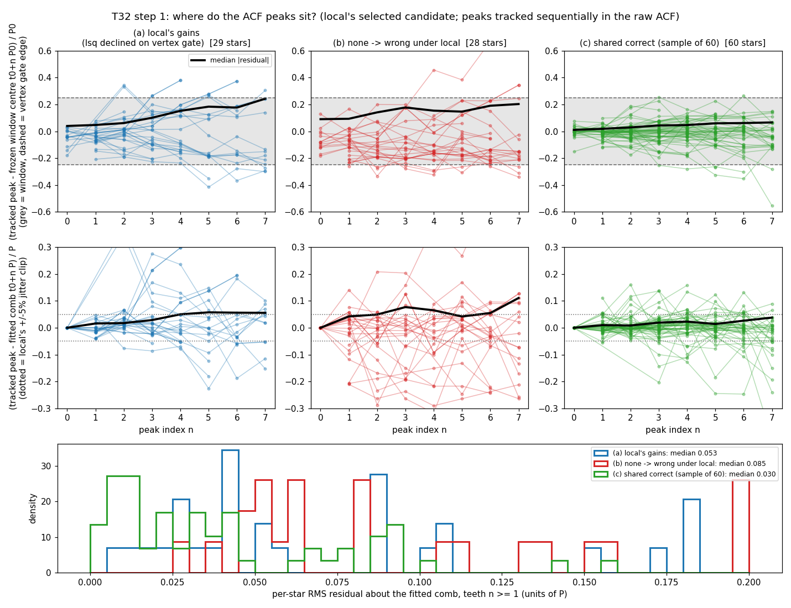
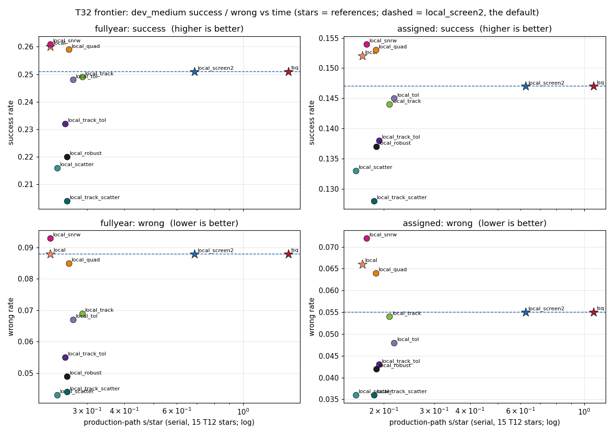
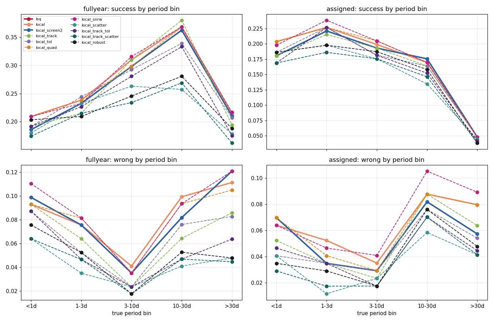
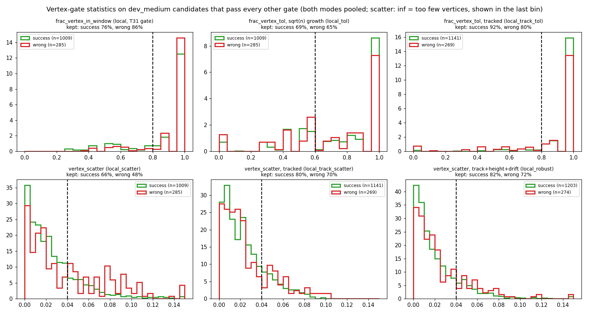
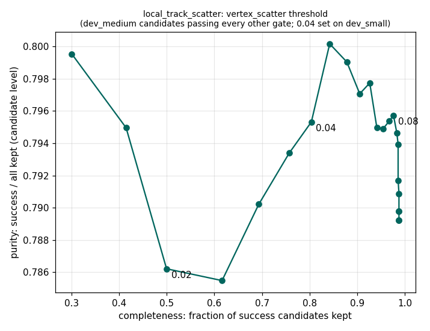
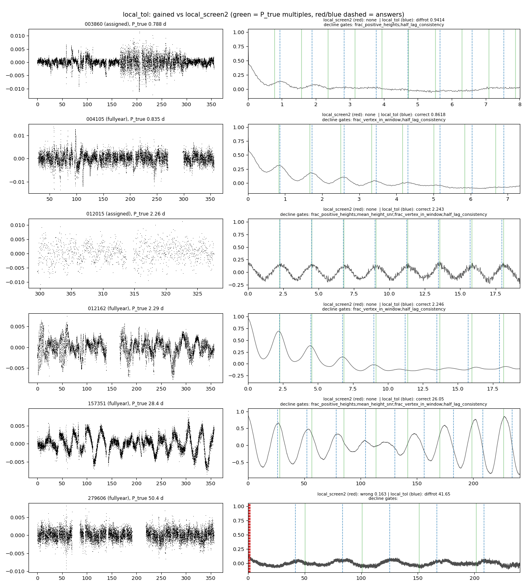
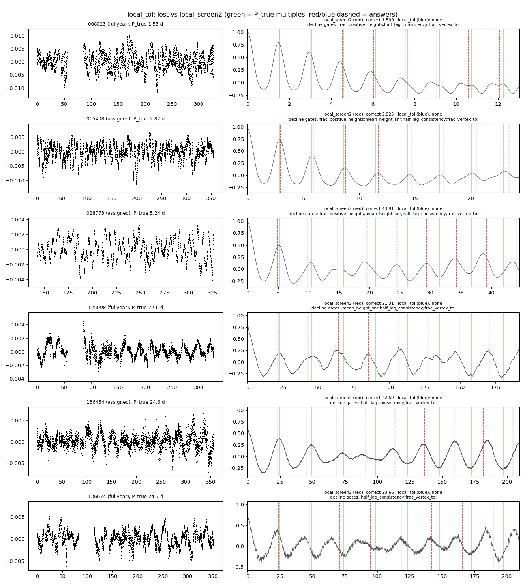
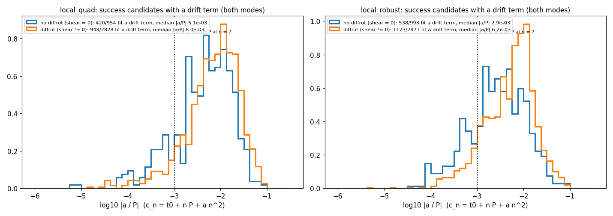

# T32: drift-robust local comb solver

**Date:** 2026-11-13 · **Author:** T32 method-improver session · **Branch:** `claude/t32-local-drift-ca46ba` · **Status:** draft

## TL;DR
- **Best variant: `local_tol`** (vertex within 0.05·P·√n of the fitted comb on ≥ 60% of teeth).
  - Speed: 2.5–2.9× faster than the default `local_screen2` on the production path.
  - Success: −0.003 full-year (0.251 → 0.248), −0.002 assigned (0.147 → 0.145).
  - Wrong answers: 0.088 → 0.067 full-year, 0.055 → 0.048 assigned.
  - `check_goals` passes against `_v7` in both modes.
- **Ideas 1 and 2 fix the problem.** Sequential tracking (`local_track`) and growing tolerance (`local_tol`) remove `local`'s extra wrong answers. `local_tol` has 0 / 4 none→wrong stars, where `local` had 12 / 16.
- **Ideas 3–5 don't.**
  - Quadratic drift and height weighting barely change anything.
  - The scatter gate halves wrong answers but loses 0.03–0.05 full-year success and fails the regression guard.
- **Your calls:**
  - adopt `local_tol`, or keep `local_screen2`;
  - whether the drift coefficient `a` is worth a ranker feature (weak signal).

## Question / goal
Task T32 in `docs/TASKS.md`: make the cheap `local` comb solver (T31, about 6× faster than `lsq` on the production path) robust to drifting ACF peaks, so it can run on its own. T31 found that `local` gains 33 stars, mostly ones `lsq` declines on `frac_vertex_in_window`. But `local`'s vertex gate rejects almost nothing (9% of candidates, vs 60% under `lsq`), so on assigned coverage 28 stars go none→wrong. No `goals.json` goal targets this. The regression guard is `check_goals --baseline` against the `_v7` files, which are `local_screen2`, the default.

## What I did
1. **Step 1, plots only.** I took 117 star-modes:
   - (a) the 29 gains that `lsq` declined on the vertex gate;
   - (b) the 28 none→wrong stars;
   - (c) 60 shared-correct stars.

   Star lists came from T31's `changed_stars_v_local__dec.csv`. For each one I re-fit `local`'s selected candidate with `local` and `lsq`. I tracked the raw-ACF peak positions tooth by tooth and logged every window, tied centre and free vertex (`step1_peaks.py`).
2. **Switches.** Each idea is a `COMB_VARIANTS` entry in `claude_files/comb_fit.py`, selected via `SS_COMB_VARIANT`. Defaults are untouched, `DEFAULT_COMB_VARIANT` is still `local_screen2`, and `local` is bit-identical. Tests are in `tests/test_t32_local_drift.py` (16). Full pytest under `nice`: 500 passed, 1 skipped.

   | idea | switch | what changes |
   |---|---|---|
   | 1 sequential tracking | `local_track` | window n centred on (last vertex) + k·P_est, not t0 + n·P0 (`_build_windows_tracked`) |
   | 2 tolerance growing with n | `local_tol` (√n), `local_tol_lin` (n), `local_tol_width` (½ HWHM) | gate becomes `frac_vertex_tol`: share of teeth whose free local vertex is within tol_n of the fitted comb |
   | 3 quadratic drift | `local_quad` | vertex fit c_n = t0 + nP + a·n²; centres on the quadratic; `drift_a`, `drift_a_frac` per candidate |
   | 4 height weighting | `local_snrw` | IRLS line-fit weights × fitted peak height × pair-count weight |
   | 5 residual-scatter gate | `local_scatter` | gate becomes `vertex_scatter`: RMS of (free vertex − comb)/P ≤ 0.04, with ≥ 50% of teeth carrying a vertex |
   | combos | `local_track_tol`, `local_track_scatter`, `local_robust` (track + height + drift + scatter) | tracking supplies the vertices that the tol/scatter gates need |

   - **New gates.** `frac_vertex_tol` and `vertex_scatter` live in `EXTRA_GATE_NAMES`. They appear in `gate_results` only for variants that enable them, so default runs keep the `GATE_NAMES` schema, and so do the ranker tables. The lag-0 tooth is excluded from both.
3. **Thresholds were set on dev_small candidates, never on dev_medium** (`cand_stats.py`).
   - Under frozen windows, 30–40% of a correct candidate's teeth have no in-window vertex (about 10% with tracking). So `min_frac_tol` is 0.6 untracked and 0.8 tracked.
   - The scatter threshold is 0.04.
4. **Scoring.** I ran `datasets/dev_medium.csv,data_root=data/smarts_dev` full-year (`--ignore-manifest-sectors`) and assigned. Settings: 3 workers, `nice -n 15`, `--resume`, one job at a time with 2-min gaps. Each variant was checked with `check_goals --baseline benchmarks/baselines/dev_medium_{fullyear,assigned}_v7.json`. `local_tol_lin` and `local_tol_width` were screened only with the harness (below); on dev_small and dev_medium they track `local_tol` within ±0.008.
   - **Fast screening harness.** `t32lib.py` caches the pooled Stage-1 guesses and runs load → ACF → fit. Its `local` reproduces T31's `local` rates exactly, and its outcomes match the T32 scorecards.
   - **Reference runs.** `lsq` comes from the `_v6w` baseline tables (T31 Part A) and `local_screen2` from `_v7`. T31's worktree had been deleted, so I re-scored `local` here; it reproduces T31's numbers exactly (0.260 / 0.088 and 0.152 / 0.066).
5. **Timing.** `benchmarks/profile_pipeline.py` ran serially on T12's 15 stars, both modes, 2 interleaved rounds of all 11 variants (`run_profiles.sh`); I report the median over rounds. The production path is load + 2 ACFs + the 3 pooled methods + fit.

## Results

### Step 1: what drift looks like


Top row: each tracked ACF peak relative to its frozen window centre t0 + n·P0. Middle row: relative to the fitted comb t0 + n·P. Bottom: per-star RMS of the middle row.
- **(a) Gains:** the peaks fan out of the windows linearly with n. P0 is off by about 3% (median |P_fit/P0 − 1| is 0.029 for `local` and 0.063 for `lsq`). The late teeth leave the ±0.25·P0 windows, which is what fails `lsq`'s vertex gate. About the fitted line they are fairly tidy: RMS 0.053.
- **(b) none→wrong:** already offset at n = 0–1, then random scatter with no trend. RMS 0.085.
- **(c) Shared-correct:** RMS 0.030.

So **drift is mostly a seed-period error (linear in n), not curvature**, and noise shows up as scatter about the line. That pointed at ideas 1, 2 and 5.

### Accuracy vs time


One point per variant; stars are the references, and the dashed line is the default. `local_tol` and `local_track` sit at about `local`'s speed, on the default's success line, and below its wrong line in both modes. The scatter variants buy lower wrong rates with a lot of success.

| variant | production s/star (full-year / assigned) | success | wrong | precision (success / answered) | stars gained / lost vs default | none→wrong vs default |
|---|---|---|---|---|---|---|
| `lsq` | 1.42 / 1.08 | 0.251 / 0.147 | 0.088 / 0.055 | 0.711 / 0.697 | +0 −0 / +0 −0 | 0 / 0 |
| `local_screen2` (default) | 0.69 / 0.62 | 0.251 / 0.147 | 0.088 / 0.055 | 0.711 / 0.697 | — | — |
| `local` | 0.23 / 0.17 | 0.260 / 0.152 | 0.088 / 0.066 | 0.716 / 0.664 | +22 −13 / +11 −6 | 12 / 16 |
| `local_track` (1) | 0.29 / 0.21 | 0.249 / 0.144 | 0.069 / 0.054 | 0.750 / 0.686 | +27 −29 / +11 −14 | 11 / 12 |
| **`local_tol` (2)** | **0.27 / 0.22** | **0.248 / 0.145** | **0.067 / 0.048** | **0.756 / 0.711** | +18 −21 / +7 −9 | **0 / 4** |
| `local_quad` (3) | 0.26 / 0.19 | 0.259 / 0.153 | 0.085 / 0.064 | 0.723 / 0.668 | +21 −13 / +12 −6 | 10 / 14 |
| `local_snrw` (4) | 0.23 / 0.17 | 0.261 / 0.154 | 0.093 / 0.072 | 0.707 / 0.650 | +22 −12 / +13 −6 | 17 / 21 |
| `local_scatter` (5) | 0.24 / 0.16 | 0.216 / 0.133 | 0.043 / 0.036 | 0.803 / 0.756 | +15 −50 / +11 −25 | 1 / 3 |
| `local_track_tol` | 0.25 / 0.19 | 0.232 / 0.138 | 0.055 / 0.043 | 0.773 / 0.715 | +24 −43 / +10 −19 | 4 / 4 |
| `local_track_scatter` | 0.26 / 0.18 | 0.204 / 0.128 | 0.044 / 0.036 | 0.785 / 0.727 | +22 −69 / +10 −29 | 2 / 4 |
| `local_robust` | 0.26 / 0.19 | 0.220 / 0.137 | 0.049 / 0.042 | 0.783 / 0.721 | +24 −55 / +12 −22 | 3 / 7 |

Data: `data/variant_metrics.csv` and `data/timing_summary.csv`.
- **Timing caveat.** This afternoon's machine was slower than T31's night: `local_screen2` was 0.69 s here vs 0.46 s then. Compare the ratios, not the absolute values. The spread between the local-family variants (0.23–0.29 s) is within round-to-round noise; tracking adds roughly 0.03–0.04 s/star of fit time.
- **Scorecard path** (all methods including the wavelet): `local_tol` 0.97 / 0.58 s vs `local_screen2` 1.25 / 0.99 s.

**`check_goals --baseline _v7`:** `OVERALL: PASS` in both modes for `local`, `local_track`, `local_tol`, `local_quad`, `local_snrw` and `local_track_tol`. `local_scatter`, `local_track_scatter` and `local_robust` FAIL full-year, on `final.overall.success` and `final.by_bin.10-30d.success` (`local_track_scatter` also on 3–10 d); they pass assigned. All outputs are in `data/check_goals/`. Excerpt for `local_tol`:
```
full-year                                              assigned
  0.251   0.248  -0.003  0.020  final.overall.success     0.147   0.145  -0.002  0.020
  0.233   0.244  +0.012  0.060  final.by_bin.1-3d          0.221   0.227  +0.006  0.060
  0.363   0.339  -0.023  0.060  final.by_bin.10-30d        0.175   0.164  -0.012  0.060
  0.298   0.292  -0.006  0.060  final.by_bin.3-10d         0.193   0.181  -0.012  0.060
  0.186   0.192  +0.006  0.060  final.by_bin.<1d           0.180   0.186  +0.006  0.060
  0.210   0.207  -0.003  0.060  final.by_bin.>30d          0.048   0.048  +0.000  0.060
OVERALL: PASS (both)
```
The draft goals G9–G11 fail exactly as they do on the baseline.

### By period bin


The solid lines are the references.
- **`local_tol` vs the default:** full-year wrong falls in every bin, most at > 30 d (0.121 → 0.083) and 1–3 d (0.076 → 0.052). Success loses mainly 10–30 d full-year (0.363 → 0.339) and gains 1–3 d.
- **Scatter variants:** they lose 0.08–0.11 at 10–30 d full-year. Long periods have few teeth, and one bad vertex dominates the RMS.

### Gate statistics: why the tolerance gate works and the scatter gate doesn't


Each panel shows dev_medium candidates that pass every other gate (both modes pooled); the dashed line is the threshold.
- **Candidate-level separation is weak for every statistic.** `frac_vertex_tol` keeps 69% of success candidates and 65% of wrong ones. `vertex_scatter` keeps 66% vs 48% untracked and 80% vs 70% tracked.
- **The dev_small separation didn't carry over.** On dev_small (72–80 candidates), the median scatter was 0.017 for success vs 0.05 for others.



Purity is flat (0.79–0.80) for every scatter threshold, so `vertex_scatter` is not a candidate-level discriminator on dev_medium.
- **Where the star-level gain comes from.** It comes from which stars get declined: wrong answers are disproportionately stars with one marginal passing candidate.
- **Why the tolerance gate does better.** It mostly removes those marginal candidates (19 / 10 wrong→none, 0 / 4 none→wrong). Its losses are concentrated on clean rotators whose late teeth decayed (next section).

### Gained and lost stars (`local_tol` vs the default)


Gains (18 full-year, 7 assigned; 22 were declined by the default, 3 were wrong):
- Most are clean rotators that the default declined on `frac_vertex_in_window`: 004105, 012015, 012162, 157351.
- 279606 goes from a wrong 0.16 d to diffrot.
- 003860 (diffrot at 0.94 d on a nearly flat ACF) looks lucky.



Losses (21 / 9):
- Mostly clear rotators with decaying ACFs, e.g. 008023 and 015438. In those, the late teeth have no free vertex, so `frac_vertex_tol` drops below 0.6.
- Every loss also fails 1–3 other gates under the local fit: `half_lag_consistency` in 28 of 30, `frac_positive_heights` / `mean_height_snr` in 20. This is the T31 observation that `local`'s per-window least squares lets decayed teeth go negative.
- The largest share is in 10–30 d (11 of 30).

### Drift coefficient `a` (idea 3, possible ranker feature)


This shows success candidates where a quadratic was fit (≥ 4 teeth with a vertex): 34–44% of them under `local_quad`, 39–54% under `local_robust`.
- **Diffrot shows somewhat larger drift.** Median |a/P| is 8.0e-3 for shear ≠ 0 vs 5.1e-3 for shear = 0 (`local_robust`: 6.2e-3 vs 2.9e-3).
- **Wrong candidates are larger still:** 1.1e-2 vs 7.2e-3 for success.
- **The distributions overlap heavily,** and typical values (a·n² ≈ 0.25·P at n = 7) mostly reflect vertex noise, not resolved spot-band drift.

Weak signal: maybe as a ranker feature, not as a gate.

## What didn't work
- **The scatter gate (idea 5)** looked clean on dev_small (median 0.017 vs 0.05), but on dev_medium the candidate purity curve is flat. At 0.04 it costs 0.035–0.047 full-year success and fails the regression guard. Raising the threshold would trade back toward `local`; I did not tune it on dev_medium.
- **Height weighting (idea 4)** slightly *raises* wrong (assigned 0.066 → 0.072). Tall early teeth dominate the line fit, so wrong combs that match the first peak get a cleaner P.
- **Quadratic drift (idea 3)** changes almost nothing (success ±0.001). The drift is mostly linear, which the line fit already absorbs. The quadratic is fit for fewer than half the candidates, because it needs 4 vertices.
- **Tracking + tolerance (`local_track_tol`)** cuts wrong further (0.055 / 0.043) but loses 0.019 full-year success. Tracking makes vertices plentiful, so the 0.8 threshold bites on stars with decayed tails.
- **Absolute-tolerance alternatives** (`local_tol_lin`, `local_tol_width`, harness only): within ±0.008 of `local_tol` on success and wrong. The growth law doesn't matter at these sizes.

## Open questions for Rae
1. **Adopt `local_tol` as the default?**
   - **For:** about 2.5× faster on the production path than `local_screen2`, success −0.003 / −0.002, and wrong 0.088 → 0.067 / 0.055 → 0.048. It passes the regression guard.
   - **Against:** it isn't a pure wrong-filter: 39 full-year and 16 assigned stars change success status (gained + lost). Every ranker feature from the comb fit changes too; T31's note on `local` applies, plus the new `frac_vertex_tol` gate column.

   My recommendation: yes for production inference, provided the ranker tables (P31) are rebuilt with the same variant. Otherwise keep `local_screen2` (no answer changes) until P31.
2. **Rescuing the decayed-tail losses.** Most losses are clean rotators whose late teeth have no free vertex. Counting `frac_vertex_tol` only over teeth with positive fitted height, or applying it after the decayed-tail trim, should recover them. This is a principled change, not tuned, and I haven't tested it; proposed as a follow-up.
3. **`drift_a_frac` as a ranker feature?** It is cheap and already on every local-family candidate's diagnostics, but the signal is weak (figure above).
4. **Thresholds** (`min_frac_tol` 0.6, tol_base 0.05) were set on dev_small. A sensitivity scan on dev_medium is cheap with the harness (about 1 min per mode per variant once the Stage-1 cache exists), but it would be tuning on the judging set. Your call whether to allow it, or whether to use a fresh dev set from the drive.

## Reproduce
```bash
PY=/opt/anaconda3/envs/ss_openblas/bin/python
R=reports/2026-11-13_t32-local-drift
nice -n 15 $PY -m pytest -q tests/test_t32_local_drift.py
nice -n 15 $PY $R/step1_peaks.py 30 && $PY $R/fig_step1.py           # step 1 (needs T31's changed_stars csv)
nice -n 15 $PY $R/cand_stats.py datasets/dev_small.csv fullyear runs/t32/cand_dev_small_fullyear.csv   # threshold study
nice -n 15 $PY $R/run_harness.py datasets/dev_medium.csv fullyear runs/t32/harness/dev_medium_fullyear.pkl local,local_tol,...
zsh $R/run_scorecards.sh local local_track local_tol local_quad local_snrw local_scatter local_track_tol local_track_scatter local_robust
zsh $R/run_profiles.sh 2 lsq local local_screen2 local_track local_tol local_quad local_snrw local_scatter local_track_tol local_track_scatter local_robust
nice -n 15 $PY $R/analysis.py local_tol
$PY $R/build_notebook.py && $PY tools/run_notebook.py $R/notebook.ipynb
```
`runs/t32/` (gitignored) holds the scorecard runs (`sc/`), the harness pickles, the Stage-1 cache and the profile CSVs. `PROGRESS.md` is the session log.
