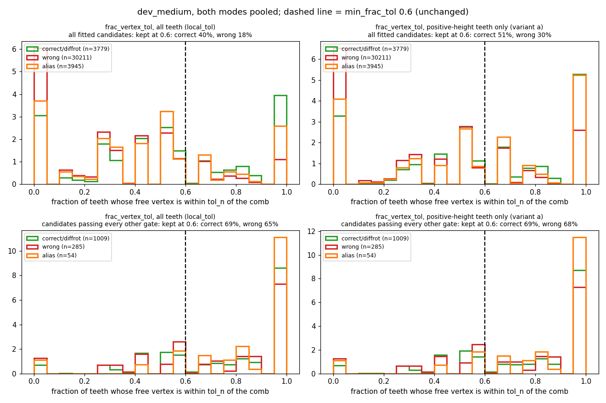
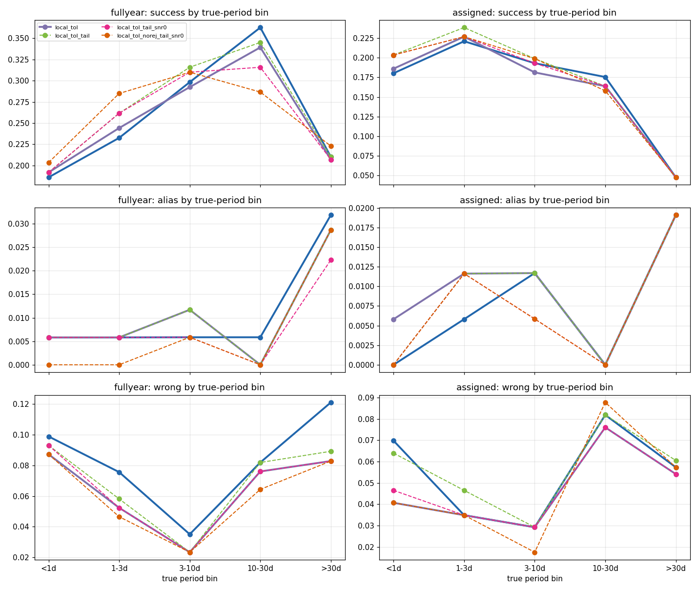
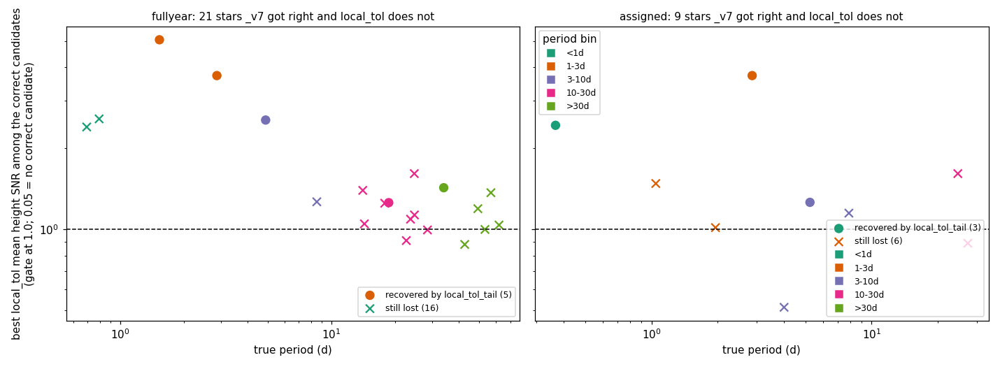
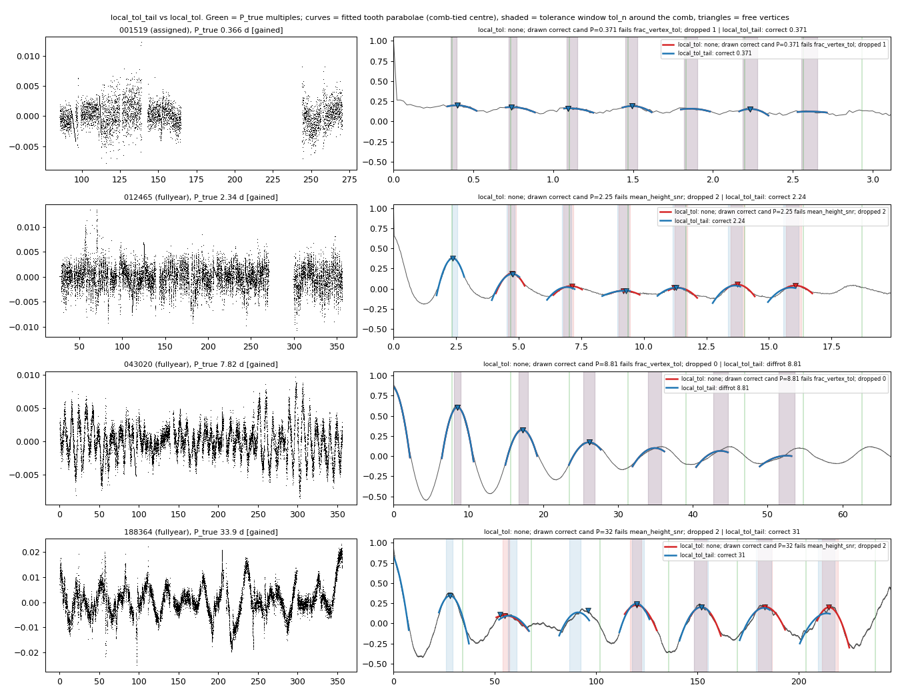
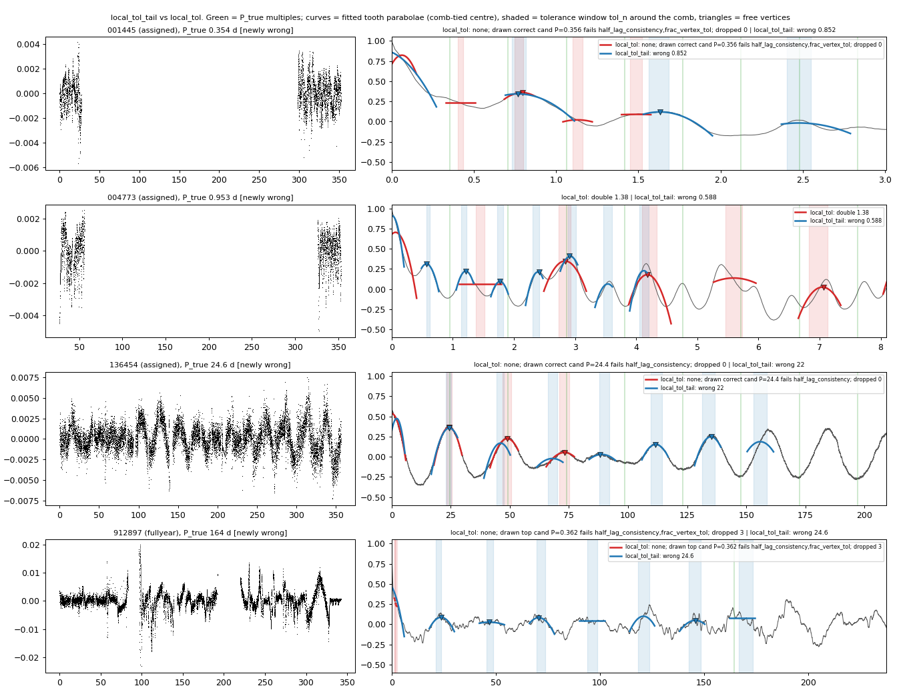
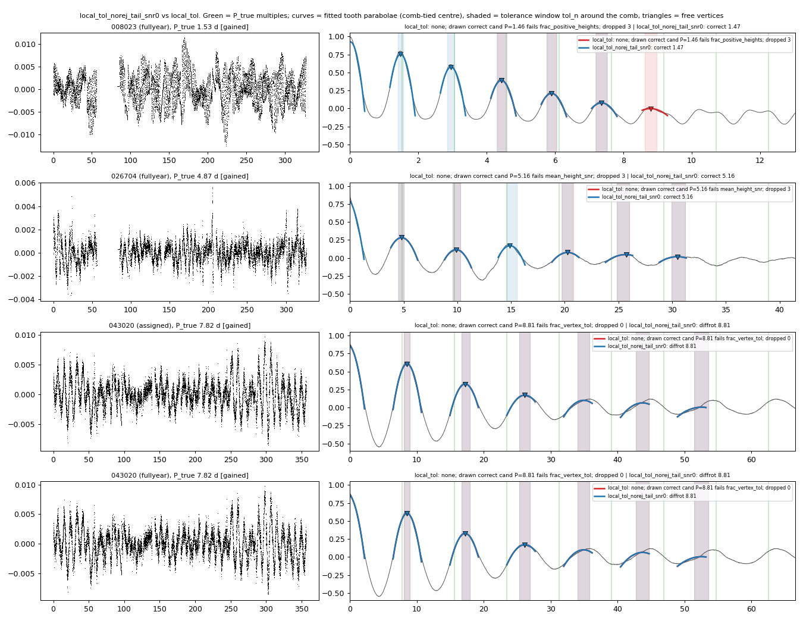
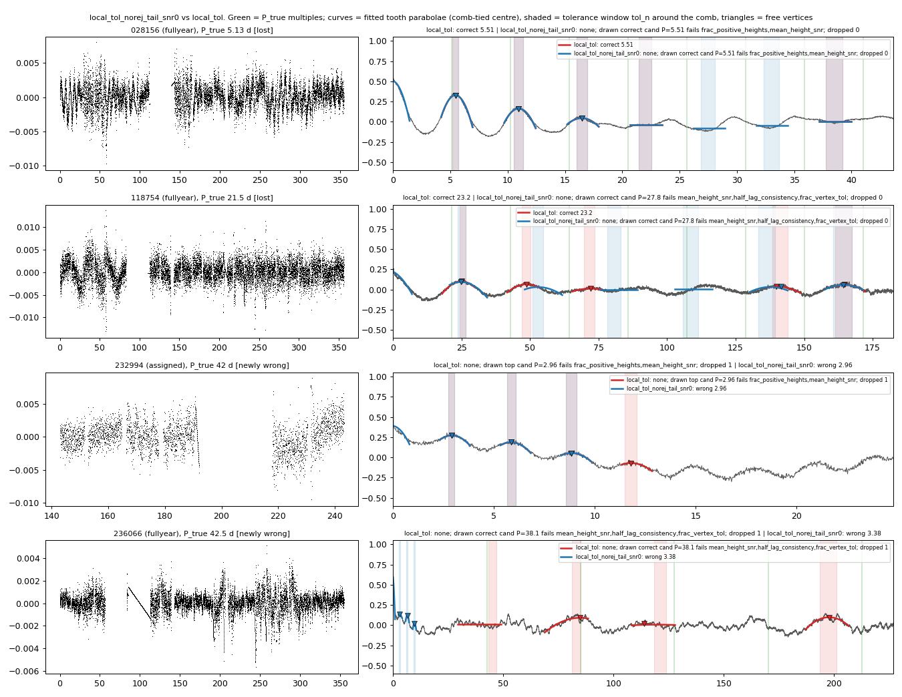
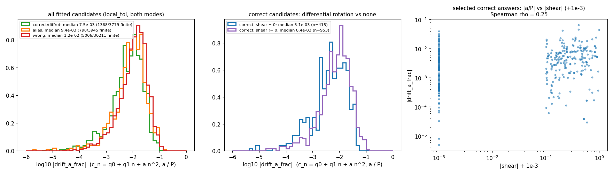
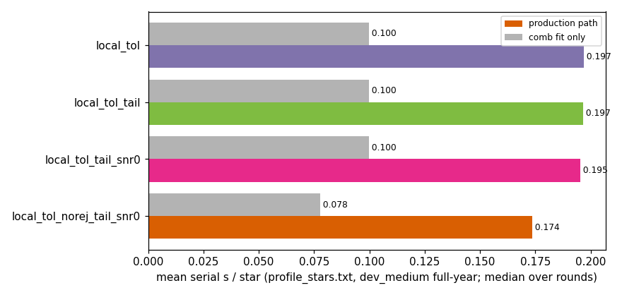

# P43: recovering `local_tol`'s decayed-tail losses (+ `drift_a_frac` feature)

**Date:** 2026-11-15 · **Author:** P43 method-improver session · **Branch:** `claude/p43-decayed-tail-22a749` · **Status:** draft

## TL;DR
- **The brief's premise was mostly wrong.** Of `local_tol`'s losses, the nearest-to-passing correct candidate fails the vertex test alone in 8 of 30, and mean height SNR alone in 13. The main cause is the outlier-rejection loop: on a decaying ACF it drops the *tallest* teeth.
- **The suggested fixes are small.**
  - **(a) positive-height teeth only:** +0.001 success.
  - **(b) excuse a trailing run of vertex-less teeth (`local_tol_tail`):** recovers 8 of 30 losses and loses nothing vs `local_tol`. Success 0.248 → 0.257 full-year and 0.145 → 0.153 assigned. Wrong rises 0.067 → 0.072 and 0.048 → 0.057.
  - **(c) robust height fit:** nothing.
- **Turning off the rejection loop** costs wrong answers, unless the lag-0 tooth also leaves the SNR gate. Even then 10–30 d loses 0.08 vs `_v7`.
- **Recommendation:** keep `local_tol` for `_v8`. `local_tol_tail` is the only clean option.
- `drift_a_frac` is now a ranker feature (weak).

## Question / goal
P43 in `docs/TASKS_PROPOSED.md`, plus the `drift_a_frac` ranker feature (Rae, 2026-11-15). `local_tol` (T32, now the default) loses 21 full-year / 9 assigned dev_medium stars that `_v7` (`local_screen2`) gets right. The brief:
- try (a) `frac_vertex_tol` over positive-height teeth only;
- (b) the tolerance test after the decayed-tail trim;
- (c) T31's robust per-window height fit;
- no new thresholds and no threshold tuning on dev_medium (`min_frac_tol` 0.6, `tol_base` 0.05 unchanged).

No `goals.json` goal targets this. The guard is `check_goals --baseline`, against both the `_v7` files and my `local_tol` reference runs.

## What I did
1. **Reference runs** of the branch default `local_tol`, which includes P39:
   - `datasets/dev_medium.csv,data_root=data/smarts_dev` full-year (`--ignore-manifest-sectors`) and assigned, plus `synthetic:n=200,seed=0`;
   - run from a frozen snapshot of HEAD (`run_scorecards.sh`) with 3 workers, `nice -n 15`, `--resume` and 2-min gaps.
   - They reproduce T32's `local_tol` exactly: 0.248 / 0.067 full-year, 0.145 / 0.048 assigned. So P39 changed nothing on dev_medium.
2. **Diagnosis before fixing.** I refit T32's 30 lost star-modes one at a time (`diag_lost2.py`, `diag_reject.py`), logging per-tooth comb centre, free vertex, fitted height and tolerance for every correct candidate (`data/diag_lost_candidates.csv`).
3. **Variants.** Each is a `COMB_VARIANTS` entry built on `local_tol` with new keys only (`claude_files/comb_fit.py`):

   | key | variant(s) | what it does |
   |---|---|---|
   | `tol_count="positive"` | `local_tol_pos` (a) | `frac_vertex_tol` counts only teeth with fitted height > 0 |
   | `tol_tail=True` | `local_tol_tail` (b) | a trailing run of teeth failing the tolerance test is left out of `frac_vertex_tol`, keeping ≥ n_required windows (the same floor as the existing decayed-tail trim). Gate-only. |
   | `height_fit="robust"` | `*_rh` (c) | per-window (h, A) by soft-L1 IRLS, scale 1.4826·MAD of that window's LS residuals |
   | `reject=False` | `local_tol_norej*` | no MAD residual-RMS window rejection (from the diagnosis) |
   | `snr_skip_lag0=True` | `*_snr0` | the `mean_height_snr` gate leaves out the lag-0 tooth (from the screen; see below) |

   - **(b) as literally worded is what `local_tol` already does.** `_vertex_stats` only sees windows that survive the trim. The trim never fires on these teeth because their comb-tied heights stay positive, so I implemented (b) as the vertex analogue of the trim.
   - `DEFAULT_COMB_VARIANT` is untouched. With the new keys at their defaults, `local_tol` is bit-identical (test).
4. **Screening:**
   - I screened 12 variants with T32's harness (Stage-1 cache, load → ACF → fit; `p43lib.py`, `run_harness.py`). Its `local_tol` reproduces the scorecard exactly.
   - **Full scorecards, both modes plus synthetic:** `local_tol_tail`, `local_tol_tail_snr0` and `local_tol_norej_tail_snr0`.
5. **Timing:** `benchmarks/profile_pipeline.py --star-ids-file benchmarks/profile_stars.txt --features --repeats 3` (dev_medium full-year), 2 interleaved rounds per variant (`run_profiles.sh`).
6. **Tests:** `tests/test_p43_decayed_tail.py` (25), covering:
   - the schema of every variant;
   - a vertex-less positive tail that `local_tol` rejects and (b) keeps;
   - (a) skipping non-positive teeth;
   - a decaying-cosine ACF where the rejection cascade makes `local_tol` decline and `reject=False` recovers it;
   - the lag-0-propped comb that `snr_skip_lag0` declines;
   - the robust height fit;
   - `drift_a_frac`.

## Results

### Diagnosis: the rejection loop eats the head of a decaying ACF
The step-4 outlier loop in `_fit_single_candidate` drops a window whose residual RMS is > median + 4 robust σ. Under the local solver:
- the lag-0 tooth's RMS is the largest (no jitter, cusp-shaped), so it goes first;
- then the MAD shrinks, and on a decaying ACF residual RMS scales with peak height, so n = 1 and n = 2 go too.

The surviving decayed teeth average height SNR < 1. Example 015438 (P = 2.87 d):

| fit | teeth kept | mean height SNR |
|---|---|---|
| `local`, rejection on | n = 3–7 | 0.39 |
| `local`, rejection off | all | 2.41 |
| `lsq`, rejection on | drops only n = 1 | 2.03 |

A plain `cos(2πτ/P)·exp(−τ/2P)` ACF reproduces it: `local_tol` drops teeth 0 and 1 and declines (test `test_rejection_cascade_on_decaying_acf_and_norej_fix`).

What the 30 lost star-modes fail (nearest-to-passing correct candidate, `data/diag_lost_candidates.csv`):

| failed gate(s) | star-modes |
|---|---|
| `mean_height_snr` only | 13 |
| `frac_vertex_tol` only | 8, all trailing vertex-less teeth ("vvv....") |
| `half_lag_consistency` only | 3 |
| `n_peaks` only | 2 |
| other | 4 |

Fitted heights are almost never negative, so (a) and (c) target a minor mode.



Look at the bottom row (candidates that pass every other gate).
- Counting only positive-height teeth hardly moves the distribution: 69% → 70% of correct candidates kept and 65% → 68% of wrong ones.
- So (a) cannot rescue much, and what it rescues is as often wrong as right.

### Scorecards (dev_medium, both modes; synthetic 200)
| variant | full-year success / wrong / precision | assigned success / wrong / precision | vs `local_tol` gained / lost (fy; as) | none→wrong vs `local_tol` (fy; as) | synthetic success | check_goals vs `_v7` (fy / as / syn) |
|---|---|---|---|---|---|---|
| `_v7` (`local_screen2`) | 0.251 / 0.088 / 0.711 | 0.147 / 0.055 / 0.697 | — | — | 0.755 | — |
| `local_tol` (reference) | 0.248 / 0.067 / 0.756 | 0.145 / 0.048 / 0.711 | — | — | 0.745 | PASS / PASS / FAIL (>30 d) |
| `local_tol_tail` (b) | 0.257 / 0.072 / 0.751 | 0.153 / 0.057 / 0.695 | +9 −0; +8 −0 | 5; 8 | 0.755 | PASS / PASS / FAIL (>30 d) |
| `local_tol_tail_snr0` | 0.250 / 0.068 / 0.762 | 0.150 / 0.049 / 0.721 | +7 −5; +6 −1 | 2; 1 | 0.755 | PASS / PASS / FAIL (>30 d) |
| `local_tol_norej_tail_snr0` | 0.256 / 0.064 / 0.776 | 0.150 / 0.049 / 0.721 | +21 −13; +9 −4 | 4; 4 | 0.755 | **FAIL (10–30 d)** / PASS / PASS |

Data: `data/variant_metrics.csv`; every check_goals output is in `data/check_goals/` (`*_vs_v7.txt`, `*_vs_local_tol.txt`).
- Every variant passes `check_goals --baseline` against the `local_tol` reference in all three datasets.
- **Synthetic `>30 d` (8 stars):** the FAIL is one star, synth-s0-00099. It is wrong at 0.17 d under `local_tol` and both tail variants, and right under `_v7`.
  - This is the new default's own regression vs `_v7`, not P43's. It will show up in the `_v8` refresh.
  - `local_tol` also has 3–10 d at −0.056, just inside the guard.

Excerpt, `local_tol_tail` vs the `local_tol` reference:
```
full-year                                              assigned
  0.248   0.257  +0.009  0.020  final.overall.success     0.145   0.153  +0.008  0.020
  0.244   0.262  +0.017  0.060  final.by_bin.1-3d          0.227   0.238  +0.012  0.060
  0.339   0.345  +0.006  0.060  final.by_bin.10-30d        0.164   0.164  +0.000  0.060
  0.292   0.316  +0.023  0.060  final.by_bin.3-10d         0.181   0.199  +0.018  0.060
  0.192   0.192  +0.000  0.060  final.by_bin.<1d           0.186   0.203  +0.017  0.060
  0.207   0.210  +0.003  0.060  final.by_bin.>30d          0.048   0.048  +0.000  0.060
OVERALL: PASS (both)
```
The `local_tol_norej_tail_snr0` guard failure vs `_v7`, full-year: `0.363 → 0.287 −0.076 final.by_bin.10-30d.success <-- REGRESSION`.



The solid lines are `_v7` and `local_tol`.
- **`local_tol_tail` (green):** sits on or above `local_tol` in every success bin, with a little more wrong in every bin.
- **`local_tol_norej_tail_snr0` (orange):** gains 1–3 d (0.244 → 0.285) and loses 10–30 d (0.339 → 0.287) full-year.

### Harness screen (all 12 variants)
| variant | full-year success / wrong | assigned success / wrong |
|---|---|---|
| `local_tol` | 0.248 / 0.067 | 0.145 / 0.048 |
| `local_tol_pos` (a) | 0.249 / 0.070 | 0.145 / 0.050 |
| `local_tol_tail` (b) | 0.257 / 0.072 | 0.153 / 0.057 |
| `local_tol_tail_rh` (b+c) | 0.256 / 0.074 | 0.153 / 0.059 |
| `local_tol_norej` | 0.277 / 0.113 | 0.165 / 0.070 |
| `local_tol_norej_tail` | 0.288 / 0.133 | 0.175 / 0.088 |
| `local_tol_norej_pos` | 0.278 / 0.123 | 0.168 / 0.074 |
| `local_tol_norej_rh` (c) | 0.277 / 0.102 | 0.166 / 0.067 |
| `local_tol_snr0` | 0.242 / 0.066 | 0.144 / 0.047 |
| `local_tol_tail_snr0` | 0.250 / 0.068 | 0.150 / 0.049 |
| `local_tol_norej_snr0` | 0.250 / 0.062 | 0.143 / 0.047 |
| `local_tol_norej_tail_snr0` | 0.256 / 0.064 | 0.150 / 0.049 |

Data: `data/harness_summary.csv`.

**Turning the rejection loop off** recovers 14 of the 30 lost star-modes, but +0.046 wrong full-year. All 52 new wrong answers came from declines. Mostly they are long-period combs on short-period stars, with mean SNR just over 1. The loop had been dropping their lag-0 tooth, whose height is about ACF(0) = 1 whatever P is. So the loop was quietly working as a noise filter on the SNR gate.

**Leaving the lag-0 tooth out of the SNR gate** (`snr_skip_lag0`) confirms this: `norej` wrong goes 0.113 → 0.062. But the stricter gate then costs 10–30 d long-period rotators, whose teeth after lag 0 average SNR 0.85–0.98 once every decayed tooth is kept. Of the 13 full-year stars lost vs `local_tol`, 10 are in 10–30 d.

### Which lost stars each variant recovers


These are `local_tol`'s 21 full-year and 9 assigned losses vs `_v7`. The y axis is the best mean height SNR among each star's correct candidates under `local_tol`.
- `local_tol_tail` recovers 5 + 3 (circles).
- Most still-lost stars have a correct candidate with SNR > 1. They fail the half-lag or vertex test instead, so no single gate tweak recovers them.
- `local_tol_norej_tail_snr0` recovers 8 + 2 and `local_tol_tail_snr0` 3 + 2 (`figures/fig_lost_scatter_*.png`, `data/local_tol_lost_vs_v7_*.csv`).

### Example stars


Stars `local_tol_tail` recovers. Red is `local_tol`, blue is the variant; the shading is each tooth's tolerance window, and the triangles are free vertices. **043020:**
- teeth 1–3 sit on the comb, and teeth 4–7 decay with drifting, out-of-tolerance vertices;
- excusing that trailing run gives the diffrot answer.

012465 and 188364 are rejection-cascade stars, where `local_tol` dropped 2 tall teeth. (b) passes them because the late teeth they keep are excused from the vertex test.



The price: none→wrong under `local_tol_tail`. These are combs with 2–3 early teeth on the comb and a trailing run of misses, which (b) excuses by construction:
- 001445 and 004773: sparse assigned coverage;
- 136454: a 24.6 d rotator answered at 22;
- 912897: a 164 d rotator answered at 24.6.




`local_tol_norej_tail_snr0`:
- **Gains** are cascade stars.
- **Losses** (028156, 118754) are stars where the rejection loop was *helping*: it dropped flat, decayed trailing teeth (h ≈ 0), which now drag `frac_positive_heights` and SNR. The same loop removes good teeth at the head and bad teeth at the tail.

### `drift_a_frac` ranker feature
- `local_tol` never fits a drift term (`drift_a` is always 0 there), so `comb_fit.comb_drift_frac` fits c_n = q0 + q1·n + a·n² to the free vertices with the solver's soft-L1 IRLS, and returns a/P.
- It needs ≥ 4 vertices on ≥ 4 teeth, and is NaN for lsq fits.
- It is in `ml_features.extract_candidate_features`, and therefore in `tools/build_feature_tables.py`'s candidate tables: every non-bookkeeping column is a feature, and `drift_a_frac` is not in `NON_FEATURE_COLUMNS`.
- It is documented in `FEATURE_DOCUMENTATION.txt` §C. I did not rebuild the tables.



- **Coverage:** finite for only 36% of correct candidates (1368 / 3779).
- **By outcome:** median |a/P| is 7.5e-3 for correct, 9.4e-3 for alias and 1.2e-2 for wrong.
- **Among correct candidates:** 8.4e-3 with diffrot (shear ≠ 0) vs 5.1e-3 without.
- **Against injected shear:** Spearman ρ = 0.25 on selected correct answers.

Same weak signal as T32 (`data/drift_a_frac_summary.csv`).

### Runtime


Serial production path (load + 2 ACFs + 3 pooled methods + fit), dev_medium full-year, `profile_stars.txt`, median of 2 rounds:

| variant | production path, s/star | fit, s/star |
|---|---|---|
| `local_tol` | 0.197 | 0.100 |
| `local_tol_tail` | 0.197 | 0.100 |
| `local_tol_tail_snr0` | 0.195 | 0.100 |
| `local_tol_norej_tail_snr0` | 0.174 | 0.078 (no refits) |

The ml_features step is 0.13 s/star for all. The robust height fit (`*_rh`) costs about 1.6× the fit time in the harness.

## What didn't work
- **(a) positive-height teeth only:** +0.001 / +0.000 success. Non-positive teeth are rare on these stars.
- **(c) robust height fit:** no gain; it adds wrong (+0.002) and 1.6× fit time.
- **`reject=False` alone:** a big success gain, at +0.046 / +0.022 wrong. The lag-0 tooth props up the SNR of noise combs.
- **`reject=False` + `snr_skip_lag0`:** clean on wrong (0.062–0.064), but 10–30 d fails the guard vs `_v7`.
- **`local_tol_norej_snr0`:** not scored; its harness numbers are dominated by `norej_tail_snr0`. I killed its queued scorecard after 30 s.
- **Disclosure:** `snr_skip_lag0` was designed after looking at dev_medium harness results (mechanism-driven, no threshold touched). Because each new idea was coming from the judging set, I stopped adding variants there.

## Open questions for Rae
1. **Which default for the `_v8` refresh?** My recommendation is to keep `local_tol`.
   - **`local_tol_tail`** is the only variant that is a strict superset of `local_tol` successes: +9 / +8 stars, 0 lost. But it adds about 1 wrong per gain (5 / 8 none→wrong), and assigned wrong (0.057) ends just above `_v7` (0.055). Take it if success matters more than precision before the ranker exists.
   - **`local_tol_norej_tail_snr0`** has the best full-year success and precision (0.256 / 0.064 / 0.776) and is 12% faster. But it fails the 10–30 d guard vs `_v7` (−0.076).
2. **The rejection loop and the SNR gate need a joint redesign, not a switch.** The loop protects the comb from bad trailing teeth and hides the lag-0 tooth from the SNR mean. On decaying ACFs it also deletes the best teeth. A height-relative rejection, plus an SNR gate without the lag-0 tooth, should be judged on a fresh dev set rather than dev_medium. Proposed as P44.
3. **Synthetic 200 `>30 d` regression (1 of 8 stars, synth-s0-00099)** is in `local_tol` itself. The coordinator's `_v8` refresh will make it the baseline. Flagging so it's a decision, not a surprise.
4. **`drift_a_frac`:** it is in the tables now, finite on about a third of candidates. Worth keeping only if the ranker finds a use for it (P31 rebuild).

## Reproduce
```bash
PY=/opt/anaconda3/envs/ss_openblas/bin/python
R=reports/2026-11-15_p43-decayed-tail
nice -n 15 $PY -m pytest -q tests/test_p43_decayed_tail.py
nice -n 15 $PY $R/diag_lost2.py; nice -n 15 $PY $R/diag_reject.py 015438:fullyear 008023:fullyear
zsh $R/run_scorecards.sh --modes "dmfy dmas syn" local_tol local_tol_tail local_tol_tail_snr0 local_tol_norej_tail_snr0
nice -n 15 $PY $R/run_harness.py fullyear runs/p43/harness/dev_medium_fullyear.pkl local_tol,local_tol_pos,local_tol_tail,local_tol_norej,local_tol_norej_tail,local_tol_norej_pos,local_tol_tail_rh,local_tol_norej_rh
nice -n 15 $PY $R/run_harness.py fullyear runs/p43/harness/dev_medium_fullyear_snr0.pkl local_tol_snr0,local_tol_tail_snr0,local_tol_norej_snr0,local_tol_norej_tail_snr0
# (same two lines with "assigned")
zsh $R/run_profiles.sh 2 local_tol local_tol_tail local_tol_tail_snr0 local_tol_norej_tail_snr0
nice -n 15 $PY $R/analysis.py local_tol_tail
$PY $R/build_notebook.py && $PY tools/run_notebook.py $R/notebook.ipynb
```
`runs/p43/` (gitignored) holds the scorecard runs (`sc/`, candidate `_v8` inputs for `local_tol` included), the harness pickles, the Stage-1 cache and the profile CSVs. `PROGRESS.md` is the session log.
