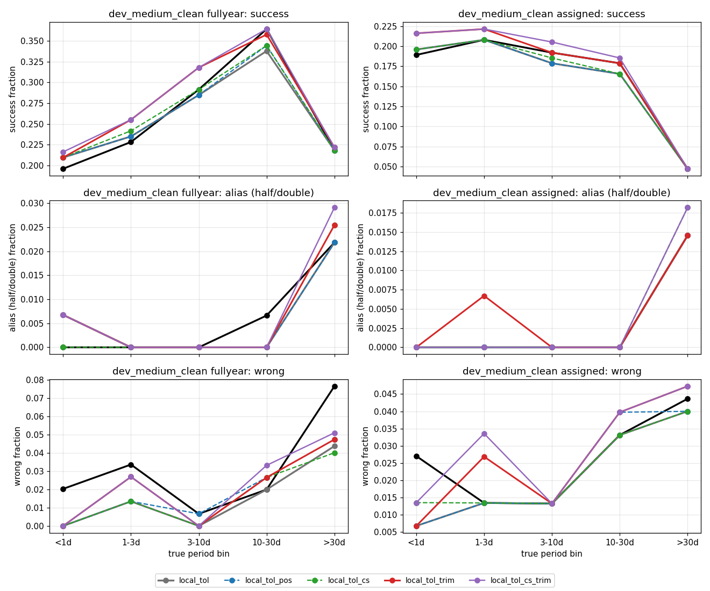
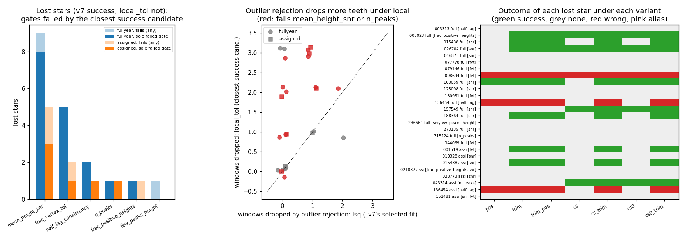
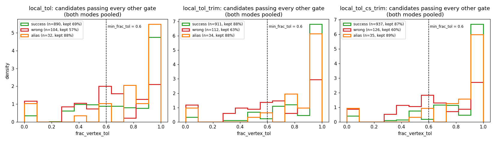
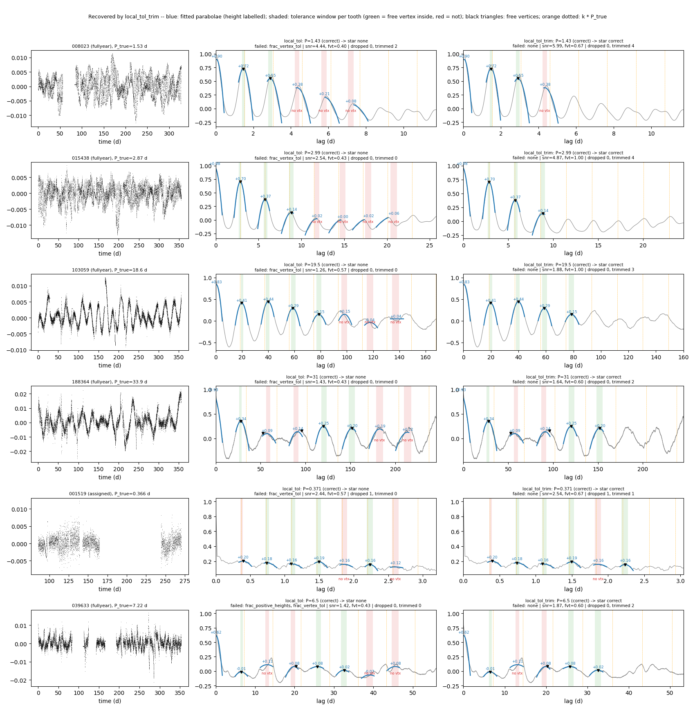
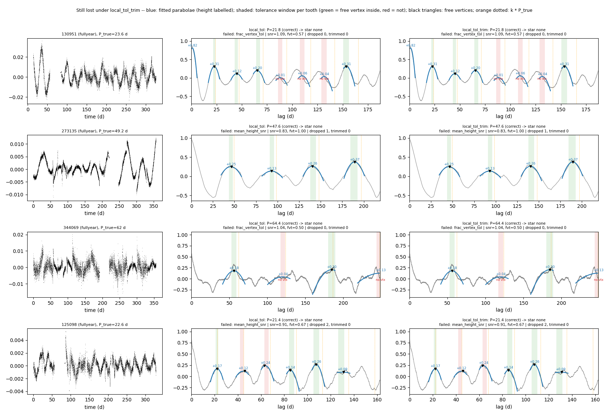
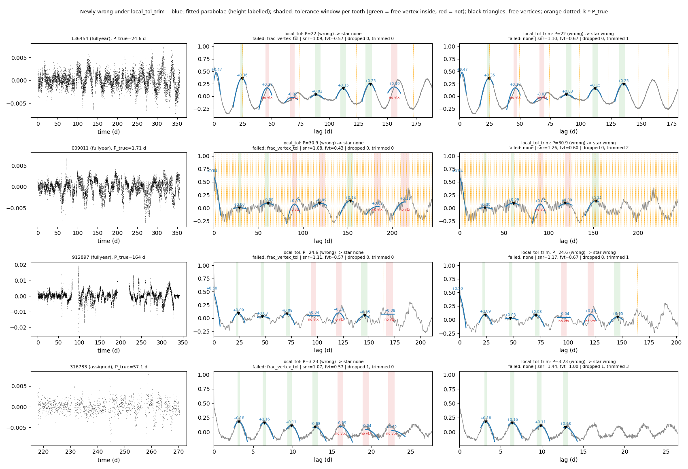
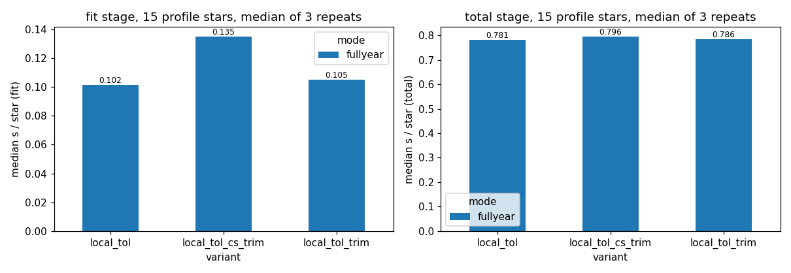

# P43 (clean rerun): local_tol's decayed-tail losses

**Date:** 2026-11-16 · **Author:** method-improver session (blind rerun) · **Branch:** `claude/p43-clean-rerun-1340c3` · **Status:** draft

## TL;DR
- **`local_tol_trim` works.** It extends the decayed-tail trim to trailing teeth with no free vertex. Full-year success goes 0.252 → **0.265** (`_v7` 0.254) and assigned 0.143 → **0.153** (`_v7` 0.146). Wrong rises 0.019 → 0.024 full-year (`_v7` 0.038) and 0.024 → 0.030 assigned (`_v7` 0.029). Runtime +0.5%. No new thresholds.
- **P43's premise holds for only part of the losses.** Of the 26 lost star-modes, 16 fail `mean_height_snr`/`n_peaks`. In 13 of those, outlier rejection dropped the tallest teeth, which `lsq` keeps. Only 7 fail `frac_vertex_tol`.
- **Positive-height-only counting does almost nothing** (+1 star, +3 wrong). `lsq`'s soft-L1 loss is effectively linear, so a "robust height fit" isn't the mechanism.
- **Decision for Rae:** make `local_tol_trim` the default (my recommendation), or keep `local_tol` for its higher precision (0.902 vs 0.889 full-year).

## Question / goal
P43 in `docs/TASKS_PROPOSED.md`: recover the stars the new default comb fit `local_tol` (T32) loses relative to the `_v7` default (`local_screen2`), without new thresholds and without tuning on dev_medium (Rae, 2026-11-15). The work was done blind to the earlier P43 attempt and judged only on noise-clean stars (Rae, 2026-11-16). No `goals.json` goal targets this. The guard is `check_goals --baseline` against `dev_medium_clean_{fullyear,assigned}_v7` and `synth200_s0_v7`, plus the step-1 `local_tol` runs.

## What I did
1. **Reference runs** of the branch default `local_tol` (`benchmarks/scorecard.py`, 3 workers, `nice 15`):
   - `datasets/dev_medium_clean.csv,data_root=data/smarts_dev,sectors=ignored` (full-year);
   - the same without `--ignore-manifest-sectors` (assigned);
   - `--synthetic 200 --seed 0`.
2. **Diagnosis.** I wrote a harness (`p43lib.py`) that caches each star's pooled Stage-1 guesses and re-runs only Stage 2 under any comb variant, recording every candidate's gate values and a per-tooth table. On all 874 stars, both modes, it reproduces both the scorecard's `local_tol` outcomes and the `_v7` per-star tables exactly (asserted in `screen.py`). It also reproduces the official scorecards of the three variants below. I then:
   - compared per-candidate gates, `lsq` vs `local_tol`, on every star `local_tol` changed;
   - probed per-window residuals (`scratch/rms_probe.py`).
3. **Variants**, as new `SS_COMB_VARIANT` entries in `claude_files/comb_fit.py`, each `local_tol` plus a switch (no new thresholds):

   | variant | switch | idea |
   |---|---|---|
   | `local_tol_pos` | `tol_teeth="positive"` | `frac_vertex_tol` over teeth with fitted height > 0 only (P43 idea 1) |
   | `local_tol_trim` | `trim_novertex=True` | the decayed-tail trim (step 4b) also drops a trailing run of teeth with no free local vertex, then refits; keeps ≥ the required tooth count (P43 idea 2: "tolerance test after the trim") |
   | `local_tol_cs` | `center_search=True` | a tooth with no free vertex (always the lag-0 tooth) is centred where it fits best within the existing ±5% P jitter bound, as `lsq` allows, instead of being pinned on the comb (from my diagnosis) |
   | `local_tol_cs0` | `center_search="t0"` | same, but the lag-0 tooth searches `lsq`'s own t0 bound (seed ± P0/2), cut at the first lag |
   | `*_trim_pos`, `*_cs_trim`, `*_cs0_trim` | combinations | |

   10 unit tests are in `tests/test_p43_decayed_tail.py`.
4. **Screening:** every variant on all stars, both modes, with the harness (`screen.py`).
5. **Official scorecards** for the three serious candidates (`local_tol_trim`, `local_tol_cs_trim`, `local_tol_cs`), in all three modes. I ran `check_goals --baseline` against the clean `_v7` files and against the step-1 `local_tol` runs.
6. **Profiling:** `benchmarks/profile_pipeline.py` (15 profile stars, `--features --repeats 3`, full-year) for `local_tol`, `local_tol_trim` and `local_tol_cs_trim`.

## Results

### Headline (official scorecards)
From `summary_table.py`. Wrong, alias and none are fractions of all stars; precision = success / answered.

| dataset | variant | success | wrong | alias | none | precision | median s/star (scorecard) |
|---|---|---|---|---|---|---|---|
| dev_medium_clean full-year | `_v7` (local_screen2) | 0.254 | 0.038 | 0.008 | 0.700 | 0.847 | 1.248 |
| | `local_tol` | 0.252 | 0.019 | 0.008 | 0.721 | 0.902 | 0.856 |
| | **`local_tol_trim`** | **0.265** | 0.024 | 0.009 | 0.701 | 0.889 | 0.912 |
| | `local_tol_cs_trim` | 0.268 | 0.026 | 0.010 | 0.696 | 0.880 | 1.043 |
| | `local_tol_cs` | 0.255 | 0.019 | 0.008 | 0.717 | 0.903 | 1.010 |
| dev_medium_clean assigned | `_v7` (local_screen2) | 0.146 | 0.029 | 0.005 | 0.820 | 0.815 | 0.841 |
| | `local_tol` | 0.143 | 0.024 | 0.005 | 0.828 | 0.833 | 0.460 |
| | **`local_tol_trim`** | **0.153** | 0.030 | 0.006 | 0.811 | 0.812 | 0.457 |
| | `local_tol_cs_trim` | 0.157 | 0.032 | 0.006 | 0.805 | 0.806 | 0.538 |
| | `local_tol_cs` | 0.144 | 0.025 | 0.006 | 0.825 | 0.824 | 0.388 |
| synth200 seed 0 | `_v7` (local_screen2) | 0.755 | 0.000 | 0.000 | 0.245 | 1.000 | 1.509 |
| | `local_tol` | 0.745 | 0.005 | 0.005 | 0.245 | 0.987 | 0.656 |
| | **`local_tol_trim`** | **0.755** | 0.005 | 0.000 | 0.240 | 0.993 | 0.670 |
| | `local_tol_cs_trim` | 0.755 | 0.005 | 0.000 | 0.240 | 0.993 | 0.821 |
| | `local_tol_cs` | 0.745 | 0.005 | 0.005 | 0.245 | 0.987 | 0.563 |

The scorecard's median s/star is parallel wall time and moves with machine load. Use the profiler (below) for runtime.

**`check_goals --baseline` vs the clean `_v7` files:**
- Both dev_medium modes: `OVERALL: PASS` for every variant and for `local_tol` itself.
- synth200: `OVERALL: FAIL` for all of them, on `final.by_bin.>30d.success` 1.000 → 0.875. That is one star of 8 (synth-s0-00099, correct → wrong), which `local_tol` already loses and no P43 variant changes. It is a `local_tol`-vs-`_v7` regression, not a P43 one (see open questions).

**`check_goals --baseline` vs the step-1 `local_tol` runs:** `OVERALL: PASS` for every variant in all three modes. All outputs are in `data/check_goals/` and `data/check_goals_vs_local_tol/`.

`local_tol_trim` vs `_v7`, full-year:
```
  0.254   0.265  +0.011  0.020  final.overall.success
  0.228   0.255  +0.027  0.060  final.by_bin.1-3d.success
  0.364   0.358  -0.007  0.060  final.by_bin.10-30d.success
  0.291   0.318  +0.026  0.060  final.by_bin.3-10d.success
  0.196   0.209  +0.014  0.060  final.by_bin.<1d.success
  0.218   0.222  +0.004  0.060  final.by_bin.>30d.success
OVERALL: PASS          (G10 wrong 0.024 <= 0.04 PASS; base 0.038)
```
`local_tol_trim` vs `_v7`, assigned:
```
  0.146   0.153  +0.007  0.020  final.overall.success
  0.208   0.221  +0.013  0.060  final.by_bin.1-3d.success
  0.179   0.179  -0.000  0.060  final.by_bin.10-30d.success
  0.192   0.192  +0.000  0.060  final.by_bin.3-10d.success
  0.189   0.216  +0.027  0.060  final.by_bin.<1d.success
  0.047   0.047  +0.000  0.060  final.by_bin.>30d.success
OVERALL: PASS
```
`local_tol_trim` vs `local_tol`, full-year (assigned is also PASS: +0.010 overall):
```
  0.252   0.265  +0.014  0.020  final.overall.success
  0.235   0.255  +0.020  0.060  final.by_bin.1-3d.success
  0.338   0.358  +0.020  0.060  final.by_bin.10-30d.success
  0.285   0.318  +0.033  0.060  final.by_bin.3-10d.success
OVERALL: PASS
```

### Outcomes by period bin, every variant


The trim variants (red, purple) lift success in 1–3 d and 3–10 d in both modes, and recover `local_tol`'s 10–30 d full-year dip.
- In full-year, their wrong rate is below `_v7` (black) in every bin except 10–30 d (0.026 vs 0.020).
- In assigned, they add wrongs at 1–3 d (0.027 vs 0.013) and 10–30 d (0.040 vs 0.033).
- `local_tol_pos` and `local_tol_cs` (dashed) are nearly indistinguishable from `local_tol` (grey).

All variants are scored by the harness here, which matches the official scorecard per star wherever both exist.

### Why `local_tol` loses `_v7`'s stars (diagnosis)


**Left panel:** for each lost star (`_v7` success, `local_tol` not), the gates failed by its closest success candidate under `local_tol` (fewest failed gates, then lowest redchi).
- `mean_height_snr` (or `n_peaks`) is the commonest blocker: 10 of 18 full-year and 6 of 8 assigned.
- `frac_vertex_tol` blocks only 5 / 2, and is the sole failed gate in 5 / 1.
- `half_lag_consistency` blocks 2 / 1.

**Middle panel:** windows dropped by outlier rejection. Under `local_tol` the correct candidate loses 2–3 windows where `lsq` lost 0–1, for 8 of the 10 full-year and 5 of the 6 assigned SNR/peak failures.

**Mechanism** (from `scratch/rms_probe.py`, per-window residual RMS before rejection):
- The local solver places a tooth with no free vertex exactly on the comb position t0 + nP.
- The lag-0 tooth never has a free vertex: the peak sits at the ACF's edge.
- So the tallest tooth (h ≈ 1) is fitted at the vertex line's intercept, not where its peak is. Its residual is 2–5× `lsq`'s, e.g. 015438: 0.059 vs 0.024; 103059: 0.244 vs 0.047.
- The MAD outlier test then drops it, and with it often the next tall tooth. The mean height of the remaining, decayed teeth falls below 1σ of the ACF.
- `lsq` keeps these teeth because its jointly fitted t0 and jitter terms let it move them.

**Right panel:** which variant recovers each lost star.
- The trim recovers 5 / 2 lost star-modes, through a sibling candidate whose vertex-less tail it removes (examples below).
- 12 / 5 lost star-modes are recovered by nothing I tried.

**P43's premise:** decayed late teeth do cost `frac_vertex_tol`, but that is the minority mechanism. Counting positive teeth only can't help: the vertex-less tail teeth have small *positive* heights (`fig_examples_recovered.png`). The negative-height tail teeth are already removed by the existing trim.

### The tolerance gate separates better after the trim


This shows `frac_vertex_tol` for candidates that pass every other gate (both modes pooled), with `min_frac_tol` = 0.6 dashed.
- **Under `local_tol`**, the gate keeps 69% of success candidates and 57% of wrong ones, so it separates them weakly.
- **Under `local_tol_trim`**, it keeps 88% vs 63%.

The trim removes the vertex-less tail teeth that counted against correct candidates. A wrong comb's misses are not concentrated in its trailing teeth, so it gains less. This is why the trim adds more successes than wrongs at an unchanged threshold.

### Examples: recovered by the trim


Each row shows the light curve, the `local_tol` fit and the `local_tol_trim` fit of the same candidate.
- Shading marks each tooth's tolerance window: green if the free vertex (▼) is inside, red if not. Blue lines are the fitted parabolae, labelled with height. Orange dotted lines are k·P_true.
- 008023, 015438 and 103059 are textbook decaying ACFs: the late teeth have flattened into noise, keep small positive heights, have no free vertex, and fail tolerance. Trimming them leaves 3–4 clean teeth, so `frac_vertex_tol` reaches 0.67–1.0 and SNR rises.
- 188364 and 039633 pass at exactly `frac_vertex_tol` = 0.60. They are marginal; 039633 (P = 6.5 d vs P_true 7.22 d) looks lucky.

### Examples: still lost


- **273135, 125098:** the lag-0 tooth was dropped by rejection (dropped = 1–2), so `mean_height_snr` is 0.83–0.91 despite 4–6 clean teeth. This is the rejection mechanism above, and the trim can't fix it.
- **130951:** the *middle* teeth (n = 4–6) drift out of tolerance and only n = 7 comes back. A tail trim never touches middle teeth, and failing this one is arguably correct.
- **344069:** 2 of 4 teeth miss, a marginal long-period case.

### Examples: newly wrong


The trim's new wrongs (4 full-year, 5 assigned vs `local_tol`) are mostly real periodic structure at the wrong period:
- **136454:** 22 d for P_true = 24.6 d, a drifting comb just outside the success band. `_v7` had it correct.
- **912897:** P_true = 164 d, far beyond reach, so any answer is wrong.
- **316783 (assigned):** a clean 3.2 d comb in a P_true = 57 d star.
- **009011:** a weak 30.9 d comb in a 1.71 d star.

### Runtime


`benchmarks/profile_pipeline.py`, 15 profile stars, full-year, `--features --repeats 3`, median over stars of the per-star median:

| variant | fit stage s/star | total s/star |
|---|---|---|
| `local_tol` | 0.102 | 0.781 |
| `local_tol_trim` | 0.105 | 0.786 |
| `local_tol_cs_trim` | 0.135 | 0.796 |

The trim costs about +3% in the fit stage (one extra closed-form refit when it fires), +0.5% end to end. The centre search's grid costs +33% in the fit stage.

### Variant screen (harness, all stars)
`data/screen_summary.csv`. "Gained / lost / new wrong" are counts vs `local_tol`; "of `_v7`'s lost" counts the 18 / 8 stars `local_tol` lost vs `_v7`.

| mode | variant | success | wrong | precision | gained | lost | new wrong | of `_v7`'s lost recovered |
|---|---|---|---|---|---|---|---|---|
| full-year | `local_tol_pos` | 0.253 | 0.023 | 0.891 | 1 | 0 | 3 | 1 |
| | `local_tol_trim` | 0.265 | 0.024 | 0.889 | 13 | 1 | 4 | 5 |
| | `local_tol_trim_pos` | 0.267 | 0.026 | 0.883 | 13 | 0 | 6 | 5 |
| | `local_tol_cs` | 0.255 | 0.019 | 0.903 | 3 | 0 | 1 | 3 |
| | `local_tol_cs_trim` | 0.268 | 0.026 | 0.880 | 15 | 1 | 6 | 6 |
| | `local_tol_cs0` | 0.253 | 0.021 | 0.902 | 4 | 3 | 2 | 4 |
| | `local_tol_cs0_trim` | 0.264 | 0.026 | 0.882 | 15 | 4 | 6 | 6 |
| assigned | `local_tol_pos` | 0.143 | 0.025 | 0.828 | 0 | 0 | 1 | 0 |
| | `local_tol_trim` | 0.153 | 0.030 | 0.812 | 9 | 0 | 5 | 2 |
| | `local_tol_trim_pos` | 0.154 | 0.030 | 0.813 | 10 | 0 | 5 | 2 |
| | `local_tol_cs` | 0.144 | 0.025 | 0.824 | 1 | 0 | 2 | 1 |
| | `local_tol_cs_trim` | 0.157 | 0.032 | 0.806 | 12 | 0 | 8 | 3 |
| | `local_tol_cs0` | 0.144 | 0.024 | 0.829 | 1 | 0 | 2 | 1 |
| | `local_tol_cs0_trim` | 0.158 | 0.030 | 0.817 | 13 | 0 | 7 | 3 |

Most of the trim's gains (8 of 13 full-year) are stars that neither `_v7` nor `local_tol` got.

## What didn't work
- **`frac_vertex_tol` over positive-height teeth only (`local_tol_pos`):** +1 star, +3 wrongs full-year; 0 stars, +1 wrong assigned. The teeth that fail tolerance on decaying ACFs have small *positive* heights, and the negative ones are already trimmed by the existing step 4b.
- **T31's "robust per-window height fit":** not built. `lsq` uses soft-L1 with scipy's default `f_scale` = 1. ACF residuals are ≲ 0.25, so its weights are ≥ 0.97: it is effectively linear least squares, and robustness is not what keeps `lsq`'s heights up (the diagnosis above shows what does). A robust fit at any other scale would be a new tuning constant.
- **Centre search for vertex-less teeth (`local_tol_cs`):** it fixes the lag-0 misfit for some stars (015438 lag-0 residual 0.059 → 0.034), and it is precision-neutral. But it recovers only 3 / 1 stars. Where the vertex line's intercept lies more than 5% P from lag 0 (e.g. 103059, residual 0.233 vs `lsq`'s 0.047), the jitter bound can't reach the peak.
- **Lag-0 tooth over `lsq`'s full t0 bound (`local_tol_cs0`):** unbounded at first, it centred the lag-0 parabola *before* lag 0 and extrapolated heights of 1.1–1.2 above ACF(0). That would inflate `mean_height_snr` artificially. Cut at the first lag, it is no better than `cs` (+4 / −3 full-year).
- **`local_tol_cs_trim`** adds +0.003 / +0.004 success over the trim alone, at +2 / +3 wrongs and +33% fit time. Not worth it.

## Open questions for Rae
1. **Default (my recommendation: `local_tol_trim`).** In plain terms: when the last few teeth of a candidate's comb have no peak left in their windows, treat them as decayed and drop them before judging the comb, exactly as the pipeline already does for teeth that went negative.
   - It raises success above the old default in both modes (0.265 vs 0.254 full-year, 0.153 vs 0.146 assigned).
   - Full-year, it gives clearly fewer wrong answers than the old default (0.024 vs 0.038). Assigned, it is about equal (0.030 vs 0.029).
   - It costs ~0.5% runtime, adds no threshold, and changes only candidates whose tails have no peaks.
   - The alternative is keeping `local_tol`. It has the best precision of anything here (0.902 / 0.833) but 0.013 / 0.010 lower success. Whether 4–5 extra wrong answers per 874 stars are worth 9–13 extra successes is your call.
2. **Lag-0 tooth in the mean-height SNR gate.** Most remaining losses come from outlier rejection dropping the lag-0 tooth under `local`. But that tooth's height (≈ ACF(0)) says nothing about P, and under `lsq` it props up `mean_height_snr`. Should the SNR gate exclude the lag-0 tooth, as the vertex statistics already do? That would change the gate's meaning for every variant, so it needs your decision. Proposed as a follow-up.
3. **synth200 >30 d regression** (synth-s0-00099, correct under `_v7` → wrong under `local_tol` and every variant). This blocks a clean `check_goals` PASS on synth for the `local_tol` family, independent of P43. It's one star of 8 in the bin, but the default change needs a decision: accept, or investigate the star.
4. **Agreement with the earlier P43 attempt** (see the next section). Both runs find the same mechanism and a near-identical fix. Only the recommendation differs, which is your call.

## Comparison with the earlier P43 attempt (read only after this report was pushed)
The earlier attempt is `reports/2026-11-15_p43-decayed-tail/` on `claude/p43-decayed-tail-22a749`; I read its TL;DR and variant list only.

**Agreement:**
- **The brief's premise.** Both runs find it mostly wrong: the closest correct candidate fails `mean_height_snr` more often than the vertex test.
- **The cause.** Both identify outlier rejection dropping the tallest teeth as the main cause.
- **Positive-height counting.** Both find it does ~nothing.
- **Robust height fit.** Both find it adds nothing (it built one and measured nothing; I didn't build it, for the reason above).
- **The tail fix.** Its trailing vertex-less fix (`local_tol_tail`) is essentially my `local_tol_trim`. On clean stars `docs/PROJECT_CONTEXT.md` quotes it at success 0.262 / 0.152, wrong 0.023 / 0.029. Mine is 0.265 / 0.153, wrong 0.024 / 0.030.

**Differences:**
- My trim removes the teeth and refits, so heights and SNR are judged without them. Its variant excuses them in the tolerance count, as far as its name and spec show.
- It also tested switching rejection off (`local_tol_norej*`). I tested the centre search instead.
- It recommended keeping `local_tol`. Its wrong-rate comparison was on all stars, where the trim's wrong increase looked bigger against a noisier `_v7`. On clean stars I recommend the trim: full-year wrong stays well below `_v7` (0.024 vs 0.038), assigned is about equal (0.030 vs 0.029), and success beats `_v7` in both modes.

## Reproduce
```bash
PY=/opt/anaconda3/envs/ss_openblas/bin/python; R=reports/2026-11-16_p43-clean-rerun
# official scorecards + check_goals vs the clean _v7 files (each variant: full-year, assigned, synth200 s0)
zsh $R/run_scorecards.sh local_tol local_tol_trim local_tol_cs_trim local_tol_cs
for v in local_tol_trim local_tol_cs_trim local_tol_cs; do for t in dmfy:fullyear dmas:assigned syn:synth; do
  $PY benchmarks/check_goals.py runs/p43_clean/sc/${v}_${t%%:*}/metrics.json --baseline runs/p43_clean/sc/local_tol_${t%%:*}/metrics.json; done; done
# harness: changed stars (diagnosis) and all stars (screen); ~10 min per mode on all stars
V=local_screen2,local_tol,local_tol_pos,local_tol_trim,local_tol_trim_pos,local_tol_cs,local_tol_cs_trim,local_tol_cs0,local_tol_cs0_trim
for m in fullyear assigned; do nice -n 15 $PY $R/p43lib.py --mode $m --variants $V --out runs/p43_clean/harness/all_$m.pkl; done
for m in fullyear assigned; do nice -n 15 $PY $R/p43lib.py --mode $m --variants local_screen2,lsq,local,$V \
  --star-ids-file $R/data/changed_$m.txt --out runs/p43_clean/harness/changed_$m.pkl; done
$PY $R/screen.py && $PY $R/prep.py && $PY $R/examples.py && $PY $R/summary_table.py
# profiling
for v in local_tol local_tol_trim local_tol_cs_trim; do SS_COMB_VARIANT=$v nice -n 15 $PY benchmarks/profile_pipeline.py \
  --manifest datasets/dev_medium_clean.csv --data-root data/smarts_dev --ignore-manifest-sectors \
  --star-ids-file benchmarks/profile_stars.txt --features --repeats 3 --out $R/data/profile_${v}_fullyear.csv; done
# figures (from data/ only), notebook
$PY $R/analysis.py && $PY tools/run_notebook.py $R/notebook.ipynb
```
