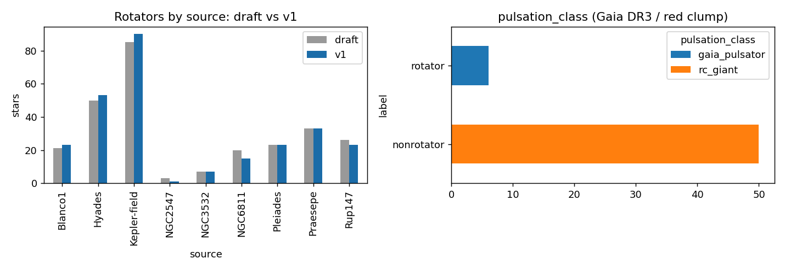
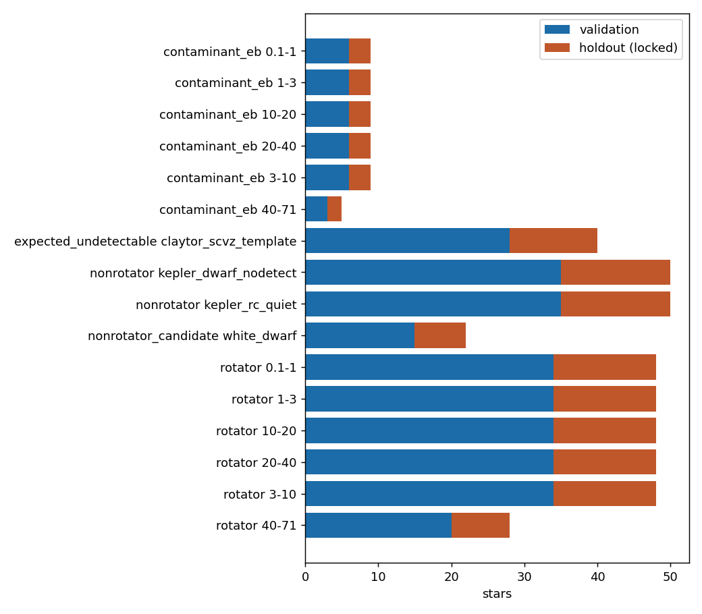

# P27 freeze: real-TESS validation manifest (v1), loader, download plan, outcomes

**Date:** 2026-11-19 · **Author:** Claude (session started from the coordinator) · **Branch:** `claude/p27-freeze-27f7e1` · **Status:** draft (v1 applies Rae's answers of 2026-11-19)

## TL;DR
- **v1 frozen:** `datasets/tess_validation_v1.csv`, 480 stars, every one scorable. 79 stars were replaced (72 with no SPOC/QLP light curve, 7 crowded EBs), strata counts unchanged. A seeded, stratified **30% holdout (144 stars) is locked**; no dataset string can select it. v0 stays as the superseded first freeze.
- **The download grew:** 4,078 files, **2.06 GB** (SPOC 1.29 + QLP fallback 0.77), ~40–70 min at an assumed 1–5 MB/s, because the replacements have more sectors. Nothing was downloaded.
- **New outcomes are in** (additive, `final.*` untouched): per-class FP rate, `pulsation`, `expected_undetectable` detection rate, EB lock, under `metrics['tessval']`. On `dev_small_clean` full-year (47 stars) metrics are identical to main's, `check_goals --baseline` PASS.
- Pulsators now use the Gaia class: 6 stars (all NGC 6811 rotators), none among the negatives.
- Open: ask Zach about a vetted subset.

## Question / goal
Implement Rae's 2026-11-19 answers to the seven open questions of the first P27 freeze report (relayed by the coordinator). No `benchmarks/goals.json` change.

## Rae's decisions and what I did
| # | Decision | Done |
|---|---|---|
| 1 | Keep a 30% holdout | `split` column: per stratum (label × period bin; label × source for negatives) `round(0.3 n)` stars are `holdout`, seed 20261119. 144 holdout / 336 validation. Dataset strings read `split == "validation"` only; `tests/test_tess_lc.py` checks the holdout is never selected. EBs come out at 34% (9 per bin rounds to 3), rotators 29%. |
| 2 | Replace the unscorable stars | 72 stars removed, 79 with the crowded EBs. Replacements drawn from the same pools with SPOC or QLP files at MAST (`tools/validation_set/draw_replacements.py`, seed 271, metadata only; committed as `datasets/proposed/p27_v1_replacements.csv`). Rotators match on period bin (a replacement may come from another cluster); other blocks on source. Cuts unchanged (Tmag ≤ 14, `contratio` < 0.2). |
| 3 | New outcomes approved | `evaluation.py` (additive functions after the existing code) and `scorecard.py` (`metrics['tessval']`); see below. |
| 4 | Gaia class for hot stars | `hot_star` removed. `gaia_class` (Gaia DR3 classifier via TIC Gaia id, `tools/validation_set/gaia_classes.py`), `gaia_pulsator` = class DSCT\|GDOR\|SXPHE or in the main-sequence-oscillator table, `pulsation_class` = `rc_giant` (Kepler red-clump block) / `gaia_pulsator` / empty. |
| 5 | QLP fallback only | Kept (default `--qlp fallback`). |
| 6 | Drop crowded EBs | The 7 EBs with `contratio` ≥ 0.2 are replaced by EBs in the same period bins with `contratio` < 0.2; the cut now holds for all 480. |
| 7 | Zach | Still open (Rae will ask). |

Fixes carried from the first freeze: integer count columns, stable sort. The replacement for the long-period rotators needed more stars than `rotators_all.csv` held (its 600-star McQuillan sample has no unused SPOC/QLP star at 20–71 d): 14 more McQuillan+2014 Kepler-field stars were drawn at 20–40 d (5) and 40–71 d (9).

## Results

### The final mix


Same counts as v0 (48 rotators and 9 EBs per period bin up to 40 d; 28 + 5 at 40–71 d).

### Replacements and Gaia pulsator flags


Left: rotators by source, draft vs v1 (Kepler field gains the long-period stars; small clusters lose a few). Right: `pulsation_class`. Only 6 stars carry a Gaia pulsator class and all are rotators in NGC 6811 (Teff 6700–6900 K, P 1–2.3 d); the Kepler dwarfs and WDs have none. Pulsation matters only on the no-truth blocks, so in v1 it applies to the 50 red-clump giants alone. Gaia's sparse sampling makes zero a lower bound.

### The locked holdout


Stratified by label × period bin: each bin keeps ~30% of its stars. Validation: 190 rotators, 70 nonrotators, 15 WD candidates, 28 expected-undetectable, 33 EBs.

### Coverage and availability


| label | n | SPOC | QLP only |
|---|---|---|---|
| rotator | 268 | 177 | 91 |
| contaminant_eb | 50 | 50 | 0 |
| nonrotator | 100 | 59 | 41 |
| nonrotator_candidate | 22 | 19 | 3 |
| expected_undetectable | 40 | 20 | 20 |

PDCSAP exists only where SPOC does: 177 of 268 rotators (130 in the validation split). SPOC-covered rotators per bin: 37, 39, 31, 35, 22, 13 (the 40–71 d bin is better than v0's 6). 25 rotators have ≤ 2 FFI sectors; median 6.

### Download plan (MAST metadata, 2026-11-19; nothing downloaded)
| product | files | stars | size |
|---|---|---|---|
| TESS-SPOC (`SAP_FLUX` + `PDCSAP_FLUX`) | 2,175 | 325 | 1.29 GB |
| QLP fallback (stars with no SPOC) | 1,903 | 155 | 0.77 GB |
| **total** | **4,078** | 480 | **2.06 GB** |

Every star has files. At 1–5 MB/s plus 0.5 s/file: 41–68 min (assumed, not measured). Run `nice -n 15 python tools/download_tess_validation.py`. The download covers all 480 stars, holdout included (only scoring is gated). Per-star table: `data/plan_per_star.csv`.

### Outcome definitions (implemented; `claude_files/evaluation.py`, `benchmarks/scorecard.py`)
Existing metrics and every `final.*` key are unchanged; a `tessval` group appears in `metrics.json` only for `tessval_v1_*` runs.
- **Rotators** (`tessval_v1_{sap,pdcsap}`): literature period with the unchanged `classify_period`.
- **EB lock** (`..._eb`): `lock` = correct + half + double against P_orb, plus `other` (any unrelated period) and `decline`; by period bin, with a Wilson interval.
- **Negatives** (`..._neg`: `nonrotator` + `nonrotator_candidate`): `classify_negative` gives `decline`, `pulsation` or `answer`. An `answer` is a false positive, reported per class and per `star_type` (`rc_giant` vs `dwarf`), with Wilson intervals. `pulsation` windows: `rc_giant` 0.2–0.5 d (Rae), `gaia_pulsator` 0.1–3 d (my choice: δ Sct to γ Dor).
- **Expected undetectable** (`..._eu`): same fields; `answer` is the detection rate, never a false positive.
- On `_neg` and `_eu` a 1 d placeholder truth is passed, so `final.*` there is meaningless; `tessval.note` says so. A 1-star end-to-end run through `score_one_star` on a synthetic FITS gave a sensible `answer`.
- The holdout has no string at all.

### No change to existing metrics
Quick check: `datasets/dev_small_clean.csv`, full-year (`--ignore-manifest-sectors`), 3 workers, run once with main's code (commit 5519297, a scratch worktree) and once with this branch, then `check_goals.py new --baseline base`:

```
OVERALL: PASS   (all 11 guarded metrics delta +0.000; final.overall.success 0.277 vs 0.277)
```
`metrics.json` is identical apart from `config` and `runtime`, and has no `tessval` key. I did not rerun the dev_medium_clean `_v7` baselines (the coordinator is running them); `tests` still pass unchanged.

## What didn't work
- The first replacement draw came up 14 stars short, all long-period Kepler-field rotators (see above); fixed by drawing more McQuillan stars.
- VizieR returns HTTP 404 for a `Source=` list with no matching rows, so `gaia_classes.py` treats that as an empty chunk (the main-sequence-oscillator table returned nothing for any star; the classifier gave 6 DSCT\|GDOR\|SXPHE).
- Gaia DR2 ids from the TIC stand in for DR3 ids (equal for most stars): 3 of 559 TICs have no Gaia id.

## Open questions for Rae
1. **Zach:** is there a vetted subset of his list? (You said you will ask.) The 40 `expected_undetectable` are drawn from his unvetted list minus Gaia variables.
2. **Download size:** v1 is 2.06 GB (4,078 files), not the 1.69 GB of the earlier plan, because replacements have more sectors. OK?
3. **`gaia_pulsator` window (0.1–3 d)** and the 0.2–0.5 d `rc_giant` window: fine? The 6 Gaia pulsators are rotators, so v1 has no Gaia-pulsator negatives to apply it to. Do you want negatives drawn from Gaia DSCT/GDOR stars later (to test the `pulsation` outcome itself)?
4. **EB share in the holdout is 34%** (per-bin rounding); acceptable, or a different stratification for EBs?
5. The paired SAP-vs-PDCSAP set is 130 validation rotators; thin at 40–71 d (13 SPOC-covered stars in all, fewer in the validation split). Enlarge (needs a v2)?

## Reproduce
```bash
# from the repo root, with /opt/anaconda3/envs/ss_openblas/bin/python
python tools/build_tess_validation.py --check                 # v1 from committed inputs
python tools/build_tess_validation.py --version v0 --check    # superseded v0 still reproduces
python tools/validation_set/draw_replacements.py              # network (metadata); writes datasets/proposed/p27_v1_replacements.csv
python tools/validation_set/gaia_classes.py                   # network (metadata); writes datasets/proposed/p27_v1_gaia_classes.csv
python tools/download_tess_validation.py --dry-run            # MAST metadata only (~7 min); writes runs/tess_validation_plan.csv
nice -n 15 python tools/download_tess_validation.py           # Rae: the real download (Data_Vault drive)
python -m pytest -q tests/test_tess_lc.py
python tools/run_notebook.py reports/2026-11-19_p27-freeze/notebook.ipynb
# no-change check (scratch worktree of main's commit vs this branch):
python benchmarks/scorecard.py --manifest datasets/dev_small_clean.csv --data-root data/smarts_dev --ignore-manifest-sectors --n-workers 3 --outdir runs/x
# once downloaded:
python benchmarks/scorecard.py --manifest tessval_v1_sap --outdir runs/tessval_sap
```
