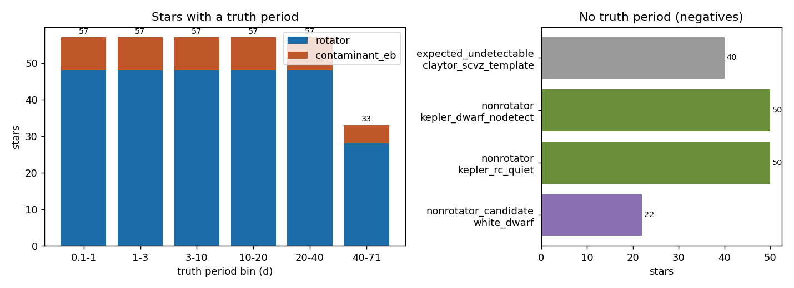
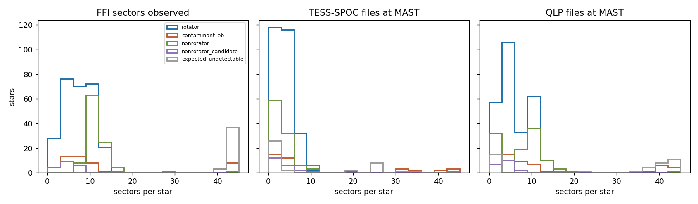
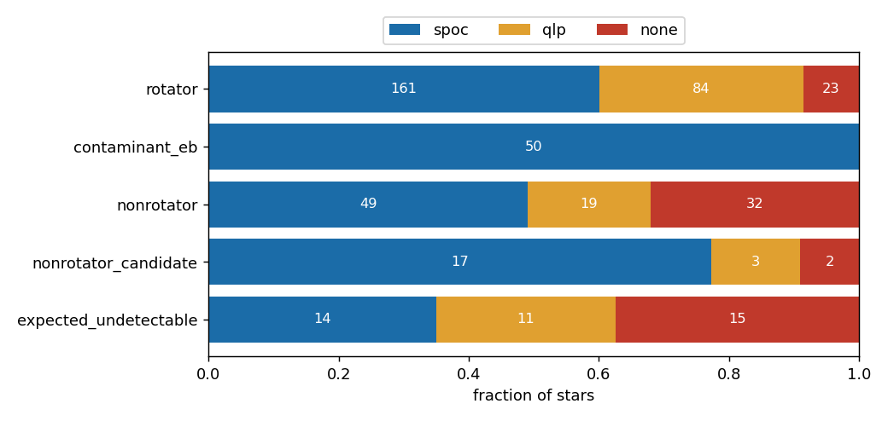

# P27 freeze: real-TESS validation manifest, loader, download plan

**Date:** 2026-11-19 · **Author:** Claude (session started from the coordinator) · **Branch:** `claude/p27-freeze-27f7e1` · **Status:** draft

## TL;DR
- **Frozen:** `datasets/tess_validation_v0.csv` (480 stars). The draft already matched every P27 decision, so only two cosmetic fixes were made. `tools/build_tess_validation.py --check` reproduces it from committed inputs.
- **72 of 480 stars have no SPOC or QLP light curve at MAST** and cannot be scored (15 of the 40 `expected_undetectable`, 32 of 100 `nonrotator`). A `scorable` column marks them. Replace them (new version) or accept?
- **Download:** the real MAST listing gives **3,201 files, 1.69 GB** (SPOC 1.17 GB + QLP fallback 0.52 GB), ~35–55 min at 1–5 MB/s (assumed, not measured). Nothing was downloaded.
- Loader `claude_files/tess_lc.py` and scorecard strings `tessval_v0_{sap,pdcsap}[_eb]` (rotators and EBs) are in. Non-rotator outcomes need new metric definitions, proposed below.
- Holdout policy is Rae's call.

## Question / goal
P27 follow-up in `docs/TASKS_PROPOSED.md`: freeze the validation manifest, and build the download script, a SPOC/QLP loader and the scoring design. No goal in `benchmarks/goals.json` is touched.

## What I did
1. **Re-checked the draft** (`check_decisions` in the builder asserts all of this, so `--check` re-verifies it):
   - labels and counts: 268 rotator, 100 nonrotator, 22 nonrotator_candidate, 40 expected_undetectable, 50 contaminant_eb; TIC unique;
   - Zach's block: all 40 are in his list and carry the label `expected_undetectable`; **none of the 294 Gaia DR3 variables** is among them (the earlier TIC 349058011 is gone), and every one is covered by the Gaia table;
   - provenance: every row has `period_method`, `period_dataset` and `period_ref`; all rotator periods are spot modulation, 0.18–65.3 d (nothing in 70–180 d, as decided); negatives have no truth period; EB truth is P_orb 0.1–60 d;
   - cuts: Tmag ≤ 14 everywhere, `contratio` < 0.2 for rotators and negatives; `n_sectors` equals the length of `sectors`.
2. **Fixes (the full list):**
   - (a) `n_tess_spoc`, `n_qlp`, `n_tglc`, `n_cdips` were floats (`3.0`); cast to integers.
   - (b) rows sorted by (label, source, TIC) so the file is stable.
   - Not fixed, but noted: 7 EBs have `contratio` ≥ 0.2 (the cut was never applied to EBs; a blended EB can lock on a neighbour); TIC 358111274 (an EB) is also in Zach's list, which is fine for an EB test; 13 EBs/WDs have one more SPOC file in the draft counts than MAST lists today (`n_tess_spoc` is a draft-time count, so use the download index, not the column, for what is on disk).
3. **Columns added:** `star_id`, `truth_kind`, `pbin`, `star_type`, `pulsation_eligible`, `gaia_variable` (audit, 0), `product_primary`, `scorable` (definitions in `datasets/README.md`). `star_type` rules (my proposal, in the builder): `rc_giant` = the `kepler_rc_quiet` block; `hot_star` = Teff ≥ 6500 K (δ Sct / γ Dor strips; 61 stars, mostly rotators in young clusters); `giant` = logg < 3.5.
4. **Download script** `tools/download_tess_validation.py` (astroquery 0.4.11): metadata through `Observations.query_criteria` + `get_product_list`; resumable (skips files at the expected size), atomic (`.part` then rename), 3 retries with backoff, log at `<root>/download.log`, index `<root>/files_index.csv` with root-relative paths; mount check stops with "plug in the Data_Vault drive". `--qlp fallback` (default) fetches QLP only for stars with no SPOC file. I ran only `--dry-run` (metadata, no files): first on 5 stars, then on all 480 (≈ 20 min of queries).
5. **Loader** `claude_files/tess_lc.py`: `load_tess_star(paths, flux_column, quality, sectors, timestep)` returns a `PreprocessedLightCurve` subclass (zero-centred per-sector-median relative flux, days from first cadence, 30-min grid, NaN for flagged/missing cadences; 10-min and 200-s sectors are averaged into 30-min bins). Quality: SPOC default bitmask 175, `hard`, `hardest`, `none` or an int; QLP default is any non-zero flag. `KSPSAP_FLUX`, TGLC `cal_*` and similar are refused. 14 tests in `tests/test_tess_lc.py` run on synthetic FITS fixtures; no network or drive.
6. **Scorecard:** additive only (`parse_tessval_dataset`, `build_tessval_tasks`, a `_load` branch): see Results.

## Results

### The frozen mix


Every period bin has 48 rotators and 9 EBs except 40–71 d (28 + 5): no cluster periods exist there. Only 6 of those 28 have SPOC data, so the SAP-vs-PDCSAP comparison is thin exactly where PDC attenuation should bite (SPOC-covered rotators per bin: 36, 38, 29, 34, 18, 6).

### Sector coverage


Rotators have a median of 6 FFI sectors and 28 have ≤ 2. Zach's stars (Tmag ~13, near the SPOC/QLP limit) have 40-45 FFI sectors but patchy product coverage.

### SPOC vs QLP availability (from the real MAST listing)


| label | n | SPOC | QLP only | none (unscorable) |
|---|---|---|---|---|
| rotator | 268 | 161 | 84 | 23 |
| contaminant_eb | 50 | 50 | 0 | 0 |
| nonrotator | 100 | 49 | 19 | 32 |
| nonrotator_candidate | 22 | 17 | 3 | 2 |
| expected_undetectable | 40 | 14 | 11 | 15 |

PDCSAP exists only where SPOC does: 161 of 268 rotators (the paired subset). All 50 EBs have SPOC (they were drawn from 2-min targets).

### Download plan (MAST metadata, 2026-11-19; nothing downloaded)
| product | files | stars | size |
|---|---|---|---|
| TESS-SPOC (`SAP_FLUX` + `PDCSAP_FLUX`) | 1,915 | 291 | 1.17 GB |
| QLP, fallback only (stars with no SPOC) | 1,286 | 117 | 0.52 GB |
| **total** | **3,201** | 408 | **1.69 GB** |

`--qlp all` adds every QLP sector of the 291 SPOC stars; I did not re-query it (the scoping estimate for all QLP was 1.3 GB, so about 2.4 GB in total). Expect ~35–55 min for the default plan at an assumed 1–5 MB/s plus 0.5 s/file overhead (a guess). Run it with `nice -n 15`. The per-star table is `data/plan_per_star.csv`.

### Scoring design
**Additive, implemented** (`benchmarks/scorecard.py`; no metric definition or `evaluation.py` change): dataset strings
- `tessval_v0_sap`: the 268 rotators scored against the literature period with the existing `classify_period` (correct / diffrot / half / double / wrong / none). SAP from TESS-SPOC; QLP `SAP_FLUX` for the 84 stars that have no SPOC file.
- `tessval_v0_pdcsap`: the same stars, SPOC `PDCSAP_FLUX` only (161 paired stars), so SAP vs PDCSAP is a paired comparison on that subset (compare against `tessval_v0_sap` restricted to those stars).
- `tessval_v0_{sap,pdcsap}_eb`: the 50 EBs scored against P_orb. `correct` = P_orb lock, `half`/`double` = the usual EB aliases; "EB lock" is the sum of the three and is not a rotation success (same convention as the WG6 contaminants).
Not run: no light curves exist locally yet.

**Proposed, not implemented** (needs a change to metric definitions or `evaluation.py`; protected files left alone). The scorecard needs a `true_period` float per star, which negatives lack, so each negative block needs a "no truth" path in the scorer:
1. **Per-class false-positive rate** on `nonrotator` (split `rc_giant` vs `dwarf`) and `nonrotator_candidate` (white dwarfs): FP = any answer that is not a decline. Report Wilson intervals per class, never pooled with the EB or `expected_undetectable` rows.
2. **`pulsation` outcome:** a non-decline answer on a `pulsation_eligible` star is `pulsation` (not FP) when P is in 0.2–0.5 d for `rc_giant`, or in 0.1–3 d for `hot_star` (δ Sct ≲ 0.3 d, γ Dor 0.3–3 d). Everything else on those stars stays an FP. Window edges are my proposal.
3. **`expected_undetectable`:** report the detection rate (answers / 40 scorable) in its own row, with an optional split by LS amplitude once light curves exist; never count it as an FP.
4. **EB lock rate** as in the `_eb` strings above, plus the fraction of EB answers that fall at a rotation-like period unrelated to P_orb (neither alias).
5. **Stratification:** rotators by period bin × number of contiguous SPOC sectors (a 20 d period needs ≥ 2 cycles); report decline and wrong rates separately.

## What didn't work
- First builder run failed my own assertion that no EB is in Zach's list: TIC 358111274 is in both. I relaxed the check for EBs (a fine EB test).
- The 5-star dry run took ~1 min and the 480-star one ~20 min: MAST product-list calls dominate, so the plan is cached at `<root>/files_plan.csv` for the real run.
- I could not confirm the QLP/SPOC FITS column layout on a real file (no download allowed). The loader assumes `LIGHTCURVE` HDU with `TIME`, `SAP_FLUX`, `PDCSAP_FLUX` (SPOC), `QUALITY`, header `SECTOR`; confirm on the first downloaded file of each product.

## Open questions for Rae
1. **Holdout policy (yours, not decided here):** the whole file is unscored and unlocked. Options: score all 480 as one fixed validation set, or lock a random fraction (stratified by label × period bin, e.g. 30%) untouched until the method is final. Also when first scoring may happen. Nothing in the manifest encodes a split.
2. **72 unscorable stars** (no SPOC or QLP at MAST), concentrated in `expected_undetectable` (15 of 40) and `nonrotator` (32 of 100). Options: keep and report n scorable; or build `tess_validation_v1` with same-seed replacements that have products (needs a re-draw with MAST queries, ~1 h of my time and no download).
3. **Outcome definitions** above (FP rate per class, `pulsation` windows, `expected_undetectable` detection rate, EB lock): OK to implement as new scorecard metric groups? That touches `scorecard.py` metrics and probably `evaluation.py`.
4. **`hot_star` threshold (Teff ≥ 6500 K)** flags 61 stars, mostly young-cluster rotators with 0.2–3 d spot periods; a 0.5 d answer on one is ambiguous between a spot period and a pulsation. Tighter (≥ 7000 K) or by Gaia classification?
5. **QLP policy:** fallback only (default, 1.69 GB) or `--qlp all` (~2.4 GB, more sectors per star)?
6. **EBs with high `contratio`** (7 of 50): keep as is, or drop them?
7. Ask Zach whether a vetted subset of his list exists (still open from the scoping report).

## Reproduce
```bash
# from the repo root, with /opt/anaconda3/envs/ss_openblas/bin/python
python tools/build_tess_validation.py --check          # rebuild the manifest from committed inputs
python tools/download_tess_validation.py --dry-run     # MAST metadata only (~20 min); writes runs/tess_validation_plan.csv
nice -n 15 python tools/download_tess_validation.py    # Rae: the real download (needs the Data_Vault drive)
python -m pytest -q tests/test_tess_lc.py
python tools/run_notebook.py reports/2026-11-19_p27-freeze/notebook.ipynb
# once downloaded:
python benchmarks/scorecard.py --manifest tessval_v0_sap --outdir runs/tessval_sap
```
