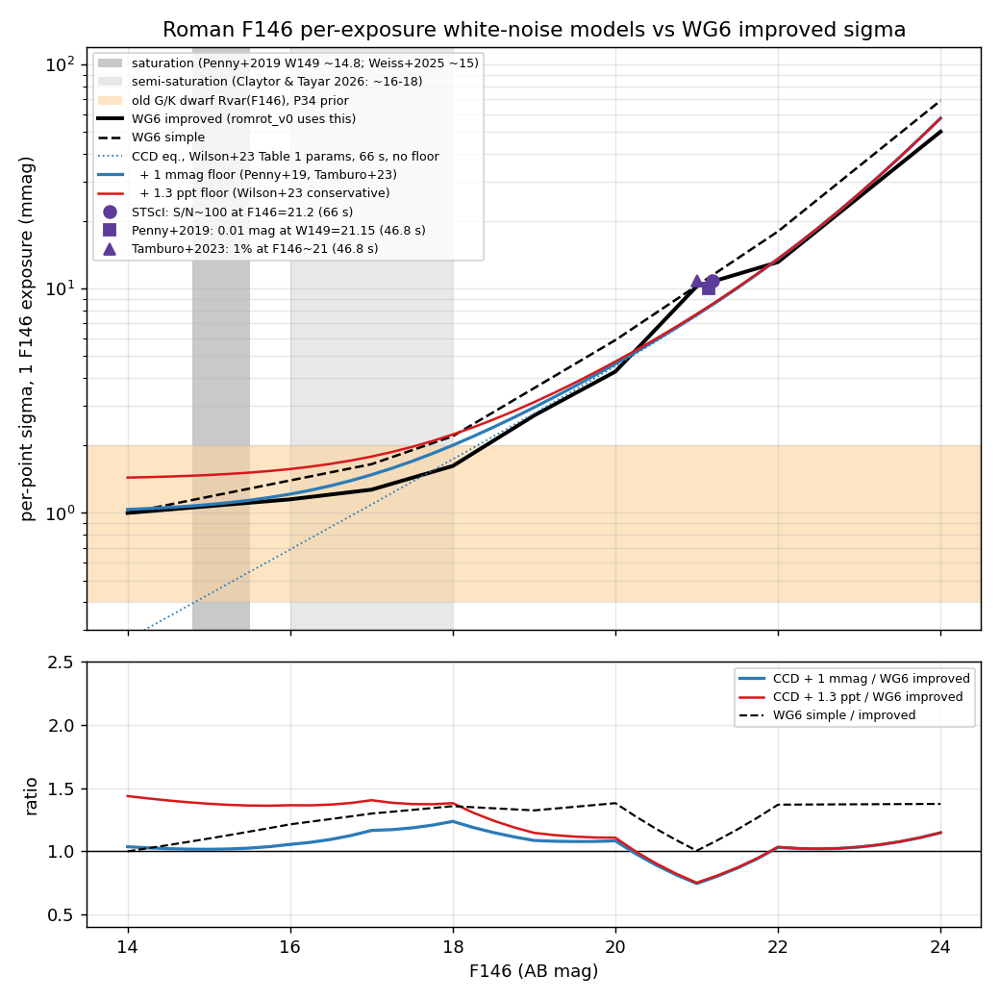
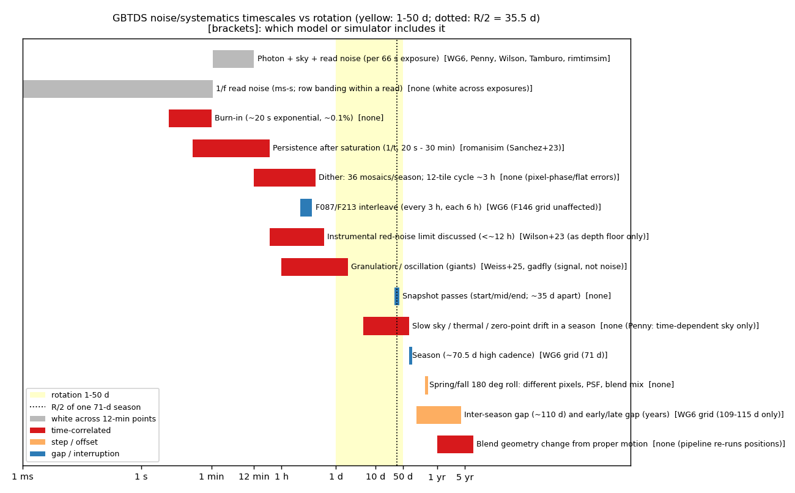
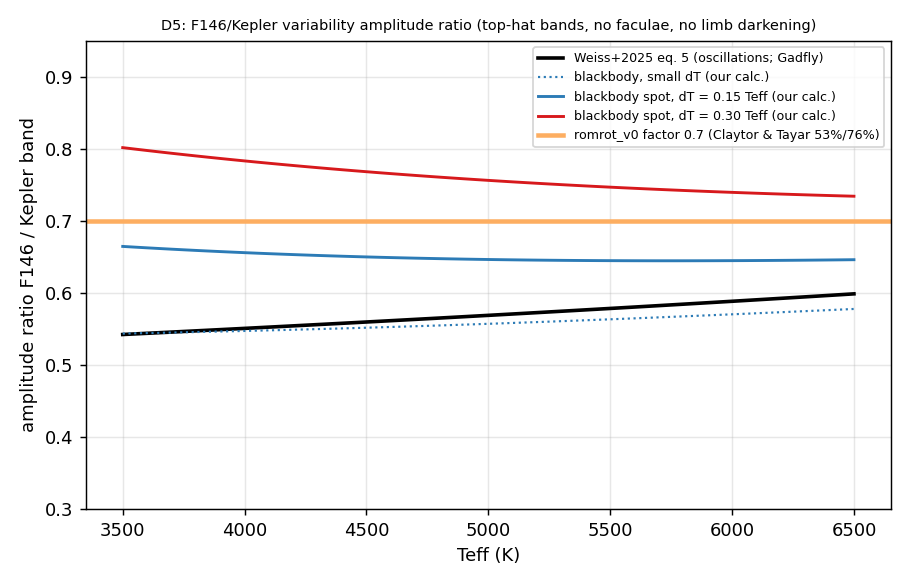

# Survey of Roman GBTDS noise and systematics models (P49)

**Date:** 2026-11-19 · **Author:** P49 agent session · **Branch:** `claude/p49-roman-noise-survey-2e5f2d` · **Status:** draft

## TL;DR
- **No group has a time-correlated GBTDS noise or systematics model to reuse.** Every published GBTDS light-curve forecast (Penny+2019, Tamburo+2023, Wilson+2023, Weiss+2025, rimtimsim) uses **white** noise: photon + sky + read noise plus a constant **~1 mmag floor** (Wilson+2023: 1.3 ppt). Red noise, inter-season offsets and long-term drifts are called out as caveats and left out.
- **WG6's improved σ(F146) is the same kind of budget, and it is close.** The literature budget ("CCD equation + 1 mmag floor") is **1.06–1.24× WG6** at F146 16–20, and 1.11–1.40× with Wilson's 1.3 ppt floor. Raising it to that is cheap.
- **Nothing in the literature covers 1–50 d timescales.** That band holds slow drifts, the spring/fall roll, snapshot gaps and inter-season offsets. We build that part ourselves, as a parametric stress test, until season-1 data exist.
- **D5:** Weiss+2025 scale Kepler oscillations to F146 by ×0.54–0.60. For spots, a blackbody gives 0.65–0.80. **×0.7 holds up.**

## Question / goal
P49 in `docs/TASKS_PROPOSED.md`: before building our own Roman noise model for `romrot_v0` (P34) and the WG6 scorecard (P35), find what other groups already use for GBTDS photometric noise and systematics. The scope covers red/correlated noise, detector effects, crowding, saturation, offsets and the cadence/gap pattern. Read and research only: no pipeline code changes, no `goals.json` goals touched, no scorecards run.

## What I did
- Ran web searches, and had web-fetch agents read the papers and pages listed under Sources (ar5iv/arXiv HTML, STScI RDox, GitHub READMEs and source). Several papers were only partly read verbatim; where a number came from a summary pass rather than the text, the table says so.
- Built three figures from the literature numbers. `figlib.py` holds every number with its citation; the WG6 curve is `tools/make_roman_rotators.sigma_f146_mmag` (no drive).
- **The "CCD equation" curve in Fig. 1 is our own calculation from published parameters, not a curve quoted by any paper.** No paper tabulates σ vs magnitude in its text. Parameters: Wilson+2023 Table 1 (ZP 27.648, sky + thermal 5.23 e⁻/pix/s, CDS read noise 16 e⁻), a 66 s exposure (STScI), a 3×3 aperture (Penny/Tamburo), and an **assumed 83% aperture flux fraction**. Three precision points quoted in the texts (purple markers) check it.
- I left out Montet+2017: both arXiv IDs I tried pointed to other papers. Tamburo+2023 inherits the same Cycle-7 Penny budget anyway.

## Results

### Comparison of models

Notes for reading the table:
- "White" means independent from one 12.1-min point to the next.
- "Effort" means effort to apply the model to WG6 / `romrot_v0` light curves.

| Model / source | Covers | White or correlated | Relevant to 1–50 d? | Public code / data, licence | Effort | Citation |
|---|---|---|---|---|---|---|
| **Penny+2019** GULLS noise model (Cycle 7) | Photon, sky (time-dependent), thermal + dark (1.07 e⁻/s), read noise 12.1 e⁻, **1 mmag floor added in quadrature per point**, 3×3 aperture, crowding as blend photons from real PSFs. W149 saturation ~14.8; 46.8 s every 15 min; 6×72 d seasons | White ("simply add in quadrature a Gaussian systematic error floor"). No pointing shifts or pixel-response variation. H4RGs treated "like CCDs" | No | GULLS not public as far as I found (plotting scripts only); paper under arXiv licence | Trivial: σ(m) formula | [arXiv:1808.02490](https://arxiv.org/abs/1808.02490), ApJS 241, 3 |
| **Tamburo+2023** (mid-M/UCD transit yields) | Penny Cycle-7 budget (Table 1), 1 mmag floor (dominant at F146 ≲ 16.8). One F146 point dropped every 12 h for F087 | "Purely uncorrelated Gaussian ('white') noise". Red noise named as a caveat, no amplitude given | No | No code statement | Trivial | [arXiv:2303.09959](https://arxiv.org/abs/2303.09959) |
| **Wilson+2023** pixel-level GBTDS sims (RImTimSim) | Up-the-ramp reads (18 × 3.04 s, 11 e⁻ read noise), WebbPSF PSF with **8 mas jitter** inside the PSF, real crowding (aperture contamination from simulated neighbours), saturation at 10⁵ e⁻, IPC kernel. **Conservative floor 1.3 ppt per exposure**; target < 0.5 ppt on ≲ 12 h | White across exposures. Crowding adds "a small amount of correlated noise". Correlated instrumental noise (nonlinearity 1.5 ppt bound) handled only as a minimum transit depth. Persistence, 1/f, flat errors explicitly not modelled | No (≲ 12 h discussed) | **RImTimSim, MIT** ([github](https://github.com/robertfwilson/rimtimsim), 8 commits, v0.0-alpha). Analytic `ramp_readout_noise_model`; no cross-exposure correlation code | Easy for σ(m) (formula); medium–hard for pixel-level crowding (PSF files, full-frame rendering) | [arXiv:2305.16204](https://arxiv.org/abs/2305.16204) |
| **Weiss+2025** asteroseismic yields | Two noise models: "Penny" (1 mmag floor for saturated stars) and "Wilson" (saturated stars capped near the Poisson limit at full well). Saturation ≈ 15, "precise photometry may be possible up to 14th". Injects into Kepler light curves at **F146/Kp amplitude = 0.493 + 0.058 T + 0.018 T²**, T = Teff/5000 (our reading; ×0.54–0.58) | White only ("We also injected white noise") | Indirect (D5 scaling) | No code release in text; Gadfly (amplitude scaling) on GitHub, licence not shown on the landing page | Trivial (formula) | [arXiv:2503.04999](https://arxiv.org/abs/2503.04999) |
| **WG6 resampled** (what we use) | σ(mag) curve with a 1.0 mmag floor plus a 0.05 dex per-star "crowding" scatter (improved). Real 12.1-min grid, 6×71 d | White (measured: ac lags 1–5 ≈ 0; binned RMS = σ/√N) | No | On the drive; generating code not in the WG6 repo | In use | `docs/WG6_REFERENCE.md` §8.3 |
| **romanisim** (STScI; Roman I-Sim recommends it) | L1/L2 images. Up-the-ramp, nonlinearity (CRDS), **IPC applied before readout (correlates Poisson noise)**, **persistence (Sanchez+23 model)**, read noise. DC25 runs omit brighter-fatter, persistence and count-rate nonlinearity | Per-image. Persistence is the only cross-exposure term | Only through persistence (min–h) | **BSD-3-style (AURA)**; README: "not been formally validated" | Hard: render a stamp per epoch (8,390 per season) | [github](https://github.com/spacetelescope/romanisim), [docs](https://romanisim.readthedocs.io) |
| **GalSim `galsim.roman`** | PSF and simple detector effects via the Roman module. The README names "nonlinearity, brighter-fatter effect, etc."; per my recollection (unverified here) it also offers IPC, persistence and reciprocity failure | Per-image | No | BSD-style | Hard (image level) | [github](https://github.com/GalSim-developers/GalSim) |
| **STScI RDox detector pages** (measured lab/TVAC) | Persistence: 1/t decay, ~1 e⁻/pix/s at 20 s, at background in 1–5 min, ×5 spread between detectors. Burn-in: ~20 s exponential, "~0.1% systematic if uncorrected". Count-rate nonlinearity ≲ 0.5% over 4 dex. BFE "never negligible" (spots grow ~10%). IPC ~2% per neighbour. 1/f read noise (row banding, ≲ 1 kHz). Dark 0.016 e⁻/s | Mostly within-exposure or minutes. **Dithering:** "Each iteration of the six-tile mosaic is offset" (36 mosaics per season, integer + subpixel), so a star moves across pixels: flat/pixel-phase errors become a dither-correlated pattern | Not directly; dither patterns repeat on hours. No amplitude given | Documentation only | N/A (inputs for a model) | [non-ideal effects](https://roman-docs.stsci.edu/roman-instruments/the-wide-field-instrument/wfi-detectors/non-ideal-detector-effects), [GBTDS](https://roman-docs.stsci.edu/roman-community-defined-surveys/galactic-bulge-time-domain-survey) |
| **ROTAC final / STScI GBTDS design** | 6 fields, 1.7 deg². F146 every 12.1 min, 66–67 s (S/N ~ 100 at F146 = 21.2). F087/F213 every 6 h, staggered 3 h. **6 high-cadence seasons of ~70.5 d** (first 3 early, last 3 late; first season ~2 d shorter). 4 low-cadence seasons (5 d per STScI, 3 d per ROTAC text). **Snapshot passes at start/mid/end of each season.** Interruptions for calibration/station-keeping | (cadence and gaps) | Gaps and grids, yes | Public docs | Easy: we already use WG6's 71-d grid | [arXiv:2505.10574](https://arxiv.org/abs/2505.10574) |
| **K2 C9 bulge photometry** (analogue, not Roman) | Real space photometry in the bulge: crowding + pointing drift (~6.5 h cycle) gave trends "much larger" than the signals. Fixed with pixel-level decorrelation (MCPM) | Strongly correlated | Hours to days | MCPM code exists (Poleski+2019) | Not a Roman model; a cautionary prior | [A&A 627, A54](https://ui.adsabs.harvard.edu/abs/2019A%26A...627A..54P) |
| **GBTDS pipelines** (IPAC handbook; Dazzle; phrosty) | Daily PSF + difference-imaging light curves; earlier seasons reprocessed once proper motions improve | No noise model published | — | Dazzle open-source | — | [IPAC GBTDS pipelines](https://roman-docs.ipac.caltech.edu/data-handbook/roman-wfi-data-pipelines/galactic-bulge-survey-pipelines), [arXiv:2412.06905](https://arxiv.org/abs/2412.06905) |

### Per-exposure white noise: the literature budget vs WG6 improved



**What to look at:** the thick black line (WG6 improved, which `romrot_v0` uses) against the blue "CCD equation + 1 mmag" line. The lower panel shows the ratio.

- **F146 16–20:** the literature budget is **1.06–1.24× WG6 improved**, and 1.11–1.40× with Wilson's 1.3 ppt floor. WG6's improved curve is slightly optimistic but the same kind of model. WG6 *simple* is 1.0–1.4× above improved, so it brackets the literature.
- **F146 > 20:** the three precision points quoted in the texts (purple markers, ~10–11 mmag at F146 ≈ 21) agree with each other. They also agree with the extrapolated WG6 point at 21 (10.25 mmag). Our CCD curve gives 7.6 mmag there, so the curve is ~30% low at the faint end. The likely cause is the assumed aperture fraction or the background. The curve is for comparison only; the anchors are the stronger evidence.
- **Old G/K dwarfs:** the orange band (Rvar(F146) prior 0.4–2 mmag, P34) lies at or below σ per point everywhere fainter than ~17. A 1.0 → 1.3 mmag floor matters most at F146 ≲ 18, the regime of the bright rotators that we can actually detect.
- **Saturation:** ~14.8–15.5. Semi-saturation (Claytor & Tayar) is ~16–18, where Penny's floor and Wilson's cap differ the most (Weiss+2025: the two "diverge brighter than magnitude 16").

### Which systematics overlap rotation timescales



**What to look at:** the yellow 1–50 d band, and what is red or orange inside it or next to it.

- Every effect that someone has *modelled* (bracket text) is white or shorter than ~12 h: photon/read noise, persistence, burn-in, dither, Wilson's ≲ 12 h red-noise limit.
- Inside or next to the rotation band there are:
  - slow sky/thermal/zero-point drifts within a season;
  - the snapshot interruptions at season start, middle and end (~35 d apart, i.e. right at R/2);
  - the spring/fall 180° roll (different pixels, PSF orientation and blend mixture each season);
  - the ~110 d inter-season gaps.
- **No paper or simulator models any of these.** The ~6.5 h K2 C9 drift is the only real bulge-photometry precedent. It shows that hour-scale pointing systematics in crowded fields can exceed the astrophysical signal until they are decorrelated at pixel level.

### D5: what the literature says about the F146 amplitude factor



**What to look at:** the orange 0.7 line, against the black Weiss+2025 line and the blue/red blackbody spot curves.

- **Weiss+2025 scale oscillation/granulation amplitudes Kepler → F146 by 0.54–0.60.** For a small temperature perturbation, our band-integrated blackbody gives the same value (0.544 vs 0.542 at 3,500 K), which checks our top-hat-band calculation.
- **Spots are not small perturbations.** At ΔT = 0.15 Teff the ratio is 0.65–0.67, and at ΔT = 0.30 Teff it is 0.73–0.80. Claytor & Tayar's 4,500 K / 3,500 K case (ΔT ≈ 0.22 Teff) gives the 53%/76% → 0.70 used in `romrot_v0`, which falls between these two curves.
- **So ×0.7 is consistent with the physics for typical spot contrasts.** A Teff- and ΔT-dependent factor would vary by about ±0.07 (0.65–0.80). Faculae are not modelled and could push the ratio either way: they are bright in the optical and have low contrast in the near-IR.
- **One survey to watch:** nobody has measured this ratio for rotators. The F087/F213 colour data will measure it directly in season 1.

### Recommendation: what to reuse vs build

**Reuse:**
- **The white-noise floor.** Keep WG6 improved σ(F146) as the baseline. Add a `romrot_v0` variant whose floor is raised to the literature value: σ² = σ_WG6² + (0.3–0.9 mmag)². That reaches Penny's 1 mmag + photon budget, or Wilson's 1.3 ppt. This is a one-line change in `tools/make_roman_rotators.py`, and there is no published alternative to adopt.
- **The faint end.** Use the precision points quoted by STScI, Penny and Tamburo (~10–11 mmag at F146 ≈ 21) to check the extrapolated WG6 σ at 21–22.
- **The cadence and gap pattern.** WG6's 71-d grid matches the ROTAC/STScI design (70.5 d; F146 at 12.1 min). The only missing structure: the snapshot-pass interruptions (start/mid/end) and calibration/station-keeping gaps. Their lengths aren't published.

**Build ourselves:** a parametric systematics layer for the 1–50 d band, kept as a stress set, not as the default training noise. It would add:
- a per-season zero-point offset and slow trend (low-order polynomial or long-τ GP);
- a dither/pointing-correlated term on hours;
- a blend-dilution draw (amplitude × f_blend, which WG6 does not apply);
- small gaps for the snapshots.

Amplitudes stay free parameters, bounded by the only published numbers: 0.1% burn-in, ≲ 0.5% count-rate nonlinearity, the 1.5 ppt nonlinearity bound, and the < 0.5 ppt target on ≲ 12 h. **They cannot be calibrated before season-1 data**, which fits Rae's plan to retrain on GBTDS-injected stars.

**Do not adopt:**
- romanisim / GalSim pixel-level simulation, for ~10⁴ star-seasons × 8,390 epochs. They are image simulators, unvalidated for this use, and very heavy for a 4-core laptop.
- RImTimSim, beyond its analytic σ formula: it adds no cross-exposure correlation.

## What didn't work
- **No numeric σ-vs-magnitude table in any paper's text.** Wilson+2023 Fig. 4/9 and Penny+2019 Fig. 4 are images the fetch agents could not read. Hence our own CCD-equation curve, with an assumed aperture fraction.
- **Montet+2017 not read** (wrong arXiv IDs). Low priority: it predates the Cycle-7 budget.
- **pandeia** GitHub URL gave a 404, so its licence and Roman support are unverified. A 2026 white-dwarf-planet paper (arXiv:2609.09481) used pandeia for GBTDS per-exposure noise, again injected as white Gaussian noise.
- **No F146 saturation magnitude at the 66 s GBTDS exposure** in STScI text (only an interactive figure based on a different MA table). The ~14.8–15 range comes from Penny/Weiss with older exposure times.
- **Partial reads.** Parts of Wilson+2023 (III.4–III.7, V.5.3–4) and Penny+2019 (IV–V.3, App. A) were seen only as summaries. Table entries that depend on them: the 83% aperture fraction and Wilson's statement that persistence is unmodelled.

## Open questions for Rae
1. **Raise the `romrot_v0` noise floor?** The literature white budget is 1.06–1.24× WG6 improved at F146 16–20.
   - **(a)** Keep WG6 as is (consistent with the WG6 scorecard).
   - **(b)** Add (0.3 mmag)² in quadrature to reach "CCD + 1 mmag" (Penny), or ~(0.9 mmag)² for Wilson's 1.3 ppt.
   - **(c)** Render both and score the difference.
   - I'd lean towards (c) at F146 17 only, as it costs one extra noise draw.
2. **Build the 1–50 d systematics stress layer now, or wait for season-1 data?** It can't be calibrated, but it would show whether the comb fit and the ranker are fragile to season-level trends and offsets.
3. **Blend dilution:** WG6 applies crowding only to σ, not to amplitudes. Should `romrot_v0` draw an f_blend (Penny: most bulge events have f_s < 0.5) that scales Rvar down? This could matter as much as D5's 0.7.
4. **D5:** keep ×0.7 as is (supported, see figure), or draw it per star from 0.65–0.80 by Teff and ΔT?
5. **Ask the RGES-PIT or Wilson** whether any group has GBTDS red-noise or inter-season systematics plans. The `rges-pit/lightcurve_format_definition` repo (updated 2026-11-13) suggests that light-curve products are being defined now.
6. **Low-cadence seasons** (every 3 or 5 d, 4 seasons between the early and late sets) are irrelevant for 1–50 d periods within a season. But could they bridge spot evolution for long-period stars (P46)? Probably not, because of the sampling, but this is your call.

## Reproduce
```bash
# from repo root; no drive, no network
/opt/anaconda3/envs/ss_openblas/bin/python reports/2026-11-19_roman-noise-survey/figlib.py
/opt/anaconda3/envs/ss_openblas/bin/python tools/run_notebook.py reports/2026-11-19_roman-noise-survey/notebook.ipynb
```

## Sources
- Penny, M. T. et al. 2019, ApJS 241, 3, [arXiv:1808.02490](https://arxiv.org/abs/1808.02490)
- Gaudi, B. S. et al. 2019, Astro2020 WP, [arXiv:1903.08986](https://arxiv.org/abs/1903.08986): 0.01 mag at W149 ~ 21, 6 × 72 d
- Tamburo, P. et al. 2023, [arXiv:2303.09959](https://arxiv.org/abs/2303.09959)
- Wilson, R. F. et al. 2023, ApJS 269, [arXiv:2305.16204](https://arxiv.org/abs/2305.16204); RImTimSim [github](https://github.com/robertfwilson/rimtimsim) (MIT)
- Weiss, T. et al. 2025, [arXiv:2503.04999](https://arxiv.org/abs/2503.04999); Huber et al. 2023 WP [arXiv:2307.03237](https://arxiv.org/abs/2307.03237) (≤ 1 mmag / 15 min needed for saturated giants)
- ROTAC final report 2025, [arXiv:2505.10574](https://arxiv.org/abs/2505.10574); [STScI GBTDS](https://roman-docs.stsci.edu/roman-community-defined-surveys/galactic-bulge-time-domain-survey); [STScI non-ideal detector effects](https://roman-docs.stsci.edu/roman-instruments/the-wide-field-instrument/wfi-detectors/non-ideal-detector-effects); [instrumental noise](https://roman-docs.stsci.edu/roman-instruments/the-wide-field-instrument/wfi-detectors/instrumental-noise)
- romanisim [github](https://github.com/spacetelescope/romanisim), [docs](https://romanisim.readthedocs.io/en/latest/romanisim/l1.html); GalSim [github](https://github.com/GalSim-developers/GalSim); gadfly [github](https://github.com/bmorris3/gadfly)
- Poleski, R. et al. 2019, A&A 627, A54 (K2 C9 MCPM); IPAC [GBTDS pipelines](https://roman-docs.ipac.caltech.edu/data-handbook/roman-wfi-data-pipelines/galactic-bulge-survey-pipelines); Dazzle [arXiv:2412.06905](https://arxiv.org/abs/2412.06905)
- Claytor, Z. R. & Tayar, J. 2026, CS23 poster, [Zenodo 20586804](https://zenodo.org/records/20586804)
- BFE lab work: [arXiv:2310.01920](https://arxiv.org/abs/2310.01920), [arXiv:2610.03882](https://arxiv.org/abs/2610.03882)
