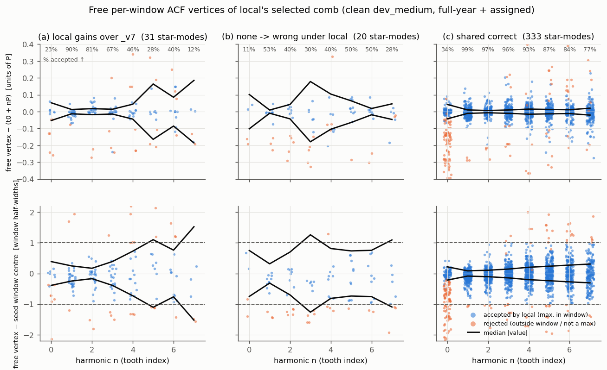
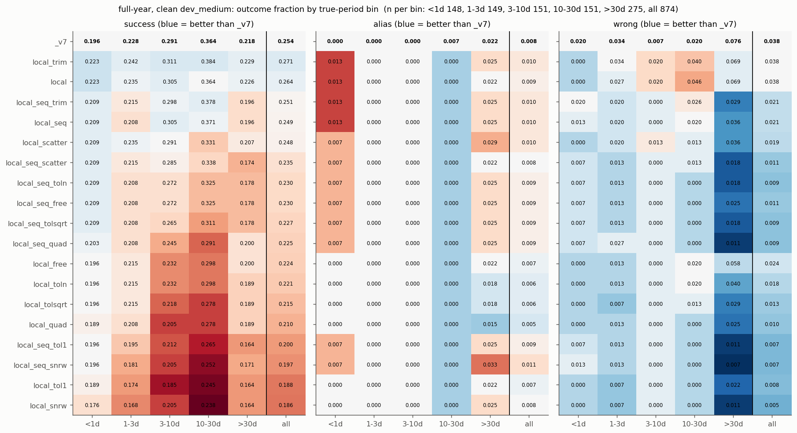
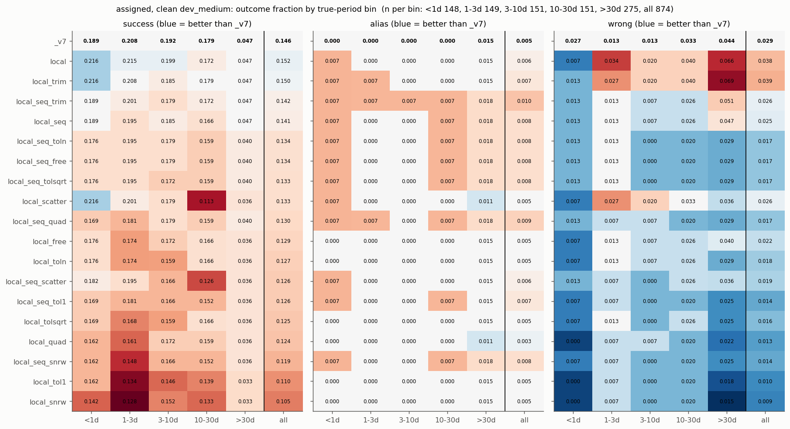
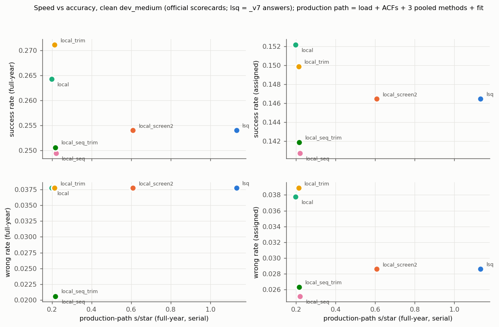
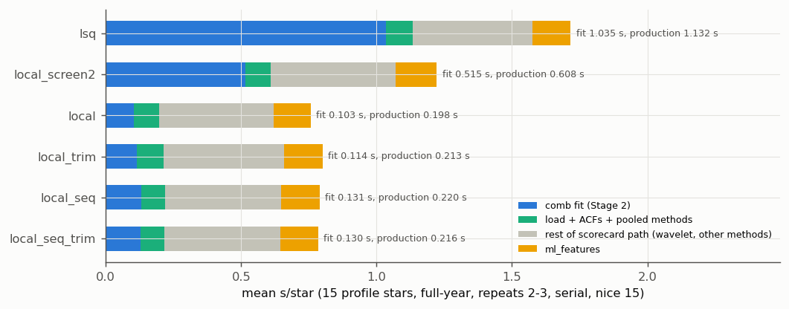
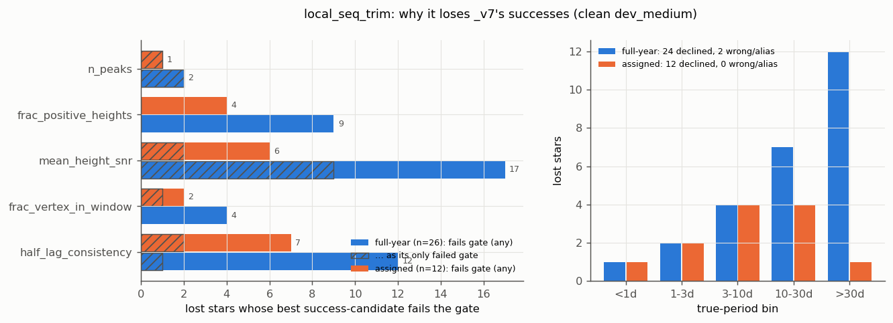
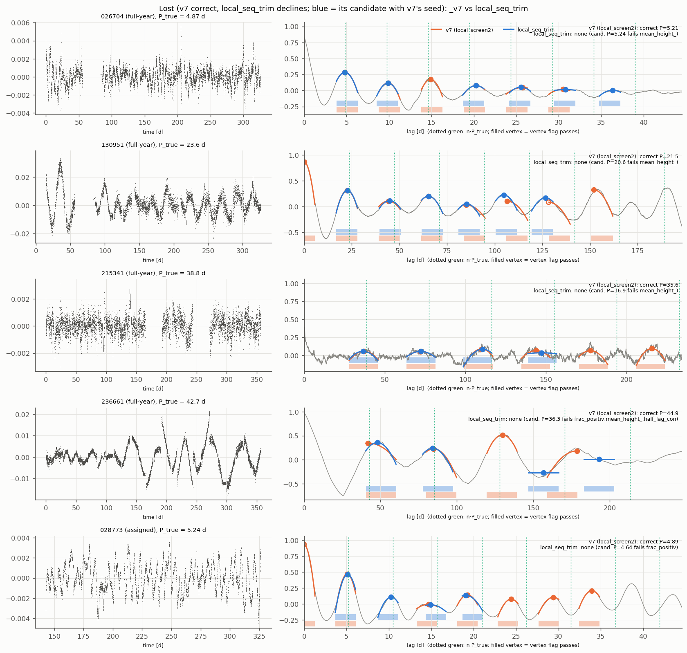
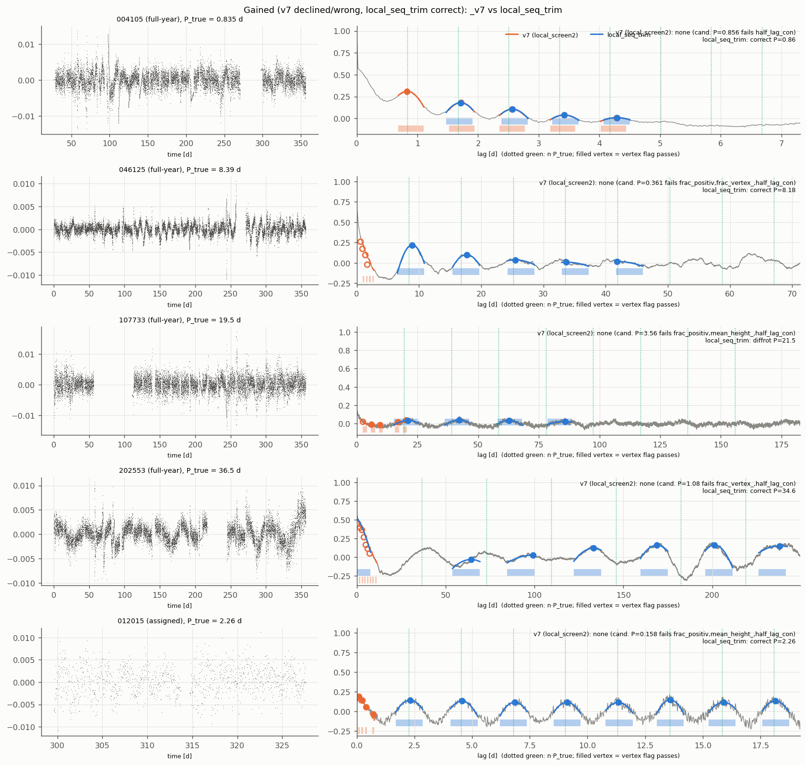
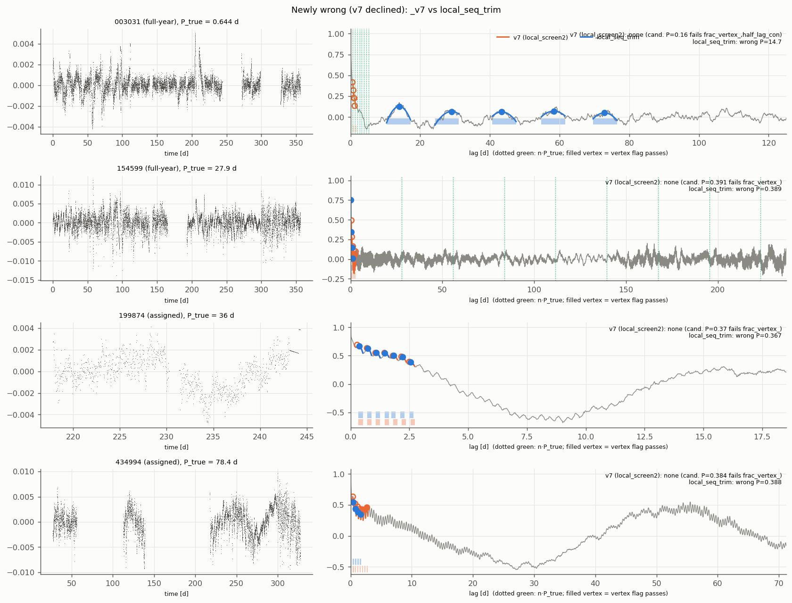
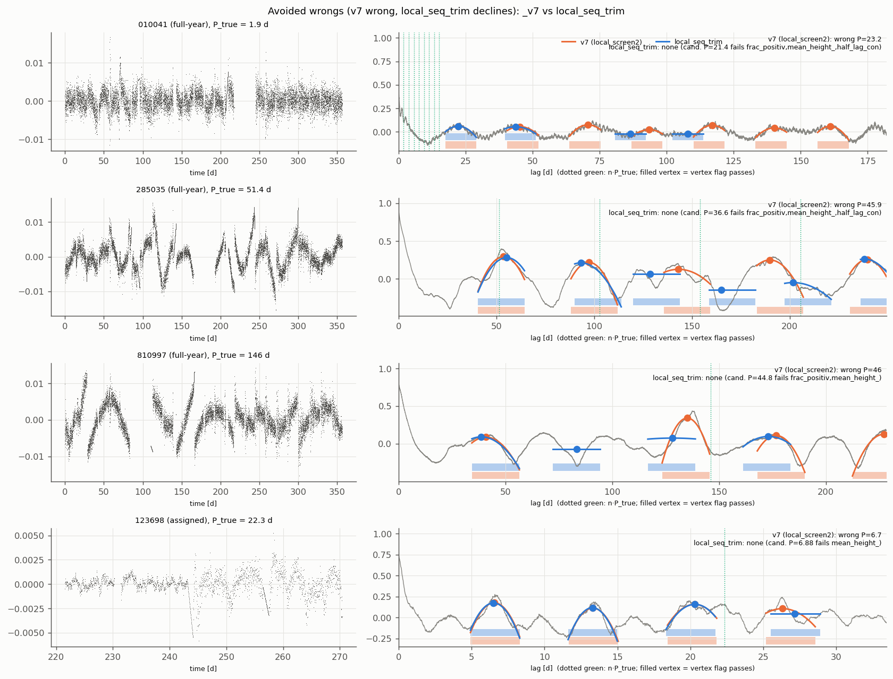

# T32 clean rerun: robust local comb solver

**Date:** 2026-11-19 · **Author:** T32 clean-rerun `method-improver` session (blind rerun) · **Branch:** `claude/t32-clean-rerun-2c0779` · **Status:** draft

## TL;DR
- **No variant matches `_v7` on both success and wrong.** The T32 ideas trade successes for fewer wrong answers.
- **Leader: `local_seq_trim`** (sequential peak tracking, plus trimming trailing peakless teeth). Production path 2.8× faster than `_v7` (5.2× faster than `lsq`). It roughly halves full-year wrong (0.038 → 0.021) and loses 0.003 / 0.005 success (full-year / assigned). dev_medium check_goals passes in both modes. Synthetic 200 flags 3–10 d (3 of 36 stars).
- **Fastest highest-success variant: `local_trim`.** Success +0.017 full-year, but wrong is unchanged (assigned 0.029 → 0.039).
- **The leader would need a follow-up fix to match `_v7` success.** Its lost stars are marginal long-period combs that fail `mean_height_snr`, because the track keeps decayed late teeth.
- **My recommendation:** keep `local_screen2` as the default for now.

## Question / goal
T32 in `docs/TASKS.md` (from T31 / P40): make the cheap `local` comb solver (`comb_fit._fit_comb_local`) robust to drifting ACF peaks, so it could be used without the `lsq` refit. This is a blind rerun on noise-clean stars only, with thresholds kept at their existing values (no scans or tuning on dev_medium). Goals touched: G9–G12 (real-data drafts) and the regression guard; G10 is the wrong rate. I didn't open any earlier T32 attempt or its report.

## What I did
1. **Stage-2 harness** (`tools/stage2_harness.py`). It caches each clean star's ACF views and pooled Stage-1 guesses once (`runs/t32_clean/cache_{fy,as}`), then reruns only `fit_rotation_period` per variant, scoring with the scorecard's own code.
   - It reproduces the official scorecards per star: 0 / 874 outcome or decline-gate differences, max |ΔP|/P = 0.
   - Checked for `local`, `local_screen2`, `local_seq`, `local_seq_trim` and `local_trim`, in both modes.
2. **Step 1** (no new scorecards). For the clean stars, I took `local`'s selected comb and fit a free quadratic vertex in every window (`diag_vertex.py`). Three groups:
   - (a) gains over `_v7`;
   - (b) none → wrong;
   - (c) shared-correct.
3. **Reference scorecards** of `local` and `local_screen2`. Dataset strings:
   - `datasets/dev_medium_clean.csv,data_root=data/smarts_dev,sectors=ignored` (full-year);
   - `…,sectors=manifest` (assigned);
   - `--synthetic 200 --seed 0`.
4. **Variants.** I implemented the five T32 ideas as orthogonal `COMB_VARIANTS` knobs, all on `solver="local"`:
   - `track`: idea 1;
   - `vgate` = free / tol: idea 2, with tolerance growth const / sqrt(n) / n;
   - `line_model="quad"`: idea 3, with `a/P` recorded as `raw.drift_a`;
   - `peak_weight="snr"`: idea 4;
   - `vgate="scatter"`: idea 5;
   - plus 7 tracking combinations, and the step-6 fix `trim_unaccepted`. That makes 17 variants.

   Tolerances reuse the joint fit's `jitter_frac` (0.05 P0), and every gate keeps its existing threshold. Tests are in `tests/test_t32_variants.py` (17 tests). The full suite passes (523).
5. **Screen and official scoring.** I screened every variant in both modes with the harness. Official scorecards plus `check_goals --baseline` (clean `_v7`) ran for the three serious candidates (`local_seq_trim`, `local_seq`, `local_trim`), in full-year, assigned and synthetic.
6. **Profiling.** `benchmarks/profile_pipeline.py`, 15 profile stars, full-year, `--features --repeats 3`, serial. Timings use repeats 2–3.
7. **Diagnosis** of the leader's lost stars and newly wrong stars.

Every heavy job ran at `nice -n 15` with 3 workers, one at a time, with gaps in between. Memory stayed at ≥ 52% free.

## Results

### Step 1: drift is mostly the seed period's error, accumulating with n


The top row shows each free vertex's offset from `local`'s fitted comb line; the bottom row shows its offset from the frozen seed-window centre (dashed lines = window edges). The percentages give the share of windows whose free vertex `local` accepts.
- **(a) Gains:** teeth n = 1–3 sit on the line (81–90% accepted, median |residual| ≈ 0.01–0.02 P). Later teeth walk out of their windows (median |offset| > 1 half-width by n = 5, acceptance 12–46%).
  - The seed P0 of these stars is off by a median 2.9%, against 1.5% for shared-correct stars, and the error grows as n·ΔP.
- **(b) none → wrong:** acceptance is low and scatter is large already at n = 1–3 (30–53% accepted).
- **(c) Shared-correct:** tight, with 84–99% accepted for n ≥ 1.

So frozen windows are the problem for (a), while (b) needs a real vertex check. That diagnosis motivates the tracking combinations.

On clean stars the `local` vs `_v7` transitions match T31's `changed_stars_v_local__dec.csv` filtered to `~noise_exclude` exactly:
- full-year: 21 gains, 9 none → wrong;
- assigned: 10 gains, 11 none → wrong.

### Screen of all variants (harness, dev_medium_clean)
| variant | full-year success / wrong / alias | assigned success / wrong / alias | gained / lost vs `_v7` (fy; as) |
|---|---|---|---|
| `_v7` (= `local_screen2`) | 0.254 / 0.038 / 0.008 | 0.146 / 0.029 / 0.005 | – |
| `local` | 0.264 / 0.038 / 0.009 | 0.152 / 0.038 / 0.006 | 21/12; 10/5 |
| `local_trim` | 0.271 / 0.038 / 0.010 | 0.150 / 0.039 / 0.007 | 25/10; 9/6 |
| **`local_seq_trim`** | **0.251 / 0.021 / 0.010** | **0.142 / 0.026 / 0.010** | 23/26; 8/12 |
| `local_seq` | 0.249 / 0.021 / 0.010 | 0.141 / 0.025 / 0.008 | 22/26; 8/13 |
| `local_scatter` | 0.248 / 0.019 / 0.010 | 0.133 / 0.026 / 0.005 | 16/21; 9/21 |
| `local_seq_scatter` | 0.235 / 0.011 / 0.008 | 0.126 / 0.019 / 0.006 | 23/40; 10/28 |
| `local_seq_free` | 0.230 / 0.011 / 0.009 | 0.134 / 0.017 / 0.008 | 16/37; 7/18 |
| `local_free` | 0.224 / 0.024 / 0.007 | 0.129 / 0.022 / 0.005 | 8/34; 1/16 |
| `local_tol1` | 0.188 / 0.008 / 0.007 | 0.110 / 0.010 / 0.005 | 5/63; 1/33 |

All 19 rows are in `data/screen_summary.csv`. Per star, the values are in `data/per_star_outcomes_screen.csv.gz`.

The gates that test the free vertex directly (`free`, `tol*`, `quad`, `snrw`) cut wrong to 0.005–0.024 but lose 0.03–0.07 success. Ideas 3 (quadratic) and 4 (SNR weights) are scored with the constant-tolerance gate and compared with `local_tol1`, since they act only through the residual. At fixed gate, the quadratic term helps a little (full-year 0.210 vs 0.188) and SNR weights don't (0.186).

Tracking alone (`local_seq`) is the only knob that cuts wrong a lot for a small success cost.

Why does tracking cut wrong at all? With tracked windows, the T31 "frame" vertex check means "the global comb line agrees with the sequential track". A noise comb's track wanders, so it fails; under frozen windows that check was nearly vacuous.



This shows outcome fractions by true-period bin, coloured by difference from `_v7` (blue = better), with variants sorted by success. The leader's wrong-rate drop is concentrated in > 30 d (0.076 → 0.029 full-year), and so are its success losses (0.218 → 0.196).



The same for assigned coverage. Here the leader's wrong drop is small (0.029 → 0.026), while its alias rate rises from 0.005 to 0.010.

### Official scorecards and check_goals (clean `_v7` baselines)
| variant | fy success / wrong / alias | as success / wrong / alias | precision fy / as | check_goals fy / as / synth |
|---|---|---|---|---|
| `_v7` | 0.254 / 0.038 / 0.008 | 0.146 / 0.029 / 0.005 | 0.847 / 0.815 | – |
| `local_screen2` | identical to `_v7` | identical | 0.847 / 0.815 | PASS / PASS / PASS |
| `local` | 0.264 / 0.038 / 0.009 | 0.152 / 0.038 / 0.006 | 0.849 / 0.778 | PASS / PASS / FAIL (> 30 d, 1 of 8 stars) |
| `local_trim` | 0.271 / 0.038 / 0.010 | 0.150 / 0.039 / 0.007 | 0.849 / 0.766 | PASS / PASS / FAIL (> 30 d, 1 of 8) |
| **`local_seq_trim`** | 0.251 / 0.021 / 0.010 | 0.142 / 0.026 / 0.010 | **0.890** / 0.795 | PASS / PASS / FAIL (3–10 d, 3 of 36) |
| `local_seq` | 0.249 / 0.021 / 0.010 | 0.141 / 0.025 / 0.008 | 0.890 / 0.809 | PASS / PASS / FAIL (3–10 d, 3 of 36) |

Precision = success / (success + wrong + alias). The official per-star results equal the harness results (0 differences).

`local_seq_trim`, full-year:
```
  0.254   0.251  -0.003  0.020  final.overall.success
  0.228   0.215  -0.013  0.060  final.by_bin.1-3d.success
  0.364   0.377  +0.013  0.060  final.by_bin.10-30d.success
  0.291   0.298  +0.007  0.060  final.by_bin.3-10d.success
  0.196   0.209  +0.014  0.060  final.by_bin.<1d.success
  0.218   0.196  -0.022  0.060  final.by_bin.>30d.success
OVERALL: PASS          (G10 wrong 0.021 <= 0.04 PASS; G9/G11 fail as on the baseline)
```
Assigned:
```
  0.146   0.142  -0.005  0.020  final.overall.success
  0.208   0.201  -0.007  0.060  final.by_bin.1-3d.success
  0.179   0.172  -0.007  0.060  final.by_bin.10-30d.success
  0.192   0.179  -0.013  0.060  final.by_bin.3-10d.success
  0.189   0.189  +0.000  0.060  final.by_bin.<1d.success
  0.047   0.047  +0.000  0.060  final.by_bin.>30d.success
OVERALL: PASS
```
Synthetic 200, seed 0: success 0.755 → 0.745. Two flags appear:
- the 3–10 d bin drops 0.861 → 0.778, which is 3 of 36 stars and trips the 0.06 limit;
- G1 (0.75) now fails.

Two of those three stars (`synth-s0-00025`, `-00041`) are also lost by plain `local`. All files are in `data/check_goals/`.

### Speed


Each point is one variant: x = production-path time per star (full-year), y = official success (top) or wrong (bottom). The `local*` variants sit at ~0.2 s and `_v7` at 0.61 s. Only the tracking variants sit below `_v7` on wrong.



This splits the time per star into stages. The comb fit:
- `lsq`: 1.035 s;
- `_v7`: 0.515 s;
- `local_seq_trim`: 0.130 s;
- `local`: 0.103 s.

Tracking adds about 0.03 s, for the extra free-vertex fits.

| variant | fit s | production path s | scorecard path s | production speed-up vs `lsq` / vs `_v7` |
|---|---|---|---|---|
| `lsq` | 1.035 | 1.132 | 1.575 | 1.00 / 0.54 |
| `local_screen2` (`_v7`) | 0.515 | 0.608 | 1.071 | 1.86 / 1.00 |
| `local` | 0.103 | 0.198 | 0.620 | 5.72 / 3.07 |
| `local_trim` | 0.114 | 0.213 | 0.657 | 5.33 / 2.86 |
| `local_seq` | 0.131 | 0.220 | 0.649 | 5.15 / 2.77 |
| `local_seq_trim` | 0.130 | 0.216 | 0.644 | 5.23 / 2.81 |

Timings are means over 15 stars × repeats 2–3, serial, at `nice 15` (`data/timing_summary.csv`). `ml_features` adds ~0.14 s to every variant.

### Why the leader loses `_v7`'s successes (step 6)


Left: for each lost star (`_v7` success, leader not), the gates failed by the leader's best success-candidate. Right: the true-period bins of those stars.

The leader loses 26 stars full-year (24 declined) and 12 assigned (all declined):
- The vertex gate is rarely the cause: 4 / 2 stars.
- `mean_height_snr` fails in 17 / 6, and is the only failing gate in 9 / 2.
- `frac_positive_heights` and `half_lag_consistency` usually fail together with it.

These are marginal stars. Under `_v7` their candidate's median mean height SNR is 1.19 / 1.10 (full-year / assigned; the gate is 1.0). It falls to 1.11 / 1.00 under plain `local` and to 0.94 / 1.00 under `local_seq_trim`.



Lost stars: the orange comb is `_v7`'s answer and blue is the leader's candidate from the same seed. Filled dots mean the vertex flag passes, and the coloured bars under the ACF are the windows. Two mechanisms show up:
1. **The track keeps decayed late teeth with heights ≈ 0, which dilute the mean SNR** (026704, 215341). `_v7`'s joint fit instead drops or downweights them, through MAD rejection and its soft-L1 loss.
2. **A two-vertex running slope can derail the track on broad peaks** (236661). Windows 3–4 land in troughs.

My fix, `trim_unaccepted`, uses no new threshold: the trailing-tooth trim also drops teeth whose free vertex isn't a maximum inside its window. It recovers only +0.001 success, so it doesn't close the gap. **A follow-up would be needed to match `_v7` success.** Candidates:
- fit window heights with the joint fit's soft-L1 loss;
- refit `lsq` only on the leader's near-miss candidates (a `local_seq_trim` screen).



Gained stars: `_v7` declines because its frozen windows miss the drifting teeth, or because its best candidate is a short-lag comb. The leader's tracked windows (blue) sit on every tooth.



Newly wrong stars (7 full-year, 9 assigned): three of these four are ~0.37–0.39 d combs fit on the near-lag-0 decay of long-period stars, which `_v7` rejected on `frac_vertex_in_window`. Tracked windows can follow small wiggles on the decay envelope. That's the residual failure mode on the wrong side.



Wrongs the leader avoids (20 full-year, 11 assigned): mostly `_v7` picking a sub-harmonic or neighbouring comb on long-period stars. The tracked line and the window track disagree there, so the leader declines.

## What didn't work
- **Free-vertex gates on frozen windows** (`local_free`, `local_tol*`, `local_quad`, `local_snrw`). They cut wrong to 0.005–0.024 but cost 0.03–0.07 success, because gained stars' late teeth sit outside their frozen windows and fail any vertex test.
- **Tolerance growing with n** (`toln` vs `tolsqrt` vs `tol1`) helps monotonically: 0.221 / 0.215 / 0.188 full-year. None comes close on success.
- **The scatter gate (idea 5)** costs assigned success (0.133).
- **Tracking combined with a free-vertex gate** (`local_seq_free`, `_toln`, `_scatter`) gives the lowest wrong rates (0.009–0.011 full-year) but loses 0.02–0.03 success, which fails the overall guard.
- **The quadratic drift term (idea 3)** is not needed to follow the drift: in this data it is a seed-P0 error (linear in n), not curvature. `drift_a` is recorded per candidate if the ranker wants it.
- **SNR weighting (idea 4)** doesn't help: 0.186 vs 0.188 full-year at the same gate.
- **`trim_unaccepted`** (the step-6 fix): +0.001 success for the leader. For frozen windows (`local_trim`) it is the best success of any variant (+0.017 full-year vs `_v7`), but wrong is unchanged.

## Open questions for Rae
1. **Default comb variant. My recommendation: keep `local_screen2`.** No `local`-only variant matches `_v7` on both success and wrong, and every one trips the synthetic 3–10 d or > 30 d guard on 1–3 stars.
   - If you value fewer confident wrongs over a few successes, **`local_seq_trim`** is the candidate. On full-year it cuts wrong from 0.038 to 0.021 for −0.003 success (precision 0.847 → 0.890), and the production path is 2.8× faster. Assigned is roughly a wash: success −0.005, wrong −0.003, alias +0.006.
   - If you'd rather keep `local`'s extra successes, `local_trim` gives +0.017 / +0.003 success, but assigned wrong rises from 0.029 to 0.039.
2. **Follow-up fix needed?** Yes, if `local_seq_trim` is to replace `_v7` without losing successes. Two concrete leads:
   - **(a)** a robust soft-L1 height fit per window, the source of the `mean_height_snr` losses;
   - **(b)** a near-lag-0 decay check for the newly wrong 0.37 d combs.

   A cheaper alternative is a hybrid: `local_seq_trim` as the screen, with an `lsq` refit of near-miss candidates. That keeps most of the speed. I didn't run it.
3. **Synthetic guard.** The bins are tiny (8–36 stars), so 1–3 stars trip the 0.06 limit. Should `check_goals` have a minimum count, or should I keep reporting it as is?
4. **Wrong-rate trade-off.** Is a −0.003 to −0.005 success cost acceptable for −0.017 full-year wrong? This is the precision question you deferred; the operating points are in the table above.

## Reproduce
```bash
PY=/opt/anaconda3/envs/ss_openblas/bin/python
ln -s /Users/raeholcomb/Documents/GitHub/ss_redevelopment/data/smarts_dev data/smarts_dev   # in a worktree
# Stage-1 caches (~1 min each) and the Stage-2 screen (~40-70 s per variant and mode)
nice -n 15 $PY tools/stage2_harness.py cache --manifest datasets/dev_medium_clean.csv --data-root data/smarts_dev --ignore-manifest-sectors --cache runs/t32_clean/cache_fy
nice -n 15 $PY tools/stage2_harness.py cache --manifest datasets/dev_medium_clean.csv --data-root data/smarts_dev --cache runs/t32_clean/cache_as
nice -n 15 $PY tools/stage2_harness.py fit --cache runs/t32_clean/cache_fy --variant local_seq_trim --out runs/t32_clean/s2/local_seq_trim_fy
# official scorecards (one at a time) + check_goals
SS_COMB_VARIANT=local_seq_trim nice -n 15 $PY benchmarks/scorecard.py --manifest datasets/dev_medium_clean.csv --data-root data/smarts_dev \
    --ignore-manifest-sectors --n-workers 3 --outdir runs/t32_clean/sc/local_seq_trim_fy --resume
$PY benchmarks/check_goals.py runs/t32_clean/sc/local_seq_trim_fy/metrics.json --baseline benchmarks/baselines/dev_medium_clean_fullyear_v7.json
#   (assigned: drop --ignore-manifest-sectors, baseline ..._assigned_v7.json; synthetic: --synthetic 200 --seed 0, baseline synth200_s0_v7.json)
#   reports/2026-11-19_t32-clean-rerun/{queue,screen,prof}.sh run the scorecard / screen / profiling queues used here
# profiling
SS_COMB_VARIANT=local_seq_trim nice -n 15 $PY benchmarks/profile_pipeline.py --manifest datasets/dev_medium_clean.csv --data-root data/smarts_dev \
    --ignore-manifest-sectors --star-ids-file benchmarks/profile_stars.txt --features --repeats 3 --out runs/t32_clean/prof/local_seq_trim.csv
# diagnosis data, figures, notebook (scripts run from the report folder)
cd reports/2026-11-19_t32-clean-rerun && $PY diag_vertex.py && $PY summarize.py && $PY build_notebook.py && cd ../..
$PY tools/run_notebook.py reports/2026-11-19_t32-clean-rerun/notebook.ipynb
$PY -m pytest -q tests/test_t32_variants.py
```
`PROGRESS.md` is the running log of this session.
