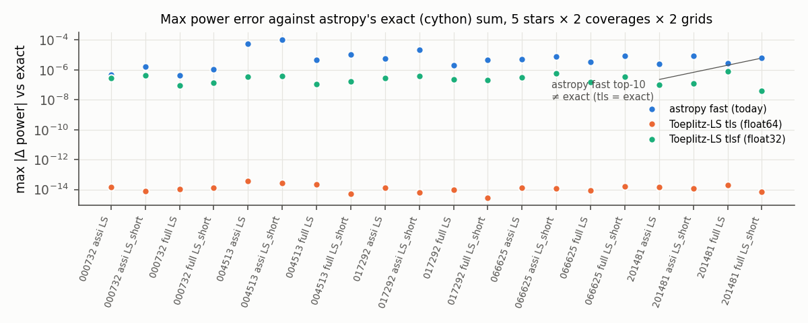
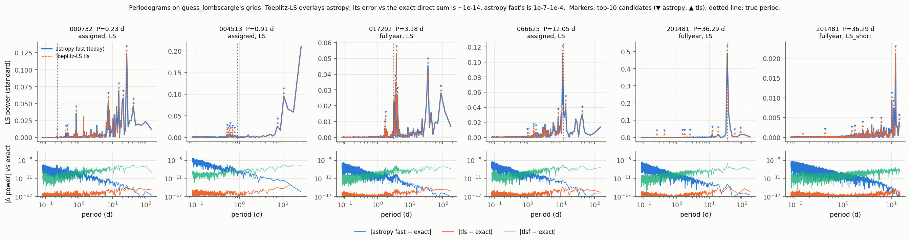
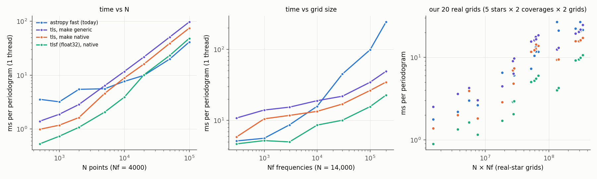
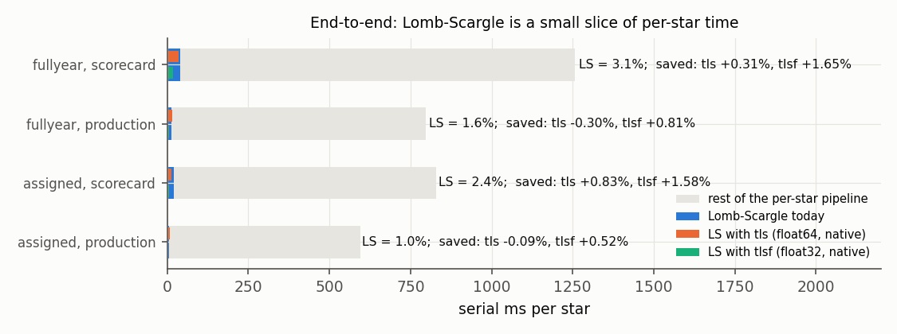

# Toeplitz-LS as a Lomb-Scargle backend

**Date:** 2026-11-19 · **Author:** performance-optimizer session · **Branch:** claude/toeplitz-ls-eval-975317 · **Status:** draft

## TL;DR
- **Verdict: don't adopt for speed.** On our own grids the float64 `tls` is 0.84–0.92× as fast as today's astropy call on the main LS grid. It is 1.3–2.2× faster on the denser `lombscargle_short` grid. End to end, the production path gets 0.1–0.3% *slower*. LS is only 1.0–1.6% of per-star time (2.4–3.1% on the scorecard path).
- **Accuracy is better, not just equal.** `tls` matches astropy's exact sum to ≤4e-14. Today's astropy `fast` method is off by up to 1e-4 and changed 1 of 20 top-10 candidate lists (its 10th slot).
- **Where it would pay:** grids much denser than the data (Nf ≫ N: 3.7× at Nf = 100k, 7× at 200k), float32 `tlsf` (~2×, error ≤8e-7), or multiharmonic periodograms.
- Deviation from the brief: I skipped the optional drop-in prototype, since there is no speed to gain.

## Question / goal
Exploratory task from Rae (2026-11-19), logged as **P50** in `docs/TASKS_PROPOSED.md`: could Toeplitz-LS (Rutkowski & Poleski, arXiv 2611.20300v2; https://github.com/kkrutkowski/Toeplitz-LS) replace or speed up `guesses.guess_lombscargle` / `guess_lombscargle_short`? No `goals.json` goal is involved, and no pipeline code was changed.

## What I did
1. **Fit check (no compute).** I read the repo (README, Python wrappers `_fastchi2.py`/`_dispatch.py`, Makefile, C sources) and the paper (read via arXiv's HTML version; no local PDF reader was available).
2. **Build.** Commit `c0aa3ec0d9347956ebce3db59ed8ea3d4dfc4edc` (2026-11-15), built with `make generic` and `make native` (Apple clang 13.1.6) in the session scratchpad. It is loaded through `PYTHONPATH`; **nothing was installed** into `ss_openblas`. Before running, I checked the C sources for system/network/file calls: the only `fopen` is the native-build constant generator.
3. **Accuracy** (`accuracy.py`). Five `datasets/dev_small_clean.csv` rotators spanning 0.23–36 d: 000732, 004513, 017292, 066625, 201481. Each was loaded with `load_smarts_fits` as the pipeline does, from `data/smarts_dev`, in both assigned-sector and full-year coverage. I used **the exact grids `guess_lombscargle` builds**: `lombscargle` = [4·dt, B/2] at `samples_per_peak=1`, and `lombscargle_short` = [4·dt, 15 d] at spp=5. That gives 20 periodograms, each computed four ways:
   - astropy `autopower` (method auto → `fast`, i.e. today's code);
   - astropy exact `method="cython"`, used as the reference;
   - `tls.power` (float64, `nterms=1`, `"standard"`);
   - `tlsf.power` (float32).

   I reproduced the frequency grids to 1.8e-15. Candidate lists come from `guess_lombscargle`'s own peak picking (`find_peaks` + `guesses._select_peaks`, hybrid ranking) with `n_guesses=10`, the scorecard's setting.
4. **Speed** (`timing.py`). Single-threaded, BLAS pinned to 1 thread, median of 5 timeit loops per point. I time the whole call each backend would make. The scans are:
   - synthetic gappy 30-min light curves at N = 500–100k (Nf = 4000);
   - Nf = 300–200k at N = 14k;
   - one Roman-like 71-d season at 12.1-min cadence;
   - the 20 real grids.

   The first run was flagged because another session's job appeared once during it (`data/run_log.txt`). I reran it on an idle machine. All numbers here come from the clean rerun; run 1 is kept as `data/timing_run1.csv` (per-point run2/run1 median 0.998).
5. **End-to-end share.** `benchmarks/profile_pipeline.py` on the same 5 stars, 3 repeats, assigned and full-year (serial). Then `end_to_end.py` applies the measured per-grid time ratios to the LS stages. Every heavy step ran under `nice -n 15` behind a gate that waits for other sessions' heavy jobs to finish plus 2 minutes and checks `memory_pressure`/`pmset` (`gate.sh`, `jobs.sh`).

## Results

### Step 1: fit check (nothing rules it out)
| Our use | Toeplitz-LS | Fit |
|---|---|---|
| astropy `LombScargle(normalization="standard")`: floating mean, centred data, no errors | `nterms=1`, `normalization="standard"`: R² of the floating-mean fit. The paper says it is equivalent to the generalized LS (Zechmeister & Kürster 2009). Verified numerically to 1e-14. | ✓ |
| `autopower` grid f0 = 1/P_max, df = 1/(spp·B), Nf points | `tls.power(Nf, df, f0, t, y)` takes any regular grid, so I reproduced astropy's grid exactly. Note: its own `autopower` grid is *different* (df = 1/(5·B·nterms) with mantissa trimming, fmin default 1/B, fmax default 12). | ✓ (use `power`, not `autopower`) |
| Sampling: SMARTS is regridded to **30-min** cadence by `load_smarts_fits` (not 2-min). N ≈ 1.2k finite points per sector, 2.4k–16k in these tests, with gaps. Roman WG6: 12.1 min, 71-d seasons (N ≈ 8.5k). | Irregular sampling is the design case. Gaps degrade conditioning, and bad frequencies come back as NaN (`autonan`). None appeared in our 20 periodograms. | ✓ |
| No weights | `dy=None` gives unit weights | ✓ |
| float64 | `tls` is float64; `tlsf` float32; `tlsdd` double-double | ✓ |
| 1 BLAS thread per worker, process pool | Pure C via `ctypes`. No BLAS, no internal threads. Each call is single-threaded, and calls release the GIL. | ✓ fits `determinism.py` unchanged |
| Bit-reproducibility | 30 calls with varied input alignment and heap state gave 1 distinct output (both builds, `tls` and `tlsf`). **But `generic` vs `native` builds differ in 4193/4200 values (≤8e-14).** The build (`-ffast-math`, `-march=native`, or the PyPI wheel's runtime CPU dispatch) becomes part of the reproducibility contract, as OpenBLAS is today. | ✓ with a pinned build |
| `guess_lombscargle` keeps `ls_object` for `ml_features`' Baluev FAP | Not provided. A backend switch would still build the (cheap) astropy object for the FAP. | minor |
| License, dependencies | MIT; numpy ≥ 1.17.3 only. A PyPI wheel exists per the README. I built from source instead and didn't test the wheel. | ✓ (new dependency needs Rae's OK) |

### Accuracy: Toeplitz-LS reproduces the exact periodogram; today's astropy path is the approximate one


Each column is one star × coverage × grid. Orange (`tls`) is ~1e-14 everywhere. Blue (today's astropy `fast`) is 4e-7 to 1e-4. Green (`tlsf`, float32) is ≤8e-7.

| comparison (20 periodograms, Nf 630–21,263) | max abs | median of per-case median abs | median of per-case median rel |
|---|---|---|---|
| astropy fast (today) vs exact | 1.0e-4 | 2.6e-8 | 1.7e-3 |
| **tls vs exact** | **3.8e-14** | 2.3e-17 | 7.7e-13 |
| tlsf vs exact | 8.3e-7 | 7.3e-11 | 2.5e-6 |
| tls vs astropy fast (what the brief asked for) | 1.0e-4 | 2.6e-8 | 1.7e-3 |

The "tls vs astropy" difference is entirely astropy `fast`'s own approximation error (the last row equals the first). Max *relative* differences reach ~40, but only at near-zero power, where relative error means nothing. No `tls`/`tlsf` value was NaN.

**Top-10 candidate lists (what `guess_lombscargle` returns):**
- `tls` = exact in 20/20 and `tlsf` = exact in 20/20;
- astropy fast = exact in 19/20;
- `tls` = astropy fast in 19/20 (top-5: 20/20).

The one difference is 201481 full-year `lombscargle_short`, 10th slot: astropy `fast` returns 3.94 d where the exact periodogram (and `tls`) gives 0.145 d. It is a near-tie in the local-SNR half of the hybrid ranking. So switching would change candidates only where today's path is slightly wrong.



Top row: the two periodograms overlay exactly; markers are each backend's top-10 candidates. Bottom row: astropy fast's error (blue) grows toward short periods, which is the extirpolation error of Press & Rybicki's method. `tls` (orange) stays at 1e-17–1e-14. The rightmost panel is the case with the flipped 10th candidate.

### Speed: no gain at our sizes; large gains only when the grid is much denser than the data


Left: at fixed Nf = 4000, `tls` beats astropy below N ≈ 5k and loses above it (0.5–0.6× at N ≥ 20k). Middle: at N = 14k (a full-year star), `tls` loses until Nf ≈ 10k, then wins strongly. Right: our 20 real grids; on the main grid, orange (`tls`) sits at or above blue (astropy).

Median astropy-time / backend-time on the real grids (>1 means faster than today):

| mode, grid | tls native | tls generic | tlsf native |
|---|---|---|---|
| assigned, lombscargle | 0.92 | 0.70 | 1.98 |
| assigned, lombscargle_short | 2.22 | 1.45 | 3.81 |
| full-year, lombscargle | 0.84 | 0.65 | 2.00 |
| full-year, lombscargle_short | 1.33 | 1.02 | 2.22 |

Synthetic scans (astropy / tls-native):

| | values |
|---|---|
| vs Nf at N = 14k | 0.88 (300), 0.53 (1k), 0.74 (3k), 1.18 (10k), 2.64 (30k), 3.73 (100k), 7.0 (200k) |
| vs N at Nf = 4000 | 3.6 (500), 2.7 (1k), 3.4 (2k), 1.2 (5k), 0.86 (10k), 0.62 (20k), 0.51 (50k), 0.55 (100k) |
| Roman-like season (N = 8450, Nf = 2111) | tls 0.62×, tlsf 1.62× |

- **Why:** our periodograms are small (≤ 21k frequencies, 10–25 ms). The `tls` cost is dominated by per-point NuFFT spreading, roughly linear in N. astropy's `fast` method at this size is mostly one small FFT. `tls`'s advantage is in the Nf ≫ N regime the paper benchmarks.
- The `make native` build is 1.3–1.6× faster than `generic`; the README says the PyPI wheels dispatch to a native-like variant.
- **Multithreading:** not measured. The library has no internal threads; its parallelism is a `ThreadPoolExecutor` over independent calls. That is what our `ProcessPoolExecutor` over stars already gives, so the single-thread numbers are the relevant ones.

### End to end: Lomb-Scargle is 1–3% of per-star time


The coloured slivers at the left are all the LS time there is. `tls` saves nothing on the production path, and the best case (`tlsf`) saves 0.5–1.7%.

| path (5 stars, serial, mean of per-star medians) | total ms/star | LS ms | LS share | saved with tls | saved with tlsf |
|---|---|---|---|---|---|
| assigned, production | 595 | 6.2 | 1.0% | −0.09% | +0.52% |
| assigned, scorecard (all methods) | 829 | 19.8 | 2.4% | +0.83% | +1.58% |
| full-year, production | 798 | 12.9 | 1.6% | −0.30% | +0.81% |
| full-year, scorecard (all methods) | 1257 | 38.8 | 3.1% | +0.31% | +1.65% |

The savings apply the periodogram-only time ratio to the whole LS stage, which also includes peak picking. They are therefore slight overestimates. Production = load + both ACFs + the 3 default methods + fit; the comb fit (~400–900 ms) dominates.

## What didn't work
- **The speed hypothesis.** Toeplitz-LS is built for many frequencies per point (the paper's benchmarks are OGLE light curves with ~500 points and fine grids, plus multiharmonic fits). Our 30-min-binned light curves have more points than frequencies on the main grid, which is where astropy's `fast` method is already cheap.
- **Gate self-match (process note).** My first idle-machine gate used `pgrep -f` with a pattern that also matched my own queued shell's command line, so it waited on itself. I fixed it by moving the commands into `jobs.sh`/`gate.sh`. Also, `accuracy.py` started (niced, ~1 min) while the other session's `stage2_harness` was running, before the gate existed. This affects no result, because accuracy doesn't depend on timing. All timing runs were gated; one flagged run was redone.
- **Paper reading.** No PDF tool exists in the env, and installing `pypdf` to scratch was blocked. I read the paper from arXiv's HTML version instead (v2, same version as the local PDF).

## Open questions for Rae
1. **Exactness at equal cost?** `tls` would replace an approximate periodogram (error up to 1e-4, 1 of 20 candidate lists differing in the 10th slot) with an exact one, at ~0.1–0.3% extra production time. Is that worth a compiled dependency? My recommendation is no for now: the comb fit refines candidates anyway, and the flipped slot was a near-tie. A dev_medium scorecard would settle it if you want a measurement.
2. **Revisit if the grid gets denser.** If a future change raises `samples_per_peak` on the full range, or adds a fine full-year search (Nf ≳ 30k at N ≈ 14k), `tls` becomes 2.6–7× faster. I logged this under P50, not as a separate task.
3. **Multiharmonic idea (not pursued).** `tls` makes `nterms=2–3` periodograms cheap (its main use case). A 2–3-harmonic power ratio at P vs P/2 might be a useful ranker feature for the P/2-alias problem. Idea only; noted in the P50 entry.

**Questions for the authors (Rutkowski & Poleski):**
- Is there a tuning for the regime N ≫ Nf (N ~ 1e4, Nf ~ 1e3–5e3) with `nterms=1`? The default block B = 2¹¹ is comparable to our whole grid. Could a smaller block or a direct-sum fallback beat astropy `fast` there?
- Are results meant to be identical across the wheel's runtime-dispatch variants (and generic vs native)? We see ≤8e-14 differences between builds. Is there a recommended way to pin a variant for bit-reproducible batch runs (`TOEPLITZ_LS_DISPATCH`)?
- Is there a macOS x86-64 wheel for 1.0.0, and is `power()` safe to call from forked worker processes (`ProcessPoolExecutor`)?
- How does the conditioning (NaN) rate behave at the lowest frequencies (f ≈ 2/B) for strongly gapped data, e.g. two sectors a year apart? We saw no NaNs in 20 cases.

## Reproduce
Toeplitz-LS is not installed. Clone and build it anywhere (here `$TLS`) and pass the package directories:
```bash
git clone https://github.com/kkrutkowski/Toeplitz-LS $TLS/Toeplitz-LS && git -C $TLS/Toeplitz-LS checkout c0aa3ec0d9347956ebce3db59ed8ea3d4dfc4edc
cp -R $TLS/Toeplitz-LS $TLS/Toeplitz-LS-native
make -C $TLS/Toeplitz-LS CC=clang generic && make -C $TLS/Toeplitz-LS-native CC=clang native
ln -s /Users/raeholcomb/Documents/GitHub/ss_redevelopment/data/smarts_dev data/smarts_dev   # in a worktree
nice -n 15 /opt/anaconda3/envs/ss_openblas/bin/python reports/2026-11-19_toeplitz-ls-eval/accuracy.py --tls-path $TLS/Toeplitz-LS/toeplitz-ls
nice -n 15 /opt/anaconda3/envs/ss_openblas/bin/python reports/2026-11-19_toeplitz-ls-eval/timing.py --generic $TLS/Toeplitz-LS/toeplitz-ls --native $TLS/Toeplitz-LS-native/toeplitz-ls
IDS=smarts-tess-v1.0-000732,smarts-tess-v1.0-004513,smarts-tess-v1.0-017292,smarts-tess-v1.0-066625,smarts-tess-v1.0-201481
nice -n 15 /opt/anaconda3/envs/ss_openblas/bin/python benchmarks/profile_pipeline.py --manifest datasets/dev_small_clean.csv --data-root data/smarts_dev --star-ids $IDS --repeats 3 --out reports/2026-11-19_toeplitz-ls-eval/data/profile_assigned.csv
nice -n 15 /opt/anaconda3/envs/ss_openblas/bin/python benchmarks/profile_pipeline.py --manifest datasets/dev_small_clean.csv --data-root data/smarts_dev --star-ids $IDS --ignore-manifest-sectors --repeats 3 --out reports/2026-11-19_toeplitz-ls-eval/data/profile_fullyear.csv
/opt/anaconda3/envs/ss_openblas/bin/python reports/2026-11-19_toeplitz-ls-eval/end_to_end.py
/opt/anaconda3/envs/ss_openblas/bin/python tools/run_notebook.py reports/2026-11-19_toeplitz-ls-eval/notebook.ipynb
```
`jobs.sh`/`gate.sh` are the gated runner I used (paths hard-coded to this session's scratchpad).
