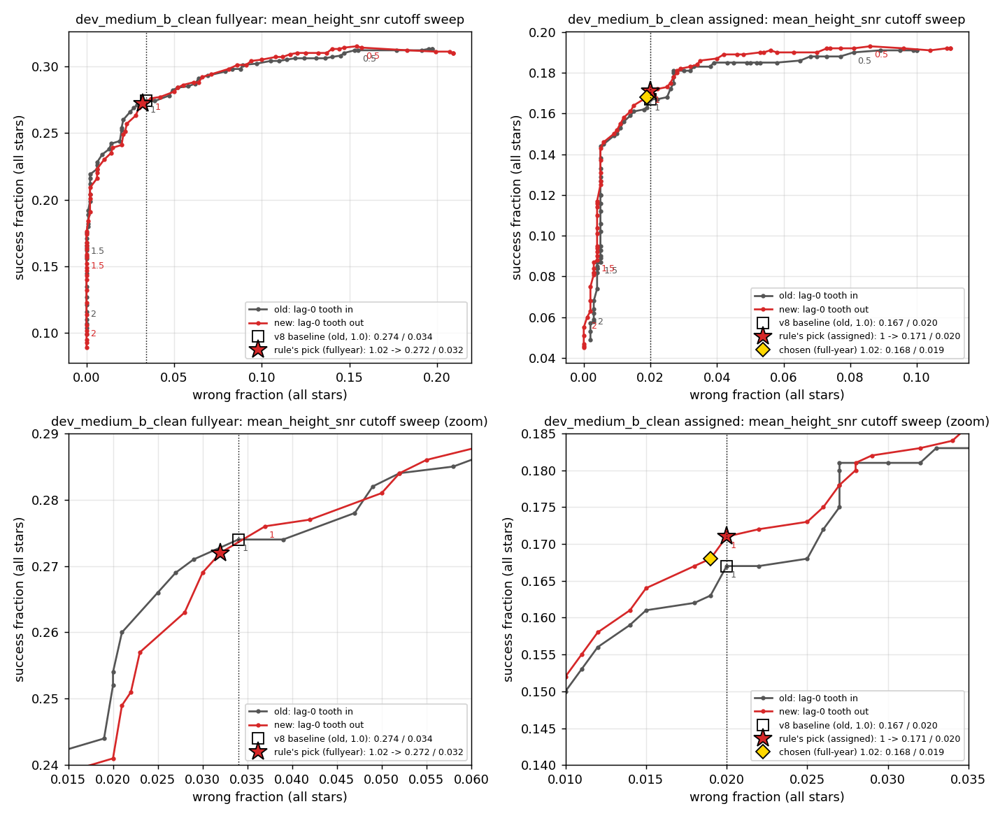
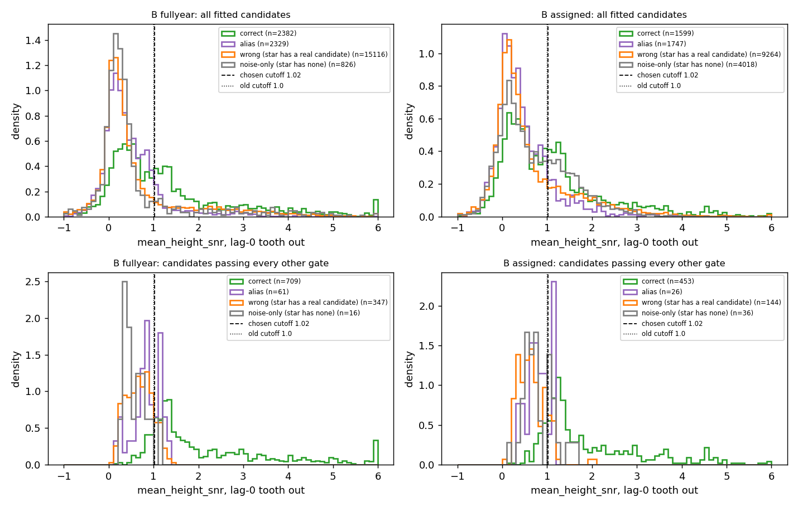
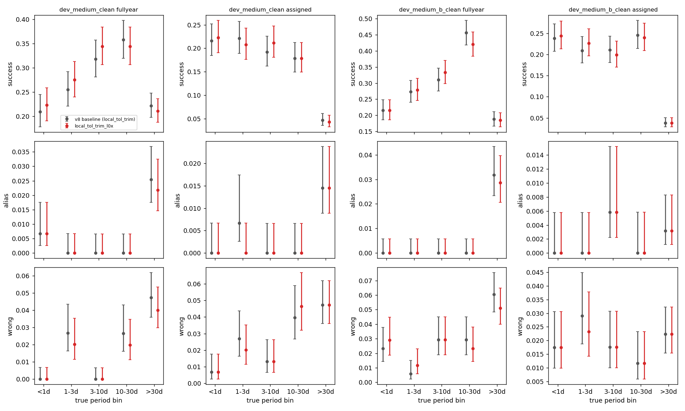
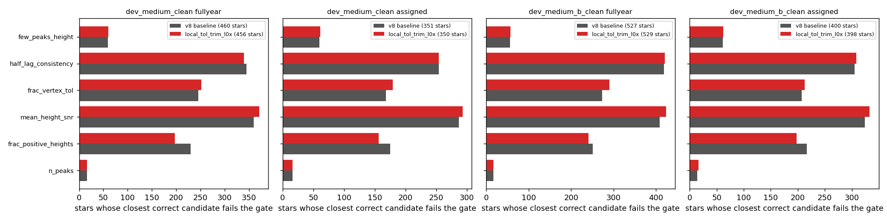
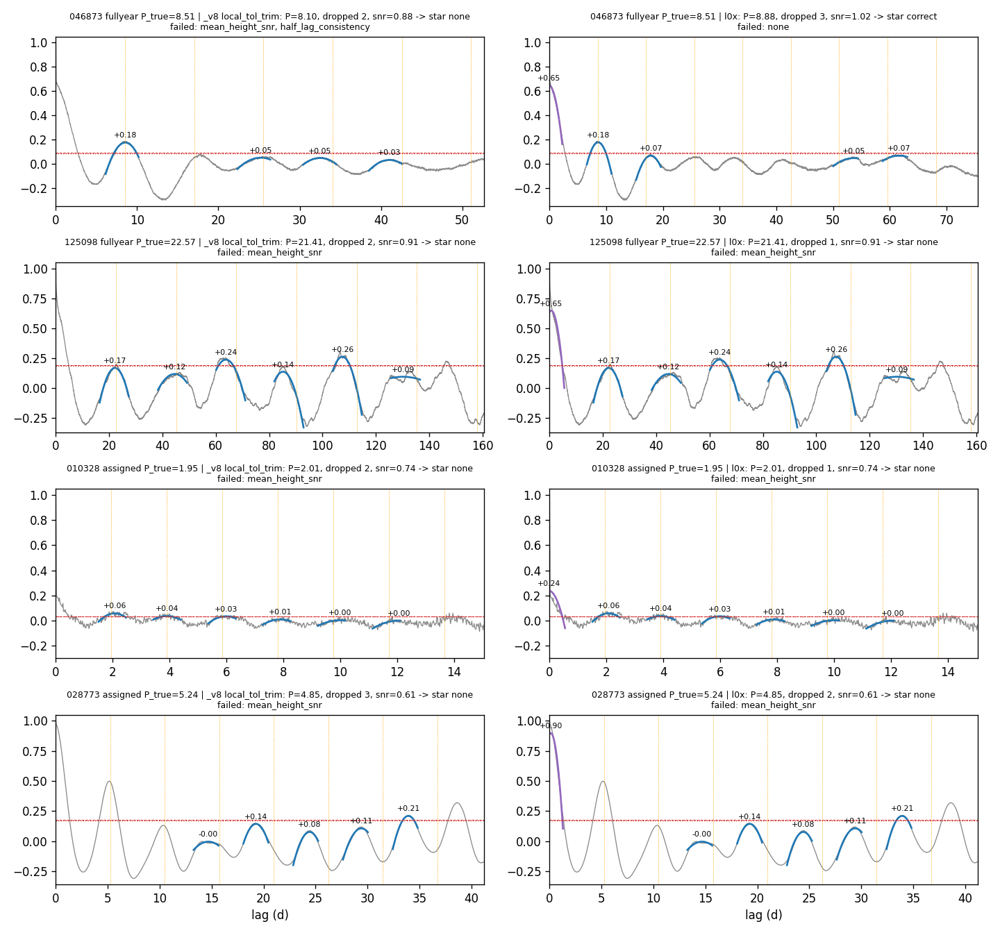

# P44: lag-0 tooth out of the comb fit's rejection and SNR gate

**Date:** 2026-11-20 · **Author:** method-improver session · **Branch:** `claude/p44-lag0-out-f25a41` · **Status:** merged; adopted as default (Rae, 2026-11-20)

## TL;DR
- **Small, consistent gain on the judging set; neutral on the tuning set.** The new variant is `local_tol_trim_l0x`, with the cutoff re-set to **1.02** on dev_medium_b_clean full-year. On dev_medium_clean full-year, success goes 0.265 → **0.270** and wrong 0.024 → **0.019**. Assigned is unchanged (0.153 / 0.030 → 0.154 / 0.030). B moves within ±2 stars of `_v8`. Synth200 is unchanged except one star.
- **All five `check_goals --baseline` runs PASS** against `_v8`.
- **The lag-0 tooth explains few of P43's losses.** Of the 13 star-modes P43 lost to it, 4 were already back under `_v8` and 1 more returns. In the other 8, the real teeth average under 1 σ_ACF, so only `lsq`'s ACF(0) ever lifted them over the gate.
- **Decide:** adopt as the default (I lean yes, mildly), and whether to make `_v9` baselines.

## Question / goal
P44 in `docs/TASKS_PROPOSED.md`, approved by Rae 2026-11-19: leave the lag-0 tooth out of (a) the comb fit's per-window MAD outlier rejection and (b) the `mean_height_snr` mean, for every variant. Then re-set the gate's cutoff on the tuning set dev_medium_b_clean (P57) and judge on dev_medium_clean against `_v8`.

No goal in `benchmarks/goals.json` targets this. The guards are `check_goals --baseline` against `dev_medium_clean_{fullyear,assigned}_v8`, `dev_medium_b_clean_{fullyear,assigned}_v8` and `synth200_s0_v8`.

## What I did
1. **Code** (`claude_files/comb_fit.py`), behind a new comb-spec key so the old behaviour stays reachable:
   - `lag0_tooth="exclude"`. The lag-0 tooth is the tooth whose comb centre is < P/2, the same rule `_vertex_stats` uses. It is neither a drop candidate nor part of the median/MAD in `_fit_single_candidate`'s rejection loop. `gate_mean_height_snr` leaves it out of the gate's mean. This works with any solver.
   - A variant may carry its own `min_mean_height_snr`. `fit_rotation_period(min_mean_height_snr=None)` takes the variant's value, else 1.0, and an explicit argument wins.
   - New variants: `local_tol_trim_l0x` (`local_tol_trim` + exclude + cutoff `P44_SNR_CUTOFF` = 1.02) and `lsq_l0x`.
   - The default variant and all other thresholds are unchanged. No existing variant's behaviour changes.
   - The gate now reads its statistic from `diag["mean_height_snr"]`. For every old variant this equals the old `nanmean(height_snr)`; the full test suite passes unchanged.
2. **Tests:** `tests/test_p44_lag0_out.py`, 13 tests. They cover registration, the lag-0 rule, the P43 rejection mechanism on a synthetic comb (the old variant drops the lag-0 tooth, the new one keeps it), "never dropped" for both solvers, no change when there is no lag-0 tooth, the lag-0-free mean, and cutoff precedence. No existing assertion was changed.
3. **Sweep harness** (`p44lib.py`). Stage 1 is cached per star. `_fit_single_candidate` and `_grid_search_t0` are memoized in-process, so the production `fit_rotation_period` is re-run at each of 75 cutoffs (0–2.5, step 0.02 in 0.5–1.6) reusing the fits. This is exact, not a re-implementation of the selection logic:
   - at 1.0, the old variant reproduces the `_v8` per-star outcome of **all 1,000 B stars in both modes** (asserted in `sweep.py`);
   - the official scorecards match the harness at 1.02.
4. **Cutoff rule** (from the brief): on B, take the highest-success cutoff with wrong ≤ B's `_v8` wrong rate. Full-year (0.034) gives **1.02**. Assigned (0.020) would give **1.00**. They disagree, so I took full-year's.
5. **Official scorecards** of `local_tol_trim_l0x` (`run_scorecards.sh`; nice 15, 3 workers, one job at a time, 2-min cooling):
   - `datasets/dev_medium_clean.csv,data_root=data/smarts_dev,sectors=ignored` and `...sectors=manifest`
   - `datasets/dev_medium_b_clean.csv,data_root=data/smarts_dev,sectors=ignored` and `...sectors=manifest`
   - `synthetic:n=200,seed=0`

   Each was followed by `check_goals --baseline` against the matching `_v8`.
6. **Figures:** `figures.py` and `examples.py`, all from `data/`. `notebook.ipynb` regenerates them.

## Results

### Headline (official scorecards; "before" = the committed `_v8` baselines, same default `local_tol_trim`)
| set | mode | run | success | wrong | alias | none | precision | gained / lost (success) | new / fixed wrong |
|---|---|---|---|---|---|---|---|---|---|
| dev_medium_clean (judge) | full-year | `_v8` | 0.265 | 0.024 | 0.009 | 0.701 | 0.889 | | |
| | | **l0x** | **0.270** | **0.019** | 0.008 | 0.703 | **0.908** | +12 / −8 | +2 / −6 |
| | assigned | `_v8` | 0.153 | 0.030 | 0.006 | 0.811 | 0.812 | | |
| | | **l0x** | 0.154 | 0.030 | 0.005 | 0.811 | 0.818 | +5 / −4 | +3 / −3 |
| dev_medium_b_clean (tune) | full-year | `_v8` | 0.274 | 0.034 | 0.010 | 0.682 | 0.862 | | |
| | | l0x | 0.272 | 0.032 | 0.009 | 0.687 | 0.869 | +8 / −10 | +4 / −6 |
| | assigned | `_v8` | 0.167 | 0.020 | 0.002 | 0.811 | 0.884 | | |
| | | l0x | 0.168 | 0.019 | 0.002 | 0.811 | 0.889 | +7 / −6 | +0 / −1 |
| synth200 s0 | | `_v8` | 0.755 | 0.005 | 0.000 | 0.240 | | | |
| | | l0x | 0.750 | 0.005 | 0.005 | 0.240 | | one star correct → alias | |

(from `data/summary.csv` and `data/metrics/`; synth from its metrics.json.) Scorecard median s/star: dev_medium 0.715 vs `_v8` 0.726 full-year, 0.485 vs 0.504 assigned (RT1a/RT1b PASS). The per-tooth work is unchanged, so I did not run the profiler.

**`check_goals --baseline`: OVERALL PASS in all five runs** (`data/check_goals/`). dev_medium_clean full-year vs `_v8`:
```
   base     new   delta  limit  metric
  0.265   0.270  +0.005  0.020  final.overall.success
  0.255   0.275  +0.020  0.060  final.by_bin.1-3d.success
  0.358   0.344  -0.013  0.060  final.by_bin.10-30d.success
  0.318   0.344  +0.026  0.060  final.by_bin.3-10d.success
  0.209   0.223  +0.014  0.060  final.by_bin.<1d.success
  0.222   0.211  -0.011  0.060  final.by_bin.>30d.success
G10   draft   PASS    0.019 <= 0.04    0.024  final.overall.wrong
OVERALL: PASS
```
dev_medium_clean assigned: overall 0.153 → 0.154; bins −0.013 (1–3 d) to +0.020 (3–10 d); PASS.
B full-year: 0.274 → 0.272; 10–30 d −0.035, 3–10 d +0.023; PASS.
B assigned: 0.167 → 0.168; PASS.
synth200: 0.755 → 0.750 (3–10 d −0.028, one star); PASS.

### The cutoff sweep (tuning set B)


Each curve is success vs wrong as the cutoff runs from 0 to 2.5. Grey is the old definition (lag-0 tooth in), red the new. The bottom row zooms in on the operating point.
- **The two definitions trace nearly the same curve**, within a few stars everywhere.
- **Full-year:** the new definition is slightly below the old one for wrong < 0.033 and slightly above it beyond.
- **Assigned:** the new one is 2–5 stars above throughout.
- **Markers:** the square is `_v8`. The star is the rule's pick in that mode (full-year 1.02 → 0.272 / 0.032; assigned 1.00 → 0.171 / 0.020). The gold diamond is the adopted 1.02 in assigned (0.168 / 0.019).

The 0.02 grid is coarse at the pick: 1.00 gives 0.276 / 0.037 full-year, just over the 0.034 target.

**Why the curves overlap.** Under the old rejection the lag-0 tooth was already dropped for about 80% of fitted candidates. It survives in 20% of candidates under the old variant and 69% under the new (B full-year; 23% vs 64% assigned). So the old gate's mean mostly excluded it too.

### `mean_height_snr` (new definition) by candidate class on B


Classes:
- **correct:** a success outcome;
- **alias:** half or double;
- **wrong:** a wrong candidate on a star that has some correct or alias candidate;
- **noise-only:** a candidate on a star where no candidate is within tolerance of a harmonic, i.e. the ACF carries no recoverable signal for the comb.

Look at the bottom row, the candidates that pass every other gate. The SNR gate is the decision for these. Wrong and noise-only candidates sit almost entirely below ~1.1. Correct ones extend to 6 (clipped). The cutoff (dashed 1.02, dotted old 1.0) sits at the upper edge of the wrong / noise-only mass, as the rule intends. The aliases that pass every other gate are mostly > 30 d stars (46 of 61 full-year), with SNR straddling the cutoff (median 0.87).

### Outcomes by period bin


Each point is a success, alias or wrong fraction per true-period bin, with 68% Wilson intervals. Grey is `_v8`, red the new variant. Every change is well inside the intervals.
- **dev_medium full-year:** the gains are at < 1 d, 1–3 d and 3–10 d. Wrong falls at 1–3 d, 10–30 d and > 30 d.
- **B full-year:** 10–30 d drops by 0.035 (about 6 of 171 stars), the largest single-bin move. 3–10 d gains 0.023.
- **Both sets:** the 10–30 d bin is the one that loses.

### Gate-failure breakdown


Each bar counts stars not answered correctly whose closest correct candidate (fewest failed gates) fails that gate.
- **`mean_height_snr`** blocks slightly more stars: +11 dev_medium full-year, +6 assigned, +15 B full-year, +9 B assigned. Its mean no longer includes ACF(0), and the cutoff rose by 0.02.
- **`frac_positive_heights`** blocks 10–33 fewer. The kept lag-0 tooth is a guaranteed positive height in that fraction (see open questions).
- **`frac_vertex_tol`** blocks a few more.

### The P43 lag-0 star-modes
These are P43's 26 lost star-modes (`_v7` success, `local_tol` not), restricted to those whose closest correct candidate failed `mean_height_snr` or `n_peaks` after dropping more windows than `lsq`. That gives 8 full-year + 5 assigned = **13**, P43's count (`data/lost13.csv`).

| | full-year | assigned |
|---|---|---|
| already back under `_v8` (`local_tol_trim`) | 015438, 026704, 103059 | 015438 |
| **back with l0x** | **046873** | |
| still lost | 125098, 157549, 273135, 315124 | 010328, 021837, 028773, 043314 |

**5 of 13 now succeed (4 before this change, +1).**



Each row is the closest correct candidate's comb under `_v8` (left) and l0x (right) on the judging set; the purple parabola is the lag-0 tooth.
- **046873 (recovered):** keeping the lag-0 tooth changes which teeth rejection drops. The n = 2 tooth is now kept, and the SNR without lag-0 reaches 1.02.
- **125098, 010328, 028773 (still lost):** the lag-0 tooth is now kept (heights 0.65 / 0.24 / 0.90), but the real teeth are unchanged. Their mean is 0.91 / 0.74 / 0.61 σ_ACF (red dotted line: 1 σ_ACF).

P43's diagnosis ("rejection drops the lag-0 tooth, so SNR fails") was literally true. But the SNR those stars had under `_v7`/`lsq` came from ACF(0) itself. Once the gate stops counting ACF(0), as Rae decided it should, they fail on the strength of their genuine teeth. 273135's comb has t0 ≈ P (no lag-0 tooth at all), and 315124 / 043314 fail `n_peaks`, so those three were never lag-0 cases.

## What didn't work
- **Recovering P43's lag-0 losses:** 1 of 9 still-lost star-modes came back (above). That is not a bug in the change; it is the honest consequence of not counting ACF(0).
- **Mode agreement:** the rule's cutoff differs between modes (1.02 full-year, 1.00 assigned). With the 0.02 grid the full-year curve crosses the 0.034 target between those two values.

## Open questions for Rae

**Rae (2026-11-20):** (1) adopt as default: yes; (2) `_v9` baselines: yes; (3) P59 approved; (4) keep the full-year cutoff.
1. **Adopt `local_tol_trim_l0x` (cutoff 1.02) as the default?** For: on the judging set, full-year success is +0.005, wrong −0.005 and precision 0.889 → 0.908; assigned is flat; B is flat (−0.002 / −0.002 full-year); all `check_goals` PASS. The gate also now means what it says ("are the period's own teeth tall?"). Against: the gain is ~4 stars and inside per-bin noise, and the 10–30 d bin dips on both sets (−0.013 dev_medium, −0.035 B full-year). I lean **yes**, on meaning more than on numbers. If adopted, the default switches by setting `DEFAULT_COMB_VARIANT = "local_tol_trim_l0x"`; nothing else needs to change.
2. **New `_v9` baselines?** If you adopt it, yes: refresh dev_medium_clean, dev_medium_b_clean (both modes) and synth200_s0. The per-star tables are already in `data/per_star/` and `runs/p44/sc/`. Fold in P58's noise-table refresh if that lands first. If you don't adopt, `_v8` stands.
3. **The lag-0 tooth still counts in `n_peaks` and `frac_positive_heights`** (and in `frac_vertex_in_window` for window-gate variants). Now that rejection keeps it, it is an always-positive tooth in `frac_positive_heights`, which blocks 10–33 fewer stars (gate figure). Your OK covered rejection and the SNR mean only, so I left these alone. Leaving it out everywhere would be consistent (P59 proposed). It would need its own sweep, because `frac_positive_heights` 0.8 and `min_peaks_required` 4 were also set with the tooth (sometimes) inside.
4. **Modes disagree on the cutoff** (1.02 vs 1.00). I used full-year as instructed. At 1.00 the judging set would see a few more successes and wrongs. I did not score 1.00 on dev_medium so as not to choose by the judging set.
5. **`local_screen*` variants** fit with `COMB_VARIANTS["local"]` / `["lsq"]` internally, so they ignore the key. Only relevant if they are revived.

## Reproduce
```bash
PY=/opt/anaconda3/envs/ss_openblas/bin/python
# worktree: ln -s /Users/raeholcomb/Documents/GitHub/ss_redevelopment/data/smarts_dev data/smarts_dev
$PY -m pytest -q tests/test_p44_lag0_out.py
# step 2: sweep on the tuning set (~9 + 7 min at 3 workers), then the rule
for m in fullyear assigned; do nice -n 15 $PY reports/2026-11-20_p44-lag0-out/p44lib.py --mode $m --out runs/p44/sweep_B_$m.pkl --n-workers 3; done
$PY reports/2026-11-20_p44-lag0-out/sweep.py
# step 3: official scorecards + check_goals vs _v8 (dev_medium_clean, dev_medium_b_clean both modes, synth200)
zsh reports/2026-11-20_p44-lag0-out/run_scorecards.sh local_tol_trim_l0x
# figures + tables; examples re-runs 4 stars
$PY reports/2026-11-20_p44-lag0-out/figures.py
nice -n 15 $PY reports/2026-11-20_p44-lag0-out/examples.py
$PY tools/run_notebook.py reports/2026-11-20_p44-lag0-out/notebook.ipynb
```
