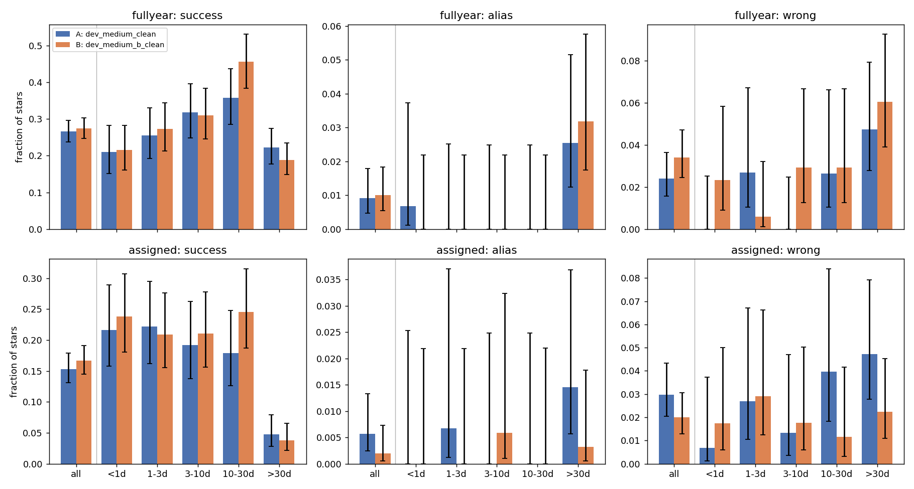
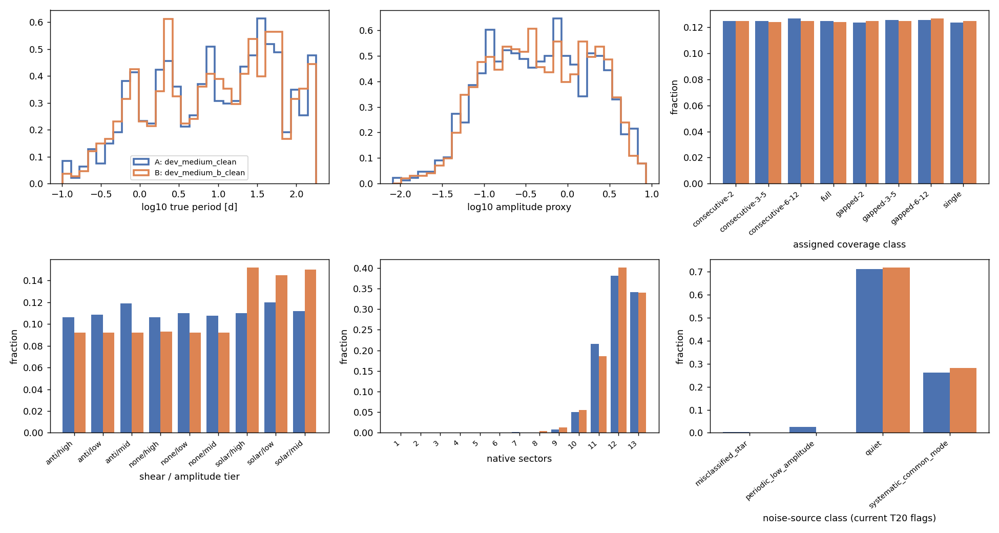
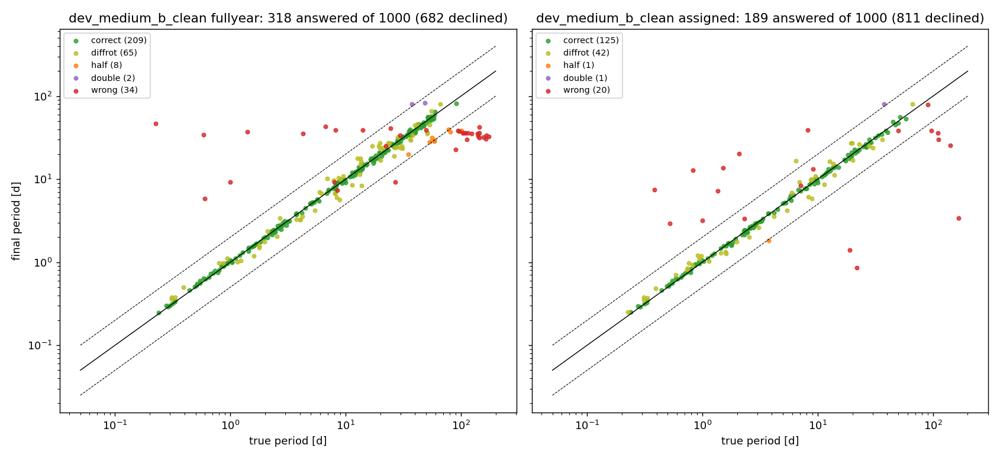
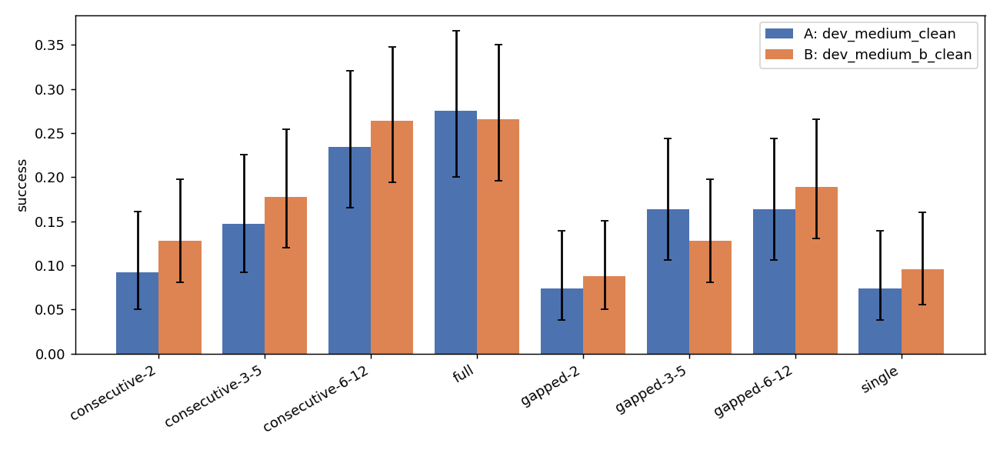

# P57: second noise-clean dev set dev_medium_b

**Date:** 2026-11-20 · **Author:** dev-set-builder session · **Branch:** `claude/p57-dev-medium-b-16ebac` · **Status:** draft

## TL;DR

- **`datasets/dev_medium_b_clean.csv`**: 1,000 stars, seed 20261120, the same strata, quotas, coverage and columns as
  dev_medium. No `noise_exclude` stars. The stars are disjoint from dev_small, dev_medium, the holdout and train_v0.
  `--check` reproduces it exactly. Light curves are in `data/smarts_dev/`; the drive build took 19 min.
- **No sign of overtuning.** `_v8` on B: full-year success **0.274** / wrong **0.034**, compared with 0.265 / 0.024 on
  dev_medium_clean. Assigned coverage: 0.167 / 0.020, compared with 0.153 / 0.030. All Fisher p ≥ 0.06 overall and in
  every bin.
- **Two departures from the brief, for Rae:**
  1. The new set shares noise TICs with the existing sets (78% of its stars sit on a TIC that dev_medium also uses).
     The pool has too few clean TICs to avoid this.
  2. B's < 1 d bin is all solar shear, because the anti-shear and no-shear cells are used up.
- B is slightly stricter than dev_medium_clean: it also excludes the 24 coherent-quiet sources that the current drive
  flags exclude.

## Question / goal

Task **P57** (`docs/TASKS_PROPOSED.md`, Rae 2026-11-19): build a second, independent dev set of about 1,000 noise-clean
stars. Thresholds are tuned on one set and judged on the other, and a change must not regress on either. The first use
is the P44 lag-0-free height-SNR cutoff: it gets tuned on B and judged on dev_medium_clean vs `_v8`. The brief also
asked for an overfit check: does the current pipeline score noticeably lower on fresh stars? No goal in
`benchmarks/goals.json` is involved; `check_goals.py` on both new baselines grades no goals and prints `OVERALL: PASS`.

## What I did

1. **Builder: `tools/build_dev_medium_b.py`.** It reuses `build_dev_sets.py` (the T2 code) unchanged by setting the
   module's set definitions, as `build_train_sample.py` does. The pool is SIM_ID ≥ 800k minus:
   - the 4,050 rows already in dev_small, dev_medium or the holdout;
   - the 455 rows T2 found corrupt;
   - the 27,171 `exclude_from_training` rows of the drive's current T20 flags file.

   That leaves 168,324 eligible rows. A bin with too little capacity is clipped instead of raising an error; none was
   short in the end. The builder writes:
   - `dev_medium_b_clean.csv`
   - `_strata_counts.csv`
   - `_exclusions_log.csv`
   - `_build_summary.json`

   `--check` rebuilds the set in memory from the drive's check cache (`extracted/p57_build/`) and compares it
   byte-for-byte.
2. **Drive build:** 2 workers, with Rae's OK on an idle machine. The tool's default is 1 worker. 1,301 candidates in
   161 bundles, 112 rejected for corrupt noise, 0 coverage fallbacks. 19 min of drive time. The 1,000 FITS files were
   copied to `data/smarts_dev/` in the main checkout.
3. **Noise table:** `tools/build_noise_table.py --keep-existing` adds the 1,000 B rows and an `in_dev_medium_b`
   column. Old rows are left byte-identical (verified). Without B's rows in the table, the scorecard's noise guard
   would silently pass B's stars.
4. **Baselines:** 3 workers, `nice -n 15`, one run after the other, default comb `local_tol_trim`, commit `97cc3bb`.
   0 star errors.
   - `datasets/dev_medium_b_clean.csv,data_root=data/smarts_dev,sectors=ignored` → `benchmarks/baselines/dev_medium_b_clean_fullyear_v8.json` + `_tables/`
   - `datasets/dev_medium_b_clean.csv,data_root=data/smarts_dev,sectors=manifest` → `..._assigned_v8.json` + `_tables/`
5. **Comparison** in `notebook.ipynb` (generated by `build_notebook.py`), against the
   `dev_medium_clean_{fullyear,assigned}_v8` tables. Rates use Wilson 95% CIs and Fisher exact tests.
6. **Tests:** `tests/test_dev_medium_b.py` covers:
   - the pool filters and the clipped allocation (synthetic data);
   - the schema, which must equal dev_medium's;
   - disjointness from dev_small, dev_medium, the holdout and train_v0 (by row and by sim_id);
   - every star is in the noise table and none is `noise_exclude`;
   - the scorecard's guard accepts the file without `--allow-noise-excluded`;
   - `--check` against the drive (slow; skips when the drive is absent).

   `python -m pytest -q`: 586 passed.

## Results

### Overfit check: B performs like dev_medium_clean

| mode | set | n | success | alias | wrong |
|---|---|---|---|---|---|
| full-year | A dev_medium_clean | 874 | 0.265 | 0.009 | 0.024 |
| full-year | B dev_medium_b_clean | 1000 | 0.274 | 0.010 | 0.034 |
| assigned | A dev_medium_clean | 874 | 0.153 | 0.006 | 0.030 |
| assigned | B dev_medium_b_clean | 1000 | 0.167 | 0.002 | 0.020 |

Fisher p-values for A vs B, overall:
- full-year: success 0.72, wrong 0.22;
- assigned: success 0.45, wrong 0.18.

Per bin, the smallest p is 0.063 (full-year 3-10 d wrong: A 0/151, B 5/171). Full table: `data/rates_A_vs_B.csv`.
B is not lower on success in any mode. The wrong-answer rates go in opposite directions in the two modes: higher on B
full-year, lower on B assigned. That points to noise, not a systematic difference.


*Figure 1.* Look at the overlap of the whiskers. Every A/B pair is within its 95% CIs, including the largest gap,
full-year 10-30 d success (0.358 vs 0.456, p = 0.088).

Corpus-weighted rates (`data/weighted_rates.csv`) also agree:
- full-year: success 0.138 vs 0.129;
- assigned: success 0.013 vs 0.018.

### Stratification matches, except for the < 1 d shear mix


*Figure 2.* The panels compare:
- period, amplitude-proxy and native-sector distributions: they overlap;
- assigned coverage classes: 1/8 each in both sets;
- noise-class mix (current T20 flags): 26% vs 28% `systematic_common_mode`;
- shear/amplitude panel: the one real difference. B is 45% solar shear.

Per-bin counts (`data/pbin_counts.csv`), B: 172/172/171/171/171/72/71, compared with A's 148-151 per short bin after
the clean cut.

- **Why B is 45% solar shear.** In the ≥ 800k pool the < 1 d anti-shear and no-shear cells are exhausted: 0 eligible
  rows after removing dev_small + dev_medium + holdout. T2's capacity rule therefore put all 172 of B's < 1 d stars into
  the solar cells. The other six bins are balanced (57/57/57).
- **It doesn't bias the comparison.** On A's solar < 1 d stars only, full-year success is 0.231 (n = 52). On B it is
  0.215 (n = 172); assigned 0.212 vs 0.238 (`data/lt1d_by_shear.csv`).
- **Noise-class labels.** The committed noise table still shows dev_medium's stars as all `quiet`; those are pre-update
  labels. I compared classes using a snapshot of the current flags instead (`data/noise_class_current_flags.csv`).

### Measured vs true period on B


*Figure 3.* Look at where the wrong answers (red) fall:
- full-year: they cluster at P_true > 60 d answered as 30-40 d, the familiar long-period failure;
- elsewhere: a handful of scattered short-P_true wrongs at 30-45 d, plus diffrot spread around the 1:1 line.


*Figure 4.* Success by assigned coverage class in A and B. The sets agree class by class within the CIs.

### Independence caveats (measured)

- **Shared noise TICs.** The ≥ 800k pool has only 719 noise TICs (620 clean), each reused about 280 times. dev_small,
  dev_medium and the holdout already use 658 of them. Dropping shared TICs (`--exclude-shared-noise-tic`) leaves 10
  eligible stars < 1 d and 110 at 1-3 d, so the strata can't be filled.
- **What B shares in practice.** B uses 472 TICs. 359 of them also serve dev_medium_clean stars, and 762 of the 1,000 B
  stars sit on such a TIC. dev_medium itself already puts 874 stars on 447 TICs. The injected signals, periods and
  files are all new; the noise light curves are reused.
- **B is stricter than dev_medium_clean.** The drive's flags file was updated 2026-11-10. Class `periodic_low_amplitude`
  is now `exclude_from_training`, and it is exactly the 24 `noise_quiet_coherent` dev stars. dev_medium_clean keeps 22
  of them, dev_small_clean 2. B uses the current flags, so it has none (2.5% of A).

## What didn't work

- **Fully noise-independent set:** infeasible, as shown above. `--plan-only` with the exclusion gave quotas of 10 stars
  < 1 d and 110 at 1-3 d.
- **A plain noise-table rebuild** would have flipped those 24 stars to `noise_exclude = True`. The scorecard would then
  refuse dev_small_clean and dev_medium_clean, and the `_v8` baselines would change. I used `--keep-existing` instead
  and left that decision to Rae.

## Open questions for Rae

1. **The 24 coherent-quiet stars in dev_small_clean / dev_medium_clean.**
   - **Situation:** the current flags exclude them; the committed table and both `_clean` sets still keep them.
   - **(a) Leave as is:** the frozen `_v8` judging set stays valid. A and B then differ in strictness by 2.5% of A.
   - **(b) Make `_v2` clean manifests:** rebuild the noise table without `--keep-existing`, write `_v2` clean manifests
     and rerun `_v8`. That would also fix the stale `noise_class` labels (`systematic_common_mode` shows as `quiet`)
     that feed the scorecard's `quiet_noise` breakdowns.
2. **Shared noise TICs.** Is reusing noise light curves acceptable for "independent"? The alternative is a smaller,
   unbalanced B, or drawing B partly from SIM_ID < 800k, which would break the train/eval noise split.
3. **< 1 d bin all solar shear.** Accept it (it doesn't change the < 1 d comparison), or shrink B's < 1 d bin to about
   57 to keep a third solar? Shrinking costs about 115 stars where recovery is weakest.
4. **Detectability.** B has no `detectable` / `undetectable` split, because its stars are not in
   `benchmarks/detectability_dev.csv`. Extend that table (`tools/audit/detectability.py`) if P44 needs it.

## Reproduce

```bash
PY=/opt/anaconda3/envs/ss_openblas/bin/python
$PY tools/build_dev_medium_b.py --plan-only                 # drive; filters + quotas
$PY tools/build_dev_medium_b.py --n-workers 2               # drive; ~20 min; writes datasets/dev_medium_b_* + data/smarts_dev
$PY tools/build_dev_medium_b.py --check                     # drive; byte-for-byte rebuild check
$PY tools/build_noise_table.py --keep-existing              # drive; adds B rows to benchmarks/noise_sources_dev.csv
nice -n 15 $PY benchmarks/scorecard.py --manifest datasets/dev_medium_b_clean.csv --data-root data/smarts_dev --ignore-manifest-sectors --n-workers 3 --outdir runs/p57_b_fullyear
nice -n 15 $PY benchmarks/scorecard.py --manifest datasets/dev_medium_b_clean.csv --data-root data/smarts_dev --n-workers 3 --outdir runs/p57_b_assigned
$PY reports/2026-11-20_p57-dev-medium-b/build_notebook.py && $PY tools/run_notebook.py reports/2026-11-20_p57-dev-medium-b/notebook.ipynb
```
The noise-class snapshot `data/noise_class_current_flags.csv` was written from
`<root>/extracted/galaxy_ids/noise_source_flags.csv.gz` (the notebook reads only committed files).
