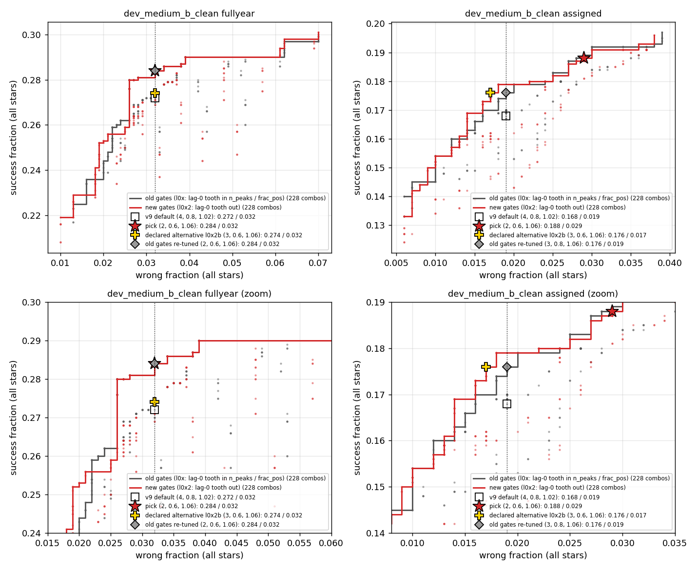
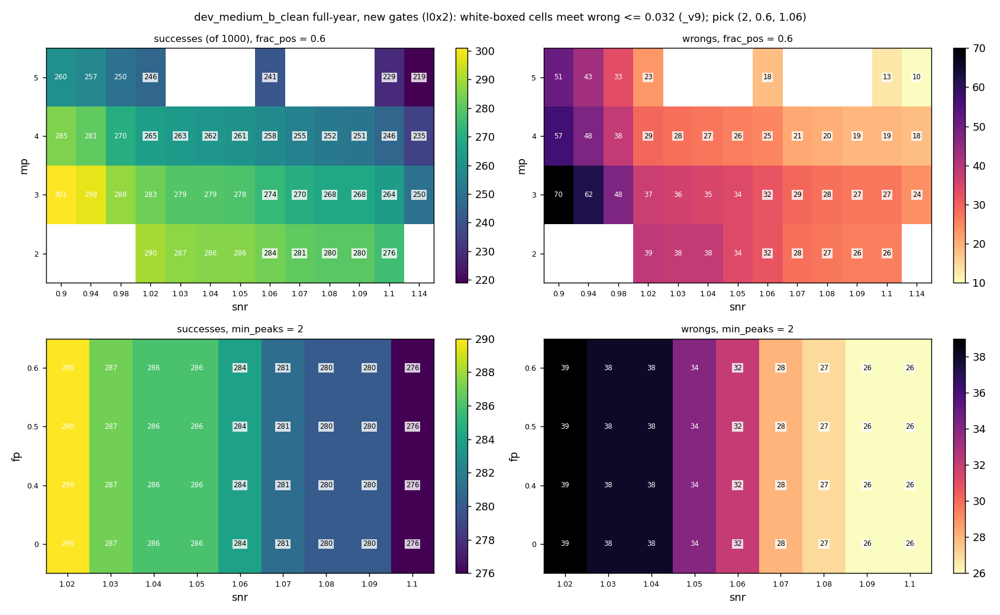
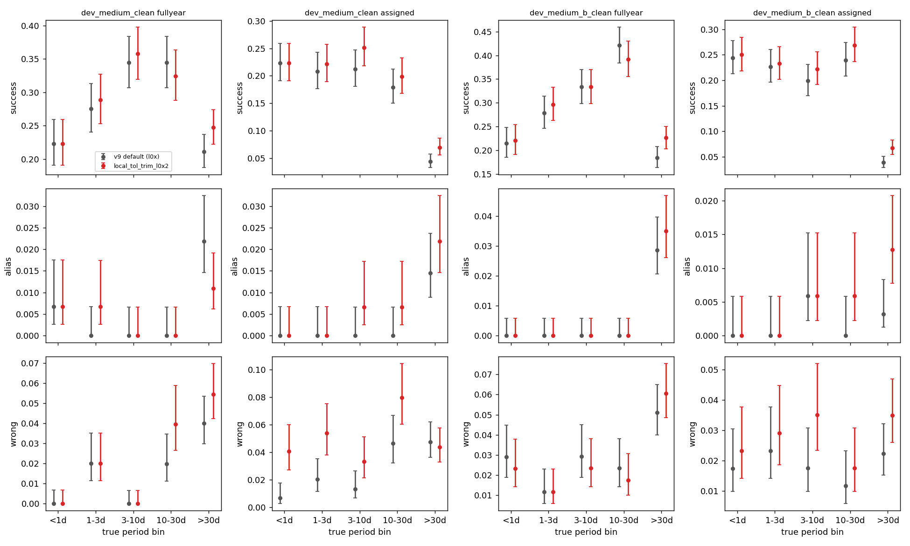
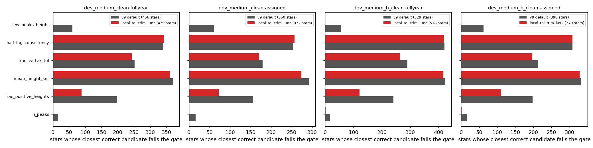
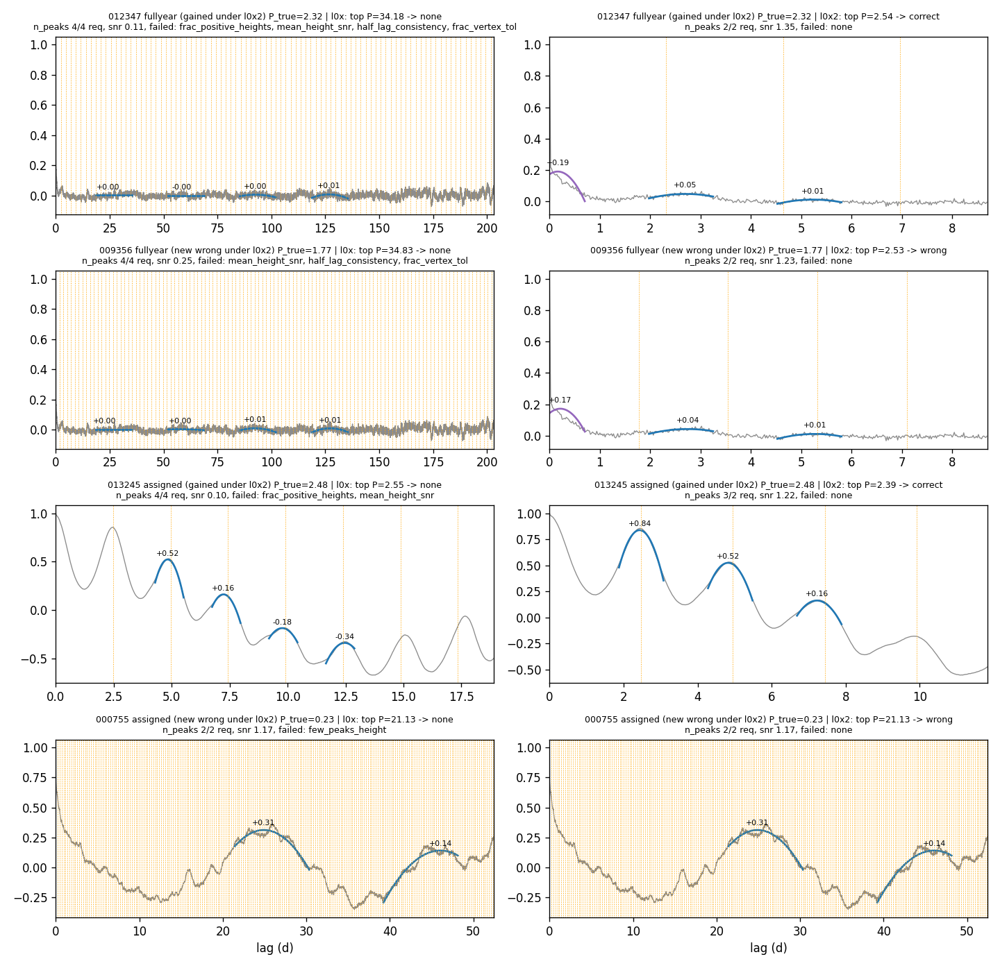

# P59: lag-0 tooth out of the remaining comb gates

**Date:** 2026-11-20 · **Author:** method-improver session · **Branch:** `claude/p59-lag0-gates` · **Status:** merged as opt-in variants, default unchanged (Rae, 2026-11-21)

## TL;DR
- **Not a win; I recommend keeping the `_v9` default (`local_tol_trim_l0x`) and not making `_v10`.**
- **The definition change does little on its own.** Leaving the lag-0 tooth out of `n_peaks` / `frac_positive_heights` slides candidates along the same purity–completeness frontier as the old definition.
- **The rule's pick on B, (min_peaks 2, frac_pos 0.6, SNR 1.06), does not hold up on dev_medium_clean:**
  - full-year success 0.270 → 0.283, but wrong 0.019 → 0.027;
  - assigned success 0.154 → 0.175, but wrong 0.030 → 0.049.
  - min_peaks 2 also switches off the few-peaks height guard.
- **The alternative I declared before judging (3, 0.6, 1.06) is near-neutral:** 0.273 / 0.023 full-year and 0.160 / 0.038 assigned.
- All 10 `check_goals` runs PASS.

## Question / goal
P59, from the coordinator, approved by Rae 2026-11-20: leave the lag-0 tooth (centre < P/2) out of `n_peaks` / `min_peaks_required`, `frac_positive_heights` and `frac_vertex_in_window`. Re-set those thresholds (`frac_positive_heights` 0.8, `min_peaks_required` 4, and the 1.02 SNR cutoff if it moves) on dev_medium_b_clean only. The rule: highest success with wrong ≤ B's `_v9` full-year wrong (0.032), with full-year deciding. Then judge on dev_medium_clean against `_v9`.

No `goals.json` goal targets this. The guards are `check_goals --baseline` against `*_v9`.

## What I did
1. **Code** (`claude_files/comb_fit.py`, branch from main `c4f0443`). The old behaviour stays the default.
   - New comb-spec key `lag0_gates=True`:
     - `lag0_gate_stats` gives `n_peaks`, `frac_positive_heights` and `frac_vertex_in_window` over non-lag-0 teeth.
     - The teeth-available count behind `n_required` drops the n = 0 window of a comb seeded at t0 < P0/2.
     - The rejection and trim floors, which count windows, carry that tooth on top of the required real teeth.
   - Variants may carry `min_peaks_required` / `min_frac_positive_heights`, as they already could the SNR cutoff. A `None` argument takes the variant's value, else 4 / 0.8; an explicit argument wins.
   - New variants:
     - `local_tol_trim_l0x2`, the rule's pick (2, 0.6, 1.06);
     - `local_tol_trim_l0x2b`, the declared alternative (3, 0.6, 1.06);
     - `lsq_l0x2`.
2. **Tests:** `tests/test_p59_lag0_gates.py`, 8 new. They cover registration, the real-tooth statistics, the gate values under l0x2 vs l0x, a `frac_positive` threshold that flips on the lag-0 tooth, the teeth-available count, the `lsq` window gate, and threshold precedence.
   - **One existing assertion changed:** `tests/test_p44_lag0_out.py::test_l0x_variants_registered_and_default_unchanged` said no variant other than `*_l0x` carries `lag0_tooth`. The `*_l0x2*` variants necessarily do, so the suffix list widened.
3. **Sweep on B** (`p59lib.py`; P44's harness method: cached Stage 1, memoized fits, production `fit_rotation_period` at every combination). Both definitions were swept on identical grids:
   - **coarse:** min_peaks {3, 4, 5} × frac_pos {0.6, 0.7, 0.75, 0.8, 0.9, 1.0} × SNR {0.90, 0.94, …, 1.14} = 126 per definition per mode;
   - **refined:** min_peaks {2, 3, 4} × frac_pos {0, 0.4, 0.5, 0.6} × SNR 1.02–1.10 in 0.01 steps = 108 (+1 baseline point) per definition per mode;
   - **214 distinct combinations per definition**, 2 definitions × 2 modes;
   - at (4, 0.8, 1.02) the old definition reproduces the `_v9` per-star outcome of all 1,000 B stars in every run (asserted in `sweep.py`).
4. **Rule:** full-year gives (2, 0.6, 1.06) and assigned gives (3, 0.6, 1.05), so they disagree. That pick raises B-assigned wrong from 0.019 to 0.029. Before scoring anything on dev_medium, I therefore also declared (3, 0.6, 1.06), which is within B's wrong budget in both modes, as `l0x2b`.
5. **Official scorecards** (`run_scorecards.sh`, nice 15, 3 workers, one at a time) for both variants:
   - `datasets/dev_medium_clean.csv,data_root=data/smarts_dev,sectors=ignored` / `...sectors=manifest`;
   - the same two for `datasets/dev_medium_b_clean.csv`;
   - `synthetic:n=200,seed=0`.

   Each was followed by `check_goals --baseline` against the matching `_v9`.

## Results

### Headline (official scorecards vs `_v9`)
| set | mode | run | success | wrong | alias | none | precision | gained / lost | new / fixed wrong |
|---|---|---|---|---|---|---|---|---|---|
| **dev_medium_clean (judge)** | full-year | `_v9` (l0x) | 0.270 | 0.019 | 0.008 | 0.703 | 0.908 | | |
| | | l0x2 (2, 0.6, 1.06) | 0.283 | **0.027** | 0.006 | 0.684 | 0.895 | +23 / −12 | +11 / −4 |
| | | l0x2b (3, 0.6, 1.06) | 0.273 | 0.023 | 0.005 | 0.699 | 0.909 | +14 / −11 | +7 / −4 |
| | assigned | `_v9` | 0.154 | 0.030 | 0.005 | 0.811 | 0.818 | | |
| | | l0x2 | 0.175 | **0.049** | 0.009 | 0.767 | 0.750 | +23 / −5 | +18 / −1 |
| | | l0x2b | 0.160 | 0.038 | 0.005 | 0.797 | 0.791 | +8 / −3 | +7 / −0 |
| dev_medium_b_clean (tune) | full-year | `_v9` | 0.272 | 0.032 | 0.009 | 0.687 | 0.869 | | |
| | | l0x2 | 0.284 | 0.032 | 0.011 | 0.673 | 0.869 | +20 / −8 | +4 / −4 |
| | | l0x2b | 0.274 | 0.032 | 0.009 | 0.685 | 0.870 | +14 / −12 | +3 / −3 |
| | assigned | `_v9` | 0.168 | 0.019 | 0.002 | 0.811 | 0.889 | | |
| | | l0x2 | 0.188 | 0.029 | 0.006 | 0.777 | 0.843 | +23 / −3 | +14 / −4 |
| | | l0x2b | 0.176 | 0.017 | 0.006 | 0.801 | 0.884 | +11 / −3 | +2 / −4 |
| synth200 s0 | | `_v9` | 0.750 | 0.005 | 0.005 | | | | |
| | | l0x2 / l0x2b | 0.750 | 0.005 | 0.005 | | | identical | |

From `data/summary.csv` and `data/metrics/`.

**`check_goals --baseline`: OVERALL PASS in all 10 runs** (`data/check_goals/`). The regression guard only watches success, so the wrong-rate rises pass it. G10 (full-year wrong ≤ 0.04) still passes at 0.027. dev_medium_clean full-year, l0x2 vs `_v9`:
```
  0.270   0.283  +0.013  0.020  final.overall.success
```
dev_medium_clean assigned, l0x2: `0.154 0.175 +0.021 0.020 final.overall.success` (a success gain beyond the guard limit; the guard is one-sided).

### Purity–completeness on B: the definition barely matters


Each dot is one swept combination; the lines are the upper envelopes for the old definition (grey) and the new one (red). The bottom row zooms in.
- **The envelopes coincide within a few stars** in both modes.
- **At min_peaks 2 the two definitions give identical outcomes** in every full-year cell. The rule's pick (★, 0.284 / 0.032) is reached equally by the old definition re-tuned (◆).
- **The gain on B therefore comes from re-tuning the thresholds, not from removing the lag-0 tooth.**
- **The declared alternative** (gold ✚) sits on the envelope in both modes.
- **At the current thresholds (4, 0.8, 1.02),** the new definition is a tightening along the same frontier: 260 / 29 vs 272 / 32 full-year (`data/sweep_B.csv`).

### Threshold maps (B full-year, new definition)


These are success and wrong counts over (min_peaks × SNR) at frac_pos 0.6 (top) and over (frac_pos × SNR) at min_peaks 2 (bottom). White-boxed cells meet the 0.032 wrong budget.
- **`frac_positive_heights` barely touches the wrong count.** Across 0–1.0, at fixed min_peaks and SNR, it moves wrong by at most 1 star (full-year) or 3 (assigned), but success by up to 13 / 12 stars (`data/sweep_B.csv`; no effect at min_peaks 2). On B the gate mostly rejects correct candidates.
- **min_peaks and the SNR cutoff trade off.** The budget's edge runs from (4, ≈1.02) to (3, 1.06) to (2, 1.06), and the rule's pick sits at the low-min_peaks end.

### What the rule's pick lets through (judging set)


Per-bin success / alias / wrong for `_v9` (grey) and l0x2 (red), with 68% Wilson intervals.
- **Full-year:** the success gain is mostly at > 30 d (0.211 → 0.247), with wrong rising at 10–30 d and > 30 d.
- **Assigned:** wrong rises in every bin below 30 d. The new wrongs are mostly long spurious periods on short-period stars; 13 of 18 have P_found/P_true > 1.1 (up to 90×).



Each bar counts stars whose closest correct candidate fails that gate.
- **`n_peaks` and `few_peaks_height` vanish** under l0x2. With min_peaks_required = 2, `few = n_required < min_peaks_required` is never true, so **the few-peaks ACF-height guard (0.4) is switched off**.
- **`frac_positive_heights` blocks about half as many stars.**



The selected candidate under `_v9` (left) and l0x2 (right): two gains and two new wrongs, the first by star_id in each mode. Purple is the lag-0 tooth.
- **012347 (gained) and 009356 (new wrong)** pass with the same kind of comb: a 2-tooth ~2.5 d comb with heights 0.05 / 0.01. The ACF's standard deviation is so small that this gives SNR > 1.2. One lands within tolerance of P_true and one doesn't. That is luck, not detection.
- **013245 (gained)** is a genuine improvement. With min_peaks 2 the comb seeded at ~2.4 d is no longer forced to keep its decayed negative teeth.
- **000755 (new wrong, assigned)** is a 21 d comb on a 0.23 d star. Under `_v9` only `few_peaks_height` stopped it.

## What didn't work
- **Tuning three thresholds against B's ~32 wrong events did not transfer.** The rule held B full-year wrong exactly at 0.032, yet dev_medium full-year wrong rose by 0.008 (+40%) and B's own assigned wrong by 0.010.
  - The full-year budget alone was not a sufficient constraint: the pick's main lever is min_peaks 2, which also removes the few-peaks guard.
  - This is the overfit P57's two-set protocol exists to catch, and it caught it.
- **The definition change itself** gains nothing measurable on either set at matched wrong rate.

## Open questions for Rae

**Rae (2026-11-21):** (1) neither variant adopted, `_v9` stands; (2) P60 queued; (3) noted in `comb_fit.py`; (4) yes, the tuning rule now requires both modes.
1. **Adopt either variant as default?** I recommend **no**: keep `local_tol_trim_l0x` and its `_v9` baselines (no `_v10`).
   - l0x2 adds 0.013 / 0.021 success on dev_medium at 0.008 / 0.019 more wrong, and precision falls (0.908 → 0.895 full-year, 0.818 → 0.750 assigned).
   - l0x2b is near-neutral (+0.003 / +0.006 success, +0.004 / +0.008 wrong), so it isn't worth a baseline change.
   - The P59 code and variants stay available for later work.
2. **`frac_positive_heights` looks redundant.** On B it removes at most 1 wrong answer (full-year; 3 assigned) at any threshold, in either definition, while costing up to 13 correct ones. Dropping it, or lowering it to ≤ 0.6, at the current min_peaks 4 / SNR 1.02 would be a one-threshold change. It needs its own B-then-dev_medium check; proposed as P60.
3. **min_peaks_required 2 disables the few-peaks guard** as a side effect of `few = n_required < min_peaks_required`. If anyone lowers min_peaks again, the guard needs its own trigger, e.g. `n_teeth_available < 4`.
4. **Wrong-rate budgets on ~30 events are noisy** (±√30 ≈ ±5 stars). A rule that also requires the assigned budget, or a margin, would have picked l0x2b. Do you want the tuning rule changed to "wrong ≤ `_v9` in both modes" for future threshold tasks?

## Reproduce
```bash
PY=/opt/anaconda3/envs/ss_openblas/bin/python
$PY -m pytest -q tests/test_p59_lag0_gates.py tests/test_p44_lag0_out.py
# B sweeps (coarse then refined; ~20-50 min per mode at 3 workers; reuse P44's Stage-1 cache in runs/p44/)
for m in fullyear assigned; do nice -n 15 $PY reports/2026-11-20_p59-lag0-gates/p59lib.py --mode $m --out runs/p59/coarse_B_$m.pkl; done
G='{"local_tol_trim_l0x2": {"mp": [2,3,4], "fp": [0.0,0.4,0.5,0.6], "snr": [1.02,1.03,1.04,1.05,1.06,1.07,1.08,1.09,1.1]}, "local_tol_trim_l0x": {"mp": [2,3,4], "fp": [0.0,0.4,0.5,0.6], "snr": [1.02,1.03,1.04,1.05,1.06,1.07,1.08,1.09,1.1]}}'
for m in fullyear assigned; do nice -n 15 $PY reports/2026-11-20_p59-lag0-gates/p59lib.py --mode $m --out runs/p59/fine_B_$m.pkl --grid "$G"; done
$PY reports/2026-11-20_p59-lag0-gates/sweep.py
# official scorecards + check_goals vs _v9
zsh reports/2026-11-20_p59-lag0-gates/run_scorecards.sh local_tol_trim_l0x2
zsh reports/2026-11-20_p59-lag0-gates/run_scorecards.sh local_tol_trim_l0x2b
$PY reports/2026-11-20_p59-lag0-gates/figures.py
nice -n 15 $PY reports/2026-11-20_p59-lag0-gates/examples.py
$PY tools/run_notebook.py reports/2026-11-20_p59-lag0-gates/notebook.ipynb
```
