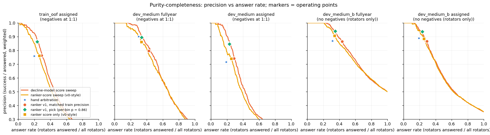
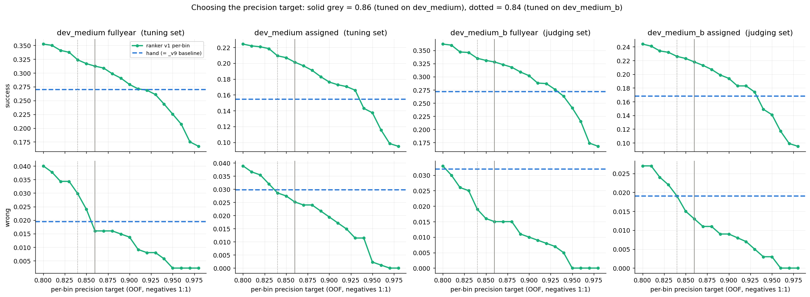
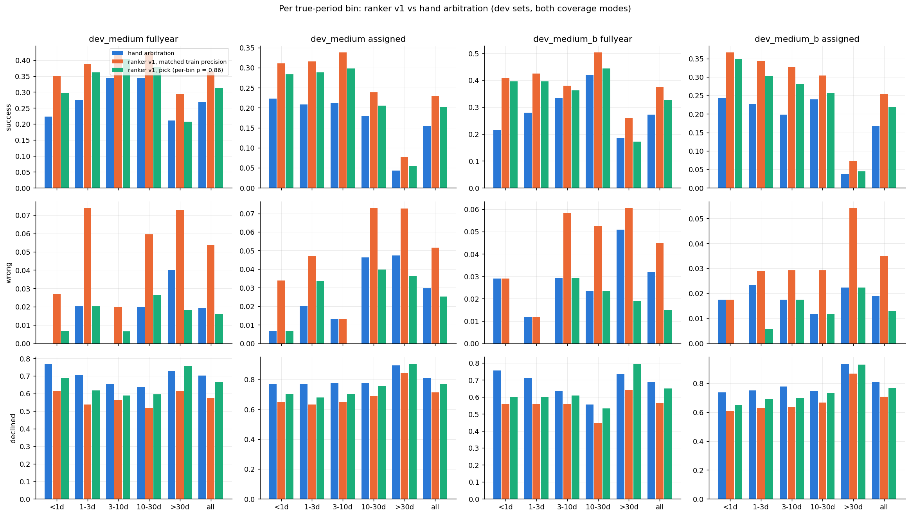
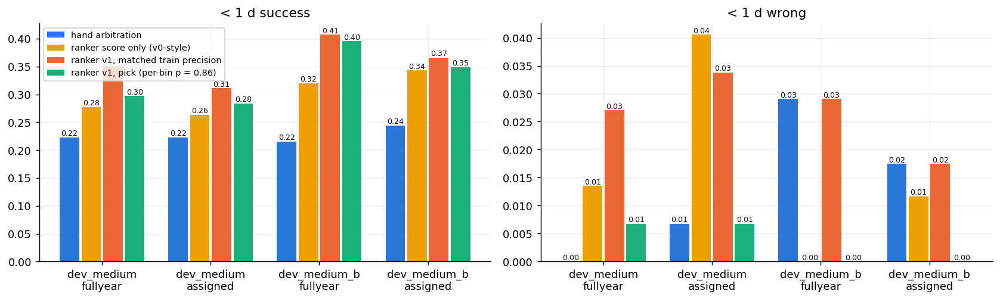
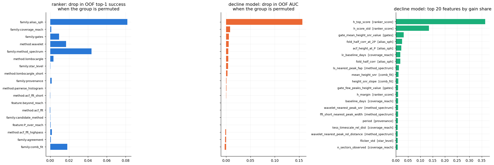
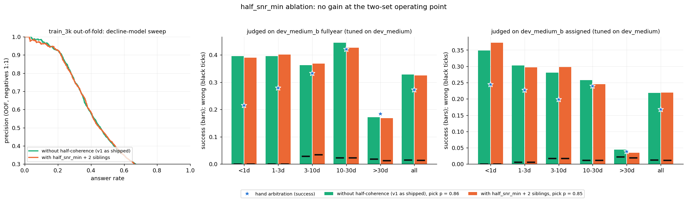
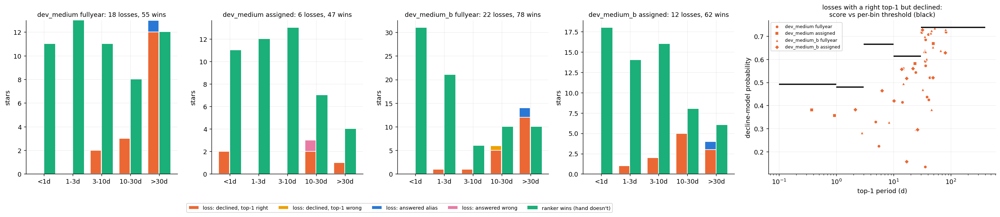
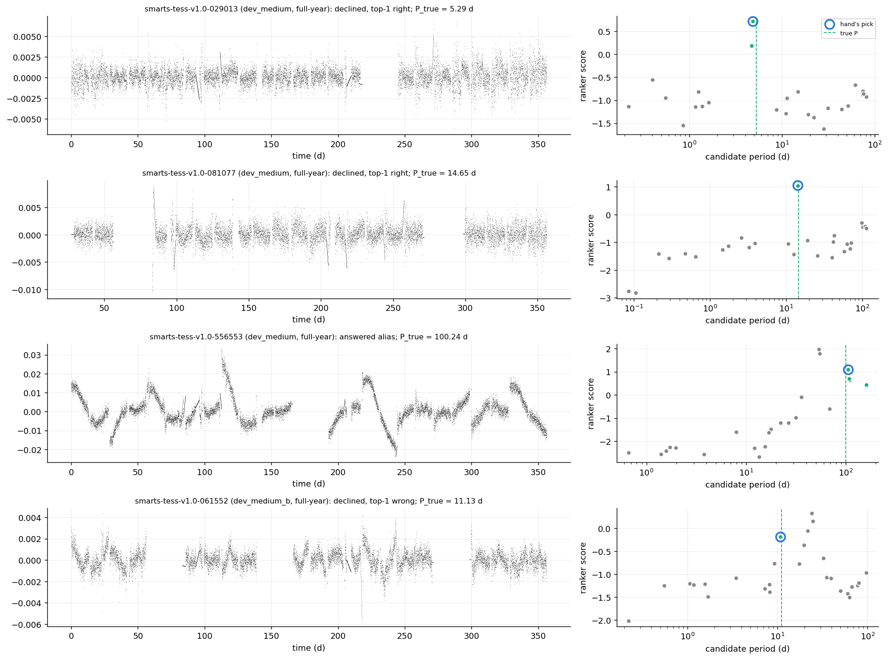

# T11: ranker v1 (decline model, per-bin thresholds)

**Date:** 2026-11-21 · **Author:** Claude (ranking-model-builder session) · **Branch:** `claude/ranker-v1-5e0e39` · **Status:** draft

## TL;DR
- **Ranker v1 beats hand arbitration on both dev sets, in both modes, with fewer wrong answers.** That is at the operating point the two-set rule picks: per-bin decline thresholds at OOF precision 0.86, non-rotators 1:1.

  | success / wrong | hand (`_v9`) | ranker v1 |
  |---|---|---|
  | dev_medium full-year | 0.270 / 0.019 | **0.312 / 0.016** |
  | dev_medium assigned | 0.154 / 0.030 | **0.201 / 0.025** |
  | dev_medium_b full-year | 0.272 / 0.032 | **0.328 / 0.015** |
  | dev_medium_b assigned | 0.168 / 0.019 | **0.218 / 0.013** |

- **Matching hand's training precision (0.76), the brief's default, fails the wrong-rate rule:** wrong goes to 0.035–0.054.
- **<1 d success:** 0.22 → 0.30 (dev_medium full-year).
- **Regressions:** >30 d full-year success, by 1 and 3 stars; full-year non-rotator FPs, 6/434 vs 1/434.
- **`half_snr_min` ablation: no gain.** Within ±0.016 success everywhere, so v1 ships without it.

## Question / goal
T11 in `docs/TASKS.md` ("Train and evaluate the ranker"), v1 as planned in `docs/HANDOFF.md` "Next up" and P24 / P23 in
`docs/TASKS_PROPOSED.md`:
- the T27 decline model with all 3 draws per negative source;
- per-period-bin decline thresholds, trained on `train_3k`;
- `half_snr_min`;
- the persistent-weak-period "quiet" stacks dropped from the negatives;
- `beyond_reach` rows with `P_over_reach`.

Judged against the `_v9` baselines with the both-sets / both-modes rule (Rae, 2026-11-21). No `goals.json` goal is
targeted. G9–G11 are graded below for information.

## What I did
1. **Inputs.** Every table was built under the default comb variant `local_tol_trim_l0x` (main checkout `runs/`). None of these files changed.
   - Training rotators: `train_3k`, i.e. `datasets/train_v0.csv,data_root=/Volumes/Data_Vault/smarts_data,sectors=manifest` (assigned coverage). These are 3,000 stars, all noise-clean (`noise_exclude_from_training` False).
   - Negatives: `neg_train` and `neg_dev_medium` (`datasets/negatives_v0.csv`).
   - The three tables (78 MB) were copied once from the drive to `runs/p31_l0x_train_tables/`, with sequential reads.
   - Dev:
     - `datasets/dev_medium_clean.csv,data_root=data/smarts_dev,sectors={ignored,manifest}`;
     - `datasets/dev_medium_b_clean.csv,data_root=data/smarts_dev,sectors={ignored,manifest}`.

   No holdout and no TESS validation stars were used.
2. **Persistent-weak-period negatives.**
   - T20's `persist` flag (the A and B stacks' top LS peaks agree) is True for **93%** of the negative sources. A and B are medians over different members of the *same* noise light curve, so they almost always agree. That makes the flag useless here.
   - I used the time-split test instead: the min-half LS S/N at the source's own top period (`tsplit_min_snr`). A source is dropped if that value is above the quiet population's 95th percentile for its P_ref bin (6.07 / 5.78 / 3.63 / 2.77 for < 5 / 5–10 / 10–20 / > 20 d, from `reports/2026-11-10_quiet-noise-periods/`).
   - This drops **43 of 743** train sources, whose hand FP rate is 6.2% against 3.0% for the kept sources. It is `ranking_model.persistent_weak_period`.
3. **Model** (`tools/train_ranker_v1.py`, helpers in `claude_files/ranking_model.py`).
   - **Folds:** 5-fold `GroupKFold` on `noise_tic` over rotators *and* negatives. 728 train negatives share a noise source with a train rotator, so they must be grouped together.
   - **Ranker:** `rank:ndcg` with T11's tuned config (depth 3, eta 0.1, 150 rounds). It is trained on the rotators; all-zero queries give NDCG no gradient.
     - Every candidate row is a document, including the 3,134 `beyond_reach` rows (P23).
     - There are 138 features, `P_over_reach` among them.
   - **Decline model:** `binary:logistic` on each star's top-1 row.
     - Inputs: the row's features plus top score, margin, score spread and row count.
     - Label: the top-1 is a success.
     - It is trained on OOF ranker scores from 3,000 rotators and 2,100 negatives (all 3 assigned draws of 700 sources). That is **0.7 negatives per rotator**, not ~2.2 as in the T27 prototype, because `train_3k` has 3× the rotators.
   - **Never trained on:** full-year negatives, since there are no full-year rotators to balance them. They are scored out-of-fold for the FP rate.
4. **Thresholds**, all set on training OOF.
   - Precision counts negatives at r = 1 per rotator (the working default).
   - Rules:
     - `rank_global`: v0-style, ranker score with one cut;
     - `head_global`;
     - `head_perbin`: per reported-period bin, every bin at hand's training precision 0.761;
     - `head_perbin_hand`: each bin at hand's own per-bin precision;
     - precision-target grids 0.80–0.98 for per-bin and global.
5. **Two-set protocol:** pick the target on one dev set, keeping wrong ≤ `_v9` in both modes, then judge on the other set. It was run in both directions.
6. **Figures and tables** come from `analysis.py` (it reads the run) and `figures.py` (reads `data/`).
7. **`half_snr_min` ablation** (Rae approved the side-table runs, 2026-11-21).
   - `ml_features.half_coherence_features` was ported from the unmerged `quiet-noise-followups` branch (`892e266`) and switched to astropy LS `fast` on a regular grid: 15× faster, Spearman 0.99 against the exact version on 88 candidates.
   - `tools/build_half_coherence_table.py` evaluates it at every candidate's `P_eval` (resumable, one shard per star).
     - The four local dev tables ran at 3 workers.
     - `train_3k`, `neg_train` and `neg_dev_medium` ran at 1 worker, with output on the drive next to the tables (`.../p31_tables_l0x/<t>/half_coherence/`, symlinked from the laptop copies).
     - All 7 tables are fully covered, with 0 errors. The drive disconnected twice during `train_3k` and the run resumed from its shards.
     - 7–11% of rows are NaN: 0% below 5 d, rising to 59% above 50 d, where a half baseline can't hold two cycles. NaN rows are spread evenly between shards written before and after the drive drops.
   - `train_ranker_v1.py --half` adds `half_snr_min`, `half_snr_ratio` and `half_amp_ratio` to both models; everything else is unchanged.

```bash
PY=/opt/anaconda3/envs/ss_openblas/bin/python
nice -n 15 $PY tools/train_ranker_v1.py --outdir /Users/raeholcomb/Documents/GitHub/ss_redevelopment/runs/ranker_v1/nohalf   # ~50 s
nice -n 15 $PY reports/2026-11-21_ranker-v1/analysis.py --run /Users/raeholcomb/Documents/GitHub/ss_redevelopment/runs/ranker_v1/nohalf  # ~6 min (permutation importance)
$PY reports/2026-11-21_ranker-v1/figures.py
```

## Results

### Purity–completeness

- On every panel the decline-model sweep (orange line) lies at or above the ranker-score sweep (yellow). Both lie above and to the right of hand arbitration (blue star).
- The pick (green diamond) sits at higher precision *and* higher answer rate than hand in every dev panel.
- The matched-precision point (orange circle) buys about 0.1 more answer rate, but at a precision below hand's.

Operating points are in `data/cutoffs.csv`. dev_medium_b has no non-rotator negatives, so its precision is rotators-only.

### Choosing the operating point (two-set rule)

- The wrong rate (bottom row) crosses each set's hand line (dashed) between targets 0.84 and 0.86.
- Tuning on dev_medium picks 0.86, and dev_medium_b passes in both modes.
- Tuning on dev_medium_b picks 0.84, and dev_medium full-year fails (wrong 0.030 > 0.019).
- I report 0.86, the stricter of the two picks, which passes on all four tables. Strictly, that uses both sets to choose. See Open questions.

| rule tuned on → judged on | mode | pick | success | wrong | hand success / wrong | passes |
|---|---|---|---|---|---|---|
| per-bin: dev_medium → dev_medium_b | full-year | 0.86 | 0.328 | 0.015 | 0.272 / 0.032 | yes |
| per-bin: dev_medium → dev_medium_b | assigned | 0.86 | 0.218 | 0.013 | 0.168 / 0.019 | yes |
| per-bin: dev_medium_b → dev_medium | full-year | 0.84 | 0.324 | 0.030 | 0.270 / 0.019 | **no** |
| per-bin: dev_medium_b → dev_medium | assigned | 0.84 | 0.209 | 0.029 | 0.154 / 0.030 | yes |
| global: dev_medium → dev_medium_b | full-year / assigned | 0.88 | 0.326 / 0.206 | 0.018 / 0.014 | | yes / yes |
| global: dev_medium_b → dev_medium | full-year / assigned | 0.85 | 0.338 / 0.212 | 0.031 / 0.030 | | **no** / yes |

Per-bin and global thresholds behave much the same overall. Per-bin is slightly better on assigned coverage, and it is the rule the brief asked for.

### Headline numbers vs hand arbitration (`_v9`)
| table | rule | success | wrong | alias | declined | non-rotator FP rate |
|---|---|---|---|---|---|---|
| dev_medium full-year | hand | 0.270 | 0.019 | 0.008 | 0.703 | 0.002 (1/434) |
| | ranker v1, matched train precision | 0.364 | 0.054 | 0.007 | 0.576 | 0.032 |
| | **ranker v1, pick (0.86)** | **0.312** | **0.016** | 0.007 | 0.665 | 0.014 (6/434) |
| | no decline (top-1 always) | 0.493 | 0.453 | 0.054 | 0 | 1 |
| dev_medium assigned | hand | 0.154 | 0.030 | 0.005 | 0.811 | 0.027 (35/1,302) |
| | matched | 0.230 | 0.051 | 0.005 | 0.714 | 0.024 |
| | **pick** | **0.201** | **0.025** | 0.002 | 0.771 | **0.009 (12/1,302)** |
| dev_medium_b full-year | hand | 0.272 | 0.032 | 0.009 | 0.687 | n/a |
| | matched | 0.376 | 0.045 | 0.014 | 0.565 | |
| | **pick** | **0.328** | **0.015** | 0.006 | 0.651 | |
| dev_medium_b assigned | hand | 0.168 | 0.019 | 0.002 | 0.811 | n/a |
| | matched | 0.253 | 0.035 | 0.004 | 0.708 | |
| | **pick** | **0.218** | **0.013** | 0.002 | 0.767 | |
| train OOF (assigned) | hand | 0.174 | 0.021 | 0.003 | 0.802 | 0.030 |
| | pick | 0.214 | 0.018 | 0.002 | 0.766 | 0.014 |

**Non-rotator FP rates.**
- Train-pool full-year negatives (OOF, never trained on): hand 1.7%, pick 1.6%.
- The 43 dropped persistent-period sources: hand 6.2%, pick 3.9%.
- On dev_medium full-year the pick answers on 6 of 434 non-rotators against hand's 1. Five of the six are reported at < 1 d, where the per-bin threshold is lowest (0.49). On assigned it answers on 12 of 1,302 against hand's 35.

`check_goals.py` on the pick, using the ranker's answers in the scorecard's `final` block
(`data/ranker_metrics_*.json`), against `_v9`:
```
dev_medium full-year: G9 0.312 (FAIL >=0.35, base 0.270) | G10 wrong 0.016 PASS | G11 <1d 0.297 (FAIL >=0.30, base 0.223)
  guard: overall +0.042; <1d +0.074; 1-3d +0.087; 3-10d +0.060; 10-30d +0.033; >30d -0.004   OVERALL: PASS
dev_medium assigned: overall +0.047; <1d +0.061; 1-3d +0.081; 3-10d +0.086; 10-30d +0.026; >30d +0.011   OVERALL: PASS
dev_medium_b full-year: overall +0.056; <1d +0.180; 1-3d +0.116; 3-10d +0.029; 10-30d +0.023; >30d -0.013   OVERALL: PASS
dev_medium_b assigned: overall +0.050; <1d +0.105; 1-3d +0.076; 3-10d +0.082; 10-30d +0.018; >30d +0.006   OVERALL: PASS
```
G9–G11 are draft goals. G11 misses by 0.003.

### Per period bin

- Top row: the pick (green) beats hand (blue) in every bin of every table except > 30 d full-year: 0.207 vs 0.211 and 0.172 vs 0.185.
- Middle row: its wrong rate is at or below hand's in 16 of 20 bin-table cells. All four exceptions are on dev_medium, each one star:
  - full-year: < 1 d (0.007 vs 0), 3–10 d (0.007 vs 0) and 10–30 d (0.026 vs 0.020);
  - assigned: 1–3 d (0.034 vs 0.020).
- The 10–30 d full-year deficit v0 had (P24) is gone: 0.377 vs 0.344 and 0.444 vs 0.421. > 30 d full-year is now roughly level.

### < 1 d success at matched precision


| < 1 d success (wrong) | hand | ranker v1, matched train precision | ranker v1 pick |
|---|---|---|---|
| dev_medium full-year | 0.223 (0.000) | 0.351 (0.027) | 0.297 (0.007) |
| dev_medium assigned | 0.223 (0.007) | 0.311 (0.034) | 0.284 (0.007) |
| dev_medium_b full-year | 0.215 (0.029) | 0.407 (0.029) | 0.395 (0.000) |
| dev_medium_b assigned | 0.244 (0.017) | 0.366 (0.017) | 0.349 (0.000) |

This is where T5's rescued sub-day candidates (P31, P32) can reach the answers. The < 1 d wrong rate at the pick is 0–1 star per table.

### Feature importance

Grouped permutation on training OOF: each family's columns are permuted together, 3 repeats.
- **Left (ranker):** the alias / S_ph family dominates (top-1 success −0.082). Next come the method spectra (−0.044, of which wavelet −0.017) and the comb-fit shape (−0.018).
- **Middle (decline model):** almost all of its AUC rests on the alias / S_ph family (−0.156).
- **Right (decline model gain):** the ranker's own top score and score spread are the main inputs. Then come `gate_mean_height_snr_value`, `fold_half_corr_at_2P` and `acf_height_at_P`.
- `P_over_reach` and `beyond_reach` add almost nothing (< 0.001).
- The gates family adds 0.009 top-1 success, coverage features 0.008 decline AUC.

### `half_snr_min` ablation

- **Left:** the training OOF purity–completeness curves with and without the half-coherence features lie on top of each other.
- **Middle and right:** run under the two-set rule (tune on dev_medium, judge on dev_medium_b), the half run picks 0.85 and the base run 0.86. Per-bin success moves by a few stars either way, and the wrong ticks don't move.

| success / wrong (two-set pick) | without (p = 0.86) | with half (p = 0.85) |
|---|---|---|
| dev_medium full-year | 0.312 / 0.016 | 0.305 / 0.018 |
| dev_medium assigned | 0.201 / 0.025 | 0.197 / 0.026 |
| dev_medium_b full-year | 0.328 / 0.015 | 0.325 / 0.014 |
| dev_medium_b assigned | 0.218 / 0.013 | 0.219 / 0.012 |

- At the same target, p = 0.86, the half run is 0.003–0.016 lower in success everywhere.
- Tuned the other way (on dev_medium_b), the half run picks 0.82 and **fails both** dev_medium modes; the base run fails only full-year.
- Non-rotator FP rates at the pick:
  - dev_medium full-year: 0.016 with half against 0.014 without;
  - full-year training negatives: 0.024 against 0.016.
- **Importance:** the three columns carry under 1% of total gain each. In fold 0 they rank 31st, 46th and 53rd of 111 in the ranker and 14th, 22nd and 30th of 115 in the decline model.
- **Why it likely adds nothing:** what it measures, whether P is still coherent in each half of the light curve, is already covered by the time-split and fold-half features (`fold_half_corr_at_2P` is a top decline-model input).
- **Decision:** v1 ships without it. The side tables stay on disk in case a later model wants them.

### Failure modes: where v1 loses to hand

- Losses (hand right, pick not): 18 / 6 / 22 / 12 stars (dev_medium full-year / assigned, dev_medium_b full-year / assigned), against 55 / 47 / 78 / 62 wins.
- **52 of the 58 losses are a correct top-1 that the decline model declined.**
- **Left four panels:** the full-year losses pile up at > 30 d (13 of 18 and 14 of 22) and 10–30 d (3 and 6).
- **Right panel:** across all four tables, 28 of the 52 declined-right losses are > 30 d stars. Most of them score just under the > 30 d threshold (0.74, the strictest bin); the median declined-right score is 0.56.
- The other losses are 4 aliases at > 30 d, 1 wrong and 1 declined-wrong.

The decline model has never seen a full-year rotator, which is the P24 prediction. Rae's stated next step (P24 decision) applies: build a full-year training table for the 1k subset.


Representative full-year losses. Right panels: ranker score per candidate; green = relevant; blue ring = hand's pick; dashed = true P.
- **Rows 1–2** (5.3 d, 14.7 d): the ranker's top-1 is the true period by a wide margin, but it was declined. These are low-amplitude, spotty light curves.
- **Row 3** (100 d): the ranker prefers P/2 (≈ 50 d), while hand's comb fit got 100 d.
- **Row 4:** the ranker's top-1 (≈ 23 d, 2P) is wrong. Hand's 11.1 d candidate is the ranker's 5th.

## What didn't work
- **T20's `persist` flag as the "persistent weak period" rule.** It is True for 93% of sources, for the reason in What I did step 2.
- **Calibrating to hand's training precision (0.761, r = 1).** Success is +0.08 to +0.10, but wrong rises to 0.035–0.054, failing the both-modes wrong rule everywhere. Hand's training precision with negatives at 1:1 is only 0.761, a looser target than hand achieves on the dev sets (0.87–0.90 full-year). On dev_medium full-year the same cut answers 3.2% of non-rotators against hand's 0.2%.
- **v0-style ranker-score threshold** (`rank_global`): +0.03 to +0.05 success, but wrong 0.025–0.046. It is dominated by the decline-model sweep on every curve.
- **`half_snr_min`** (with `half_snr_ratio` and `half_amp_ratio`): no gain at any operating point, and slightly more non-rotator FPs. See the ablation section above.
- **Tuning on dev_medium_b** picks 0.84, which fails dev_medium full-year. Its full-year baseline wrong rate (0.032) is looser.

## Open questions for Rae
1. **Operating point.**
   - Strictly by the rule (tune on dev_medium, judge on dev_medium_b) the pick is 0.86 and passes.
   - The reverse direction fails. I took the stricter of the two, which uses both sets.
   - Is "pass in both directions" the bar? If so, 0.86 is the loosest target that passes everywhere.
2. **`half_snr_min`.** The ablation shows no gain, so I left it out of v1.
   - Keep `half_coherence_features` in `ml_features.py` for later models, or drop it?
   - P63 (make it a built-in table column) is now low priority unless you want it.
3. **Full-year non-rotator FPs** (6/434 vs 1/434, five at < 1 d). Accept as is, or add full-year negatives to the decline model alongside the full-year training table (next item)?
4. **> 30 d full-year** is the one bin still behind (by 1 and 3 stars). Build the full-year training table for the 1k subset now (your P24 decision)?
5. **Persistent-source rule** (95th percentile of the quiet time-split S/N, 43/743 sources dropped). Keep this rule, or prefer a different cut?
6. **Negatives per rotator** in training is now 0.7, not 2.2. Fine, or add more draws?

## Reproduce
```bash
PY=/opt/anaconda3/envs/ss_openblas/bin/python
# one-time: copy the three training/negative tables from the drive (candidates/stars/config only)
#   /Volumes/Data_Vault/smarts_data/extracted/p31_tables_l0x/{train_3k,neg_train,neg_dev_medium}
#   -> <main>/runs/p31_l0x_train_tables/, plus neg_source_flags.csv (negative TICs' rows of noise_source_flags)
nice -n 15 $PY tools/train_ranker_v1.py --outdir <main>/runs/ranker_v1/nohalf
nice -n 15 $PY reports/2026-11-21_ranker-v1/analysis.py --run <main>/runs/ranker_v1/nohalf
# half_snr_min ablation: side tables (dev: --n-workers 3; drive tables: --data-root /Volumes/Data_Vault/smarts_data --n-workers 1)
nice -n 15 $PY tools/build_half_coherence_table.py --table <table dir> --outdir <table dir>/half_coherence --resume
nice -n 15 $PY tools/train_ranker_v1.py --half --outdir <main>/runs/ranker_v1/half
$PY reports/2026-11-21_ranker-v1/analysis.py --run <main>/runs/ranker_v1/nohalf --ablation <main>/runs/ranker_v1/half
$PY reports/2026-11-21_ranker-v1/figures.py
$PY benchmarks/check_goals.py reports/2026-11-21_ranker-v1/data/ranker_metrics_dev_medium_fullyear.json \
    --baseline benchmarks/baselines/dev_medium_clean_fullyear_v9.json   # same for the other three
$PY tools/run_notebook.py reports/2026-11-21_ranker-v1/notebook.ipynb
```
