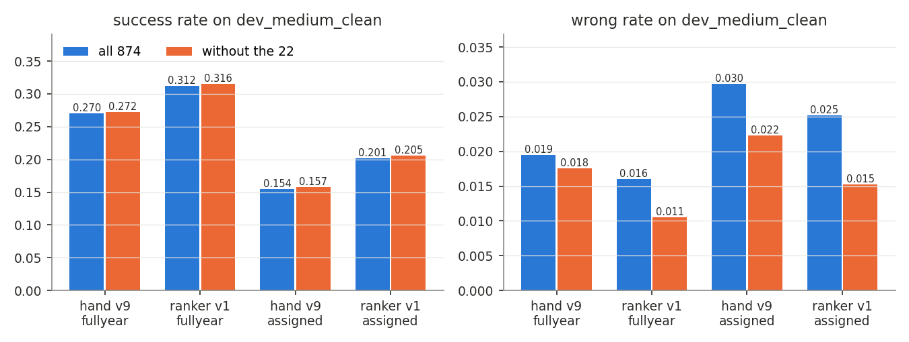
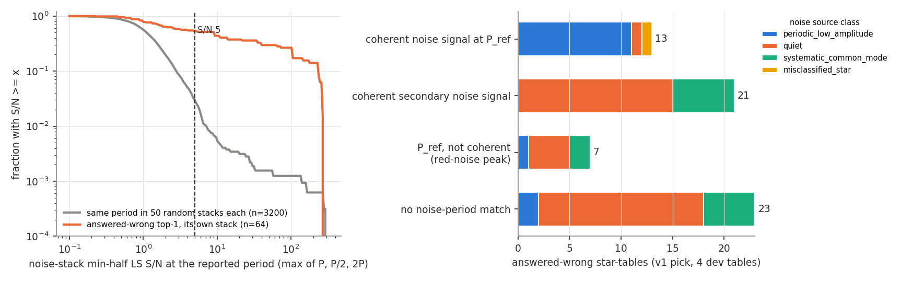
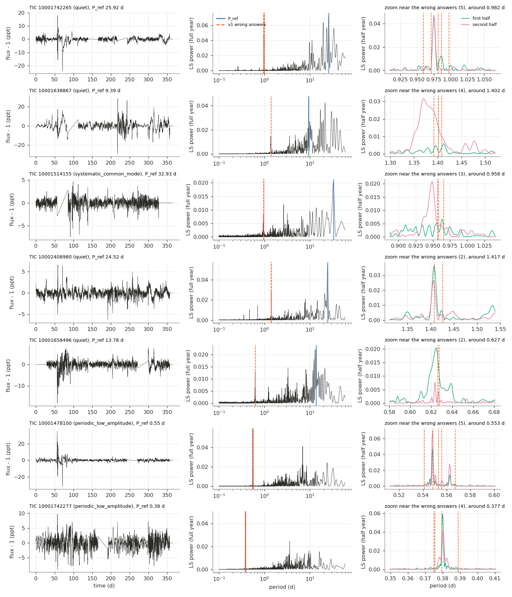
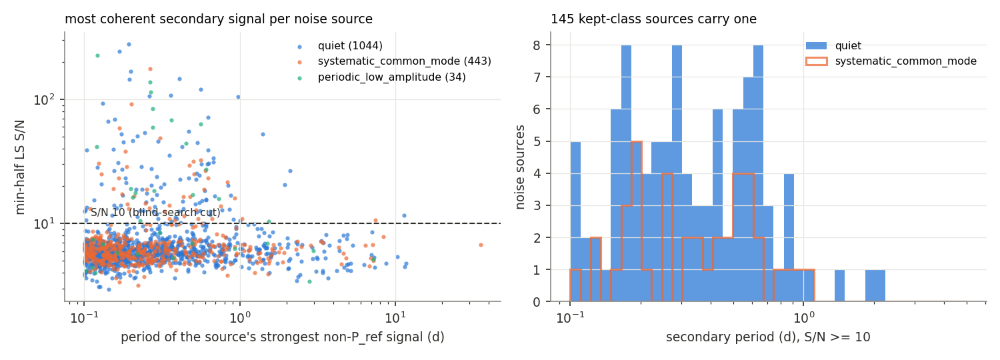
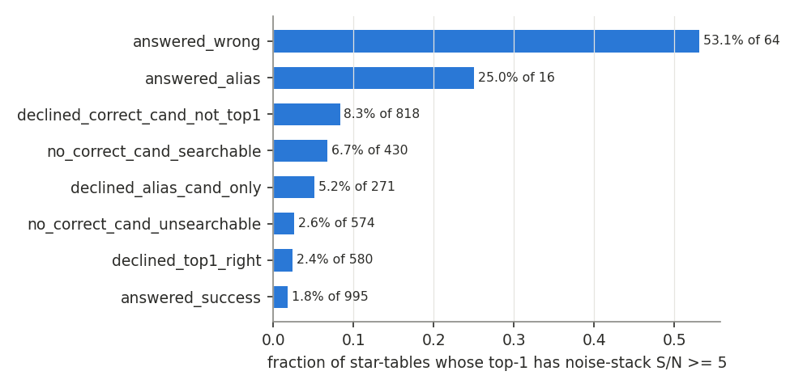

# Noise-source periods behind wrong answers

**Date:** 2026-11-22 · **Author:** data-auditor session (P65) · **Branch:** `claude/p65-noise-periods-c39360` · **Status:** draft

## TL;DR
- **34 of ranker v1's 64 wrong answers sit on a coherent signal in their own noise light curve** (time-split S/N ≥ 5; 1.8 expected from shuffled sources).
  - 13 are at `P_ref`, mostly `periodic_low_amplitude`.
  - **21 are at a secondary signal under a stronger red-noise `P_ref`.** That explains the repeat offenders: lines or humps at 0.975 d, 1.37–1.41 d and 0.95 d.
- **69 of the 1,487 kept-class sources carry such a signal at S/N ≥ 20** (145 at ≥ 10). The 2026-11-10 rule tested only `P_ref`.
- **Dropping the 22 stars from dev_medium_clean** lowers wrong rates:
  - v1: 0.016 → 0.011 full-year, 0.025 → 0.015 assigned;
  - hand `_v9`: 0.019 → 0.018 full-year, 0.030 → 0.022 assigned.
  - Success moves < 0.004.
- **Your calls:** P58 at the next baseline change (I recommend it), and how to treat secondary-signal sources.

## Question / goal
P65 in `docs/TASKS_PROPOSED.md`, from the ranker v1 loss audit (`reports/2026-11-21_ranker-v1/loss_categories.py`). The audit found that 31% of answered-wrong star-tables report the noise source's own `P_ref` (or ½× / 2×), against 3% by chance. It also found several "quiet" sources that give the same wrong period on several stars, at a period that is not their `P_ref`.

The task had two parts:
- (a) look for secondary periodic signals in the noise stacks;
- (b) give hand's and v1's rates on dev_medium_clean with and without the 22 `periodic_low_amplitude` stars, to inform P58.

No goals in `benchmarks/goals.json` are touched. No manifests, baselines or pipeline code were changed, and no `_v2` manifests were built.

## What I did
1. **Copied the stacks off the drive once, sequentially.** I copied `extracted/galaxy_stack/{stacks.npy, stack_index.csv}` and `galaxy_ids/noise_source_flags.csv.gz` (~420 MB) to the session scratchpad while P62's drive build was not running. Every later step reads that copy. `data/source_flags.csv` is the per-source cut of the flags (classification, `P_ref`, `tsplit_min_snr`).
2. **`tools/audit/noise_secondary_peaks.py` (new, single process, ~12 min under `nice`).** Each of the 1,719 stacks (the A+B "all" stack) is written to a temporary SMARTS-layout FITS file and read back with `load_smarts_fits`, exactly as `galaxy_periods.py ls` does for `P_ref`. Rank 1 then reproduces `P_ref` for 96% of sources; the rest are sources whose `P_ref` is the pipeline's period. It then lists:
   - the top 5 full-year LS peaks by power (0.1–60 d);
   - the top 5 "line-like" peaks at P ≤ 5 d, ranked by power over the `time_split_snr` continuum (the median at 3–25% fractional frequency offset).
   
   At each peak it records the full-year and per-half local S/N, the same statistic as `galaxy_phase2_analysis.time_split_snr` (halves split at 182.5 d). With `--query`, it also evaluates the S/N at given (source, period) pairs, at P, P/2 and 2P:
   - every dev star-table's v1 top-1 period in its own noise stack;
   - for each answered-wrong row, the same period in 50 random other stacks (the null).
3. **`analysis.py`** joins this with `reports/2026-11-21_ranker-v1/data/loss_categories.csv`, the ranker v1 per-star answers and the hand `_v9` per-star tables:
   - ranker v1: `<main>/runs/ranker_v1/nohalf/dev_top1_dev_medium_{fullyear,assigned}.csv` at the `head_perbin_p0.86` pick. These already existed, so I did not regenerate them.
   - hand `_v9`: `<main>/runs/v9_dm{fy,as}/per_star.csv`.
   
   All of these are dataset `datasets/dev_medium_clean.csv,data_root=data/smarts_dev` (full-year = `ignore_manifest_sectors`), plus dev_medium_b_clean for part (a). The overall rates reproduce the committed `_v9` baseline (0.2700 / 0.0195 full-year) and v1's metrics JSON (0.3124 / 0.0160).
4. **`figures.py`** and the notebook make the figures from `data/` only.

**Two S/N cuts.**
- **S/N ≥ 5 at one given period.** No look-elsewhere applies here. The shuffled-source null measures the false rate at 1.8 of 64 (max 5 in any one of the 50 draws).
- **S/N ≥ 10 for a blind search.** This is the max over many frequencies and both halves. ≥ 20 matches the `periodic_low_amplitude` rule.

## Results

### (b) The 22 `periodic_low_amplitude` stars (the P58 question)

Removing the 22 stars barely moves success (left). It removes a third of v1's wrong answers in both modes (right). Hand's wrong rate falls less, because hand already declines most of these stars.

| mode | method | all 874: success / wrong | without the 22: success / wrong | the 22 alone: success / wrong (n wrong) |
|---|---|---|---|---|
| full-year | hand `_v9` | 0.2700 / 0.0195 | 0.2723 / 0.0176 | 0.182 / 0.091 (2) |
| full-year | ranker v1 | 0.3124 / 0.0160 | 0.3157 / 0.0106 | 0.182 / 0.227 (5) |
| assigned | hand `_v9` | 0.1545 / 0.0297 | 0.1573 / 0.0223 | 0.045 / 0.318 (7) |
| assigned | ranker v1 | 0.2014 / 0.0252 | 0.2054 / 0.0153 | 0.045 / 0.409 (9) |

- On the 22, v1 answers wrong more often than hand does: 5 vs 2 full-year, 9 vs 7 assigned.
- This class is excluded from v1's training, so the decline model has never seen a coherent ~0.4–0.8 d noise line. It trusts one as it would trust a rotator. The 22 are 2.5% of the stars but 36% (full-year) and 41% (assigned) of v1's wrong answers.
- v1's lead over hand holds without them, and grows: wrong 0.0106 vs 0.0176 full-year, 0.0153 vs 0.0223 assigned. The table is `data/rates.csv`.

### (a) Wrong answers sit on coherent noise signals

Left: the orange curve, wrong answers in their own noise stack, sits far above the grey shuffled-source null at every S/N above ~2. Right: the breakdown of the 64 answered-wrong star-tables (4 dev tables, v1 pick).

| S/N at the reported period | observed (of 64) | null expected | null max in 50 draws |
|---|---|---|---|
| ≥ 5 | 34 | 1.84 | 5 |
| ≥ 10 | 28 | 0.36 | 2 |
| ≥ 20 | 24 | 0.20 | 1 |

How the 64 break down:
- **Coherent signal at `P_ref`: 13.** 11 are `periodic_low_amplitude`, 1 `quiet`, 1 `misclassified_star`.
- **Coherent secondary signal (not `P_ref`): 21.** 15 are `quiet`, 6 `systematic_common_mode`.
- **`P_ref` but not coherent: 7.** These are the red-noise peaks of the 2026-11-10 report.
- **No noise-period match: 23.**

So the loss audit's "31% report `P_ref`" understated the effect. Counting the secondary signals, **53%** of the wrong answers are the noise light curve's own coherent signal.


The repeat offenders. Columns: the stack, its full-year LS (`P_ref` in blue, v1's wrong answers dashed orange), and a zoom on the wrong answers with each half-year's LS (green = first half, pink = second half).
- **TIC 10001742265** (quiet, `P_ref` 25.9 d) has a sharp line at **0.975 d** with min-half S/N 105, present in both halves. It is 5th by power, behind four red-noise humps at 19–34 d. 4 of its 5 wrong answers land on it. The 5th, 0.998 d on assigned coverage, is 2.3% off and does not match.
- **TIC 10001638867** (quiet, `P_ref` 9.39 d) has a **broad hump at 1.37–1.41 d**, about ±3% wide. It is strong in the second half and weaker in the first (S/N 9–11 at the wrong periods). It looks like a spotted star with spot evolution, not a line.
  - Its width also hid it from a narrow-continuum line search (see "What didn't work").
  - TIC 10002408980 (quiet, `P_ref` 24.5 d) has a sharp 1.409 d line (S/N 27, both halves). Its 2 wrong answers are 1.408 and 1.426 d.
- **TIC 10001514155** (systematic_common_mode, `P_ref` 32.9 d) has a hump at **0.94–0.96 d**, mostly in the second half (S/N 5–9 at the wrong periods). It is weaker than the other two, but its 3 wrong answers all sit on it.
- **TIC 10001658496** (quiet) has a **0.624 d** line (S/N 39), mainly in the first half. 2 wrong answers.
- **Bottom two rows:** `periodic_low_amplitude` sources (0.548 d and 0.380 d), for comparison. Their wrong answers scatter by ±2–3% around the line, which shows how loosely the pipeline locks onto these lures.


Left: each source's most coherent non-`P_ref` signal. The red-noise bulk sits at S/N 4–8; a tail of `quiet` and `systematic_common_mode` sources rises to S/N 50–280, overlapping the `periodic_low_amplitude` sources. Right: the secondary periods (S/N ≥ 10) are mostly 0.1–1 d.

| class | sources | secondary S/N ≥ 10 | ≥ 20 |
|---|---|---|---|
| quiet | 1,044 | 104 | 53 |
| systematic_common_mode | 443 | 41 | 16 |
| periodic_low_amplitude | 34 | 18 | 10 |
| contamination_known_variable | 90 | 57 | 49 |

- **Reach in the full corpus** (`data/secondary_file_counts.json`). The 69 kept-class sources at S/N ≥ 20 (P < 5 d) cover **42,141 files**, 6,930 of them in the ≥ 800k pool. At S/N ≥ 10, the 143 sources cover 87,363 files.
- **Reach in the training sets.** The ≥ 20 sources hold 172 of the 3,000 `train_v0` rotators and 232 of the 4,708 `negatives_v0` stars (≥ 10: 349 and 460).
- **On the dev sets** (kept classes, both sets and modes; `data/secondary_dev_exposure.json`, `summary.json`), v1's wrong answers per answered star are:
  - 0.181 on sources with a secondary signal (S/N ≥ 10): 17 of 94;
  - 0.033 on the rest: 32 of 958.
- **Caveat on the blind cut.** The S/N ≥ 10 tail is continuous with the red-noise bulk below 0.3 d, where the search covers the most frequencies. Some of the 145 may be chance; the S/N ≥ 20 count (69) is the safer number.


The same lure appears across v1's loss categories: 25% of answered aliases and 8% of `declined_correct_cand_not_top1`, against 1.8% of successes. It is one cause of P66's ranking misses, not only of answered-wrong.

## What didn't work
- **Running LS on the raw stacks.** My first pass skipped the production loader's bad-orbit flagging, and its rank-1 peak matched `P_ref` for only 42% of sources. The loader round-trip fixed that (96%). The 2026-11-10 `tsplit_min_snr` was computed on raw stacks, so it differs from this report's S/N at `P_ref` (median ratio 1.17, wide scatter).
- **A ±5% log-segment running median as the line continuum.** It hid broad humps: TIC 10001638867's 1.38 d hump raised its own continuum and ranked below noise lines. I switched to the `time_split_snr` band median (3–25% offset), and the hump came out at S/N 43 (full year).
- **Exact-period S/N alone.** It underrates sharp lines when the reported period is 0.4% off the line, for example 0.971 vs 0.975 d. The final score also takes any listed stack peak within 2%. The shuffled-source null uses the same score.

## Open questions for Rae
1. **P58: I recommend doing it at the next baseline change, as you planned, and not leaving it later.** The 22 stars hold 36–41% of v1's dev_medium wrong answers, and they are a class v1 never trains on. While they stay, dev_medium_clean judges v1 partly on stars that the training-set policy calls out of scope.
   - The change lowers both methods' wrong rates (v1 0.016 → 0.011 full-year, 0.025 → 0.015 assigned; hand 0.019 → 0.018, 0.030 → 0.022). Success moves by < 0.004.
   - It would also make dev_medium_clean consistent with dev_medium_b_clean, which already excludes this class.
2. **Flag sources with a coherent secondary signal?** The 2026-11-10 rule tested only `P_ref`. Applied to *any* peak at P < 5 d (min-half S/N > 20), it would catch 69 more kept-class sources (42k files; 172 train rotators, 232 negatives).
   - Options:
     - (i) a new class `secondary_periodic`, excluded from training like `periodic_low_amplitude`;
     - (ii) keep these sources in training but give the ranker the information: the injected star does not have the line, and a real TESS star may well have a blended neighbour;
     - (iii) leave them.
   - I lean to (ii), because real light curves carry exactly this contamination. If you choose (i), note that it also changes the clean dev sets.
   - Proposed as P69 (flag) and P70 (feature).
3. **Is TIC 10001638867's 1.37–1.41 d hump a contaminating spotted star?** It is broad and evolves between halves. If it is, it is a genuine blend, and "wrong" is arguably a correct detection of the wrong star. An FFI check (T20's `ffi_lc_compare.py`) on the 4 offender sources is cheap.
4. **The 23 wrong answers with no noise match** are the remaining true method errors, and P66 should start from them.

## Reproduce
```bash
PY=/opt/anaconda3/envs/ss_openblas/bin/python
SC=<scratch>; E=/Volumes/Data_Vault/smarts_data/extracted
# one sequential copy off the drive (only when no other drive job is running)
cp $E/galaxy_stack/stacks.npy $E/galaxy_stack/stack_index.csv $E/galaxy_ids/noise_source_flags.csv.gz $SC/
# data/source_flags.csv: per-source cut of the flags
$PY -c "import pandas as pd; pd.read_csv('$SC/noise_source_flags.csv.gz', usecols=['tic','classification','P_ref','tsplit_min_snr']).drop_duplicates('tic').to_csv('reports/2026-11-22_p65-noise-periods/data/source_flags.csv', index=False)"
$PY reports/2026-11-22_p65-noise-periods/analysis.py --build-query $SC/query.csv $SC/stack_index.csv
nice -n 15 $PY tools/audit/noise_secondary_peaks.py --stack-dir $SC --tmp-dir $SC \
    --out reports/2026-11-22_p65-noise-periods/data/stack_peaks.csv \
    --query $SC/query.csv --query-out reports/2026-11-22_p65-noise-periods/data/query_snr.csv \
    --spectra-tics 10001742265 10001638867 10001514155 10002408980 10001478100 10001742277 10001658496 10001518979 10001543584
$PY reports/2026-11-22_p65-noise-periods/analysis.py
$PY reports/2026-11-22_p65-noise-periods/figures.py --stack-dir $SC   # builds data/offender_stacks.npz once
$PY tools/run_notebook.py reports/2026-11-22_p65-noise-periods/notebook.ipynb
```
